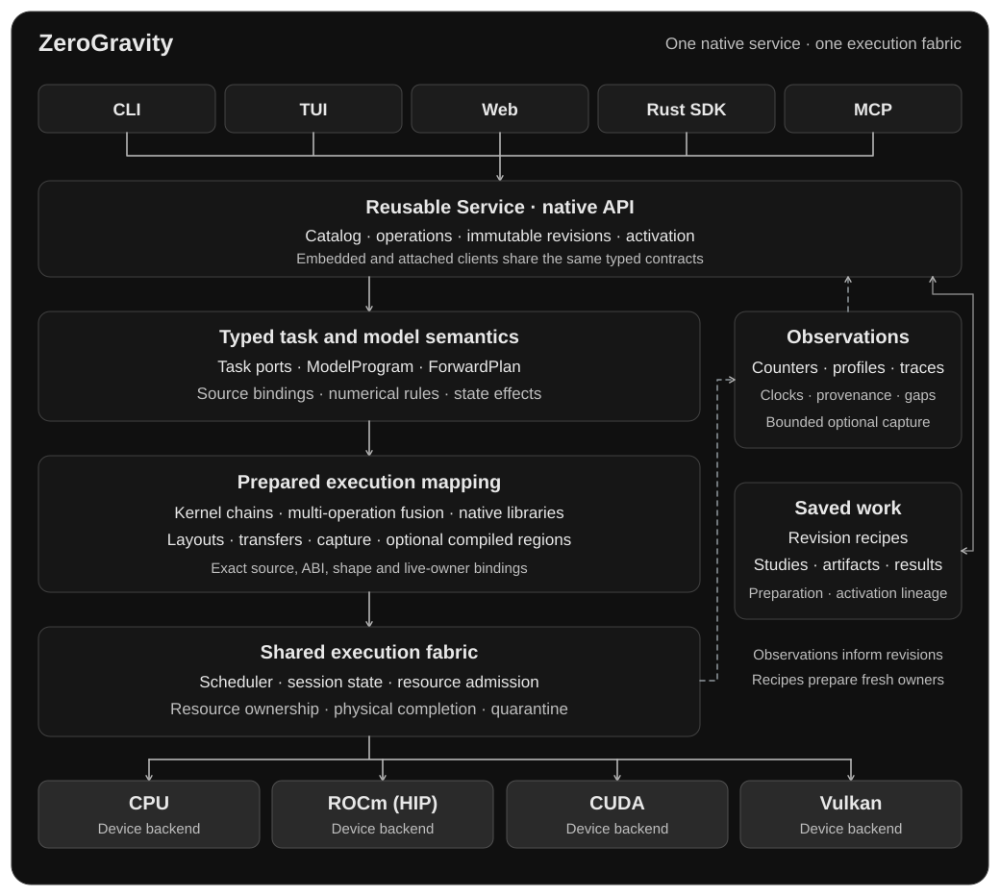

# ZeroGravity — full comprehensive handoff through OA-7D

Date: 27 Nov 2026 (Singapore). Repository: /home/pvl/spaces/abird/src/zerogravity.
Last independently verified accepted implementation: 05c54e5d73f193543c725dfba64d1a039f2075e6 — capability-gated WAV transcription.
Previous complete takeover: 39d7086e6502d0ff9badbe9e6e2cefc2ed8ea065, [FULL_COMPREHENSIVE_HANDOFF_2026-11-27_OA4B.md](FULL_COMPREHENSIVE_HANDOFF_2026-11-27_OA4B.md).
Accepted UX-1–10 exit: 1b8de1cb87fa4815655cbb6700e6633946f93305.
Accepted bounded Phase 1 exit: d5030ad4ce476b913a46056d492992ccf1b8edf7.

**Read §§0–13 first and Appendix F before writing anything. Resume at §11 after revalidating actual HEAD and worktree.** This requested pack consolidates history and navigation; it is not another live task ledger or source pinning scheme. Historical instructions are retained as history. All original engineering docs, source and older handoffs remain intact.

- Appendix A: complete tracked engineering-document inventory.
- Appendix B: unresolved checklist snapshot, linked original files and line numbers.
- Appendix C: complete reachable Git ledger through the verified implementation plus exact new delta.
- Appendix D: eleven post-OA-4B landings, original checkpoint narratives, exact changed paths, original engineering-document deltas and reconciled committed baseline.
- Appendix E: full prior OA-4B main body verbatim and earlier comprehensive chain, including its exact post-M1 chronology and original October designs.
- Appendix F: OA-7E recovery: actual independent Spanish reference, observed compile/test progress, live mutable WIP snapshot and explicit non-acceptance.
- Standalone [NEXT_AGENT_2026-11-27_OA7E.md](NEXT_AGENT_2026-11-27_OA7E.md) reproduced in §13.

## 0. Recovered implementation and current position

The interrupted OA-7D turn already landed. Revalidated actual signed Git source, the committed live handoff and baseline, actual run-local SDK/focused/assembled logs, and repository/resource observations. OA-7D focused 249/0/3 across 26 suites, strict Clippy. Real learned SDK2.33.0 "Hello world" input41/output3/total44, 264.264s completion, 292.73s lifecycle pass. Full isolated gate 2,595/0/112 across 324 Rust suites (904s), terminal exit=0. This closes OA-7D wire qualification on explicit eligible adapters; built-in Gemma remains native-only. No repeat of unchanged mandatory gate in this documentation task. Initial WAV fixture-only failure (mutated already-zero byte) was corrected; final focused and full gates pass.

OA-4C/D/E and OA-5 accepted, including the serial actual resident OA-4E retry. OA-6A/B/C native model/runtime/wire implementation qualified with source-bound synthetic BERT; trained MiniLM parity remains blocked by explicit acquisition authorization. OA-7A/B original cached audio encoder and audio-conditioned decoder qualified against independent F32 original model. OA-7C native actual speech test and OA-7D installed SDK passed on local synthesized speech. No claim of broad natural-speech accuracy, optimized inference, TTS, arbitrary codecs or Realtime model support.

**Recovery changed during observation:** initial dirty speech.py was followed by additional OA-7E model, engine, SDK, serving and test changes. Independent original reference succeeded. A development compile passed; a learned SDK test log appeared. This is WIP, not an accepted implementation; the exact live state may have advanced by the time this document is read. Do not compete with an existing owner or restore the captured patch. Inspect live HEAD/index/worktree, jobs and executed results first.

### 0.1 Repository and resource authority

Observation at 2026-11-27T18:07:00+08:00: HEAD 05c54e5d73f193543c725dfba64d1a039f2075e6, local tracking ref 3156ce45750e838c7ace72dc7d8c0c06aa762c3b. At the start, main was 19 ahead/0 behind origin/main, one main checkout; source WIP was unstaged. The accepted commit contains a cryptographically good SSH ED25519 signature; local allowed_signers principal configuration is missing. No remote fetch/push. At separate observations L5 27 GiB RAM with approximately 5.8–24 GiB available, 20 GiB disk free (98% used); RTX3060 Laptop 6144 MiB total, 37 MiB used, 5789 MiB free, no visible compute owner in nvidia-smi. These are momentary observations, not guarantees; sandbox visibility is not a proof that all physical or other-client jobs are absent. Job-list entries may belong to different connector sessions; one observed handle was not retrievable from this session. Do not cancel/ack unrelated jobs. X2/A1 execution/testing only; not revalidated. Sole L5 source authoring, no persistent additional checkout, no destructive Git or privilege changes.

This pack is authored as independent documentation while translation WIP is mutable; no production source, staging or existing live plan changes are required. Appendix F records the exact observed state separately. If another agent has landed newer work, its accepted live source and owner TODOs supersede this snapshot.

## 1. Bootstrap sequence

1. [AGENTS.md](../../AGENTS.md).
2. [Plan rulebook](../plans/README.md).
3. This handoff §§0–13, Appendix F for immediate recovery, Appendix D for exact post-OA-4B landings.
4. [Full ordered implementation plan](../plans/FULL_IMPLEMENTATION_PLAN.md).
5. [CURRENT_HANDOFF](CURRENT_HANDOFF.md) and [CURRENT_BASELINE](CURRENT_BASELINE.md).
6. [Shared queue](../plans/TODO.md), [public serving specification](../plans/serving-and-speculation/NEXT_ITERATION_OPENAI_COMPATIBLE_SERVING.md) especially §§6–10,17–25,30–37, OA-6/OA-7, [serving TODO](../plans/serving-and-speculation/TODO.md).
7. [SDK/serving](../plans/fabric-vnext/PUBLIC_LIB_AND_SERVING.md), [structure/naming](../plans/pipeline-composition/STRUCTURE_AND_NAMING.md), original resource, state, source, scheduler and multimodal specs (§12).
8. Read prior packs and owning CLI/UX, acquisition, platform, model/numerics/backend plans for the specific change. Earlier OA-4C/UX prompts are historical. Current implementation and accepted evidence govern.
9. Inspect live source and tests (§5); continue §11. No duplicate source/fixture download, architecture or owner.

Standalone prompt: [NEXT_AGENT_2026-11-27_OA7E.md](NEXT_AGENT_2026-11-27_OA7E.md).

## 2. Owner direction and working contract

- Elegant, simple, clear and intuitive. ZeroGravity is a composable Rust
  library/execution fabric, not a single-model benchmark or per-backend
  independent engine. Favor zero-cost abstractions, direct hot paths and
  performance where it remains clean and maintainable. Where high
  performance requires convoluted maintenance, choose clean/simple first
  and target the measured hot area selectively.
- Reuse mature optimized mathematics and actual shared operations. Attack
  large architectural/computational bottlenecks before marginal launch
  counts. Model-specific specializations must consume the authoritative
  model semantics and justify their own benefit.
- Preserve useful correct model-neutral kernels, layouts, transports,
  state/scheduling transforms, providers and completion primitives when
  a consumer/selector loses. Remove temporary probes, losing consumer
  wiring, runners and test-only choices, not reusable implementations.
  Delete a primitive only when incorrect/unsafe, incompatible with its
  contract or strictly superseded; record why.
- Preserve exact source, numerical, layout, state, physical resource,
  ownership, cancellation and completion semantics. Intentional changed
  arithmetic is a separate explicit numerical profile, not a hidden
  approximation. No retry against an uncertain submitted root.
- No overly granular test/evidence/pinning process. Batch related work,
  reuse applicable accepted evidence, validate actual changed consumers
  and meaningful invariants. Full assembled gate at phase exit; synthetic
  kernel speed, compilation and UI lifecycle time are not performance
  parity. Real-source and physical qualification still mandatory where
  the relevant execution path changes.
- One substantial coherent validated signed checkpoint per user turn,
  aim approximately 30 minutes at most; pause with exact state, blockers
  and next unit. Recover interrupted work from live source and executed
  results. Keep active jobs owned; no indefinite background promise.
- Sole L5 source authority, exact incremental bundles, no persistent
  additional worktrees. Coordinator is single writer of shared queue.
  User-authored root README unchanged; architecture in README describes
  final intended engineering system while status belongs in plans.
- Latest product direction: calm, beautiful and minimal by default,
  discoverable detail on demand, not maximal control visibility. Full
  mouse plus keyboard; **no permanent action toolbar** at any width.
  One navigation rail, inline live local search, exact selected-object
  context actions, separate small session menu. Smart human size units.
  Dark/Light/Auto now; additional theme catalog later only if requested.
  Running is the live model dashboard, not a separate monitoring app.
- Full sane Cargo CLI default includes all current production models,
  CPU/CUDA/ROCm/Vulkan, acquisition, serving, TUI/Web while breadth is
  small. Explicit minimal/portable and embedding profiles remain
  available. Do not confuse a compiled backend with qualified execution.
  Error categories and chains must be accurate; safe HTTP responses and
  opt-in trusted diagnostic details, with bounded safe structured logs.

## 3. Original design and architecture to preserve

The [October 10 master plan](../plans/ZEROGRAVITY_MASTER_PLAN_2026-10-10.md),
[vision](VISION_SCOPE_AND_PRINCIPLES.md), [modular reference architecture](MODULAR_AI_SYSTEMS_REFERENCE_ARCHITECTURE.md),
original engineering specifications and critical review define the design
from the beginning. First reachable Git commit is October 13
be95424837deb7919adf34503db71d27d3ad3adb. Appendix E preserves the detailed
previous architecture explanation verbatim; earlier Phase 1 packs preserve
the original design evolution and decisions. This summary does not replace
their source/numerical/lifetime contracts.

### 3.1 One fabric; four distinct concerns

| Concern | Authority |
| --- | --- |
| Fabric/runtime | Model lifecycle, original catalog/registration, admission, placement, scheduling, batching, pipelines, persistent state, publication and serving |
| Model semantics/planning | Verified source-bound computation and task, learned roles/axes, typed shapes/regions/state effects, numerical/quality profile |
| Implementations | Native composed ops, mature vendor math, specialized kernels, captured commands or compiled closed regions/whole programs |
| Backends | CPU, CUDA, HIP/ROCm, Vulkan and future devices; physical memory, command submission, readiness and completion |

Do not conflate operator libraries, graph compilers, artifact formats and
physical backends. Prefer actual mature math (cuBLAS/Lt, CUTLASS, cuDNN,
FlashAttention/FlashInfer where qualified; rocBLAS, hipBLASLt, CK, MIOpen
and suitable HIP primitives; qualified Vulkan cooperative-matrix/shader
implementations and existing CPU optimized/reference operations).
Optional concrete MIGraphX/TensorRT/IREE/ONNX Runtime integrations are
later Phase 6, not dependencies of native CUDA/ROCm/Vulkan. No new
provider is granted by recognizing a format or compiling a library.

### 3.2 Source, semantics and executable lowering

Original HF configuration/tokenizer/processor/indexed Safetensors and
GGUF metadata/codecs/weight tensors are primary. Transformers describes
an architecture/software ecosystem; Hugging Face is source/distribution,
not a storage format. Verify original identities/roles/axes/quantization;
no implicit conversion, remote model code, mandatory Python or mandatory
ONNX conversion. Source eligibility independent of device execution.

Two enduring execution representations: (1) authoritative semantic
ModelProgram/ForwardPlan, mathematical/task regions and state effects;
(2) prepared physical executable and original source/resource owners.
Artifact input and provider-local compiler graphs are not alternative
canonical IRs. Native ModelAssembly/regions and multi-model TaskPipeline
are distinct concerns; compositional descriptions do not create a second
runtime. Select a provider during cold preparation or qualified
committed-root switch. Pre-enqueue miss may take already-qualified
decomposition or refuse; submitted uncertainty cannot be retried
against the same root by silently changing provider.

Direct typed-region lowering is independent of external graph import.
MIGraphX/TensorRT preferably construct from verified regions through
native APIs. Optional ONNX import/ORT needs authenticated graph/weights,
layout, precision, state, effects and resource contracts; IREE suitable
lowered computation. SDK-free scaffold accepted only for bounded seam.

### 3.3 Non-negotiable state and physical ownership

One logical StateRoot publisher per session. Device work creates private
candidates and readiness, not logical commits. All required KV/recurrent/
conv state domains publish a compatible frontier before visible output.
Cancellation/failure cannot leak provisional output/state; uncertain
completion fences/quarantines the original physical owners until actually
safe. Immutable source/backing/range/lease provenance remains authority;
aliases/readers retain real owners; independent mutable session state is
private. Complete-domain compatibility for prefix/cache/COW/page reuse.

One physical ResourceArbiter. Account persistent/context/workspace/
transfer and synchronization costs; explicit headroom, real UMA overlap.
No implicit reclamation or hidden memory grant. Backend adapters own
submission and completion; shared/external views conditional on actual
capability. No new allocator, model registry, scheduler or execution IR.
Separate reference arithmetic/native profile, quality, source compatibility,
physical readiness, feature compilation and serving/performance acceptance.
One fair worker/cohort/scheduler with shared prefill, independent
continuations, paged/hybrid state, feedback, MTP, placement and task
pipeline contracts.

Read [invariants](INVARIANTS_AND_FAILURE_SEMANTICS.md),
[state](STATE_CACHE_AND_TRANSACTIONS.md), [resource/commands](ASYNC_RESOURCE_COMMAND_IR.md),
[execution spine](MINIMAL_EXECUTION_SPINE_AND_PROTOCOL_V4.md),
[regions](../plans/pipeline-composition/REGIONS_AND_PROFILES.md),
[correctness policy](../plans/numerics-and-context/CORRECTNESS_POLICY.md).
The previous comprehensive handoffs preserve all accepted foundation
slices and exact provider/capture/persistence decisions.

### 3.4 Current typed failure contract (supersedes historical coarse translation)

| Core category | Meaning |
| --- | --- |
| Malformed | Actual source/artifact validation failure |
| InvalidInput | Invalid request/configuration/input rather than artifact corruption |
| Unsupported | Backend, device, route or capability unavailable |
| Limit | Configured/static bounds, arithmetic overflow, quotas |
| Resource(ResourceLimit) | Actual measured admission refusal; operation/resource/requested and available bytes/scope |
| State | Invalid lifecycle/internal state |
| Io | Original underlying cause |

In-process ServiceError keeps typed origin through Arc on error path,
including shared conversions, resource amounts and I/O causes. For
synthetic service errors use stable code, then status fallback; never
invent a budget or infer artifact corruption from HTTP 400. The previous
A1 message "malformed model artifact" for missing compiled backend was
misclassification. Original-source Qwen needs eligible CUDA or HIP,
not default CPU/Vulkan; SM89 is not automatically qualified by compiling
CUDA. Preserve actual source and device policy, not merely nicer errors.
No string parsing as admission/fallback policy.

HTTP and SSE preserve status/code/type with fixed safe public message
by default. Optional error.details adds status, code, category, measured
bytes and OS code where available, plus bounded diagnostic text/causes
only after explicit trusted listener setting and valid bearer auth.
Pre-auth/framing/connection refusal never exposes diagnostic text.
The existing bounded control event ring/logs carries safe FailureDetails
tagged by listener generation; arbitrary raw paths/credentials/prompts
not stored in the shared operational ring. Full native diagnostic retained.
See §5 and the previous UX-P-M1 pack Appendix D.14 for the original
diagnostics landing. The native diagnostic setting is not browser
safe-editable. Future public serving must not expose trusted debug text
to ordinary clients.

## 4. Ordered delivery and pending boundaries

| Phase | State / objective |
| --- | --- |
| 1 Foundations | Bounded common exit d5030ad4 accepted; broader generalizations remain |
| 2 CLI/TUI/Web and public serving | UX-1–10, UX-P and execution chooser accepted; OA-1–5 accepted for actual supported text; OA-6A/B/C implemented/fixture-qualified, MiniLM learned acceptance open; OA-7A/B/C/D accepted in bounded scope; recover OA-7E then remaining applicable capabilities and ordinary benchmarks |
| 3 ROCm | Match or beat optimized matched vLLM first, AMD |
| 4 CUDA | Match or beat optimized matched vLLM next, NVIDIA |
| 5 Vulkan | Native correctness/performance parity with actual suitable comparators |
| 6 Optional compiled providers | MIGraphX, TensorRT, IREE, ONNX Runtime after native campaigns, demonstrated benefit |

Use the live ordered plan. Qwen3.5 0.8B/2B and Qwen3.8 27B first performance family; Qwen3.5+/3.8, Gemma4, Qwen Flash/Next, DeepSeek and other families through actual model contracts. No downloaded or executable capability inferred from catalog.

### 4.1 Bounded accepted foundation versus remaining generalization

Phase 1 minimum common seams: source-bound semantic and prepared
composition, native operations/typed regions and optional provider scaffold,
authentic HF/GGUF/SDK source lifecycle, original physical/state/control
ownership, paged/streamed/prefix/persistence/cohort, typed tasks and
bounded pipelines, actual SDK and real CLI consumers. Accepted scope,
exact post-matrix 49-commit history and physical tests are preserved in
[Phase 1 exit pack](FULL_COMPREHENSIVE_HANDOFF_2026-11-25_PHASE1_EXIT.md)
§§0–13 and Appendices C–E. General foreign/Existing buffer or context
interop, device-write-to-host-read/coherency, multi-domain and UMA overlap
generalization, non-Linux physical fit/OS-hard reservations, general
multi-source/mixed-backend HF, general DAG/media/context, arbitrary state
migration/persistence, authenticated tenant stores, async SSD and broader
model/codec/profile/device qualifications remain open. Do not infer
general support from a bounded coherent mapped producer or actual
single-device preparation. Preserve all original hold conditions.

### 4.2 Public serving status and remaining order

| Unit | Accepted scope / open boundary |
| --- | --- |
| OA-1 | Owned async HTTP, strict bounded chunked JSON, multipart, owned WebSocket primitives |
| OA-2 | Shared typed semantic text and model-owned template |
| OA-3 | Models retrieve/list and stateless Responses JSON/SSE |
| OA-4A–E | Foreground response storage/continuation, joined background/cancel, conversations/items and atomic append, selected-model input count, bounded streaming/replay/resumption; accepted after real serial resident retry |
| OA-5 | Chat/legacy Completions supported text compatibility, exact usage; unsupported active modalities/tools/sampling/structured-output controls refuse |
| OA-6A/B/C | Native BERT candidate, shared finite task/typed result, gated embedding wire with actual source-bound synthetic SDK fixture; trained MiniLM/native loader/public qualification open |
| OA-7A/B | Actual cached E2B learned audio tower/projector + original decoder via one verified window source |
| OA-7C/D | Native typed transcription + capability-gated WAV multipart JSON/text, actual learned SDK smoke; candidate native-only |
| OA-7E | Independent non-English speech reference complete; mutable implementation/test WIP; recover actual state (§11/F) |
| OA-7 remaining | Natural/general speech quality and real TTS/streaming capability; no unsupported claim |
| OA-8 | Image generation/edit/variation only actual eligible image generation; vision encoder alone insufficient |
| OA-9 | Realtime WebSocket common session/pipeline task semantics, actual capability; no WebRTC unless separately required |
| OA-10 | Concise endpoint matrix, official SDK smokes, cancellation/shutdown, object audit, help/docs |
| Beyond OA | Ordinary serving benchmark acceptance, then native backend campaigns in §4 |

Public API is not a cloud billing/account API clone. Keep independent control/inference authentication, actual route/tenant capability, original physical and execution owners. Local loopback tests do not imply general public exposure, tenant isolation or complete hosted API parity. Do not block ordinary benchmarks on imaginary media implementations. Capability-blocked scopes stay explicit.

## 5. Current source map and implemented contracts

All paths below are repository-relative. Foundation source map in the
previous Phase 1 pack §5 and Appendix E §5. Inspect live file names and
feature guards rather than extrapolate old examples.

| Area | Primary live owners |
| --- | --- |
| Core / source / operators | crates/zerogravity-core, zerogravity-artifacts, zerogravity-cpu, zerogravity-model-qwen35, zerogravity-model-gemma4, zerogravity-gpu, vendored CubeCL |
| Engine | crates/zerogravity-engine/src/{runtime,diagnostics,router}.rs; router/{registry,worker,pending,event_channel,dispatch,error,performance}.rs and actual scheduler/state owners |
| Facade and control | crates/zerogravity/src/{runtime,models,configuration,control,run}.rs; control/{cache,downloads,events,serving}.rs; prepare/, devices/, builtins/text/ |
| Configuration | facade pipelines/{document,yaml}.rs, configuration/file.rs; CLI config_cli.rs, run_cli/config.rs; one typed v2 Document/ConfigFile |
| CLI | crates/zerogravity-cli/src/{main,args,commands,completion,output,model_cli,resident,run_cli,pull}.rs; output/presentation.rs, run_cli/, serve/ |
| Shared host | CLI control_host.rs, control_host/{actions,inventory,logs,settings,work}.rs |
| Native TUI | CLI tui.rs, tui/{view,layout,input,controls,editor,choice,theme,format,performance,library,logs,settings,terminal,work}.rs |
| Embedded control | CLI web.rs, web/{actions,http,settings,wire}.rs; web/src/{main.jsx,settings.jsx,performance.jsx,performance.js,api.js,browser-smoke.mjs,styles.css}, committed dist |
| Inference server | crates/zerogravity-serving/src/{server,http,auth,service}.rs; original text service/events and http/{body,transport,ingress_body,multipart,websocket,responses}.rs; responses/{input,store,background}.rs (not browser control transport) |
| Actual tests | crates/zerogravity-cli/tests/{cli,config_cli,pipeline_config,run_unified}.rs, tests/fixtures/{tui_shell,web_shell,serve_shutdown}.py; engine/router tests, facade tests/fabric_sdk.rs; serving/server tests and artifact/cache fixtures |
| Build and qualification | scripts/check.sh, scripts/check-gpu-feature-boundaries.sh, scripts/native-gpu.py, tools/, nix/workspace.nix, release/installer scripts |

### 5.1 Shared native/Web control and identity

One Runtime, one facade ControlPlane, one process-local Selection and
one shared Actions slot (not a queue). Resident planner executes original
load/invoke/run/unload/listener and transfer owners; browser and native
observe same state. Exact digest/source, registration, listener generation,
transfer operation and action IDs are distinct. Aliases do not create
new owners. Confirmation/request revalidates observed key and resource;
no stale retarget. Selection, pointer motion, filter, settings preview,
view navigation never execute. Cancellation request is not completion.
Bounded output receipt and original terminal retirement/join remain
authoritative. Native-private draft/output separate from Web receipt.
One typed v2 ConfigDocument/ConfigFile, default/named/explicit selection
and CLI precedence, future-only activation, atomic exact compare and
raw repair, no independent store or arbitrary browser file/execution
authority. Existing safe operational log ring, no persistent prompt
history. Bounded original events and SSE resync, no parallel history.

### 5.2 Embedded Web control security

Embedded offline-built SolidJS/Vite assets, independent CLI Web feature
(no terminal dependencies). Numeric loopback, OS random 32-byte control
credential in private URL fragment, consumed/scrubbed and tab-scoped;
lock clears it. Independent inference bearer. Authenticated snapshot,
events and exact typed actions/receipts; bounded connections/headers/
JSON/SSE, strict numeric Host/origin and same-origin rules, no CORS or
credential/path/argv authority. See current wire/actions/http/settings
source and prior UX-9A/B/C/D/E acceptance. Only supported approved
cache/pinned source/recipe and typed actions; explicit consent and offline
policy, no implicit acquisition. Web and TUI can coexist, share actions,
read-only observations, original transfer and config revisions. Local
foreground host retires clients/actions/listener/runtime in owned order.

### 5.3 Latest native UX (supersedes all toolbar designs)

Whisrs v0.2.1 inspired semantic color depth and restrained palette.
Dark/Light/Auto; Auto terminal hint and honest dark fallback, active
probe deferred. Scoped mouse capture and ui.mouse auto/always/never;
F8 session override and terminal restoration, no clipboard bridge.
Actual render-derived hit regions, matching press/release and modal
masking. Per-view focus, rail/split drag, independent scrolling/scrollbars,
maximize/restore, compact collapse/navigation. Keyboard equivalents
remain, Ctrl+arrows split, Alt+arrows rail, F6 panes, F7 size.

User screenshots rejected visual overload, then rejected even the
curated top toolbar. **No toolbar**. Search-only top line in Models,
Devices, Profiles, Config, Running and Logs; ordinary printable input
(including former shortcut letters/digits/punctuation) focuses/filter
locally as typed. Ctrl-F/U, Esc clear, Tab leave, arrows select, filters
per shelf. Alt+1–9 views, explicit Alt operation letters, F1 help,
F4 context, F10 session, Ctrl-Q quit, original modal keys. Non-search
views retain ordinary shortcuts. Row selection inert; selected ellipsis,
matching right-click, Enter model/device/registration context; profile
Enter editor; Config Enter YAML value, typed picker via menu/Alt-e,
F2 YAML fallback. Session menu Web/Appearance/Refresh/Quit. Context
only applicable actions (cached load/run/inspect/verify/alias/removal;
catalog/partial pull/details). Offscreen/collapsed/no-row pane fallback.
No repeated nav/shelf/theme controls, debug slogans or shortcut wall.

Smart IEC B/KiB/MiB/GiB/... with at most two decimals (exact bytes kept
in details and machine data). Concise model name/size/source/verification
status; exact digest/revision/raw size and diagnostics only on demand.
Identity anchors per shelf/list/ready owner/log sequence and response
byte position survive reorder, empty refresh and viewport clamp. F3
distinct Running details/response viewport, F9 follow; response header
registration first, truncate long aliases. Logs safe selected entry
details; retention eviction refuses rather than retarget. Full short
terminal dialogs with scrolling, actual 20×7 tested. Grapheme-aware
bounded drafts, caret, mouse/Shift selection, drag edge by real event,
safe raw YAML and paste, no click-through/implicit submit.

### 5.4 Full production defaults and diagnostics

CLI Cargo default is ["all"], existing production all-models/all-backends,
CPU/CUDA/HIP/Vulkan, Qwen/Gemma model/source features, acquisition, serve,
TUI/Web. Qualification, diagnostic and experimental native attention
features opt-in; do not use --all-features as equivalent to production
default. Facade defaults remain small. Portable Nix/release build remains
explicit CPU/Qwen3.5/text/TUI/Web (nix/workspace.nix). This was a deliberate
implementation distinction at c0e4794d; **full Cargo default is not proof
that portable distributed artifacts now include all backends**. Reconcile
user's intended full normal package vs explicitly portable assets with
platform owner; no silent cross-platform toolchain requirement or
claim of all-backend release.

ServiceError and safe FailureDetails in engine/router/error.rs. Original
typed failures preserved through core/engine/SDK/CLI/HTTP/SSE. Setting
serve.enable_error_details defaults false, CLI --enable-error-details,
requires authenticated loopback listener and ZEROGRAVITY_API_KEY
configured before start. Only authorized requests get optional details;
bounded original diagnostic text (up to 512 characters per text and
three source causes) can contain internal information; trusted local
debug only, not public/reverse-proxied untrusted endpoint. Native retains
actual diagnostic, shared operational log stores only safe metadata.
Actual loopback HTTP and SSE opt-in/redaction tests passed; browser
configuration whitelist deliberately cannot enable diagnostic exposure.
No change to already-owned listener from profile edits.

### 5.5 Live registration performance (UX-P-M1 contract, retained through M2)

[Owning spec](../plans/cli-ux/LIVE_MODEL_PERFORMANCE.md) is precise. One
fixed-size RegistrationPerformance on original registry Route, request
timing on original ModelRead. No second request registry/reader/scheduler
or extra per-token clock, allocation, mutex or GPU sync. Use existing
committed non-EOS frontier/timestamp, count once even if decoder/transport
fails or parked resumes. Relaxed atomics for counts/durations; terminal
receipt stores last sample once under small mutex. Existing sizeof-based
admission prices added fields.

- Age: monotonic registration age, includes idle; new registration resets,
  aliases share counters, native/Web/HTTP share actual owner.
- TTFT: engine acquire to first committed non-EOS token (includes queue,
  tokenizer, prefill; not HTTP ingress-to-byte or GPU time). Valid first
  token of active or ended request contributes even if later failure/
  cancel; zero-output has no sample.
- Average decode TPS: token-weighted valid within-request commit intervals
  / summed durations (includes scheduler/backpressure delays). No time
  across requests, no idle dilution, no rate without interval and time.
  Aggregate includes active and ended; distinct from wire delivery.
- Completed requests: original Done receipt accepted by bounded presenter,
  not scheduler work-step count. Last completed is registration's last
  sample, not necessarily the visible local response. Snapshot values may
  advance between fields; no fictitious exact per-request association.
- Recent throughput: client delta of committed output / elapsed age via
  existing native 1 s / Web 2 s refresh. Selected owner only, <=24 samples,
  suppress sub-750 ms, clear gap >6 s/regression/replacement, observed idle
  zero not missing. No new timer/history. Normalize trend to observed peak,
  label actual latest; not a per-request speed comparison.
- Running TUI/Web selected panel shows age, Avg decode/TTFT, recent
  sparkline, completion/output counts, actual provider and reported layer
  execution; no samples em dash. Alt-D/context performance details and
  Web disclosure, full aliases/technical observations on demand. F3
  response remains separate. No public inference metrics schema change.
- ModelDetails.layer_placement adapter-supplied zero-based half-open
  actual spans. CPU Qwen verified geometry Host CPU; original whole-text
  single-device prepared source exact plan layers + actual resident
  device. Older resident adapter without map stays unknown. Compute
  placement distinct from weights/storage/state/admitted capacity and
  actual physical usage. Do not infer offload/split from RAM/model name.
  Web explicitly projects safe numeric data and original lease bounds.
  CPU real 24-layer placement verified. The M1-era GPU compile-only
  caveat was narrowed by later actual CUDA placement evidence (§5.6).

### 5.6 Latest UX acceptance and selector (supersedes M1-only caveats)

P4B completed full native Cargo-default link/launch, production strict lint,
explicit CPU/cache/acquisition features, Web-only isolation and original
native/browser/SDK/HTTP/transfer/config/typed-refusal regressions. The gate's
two cold_server failures were obsolete fixture expectations, not weaker
admission. M2 aligns Running with the user reference: 38:62 default split,
paired TPS/TTFT, bounded recent chart, concise actual providers and
segmented actual layer map with exact legend/tooltips and mixed/unknown
cells. Details on demand; independent response pane; no toolbar. Admitted
readers indicate queued/active/retiring work, not live per-layer kernel
activity. No new device profiling or synchronization. Full P4B gate
2,539/0/109 at ad7a4178, accepted by dc9b1956. Actual qualified CUDA source
admission/retry reported 24 compute layers; not new HIP/Vulkan execution
qualification. Full native default linked/launch tested; portable packaged
release remains explicitly CPU. M2 deeper per-request/phase/device and
observer-overhead work remains optional/capability-bound.

240bd05e adds one model-local Execution selector (native and Web).
Default inherits active profile, absent explicit policy uses automatic
routing. Explicit backend alone resets inherited device restriction to
automatic; explicit device is one exact physical override. Drafts bound
to exact cached digest, not profile mutation or existing registration
changes. Shared Run/Load/Load-for-Serve intent, original resolver/fit/
admission, cold backend/device discovery only. Actual CPU choice and
exact output in both clients qualified; no silent fallback or source-fit
promise. Gate 2,543/0/109.

### 5.7 Serving transport, semantic request and projection

- OA-1 uses one owned current-thread Tokio runtime and bounded Hyper HTTP/1
  connection tasks, persistent/pipelined, original charged event-channel
  readiness. Header 8 KiB / 32 fields; 10 s ingress deadline, 256 requests
  per connection, cumulative wire budget, 30 s stalled-write bound.
  Connection/server 64 KiB conservative allowances, not exact allocator
  census. Read-only bounded peer-close observer handles buffered pipelines;
  original receipt cancellation and joined shutdown. Actual SSE token
  payload handoff timestamp, not client receipt.
- Vendored Hyper 1.13.0 narrow server framing patch rejects mixed TE/CL
  in either order and repeated CL before normalization; client unchanged.
  Fixed/chunked JSON feeds one charged decoded reader, absolute cap/deadline,
  no unsupported Expect/trailers or transfer coding. Bounded multipart
  Multer 3.1.0 with checksum provenance and strict initial/final delimiter,
  decoded EOF and duplicate-part-header policy; charged per-part/aggregate
  staging. No preamble/epilogue, filename-to-path, implicit transfer
  decoding or persistent upload store. Cached form-data 0.6.0 rejected
  for truncated loop and invalid boundary termination. WebSocket upgrades
  reuse original connection, wire budget, frame/message caps and joined
  lifetime; private test adapter only, no advertised Realtime inference.
- OA-2: core/task/text.rs ChatRole, ChatMessage, TextInput (raw/user/
  conversation); SemanticRequest and original typed ResponseEvent,
  RequestLease/Scheduled/Active. Legacy Request and borrowed TextTask
  adapt, CLI direct CPU uses same Qwen renderer. HTTP only parses typed
  shapes; selected model measures PromptBounds, prices rendered bytes,
  prompt tokens and scratch, validates and tokenizes under original
  owner. Exact prior Qwen template, ordered roles and assistant prefix.
  1 MiB rendered and configured input cap retained; typed chat rejects
  role delimiters including single-user; explicit raw unchanged. No
  arbitrary Jinja or fake media/tool coercion.
- OA-3: accepting registry Models list/exact retrieve, Responses text
  string/ordered items/instructions as developer, bounded metadata and
  explicit greedy controls. Borrowed serde views and charged bounded
  projection; named SSE events, sequence and response/item IDs, length
  incomplete, safe failed state, actual restored cached prompt-token count
  on terminal event. Server correlation IDs with original legacy metrics
  stream ID preserved. Parser-level errors remain Hyper-owned. Static
  parameter names in errors; private details opt-in only. No Chat wire
  translation or added event queue.

### 5.8 OA-4/5 and finite task serving additions

| Area | Current source owners |
| --- | --- |
| Responses/conversation resources | crates/zerogravity-serving/src/http/responses.rs and responses/ children; http/body.rs/transport.rs; listener supervisor and original protocol quota |
| Chat / legacy | crates/zerogravity-serving/src/http/completions.rs; engine semantic request, original tokenizer and terminal accounting |
| BERT sentence encoder | crates/zerogravity-model-bert/src/{config,source}.rs, source/tokenizer.rs; shared CPU ops/encoder.rs; artifacts/source_weights.rs, cache/leases.rs and original I64 storage codec boundary |
| Finite native tasks | crates/zerogravity-engine/src/{embedding,transcription}.rs; model_instance.rs; router/{registry,dispatch,worker,statistics}.rs; generic RequestEvents/CancelToken |
| SDK | crates/zerogravity/src/{embedding,transcription,runtime,models}.rs; serving/facade.rs; native snapshots and exact unload |
| Gemma audio/language | crates/zerogravity-model-gemma4/src/audio/{config,frontend,layer,source,language,transcription,mod}.rs; managed_source.rs; text.rs, text/original.rs, text/tokenizer.rs; CPU ops/audio.rs and reference_text.rs; artifacts/source_weights/tensor_window.rs |
| Wire | crates/zerogravity-serving/src/http/{embeddings,transcription,multipart,body,transport}.rs; service.rs; original ingress/auth/shutdown |
| Actual fixtures | crates/zerogravity/tests/{embedding_candidate,transcription_candidate}.rs and tests/fixtures/{embedding_sdk,transcription_sdk}.py; tools/gemma4-audio-reference/{reference,language,speech}.py; CLI tests/fixtures/responses_sdk.py |

OA-4: same protocol quota and physical admission ledger for stored response/conversation resources, bounded IDs/items/pages, retention/expiry/readers, exact original selected-model request semantics. Exclusive conversation context mutation lease; atomic terminal append plus response publication. Cancelled, failed or disconnected work cannot publish a partial/duplicate context; successful/incomplete completion semantics explicit. Exact input count selected original charged tokenizer, no session or generation counters. Background jobs listener-owned and joined; bounded replay over original receipt and SSE events, exclusive cursor, immutable charged event data, store/expiry/continuation policy. No second model session, scheduler or listener.

OA-5: roles system/developer/user/assistant, strings and ordered typed text parts; raw legacy single-string; measured text before copy, original model template and delimiter validation. Accept only neutral supported controls; non-greedy, actual tools, structured JSON, other media, logprobs, bias, unsupported stop or stored Chat refuse before admission. Shared terminal counts/finish validation, exact cached and total token usage, zero separate reasoning; final usage-only SSE chunk when requested. SDK 2.33.0 legacy strict schema incorrectly excludes null nonterminal finish_reason; ordinary streaming SDK plus explicit event assertions retained, strict other JSON/Chat/Responses. No fabricated success from malformed terminal.

OA-6: actual model-neutral encoder batches (max 16 rows, 4096 dimensions) through same original route/active FIFO/receipt, exact context and vocabulary limits; one sequence quantum, private whole-batch publication; independent output credit. Single-file verified original Safetensors and explicit I64 source index buffers not floating projection. BERT WordPiece source semantics, affine LayerNorm, full bidirectional attention, exact-erf GELU, mean pooling/L2 normalize. Candidate explicit CPU feature, synthetic numerical/source/ownership tests and actual SDK fixture, not learned model qualification. Gate captured once at original registration (default false), recheck before actual admission. Float or LE-F32 base64, four input forms, exact fixed dimensions and usage, no implicit shortening/unsupported controls. MiniLM source absent; see §11. A public adapter declaration is not a claim that an arbitrary encoder is qualified.

OA-7: cached original Gemma4 E2B learned audio tower, shared reusable CPU FFT and conv/math. Model owns 16 kHz normalized mono unpadded waveform, periodic Hann/magnitude HTK log-mel, two learned subsampling stages, all 12 Conformer layers and language-space projection. Same original verified source window issuer as text; bounded raw dense scalar/conv exact shapes and source identity. One state transaction, actual audio soft row imported for same source, PAD lookup for PLE; learned PLE projection from merged main audio embedding (supersedes OA-7A preliminary interpretation). Explicit F32 reference only. Native speech task uses original finite workers and generation/embedding FIFO, actual prepared owner, deterministic greedy model-owned audio prompt and tokenizer, exact usage including stop. Distinct stop/length, private output, cancellations and joined retirement. Native-only candidate feature, no default model or public capability implied.

OA-7D: original public speech gate/registration identity/effective limits; authenticated fixed/chunked bounded multipart, strict PCM16 RIFF/WAVE mono16k parsing, bounded ancillary chunks, no hidden codec/resample/filename storage. JSON text actual token usage or plain UTF8 text, only neutral supported controls; length is 422 incomplete, output413 before successful partial body. Speech-only 600s deadline, original text180s; no detached inference. Actual installed SDK with explicit real test adapter only. See verbatim landing below and Appendix D.

### 5.9 Exact accepted OA-7D landing narrative

### Current checkpoint — OA-7D capability-gated transcription wire (27 Nov)

Started from clean signed 83c79f1e on sole L5 main. Prior native learned
transcript and decoder/encoder evidence reused. No new model, source
or SDK download. OA-6 trained MiniLM acquisition remains open.

Original SpeechRecognizer::public_transcription defaults false, captured
once on the existing registration. Native speech availability alone
never grants wire exposure. Public model list/retrieve includes only
explicit eligible speech aliases (in addition to prior text/embedding
capabilities). Public TranscriptionLimits describes exact registration
ID and admitted max_samples, max_tokens and max_output_bytes. Original
registry reader checks eligibility during preflight and again at actual
request admission, with equal exact registration/limits; no second map,
scheduler, state or listener. Legacy services refuse. Built-in
Gemma4SpeechCandidate remains native-only; learned wire qualification
uses explicit test-only adapter over the exact real candidate.

POST /v1/audio/transcriptions uses authenticated existing Hyper listener
and bounded Multer form collector, fixed length/chunked input, actual
HTTP EOF, original connection/ingress/deadline policy. Max12 parts,
existing 1MiB body cap, no nested decoding or filenames as paths. File
must be RIFF/WAVE PCM16 little-endian mono16k; verify actual RIFF length,
bounded chunks (64), fmt geometry/byte rate/alignment, one fmt before one
nonempty even data chunk, padding/extent and effective native sample
limit. Skip bounded ancillary chunks. No implicit resampling, compressed
codec or raw ambiguous PCM. Decode exact i16/32768 F32 under charged
copy allowance, release form before original native queue handoff.
Input cap is min(model max, runtime input bytes/4, native 1MiB ceiling).
Model alias required; json(default)/text only; omitted or zero
temperature (deterministic policy; no sampling fallback), omitted or
false stream. Duplicate/unknown controls and unsupported language,
prompt, logprobs, diarization, timestamps, chunking etc explicitly
refuse before inference. Output token budget selected by original
router/model, not transport-invented IDs.

Original typed receipt awaited with explicit speech-only hard600s
deadline (CPU reference ~263s on 0.762s speech); text180s unchanged.
Original disconnect/shutdown drops receipt/cancels execution; no
detached HTTP inference work. JSON text and actual token usage
(type=tokens, input/output/total; no invented breakdown/timestamps).
Plain UTF8 text content type with independent output credit. Length
terminal ->422 transcription_incomplete, never partial success;
output limit413 before emitting any partial successful body.
Shared bounded writer and retained protocol bytes, original hard
socket output limit still applies. No public speech synthesis,
translation or streaming claim.

Focused249/0/3 (26 suites), strict Clippy. Real socket control adapter
covers WAV geometry/corruption, fixed/chunked form, filename opaque,
normalization, exact usage, JSON/text, auth, native-only and stale
registration refusal, unsupported controls/duplicate fields before
admission, oversize audio, length refusal, output byte limit, disconnect
cancellation/retirement. First WAV test failed because test byte28 was
already zero; corrected fixture mutation, no production relaxation.
All56 serving unit tests pass. Native actual source evidence from
OA-7C unchanged. Actual installed OpenAI SDK2.33.0 against real cached
Gemma4 speech with explicit test-only public eligibility and original
0.762s synthesized WAV: actual installed OpenAI SDK2.33.0 strict JSON "Hello world", input41/output3/total44, exact independent reference; 264.264s SDK completion, real learned wire test passed292.73s including retirement. Assembled:
2,595/0/112 (324 Rust suites, 904s), complete isolated gate passed.

Logs target/oa7d-compile.log, target/oa7d-serving.log (initial one
fixture-only failure), target/oa7d-focused.log, target/oa7d-sdk.log,
target/oa7d-assembled.log. Actual learned wire test uses original
OA-7C cache/ref env plus ZG_GEMMA4_SPEECH_WAV and installed
ZG_TEST_OPENAI_PYTHON/PYTHONPATH closure. Release locked/offline
-p zerogravity --no-default-features --features
model-gemma4-audio-candidate,serve --test transcription_candidate
wire::actual_spoken_transcription_through_openai_sdk
-- --ignored --exact --nocapture --test-threads=1.

Next: OA-7E source-supported audio translation (cached Gemma4 model
card documents AST prompt; qualify actual native English translation
from non-English speech, preserve one original task/receipt and
truthful translation semantics). TTS needs actual learned synthesizer
source/qualification, never external shell or dummy waveform in HTTP.
Natural speech/general quality and latency remain unqualified; do not
promote built-in candidate automatically. OA-8 generation/edit/variation
requires actual eligible image generator, not Gemma vision encoder
alone. Continue ready work without unauthorized downloads; OA-9
realtime must reuse actual session/task capabilities.

## 6. Original chronology: beginning through Phase 1

Read the [October 10 master plan](../plans/ZEROGRAVITY_MASTER_PLAN_2026-10-10.md),
original vision, modular architecture, October reviews and full prior packs.
First reachable commit: be95424837deb7919adf34503db71d27d3ad3adb.
The previous comprehensive pack §6, Phase 1 exit pack §§6–9 and its
Appendices C–E preserve the original P00–P23 roadmap, Fabric vNext
transition, source/semantics/state/resource/numerics, all 49 post-matrix
foundation landings, physical tests and rejected trials. Appendix C below
extends the exact complete Git ledger; Appendix E reproduces the previous
main body and indexes the original historical files. Do not reconstruct
earlier semantics or experiment conditions from a short overview.

## 7. Complete Phase 2 and public-serving chronology

Historical UX steps through M1, exact table from prior handoff (earlier focused scopes are not new acceptance results):

| Slice | Commit | Accepted/focused scope and result |
| --- | --- | --- |
| UX-1 | e6211608 | Shared CLI presentation, capability/typed failure; full 2431/0/106 |
| UX-2 | bcdb46a8 | Typed tree and cold resolver, exact source/config/device; full 2451/0/106 |
| UX-3 | 3cf1bb2d | SDK ControlPlane, owner snapshots/actions/events; full 2457/0/108 |
| UX-4 | da2385c7 | Shared transfer/checkpoint pause/resume/cancel; full 2459/0/109 |
| UX-5 | 8e382947 | Canonical run, pinned acquisition and reusable resident owner; full 2465/0/109 |
| UX-6 | 84e0681c | Canonical serve, joined listener and real alias equality; full 2466/0/109 |
| UX-7 | 7f5fc4eb / abe98b83 | Unified document/profiles, recovered interrupted acceptance; full 2473/0/109 |
| UX-8A | 08e7e9d3 | Native shell, palette and terminal lifecycle; full 2477/0/109 |
| UX-8B | 0c7ad87a | Native resident actions; full 2479/0/109 |
| UX-8C | 9bf7829a | Native inventory/transfer/device; full 2481/0/109 |
| UX-8D | 71e36933 | Native config/profile/logs; full 2483/0/109 |
| UX-9A | 4e472aed | Authenticated embedded Web shell; full 2485/0/109 |
| UX-9B | 4f23983a | Web resident/listener shared slot; full 2489/0/109 |
| UX-9C | a6744b12 | Web Models/Downloads/Devices, original exact/pinned actions, actual controlled transfers and cached lifecycle (48.13s); full 2489/0/109 |
| UX-9D | 543194ac | Web Profiles/Config/Logs, exact safe settings, bounded logs; gate interrupted, recovered in 9E |
| UX-9E | 1a878990 | Simultaneous clients and shared invalidations/transfer/settings; real cached 54.16s, full 2491/0/109 |
| UX-10 core | 22c6c0a7 | Cold doctor, typed pipeline inspection and command cleanup; 59/0/1, interrupted CUDA rebuild gate |
| UX-10 exit | 1b8de1cb | Cold backend/quota observations, recovered gate; focused 44/0/2; full 2505/0/109 |
| UX-P design | 3b584f72 | User-inserted polish before public serving; design only, original spec in D.6 |
| UX-P1 | b1073e7c | Semantic themes native/Web, Auto hint; 81/0/3 + JS 3/0 |
| UX-P2 | ab3cf974 | Mouse and panes, scoped capture/scroll; 84/0/3 |
| UX-P3A | 5da96251 | Exact bound actions/modal buttons; 82/0/3 + cached 1/0/0 (52.81s) |
| UX-P3B | 8a2c2ae8 | Typed choice/log filters/grapheme editor/local search; 86/0/3 + cached 1/0/0 (55.96s) |
| UX-P4A1 | f723b0b6 | Screenshot-driven concise summaries, Details, smart sizes; 87/0/3, actual PTY/transfer; resident rerun blocked by memory |
| UX-P4A1 correction | d1e27080 | Toolbar-free object context, inline live search and session menu; 88/0/3 + cached 1/0/0 (57.77s); prior memory blocker resolved |
| UX-P4A2 | 0ee66351 | Stable anchors, separate response/log details, compact dialogs/drag; 91/0/3, real native/attached-Web 1/0/0 (34.49s); browser passed separately |
| Defaults/errors | c0e4794d | Full production Cargo default, typed errors, safe HTTP/SSE+opt-in detail and logs; focused 422 pass/3 skips across recorded affected suites; default check passed; link timed out |
| UX-P-M1 | e96cdab9 | Registration live metrics/layer detail; 109 engine, 64/0/3 CLI, Web 4/0, real cached 1/0/0 (55.61s), default check |

Subsequent checkpoints (every earlier commit detailed in the retained OA-4B pack Appendix D):

| Commit | Scope / recorded result |
| --- | --- |
| 53cc7ec3 | Full default link/launch, explicit feature gates, GPU lint, actual owner acceptance |
| 5c919c13 | P4B incomplete assembled gate, two cold_server fixture blockers recorded |
| 490fe410 | M2 reference dashboard and exact layer placement, fixture repairs |
| ad7a4178 | Acquisition-only format import fix |
| dc9b1956 | P4B final isolated gate 2,539/0/109; UX-P accepted |
| 240bd05e | Model-local Execution selector; 2,543/0/109 |
| fbb4ab1d | OA-1A async transport; 2,538/0/109 |
| 3156ce45 | OA-1B ingress/WebSocket primitives; 2,544/0/109 |
| 08a9d30e | Strict Hyper framing and public chunked JSON; focused/real passes; assembled timeout |
| 715127cc | Recovered warmed-cache gate 2,546/0/109; chunked acceptance |
| 3f8329f2 | Authorized single Multer archive; bounded multipart; OA-1 accepted 2,551/0/109 |
| a76ddbfe | OA-2 typed text and model template; 2,553/0/109 |
| cea0f18c | OA-3 Models/Responses stateless, official SDK; 2,557/0/109 |
| 0898734b | OA-4A foreground resources and continuation; 2,560/0/109 |
| 89822f40 | OA-4B joined background polling/cancel; 2,562/0/109 |

Do not reinstate historical toolbars, repeat UX-P4B, or treat interim failures
as still-open production defects. Do not treat aggregate counts across
different feature configurations as unique tests. Earlier acceptance/initial
timeouts and corrected fixtures remain preserved in exact original narratives.
Full local tracking synchronization at 3156ce45 was performed only after
explicit user push authorization, via verified GitHub SSH host identity
(HTTPS CA/credential helper unavailable in sandbox). No permanent config
change. At that historical observation the seven newer commits were not pushed; current tracking and worktree state must be revalidated.

### 7.1 Complete post-OA-4B implementation sequence

Counts are aggregate feature-lane test results, not distinct test cases. Actual learned/SDK evidence and exact caveats in Appendix D.

| Unit | Implementation | Accepted/focused result |
| --- | --- | --- |
| OA-4C | e8ad81e5 | Conversation resources, exact pages and atomic append; focused177/0/0; full2567/0/109; real SDK/CLI/Web and Rust SDK |
| OA-4D | ad4fe6f7 | Exact original selected-model input-token count; focused179/0/0; full2569/0/109; actual count/usage SDK parity |
| OA-4E | 37723346 | Bounded background streaming/replay; focused182/0/0; full2572/0/109; final resident retry83.29s on unchanged source accepted in OA-5 |
| OA-5 | 70e9809c | Typed Chat/legacy text; focused184/0/0; full2574/0/109; cached SDK/CLI/TUI/Firefox184.78s and Rust SDK13.99s |
| OA-6A | 6a5e3518 | Native BERT source candidate; focused489/0/16; original gate stopped1844/0/95; unchanged retry2581/0/109 accepted in OA-6B |
| OA-6B | 6603dfae | Shared finite encoder Runtime; focused246/0/1; full2584/0/109; actual synthetic-source native SDK |
| OA-6C | fa269df1 | Capability-gated embeddings HTTP + official SDK; focused246/0/1; full2585/0/109; synthetic BERT, not learned MiniLM |
| OA-7A | cec65c4f | Actual cached E2B encoder/projector; focused125/0/13; full2587/0/110; learned numerical/retirement separately passed |
| OA-7B | 642b72f3 | Shared audio/language windows and actual audio-conditioned logits; focused222/0/14; full2591/0/111; both actual learned tests |
| OA-7C | 83c79f1e | Actual native speech through Runtime; focused247/0/2; full2593/0/112; exact "Hello world", 41/3, actual cancellation |
| OA-7D | 05c54e5d | Bounded authenticated WAV wire; focused249/0/3; full2595/0/112; actual SDK2.33.0 strict JSON 41/3/44, 292.73s lifecycle |
| OA-7E WIP | uncommitted during inspection | Original Spanish AST reference succeeds; compile observed; no native/wire acceptance inferred, verify latest actual results |

Full SHAs and original commits in C/D. The historical UX/serving chain remains intact; the OA-4B pack itself was a documentation-only commit, not a production feature.

## 8. Current execution and performance authority

[CURRENT_BASELINE](CURRENT_BASELINE.md) and original backend plans govern
all measured claims. UX and serving changes do not start backend performance work.
Retain original real qualified evidence (see historical pack §8 and
Appendix E): X2 HIP original HF V2 0.8B C1/C8 independent continuation/
retirement, explicit native vs source arithmetic; L5 CUDA resident/
streamed/paged/prefix/cohort and actual GGUF B2 capture full-vocab/all42
equality/unknown retention (public graph serving remains Native);
Vulkan named RADV/portable Q8/conv/coherent mapped producer, not whole
learned parity or general external/UMA storage; CPU GGUF 0.8B/2B original
source/cache, committed continuation and language chains.

Retained historical HIP V2 47+3 0.8B C8 43.638 tok/s, 2B C8 30.949 tok/s,
27B C1 2.228 tok/s and older small-model vLLM 219.612/140.847 tok/s
are historical condition-specific numbers, **not a fresh matched parity
comparison**. Exact conditions and rejected alternatives in older pack
Appendix E §§8–9, baseline and owning plans. Approved pinned X2 vLLM
closure previously unavailable; revalidate/restore approved local
closure before new comparison. Do not download replacements or tune
against unverified reference. User's delivery priority ROCm then CUDA
then Vulkan then optional compiled providers. Read
[backend iteration](../plans/cpu-gpu-optimization/NEXT_ITERATION_BACKEND_PARITY_AND_EXECUTION_PERFORMANCE.md),
[backend parity](../plans/cpu-gpu-optimization/BACKEND_PARITY.md),
[backend TODO](../plans/cpu-gpu-optimization/TODO.md),
[numerics TODO](../plans/numerics-and-context/TODO.md) and
[model execution TODO](../plans/model-execution/TODO.md).
M1 instrumentation overhead and GPU placement physical behavior have
not been measured/qualified by a performance comparison. No imagined
TPS/TTFT/layer estimates; illustrative mockup numbers are not evidence.

## 9. Reusable primitives, rejected approaches and holds

Preserve correct model-neutral GEMM/solve, GDN/attention/norm,
tiled/batched/paged/streamed transport, source-window, state/layout,
sampling, graph/cache, admission/lease, completion, pipeline primitives.
Native graph timing at useful widths did not justify production selection;
retain graph substrate/cache. Paged scatter-tail-zero consumer lost;
retain reusable kernel. Earlier exact held/rejected experiments and
reusable results are in Phase 1 exit pack Appendix E §9, earlier packs,
current baseline and original owner plans. Do not repeat without
materially new evidence or remove dormant primitives to silence warnings.
Renoir/gfx90c AMD launch hold remains. Preserve finite captured CUDA
qualification route distinction; no production selector shortcut.
A1 SM89 original-source CUDA qualification remains pending; do not
turn feature compilation into capability. General source/model/codec/
quality/native Vulkan/UMA/foreign/mixed/async SSD holds remain explicit.
Optional compiler integrations after native campaigns, not replacement
for original state/math/provider/physical contracts.

### 9.1 New evidence and held/rejected choices after OA-4B

- OA-4E Firefox timeout under shared memory pressure was resolved by a serial unchanged consumer retry; no admission/timeout weakening. OA-5 real startup refusal (7934MiB vs original8GiB) and SDK fixture construction/strict legacy schema were corrected without changing production contract. Do not repeat rejected eager fixture errors.
- OA-6A initially stopped full gate at turn boundary; unchanged retry complete, do not treat partial results as final. Synthetic BERT real math/source/SDK is valuable but not trained MiniLM evidence. Source remains native-only. Reuse scalar I64 buffer support, exact source authentication, noncausal CPU primitives and shared finite tasks. No fake generation-derived vectors.
- OA-7A original complete E2B audio: 752 BF16 audio/projector tensors (614,368,768 bytes). F32 reference 2720 and 10240 samples, 4 and16 x1536 values, log-mel max4.77e-7, projected max2.5749e-5/4.3988e-5, relL2 1.039e-6/1.594e-6. Corrected independent HF boolean mask (forced eager additive mask was wrong) and cache fixture policy, no native tolerance weakening.
- OA-7B replaced full 10,254,953,566-byte retained reservation with one window source and combined74,392,844 bytes, not RSS/OS page cache claim. Full 524288 prefill/decode logits max0.000320435/0.000189781, relL2 0.000004470/0.000009288, exact argmax and cancellation. Shared-KV original unused members admitted only with explicit actual roles; PLE projection correction above. Original two audio cases requalified on windows.
- OA-7C shorter audio-first "Hi." reference gave refusal; model-card instruction-first local synthesized Hello world succeeded. Correct actual prompt41 (earlier report39 incorrect), output3 including stop. Native263.484s. OA-7D actual SDK264.264s; real reference path extremely slow, correctness not production speed. Strict WAV intentionally not general codec handling. Built-in native-only; explicit test-only eligibility is not product promotion.
- OA-7E independent Spanish speech result includes source text plus explicitly marked English target; do not mistake source-only transcript or length terminal for translation. Do not invent language guarantees from one synthesized utterance.
- No new physical GPU performance parity from these serving/model CPU changes. Existing vLLM comparison/hold history preserved; prior exact numerical thresholds govern. Reuse correct source, math, layout, transport, state, admission and completion primitives even if a future consumer loses.

## 10. Build, validation, host and Git procedure

Read AGENTS.md, current scripts, installed toolchain/cache and prior
Phase 1 pack Appendix E §10 for exact historical physical/bundle
recipes. Mandatory assembled gate when outer connector shares network:

~~~sh
cd /home/pvl/spaces/abird/src/zerogravity
export CARGO_BUILD_JOBS=8 RAYON_NUM_THREADS=4 PYTHONDONTWRITEBYTECODE=1
bwrap --unshare-net --bind / / --dev-bind /dev /dev -- \
  python3 -B scripts/native-gpu.py --require-private-network -- bash scripts/check.sh
~~~

If observed host pressure use fewer build jobs; run real cached model
serially with original 8 GiB admission and original cache. Never bypass
mandatory private-network harness, enable host network/privileges or
download unapproved inputs. For focused checks that need local HTTP,
use the same private harness and the loopback setup from scripts/check.sh;
only private owned user/network namespace loopback, not host interfaces.
Use locked/offline builds. Review every result and cleanup verdict.
Inspect actual staged paths before signed commit; no unrelated edits,
remote push or destructive operations. Keep one main worktree, exact
bundle transfer for execution only; do not infer old X2/A1 revision.
No need to create more snapshot artifacts during normal work.

### 10.1 Required feature and consumer distinctions

The old command `--features serve,acquisition` alone now inherits full
GPU default. For explicitly bounded CPU resident fixture use:

~~~sh
ZG_TEST_BROWSER=1 cargo test --locked --offline --release \
  -p zerogravity-cli --no-default-features \
  --features cpu,model-qwen35,text,tui,web,serve,acquisition \
  --test run_unified canonical_serve_profile_and_cached_aliases_use_one_listener_owner \
  -- --ignored --exact --nocapture --test-threads=1
~~~

Run inside the private harness as above. This is the existing real
cached owner fixture, not a new load or comparator. Retain explicit
test/feature separation, Web-only independent of terminal, CPU-only
without optional GPU/serving dependencies, original acquisition and
serving fixtures. Ratatui/Crossterm and locked Unicode libs optional
TUI-only. SolidJS/Vite assets built locally using installed pinned
dependencies; Web README documents npm test/build and Firefox BiDi.
No Node/runtime remote assets. Actual native PTY shell/settings,
appearance, mouse, controls, editor, ergonomics, Web HTTP/Firefox and
controlled/shared downloads are existing fixtures. Follow current
scripts; no new golden matrix. Full production default check is not
the linked execution check; portable release fixture is explicitly CPU.

### 10.2 Current validation caveats (supersedes historical interim blockers)

- UX-P4B and original UX acceptance, OA-1–5 supported text, OA-6A/B/C bounded fixture implementation and OA-7A/B/C/D full assembled gates passed. Reuse unchanged accepted evidence. Latest OA-7D 324 suites/2595 pass/112 explicit skip; actual learned SDK and audio reference tests run separately. The explicit skips are not claimed passing.
- Observed resource pressure varies significantly. Use up to 8 Cargo jobs only with actual fit; most recent lanes used 2–4 build jobs, RAYON_NUM_THREADS=4. Serial real model runs; don't weaken resource admission or purge unrelated artifacts. Disk ~20 GiB free at observation.
- Exact Nix source-integrity derivation remains separately blocked by unavailable locked nixpkgs/pyproject-build-systems/pyproject-nix/uv2nix hashes (historical caveat, revalidate if touching). Crane/rust-overlay matched. Nix syntax/vendored-source and portable release/installer smoke passed; separate all-backend distribution and physical qualification remain platform scope.
- Preserve user/network isolation: outer connector may share network, explicitly use private bwrap and mandatory harness with loopback setup for HTTP; locked/offline; no unauthorized model/SDK acquisition.
- Real OA-7D acceptance reused OA-7C native evidence and real SDK with explicitly qualified test adapter; natural speech and GPU audio remain unqualified. Reference duration not throughput benchmark. Actual public translation not accepted by OA-7D.
- During this handoff source WIP evolved. Do not start a competing Cargo/SDK job or commit/stage another owner's files. Determine whether live agent/job finished. A durable job ID alone is not a transfer of ownership.

### 10.3 Changed serving consumer / official SDK validation

Within the same private harness and loopback setup from scripts/check.sh,
run the existing cached CLI canary in §10.1 plus:

~~~sh
cargo test --locked --offline --release -p zerogravity \
  --no-default-features --features cpu,model-qwen35,text,cache,serve \
  --test fabric_sdk control_clients_share_exact_model_and_listener_lifecycle \
  -- --ignored --exact --nocapture --test-threads=1
~~~

The existing optional fixture `crates/zerogravity-cli/tests/fixtures/responses_sdk.py`
uses the actual cached model and installed OpenAI SDK 2.33.0 with strict
response validation. Enable via ZG_TEST_OPENAI_PYTHON and
ZG_TEST_OPENAI_PYTHONPATH and ZG_TEST_BROWSER=1 when running the CLI test.
Locate the approved installed closure, no downloads (read-only nix-store -qR
against installed /nix/store/*-python3.13-openai-2.33.0, find its Python
3.13 interpreter and site-packages directories). See prior exact test
logs and source fixture; keep it strictly loopback, trust_env=false,
no remote service/key. It covers actual model list/retrieve, Chat parity,
Responses JSON/SSE, stored lifecycle, previous-response replay,
background polling, cancellation, conversations, exact input counts, replay and supported Chat/legacy text. Extend the same fixture for the
next real endpoint, not a parallel qualification server. Deterministic
held-receipt TCP tests cover races independently of real timing.

For focused network tests, use the private wrapper in §10 with the
loopback setup from scripts/check.sh before locked/offline commands;
do not bypass mandatory isolation. The full script performs all required
feature checks, tests, release and smoke. Check terminal result and actual
log; record exact scope of any explicitly skipped or unqualified work.
No reason to rerun OA-7D on this documentation-only handoff; qualify actual changed OA-7E consumers.

### 10.4 Actual learned embedding/audio and SDK qualification recipes

Use existing authenticated cache and actual installed reference/SDK closures, no new downloads. The full original exact Gemma source/cache pins, numerical thresholds, command lines, earlier failures, environment variables and results are preserved in Appendix D and live owner files.

- Cached E2B original: google/gemma-4-E2B-it revision 3e22461f65e89153144f8adb70e3b8c2cc9845a7; original cache snapshot ba32b7693d0f7dcbdf4f00f94d13bd61c838e2d7a927f1879817cd5e74fca8b1. Original Safetensors 10,246,621,918 bytes; digest 2db5482b20d746879bb3ef79b5203e9075a2e2b98f54ec7c2f281c1477ddc550. Existing disk policy 103079215104 (96 GiB); do not change policy. Revalidate source owner and actual file availability, use original verified source/cache path.
- Existing cached PyTorch2.11.0, Transformers5.5.4, Safetensors0.7.0, Tokenizers0.22.2, sympy1.14.0 and Jinja2 closures; no model download or pickle. HF_HUB_OFFLINE=1, TRANSFORMERS_OFFLINE=1. Run tools/gemma4-audio-reference/reference.py, language.py, speech.py with original local snapshot files and run-local output JSON; use the existing installed closure from target/run-oa7-reference.sh, run-oa7b-reference.sh, run-oa7c-reference.sh and interrupted run-oa7e-reference.sh if retained. Appendix F captures the OA-7E runner exactly; revalidate paths rather than treating installed store strings as new mandatory pins.
- For original Gemma encoder/decoder learned tests use ZG_GEMMA4_AUDIO_REFERENCE, ZG_GEMMA4_AUDIO_LANGUAGE_REFERENCE, ZG_GEMMA4_AUDIO_SNAPSHOT, ZG_GEMMA4_AUDIO_CACHE_BYTES (and optional ZG_GEMMA4_AUDIO_CACHE). Inside mandatory private harness: cargo test --locked --offline --release -p zerogravity-model-gemma4 --features audio-reference --lib audio::tests::actual_ -- --ignored --nocapture --test-threads=1.
- Native speech: add ZG_GEMMA4_SPEECH_REFERENCE, release -p zerogravity --no-default-features --features model-gemma4-audio-candidate --test transcription_candidate -- --ignored --exact actual_spoken_transcription_through_runtime --nocapture --test-threads=1.
- OA-7D wire: add ZG_GEMMA4_SPEECH_WAV and installed ZG_TEST_OPENAI_PYTHON/PYTHONPATH, release -p zerogravity --no-default-features --features model-gemma4-audio-candidate,serve --test transcription_candidate wire::actual_spoken_transcription_through_openai_sdk -- --ignored --exact --nocapture --test-threads=1; private loopback setup required. OA-7E changes may modify test names/env; inspect current source and active log first.
- Existing source-bound synthetic BERT SDK: feature model-bert-cpu-candidate,serve; --test embedding_candidate; optional installed SDK2.33.0. Trained MiniLM independent reference available offline, payload not present; acquire only if expressly authorized (§11). No natural/learned accuracy claim from fixture.

The assembled script includes focused ordinary feature and release/installer checks; actual learned tests are separately explicit. Do not add per-fixture acceptance bureaucracy. Preserve all current limits/cancellation/result and exact source identities.

## 11. Next coherent unit — recover OA-7E, then remaining serving

**Do not redo OA-7D or overwrite the current OA-7E work.** Appendix F records a non-atomic-in-time diagnostic snapshot because source files changed during recovery. The independent AST reference completed on 9,558 local synthesized Spanish samples (15 audio rows), exact original instruction/IDs and stop; "Hola mundo" followed by "English: Hello world". Initial WIP development compile passed. The reference does not qualify native translation.

1. Revalidate HEAD/worktree/index, current durable jobs and owner, plan/baseline, actual source and logs. If another owner is live, coordinate before writing. If OA-7E landed, verify accepted scope and continue next open unit.
2. Inspect the existing WIP model SpeechTask/translation_range, tokenizer, native registry/dispatch/receipt, public translation eligibility/limit identity, HTTP and tests. Keep one original prepared model/decoder, same FIFO/worker budget/receipt, task identity on admission and terminal, exact source/template/context/usage. Use actual source output and complete marked target line; no invented result or silent source-only fallback. Validate length/invalid/unlabeled outputs and cancellation before publication. Preserve native-only candidate separate from explicit public test adapter. Review race/resource/lifetime edges, no separate translation owner. Preserve all transcription compatibility, neutral controls and original WAV/HTTP limits.
3. Qualify actual non-English learned native output and installed SDK translations consumer, original exact prompt, truthful actual token usage (all selected tokens including source transcript and original stop), output-only English projection, failure/length/unsupported/eligibility/cancellation/retirement, actual socket and original mixed-task tests. Verify finished jobs and logs, don't assume compile or reference evidence is native acceptance. Run complete private-network assembled gate on coherent source and update owner docs/signed checkpoint.
4. OA-6 trained acceptance remains open: if and only if explicitly authorized acquire exact original sentence-transformers/all-MiniLM-L6-v2 revision 1110a243fdf4706b3f48f1d95db1a4f5529b4d41 (published model.safetensors SHA256 53aa51172d142c89d9012cce15ae4d6cc0ca6895895114379cacb4fab128d9db, ~90.9 MB) plus config, sentence_bert_config, modules, pooling, vocab/tokenizer_config/tokenizer JSON closure as required. Use existing acquisition manifest/descriptor owner, no full repo/pickle/alternate formats or SDK download. Actual tokenizer/vector parity to installed offline HF reference, real memory/cancellation and actual SDK before qualified loader/public eligibility. A bare "next" is not authorization.
5. OA-7 remaining natural-speech/general quality, TTS and audio streaming; actual eligible learned synthesis before wire support. OA-8 actual image generation/edit/variation; OA-9 Realtime over actual common session/pipeline; OA-10 closeout. If no trained model/source, keep capability explicitly refused and advance independent ready work. Do not make a new scheduler, use shell synthesis as production capability, or call vision encoder image generation.
6. Public serving/ordinary benchmark acceptance then ROCm/vLLM, CUDA/vLLM, Vulkan and optional concrete compiled providers. Preserve broader foundational and UX-M2 pending scope.

Do not add ad hoc fixture/evidence registries or reimplement old design. The earlier detailed owner specs retain all pending cases, semantics and acceptance boundaries. Use §12 and Appendix B for navigation, not as new independent task queues.

## 12. Specification navigation and complete historical context

Appendix A links the entire tracked .agents/docs, .agents/plans,
.agents/prior-art, .agents/research and docs corpus. Original source files
remain in place. The older comprehensive packs are retained and their
appendices contain the exact previous chronology and original design.
Use this hierarchy, not a new duplicated source-of-truth:

| Subject | Key authority |
| --- | --- |
| Original design | [master plan](../plans/ZEROGRAVITY_MASTER_PLAN_2026-10-10.md), [vision](VISION_SCOPE_AND_PRINCIPLES.md), [modular architecture](MODULAR_AI_SYSTEMS_REFERENCE_ARCHITECTURE.md), [engineering spec](../../docs/ENGINEERING_SPECIFICATION.md) |
| Source and semantics | [formats](FORMATS_QUANTIZATION_AND_LOADING.md), [model semantics](MODEL_SEMANTICS_AND_COMPATIBILITY.md), [composition](COMPOSITION_AND_EXTENSION_CONTRACTS.md), [derived quant](DERIVED_QUANTIZATION_CONTRACT_2026-10-15.md), [verified assemblies](VERIFIED_MODEL_ASSEMBLIES_AND_SPECIALIZATION_V5_1_2026-10-15.md), [immutable source](../plans/IMMUTABLE_SHARDED_SOURCE_IMPLEMENTATION_SPEC.md), [acquisition spec](../plans/MODEL_ACQUISITION_IMPLEMENTATION_SPEC.md) |
| Regions/provider/physical | [semantic IR](SEMANTIC_IR_AND_COMPILER.md), [regions](../plans/pipeline-composition/REGIONS_AND_PROFILES.md), [policy and reuse](../plans/pipeline-composition/PROFILE_POLICY_AND_COMPONENT_REUSE.md), [shared execution](../plans/pipeline-composition/SHARED_EXECUTION_ARCHITECTURE.md), [naming](../plans/pipeline-composition/STRUCTURE_AND_NAMING.md) |
| Fabric evolution | [Fabric vNext](../plans/fabric-vnext/README.md), [decisions](../plans/fabric-vnext/DECISIONS_AND_OPEN_QUESTIONS.md), [acceptance](../plans/fabric-vnext/IMPLEMENTATION_AND_ACCEPTANCE.md), [transition](../plans/fabric-vnext-transition/README.md), [transition contracts](../plans/fabric-vnext-transition/ARCHITECTURE_AND_CRATE_CONTRACTS.md) |
| Physical/state | [core protocol](ENGINE_CORE_EXECUTION_AND_PROTOCOL.md), [state](STATE_CACHE_AND_TRANSACTIONS.md), [residency](MEMORY_RESIDENCY_AND_IO.md), [virtual tensor/SSD](UNIFIED_VIRTUAL_TENSOR_RESIDENCY_AND_SSD_STREAMING_2026-10-15.md), [memory TODO](../plans/memory-and-streaming/TODO.md), [gfx1151 safety](GFX1151_ROCM_KERNEL_COST_AND_UNIFIED_MEMORY_SAFETY_CONTRACT_2026-10-15.md) |
| Math/numerics/performance | [operator catalog](OPERATOR_AND_FUSION_CATALOG.md), [kernel/codegen](DEVICE_KERNEL_AND_CODEGEN.md), [cost model](COST_MODEL_AND_AUTOTUNING.md), [numerics](NUMERICS_QUALITY_AND_BENCHMARKS.md), [correctness first](../plans/numerics-and-context/CORRECTNESS_POLICY.md), [baseline](CURRENT_BASELINE.md), [experiment program](../plans/EXPERIMENT_PROGRAM.md) |
| Scheduling/serving | [scheduling/speculation](SCHEDULER_BATCHING_AND_SPECULATION.md), [router/residency](MODEL_ROUTING_RESIDENCY_AND_MULTI_MODEL_SERVING_CONTRACT.md), [paged/batched state](../plans/serving-and-speculation/BATCHING_AND_PAGED_STATE.md), [fused batching](../plans/serving-and-speculation/FUSED_GPU_BATCHING.md), [goodput contract](JOINT_CONCURRENT_SERVING_OPTIMIZATION_AND_GOODPUT_CONTRACT_2026-10-15.md), [public serving design](../plans/serving-and-speculation/NEXT_ITERATION_OPENAI_COMPATIBLE_SERVING.md) |
| Product UX | [zero-config API](ZERO_CONFIG_CLI_CONFIG_AND_OPENAI_API_CONTRACT.md), [runtime UX](RUNTIME_SERVING_AND_UX.md), [CLI UX](../plans/cli-ux/NEXT_ITERATION_CLI_UX_AND_MODEL_LIFECYCLE.md), [native polish](../plans/cli-ux/TUI_POLISH_AND_MOUSE_INTERACTION.md), [live performance](../plans/cli-ux/LIVE_MODEL_PERFORMANCE.md), [CLI guide](../../docs/CLI.md) |
| Multimodal/distributed | [multimodal V5.1](UNIVERSAL_MULTIMODAL_EXECUTION_ARCHITECTURE_V5_1_2026-10-15.md), [realtime/QoS](REALTIME_MULTIMODAL_SERVING_AND_QOS_V5_1_2026-10-15.md), [NPU](NPU_GPU_COOPERATIVE_EXECUTION_AND_TASK_PIPELINES.md), [distributed placement](DISTRIBUTED_PLACEMENT_AND_NETWORK_EXECUTION_CONTRACT.md), [remote state handoff](REMOTE_PEER_TRANSPORT_AND_STATE_HANDOFF_PROTOCOL.md), [multimodal TODO](../plans/multimodal/TODO.md), [distributed TODO](../plans/distributed-execution/TODO.md) |
| Reliability/release | [security](SECURITY_AND_RELIABILITY.md), [failure](INVARIANTS_AND_FAILURE_SEMANTICS.md), [engineering](RUST_WORKSPACE_AND_ENGINEERING.md), [delivery gates](../plans/INTEGRATED_PHASE_0_AND_DELIVERY_GATES.md), [release gates](../plans/RELEASE_ACCEPTANCE_GATES.md), [traceability](../plans/REQUIREMENTS_AND_TEST_TRACEABILITY.md), [platform TODO](../plans/platform-and-release/TODO.md) |

All older comprehensive handoffs from Nov 14,15,18,20,21,22,23,24
(including foundations),25 (foundations and Phase 1 exit),26 (UX-9B and UX-P-M1)
are indexed in Appendix E and A. In particular the earlier full
Phase 1 pack preserves exact source, experiment and rejection scope
going back to the beginning; the UX-9B pack preserves UX-1 through
UX-9B. The OA-4B pack preserves every post-M1 commit; this pack adds all eleven post-OA-4B implementation landings, the exact original document deltas and an updated pending-work snapshot, plus the interrupted OA-7E recovery. Do not execute superseded next-agent prompts.
No original files were deleted or replaced. Historical data remains
available at original Git revisions even when live owner prose evolves.

## 13. Copy/paste starting prompt

~~~~markdown
You are taking over ZeroGravity. Continue implementation in:

/home/pvl/spaces/abird/src/zerogravity

### 1. Acquire complete project context

Read in this order:

1. AGENTS.md
2. .agents/plans/README.md
3. .agents/docs/FULL_COMPREHENSIVE_HANDOFF_2026-11-27_OA7D.md — §§0–13 first, then Appendix F (OA-7E recovery).
4. .agents/plans/FULL_IMPLEMENTATION_PLAN.md
5. .agents/docs/CURRENT_HANDOFF.md and .agents/docs/CURRENT_BASELINE.md
6. .agents/plans/TODO.md
7. .agents/plans/serving-and-speculation/NEXT_ITERATION_OPENAI_COMPATIBLE_SERVING.md — especially §§6–10, 17–25, 30–37 and OA-6/OA-7.
8. .agents/plans/serving-and-speculation/TODO.md
9. .agents/plans/fabric-vnext/PUBLIC_LIB_AND_SERVING.md; .agents/plans/pipeline-composition/STRUCTURE_AND_NAMING.md; relevant state, physical resource, scheduler, model/source/numerical and multimodal contracts.
10. Read the relevant prior comprehensive pack and owning plans before revisiting any rejected approach or frozen evidence.

The new pack preserves every post-OA-4B landing (11 signed implementation checkpoints), original narratives and exact engineering-document changes in Appendix D. Appendix E preserves the previous complete main body and links every older comprehensive pack through the original October design. Appendix A indexes the engineering corpus; B snapshots unresolved markers; C is the full reachable Git ledger; F preserves interrupted OA-7E investigation and a time-stamped diagnostic WIP snapshot. Earlier next-agent prompts are historical, not instructions. Live source, actual executed evidence, AGENTS.md and owner TODOs remain authoritative.

### 2. Revalidate actual repository and execution authority

Last independently confirmed accepted implementation:
05c54e5d73f193543c725dfba64d1a039f2075e6 — OA-7D.
OA-7C: 83c79f1eda16b28401c0bf6728637bdfd2a625ab.
OA-7B: 642b72f38db8dcb77a758d10526ba9aa5a3a4fa8.
OA-7A: cec65c4f5cda4aaa807c21e8c69ab3c9b8491914.
OA-6C: fa269df16d24cfaab9ff2c4f4863f4160f10d87f.
OA-5: 70e9809c209794b4b98689dbf6f78e57dc6555f0.
Accepted UX-1–10: 1b8de1cb87fa4815655cbb6700e6633946f93305.
Accepted bounded Phase 1 exit: d5030ad4ce476b913a46056d492992ccf1b8edf7.

Do NOT assume a clean checkout or that HEAD is still 05c54e5d. During handoff, OA-7E changes appeared progressively in the reference script, native model, engine, SDK, serving and test files; the worktree may have an active writer or a durable test job. The independent reference succeeded and a development compile passed; check the live status of any subsequent tests/commits. Coordinate/establish the owner and review staged, unstaged and untracked changes before touching source. Do not replay the captured patch on top of existing or newer work. If OA-7E has since landed, verify it and continue the next open coherent unit instead.

Use **dotlink---l5 as the sole source-authoring connector**. L5 main is the only persistent checkout/branch. Revalidate HEAD, local tracking ref (not remote live state), worktrees, durable jobs, resource owners, available RAM and disk. X2/A1 execution/testing only; sync exact authorized L5 commits via verified incremental Git bundles when needed. Preserve all unrelated and in-flight work. No destructive Git, unapproved model/SDK downloads, privilege changes, GPU resets, unrelated cache/process cleanup or push. Sign commits; never disable signing. Root README is user-authored and stays unchanged.

### 3. Accepted scope and important open boundaries

Phase 1 bounded foundations; UX-1–10 and UX-P4B, live model metrics and model-local backend/device selector; OA-1 through OA-5 supported text contracts are accepted. OA-6A/B/C embedding implementation, shared runtime and wire/SDK fixture are qualified, NOT trained MiniLM parity or built-in public eligibility. MiniLM original Safetensors (~90.9 MB plus config/tokenizer/module closure) acquisition remains subject to explicit authorization. Do not interpret bare "next" as download permission.

OA-7A/B real cached Gemma4 E2B F32 audio encoder, one shared verified-window source, audio-conditioned prefill/decode qualified. Correct PLE semantics: PAD token lookup, learned PLE projection from merged audio embedding. OA-7C native transcription through shared Runtime and OA-7D strict authenticated multipart PCM16 mono16k WAV JSON/text endpoint accepted. Actual installed OpenAI SDK 2.33.0 on synthesized "Hello world": input 41, output 3 including stop, total 44; 264.264s CPU reference, 292.73s real lifecycle test. Full isolated gate 2,595/0/112 across 324 suites (904s), strict lint and release/installer checks passed. Explicit test-only public adapter, built-in Gemma candidate remains native-only. No general natural-speech, throughput, GPU audio, speech synthesis, translation or streaming acceptance follows.

### 4. Next coherent implementation unit — recover/finish OA-7E

Read Appendix F and live diff/source. A local synthesized Spanish speech reference already ran on original cached Gemma4/PyTorch/Transformers: 9,558 samples, 15 audio rows, reference output "Hola mundo\nEnglish: Hello world", original stop token. The WIP adds distinct speech task and native/public translation eligibility, source model prompt and target-line extraction, original shared receipt/scheduler and multipart /v1/audio/translations. Inspect actual implementation and results; do not assume acceptance from compilation or the reference. Retain distinct task/registration/limit identity, real output token accounting (including generated source transcript and stop), cancellation/length/failure semantics, no unlabeled/source-only fallback masquerading as English. Verify exact reference prompt and actual native English result, explicit public test adapter and official SDK, malformed/unsupported controls, atomic complete outputs, disconnect/cancellation, shared physical admission and joined retirement. Reuse OA-7D unchanged evidence; regression test affected transcription and mixed-task consumers. Run the mandatory private-network assembled gate on the coherent final batch. Keep natural speech/general quality and production eligibility gated.

If source/SDK acquisition or natural-speech quality remains blocked, document it and advance independent ready work, never simulate a model capability. TTS requires real learned synthesis source; OA-8 real generation/edit/variation (not just a vision encoder); OA-9 bounded Realtime over actual common capabilities; OA-10 endpoint/SDK/lifecycle/help closeout.

### 5. Remaining implementation order

Finish remaining applicable public-serving capabilities (including OA-6 trained acceptance when authorized), ordinary benchmark/serving acceptance; then match or beat optimized matched vLLM on ROCm, CUDA, native Vulkan; only then concrete optional MIGraphX/TensorRT/IREE/ONNX Runtime providers. Original Hugging Face/Safetensors and GGUF primary; no mandatory ONNX conversion or external graph compiler in native execution. Respect current holds (including Renoir/gfx90c) and earlier rejected selectors; no performance claim from compilation, synthetic fixtures or reference CPU times.

### 6. Engineering contract and cadence

Preserve one Runtime, ControlPlane, shared Actions slot, process-local Selection, typed ConfigDocument, source/cache/transfer owners, semantic admission, registry, scheduler, workers, listener, original request receipt, StateRoot/SessionAuthority and physical ResourceArbiter. Protocol resources must not retain model sessions or own another scheduler. Model semantics in model crates, model-neutral operators shared, physical backends own their resources. Elegant, simple, clear, intuitive Rust; favor zero-cost abstraction/direct hot paths, target measured major bottlenecks, reuse mature math. Preserve correct reusable primitives even when individual production selectors lose.

Avoid overengineered test/evidence/pinning; meaningful focused checks, changed real consumers and assembled final gate, reuse accepted evidence where unchanged. Locked/offline builds; mandatory private isolation via existing scripts/native-gpu.py --require-private-network and explicit bwrap --unshare-net when needed; preserve original loopback setup, limits and admission. Account for observed free disk/memory and GPU owners. Do not purge unrelated caches. Use subagents for independent work where available with explicit boundaries.

Aim for one substantial, coherent validated signed implementation checkpoint per user turn within ~30 minutes. At checkpoint update owning TODOs, current handoff and baseline; report actual completed work, exact commits, accepted scope, blockers, limitations and next unit; pause. No push without explicit instruction.
~~~~

## Appendix A — complete engineering document inventory

All 176 tracked files under .agents/docs, .agents/plans, .agents/prior-art, .agents/research and docs at accepted implementation 05c54e5d73f193543c725dfba64d1a039f2075e6. Original files remain in place; full content/history preserved at their Git revisions. The root AGENTS.md and README.md remain authoritative and unchanged. New navigation: [FULL_COMPREHENSIVE_HANDOFF_2026-11-27_OA7D.md](FULL_COMPREHENSIVE_HANDOFF_2026-11-27_OA7D.md), [NEXT_AGENT_2026-11-27_OA7E.md](NEXT_AGENT_2026-11-27_OA7E.md).

- [.agents/docs/ACCELERATOR_EXECUTION_FAMILIES_AND_BACKEND_CONTRACT.md](ACCELERATOR_EXECUTION_FAMILIES_AND_BACKEND_CONTRACT.md)
- [.agents/docs/ASYNC_RESOURCE_COMMAND_IR.md](ASYNC_RESOURCE_COMMAND_IR.md)
- [.agents/docs/COMPOSITION_AND_EXTENSION_CONTRACTS.md](COMPOSITION_AND_EXTENSION_CONTRACTS.md)
- [.agents/docs/COST_MODEL_AND_AUTOTUNING.md](COST_MODEL_AND_AUTOTUNING.md)
- [.agents/docs/CURRENT_BASELINE.md](CURRENT_BASELINE.md)
- [.agents/docs/CURRENT_HANDOFF.md](CURRENT_HANDOFF.md)
- [.agents/docs/DERIVED_QUANTIZATION_CONTRACT_2026-10-15.md](DERIVED_QUANTIZATION_CONTRACT_2026-10-15.md)
- [.agents/docs/DEVICE_KERNEL_AND_CODEGEN.md](DEVICE_KERNEL_AND_CODEGEN.md)
- [.agents/docs/DISTRIBUTED_PARALLELISM.md](DISTRIBUTED_PARALLELISM.md)
- [.agents/docs/DISTRIBUTED_PLACEMENT_AND_NETWORK_EXECUTION_CONTRACT.md](DISTRIBUTED_PLACEMENT_AND_NETWORK_EXECUTION_CONTRACT.md)
- [.agents/docs/ENGINE_CORE_EXECUTION_AND_PROTOCOL.md](ENGINE_CORE_EXECUTION_AND_PROTOCOL.md)
- [.agents/docs/EXAMPLE_EXECUTION_TRACES.md](EXAMPLE_EXECUTION_TRACES.md)
- [.agents/docs/EXTREME_HYBRID_MODELS_AND_SPECULATIVE_DRAFTER_SEMANTICS_2026-10-15.md](EXTREME_HYBRID_MODELS_AND_SPECULATIVE_DRAFTER_SEMANTICS_2026-10-15.md)
- [.agents/docs/FORMATS_QUANTIZATION_AND_LOADING.md](FORMATS_QUANTIZATION_AND_LOADING.md)
- [.agents/docs/FULL_COMPREHENSIVE_HANDOFF_2026-11-14.md](FULL_COMPREHENSIVE_HANDOFF_2026-11-14.md)
- [.agents/docs/FULL_COMPREHENSIVE_HANDOFF_2026-11-15.md](FULL_COMPREHENSIVE_HANDOFF_2026-11-15.md)
- [.agents/docs/FULL_COMPREHENSIVE_HANDOFF_2026-11-18.md](FULL_COMPREHENSIVE_HANDOFF_2026-11-18.md)
- [.agents/docs/FULL_COMPREHENSIVE_HANDOFF_2026-11-20.md](FULL_COMPREHENSIVE_HANDOFF_2026-11-20.md)
- [.agents/docs/FULL_COMPREHENSIVE_HANDOFF_2026-11-21.md](FULL_COMPREHENSIVE_HANDOFF_2026-11-21.md)
- [.agents/docs/FULL_COMPREHENSIVE_HANDOFF_2026-11-22.md](FULL_COMPREHENSIVE_HANDOFF_2026-11-22.md)
- [.agents/docs/FULL_COMPREHENSIVE_HANDOFF_2026-11-23.md](FULL_COMPREHENSIVE_HANDOFF_2026-11-23.md)
- [.agents/docs/FULL_COMPREHENSIVE_HANDOFF_2026-11-24.md](FULL_COMPREHENSIVE_HANDOFF_2026-11-24.md)
- [.agents/docs/FULL_COMPREHENSIVE_HANDOFF_2026-11-24_FOUNDATIONS.md](FULL_COMPREHENSIVE_HANDOFF_2026-11-24_FOUNDATIONS.md)
- [.agents/docs/FULL_COMPREHENSIVE_HANDOFF_2026-11-25_FOUNDATIONS.md](FULL_COMPREHENSIVE_HANDOFF_2026-11-25_FOUNDATIONS.md)
- [.agents/docs/FULL_COMPREHENSIVE_HANDOFF_2026-11-25_PHASE1_EXIT.md](FULL_COMPREHENSIVE_HANDOFF_2026-11-25_PHASE1_EXIT.md)
- [.agents/docs/FULL_COMPREHENSIVE_HANDOFF_2026-11-26_UX9B_EXIT.md](FULL_COMPREHENSIVE_HANDOFF_2026-11-26_UX9B_EXIT.md)
- [.agents/docs/FULL_COMPREHENSIVE_HANDOFF_2026-11-26_UX_PM1.md](FULL_COMPREHENSIVE_HANDOFF_2026-11-26_UX_PM1.md)
- [.agents/docs/FULL_COMPREHENSIVE_HANDOFF_2026-11-27_OA4B.md](FULL_COMPREHENSIVE_HANDOFF_2026-11-27_OA4B.md)
- [.agents/docs/GFX1151_ROCM_KERNEL_COST_AND_UNIFIED_MEMORY_SAFETY_CONTRACT_2026-10-15.md](GFX1151_ROCM_KERNEL_COST_AND_UNIFIED_MEMORY_SAFETY_CONTRACT_2026-10-15.md)
- [.agents/docs/HETEROGENEOUS_PREFILL_AND_RETAINED_REPLAY_CONTRACT_2026-10-15.md](HETEROGENEOUS_PREFILL_AND_RETAINED_REPLAY_CONTRACT_2026-10-15.md)
- [.agents/docs/INVARIANTS_AND_FAILURE_SEMANTICS.md](INVARIANTS_AND_FAILURE_SEMANTICS.md)
- [.agents/docs/JOINT_CONCURRENT_SERVING_OPTIMIZATION_AND_GOODPUT_CONTRACT_2026-10-15.md](JOINT_CONCURRENT_SERVING_OPTIMIZATION_AND_GOODPUT_CONTRACT_2026-10-15.md)
- [.agents/docs/LINUX_DEV_NODE_SELECTORS_2026-10-25.md](LINUX_DEV_NODE_SELECTORS_2026-10-25.md)
- [.agents/docs/MEMORY_RESIDENCY_AND_IO.md](MEMORY_RESIDENCY_AND_IO.md)
- [.agents/docs/MINIMAL_EXECUTION_SPINE_AND_PROTOCOL_V4.md](MINIMAL_EXECUTION_SPINE_AND_PROTOCOL_V4.md)
- [.agents/docs/MODEL_ROUTING_RESIDENCY_AND_MULTI_MODEL_SERVING_CONTRACT.md](MODEL_ROUTING_RESIDENCY_AND_MULTI_MODEL_SERVING_CONTRACT.md)
- [.agents/docs/MODEL_SEMANTICS_AND_COMPATIBILITY.md](MODEL_SEMANTICS_AND_COMPATIBILITY.md)
- [.agents/docs/MODULAR_AI_SYSTEMS_REFERENCE_ARCHITECTURE.md](MODULAR_AI_SYSTEMS_REFERENCE_ARCHITECTURE.md)
- [.agents/docs/NEXT_AGENT_2026-11-26_UX9C.md](NEXT_AGENT_2026-11-26_UX9C.md)
- [.agents/docs/NEXT_AGENT_2026-11-26_UX_P4B.md](NEXT_AGENT_2026-11-26_UX_P4B.md)
- [.agents/docs/NEXT_AGENT_2026-11-27_OA4C.md](NEXT_AGENT_2026-11-27_OA4C.md)
- [.agents/docs/NPU_GPU_COOPERATIVE_EXECUTION_AND_TASK_PIPELINES.md](NPU_GPU_COOPERATIVE_EXECUTION_AND_TASK_PIPELINES.md)
- [.agents/docs/NUMERICS_QUALITY_AND_BENCHMARKS.md](NUMERICS_QUALITY_AND_BENCHMARKS.md)
- [.agents/docs/OPERATOR_AND_FUSION_CATALOG.md](OPERATOR_AND_FUSION_CATALOG.md)
- [.agents/docs/PERFORMANCE_HYPOTHESES_AND_RISKS.md](PERFORMANCE_HYPOTHESES_AND_RISKS.md)
- [.agents/docs/PRODUCT_MODEL_PIPELINE_AND_EXTENSIONS.md](PRODUCT_MODEL_PIPELINE_AND_EXTENSIONS.md)
- [.agents/docs/REALTIME_MULTIMODAL_SERVING_AND_QOS_V5_1_2026-10-15.md](REALTIME_MULTIMODAL_SERVING_AND_QOS_V5_1_2026-10-15.md)
- [.agents/docs/REMOTE_PEER_TRANSPORT_AND_STATE_HANDOFF_PROTOCOL.md](REMOTE_PEER_TRANSPORT_AND_STATE_HANDOFF_PROTOCOL.md)
- [.agents/docs/RUNTIME_SERVING_AND_UX.md](RUNTIME_SERVING_AND_UX.md)
- [.agents/docs/RUST_WORKSPACE_AND_ENGINEERING.md](RUST_WORKSPACE_AND_ENGINEERING.md)
- [.agents/docs/SCHEDULER_BATCHING_AND_SPECULATION.md](SCHEDULER_BATCHING_AND_SPECULATION.md)
- [.agents/docs/SECURITY_AND_RELIABILITY.md](SECURITY_AND_RELIABILITY.md)
- [.agents/docs/SEMANTIC_IR_AND_COMPILER.md](SEMANTIC_IR_AND_COMPILER.md)
- [.agents/docs/STATE_CACHE_AND_TRANSACTIONS.md](STATE_CACHE_AND_TRANSACTIONS.md)
- [.agents/docs/TASK_PROGRAM_AND_COMPILER_REFINEMENT_V4.md](TASK_PROGRAM_AND_COMPILER_REFINEMENT_V4.md)
- [.agents/docs/TERMINOLOGY.md](TERMINOLOGY.md)
- [.agents/docs/UNIFIED_MULTIMODAL_EXECUTION_CONTRACT_V5_2026-10-14.md](UNIFIED_MULTIMODAL_EXECUTION_CONTRACT_V5_2026-10-14.md)
- [.agents/docs/UNIFIED_VIRTUAL_TENSOR_RESIDENCY_AND_SSD_STREAMING_2026-10-15.md](UNIFIED_VIRTUAL_TENSOR_RESIDENCY_AND_SSD_STREAMING_2026-10-15.md)
- [.agents/docs/UNIVERSAL_MULTIMODAL_EXECUTION_ARCHITECTURE_V5_1_2026-10-15.md](UNIVERSAL_MULTIMODAL_EXECUTION_ARCHITECTURE_V5_1_2026-10-15.md)
- [.agents/docs/VERIFIED_MODEL_ASSEMBLIES_AND_SPECIALIZATION_V5_1_2026-10-15.md](VERIFIED_MODEL_ASSEMBLIES_AND_SPECIALIZATION_V5_1_2026-10-15.md)
- [.agents/docs/VISION_SCOPE_AND_PRINCIPLES.md](VISION_SCOPE_AND_PRINCIPLES.md)
- [.agents/docs/ZERO_CONFIG_CLI_CONFIG_AND_OPENAI_API_CONTRACT.md](ZERO_CONFIG_CLI_CONFIG_AND_OPENAI_API_CONTRACT.md)
- [.agents/plans/CURRENT_STATUS_AND_TRACKING.md](../plans/CURRENT_STATUS_AND_TRACKING.md)
- [.agents/plans/EXPERIMENT_PROGRAM.md](../plans/EXPERIMENT_PROGRAM.md)
- [.agents/plans/FULL_IMPLEMENTATION_PLAN.md](../plans/FULL_IMPLEMENTATION_PLAN.md)
- [.agents/plans/IMMUTABLE_SHARDED_SOURCE_IMPLEMENTATION_SPEC.md](../plans/IMMUTABLE_SHARDED_SOURCE_IMPLEMENTATION_SPEC.md)
- [.agents/plans/IMPLEMENTATION_ROADMAP.md](../plans/IMPLEMENTATION_ROADMAP.md)
- [.agents/plans/INTEGRATED_PHASE_0_AND_DELIVERY_GATES.md](../plans/INTEGRATED_PHASE_0_AND_DELIVERY_GATES.md)
- [.agents/plans/MODEL_ACQUISITION_IMPLEMENTATION_SPEC.md](../plans/MODEL_ACQUISITION_IMPLEMENTATION_SPEC.md)
- [.agents/plans/README.md](../plans/README.md)
- [.agents/plans/RELEASE_ACCEPTANCE_GATES.md](../plans/RELEASE_ACCEPTANCE_GATES.md)
- [.agents/plans/REQUIREMENTS_AND_TEST_TRACEABILITY.md](../plans/REQUIREMENTS_AND_TEST_TRACEABILITY.md)
- [.agents/plans/TODO.md](../plans/TODO.md)
- [.agents/plans/ZEROGRAVITY_MASTER_PLAN_2026-10-10.md](../plans/ZEROGRAVITY_MASTER_PLAN_2026-10-10.md)
- [.agents/plans/cli-device-routing/README.md](../plans/cli-device-routing/README.md)
- [.agents/plans/cli-device-routing/TODO.md](../plans/cli-device-routing/TODO.md)
- [.agents/plans/cli-ux/LIVE_MODEL_PERFORMANCE.md](../plans/cli-ux/LIVE_MODEL_PERFORMANCE.md)
- [.agents/plans/cli-ux/NEXT_ITERATION_CLI_UX_AND_MODEL_LIFECYCLE.md](../plans/cli-ux/NEXT_ITERATION_CLI_UX_AND_MODEL_LIFECYCLE.md)
- [.agents/plans/cli-ux/TUI_POLISH_AND_MOUSE_INTERACTION.md](../plans/cli-ux/TUI_POLISH_AND_MOUSE_INTERACTION.md)
- [.agents/plans/cpu-gpu-optimization/BACKEND_PARITY.md](../plans/cpu-gpu-optimization/BACKEND_PARITY.md)
- [.agents/plans/cpu-gpu-optimization/BENCHMARK_CONTAINER_TERMINATION.md](../plans/cpu-gpu-optimization/BENCHMARK_CONTAINER_TERMINATION.md)
- [.agents/plans/cpu-gpu-optimization/NEXT_ITERATION_BACKEND_PARITY_AND_EXECUTION_PERFORMANCE.md](../plans/cpu-gpu-optimization/NEXT_ITERATION_BACKEND_PARITY_AND_EXECUTION_PERFORMANCE.md)
- [.agents/plans/cpu-gpu-optimization/SHARED_MEMORY_AND_BOUNDARIES.md](../plans/cpu-gpu-optimization/SHARED_MEMORY_AND_BOUNDARIES.md)
- [.agents/plans/cpu-gpu-optimization/SHORT_HF_RESULTS.md](../plans/cpu-gpu-optimization/SHORT_HF_RESULTS.md)
- [.agents/plans/cpu-gpu-optimization/TODO.md](../plans/cpu-gpu-optimization/TODO.md)
- [.agents/plans/distributed-execution/TODO.md](../plans/distributed-execution/TODO.md)
- [.agents/plans/fabric-vnext-transition/ARCHITECTURE_AND_CRATE_CONTRACTS.md](../plans/fabric-vnext-transition/ARCHITECTURE_AND_CRATE_CONTRACTS.md)
- [.agents/plans/fabric-vnext-transition/CURRENT_SOURCE_RECONCILIATION.md](../plans/fabric-vnext-transition/CURRENT_SOURCE_RECONCILIATION.md)
- [.agents/plans/fabric-vnext-transition/DECISIONS_RISKS_AND_ACCEPTANCE.md](../plans/fabric-vnext-transition/DECISIONS_RISKS_AND_ACCEPTANCE.md)
- [.agents/plans/fabric-vnext-transition/FEATURE_PARITY_MATRIX.md](../plans/fabric-vnext-transition/FEATURE_PARITY_MATRIX.md)
- [.agents/plans/fabric-vnext-transition/HANDOFF.md](../plans/fabric-vnext-transition/HANDOFF.md)
- [.agents/plans/fabric-vnext-transition/PHASED_IMPLEMENTATION.md](../plans/fabric-vnext-transition/PHASED_IMPLEMENTATION.md)
- [.agents/plans/fabric-vnext-transition/QUALIFICATION_AND_COMMIT_POLICY.md](../plans/fabric-vnext-transition/QUALIFICATION_AND_COMMIT_POLICY.md)
- [.agents/plans/fabric-vnext-transition/QUANTIZATION_AND_NUMERICS.md](../plans/fabric-vnext-transition/QUANTIZATION_AND_NUMERICS.md)
- [.agents/plans/fabric-vnext-transition/README.md](../plans/fabric-vnext-transition/README.md)
- [.agents/plans/fabric-vnext-transition/ROADMAP_AFTER_TRANSITION.md](../plans/fabric-vnext-transition/ROADMAP_AFTER_TRANSITION.md)
- [.agents/plans/fabric-vnext-transition/STRUCTURAL_SKELETON.md](../plans/fabric-vnext-transition/STRUCTURAL_SKELETON.md)
- [.agents/plans/fabric-vnext-transition/TODO.md](../plans/fabric-vnext-transition/TODO.md)
- [.agents/plans/fabric-vnext/DECISIONS_AND_OPEN_QUESTIONS.md](../plans/fabric-vnext/DECISIONS_AND_OPEN_QUESTIONS.md)
- [.agents/plans/fabric-vnext/HANDOFF.md](../plans/fabric-vnext/HANDOFF.md)
- [.agents/plans/fabric-vnext/IMPLEMENTATION_AND_ACCEPTANCE.md](../plans/fabric-vnext/IMPLEMENTATION_AND_ACCEPTANCE.md)
- [.agents/plans/fabric-vnext/PRIOR_ART_AND_REVALIDATION.md](../plans/fabric-vnext/PRIOR_ART_AND_REVALIDATION.md)
- [.agents/plans/fabric-vnext/PUBLIC_LIB_AND_SERVING.md](../plans/fabric-vnext/PUBLIC_LIB_AND_SERVING.md)
- [.agents/plans/fabric-vnext/README.md](../plans/fabric-vnext/README.md)
- [.agents/plans/fabric-vnext/TODO.md](../plans/fabric-vnext/TODO.md)
- [.agents/plans/memory-and-streaming/README.md](../plans/memory-and-streaming/README.md)
- [.agents/plans/memory-and-streaming/TODO.md](../plans/memory-and-streaming/TODO.md)
- [.agents/plans/model-acquisition/README.md](../plans/model-acquisition/README.md)
- [.agents/plans/model-acquisition/TODO.md](../plans/model-acquisition/TODO.md)
- [.agents/plans/model-execution/README.md](../plans/model-execution/README.md)
- [.agents/plans/model-execution/TODO.md](../plans/model-execution/TODO.md)
- [.agents/plans/model-execution/archive/populated-hip-serving/TODO.md](../plans/model-execution/archive/populated-hip-serving/TODO.md)
- [.agents/plans/multimodal/TODO.md](../plans/multimodal/TODO.md)
- [.agents/plans/numerics-and-context/CORRECTNESS_FIRST_VLLM_PLAN_2026-10-20.md](../plans/numerics-and-context/CORRECTNESS_FIRST_VLLM_PLAN_2026-10-20.md)
- [.agents/plans/numerics-and-context/CORRECTNESS_POLICY.md](../plans/numerics-and-context/CORRECTNESS_POLICY.md)
- [.agents/plans/numerics-and-context/TODO.md](../plans/numerics-and-context/TODO.md)
- [.agents/plans/pipeline-composition/FORMATS.md](../plans/pipeline-composition/FORMATS.md)
- [.agents/plans/pipeline-composition/PROFILE_POLICY_AND_COMPONENT_REUSE.md](../plans/pipeline-composition/PROFILE_POLICY_AND_COMPONENT_REUSE.md)
- [.agents/plans/pipeline-composition/README.md](../plans/pipeline-composition/README.md)
- [.agents/plans/pipeline-composition/REGIONS_AND_PROFILES.md](../plans/pipeline-composition/REGIONS_AND_PROFILES.md)
- [.agents/plans/pipeline-composition/SHARED_EXECUTION_ARCHITECTURE.md](../plans/pipeline-composition/SHARED_EXECUTION_ARCHITECTURE.md)
- [.agents/plans/pipeline-composition/STRUCTURE_AND_NAMING.md](../plans/pipeline-composition/STRUCTURE_AND_NAMING.md)
- [.agents/plans/pipeline-composition/TODO.md](../plans/pipeline-composition/TODO.md)
- [.agents/plans/platform-and-release/TODO.md](../plans/platform-and-release/TODO.md)
- [.agents/plans/qwen-parity/API_ROUTE_FRONTIER.csv](../plans/qwen-parity/API_ROUTE_FRONTIER.csv)
- [.agents/plans/qwen-parity/CLI_OPTION_FRONTIER.csv](../plans/qwen-parity/CLI_OPTION_FRONTIER.csv)
- [.agents/plans/serving-and-speculation/BATCHING_AND_PAGED_STATE.md](../plans/serving-and-speculation/BATCHING_AND_PAGED_STATE.md)
- [.agents/plans/serving-and-speculation/BENCHMARK_CAMPAIGN_2026-10-27.md](../plans/serving-and-speculation/BENCHMARK_CAMPAIGN_2026-10-27.md)
- [.agents/plans/serving-and-speculation/FUSED_GPU_BATCHING.md](../plans/serving-and-speculation/FUSED_GPU_BATCHING.md)
- [.agents/plans/serving-and-speculation/NEXT_ITERATION_OPENAI_COMPATIBLE_SERVING.md](../plans/serving-and-speculation/NEXT_ITERATION_OPENAI_COMPATIBLE_SERVING.md)
- [.agents/plans/serving-and-speculation/README.md](../plans/serving-and-speculation/README.md)
- [.agents/plans/serving-and-speculation/TODO.md](../plans/serving-and-speculation/TODO.md)
- [.agents/prior-art/ACCELERATOR_PRIOR_ART_AND_PLATFORM_RESEARCH_2026-10-12.md](../prior-art/ACCELERATOR_PRIOR_ART_AND_PLATFORM_RESEARCH_2026-10-12.md)
- [.agents/prior-art/ARCHITECTURE_RECONCILIATION_AND_AUTHORITY.md](../prior-art/ARCHITECTURE_RECONCILIATION_AND_AUTHORITY.md)
- [.agents/prior-art/ARCHITECTURE_V4_CRITICAL_REVIEW_2026-10-12.md](../prior-art/ARCHITECTURE_V4_CRITICAL_REVIEW_2026-10-12.md)
- [.agents/prior-art/COMPARATIVE_COMPILER_AND_RUNTIME_RESEARCH_2026-10-10.md](../prior-art/COMPARATIVE_COMPILER_AND_RUNTIME_RESEARCH_2026-10-10.md)
- [.agents/prior-art/DISTRIBUTED_PRIOR_ART_AND_TUNNEL_RESEARCH_2026-10-12.md](../prior-art/DISTRIBUTED_PRIOR_ART_AND_TUNNEL_RESEARCH_2026-10-12.md)
- [.agents/prior-art/FINAL_ARCHITECTURE_REVIEW_2026-10-12.md](../prior-art/FINAL_ARCHITECTURE_REVIEW_2026-10-12.md)
- [.agents/prior-art/GUFO_FORK_AND_XDNA2_PREFILL_SOURCE_RESEARCH_2026-10-12.md](../prior-art/GUFO_FORK_AND_XDNA2_PREFILL_SOURCE_RESEARCH_2026-10-12.md)
- [.agents/prior-art/MULTI_MODEL_ROUTER_AND_API_PRIOR_ART_RESEARCH_2026-10-12.md](../prior-art/MULTI_MODEL_ROUTER_AND_API_PRIOR_ART_RESEARCH_2026-10-12.md)
- [.agents/prior-art/PRIOR_ART_LICENSE_AND_PROVENANCE_POLICY.md](../prior-art/PRIOR_ART_LICENSE_AND_PROVENANCE_POLICY.md)
- [.agents/prior-art/RESEARCH_SOURCE_ATLAS.md](../prior-art/RESEARCH_SOURCE_ATLAS.md)
- [.agents/prior-art/SSD_STREAMING_AND_RELATED_PRIOR_ART_2026-10-15.md](../prior-art/SSD_STREAMING_AND_RELATED_PRIOR_ART_2026-10-15.md)
- [.agents/prior-art/VLLM_CONCURRENCY_PRIOR_ART_AND_ARCH_RECONCILIATION_2026-10-15.md](../prior-art/VLLM_CONCURRENCY_PRIOR_ART_AND_ARCH_RECONCILIATION_2026-10-15.md)
- [.agents/research/EXTREME_MODEL_SPECIALIZATION_INTEGRATION_AND_ACCEPTANCE_2026-10-15.md](../research/EXTREME_MODEL_SPECIALIZATION_INTEGRATION_AND_ACCEPTANCE_2026-10-15.md)
- [.agents/research/GEMMA4_FAMILY_CONTRACTS_2026-10-16.md](../research/GEMMA4_FAMILY_CONTRACTS_2026-10-16.md)
- [.agents/research/GPU_TEXT_FRONTEND_AND_DEVICE_ORCHESTRATION_ROADMAP_2026-10-16.md](../research/GPU_TEXT_FRONTEND_AND_DEVICE_ORCHESTRATION_ROADMAP_2026-10-16.md)
- [.agents/research/HETEROGENEOUS_PREFILL_AND_REPLAY_ACCEPTANCE_2026-10-15.md](../research/HETEROGENEOUS_PREFILL_AND_REPLAY_ACCEPTANCE_2026-10-15.md)
- [.agents/research/INITIAL_HARDWARE_TARGETS_AND_OPTIMIZATION_2026-10-16.md](../research/INITIAL_HARDWARE_TARGETS_AND_OPTIMIZATION_2026-10-16.md)
- [.agents/research/MODEL_PULL_XDG_CACHE_AND_SOURCE_PARITY_2026-10-16.md](../research/MODEL_PULL_XDG_CACHE_AND_SOURCE_PARITY_2026-10-16.md)
- [.agents/research/MULTIMODAL_MODEL_FAMILY_SOURCE_ATLAS_AND_IMPLEMENTATION_2026-10-14.md](../research/MULTIMODAL_MODEL_FAMILY_SOURCE_ATLAS_AND_IMPLEMENTATION_2026-10-14.md)
- [.agents/research/MULTIMODAL_V5_1_ACCEPTANCE_AND_ROADMAP_2026-10-15.md](../research/MULTIMODAL_V5_1_ACCEPTANCE_AND_ROADMAP_2026-10-15.md)
- [.agents/research/MULTIMODAL_V5_1_DECISIONS_AND_PROVENANCE_2026-10-15.md](../research/MULTIMODAL_V5_1_DECISIONS_AND_PROVENANCE_2026-10-15.md)
- [.agents/research/NATIVE_FP32_FMA_QUALIFICATION_PROPOSAL_2026-10-16.md](../research/NATIVE_FP32_FMA_QUALIFICATION_PROPOSAL_2026-10-16.md)
- [.agents/research/PULL_A1_LOCAL_XDG_CACHE_2026-10-16.md](../research/PULL_A1_LOCAL_XDG_CACHE_2026-10-16.md)
- [.agents/research/QWEN_BASICS_PARITY_AND_ADVANCED_DECODING_ROADMAP_2026-10-16.md](../research/QWEN_BASICS_PARITY_AND_ADVANCED_DECODING_ROADMAP_2026-10-16.md)
- [.agents/research/README_PRE_PRODUCT_REWRITE_SNAPSHOT_2026-10-15.md](../research/README_PRE_PRODUCT_REWRITE_SNAPSHOT_2026-10-15.md)
- [.agents/research/SPECIALIZATION_SOURCE_ATLAS_2026-10-15.md](../research/SPECIALIZATION_SOURCE_ATLAS_2026-10-15.md)
- [.agents/research/SSD_STREAMING_IMPLEMENTATION_ROADMAP_AND_ACCEPTANCE_2026-10-15.md](../research/SSD_STREAMING_IMPLEMENTATION_ROADMAP_AND_ACCEPTANCE_2026-10-15.md)
- [.agents/research/STRIX_HALO_OPTIMIZATION_DOSSIER.md](../research/STRIX_HALO_OPTIMIZATION_DOSSIER.md)
- [.agents/research/VLLM_PARITY_AND_COMBINATORY_SPECIALIZATION_ACCEPTANCE_2026-10-15.md](../research/VLLM_PARITY_AND_COMBINATORY_SPECIALIZATION_ACCEPTANCE_2026-10-15.md)
- [.agents/research/multimodal/ASR_AND_STREAMING_SPEECH_UNDERSTANDING_2026-10-15.md](../research/multimodal/ASR_AND_STREAMING_SPEECH_UNDERSTANDING_2026-10-15.md)
- [.agents/research/multimodal/CROSS_STREAM_ARCHITECTURE_RECONCILIATION_2026-10-15.md](../research/multimodal/CROSS_STREAM_ARCHITECTURE_RECONCILIATION_2026-10-15.md)
- [.agents/research/multimodal/DECISION_MODELS_TERNARY_AND_SPECIALIST_TEXT_2026-10-15.md](../research/multimodal/DECISION_MODELS_TERNARY_AND_SPECIALIST_TEXT_2026-10-15.md)
- [.agents/research/multimodal/IMAGE_GENERATION_EDITING_AND_FLOW_MODELS_2026-10-15.md](../research/multimodal/IMAGE_GENERATION_EDITING_AND_FLOW_MODELS_2026-10-15.md)
- [.agents/research/multimodal/SERVING_API_AND_REALTIME_PRIOR_ART_2026-10-15.md](../research/multimodal/SERVING_API_AND_REALTIME_PRIOR_ART_2026-10-15.md)
- [.agents/research/multimodal/TTS_VOICE_CODECS_AND_FULL_DUPLEX_2026-10-15.md](../research/multimodal/TTS_VOICE_CODECS_AND_FULL_DUPLEX_2026-10-15.md)
- [.agents/research/multimodal/VIDEO_TEMPORAL_MODELS_AND_SYNCHRONIZED_AV_2026-10-15.md](../research/multimodal/VIDEO_TEMPORAL_MODELS_AND_SYNCHRONIZED_AV_2026-10-15.md)
- [docs/CLI.md](../../docs/CLI.md)
- [docs/DEVELOPMENT.md](../../docs/DEVELOPMENT.md)
- [docs/ENGINEERING_SPECIFICATION.md](../../docs/ENGINEERING_SPECIFICATION.md)
- [docs/PUBLICATION_AND_REVIEW_CHECKLIST.md](../../docs/PUBLICATION_AND_REVIEW_CHECKLIST.md)
- [docs/README.md](../../docs/README.md)
- [docs/REFERENCES.md](../../docs/REFERENCES.md)
- [docs/WHITEPAPER.md](../../docs/WHITEPAPER.md)
- [docs/architecture-overview.svg](../../docs/architecture-overview.svg)

## Appendix B — complete unresolved checklist snapshot

Literal unchecked/open/active/blocked checklist markers from non-takeover engineering Markdown at 05c54e5d73f193543c725dfba64d1a039f2075e6; grouped by path and numbered original lines. Includes historical specs' markers, not all newly actionable items. Fenced examples and prior generated takeover/next-agent/current handoff/baseline excluded and indexed in A/E. Prose-only work remains in the linked originals. Do not run historical commands as active instructions.

### [.agents/docs/SECURITY_AND_RELIABILITY.md](SECURITY_AND_RELIABILITY.md) — 12 unresolved markers

~~~~text
104: - [ ] Defined model file trust and network resolver policy.

105: - [ ] All external source/data licenses reviewed.

106: - [ ] No unchecked parser arithmetic or format downgrades.

107: - [ ] Public HTTP exposure is explicit and protected.

108: - [ ] Model-state snapshots private, bounded and versioned.

109: - [ ] Physical RAM admission and APU watchdog exercised on hardware.

110: - [ ] Fault injection on expert slots, snapshots, kernels and cancellation.

111: - [ ] No execution of arbitrary Python model/plugin scripts.

112: - [ ] Distributed transport identity/credential and fail-closed policy.

113: - [ ] GPU memory/FFI unsafe blocks audited and sanitizer tests recorded.

114: - [ ] Secrets/model traces excluded from CI and release artifacts.

115: - [ ] Performance and quality claims link reproducible evidence.
~~~~

### [.agents/plans/FULL_IMPLEMENTATION_PLAN.md](../plans/FULL_IMPLEMENTATION_PLAN.md) — 40 unresolved markers

~~~~text
354: - [ ] Reconcile model/source/format/codec/task registration and crate boundaries
355:   against the live Fabric transition. Keep family-specific mathematics in
356:   model crates, shared mathematical operators in core/shared libraries, and
357:   physical execution in backends. Remove only obsolete wiring; retain useful
358:   correct primitives and numerical variants.

359: - [ ] Preserve one authoritative source-bound `ModelProgram` / `ForwardPlan`
360:   and prepared physical executable. Typed values, state effects, layouts,
361:   regions and task dependencies determine valid execution. Distinguish a
362:   mathematical region, a native ModelAssembly and a multi-model TaskPipeline.
363:   Recursive composition is a semantic/planning view, not a recursive second
364:   runtime.

365: - [ ] Complete the existing `RegionExecutionProvider` / `PreparedExecutable`
366:   / `ExecutableBundle` seam for closed regions and whole-model regions.
367:   Preserve the original model/source identity, numerical contract, shape
368:   constraints, input/output bindings and state effects. No arbitrary
369:   subgraph replacement that bypasses the authoritative plan.

370: - [ ] Separate cold policy from physical capability: explicit backend,
371:   implementation/provider identity, numerical/approximation profile,
372:   execution mode and resolved region choices. Select a qualified executable
373:   at preparation or an explicitly supported committed-root boundary. Shape
374:   misses use a qualified pre-enqueue decomposition or refuse. Submitted
375:   failures cannot be retried as another provider on the same root.

413: - [ ] Generalize only proven shared mathematical contracts: keep the dense
414:   seam and add bounded native row-wise, normalization/gating, rotary, attention,
415:   recurrent, convolution and quantized operators as real consumers require.
416:   Keep compact row/batch layouts and explicit precision; avoid forcing every
417:   operator into GEMM or a universal dispatch object.

429: - [ ] Make borrowed device views and external execution/completion integration
430:   possible without promising universal zero-copy interop. A provider may
431:   plan/reuse local intermediate storage inside its admitted region. When it
432:   cannot import caller buffers or use the original stream, admit its internal
433:   memory and actual synchronization/transfers explicitly. No provider may
434:   publish StateRoot, schedule independent sessions or hide unaccounted memory.

435: - [ ] Keep provider features independently optional. Native execution and all
436:   primary model loading remain usable with no graph compiler installed.
437:   Concrete MIGraphX/TensorRT/IREE/ONNX Runtime build, runtime bindings and
438:   model/region support are Phase 6 work, not foundation exit requirements.

442: - [ ] Complete shared source acquisition/import/cache, verified shard/index
443:   and tensor-window identities, license/authorization, exact snapshot
444:   selection, config/tokenizer/processor/adapter validation and finite
445:   encoding/codec support. Preserve HF/Xet, GGUF, local and existing remote
446:   acquisition mechanisms; unsupported providers/format variants refuse
447:   explicitly. Native weights load without ONNX conversion or remote model code.

448: - [ ] Preserve one catalog/SDK source-lifecycle authority, transactional cache
449:   admission, cancellation, download resume, last-reader retirement and safe
450:   cleanup. Retain source provenance, checked metadata and byte bounds;
451:   avoid duplicate allocations for aliases and components. Make actual file
452:   descriptors, mappings and immutable readers the authority.

453: - [ ] Consolidate pre-Client fit/admission, stable device identity and source
454:   eligibility. Derive complete cold/prefill/decode/graph/provider/state/
455:   output cost and headroom from real geometry/physical observations; keep
456:   UMA overlap and host limits explicit. A typed capacity miss is distinct
457:   from a lifecycle error. No silent CPU/backend/profile substitution after
458:   work is submitted.

462: - [ ] Close shared physical backing/range identity, original leases,
463:   immutable source readers, actual readiness and event-backed completion/
464:   quarantine. One ResourceArbiter; optional local allocator strategies and
465:   provider workspaces may vary under its authority. No global reset or
466:   reclamation of unrelated owners.

467: - [ ] Complete the common independent session-state and candidate-publication
468:   contract across KV, recurrent/conv and all required state domains.
469:   Paged/hybrid state, complete-domain prefix reuse and COW, bounded snapshots,
470:   cancellation/recovery and cache compatibility use the same StateRoot.
471:   Only actual completion and the original authority publish; unknown work
472:   retains all affected owners and fences the unsafe service.

473: - [ ] Complete shared resident/paged/streamed tensor materialization and
474:   transfer-retirement boundaries. Preserve resident direct access with no
475:   mandatory host dispatch; actual SSD windows, page/weight cache, prefetch,
476:   bounded async IO and eviction policies mature in later native workloads.

477: - [ ] Finish model-neutral invocation/cohort, fair worker, batching/refill,
478:   backpressure, cancellation and task/pipeline control seams. Continuous
479:   batching, chunked/ragged prefill, speculation/MTP and multi-model placement
480:   share these owners. Do not grant unqualified execution modes from policy.

481: - [ ] Preserve typed media ports/clocks, realtime lanes and remote placement/
482:   transport boundaries without implementing every media codec or network
483:   topology now. Local single-process execution requires no network.

487: - [ ] Complete public Rust SDK and standalone serving library contracts;
488:   CLI/TUI/Web use the same runtime, catalog, configuration and control
489:   events, not a separate frontend-owned execution path. Keep model and
490:   backend features orthogonal, ordinary `all` free of diagnostic features,
491:   backend-only/model-only/serve-only dependency isolation and mixed GPU
492:   development shell. Integrate provider capabilities without requiring
493:   optional SDKs in default CPU builds.

497: - [ ] Close remaining applicable architecture/feature/test-boundary debt.
498:   Keep source, model arithmetic,
499:   quality, cancellation, physical readiness, state/root and real execution
500:   checks distinct. Qualify the existing working native paths; CUDA unresolved
501:   parity is an explicit gate before CUDA performance, not a pretext for
502:   starting its optimization campaign ahead of ROCm.

503: - [ ] Expose a common effective configuration, capabilities, resource
504:   snapshot, plan/region identity, structured error and execution metrics
505:   contract. Keep telemetry on demand, bounded and out of hot-path ownership
506:   decisions where possible. The UI builds on this rather than deriving
507:   semantics from logs.

848: - [ ] Close the [OpenAI-compatible serving iteration](serving-and-speculation/NEXT_ITERATION_OPENAI_COMPATIBLE_SERVING.md):
849:   model catalog/router, OpenAI Chat/Responses and supported completion/
850:   embedding/tool/structured-output contracts, usage, errors, JSON/SSE,
851:   streaming/cancellation/timeout/backpressure and real concurrent requests.
852:   Unsupported tasks/options must refuse rather than simulate compatibility.

853: - [ ] Preserve a separate control surface and inference API with typed
854:   configuration, explicit route/tenant scope, model lifecycle and shared
855:   scheduling. Add future WebSocket/WebRTC/media endpoints through the
856:   existing task contracts; do not wait on unimplemented media models.

857: - [ ] Establish ordinary public CLI/SDK/server benchmark invocation,
858:   effective config and end-to-end metrics, not a qualification-only serving
859:   process. Retain one process/multiple model instances and pipeline routing.

876: - [ ] Restore the approved pinned optimized vLLM provider and establish
877:   fresh matched original-source 0.8B/2B/27B baselines. Use retained V2
878:   results for engineering direction, not fresh comparisons. Get quick real
879:   C1/C8 feedback; extend the declared campaign after working results.

880: - [ ] Native row-wise and attention regions: eliminate unnecessary intermediate
881:   materialization and exact-reference scalar passes within explicitly
882:   qualified native arithmetic. Compose complete normalization/residual,
883:   gating, QK/rotary, attention and recurrent regions; reuse mature native
884:   kernels/providers where capability and model geometry fit. Keep GDN
885:   solve/products and source/reference implementations.

886: - [ ] Use rocBLAS/hipBLASLt for dense products, appropriate CK, MIOpen and
887:   mature attention/flash-decode kernels, model-specific kernels where needed.
888:   Select measured GEMV/GEMM, quantized and batch shapes, not one blanket
889:   provider choice. Native command capture and larger execution regions
890:   amortize host/actor dispatch, without requiring MIGraphX.

891: - [ ] Improve genuine shared prefill, independent stateful cohort work,
892:   continuous ragged refill/regroup, paged/hybrid KV and prefix/COW.
893:   Device-resident sampling/feedback, overlap, fair scheduling, native
894:   graph execution where material. Qualify cancellation and state effects.

895: - [ ] Scale native resident and streamed weights, long context, real
896:   supported low-bit GGUF/source quantization, KV formats and SSD execution.
897:   Keep exact/source/native profiles separate; quantify quality against
898:   reference and compare equivalent precision/workload. Extend family support
899:   through existing registries and source bindings, not separate model loops.

900: - [ ] Close the matched performance acceptance below on the required feasible
901:   AMD cells. Do not wait until the entire grid is green to measure and fix
902:   the dominant gaps. No actual graph compiler integration in this phase.

915: - [ ] Revalidate actual current NVIDIA source paths before performance claims.
916:   Close deterministic C4/B8 identical-lane divergence, independent populated
917:   all-state-domain correctness and missing approved active-context/2B
918:   references. Preserve prior physical acceptance only within its scope.

919: - [ ] Promote the existing owned cuBLAS/cuBLASLt dense adapter into ordinary
920:   execution through shared geometry and original physical owners. Use native
921:   tensor-core/CUTLASS and FlashAttention/FlashInfer where they win; preserve
922:   existing specialized GDN/state and transport alternatives.

923: - [ ] Reuse ROCm phase's mathematical regions and native execution improvements;
924:   tune CUDA-specific attention/paging, continuous batching, compact
925:   device-resident sampling, larger captured graphs and dispatch amortization
926:   only from actual measurements. Keep pre-enqueue qualified misses distinct
927:   from unknown native submissions. Production selection must be physically
928:   accepted, not inferred from diagnostic graph/timing support.

929: - [ ] Run matched optimized vLLM through the same public serving campaign on
930:   approved NVIDIA devices and feasible models/context/concurrency. Extend
931:   source/GGUF model coverage, native quantization and residency according to
932:   measured capacity. TensorRT remains optional Phase 6 work.

941: - [ ] Reuse shared typed operations, region/shape contracts and device
942:   lifetime semantics. Close actual Vulkan model execution, independent
943:   recurrent/KV state, prefill/decode, cohort and resource safety, then
944:   required CPU/CUDA/HIP-compatible capabilities where available.

945: - [ ] Evaluate mature ggml Vulkan cooperative-matrix GEMM implementations,
946:   capability-gated VK_KHR_cooperative_matrix and vendor variants, portable
947:   compute shaders for unsupported geometries, and applicable optimized
948:   quantized/attention kernels. Audit license/provenance and actual backend
949:   layout compatibility before reuse. No fictional universal Vulkan BLAS
950:   and no mandatory compute-engine fork.

951: - [ ] Compare real model latency, throughput, memory and quality against
952:   native Vulkan baselines (e.g. llama.cpp/ggml) on the same device/format;
953:   use matching native/vLLM hardware comparisons only where meaningful.
954:   No unsupported vLLM Vulkan baseline. Extend Linux and other targets by
955:   actual capability and package qualification; retain clean backend feature
956:   isolation. IREE integration is Phase 6.

980: - [ ] MIGraphX on HIP: lower native semantic regions through programmatic
981:   graph construction, qualify runtime/hardware and external device arguments/
982:   stream interop, compile/prepare a closed FFN or other dense region, then
983:   compare native and compiled paths at actual model/serving level. Consider
984:   whole encoders/embeddings/ASR where source format and model semantics fit.

985: - [ ] TensorRT on CUDA: lower native semantic regions through programmatic
986:   network construction, same closed-region/whole-model boundary, compatible
987:   caller-bound tensor addresses/context memory/stream, admitted engine
988:   compilation/cache and explicit supported shape/profile. Benchmark a real
989:   region or conventional model, not another complete LLM serving engine.

990: - [ ] IREE: evaluate compiler/HAL interop on supported device targets, in
991:   particular Vulkan, and compare with the native cooperative-matrix path.
992:   Verify actual import/export/synchronization before promising zero-copy.

993: - [ ] Optional graph import: authenticate ONNX graphs and external weights;
994:   establish their typed region, numerical and effect contracts through the
995:   existing source/preparation boundary. ONNX Runtime executes supported
996:   conventional models, encoder/vision/audio/embedding graphs, with device
997:   I/O binding or explicitly budgeted materialization. MIGraphX/TensorRT
998:   import support is independently qualified; it is not a prerequisite for
999:   direct native-region lowering. Other graph accelerators/TVM only when a
1000:   concrete workload justifies them.

1001: - [ ] Native/compiled selection happens at admitted preparation, with source,
1002:   numerical/quality, layout, shapes, device/runtime, actual costs and state
1003:   compatibility explicit. Bound compilation/autotune/artifact caches and
1004:   retain useful alternatives. Require actual external-resource lifetime and
1005:   completion; a failed submission never falls back by hiding its failure.

1006: - [ ] Preserve one engine, state authority, resource fabric and model/pipeline
1007:   interfaces. Whole-model opaque managed remote APIs are TaskService adapters,
1008:   not native kernels or proof of local physical execution.
~~~~

### [.agents/plans/TODO.md](../plans/TODO.md) — 11 unresolved markers

~~~~text
717: - [ ] P1 serving-and-speculation — @pvl — l5 CUDA `.8B`/`2B`, x2 ROCm `.8B`/`2B`/`27B`: source-real correctness/paged/prefix/fused 2/4/8-row cohorts accepted; multi-token prefill + autoregressive refill/regroup now fast under matched opt1. Public CUDA serving passes4K/8K/16K on both small models,0.8B32K has one full pass, and paged2B32K passes32766 tokens in224.80s. Same32K-capacity1024-token A/B is283.22s contiguous-streamed vs28.56s paged-resident (~9.9x). Generic cold-start smart config now jointly resolves Qwen `state_policy` + `cohort_width` from fresh runtime admission: Exclusive=ignore user knobs, Enabled(default)=user values override Auto per knob, Disabled=no Auto; score=resident weights > wider 8/4-row cohort > Contiguous tie. Default2B32K/1024 Auto-selects paged and passes in26.51s exact. Existing `active=8` SDK with cohort width unspecified Auto-selects8 for both Contiguous/user-Paged halves and publishes `{8}` at135.979/133.004 tok/s exact. Nix-realized vLLM0.33.0/cu130 correctness now passes exact local0.8B/2B on L5 without Podman; the frozen wheel graph is store-realized and an optimized CUDA-graph smoke passes, so the retained concurrency=1/4/8/16/32/64 paired matrix is next on L5 before the exact-commit X2 ROCm campaign. Independent populated all-state-domain closure remains open; X2 ROCm remains environment-gated — [details](serving-and-speculation/TODO.md)

718: - [~] P1 numerics-and-context — @pvl — exact prefill 47 + decode 48–50, lifecycle/capacity and final gate pass; active-context/2B reference inputs missing — [details](numerics-and-context/TODO.md)

719: - [~] P1 memory-and-streaming — @pvl — 32K storage/execution policy is materially closed:0.8B32K has one full public-SDK pass;2B32K passes the full32766-token retained cell with Paged64/64, and canonical default startup Auto-selects paged when contiguous would stream. Final CUDA admission independently clamps provider capacity to original-actor live free VRAM while preserving configured headroom. CUDA-forward source-page transfer now retains the verified `TensorWindow` itself through the existing checkpoint and uses the original actor's bounded owned-window H2D directly, removing the superseded pinned/Bytes copy chain. Matched 2B/32K prompt48 streamed feedback is38.46s vs39.36s at `b839920`; cache-promotion41.00s, moved-pinned44.88s and direct-SSD/cache-bypass41.77s variants were rejected. A same-tree one-page CUDA retirement-ring Qwen A/B is rejected at39.281s vs38.323s serial (~2.5% slower); production remains serial at that boundary and default smart config avoids it when paged state enables resident weights. The model-neutral primitive remains dormant/reusable across backends: CUDA `OwnedCudaEvent` and HIP `OwnedHipTransferRetirement` implement `RetirementMark`, with zero-cost CUDA/HIP ring aliases over the shared `TransferRetirementRing`. Shared completed-root reuse, allocation-free common-frontier reconciliation, exact partial-tail paged COW ownership and canonical physical allocation+range identity are active; CUDA-forward prepared sets, streamed-head transfer binding and production HIP resident-text workspace/root binding use canonical ledger identity. Remaining work is additional real identity consumers plus cache-aware direct/async IO and broader authenticated streaming tiers — [details](memory-and-streaming/TODO.md)

720: - [~] P1 cpu-gpu-optimization — @pvl — forward kernel/transport checks pass; exact whole-model parity before measured tuning and the matched benchmark campaign — [details](cpu-gpu-optimization/TODO.md)

721: - [~] P1 pipeline-composition — @pvl — recursive primitives/pipelines/profiles; shared execution adapters active, reuse current adapters in Fabric; Qwen expansion deferred — [details](pipeline-composition/TODO.md)

722: - [~] P1 cli-device-routing — @pvl — unified run/config/source/device selection; preserve behavior through Fabric SDK/CLI migration — [details](cli-device-routing/TODO.md)

723: - [~] P2 model-execution — @pvl — current Qwen CUDA forward owns source-real fused 2/4/8-row contiguous+paged transport, complete-domain prefix reuse, event-backed/multi-flight primitives, retained stateless + multi-token attention/GDN prefill, reduced 4/8-row GDN layout selection and bounded paired-page KV gather with fused inactive-tail fill. Latest matched opt1 short-wave is135.236 tok/s contiguous/132.949 paged (~1.7% wall-time gap); current68-token refill is169.837/160.919 tok/s. Rejected A/B mechanics are retained dormant rather than deleted: lane regroup, copy+tail-zero,17 BF16 GEMM strategies (including restored terms64 shared-row, paired-boundary and K64 weight-cache variants), recurrent tiled transpose and GDN occupancy variants, with zero production consumers. The restoration sweep also repairs default/qualification/CUDA-native test cfg drift; the largest native-qualification lane is external-SIGKILL incomplete. Public graph serving deliberately remains Native. Large same-contract CUDA numerical acceptance still depends on approved references; populated small HIP and resident27B work remain separate. X2 is shared: preserve other owners and verify only ZeroGravity's incremental resource delta retires — [details](model-execution/TODO.md)

724: - [~] P2 model-acquisition — @pvl — [details](model-acquisition/TODO.md)

728: - [ ] multimodal — [details](multimodal/TODO.md)

729: - [ ] distributed-execution — [details](distributed-execution/TODO.md)

730: - [ ] platform-and-release — [details](platform-and-release/TODO.md)
~~~~

### [.agents/plans/cli-device-routing/TODO.md](../plans/cli-device-routing/TODO.md) — 64 unresolved markers

~~~~text
544: - [ ] Optional deeper exact per-request/phase and individual layer
545:   observations; keep profiling explicit and capability-bound.

546: - [ ] Optional terminal background helper only with dependency/offline
547:   approval; conservative Auto fallback must remain truthful. No additional
548:   theme catalog or persistent layout store now.

550: - [ ] Broader catalog presets, conversation history, dedicated graph
551:   visualization and unsupported routes remain explicit future scope.
552:   Existing direct text/JSON structural inspection is accepted.

553: - [ ] Extend advanced direct provider forced interactive/JSONL presentation
554:   and aggregate component download control without changing independently
555:   published receipts; existing direct provider progress and legacy sequential
556:   component executor remain valid. No general concurrent download scheduler,
557:   persistent event history or automatic partial deletion introduced.

563: - [~] Shared pre-Client transactional admission: accepted `f4746c23` adopts
564:   the original envelope before HIP source Client/runtime bootstrap; actual
565:   Qwen refusal/retry passes without leaked reservation or fencing.
566:   9ae6dd1e/e06213a5 now share exact context-free CUDA PCI and original
567:   configured provider reservation before Client on ordinary/pinned Linux
568:   CUDA routes, actual identity adoption and original live downward clamp
569:   with unused cold credit released. Real Qwen HF peer refusal (no new
570:   observed compute owner)/retry, pinned live fit and retirement, HF C1,
571:   GGUF pipeline/selective unload and HIP V2 C1/C8 pass. Existing Vulkan
572:   diagnostic attachment compiles. Logical pre-admission is conservative;
573:   current free memory still observed on actor after bootstrap when
574:   necessary. cbd2c119/197c2e26 add original shared host-backing constraint,
575:   immutable scoped caps, latest visible cgroup-v2 hard constraint, shared
576:   cold fit and real HIP local VRAM/driver intersection (no host/GTT sum).
577:   Original host lifetime upper remains logical; check actual next cold
578:   allocations. a6548863 extends original preadmission to ordinary Linux HIP
579:   and guarded native HIP; guarded exact-adapter Vulkan intersects local VRAM
580:   total/current use before original registration. Equal declared physical
581:   roles return no inter-domain transfer; distinct domains explicitly refuse.
582:   3b5a520d/fc38db03/e1decff5 close bounded explicit named Linux Vulkan
583:   registry reuse and physical admission: actual peer refusal/raced/warm
584:   reuse, independent envelope retirement and portable healthy/unknown.
585:   14bbbd48/5d952364/5a7535e7 qualify actual coherent mapped Vulkan
586:   producer on the original range and charge. No implicit zero-copy from
587:   colocated placement. Non-Linux, general host-visible GPU backing
588:   aliasing and OS hard-memory guarantees remain open.
589:   Minimum shared foundation exit review in the full plan; shared CLI
590:   presentation (UX-1) now accepted above, preserving the original runtime/selector.

594: - [ ] Recheck live source, ownership and accepted model/backend evidence before
595:   implementation; preserve root README, other plans and active implementation.

599: - [ ] Accept local paths, catalog/model names, `hf:`, `gh:`, `http:` and `https:`
600:   through one shared source selector and the existing acquisition/cache identity
601:   contracts. Recognized source schemes take precedence over local YAML suffix
602:   classification; only a local `.yaml`/`.yml` selector implies a run document.

603: - [ ] Resolve already acquired immutable exact sources, reject ambiguous variants
604:   and preserve explicit acquisition guidance when absent. URI parsing/resolution
605:   is not inference qualification. Reuse provider parsing/source identity rather
606:   than a second downloader or format-specific run loop; dry-run stays read-only.

607: - [ ] Every new CLI semantic option has a typed v2 field. Unit1 implementation
608:   and tests precede ROOT guarded fresh-mtime merge; final assembled gate remains
609:   required. Future split/NPU/remote units retain separate qualification.

617: - [ ] Normalize `run`, backend aliases and common task flags into one library
618:   request; preserve compatible existing invocations and actionable diagnostics.

619: - [ ] Extend the canonical pipeline document/compiler to proposed v2 with one
620:   model table, explicit model/pipeline entrypoint and typed run policy/task/
621:   diagnostics; do not introduce a separate config interpreter or runtime.

622: - [ ] Implement unambiguous positional model/config and explicit selectors;
623:   selector-free run loads only absolute-XDG/HOME `abird/zerogravity/config.yaml`.
624:   Missing/unreadable/invalid config fails without fallback or initialization.

625: - [ ] Implement CLI > selected config > built-in resolution with per-field
626:   provenance, origin-correct paths, whole-list replacement and explicit boolean/
627:   zero/empty semantics. Preserve alias equivalence and final constraint checks.

628: - [ ] Migrate model metadata to `--model-config`; cover every existing task,
629:   tokenizer, teacher-ID, prefill and audit option with typed config equivalents.

630: - [ ] Retain bounded strict YAML/graph validation; check the complete merged
631:   document before effects. Declared routes remain inert under run; graph and
632:   recursive execution still need their independently qualified implementation.

633: - [ ] Resolve exact local source and bounded task/model requirements through
634:   existing adapters; catalog/metadata status grants no executable capability.

635: - [ ] Add read-only inventory and stable physical identity resolution; derive
636:   actual vendor/backend support and deduplicate cross-backend aliases.

637: - [ ] Implement strict ordered allowlists, CPU-terminal semantics, local-only
638:   auto and all-neural-stage forced-backend checks before preparation.

639: - [ ] Implement current-memory observation with explicit provenance/age/unknown
640:   status, OS/cgroup constraints and host/UMA domain relationships. Do not reuse
641:   `max_memory` as free memory or mutate established operator ceilings.

642: - [ ] Resolve a safe default operator-ceiling/bootstrap policy once for a new
643:   process before context effects, so bare `run` needs no manual resource caps;
644:   preserve established domains and benchmark/serving controls.

645: - [ ] Integrate complete cold/prefill/decode/native/compiler/state/output costs
646:   with original ledger snapshots and authentic existing backing/reuse. Close or
647:   expose pre-admission context-bootstrap gaps; unknown costs cannot claim fit.

648: - [ ] Implement configurable headroom, all-GPU full-fit scan and qualified CPU
649:   fallback; explain missing split support when a model would otherwise spill.

650: - [ ] Revalidate and admit through original owners; bound safe startup replanning,
651:   preserve unknown-work fences and retain all submitted owners.

652: - [ ] Provide `devices list`, `--dry-run`, `--explain` and structured refusals
653:   without hidden execution/network/cache mutation during diagnostics.

654: - [ ] Validate the assembled unit on approved source/hardware/backend tuples;
655:   document actual supported tuples and unavailable current-resource probes.

664: - [ ] Define source-specific indivisible groups and embedding/head/shared-weight/
665:   MTP ownership; produce one complete feasible placement before any preparation.

666: - [ ] Extend original arbiter with all-or-none multi-domain admission if needed;
667:   collapse aliases and UMA domains, preserve prepaid-envelope/sublease rules.

668: - [ ] Integrate original state shards, typed activations and actual event/reader
669:   transfers into the existing prepared physical plan and fair workers; join all
670:   Ready events before the original SessionAuthority publishes one logical root.

671: - [ ] Prove same-backend multi-GPU and GPU↔CPU compositions separately before
672:   enabling each; qualify mixed CUDA/ROCm/Vulkan only with its own evidence.

673: - [ ] Verify full-logit/complete-state following-token parity, cancellation,
674:   partial preparation, transfer failure, unknown work and complete retirement.

675: - [ ] Compare full CPU and each feasible single/split route with complete cold/
676:   warm request costs; show capacity enabling separately from speedup.

682: - [ ] Introduce semantic stage-role constraints without model-family CLI routing
683:   branches; preserve full-run forced-backend policy and common allowlist.

684: - [ ] Qualify actual trained draft/MTP source and recursive state semantics;
685:   distinguish native MTP depth from supported proposal length.

686: - [ ] Add an NPU provider only through existing region/state/lifetime boundaries;
687:   prove end-to-end benefit versus available GPU draft and no-speculation routes,
688:   including transfer/verification/rejection/shared-domain costs.

689: - [ ] Resolve explicitly enrolled peer aliases to authenticated identities and
690:   capability/topology epochs; standalone auto performs no remote discovery.

691: - [ ] Coordinate bounded all-or-none holds through original per-host ledgers;
692:   implement authenticated transfers and exact state shard publication/fencing.

693: - [ ] Qualify first two-host contiguous layer/local-state composition on approved
694:   sources/hosts; report directional network/copy/crypto/queue costs and loss.

695: - [ ] Keep remote inference APIs that hide region/state contracts outside native
696:   device routing; no SSH/shell or implicit artifact downloads for placement.

704: - [ ] **Syntax equivalence:** canonical/alias/repeated flags normalize identically;
705:   conflicting backend, mixed `auto`, empty device, unknown host/ID and CPU before
706:   GPU refuse. Unsupported backend is reported without model preparation.

707: - [ ] **Default config:** present/missing/unreadable/invalid default; absolute,
708:   relative and unset XDG base; valid/absent HOME fallback; no cwd/parent search.
709:   Explicit model/config/graph skips default overlay; help/version do not load it.

710: - [ ] **Config discrimination:** YAML suffix, extensionless explicit --config,
711:   --model, odd model filename, malformed/unsupported schema, multiple positional
712:   selectors and old model-JSON --config produce the specified result; no model/
713:   config fallback, automatic pull, initialization or side effects.

714: - [ ] **Config/CLI parity:** direct YAML and flags yield equal typed requests;
715:   graph YAML and declarations share one instance table/compiler. Source metadata,
716:   tokenizer, prompt/context/output/raw/teacher/prefill/audit/numerical/speculation/
717:   role/device/diagnostic fields and semantic validation round-trip equally.

718: - [ ] **Precedence/provenance:** CLI scalar wins, alias equals canonical backend,
719:   default only fills absent values; false/zero/empty/auto are preserved and
720:   validated. Repeated CLI devices replace config list as a whole; graph list
721:   replacement/clear detects dangling references and duplicate IDs.

722: - [ ] **Path bases:** config-origin source/sidecar/audit paths use selected config
723:   directory; CLI replacements use invocation cwd. Moving cwd, config symlinks and
724:   same relative spelling with different origins cannot silently retarget fields.

725: - [ ] **Config safety/entrypoint:** unknown/duplicate fields, expansion/depth/file
726:   limits, custom tags/includes/interpolation, missing/ambiguous entrypoint,
727:   contradictory final backend/device policy and legacy model-config spelling
728:   refuse before execution. Selected graph runs once; declared routes do not bind.

729: - [ ] **Identity:** CUDA/Vulkan aliases of one card count once; AMD discrete and
730:   NVIDIA integrated classifications cannot invert vendor routing. Snapshot
731:   indices never survive reorder/restart without physical revalidation.

732: - [ ] **Forced scope:** CUDA+AMD rejects before allocation/compiler activity;
733:   forced GPU+CPU spill or incompatible NPU draft rejects; forced CPU runs every
734:   requested neural stage on CPU or refuses a missing capability.

735: - [ ] **Full fit:** both vendors fit→NVIDIA; NVIDIA insufficient/occupied and AMD
736:   fits→AMD; later listed GPU full fit precedes first-card split; GPU-only explicit
737:   list cannot reach CPU. NVIDIA unavailable/fenced is a precise exclusion.

738: - [ ] **CPU fallback:** no GPUs, missing GPU build, unqualified GPU model and no
739:   qualified split each reach CPU only if allowed, qualified and currently fitting.
740:   An unqualified model everywhere gives no invented inference route.

741: - [ ] **Current pressure:** large total VRAM with low free bytes does not fit;
742:   cross-process occupancy, OS/cgroup pressure, missing/stale counters and
743:   fragmentation produce conservative proposals and bounded allocation failures.

744: - [ ] **Accounting:** original leases plus actual backing plus unbacked promises;
745:   prepaid envelope and native partition; idle retained pools; authentic reuse;
746:   unknown/captured readers. No duplicate charge/free credit or cap enlargement.

747: - [ ] **UMA:** CPU/GPU/NPU alias one memory domain; cross-device views/transfers
748:   retain proper fences and charge physical backing once. Headroom applied once.

749: - [ ] **Complete peaks:** weights fit but prefill/KV/output/compiler/native/capture/
750:   draft costs do not; reject. Disjoint phase maxima are not blindly added; actual
751:   overlapped lifetimes, COW, transfer and old/new state are not omitted.

752: - [ ] **Headroom:** percentage/bytes/default/floor/overflow validation; resolved
753:   amount shown; reducing margin never raises a physical/operator ceiling or
754:   waives source/shape/native qualification. Bare-run bootstrap records a safe
755:   default once; later live-free changes never resize the registered ceiling.

756: - [ ] **TOCTOU:** external allocation and concurrent internal admission between
757:   proposal/admission/preparation; all-or-none holds and known-safe rollback;
758:   at most one fresh replan. Dry-run and cached plan never grant reservation.

759: - [ ] **Unsafe preparation/flight:** unknown module load/unload, transfer/capture/
760:   launch retains/fences original owners; no alternate-backend replay, partial
761:   root/output publication or reuse based on cancellation/timeout alone.

762: - [ ] **Split feasibility:** largest legal prefix leaves a feasible remainder;
763:   indivisible tail/tied embedding/head cases; GPU→GPU→CPU exact state and
764:   activation transfer. Unqualified mixed numerics refuse rather than retag.

765: - [ ] **Runtime equivalence:** real full affected logits/tensors, every required
766:   state domain, natural following-token continuation and task outputs match the
767:   selected numerical contract for each admitted source/profile/composition.

768: - [ ] **Fairness/lifetime:** overlapping requests/models preserve independent
769:   roots, original fair progress and complete reader retirement under pressure;
770:   successful cleanup cannot hide an earlier semantic failure.

771: - [ ] **Diagnostics:** list/dry-run leave model, GPU context/compiler, resource
772:   ledger, cache and network unchanged; report unknown rather than probe by
773:   execution. Explain identifies each rejection and final route without corrupting
774:   output or exposing prompts/secrets.

775: - [ ] **NPU role, future:** qualified NPU still loses when transfer/verification/
776:   rejection/queue costs dominate; wins only with applicable full-request benefit.
777:   Stale evidence rejects automatic speed claim; default auto selects ordinary
778:   decode without proven benefit, optional draft-device does not force drafting,
779:   and required MTP/draft/source features are not omitted.

780: - [ ] **Remote, future:** unknown enrollment, identity/epoch mismatch, denied
781:   source/data grant, partial holds, slow/relayed link, late Ready, lost ACK and
782:   uncertain DMA preserve original authority/leases; no implied discovery or HA.

783: - [ ] **Performance:** authorized paired whole-request comparisons, cold/hot
784:   preparation, TTFT/ITL and total latency, memory/IO/transfers and fair load;
785:   compare against CPU/single-GPU baseline and include slower-split negative cases.

786: - [ ] **Final assembled gate:** after applicable unit qualification, run
787:   `CARGO_BUILD_JOBS=2 RAYON_NUM_THREADS=4 python3 scripts/native-gpu.py -- bash scripts/check.sh`.
788:   This design-only draft does not run the gate or any GPU/model tests.
~~~~

### [.agents/plans/cli-ux/LIVE_MODEL_PERFORMANCE.md](../plans/cli-ux/LIVE_MODEL_PERFORMANCE.md) — 1 unresolved markers

~~~~text
153: - [ ] UX-P-M2 optional richer request and phase inspection beyond the presentation refinement:
154:   exact current response/request identity, per-request run progress,
155:   prompt/prefill/queue and decode timings where original boundaries
156:   provide them; optional bounded recent request samples/latency
157:   distribution only if justified, no unbounded history. Detailed
158:   layer/device topology across actual adapters including future mixed
159:   placement, layer roles/types from original model geometry, reported
160:   memory by owner class. Per-layer time is explicitly profiled, never
161:   estimated from model TPS or enabled via per-layer GPU synchronization
162:   by default. Reuse authoritative provider completion/timing contracts;
163:   qualify observer overhead and physical execution on relevant hardware.
164:   Keep unreported observations explicit. No requirement to invent
165:   unsupported split/offload or per-layer telemetry to fill a dashboard.
~~~~

### [.agents/plans/cli-ux/TUI_POLISH_AND_MOUSE_INTERACTION.md](../plans/cli-ux/TUI_POLISH_AND_MOUSE_INTERACTION.md) — 1 unresolved markers

~~~~text
601: - [ ] **UX-P4 — finish ergonomics and acceptance:** Unicode wrapping/caret,
602:   scrollbar/follow/selection edge cases, small viewports, accessibility,
603:   focus order, no-color/ANSI, busy/disabled/stale/error/empty states,
604:   cross-client theme revision, browser retirement and terminal cleanup.
605:   Real cached resident inference/serve/download/config simultaneous
606:   regression through mouse and keyboard, full offline isolated gate,
607:   updated CLI guide/help and owner handoff. No physical GPU perf claim.
~~~~

### [.agents/plans/cpu-gpu-optimization/BACKEND_PARITY.md](../plans/cpu-gpu-optimization/BACKEND_PARITY.md) — 5 unresolved markers

~~~~text
108: - [ ] Portable arithmetic assembled integration: existing recorded typed embedding→ordinaryRMS→
109:   projection slice, same ResidentProgram traversal/service/flight, explicit
110:   TorchCpuBf16Avx2MixedSourceV1 contract. Reuse the existing64lane projection
111:   shader; preserve every RMS materialization/reduction and check actual bits.
112:   B1/H1024or2048/W<=32MiB, provider64MiB/physical256MiB/host128MiB diagnostic
113:   bounds; no model/state-root/serving grant. CUDA SM86 rsqrt/native profiles
114:   remain separately unavailable. ROOT reviewed runtime/reference source;
115:   strictHIP/Vulkan/CUDA and focused guards pass. Both authentic pinned public
116:   HF/Torch captures plus independent validators pass all11 boundaries. Actual
117:   ten-process HIP/Vulkan cohort now PASS: both healthy H1024/H2048 exact public
118:   boundaries plus private CPU stages/packed RMS/FP32 projection,3nodes/28
119:   dispatches/17readbacks/callback1/finalresident-event-physical0. RMS/projection
120:   unknown cuts on each provider and both shared-PCI directions retain actual
121:   source/234664B/pending1/unpromoted outputs/64or128MiB envelopes;0D2H/Ready/
122:   callback. ROOT independently reproduced exact collector/outcome/source/
123:   binary/reference/cap/test/group/reap/EOF checks; finaljobsnone/VRAMbaseline
124:   observed, notpeak. Reviewed21paths merged MAIN with freshmtimes/backups;
125:   ISO held for CUDA diagnostic. Next combined fullgate remains pending.
126:   Finite synthetic3node CPU-profile proof only; no broad32MiBgeometry, learned
127:   model, CUDA-specific profile, serving or performance grant. Full model parity
128:   needs its actual backend/reference contract, not a provider retag.
129:   Actual arithmetic results.

130: - [ ] Whole-model HF and serving profiles on each backend, with full vocabulary,
131:   every state domain, private natural feedback and independent concurrent roots.
132:   Gemma E2B whole35 bridge design
133:   maps direct gamma1536/grouped256/512, actual call-M/PV contraction, source
134:   row/full-K tiles and numeric-zero-tie262144 greedy into the original engine.
135:   Reviewed13path source/call/observation/tile contract checkpoint merged MAIN;
136:   core183/Gemma32/Qwen79/strictClippy/fmt pass. Original whole35 traversal,
137:   authentic gamma/unit-V roles, callM/projection/PV geometry and <=1MiB frame
138:   recipes preserve old profiles. Inventory prices one4MiB call; every other
139:   simultaneous call/frame/native owner still needs actual admission. Lowerers
140:   and full model/state/physical qualification continue in isolated checkouts
141:   from current MAIN+portable21. No second traversal/IR or monolithic fit grant.

142: - [ ] Before any large Vulkan matrix consumer, use the device's effective buffer
143:   and storage-binding limits. CubeCL's Vulkan index64 path can expose heap size
144:   as max_page_size; that is not a single-binding limit. Existing actual
145:   transport<=3MiB and arithmetic<=32MiB callers have independent small bounds.
146:   Gemma E2B PLE table262144x8960 BF16=4697620480B exceeds x2's effective
147:   0xfffffffc buffer/0xffffffff storage-binding bounds; use authenticated
148:   selected-row reads or checked paging. No monolithic admission/fit claim.

149: - [ ] Product execution/declarative packaging must use a mutually compatible
150:   host-libc/compiler/backend SDK closure. Preserve the actual per-job loader
151:   requirement in qualification; successful prefixed tests do not qualify a
152:   differently launched run-rocm/serving binary. Avoid global environment repair
153:   or repository-external configuration changes without applicable authorization.

154: - [ ] Matched performance after correctness. Existing owner order remains
155:   .8BC1+C4 superior → C8 superior →2B; Qwen27B/Gemma integrate independently,
156:   with their GPU qualification/benchmarks on pvl-x2 HIP. No timing promotion
157:   from compilation, missing reference runtime or an unmatched source/codec.
~~~~

### [.agents/plans/cpu-gpu-optimization/TODO.md](../plans/cpu-gpu-optimization/TODO.md) — 67 unresolved markers

~~~~text
36: - [ ] After correctness: optimize CUDA `.8B`/`2B` on l5 and ROCm `.8B`/`2B`/`27B`
37:   on x2 across fitted active contexts and C1/C4/C8/C16/C32/C64. High concurrency
38:   belongs on sufficiently capable hardware; preserve actual active/queued widths.

39: - [ ] Beat the matched, pinned vLLM baseline in every required feasible run;
40:   diagnose losses, retain all samples and separate throughput/latency metrics.
41:   Prefer simple shared-layer fixes and measured hot-path changes. Finite source
42:   diagnostics and old timings are not current ordinary-serving performance.

43: - [ ] x2 compute/memory/storage use is authorized without routine requests;
44:   do not relax numerical/source/ownership contracts to obtain a timing win.

61: - [ ] Run current-source `.8B`/`2B` model, cached, fault, shutdown and fitted-context
62:   qualification plus final full gate. `.8B` native/reference inputs were recovered
63:   offline on 29 Oct and fresh phase-1 capture passes with the existing 8 GiB
64:   reference host profile. Ordinary cuBLAS initialization now refuses a private
65:   driver export-table call before model math; preserve allocator ownership.

66: - [ ] Run the one serial campaign specified in
67:   `../serving-and-speculation/BENCHMARK_CAMPAIGN_2026-10-27.md`. Preserve the
68:   historical `2B` C16 loss and all cap/resource asymmetries; no new benchmark
69:   was executed in this checkpoint.

73: - [~] [Shared vLLM/llama.cpp correctness policy](../numerics-and-context/CORRECTNESS_POLICY.md)
74:   across all models; .8B initial/cached47–50, then genuine long contexts and
75:   CPU/CUDA/ROCm/Vulkan. All agents GPT-6.1 Sol xhigh. Earlier B4/C16/27B order
76:   below is historical; no new performance or27B capture before correctness.

77: - [ ] Preserve case5 FAIL101 and quarantine. Original default vLLM N1/B4 also
78:   has the same six QKVZ BF16 differences at frontier47 with identical inputs,
79:   input RMS and48 prior planes. Width-specific original agreement and model
80:   accuracy are distinct; no arithmetic substitution or failed-run relabel.

84: - [ ] Current B4 → fresh optimized matched C16 (.8B +2B) → x2 original27B,
85:   latest owner order; no C2. Base `d0fff261`, all246 signatures verified;
86:   README unchanged. All current lanes: GPT-6.1 Sol xhigh, owner override.
87:   Owned run.
88:   Final evidence index.

271: - [~] User extends both-model sequence to C16, thenC32 andC64; NO C2. Implement
272:   genuine populations and honest active8/B4 observations. Latest user direction:
273:   resume all parallel tracks now. The78 signed logical commits are complete;
274:   C16 correction, Qwen27B, Gemma4, Vulkan, HIP and shared queue have independent
275:   Pi lanes. ROOT coordinates builds/physical ownership and quiet timings.
276:   Default pending count unlimited, optional configured cap, actual HOST
277:   admission unchanged. C32/C64 follow queue acceptance. C16 correction and
278:   grouped controls run separately from product source; old drafts preserved.
279:   Audit/store latest and best verified matching historical C1/C4/C8 plus new
280:   bands, with source/profile and stock arm from SAMEattempt, no cherry-picking.

285: - [~] C16 both executed on frozen21. Clean2B: ZG78.7859tok/s,1.62466s;
286:   vLLM95.9974tok/s,1.33337s. Each16offers/16completed/128tokens/0errors,
287:   original semantic/source/owner closure healthy, actual active8/B4 and compiler0.
288:   Rate refusal is a measured performance loss, not numerical/cleanup failure.
289:   First.8B timing overlaps audit scan; one repeat105.7331vs96.6544tok/s has an
290:   extra sampler and remains diagnostic, not quiet/best evidence. No third rerun.
291:   Scope review.

511: - [ ] Shared compiler lifetime/readiness: fix checked all-exit raw NVRTC cleanup,
512:   retain/fence uncertain destruction and partial module loads; establish actual
513:   context-lifetime host/device ownership before eager exact-recipe preparation.
514:   No global DryRun, dummy roots or unpriced cache. Existing model-local128MiB
515:   loader is host scratch, not a persistent CUDA context charge. Numeric ceilings/
516:   complete fit remain unresolved; Sol HIGH implements the contained foundation.
517:   Astra architecture.

518: - [ ] After current C8/refill and source113 qualification: shared prepared matrix/
519:   compact IO reuse, temporal work, optimized eligible GEMM/attention/GDN, pages/
520:   full-domain prefix/COW, admitted prefetch and graph replay. Preserve numerical
521:   profiles; source113 CPU-order dot is not TensorCore/BLAS parity. Family and new
522:   model gaps are queued in model-execution; no hardware eligibility by name.

655: - [ ] **Parallel implementation, third merge — genuine BF16/HF request batching
656:   (owner directive,23Oct).** Develop the physical multi-request unit now; merge
657:   after current storage/residency/architecture fixes, before further N1 microtuning.
658:   Start with genuine canonical47 B4/B8 initial prefill (188/376 total tokens)
659:   through SAME independent roots into decode and correct partial-batch fallback;
660:   extend mixed frontiers through shared engine
661:   cohort/binding/workspace APIs. Reuse existing root-cohort publication, but
662:   implement compatible BF16 attention/GDN/projection lowering rather than
663:   enabling the older GGUF/F32 path. Preserve independent row states, natural
664:   feedback, fair work, cancellation/quarantine and current resource caps.
665:   Validate row permutations/full logits/all states and physical/API behavior,
666:   then matched C1/C4/C8; preserve the C1 fast path. Request batching is distinct
667:   from operation fusion; no speedup or superiority claim before measurement.

668: - [ ] Lift reusable source identity, bounded immutable reads, prepared bindings,
669:   actual-flight indices and resident matrix transport into shared components.
670:   Select qualified implementations using complete host/device live costs;
671:   a family adapter may restrict mathematics without duplicating common policy.

672: - [ ] Shared resident-backing pool + immutable layout/access metadata + bounded
673:   transfer/frame retirement, from23Oct parallel source audits. Keep existing
674:   model traversal/publication and current root/lease freshness; price live,
675:   idle and unknown owners until actual retirement. Expose minimal common APIs
676:   through existing prepare/bind/submission/completion objects. CUDA/HIP pinned
677:   staging and Vulkan queue/mapping need their own physical proof; no inferred
678:   speedup or zero-copy claim. Follow the coherent units in the linked design.

679: - [ ] Demonstrate superior matched .8B C1 AND C4, then run C8. Only after all
680:   three wins, optimize/benchmark2B. Keep original quality/source/caps and report
681:   single-pass uncertainty. Latest prepared-binding release1 observes C1+78.62%/
682:   C4+26.67%/C8−1.09%; C8 superiority remains open.2B head residency is fixed;
683:   actual physical/API pass and C1+15.32% with the explicit4608MiB profile.
684:   Genuine batching precedes wider fresh timing bands; stable superiority is unproved.

685: - [ ] Merge Qwen27B/Gemma contained units as ready in parallel. Their later GPU
686:   qualification/benchmarks use pvl-x2's AMD gfx1151 through ROCm/HIP.

687: - [ ] Bring Vulkan implementations to CUDA parity independently; AMD uses HIP,
688:   not an implicit Vulkan/CPU substitute. Preserve one engine/physical service,
689:   independent roots, fair work and completion/quarantine through each provider.
690:   Read-only pvl-x2 inventory confirms96GiB GPU memory, existing ROCm7.2.4 and
691:   RADV/Vulkan. Availability/compilation is not numerical or performance parity.
692:   [Shared components and backend implementation units](BACKEND_PARITY.md).

694: - [ ] **OPT-01 matched short baseline:** after parity, established same-source
695:   C1/C2/C4/C8 profiles, original ABBA+BAAB/offered-load controls, real TTFT/true
696:   token ITL/E2E tails, correct committed/delivered SLO-goodput and failures.
697:   Separate unprofiled timing from CPU/driver/kernel/copy/IO diagnostics; pin
698:   actual binary/profile/caps/EOS rather than retagging old GGUF workloads.
699:   Quick .8B canonical wave8 C1/C4 baseline completed: ZG0.9557/0.9511 output
700:   tok/s vsstock38.5021/49.6408. Owner23Oct now requires fixing the gap and
701:   beating vLLM first;2B/full repeated/ragged timing deferred. C8 pair6 is now
702:   completed above; earlier C8 cancellation is superseded. Preliminary
703:   single-pass result, no repeated-run confidence or stable-tail claim.

704: - [ ] **OPT-02 reusable bindings:** profile then qualify stable leased row/
705:   workspace metadata, bounded diff uploads, compact device feedback and removal
706:   of redundant source/state/readout copies in the original actor. Source/root/
707:   epoch/physical generations and unknown-completion ownership stay authoritative.
708:   After the current short baseline, measure the1MiB streamed vocabulary head's
709:   actual source reads/copies/launches. Qualify admitted larger windows or full
710:   residency where the complete model/root/workspace inventory fits; retain
711:   streaming when it does not. Investigate sharing serial cold-geometry storage
712:   by genuine liveness/alias proofs rather than summing six separate cohorts.
713:   Both are performance hypotheses, not measured gains or permission to raise caps.
714:   Current source uses485/970 authenticated1MiB reads+H2D+kernel+same-stream
715:   checkpoints per .8B/2B Head. Existing .8B original full-table selected-head
716:   actor offers a reuse path. Raw508,559,360B .8B table addition stays below the
717:   present4GiB provider/host upper bounds, before deriving new exact overheads;
718:   original estimate is now superseded by actual .8B validation below. 2B cannot
719:   inherit that fit claim; evaluate larger tiles and proved workspace reuse.
720:   Active isolated resident-head unit reuses original full-table actor, keeps
721:   same arithmetic/source/private ownership and actual4GiB/5GiB caps. Separate
722:   warmed-process CPU profile now closed healthy: sampled user CPU cycles57.573%
723:   SHA256,15.202% BF16 finite scanning,10.195% actor spin,7.341% memcmp. Private
724:   stripped addresses classified from actual instructions. These are CPU cycle
725:   fractions, not wall/GPU percentages; perf-stat file was empty. Static30.31GiB/
726:   31,040sync per64forwards is not a measured time percentage.
727:   Assembled resident .8B passes actual40 natural calls/all5 prompt lengths with
728:   exact boundaries/fullV/all-state/feedback and pressure/stale/precancel/retirement.
729:   Actual resident head508,559,360B; source-derived provider upper2,625,406,976B/
730:   host upper3,397,702,556B fit unchanged4GiB limits. Conv/recurrent/lastFA fault
731:   cases pass; head-unknown exposed verifier's old streamed-only error recognizer.
732:   Exactly2 resident strings added behind unchanged error/index254/fault20|21/
733:   actual-enqueue gates; two affected Head faults await rebuilt fixture. Vendor117
734:   CPU guards pass. No speedup or complete new-batch acceptance claim yet.
735:   Follow-up physical Headunknown+cancel PASS; matrix40+all5faults complete.
736:   Quiet resident CLI2 diagnostic8requests/64forwards exact, owned source/retirement
737:   closed: forward6.907854s, bind_program3.629112s, enqueue3.021396s,
738:   complete/readback0.148894s. Nested Head0.005158s,0H2D/0checkpoints/1native per
739:   call; prepare includes forward, so totals must not be added. Instrumented
740:   wave7.115s is not an unprofiled performance win. Next substantial host unit
741:   addresses reusable cold construction and attempt-local state proofs while
742:   preserving dynamic root/session/generation/fence/cancel/ownership checks.

743: - [ ] **OPT-03 prepared optimized regions:** close existing production graph
744:   admission in the serving plan; qualify exact producer/consumer fusion,
745:   prologue/epilogue layouts, finite decode/prefill/verify shape variants and
746:   source-derived packs. Preserve materialized casts/reductions, aliases and
747:   effective fused read lifetimes. Fewer graph submissions are not fewer kernels.

748: - [ ] **OPT-04 temporal/fair work:** extend existing native sequence batches
749:   with actual multi-token dense/GDN prefill and fair mixed-work chunks; retain
750:   independent state and profile-specific arithmetic. Serving owns scheduling
751:   integration; memory owns pages/prefix/COW. Re-run short concurrent baselines
752:   after singles and meaningful combinations before larger contexts.

753: - [ ] **OPT-05 state/residency composition:** full-domain compatible prefix
754:   intersection, pages/COW, exact source chunk/pack sharing, safe scratch reuse
755:   and bounded transfer readiness through existing owners. Benchmark cache hits,
756:   cold arrivals, long prefill versus decode, memory displacement and fair tails.

757: - [ ] **OPT-06 larger dense source:** after long-context prerequisites, original
758:   27B execution using authenticated layer/row windows, coalescing/batch reuse
759:   and admitted prefetch. Price every required dense matrix plus activation IO;
760:   a sparse expert cache cannot turn this checkpoint into a sparse model.

761: - [ ] **OPT-07 optional proposals:** target verifier/all-prefix rollback first,
762:   then bounded n-gram/Recall/suffix and compatible trained MTP/block drafters.
763:   Joint finite cost policy considers batch/graph/depth/IO/retained state and
764:   selects K=0 when it loses. Exact distribution, seeded trace, numeric profile
765:   and quality changes are distinct gates. No acquisition/training implied.

766: - [ ] **OPT-08 nested profiles:** reconcile primitives→recursive pipelines→
767:   profiles with the pipeline-composition plan. Compile/in-line/specialize closed
768:   regions through the original engine; no per-token interpreter/search, new
769:   serialized IR, model loop, allocator or publisher. Structural design can
770:   proceed in parallel; new framework implementation must not delay parity.

771: - [ ] **OPT-09 deferred capabilities:** typed sparse selection, grouped experts/
772:   protected SLRU/hotsets/replicas, deterministic PLE/Engram IO, source-dependent
773:   shared-KV/liveness, hardware-specific MMA/PDL and derived weight/state codecs.
774:   Activate only for qualified Qwen/Gemma variants, then other model/device work.

775: - [ ] **OPT-10 promotion:** source/full-logit/all-state/natural-output, actual
776:   cancel/pressure/unknown-completion/fair serving and complete isolated check.sh;
777:   repeated complete-request benefit including cold/setup/memory/energy and
778:   negative cases. Do not multiply external gains or promise universal superiority.

785: - [ ] Qualify [cross-stage residency/fusion](../pipeline-composition/REGIONS_AND_PROFILES.md#resident-values-and-cross-stage-lowering--owner21-oct)
786:   through the original engine after baseline: compare ordinary, resident-chain,
787:   graph and fused paths; retain intermediates/feedback on device where eligible,
788:   report actual H2D/D2H/device traffic, host waits and reasons for required
789:   bridges. Preserve arithmetic/declared approximation, original commits,
790:   lifetimes/cancel/fairness and measure complete-task benefit/negative cases.

791: - [ ] Complete the dedicated [ExLlamaV3 investigation](../fabric-vnext/PRIOR_ART_AND_REVALIDATION.md):
792:   pinned kernel/packing/transform/codec consumers, shape/model/backend limits,
793:   KV, batching/graphs, CPU offload and partition seams; exact file/dependency
794:   licenses and static C/Rust ABI versus direct-port disposition. Add independent
795:   fixtures and map mechanisms into existing plans; existing EXL3/QTIP calibration
796:   design is not missing and must not be duplicated. Initial scoping is not a
797:   completed audit or a new entry in the completed416-mechanism inventory.

798: - [ ] Implement native kernel-contract comparison/fixture support, reusing or
799:   directly porting suitable TensorFold harness/leaf code after license/ABI
800:   review. Add planted rounding/reduction/NaN/tail/no-write/alias/source defects
801:   and prove every expected rejection. Invalid hardware configurations refuse
802:   before launch. Keep broken controls test-only; independent oracles, actual
803:   model/all-state/physical checks and full isolated check.sh remain required.

804: - [ ] Implement the useful kernels/components identified by these investigations
805:   through existing providers, using static-native reuse first and faithful
806:   direct ports when unsuitable for linking. Qualify the implementation as well
807:   as the harness; an upstream passing test is not local runtime acceptance.

808: - [ ] Specialize first for the NVIDIA cards on both existing machines, then
809:   prioritize Strix Halo/gfx1151 ahead of all other new hardware and cluster
810:   work. Keep broad model/device/platform compatibility as the long-term target,
811:   with portable paths and actual per-target gates; retain the separate gfx90c
812:   hold. Hardware order does not alter parity→short→long→dense27B model order.

814: - [ ] Bench and hyper-optimize in strict user order:
815:   Qwen3.5 2B, dense Qwen3.8 27B including SSD/coalesced layer-window streaming;
816:   Gemma4 E2B/26B/31B; Qwen3.8 Flash-Next Q2/~3.5-bpw/Q4
817:   and MTP/drafter/n-gram pipeline. Optimize complete
818:   request goodput with the same model semantics, source quant
819:   calibration and StateRoot precision. Do not change the
820:   Renoir/gfx90c launch hold or assume measured superiority.
821:   Routed-expert streaming applies only to later source-defined MoE variants.

823: - [ ] Keep the local Renoir/gfx90c hold: 2B initialization aborted and automatic resets wedged it; no further launch/reset/recovery or Drop-retirement proof is implied.

824: - [ ] Establish controlled cold/warm request baselines across all five GPU/three CPU optimization targets; accepted five backend profiles do not mean five cards or fleet-wide maximal capability use.

825: - [ ] Qualify capability-selected AVX2/AVX512/VNNI quantized kernels, cache/thread/topology policies and source-derived repacking while preserving reduction/rounding/zero/subnormal rules.

826: - [ ] Measure native/Vulkan tiling, subgroup/vector loads, packing, source-exact fusion/prepared dispatch; gate tensor/MMA/WMMA/integer-dot use by exact arithmetic, not advertised support.

827: - [ ] Evaluate explicit NativeF32 projection policy only after physical FMA edge tests, all-codec trained vectors and whole-model/cancellation/replay gates; WideF64 stays default meanwhile.

828: - [ ] Profile then qualify captured graphs/replay, bounded device loops/persistent scheduling, CPU/GPU overlap and exact optional GPU tokenization/detokenization; prepared plans alone are not graph capture.

829: - [ ] Keep separate LLVM code-generation paths and broader accelerator backends unqualified until independently built and physically tested; accepted native paths use CPP NVRTC/HIPRTC.

830: - [ ] Qualify optional EXL3/QTIP/trellis/codebook/low-bit derived packs and calibration identity/quality separately from original source semantics. No hidden precision substitution or default steering.

831: - [ ] Promote only repeated complete-request gains with cold/warm cost, tails, memory, power, source correctness, negative results and qualified capability/version guards.

833: - [ ] Gate future compiler/driver/libm and fast-arithmetic profiles with scalar fingerprints, physical edge/stress and trained full-logit/state tests. WideF64 is qualified on measured inputs, not a universal IEEE FMA emulation.

834: - [ ] Qualify real deadline wakeups, concurrent/multi-stream scheduling and actual driver failure/recovery before broader worker claims; queue deadlines currently need scheduling/poll opportunities.

835: - [ ] Keep the local gfx90c hold. If a healthy/recovered profile is separately authorized, localize retained allocation/H2D/final-sync initialization before changing kernels; natural SIGABRT establishes neither Rust Drop quarantine nor reclaimed storage.

836: - [ ] Consider read-mostly publication only after representative contention and ownership evidence. If left-right fits, test deterministic dual replay without IO/RNG/admission/state/device effects, one writer, persistent non-Sync readers, short guards without await/load/device work and explicit publish/drain/shutdown. Account for both indexes/logs while sharing one payload; do not reopen the rejected cold-catalog migration.

838: - [ ] Resolve applicable SYK-011..016 source/derived-quality/LLVM/SLO/pressure/steering choices from the [specialization reference](../../research/EXTREME_MODEL_SPECIALIZATION_INTEGRATION_AND_ACCEPTANCE_2026-10-15.md) before that slice; proposed SYK-002..010 are not frozen user approvals. Preserve negative candidates and the default disabled steering policy.

855: - [~] Shared queue checkpoint preserves application-owned HOST admission,
856:   unlimited default pending count and optional cap. Final batch corrects
857:   tokenizer construction, original Rayon reuse, HTTP framing/serialization
858:   and worker/last-reader ownership. HTTP handles and connection credit survive
859:   through join; original default thread stacks remain runtime-selected.
860:   Platform stacks/TLS/caches and OS/driver headroom remain separate, unquantified
861:   scope: application reservations are not process RSS or a full-process fit.
862:   Contract decision.
863:   CPU functional acceptance is complete; the final full CPU gate passed
864:   rc0 25Oct on the committed tree. Assembled GPU checks PASSED 25Oct
865:   (22/22 rc0: builds/stricts, cuda_compiler_context 4/4, loaded/inventory
866:   4/4, CLI baseline/serve-short_hf, host-profile umbrella, four ignored
867:   route cases alone, five actual source-cost cases) —
868:   execution.
869:   Physical device scopes (CLI direct route, serving) remain open.

900: - [~] Direct short-HF route lifetime correction: preliminary tokenizer drops
901:   before model loading, but its static retained-credit vector never releases.
902:   Return tokenizer plus its actual lease; validate the exact legitimate
903:   process-global bootstrap baseline through route/model closure. No VM9/H14
904:   source overlap. Closed11-path source draft has the typed owner; ROOT/Astra
905:   required collected corrections for request payload/credit lifetimes,
906:   unconditional original close, exact bootstrap/backend baselines and tests.
907:   Those source repairs landed in `52f76a0`; the affected optimized/strict
908:   batch and the final full CPU gate passed rc0 25Oct; real source-cost/
909:   lifetime and GPU serving/ownership checks remain pending.

910: - [~] CUDA B4 HOST requirement needs correction before fresh acceptance.
911:   Source-derived P16 lower bound4,341,525,623B already exceeds4GiB by46,558,327B
912:   before bootstrap/native/other metadata; old source21 HOST fits omit the new
913:   R+G+V credit. Cost-only inventory currently bypasses that owner too. Preserve
914:   all real charges, GPU caps and CPU4096MiB population controls; review honest
915:   configured HOST requirements versus real owner/phase savings. Explicit
916:   short-HF8192MiB policy landed in `52f76a0`; CPU/default4096 and legacy4GiB,
917:   provider/physical and H/G/V caps remain unchanged. Measured 25Oct
918:   (application-owned configured-domain accounting at 8192MiB, gpu_executed
919:   false, no process-RSS or device claim): N1 .8B host_upper 4,075,700,811B,
920:   N1 2B 4,111,001,099B, B4 2B 4,741,293,239B, B4 .8B 4,736,259,779B — all
921:   fit 8GiB; legacy 4GiB refusal tied to authenticated host cost (excess
922:   446,325,943B, provider within cap). Real RAM/cgroup availability and
923:   device/serving execution checks remain open.

934: - [~] Five-lane source is assembled in MAIN; the final affected batch completes
935:   portable core admission, actual spawn-capture ownership and direct-lease
936:   metadata. Original private-network HTTP checks now execute without a fallback.
937:   The final source freeze/full CPU gate passed rc0 25Oct and the five-lane
938:   batch landed as signed commits (`8f01635`..`68e13a8`); assembled GPU/
939:   physical checks, H6/G8/V10 cases and lane-tree retirement remain pending;
940:   no new benchmark yet.

1248: - [ ] Assembled .8B host batch: authenticate immutable114-weight cohort once
1249:   per binding, reuse exact cold allocation analysis/certificates, seal fresh
1250:   native roles once, index actual lease/access coverage. Current source/root/
1251:   permit/generation/fence/cancel and physical range checks remain. Existing
1252:   pre-node0 status clear permits removal of redundant4B upload/sync; no new
1253:   sticky-status semantics or cap changes. Ten paths merged into ROOT ISO;
1254:   frozen physical fixture passes full40+five-fault requalification, actual final
1255:   host0/device0 and original owned closure. All14 pure metadata guards PASS,
1256:   including three new lifetime/rebind/SSA/private-effect/alias guards. Matched
1257:   API wave/ragged checks PASS full IDs/text/usage/finish and actual owned/source
1258:   closure. Clean C1/C4 performance remains pending CPU/IO quiet clearance.

1259: - [ ] Native harness passes positive fixtures and rejects all named planted
1260:   defects; independent oracle and selected-profile equivalence matrix pass.

1261: - [ ] Reused/ported implementation passes exact/approximate declared-contract,
1262:   held-out quality where applicable, full-state/cancel/physical and native
1263:   packaging/link checks independently of the harness's own controls.

1264: - [ ] QTIP-01..14: derived source codec/pack identity, transforms, held-out quality and physical kernel correctness pass independently of original model semantics.

1265: - [ ] HYB-01..18: exact source routing/draft/tap/mask/reduction and target-authoritative verification pass, including cases where a wrong draft is rejected or deeper drafting slows work.

1266: - [ ] GFX-01..18: WMMA/LDS caller/shape coverage, driver/compiler numeric gates and coherent-memory physical headroom pass; require matched complete-request gains. See the [50-test register](../../research/EXTREME_MODEL_SPECIALIZATION_INTEGRATION_AND_ACCEPTANCE_2026-10-15.md#4-acceptance-register-50-planned-tests-not-implemented).

1272: - [ ] Complete current15 fresh matched API/HTTP for .8B and2B; ROOT1254 running. Then quiet C1/C4 and C8 only after both rate+wall wins, no hot compiler activity; previous .8B measurements remain historical.

1273: - [ ] Full assembled check.sh phase gate after CLI/source reconciliation; source12 gate18 remains the last accepted whole gate.

1279: - [ ] Real current-source qualification remains mandatory before production routing: .8B natural/current-root parity including cached 47→50, physical fault/cancellation/retirement and real-model shutdown, then .8B 512/1K/2K/4K/8K and 16K/32K. Admit 2B contexts only where the exact two-root plan fits.

1280: - [ ] Current physical blocker: the approved .8B source is now visible at `/home/pvl/.cache/abird/zerogravity/external-baselines/models/Qwen--Qwen3.5-0.8B/2fc06364715b967f1860aea9cf38778875588b17`; its 1,746,942,600-byte safetensor SHA256 is exactly `04b1c301231dd422b8860db31311ab2721511346a32cb1e079c4c4e5f1fe4696`. The transient `.agents/runs` native bundle was intentionally purged and no `cuda-kernels.json`/legacy `short-hf-native.json` bundle remains under the repo or user cache. Reacquire/regenerate the qualified native/reference bundle through the maintained capture path; do not restore deleted run directories or substitute another model source.

1295: - [ ] These are fit/admission results only. Physical correctness, continuation,
1296:   replay, faults and state-history qualification remain required for each cell
1297:   before production use; .8B real-model qualification is blocked on a qualified
1298:   native/reference bundle, not on model-source visibility.

1314: - [ ] Real physical after-launch cancellation/fault and real-model shutdown
1315:   remain required with the approved .8B source; source-free ownership success
1316:   does not substitute for those device tests.

1338: - [ ] Execute both phases serially as soon as the approved .8B safetensor shard
1339:   becomes visible to the connector. Do not download or substitute source.

1365: - [ ] Physical execution is currently blocked by provider identity, not code:
1366:   the verifier is pinned to libcublas.so.12 bytes=105,140,976 SHA256
1367:   d63456d94f1b8e2408a8a9538c8740eb474c9eba48a84f420b15e2e10fbcd048
1368:   and libcublasLt.so.12 bytes=749,205,904 SHA256
1369:   96ddf4891ca4f4ed1475966783a9185df2abd64a81c3cc713b96d036696fc541.
1370:   Historical validated runs used
1371:   /usr/local/lib/python3.12/dist-packages/nvidia/cublas/lib/, but those held
1372:   DSOs are not visible through the current connector. The available Nix CUDA
1373:   12.9.2.10 DSOs have different sizes/hashes. Do not repin or substitute them
1374:   without an explicit source/provider qualification decision.

1492: - [ ] When the approved source tree, pinned native bundle payloads and pinned
1493:   provider DSOs reappear, use this wrapper with a fresh evidence path; no manual
1494:   phase ordering is required.
~~~~

### [.agents/plans/distributed-execution/TODO.md](../plans/distributed-execution/TODO.md) — 12 unresolved markers

~~~~text
21: - [ ] Evaluate layer, tensor/head, context and expert partitions as independent
22:   placement choices under source-specific partition algebra. Distributed full
23:   softmax summaries and recurrent state are different contracts; changed reduction
24:   or8/16-bit activation wire formats need explicit numerical profiles.

25: - [ ] Admit shared collective/IPC/RDMA backing, staging, graph and encoded-reader
26:   ownership through original per-physical-resource ledgers. UMA host-visible
27:   transfer is not discrete GPUDirect; port ratings/tunnels do not attest throughput.

28: - [ ] Later MoE EP/replicas/EPLB/communication overlap: preserve logical expert
29:   source IDs, topology/version guards, old/new migration readers and rank-agreed
30:   batch/graph/verification shapes. PDL requires actual eligible hardware; DBO is
31:   not generic one-GPU prefill/decode overlap.

32: - [ ] Later produced-state P/D/encoder separation and remote prefix hydrate:
33:   complete hybrid source/profile/tenant/root-frontier handoff, authenticated
34:   producer/consumer epochs, completion notifications and failure fencing. Heartbeat
35:   expiry or peer silence cannot reclaim unknown DMA or publish partial roots.

36: - [ ] Compare placement against local batching and capacity needs using actual
37:   directional links/host copies/crypto/collectives/stragglers and offered-load
38:   tails/goodput. Retain two-device/tiny-model and grouped-pipeline negative cases;
39:   no universal speedup from more ranks or deferred global-service descriptions.

41: - [ ] Preserve zero-network standalone execution; add capability/transport/placement seams through the same model/task/coordinator/resource authorities.

42: - [ ] Qualify optional local CPU/GPU/NPU split projection, expert ownership and prefill/decode placement with actual event/memory/power-fabric safety; Stage N is independent of CPU/GPU release.

43: - [ ] Begin authorized two-node layer-group plus local-state execution and immutable full-state hydration; then evaluate P/D and attention+state versus FFN/expert disaggregation.

44: - [ ] Extend tensor/head/pipeline/data/context/expert/sequence parallelism and collectives only where exact state partition algebra, source numerics and transport cost support them.

45: - [ ] Authenticate/version source/state/tenant/session epochs and complete transfers; loss/timeout/stale peers cannot publish partial roots or release unknown in-flight storage.

46: - [ ] Qualify topology changes only at committed frontiers and compare collocation against fast/slow/tunneled links, including real transfer/copy/crypto cost and fairness.

47: - [ ] Add a peer/transport/placement without rewriting model, task, coordinator or API; fleet SSH qualification alone is not distributed inference.
~~~~

### [.agents/plans/fabric-vnext-transition/TODO.md](../plans/fabric-vnext-transition/TODO.md) — 13 unresolved markers

~~~~text
538: - [ ] E01 original-HF general Qwen3.5/2B and real 27B; independent fresh47–50/long context CPU/CUDA/HIP/Vulkan.

539: - [ ] E02 vLLM continuous batching, persistent row slots, temporal prefill, all-domain paged/COW state, goodput; benchmark.

540: - [ ] E03 shared multi-model residency, replicas and hot reload.

541: - [ ] E04 true large dense SSD authenticated windows and physical streaming.

542: - [ ] E05 Gemma4 E2B/26B-A4B/31B complete native qualification, then new families.

543: - [ ] E06 Q4_K source kernel, Q1/Q2/Q3/NVFP4/EXL3/source derived quant and quality evidence.

544: - [ ] E07 sparse/QSA/GDN/MLA/Engram/MoE/MTP draft state and expert IO.

545: - [ ] E08 native ASR/TTS/codec/image/video/duplex and typed task pipelines.

546: - [ ] E09 NPU/graph/wafer/remote distributed placement and state bridge.

547: - [ ] E10 calibrated cost/autotune, matched vLLM/llama.cpp task benchmarks and release.

578: - [ ] Live insertion/replacement, heterogeneous/native shared residency,
579:   additional independent adapter retirement and context reinitialization.

636: - [ ] Broader qualified physical interop; general DAG/media/context,
637:   mixed backend/multi-source HF and pipeline CLI/API activation only
638:   through original qualified owners.

708: - [ ] Non-Linux bootstrap and general host-visible GPU/UMA backing
709:   aliasing beyond the qualified original coherent mapped producer.
710:   Broader family/codec/task
711:   registration, other resident formats, generalized persistent session storage, cross-provider restore and
712:   additional backend prefix eligibility remain open.
~~~~

### [.agents/plans/fabric-vnext/PUBLIC_LIB_AND_SERVING.md](../plans/fabric-vnext/PUBLIC_LIB_AND_SERVING.md) — 12 unresolved markers

~~~~text
318: - [ ] Compile a standalone Rust program depending ONLY on zerogravity and run a permitted local source/model task end-to-end.

319: - [ ] Compile a standalone Rust program depending ONLY on zerogravity and embed/start/stop a live API server and submit a request with real emitted events.

320: - [ ] Separate zerogravity-serving crate builds and integration tests WITHOUT zerogravity-cli or Qwen/Gemma/GPU import.

321: - [ ] zerogravity-cli depends on zerogravity facade only (and conventional CLI/terminal/logging helpers); no private engine/serving internals.

322: - [ ] All existing CLI actions have programmatic API equivalent with matching errors, rights and result semantics.

323: - [ ] Server and direct SDK share loaded immutable model/physical backing and ResourceArbiter; no duplication by alias/listener.

324: - [ ] Server ingress/reload/shutdown while active sessions run does not change their source/model generation/root unexpectedly.

325: - [ ] Strict loopback/auth/body/stream conformance; slow/disconnected clients do not leak GPU buffers/HTTP queues.

326: - [ ] A source-specific novel model executes via HTTP with no model-specific server or CLI branches.

327: - [ ] Native media/structured task SDK output and server transport share typed event contracts; prepared vs committed vs delivered distinct.

328: - [ ] CPU-only build requires neither network stack nor GPU compiler and can run without an HTTP daemon.

329: - [ ] Rustdoc/examples plus crate/features docs show library-first usage before CLI-specific flags.
~~~~

### [.agents/plans/fabric-vnext/TODO.md](../plans/fabric-vnext/TODO.md) — 42 unresolved markers

~~~~text
28: - [ ] Confirm the user has expressly initiated the **read-only resync/revalidation phase**.

29: - [ ] Read the full frozen Fabric vNext pack and literal user amendments, then AGENTS.md and current owner plans.

30: - [ ] Inspect current live HEAD, branch, checkout, recent commits, in-flight agents and true Cargo feature/dependency graph. Protect third-party work.

31: - [ ] Reconcile current source/architecture docs/active TODOs with historical 26-Oct analysis; classify old path anchors obsolete/new/already done.

32: - [ ] Reconfirm current in-source model families, generic semantics, numerical policies, physical provider, queues, state publication, resource services and source ownership.

33: - [ ] Reconfirm current model-neutral engine/SDK/CLI/serving responsibilities and look specifically for newly added server/engine library work.

34: - [ ] Re-evaluate public zerogravity facade + standalone zerogravity-serving crate + thin CLI against exact new code; revise module names/ownership for simplicity without weakening the newest user decision.

35: - [ ] Validate distinction among mathematical region, native ModelAssembly and multi-model TaskPipeline; complete-domain state and typed media clocks.

36: - [ ] Crosswalk every source/design gap with the current active P00–P23 workstreams, including source/quality/physical and model/backend holds.

37: - [ ] Produce source-grounded diagram, gap table, revised implementation plan, test evidence ledger and explicit remaining decisions. **Stop without coding.**

41: - [ ] Receive explicit user permission to start implementation after the source-grounded resync.

42: - [ ] Freeze a reproducible implementation/test baseline without corrupting active work.

43: - [ ] Introduce minimal generic SemanticProgram/closed-region and prepare/bundle paths from existing ForwardPlan; avoid second IR.

44: - [ ] Remove family math and source-specific source/ABI recipes from generic core, artifact, GPU and serving implementations.

45: - [ ] Refactor model family crates and reverse dependencies, no GPU → Qwen/Gemma import.

46: - [ ] Extract one model-neutral zerogravity-engine or equally enforceable cohesive engine boundary; one TaskCoordinator/StateRoot and physical ResourceArbiter.

47: - [ ] Provide source-qualified model instance/session/TaskDriver interfaces and cold built-in registration, not model-name switches in runtime.

48: - [ ] Implement public zerogravity Rust library for ALL functionality (run, inspect, load/pull/cache, admin, device planning, pipelines, metrics and serving).

49: - [ ] Create independent, embeddable **zerogravity-serving** Rust library for HTTP/OpenAI/Responses/stream/media service protocols and lifecycle; no CLI/model-kernel imports.

50: - [ ] Make zerogravity-cli ONLY call exported zerogravity library and own args/env/terminal/signal/output.

51: - [ ] Prove separate library embed and server start/stop, direct run and HTTP share same model/resource/state; strict auth/stream/errors.

52: - [ ] Prove Qwen3.5 0.8B/2B source-real CPU and selected GPU state/numeric/regression gates survive changes.

53: - [ ] Add Gemma source-real model through same engine and server without source-specific allocator/HTTP/scheduler branching.

54: - [ ] Record accepted and failed/unsupported paths per actual profile/driver/model/corpus and explicitly leave unrun hardware cases open.

58: - [ ] Persistent GPU slots, incremental row metadata, actual async bounded step submission and retirement.

59: - [ ] Native source-qualified continuous batching, real temporal prefill/decode overlap and fairness/ageing.

60: - [ ] Paged and complete-domain hybrid state/COW/prefix checkpoint reconciliation including sparse and recurrent state.

61: - [ ] Region fusion/capture/device-native feedback; optional speculation and draft/target full state semantics.

62: - [ ] Unified physical residency and SSD streaming on one source identity with byte-budgeted cache and real completion.

63: - [ ] Qwen3.8 27B exact source/CPU/selected GPU, Gemma E2B→26B-A4B→31B independent functionality; then richer sparse/quant targets.

64: - [ ] First real non-token task and multi-model typed pipeline via same public library/engine/serving.

65: - [ ] Qualified CPU+GPU+NPU, local split and authorized remote region workers only with actual source/state/physical/latency proof.

66: - [ ] Matched vLLM/llama.cpp complete-request/quality/TTFT/ITL/P95/goodput/memory/energy benchmarks and negative findings.

67: - [ ] Minimality/extension drills for new model, novel stateful op, backend, task, transport with measured shared source change radius.

68: - [ ] Consolidate normative docs/public whitepaper/current status after actual implementation acceptance.

72: - [ ] Keep this plan set internally linked and consistent with the canonical current handoff and four-file planning spine.

73: - [ ] Revalidate source-dependent statements against current main before implementation; historical SHAs remain provenance only.

74: - [ ] Keep the next-agent prompt source-first: read the canonical handoff, current status/traceability, then this plan; do not reconstruct deleted archive snapshots.

75: - [ ] Later: enforce Cargo acyclic layering including serving→engine and facade→serving and CLI→facade.

76: - [ ] Later: public zerogravity-only embedded Rust direct run/server examples compile without CLI, with one shared model/ResourceArbiter and exact source states.

77: - [ ] Later: source/semantic/quality/physical/serving/multimodal/distributed acceptance gates defined in IMPLEMENTATION_AND_ACCEPTANCE.md and original project owners.

78: - [ ] Later: no vLLM/llama.cpp performance parity claim absent true matched workload/driver/profile/quality evidence.
~~~~

### [.agents/plans/memory-and-streaming/TODO.md](../plans/memory-and-streaming/TODO.md) — 29 unresolved markers

~~~~text
22: - [~] Physically qualify each admitted context independently. Preserve current
23:   F32/F32/BF16 two-root semantics; never change precision/source/root semantics merely
24:   to make a cell fit. Public CUDA serving passes4K/8K/16K for both0.8B and2B with exact
25:   replay/frontiers and clean retirement;1K/2K separately retain all42/finite-state
26:   qualification.32K now has split status. The exact direct optimized0.8B32K
27:   retained qualifier has one full current-path pass in185.18s with exact replay,
28:   independent sessions, exact producer frontiers and clean shutdown. The next identical
29:   direct trace run was externally SIGKILLed at~80.7s after >60s of execution. Thus
30:   0.8B32K model capability is positively established once.2B32K public load succeeds and
31:   is now localized to a real long-context response deadline rather than infrastructure:
32:   current matched optimized runs survive normally to the retained SDK's600s
33:   first-response timeout (~616–617s total) without SIGKILL. Do not treat this as
34:   VRAM/admission failure. Simple partial-resident source placement (~2.9GiB resident),
35:   state-path-first pack ordering and a16MiB serial source page did not materially move
36:   the timeout, so those experimental production changes were removed. The obsolete
37:   CUDA-forward attention reserve is now removed from the real admission/ownership graph:
38:   the selected tile-local kernel uses no global scratch, saving138,428,516B at32K. This
39:   makes the low-level two-root2B32K inventory fully resident. Public active1 still
40:   retains four **logical** lifecycle roots, but the paged-state inventory now stops
41:   preallocating unreachable duplicate KV pages: active current roots own complete page
42:   sets while snapshots/displaced/Pending candidates share immutable prefixes and reserve
43:   only bounded divergent COW/appended pages. This preserves lifecycle authority and makes
44:   explicit paged2B32K fully weight-resident. Same-capacity1024-token public A/B improves
45:   283.22→28.56s, and full32766-token paged serving passes in224.80s. The21 Nov generic
46:   smart-config layer supersedes the fixed Contiguous default: canonical `QwenCuda` uses
47:   Enabled mode and Auto selects Paged64/64 when it preserves weight residency, while user
48:   values still win per knob. Final CUDA admission independently re-observes free VRAM from
49:   the original actor and clamps the provider envelope before allocation.

50: - [~] Preserve complete recurrent/conv/KV state history, chunk continuation,
51:   cancellation/quarantine and readback owners at512/1K/2K/4K/8K/16K, then32K.
52:   Public4K/8K/16K execution proves the current chunk-continuation/serving path;0.8B32K
53:   has one full retained public-SDK pass and2B32K now passes the full32766-token retained
54:   cell under explicit Paged64/64 in224.80s. Canonical default2B32K/1024 also physically
55:   Auto-selects that paged policy and passes through the live actor-side VRAM clamp. The
56:   independent populated all42 archive is absent on L5, so32K **numerical** closure remains
57:   open; use the retained32768 qualifier and current smart/storage policy rather than
58:   adding another context fixture or restoring the obsolete refusal assumption.

63: - [~] Bounded completed-root backing reuse is adopted in the shared resident layer.
64:   `ResidentPool`/`BackingPlane` retain one charged physical allocation while every
65:   checkout receives fresh `BufferLeaseId`/allocation generations. `ResidentReadback`
66:   and `ResidentReady` retain the checked-out lease/use; a set returns idle only after
67:   the device ledger proves every backing view idle. Failed/unknown retirement poisons
68:   the use and fences/quarantines instead of reusing it. CUDA-forward/HIP source
69:   sessions install this pool through `install_window_root_pool`. Remaining work in
70:   this roadmap item is the broader authenticated transfer-slot/ring and physical-
71:   backing identity adoption across source/staging paths; do not add another root pool.

78: - [~] The first CUDA-forward source-page transfer cleanup now uses the existing
79:   **owned authenticated window** boundary directly. `TensorWindow` remains the exact
80:   source/cache/authentication owner and already carries the real `TransferStaging` lease;
81:   CUDA wraps only that owner in an `Arc`, installs it in the page's existing pending state
82:   before enqueue, and the original actor reuses its generic bounded owned-window H2D
83:   primitive. The existing page+consumer `sync_buffers` checkpoint is still the only serial
84:   reuse boundary. No payload `Vec`, second `Bytes`, CUDA pinned staging allocation, new pool
85:   or new retirement ring exists on this path; HIP/non-CUDA serial representation remains
86:   unchanged by cfg. The earlier `b839920` source-side pinned experiment is superseded: the
87:   CubeCL pinned `Bytes` controller has no cheap `duplicate`, so `bytes.clone()` deep-copied
88:   to Native and the generic writer then staged to pinned again. A cache-promotion variant
89:   (41.00s) and moving the pinned `Bytes` directly into the writer/drop-queue lifetime
90:   (44.88s) were both rejected against the same 2B/32K Contiguous/Streamed prompt48 cell.
91:   The final retained-owner actor upload passes that exact cell at **38.46s**, versus39.36s
92:   at `b839920` (~2.3% faster), with exact replay/frontiers, independent sessions and clean
93:   shutdown. The earlier direct SSD→pinned/cache-bypass prototype remains rejected at41.77s.
94:   The next simple overlap attempt is now rejected too: generalizing the existing two-slot
95:   retirement ring to CUDA while keeping one device page/same stream passed strict checks,
96:   but matched same-tree Contiguous/Streamed2B32K/prompt48 measured **38.323s serial vs
97:   39.281s ring** (~2.5% slower). The Qwen consumer/selector and temporary Contiguous policy
98:   switch were removed; an Auto control at24.267s chose paged state + resident weights and did
99:   not exercise this fallback. Keep the reusable mechanism: CUDA `OwnedCudaEvent` and HIP
100:   `OwnedHipTransferRetirement` directly implement `RetirementMark`; the zero-cost
101:   `CudaTransferRetirementRing<Owner>` / `HipTransferRetirementRing<Owner>` aliases reuse the
102:   existing generic bounded ring with no wrapper allocation or model policy. These dormant
103:   primitives are available to Gemma, larger streamed models, other CUDA/HIP devices or
104:   workload shapes that can separately prove exact ownership/admission and a measured benefit. Do not re-enable the
105:   rejected Qwen one-page selector merely because the primitive exists. A future second device
106:   page or copy stream still needs separate physical admission and a real workload case that
107:   requires streamed weights. No benchmark fixture/evidence pin was added. Direct/async source
108:   IO remains future work only if it composes with the verified cache/miss policy instead of
109:   bypassing it.

110: - [~] **25 Nov matrix window/transfer follow-up:** `7b36a879` and
111:   `0342e103` share authenticated window row validation, original owned CUDA
112:   H2D for cold packing, and the existing streamed pending/reuse checkpoint;
113:   resident access is direct, HIP retains its actual event retirement ring.
114:   Portable serial staging has an admitted copy/bounce bound. No new page
115:   allocator or cache. `fdfb467f` real Qwen 0.8B resident/streamed exact
116:   B1 full logits/all42 and native B4 tokens/scores/all42, streamed
117:   cancel/discard/retry, SDK C1 and native HIP regressions pass. Fresh
118:   compiler contexts avoid the cumulative PTX limit hit in the first
119:   combined comparison; do not raise the budget.

133: - [~] Canonical physical buffer identity now exists in the model-neutral device
134:   ledger. `DeviceBufferIdentity` is an opaque process-local **ledger namespace +
135:   allocation owner + exact byte range**: direct allocations are owned by their original
136:   lease allocation, while pooled/aliased views name the retained `DeviceBackingId`.
137:   The non-wrapping ledger namespace prevents identical local lease/backing counters from
138:   separate resident services from comparing equal. Equality/`same_allocation`/`overlaps`
139:   therefore describe real storage rather than hashes, chunk coordinates or backend
140:   handles. `DeviceEventLedger::buffer_identity` is the sole public constructor, and
141:   production overlapping-alias admission now uses the same identity semantics. The first
142:   resident consumer is the source-page immutable-cache/output alias guard: both HIP and
143:   CUDA paths validate all outputs through shared `ResidentService::overlaps_any`, which
144:   checks service ownership and performs one ledger lock with no heap allocation or
145:   per-lease identity field. The same primitive now replaces backend-handle range checks in
146:   the native B4 embedding preparation path for output/table/status and feedback aliases;
147:   its four-packet diagnostic pairwise check simply reuses `overlaps_any`. The production
148:   CUDA-forward body now has the first **prepared-set** consumer too: shared
149:   `ResidentService::pairwise_disjoint` validates the complete deduplicated resident lease
150:   set under one ledger lock before binding, while `BufferRange`/`OwnedRanges` remain only
151:   for their legitimate kernel-handle geometry role. The prepared streamed BF16 vocabulary
152:   head now reuses that same helper for its weight-staging/input/output lease triple, so
153:   distinct logical lease IDs cannot hide overlapping physical backing before the existing
154:   two-slot authenticated retirement ring starts. The ring, source-owner lifetime and
155:   same-stream overwrite/retirement protocol are unchanged; no second transfer abstraction
156:   was added. The production HIP resident-text path now uses the same authority too:
157:   cold workspace owners are pairwise ledger-checked once, while per-request root binding
158:   uses a one-lock incremental disjointness check against that already-validated workspace
159:   plus earlier new roots. This preserves the old O(root*workspace + root²) validation shape
160:   instead of rechecking workspace² on every token, and keeps exact handle ranges only for
161:   execution-view length/binding geometry. The helpers allocate nothing internally and cache
162:   no identity into leases. HIP source/public composition checks and the two existing host
163:   source-admission tests pass; X2 physical execution remains environment-gated. Existing B8
164:   public-SDK Contiguous/Paged execution remains exact/clean, and the retained 0.8B
165:   context1024/prompt48 public-SDK replay cell passes again after the shared helper refactor
166:   with exact tokens/frontiers, independent sessions and clean shutdown. No new alias fixture
167:   was added. Six backing-ledger tests cover cross-ledger separation, direct-vs-backed
168:   identity, exact offsets/ranges, overlap/disjoint aliases, continuous charge, cancellation
169:   and unknown fencing. Remaining adoption is to query this identity only where additional
170:   graph views or transfer consumers actually need it, without mandatory hot-path bookkeeping.
171:   Encoded/captured/queued readers still remain part of the broader retirement work.

172: - [ ] Add measured lifetime-aware scratch reuse/phase lending only when no live
173:   root, graph, transfer or reader needs the range. Price borrowed capacity,
174:   old/new COW copies and following decode residency; do not import a hidden arena.

175: - [ ] Protect demand/decode hotsets from transient prefill and unused predicted
176:   reads; compare protected segmented/recency/frequency policies under topic shifts.
177:   Different source codecs use byte-size classes under one cap. Cache policy may
178:   change residency, never source routing, expert count or arithmetic silently.

179: - [ ] Separate known source lookup IDs, dense next-layer windows, produced-state
180:   restore and predicted expert prefetch, while sharing fair bounded IO/host/device
181:   admission. Optional direct/async IO retains the same hash/short-read/cancel
182:   contract. A fully resident path performs no mandatory cache-miss bookkeeping.

183: - [~] Common-frontier prefix reconciliation is now implemented model-neutrally in
184:   `zerogravity-engine::state_cache`: `PrefixDomainCheckpoint` supplies each required
185:   domain's retained-through frontier and zero-based checkpoint alignment, and
186:   `reconcile_prefix_frontier` returns the largest request-bounded frontier legal for
187:   every domain. The hot check is allocation-free O(domains), uses an overflow-safe
188:   bounded LCM and returns0 when no nonempty common aligned checkpoint exists. Exact
189:   partial-tail COW is **already closed by the existing paged-state path**, not by this
190:   frontier algebra: `share_prefix` retains an immutable physical tail page with a narrowed
191:   valid extent; `fork_for_append` transactionally allocates a fresh page and emits a
192:   source→target copy for exactly the valid tail; the append plan pins both handles, the
193:   resident submission clones those Read/Write leases until physical completion, and only
194:   Ready candidate pages can enter the atomic root/domain swap. Displaced domains drop only
195:   after the new root commits. Existing physical materialization/boundary/source-fork
196:   qualifiers prove fresh generations, immutable source bytes, exact partial-tail copy,
197:   zero inactive tail and complete retirement. Do not add a second COW owner abstraction.
198:   Approximate truncated replay and moved-message reuse stay outside exact mode.

199: - [ ] For dense27B, compare layer-major/row-cohort source-window reuse against
200:   extra activation spill, retained states, IO amplification and fair decode
201:   progress. First correct execution may itself require streaming; no full-resident
202:   runtime is assumed feasible under the declared5GiB target.

204: - [ ] **Next SSD source execution:** integrate accepted original-index
205:   owned windows and an async I/O/readiness model with
206:   original CPU/GPU TensorSource and BufferLease, cancellation,
207:   cache/eviction/ABA and independently trained full-logit/StateRoot
208:   parity on real large weights.

210: - [ ] Shared one-process pipeline residency: source-exact immutable
211:   model/component buffers, per-session private StateRoots, one
212:   ResourceArbiter (UMA/GPU/RAM/SSD and device queue), cross-model
213:   lease/zero-copy only when physical placement, codec and lifetime
214:   permit it. Do not replicate weights per route or release a
215:   GPU buffer before actual completion/quarantine retirement.

216: - [ ] Prioritize Qwen3.5 2B resident then Qwen3.8 27B SSD
217:   streaming and Gemma4 E2B/26B/31B, then sparse Qwen Flash-Next
218:   learned 51B n-gram bank and 4B MTP head placements. Compare
219:   source-real logits, resident/streamed StateRoot, cold/warm
220:   TTFT/ITL, I/O/read amplification and throughput with full
221:   physical/cancel/error gates; live audio's soft deadline may
222:   demand resident codecs and refuse cold SSD layouts.

224: - [~] Host scopes share one original physical backing constraint
225:   (cbd2c119/197c2e26); all host lease admissions/retirements/partitions use
226:   the same arbiter. First observed ceiling and later known cgroup constraint
227:   separate; actual source/control/context cold fit, no hot OS polling.
228:   Qualified HIP intersects driver/local VRAM without summing host/GTT.
229:   Real CUDA and HIP source regressions pass; initial lifetime-upper-as-growth
230:   check corrected without weakening logical bound. Remaining direct/legacy
231:   unadmitted owners, general UMA backing alias mapping and non-Linux/OS
232:   hard limits still need qualified consumers. a6548863 shares
233:   original Linux HIP preadmission with the ordinary portable owner and
234:   guarded exact-adapter Vulkan local fit; same declared physical placement
235:   does not establish common backing or zero-copy. Actual portable HIP/Vulkan
236:   two-source healthy/unknown and peer refusal/retry pass.
237:   3b5a520d/fc38db03/e1decff5 close bounded named Linux Vulkan original
238:   service reuse and local fit; actual cold peer refusal/raced/warm reuse
239:   and independent envelope retirement. ce83cc18 exposes actual retained
240:   capture/cache/pin/accepted replay facts without another backing owner;
241:   original retirement/unknown retention remains authoritative.
242:   14bbbd48/5d952364/5a7535e7 qualify exact coherent Vulkan host producer
243:   on original managed backing/range; synchronous borrowed copy under
244:   exclusive Write and actual prior barrier, original Ready, no second
245:   charge. Actual GPU full/subrange/neighbor consumption and retirement,
246:   foreign/extent/duplicate/HIP refusal. General device-write host reads,
247:   foreign imports and aggregate UMA capacity remain unqualified.

248: - [ ] **Paged hybrid state allocator:** extend original leases/StateRoot with
249:   finite page pools/block tables, generations, valid tails, charged metadata
250:   and peak COW/candidate memory. Retain a qualified contiguous policy and typed
251:   recurrent/conv checkpoints. Pin encoded/captured/queued/in-flight readers;
252:   reclaim only after real completion, preserving cancellation/quarantine.
253:   Design and physical acceptance: [batching/paged state](../serving-and-speculation/BATCHING_AND_PAGED_STATE.md#paged-state-allocator--memory-plan).
254:   Signed `0027c28` lands the logical-only shared block-table/COW planner:
255:   exact source/numerical/domain/layout + semantic page/unit compatibility,
256:   immutable full-page sharing, partial-tail COW, transactional allocation
257:   refusal and copy/write owner pinning. It deliberately owns no device allocator
258:   or Ready/root authority. Signed `54340a6` now binds it to a finite
259:   `ResidentPagePool` over existing `ResidentPool`/`ResidentLease` physical
260:   backing/generation/event/quarantine ownership. The CUDA physical qualifier
261:   passes finite pressure, fresh reuse generation, fork/read pinning, completed
262:   GPU readback reuse and submitted-unknown fencing/quarantine that diagnostic
263:   sync cannot reclaim. Signed `1eb6e0f` adds actual COW materialization under
264:   those original leases/events: fresh-page zero, partial-tail device copy and
265:   append H2D ranges physically pass page2048/unit512 with valid[2048,512],
266:   immutable source, zero inactive tail and complete retirement. Model KV
267:   block-table lowering remains open; recurrent/conv domains remain typed
268:   contiguous checkpoints. Signed `3ac2059` adds a typed paired K/V paged-domain
269:   representation and bounded gather-to-contiguous adapter. RTX3060 frontiers3/4/5
270:   around a four-token page match exact contiguous K/V bytes under a four-page
271:   peak cap, including boundary COW, full-page sharing/backing reuse, immutable
272:   parents, zero tails, capacity refusal and final release. At `3ac2059` it was
273:   not yet selected by `ResidentSession::Domain`. Signed `dc6a188` adds transient typed K/V
274:   staging plus device-to-device scatter from the unchanged contiguous candidate
275:   ABI into private pages. Physical prior3->candidate4 stays under one original
276:   flight, does gather2/prefix-copy2/scatter-COW2/scatter-append2 with no host
277:   readback after input, preserves the parent and retires all pages. Session
278:   integration and full-model parity remain the next allocator/COW gate. Signed
279:   `53336b3` adds the canonical paged-KV `Domain` representation and the exact
280:   original root-swap helper used by single-session commit; physical roots0->3->4
281:   publish with initialized page ownership, exact displaced parents and full
282:   retirement. Production ordinary sessions still select contiguous KV. Admission
283:   review rejects a separate full prior+candidate staging pair on top of paged
284:   state because that becomes a third state-sized envelope at full context.
285:   Signed `ef9e4d4` adds the ordinary KvInPlace execution contract: exact fresh
286:   prior/candidate staging alias, no zero/prefix-copy preparation, physical
287:   prefix/new-row/tail exactness and clean retirement. Next split ordinary root
288:   storage into admitted vector/page/staging pools, allow only exact initialized
289:   current-root full pages as inherited Ready state, and add paged snapshot/read/
290:   restore before selecting the production session route. Signed `93468b1`
291:   closes those semantic gates: paged partial/full snapshot +4->3->4 restore pass;
292:   Ready requires only new/COW page Writes and proves2 inherited full pages at
293:   4->5. A pure hybrid inventory plan now proves vector/staging/page maxima stay
294:   inside the old root byte envelope and rejects insufficient fork headroom.
295:   Signed `cb57e1d` constructs the real Vector/staging/page pool owner and
296:   verified-source installer. Physical4-vector-root +1-staging +24-page maximum
297:   equals the old67584-byte envelope exactly, reuses all idle backing and retires
298:   to resident0. Initial hybrid roots are zeroed Vector + empty paged KV; candidate
299:   allocation still refuses without the current root. Signed `b9b04aa` wires
300:   current-root-aware candidate execution: Vector candidate + one staging set +
301:   per-KV paged append under one exact submission, gather before the ordinary body,
302:   scatter after, Ready only for Vector/fresh-COW outputs and paged Domain creation
303:   after completion. Physical one-Vector/two-KV base3->4 is exact with gather4/
304:   scatter8, five Ready outputs, exact continuation/tails and final resident0.
305:   Signed `1413f72` adds the explicit low-level source policy while production
306:   registration stays Contiguous. Paged policy installs the accepted hybrid pools
307:   only for explicit page_tokens/max_append_tokens, enforces B1 and append bounds,
308:   and has an original-HF Contiguous-vs-Paged full-vocab/all42 page-boundary
309:   differential. The real L5 managed cache now contains approved0.8B/2B snapshots;
310:   original0.8B page4/append4 passes full-vocab/all42 at3/4/5/9.
311:   Signed `398e446` adds the matching paged B1 lifecycle target:
312:   prelaunch cancel, abandoned Ready, cancel-after-Ready discard, page-boundary
313:   commits, exact all42 restore and shutdown. Signed `3041457` corrects restore
314:   qualification to fresh root/epoch publication at the saved frontier.
315:   Cold-paged0.8B lifecycle is accepted by retained exit0 dotlink job
316:   `9feb1394...` with `contiguous_warmup=false`, exact lifecycle/all42 and
317:   shutdown. Signed `e6aac53` leaves the qualifier cold-only. Other null-exit
318:   attempts are signalled-Bubblewrap infrastructure events with zero cgroup
319:   OOM/pids and no observed dotlink restart/poll-failure evidence, not model
320:   failures. Deployed dotlink v0.17.3 records a signalled child as
321:   `Completed + exit_code=null + success=false` via `ExitStatus::code()==None`;
322:   main's richer signal enum is not deployed. A direct no-inner-supervisor run
323:   still reproduced null exit. Dotlink v0.17.4 follow-up corrects the earlier
324:   quiet-job interpretation: every connector-initiated stop is now logged, and
325:   the relevant window contains only an explicit `job_cancel`; a silent long
326:   sleep survived until cancellation. Earlier SIGKILL9s therefore belong to the
327:   surrounding harness/orchestration layer, not a dotlink quiet-job watchdog.
328:   With a heartbeat sidecar used only as harness plumbing and a foreground model,
329:   original2B
330:   page4/append4 is accepted: `38c1f321...` differential exits0 in703.17s with
331:   full-vocab/all42 exact at3/4/5/9; `744f36fd...` cold lifecycle exits0 in
332:   438.18s with exact cancel/abandon/restore/all42/shutdown. Signed `6b920a0`
333:   owns the native-GPU harness repair: reuse existing Bubblewrap user/PID
334:   isolation, seccomp-deny socket/io_uring creation when Bubblewrap networking is
335:   shared, retain outer user+net unshare otherwise, expose `--isolation-info`,
336:   and require `--require-private-network` for loopback callers. Signed `4688cba`
337:   adds recognition of an already-entered child netns only when self is loopback-only,
338:   PID1's network view differs and no socket FDs are inherited.31/31 harness tests
339:   plus real child-net loopback+CUDA smoke pass. Direct shared-net L5 still refuses;
340:   an explicit `bwrap --unshare-net --bind / / --dev-bind /dev /dev --` wrapper can
341:   supply the required private loopback namespace. Both small approved models clear source-real paged B1
342:   state/lifecycle. **19 Nov original0.8B also clears true in-flight cancellation:**
343:   a real post-enqueue/pre-Ready launch cut proves Vector/staging/page ownership is
344:   held until known physical completion, cancellation retirement creates no Ready
345:   or initialized candidate Write, committed root/all42 stay exact, pool occupancy
346:   returns exactly, replay continues and shutdown is clean. A deliberate submitted
347:   future drop proves the existing fail-safe unknown path fences the service and
348:   quarantines the pending event,396 handles and completion owners without pool
349:   reuse or root publication. Two externally SIGKILLed attempts remain incomplete;
350:   the terminal known/unknown runs pass. **19 Nov high-level selection is now
351:   explicit but still non-default at the19 Nov checkpoint:** `QwenCudaWithStatePolicy`
352:   carries public `QwenCudaStatePolicy::Paged`; the21 Nov smart-config layer supersedes
353:   the fixed Contiguous default while retaining this API as a user override. The
354:   `page_tokens` remains explicit. Native rows4/8 now share the same Hybrid pool
355:   and per-lane candidate abstraction: paged gather/body/scatter stays under the
356:   original cohort submission and only actual fresh/COW outputs can become Ready.
357:   Contiguous B8 keeps its existing optimized KV transition; paged uses the simple
358:   already-qualified `KvInPlace` append path. Focused selector/policy, strict clippy
359:   and serving-composition checks pass. The compact original0.8B native transport
360:   parity cell is now terminal-green for B2/B4/B8 prefill/decode/all42 (306.84s,
361:   clean shutdown); two earlier external-SIGKILL attempts remain incomplete only.
362:   Public SDK is also terminal-green with8 concurrent page-boundary requests,
363:   native B8 on both Contiguous/Paged, exact returned IDs and clean shutdown
364:   (340.78s). Public HTTP now passes the same workload under the proven child-private
365:   netns: native B8 on both, exact IDs, clean shutdown in358.07s. Prefix reuse and
366:   overlap are still later.

367: - [ ] **Complete-domain prefix reuse/COW:** the first physical fork substrate is
368:   accepted. `ResidentSession::fork_shared_prefix` seeds only a fresh destination,
369:   validates same source/service/capacity/all domains and publishes cloned immutable
370:   owners under the destination's own replacement root; resident-text usage additionally
371:   requires the same resident model. Original0.8B paged page4 prefix3 -> fork ->
372:   append1 matches independent replay for full logits/all42, keeps the cached snapshot
373:   immutable and retires cleanly in179.13s. No replay/readback/copy occurs at fork.
374:   The bounded lookup/eviction substrate is now implemented in the engine:
375:   `2df8cbb3` supersedes numeric compatibility placeholders:
376:   `PrefixCompatibility<K>` binds the actual typed prepared state key and sharing
377:   scope; `PrefixCache<U,T,K>` keeps exact units + immutable `Arc` payloads under
378:   entry/weight caps, does allocation-free greatest-prefix/newest-tie lookup, refreshes
379:   duplicates and evicts FIFO. It creates no restore authority. **Explicit scoped
380:   worker integration is now accepted:** nonzero `PrefixSharingScope` travels beside
381:   the admitted request; ordinary requests stay isolated, explicit SDK calls opt in.
382:   Restore is allowed only into a fresh executor state and must match its actual
383:   frontier; cache insertion happens only after committed state-only prompt progress.
384:   Qwen enables retention only for paged state, with model-local `active` entry and
385:   `active*context` semantic-token bounds. Original0.8B page4/max_append64 prompt65
386:   physically proves65 warm /1 same-scope /65 different-scope model-token work,
387:   identical generated ID and clean retirement in172.98s. The first run exposed and
388:   fixed cache-before-resident retirement ordering. Trusted server-side HTTP scope
389:   injection is now accepted: one `ServerBuilder` scope is fixed by the embedding
390:   application, absent from the wire format, and unaware services fail closed. The
391:   physical original0.8B prompt65 HTTP proof records65 warm /1 same scope /65 different
392:   server scope with exact output ID and clean shutdown in171.97s. **Actual FIFO/
393:   weight eviction with live snapshot owners and explicit stale-scope cache invalidation
394:   is now accepted.** `invalidate_prefix_scope` is the trusted retained-cache purge and
395:   reports exact removed entry/weight totals; it does not cancel already-admitted
396:   work. Stop/drain stale-scope admission first; server stop/scope switch alone does
397:   not purge.
398:   Qwen uses `2*active` entries and `active*context` semantic weight. Physical active1
399:   page4/max_append64 proves prefix64 FIFO oldest miss/newer hit, purge2/128 + invalidated
400:   scope miss, and independent512-weight pressure: prefix320 hit1 while evicted prefix256
401:   makes prompt257 replay257; final purge2/448, repeat purge0, clean shutdown in
402:  179.12s. **Externally imposed resident page-pool pressure is now accepted:** a
403:   qualification-only owner pins real pages from the same finite pool around a cached
404:   prefix64. Original0.8B page4/max_append64 holds5952 pages, fills6144/6144, gets
405:   prelaunch Capacity without root mutation or vector/staging leakage, then after
406:   release reproduces the complete baseline logits exactly and retires all pages
407:   before clean shutdown in168.51s. One startup SIGTERM attempt is incomplete only.
408:   Minimal production diagnostics expose current prefix-cache occupancy/bounds and
409:   paged-pool allocated/idle/occupied/max/page-byte values. No cumulative hot-path
410:   pressure counters were added. External host/device OOM and future multi-checkpoint
411:   domain sets remain outside this checkpoint.
412:   **25 Nov typed compatibility/admission follow-up accepted (`2df8cbb3`):**
413:   original resident service/plan/source/geometry/numerical/port/storage identity
414:   is shared by snapshots and sessions; independent preparations cannot reuse state.
415:   Restore/fork validate source/service/capacity/complete-domain/lease generations
416:   and paged logical frontiers and publish through the same root swap. State-only
417:   lookup excludes the last token (prompt64 against cached64 replays64, correct
418:   output). Admit cache backing before native prep; bound retained token arrays
419:   plus one incoming prefix; charge actual variable cloned snapshot metadata
420:   alongside existing control allowance. Drop cache and backing before resident
421:   retirement. Physical fork/restore, paged/contiguous B1, scoped reuse/eviction/
422:   exact-length/HTTP and native HIP regressions pass. No new portable persistence
423:   or cross-owner/provider restore. Missing recurrent state still requires an
424:   earlier complete checkpoint/recompute, never a KV-only full hit. Exact gates and serving owner:
425:   [prefix design](../serving-and-speculation/BATCHING_AND_PAGED_STATE.md#complete-domain-prefix-reuse-and-cow--memory-plan).

441: - [ ] Extend to other qualified resident layouts/providers and general
442:   compatibility/security/tenant store UX, disk capacity and
443:   restore-versus-recompute. Diagnostic portable checkpoints are not
444:   product cross-provider persistence.

445: - [ ] Add immutable source extents and bounded coalesced IO/materialization with stable logical tensor identity, genuine copy readiness and original IO/device reader leases.

446: - [ ] Protect encoded-but-unsubmitted/captured expert reads and generation ABA; support mixed-codec expert size classes under one byte cap, source-exact routing and hot-cache preservation.

447: - [ ] Add bounded PLE/Engram lookup rows and separately governed disk state/media tiers; fully resident execution must incur no mandatory IO or host cache dispatch.

448: - [ ] Test source-exact resident/streamed parity, short/corrupt IO, cancellation, safe victim refusal, SSD QoS and actual physical lifetime before eviction/free-space claims.

449: - [ ] Optional direct/async/platform IO needs equivalent semantics and explicit support; large memory-pressure/SSD experiments require approved hardware/source scope.

451: - [ ] Distinguish logical envelope retirement from driver allocator pages/pools, fragmentation, cross-process use and actual OS release. Driver VRAM/GTT usage/max counters are not reservations or immediately free bytes.

452: - [ ] Prove trusted teardown/recovery before reclaiming unknown-work handles or clearing a fence. Diagnostic service sync/readback permits inspection/exit only and cannot synthesize Ready, retire unknown events or authorize reuse.

529: - [ ] SSD-01..32: run the [full source/residency suite](../../research/SSD_STREAMING_IMPLEMENTATION_ROADMAP_AND_ACCEPTANCE_2026-10-15.md) for each claimed backing/backend; mock tiers cannot qualify physical IO or trained streaming.

530: - [ ] SSD-14/15: encoded-but-unsubmitted, queued and captured readers prevent generation-ABA slot reuse through actual GPU completion/cancellation.

531: - [ ] SSD-21/22/24: mixed Q2/Q4 expert sizes share one byte cap with safe victims and fair progress; hot-cache retention cannot bypass admission.

532: - [ ] SSD-32: an authorized original trained streamed model matches complete resident logits/StateRoot; measure cold/warm IO, staging, OS headroom and genuine resource lifetime.
~~~~

### [.agents/plans/model-acquisition/TODO.md](../plans/model-acquisition/TODO.md) — 19 unresolved markers

~~~~text
377: - [ ] Extend advanced forced interactive/JSONL and aggregate component
378:   control over independently published original receipts; keep exact
379:   provider refusal and cancellation semantics.

381: - [ ] Canonical source-pull execution order (18 Oct decision): Qwen3.5 .8B/
382:   2B, Qwen3.8 27B; Gemma4 E2B/26B-A4B/31B, each exact chosen GGUF
383:   quants or indexed original safetensors; QwenImage2.1 original
384:   Diffusers components; Qwen3 TTS/ASR; Whisper; NVIDIA Canary and
385:   NeMo Parakeet; Qwen3.8 Flash-Next original plus separately sourced
386:   Q2/~3.5-bpw/Q4 quants and independently verified MTP/n-gram
387:   embedding banks. Do not guess literal Q3.5 quant tags or conflate
388:   runtime speculative n-gram with trained n-gram checkpoint tensors.
389:   Implement exact typed presets/component assembly and run real
390:   metadata-only then authorized actual payload/sidecar/checksum
391:   publication gates. DeepSeek V4.1 Flash and GLM5.3 Flash have an
392:   explicit NO PAYLOAD download hold; prepare metadata pipeline only.

393: - [ ] Extend the new bounded HF/GitHub Auxiliary-only --bundle to
394:   source-verified Diffusers model_index nested shard sets, ASR/TTS
395:   processors/codecs, NeMo archive streaming/extraction and
396:   release-specific recursive dependencies under one pin/manifest.
397:   Current --bundle is a user-selected subset and cannot claim a
398:   complete model/codec assembly, support auto-loading, or run without
399:   newly qualified source parser and license checks.

401: - [ ] Extend cloud profiles beyond the narrow qualified AWS FULL_OBJECT SHA256 object route: broader S3 partitions/compatible vendors/credentials/checksum algorithms, Azure latest/SAS/managed chains and per-object digest-map prefixes. Keep explicit version, caller-SHA and conditional FirstSeen contracts distinct; never infer immutable versions or trusted raw hashes from unqualified validators or multipart COMPOSITE checksums.

402: - [ ] Extend ModelScope only through separately qualified alias authority and redirect/CDN/mirror/credential profiles. Selected missing sizes now use exact pinned HEAD; no alias-to-commit authority was established from revision echoes, timestamps or file last-modified IDs. The current profile does not close broader parity or independently prove server revision/membership behavior.

403: - [ ] Measure and qualify native Xet fetch coalescing/chunk caching and any persistent native-prefix protocol. The current bounded per-intersection complete-signed-set reader has counted overfetch/refetch and no performance claim; native process interruption restarts a full transfer. Keep per-term/partial-xorb proof limits, fixed CAS scope and existing elapsed-time/HTTP-trailer boundaries explicit.

404: - [ ] Close remaining finite convenience/compatibility gaps: required sidecar/adapter/sparse-quant policy, bounded auxiliary/presets, mirror/endpoint/env precedence and gate/license diagnostics. Preserve explicit source authority/no silent numeric fallback and separate loader/runtime plans.

406: - [ ] Qualify any future v1 migration only after separate authorization and proven reader/process quiescence; current removal supports originally protected roots only.

407: - [ ] Extend cleanup only through separately qualified exact ownership/recovery protocols for dead retained staging/general orphans and any later eviction policy. Current exact-snapshot operation deliberately retains them and every stable lock inode.

408: - [ ] Any additional lazy/raw-path/mmap consumer must adopt managed descriptor/open ownership or remain externally quiescent during removal. Observed named cache charge is not a process-global final-close/physical-free-space attestation.

409: - [ ] Qualify additional filesystem pairs before extending the explicit allowlist. Different st_dev values alone do not prove independent backing objects for Btrfs subvolumes, overlay/FUSE or virtualized views; retain branch-specific root device/mount checks and complete inode/ancestry exclusion. No unsupported pair gains acceptance from generic mocks.

410: - [ ] Separately authorize any needed namespace-only hidden-bind/subvolume/overlay filesystem fixtures before mount operations. Real target-root/unselected inode aliases and hidden bind aliases in both directions remain NOT RUN; no host mounts, block devices, new privileges or live cache actions are implied. Current tests use already existing distinct filesystems only.

411: - [ ] Independently qualify any broader local layouts, renamed/unnamespaced roots, missing mount identities or new destination-root creation before exposing support. Keep explicit selection, retained descriptors, bounded topology work and existing cancellation/rollback limits; real import still needs user-selected source/repository/commit/files and copying authorization.

412: - [ ] Finish the finite provider/loader parity ledger beyond qualified HF/GitHub/HTTPS/OCI/GCS/versioned-S3/Azure/ModelScope and explicit local-HF import slices: remaining external-cache layouts/filesystems, additional model hubs, unversioned/broader S3/Azure/compatible profiles, native Xet and broader OCI profiles. Opaque serialization/plugin loaders remain separate runtime work.

413: - [ ] Continue explicit source/license authorization and trusted-digest versus first-seen provenance through additional providers/loaders; acquisition grants no license or loading support.

417: - [ ] ACQ-A12: complete the finite provider/loader parity inventory and independently qualify remaining supported paths.

430: - [ ] Each remaining provider phase requires focused API/CLI/protocol/auth/version/range/offline/fault gates, full frozen isolated check.sh, relevant source validation, actual source-integrity and documentation/dependency/root README checks before signing.

434: - [ ] Unsupported plans fail closed until qualified: unknown-length required/model-closure files, capped resumable transfers, unqualified external-cache layouts/filesystems and remaining cloud/OCI profiles, legacy-root removal and unmanaged-reader concurrent reclamation remain explicit above. Independent full HTTP trailer validation is unqualified under the documented decoder boundary, rather than a reason these payloads universally refuse. Independent component data grants no additional loader eligibility.

435: - [ ] Linux local-filesystem semantics are qualified first. HTTP cancellation obeys configured whole-request bounds; old retained attempts consume real quota and arbitrary same-UID mutation remains outside descriptor isolation.
~~~~

### [.agents/plans/model-execution/TODO.md](../plans/model-execution/TODO.md) — 79 unresolved markers

~~~~text
81: - [ ] Phase 3 (ROCm): replace whole reference row-wise/attention
82:   stages (normalization, gated activations, QK/rotary, attention) with mature
83:   native implementations where available. Re-profile actual V2 C8 and cached
84:   decode, share compatible independent rows, keep actual state/position
85:   semantics. Then amortize large dispatch regions using existing graph/actor
86:   ownership, including device-resident sampling. No scalar microtuning
87:   campaign or general speculative provider registry.

88: - [ ] Phase 4 (CUDA): connect existing owned cuBLAS/cuBLASLt provider to ordinary
89:   resident projection/compatible dense products, not just reference diagnostics.
90:   Preserve existing native tensor-core/CUTLASS primitives; resolve fused lane
91:   divergence, and use FlashAttention/FlashInfer where appropriate. Benchmark
92:   actual correctness and C1/C8 on physical CUDA before wider selection.

93: - [ ] Phase 5 (Vulkan): evaluate reusable mature ggml Vulkan cooperative-matrix GEMM
94:   kernels (`VK_KHR_cooperative_matrix`, vendor cooperative-matrix2 where
95:   supported) under existing owned command/buffer lifecycle. There is no single
96:   portable cuBLAS-equivalent library; inspect actual BF16/FP32 capability,
97:   licensing, layouts and integration cost before selecting. Keep scalar and
98:   existing shader primitives. Do not silently cast or adopt a second engine.

99: - [ ] Phase 3 (ROCm): restore a current matched vLLM comparison when its pinned local closure is
100:   available. No new download or unrelated dependency repin just for evidence.

674: - [ ] Establish independent large-CUDA distribution/state accuracy (session task44)
675:   under its declared numerical contract. Three matching IDs/112 finite domains
676:   and CPU-logit NMSE0.124241/0.090048/0.043837 are diagnostic, not a post-hoc
677:   tolerance grant. Preserve exact small-model references and original failures.
678:   The existing large composition diagnostic now reuses the independently accepted
679:   source-call archive reader to measure full-vocabulary and all112 state-domain
680:   cross-profile error together; CUDA Conv3 is compared explicitly with the retained
681:   history tail of original Conv4, while recurrent/KV retain their logical mappings.
682:   Results remain `same_contract_reference=false`/`full_reference_acceptance=false`:
683:   no27B CUDA-contract oracle exists on l5, and the retained22,126,120,608B original
684:   archive needed for the physical rerun is no longer present on this host.

747: - [ ] Localize ROCm2B C4 warmup and C16/32/64 warmup/timed divergence (task39),
748:   without repinning expected IDs or attributing an unlocalized failure to kernels.

749: - [~] Close ordinary27B HIP HTTP504 and populated1K/2K references/serving (task11).
750:   The historical504 still predates resident75GiB routing, but the20 Nov exact-current
751:   liveness rerun is now blocked before HIP allocation by the X2 runtime closure, not by
752:   ZeroGravity serving: both installed clr7.2.4 roots require an LLVM22 library needing
753:   GLIBC_2.44 while the locked dev shell is glibc2.42. Exact `HIP_PATH/ROCM_PATH` does
754:   not bridge that ABI mismatch. The temporary reference-free HTTP probe compiled under
755:   the accepted opt3/codegen16/non-LTO test profile and private child-net isolation was
756:   accepted, but runtime loading refused before GPU allocation. X2 stayed at the exact
757:  274,448,384B/0% baseline and was restored to `b599db3`; probe/bundle removed. Repair
758:   the X2 ROCm environment separately before another27B/ROCm2B run. Update24Nov:
759:   process-local compatible loader restores actual ROCm SDK execution for all three
760:   models; see CURRENT_HANDOFF and CURRENT_BASELINE. HTTP/populated context
761:   qualification and missing approved 66-call/1K/2K references remain separate.
762:   R10 audit is complete and mixed; R11 remains staged/unlaunched. Review its older
763:   binary/budget before any fresh successor. Both context captures remain interrupted;
764:   the waived12GiB host-available threshold is not a current blocker.

765: - [ ] Continue genuine shared inter-session batching beyond current B8 decode/chunked
766:   prefill cohorts. Aligned prompt chunks up to the model's admitted chunk size share
767:   projection GEMMs while retaining private roots; B8 decode reuses the qualified B4
768:   stateful kernels as two groups. Dynamic grouping remains open, but do **not**
769:   resurrect the rejected global-active/native-B16 experiment as the next step: a
770:   same-path0.8B B16 measurement was slightly worse than two B8 groups
771:   (78.389 vs79.380 tok/s), while2B B16 regressed catastrophically (~44.9s/~42.0s
772:   warm waves). `MAX_ACTIVE_PER_WORKER=8` and native4|8 therefore remain deliberate
773:   until a materially different architecture/measurement justifies revisiting them.
774:   Bounded queueing already handles larger offered populations without widening the
775:   resident/native ceiling: same non-LTO2B47+3 run stayed exact/native-width8 at
776:   offered8/16/32 with66.24/68.10/69.06 output tok/s respectively;16 and32 are
777:   simply two/four queued B8 groups, not hidden B16/B32 execution.
778:   **21 Nov mixed-prefill grouping candidate rejected.** Current source already admits
779:   reduction-compatible mixed prompt chunks (for example48/49) into one native B8 and
780:   shares projection/GDN work, but FlashAttention only batches consecutive equal-row B4
781:   groups. A temporary source-neutral experiment kept scheduler/fairness/publication
782:   order unchanged, stably clustered only the private physical lanes by prompt-row count,
783:   restored logical session/readback order before publication, and let the existing B4
784:   attention kernel consume every equal-row quartet with per-lane fallback for leftovers.
785:   It added no GPU allocation or kernel. The exact public-SDK interleaved
786:   [49,48,49,48,49,48,49,48] +3-output cell remained singleton-exact and native width8,
787:   but matched opt1/codegen64/non-LTO measured299.985ms on unchanged source versus
788:   324.231ms and313.585ms with the candidate (~8.1% and~4.5% slower). The Qwen-specific
789:   wiring/probe was removed, but the allocation-free lane regroup/equal-group primitive is
790:   retained in `performance_candidates::LaneRegroupPlan` for Qwen2B/27B, Gemma4 and other
791:   shapes. Dynamic grouping remains open; do not select this candidate for the measured
792:   .8B cell, but do not treat that loss as a global-model rejection. Move next to the admitted populated-context
793:   ladder on L5:4K first, then8K/longer-fit cells, reusing the existing64-row contract.

794: - [ ] Optimize measured CUDA2B/HIP hot paths and run controlled comparisons after
795:   relevant correctness. Existing short eager/direct-API rates are not general
796:   HTTP/context/graph performance or proof of vLLM superiority.

1247: - [ ] Resolve ROCm2B batch-dependent output mismatch. Retained
1248:   `qwen-rocm-benchmark-3gteresx/vllm-2b-summary-r1.json` confirms C4 warmup
1249:   wave0/request_index3 differs, despite0/8 timed mismatches. C16/C32/C64 have
1250:   2/32,2/64,6/128 timed mismatches, plus1/1/3 warmup mismatches. Expected
1251:   [95726,26516,220], actual[95726,98019,271]. Warmup failures count; earlier
1252:   “C1/C4/C8 match” shorthand was incorrect. Original summaries/logs unchanged.
1253:   Failed run/source bytes/shutdown/original retirement retained. Cause unlocalized;
1254:   not established as a ROCm kernel bug. Do not repin expected IDs or count these
1255:   cells as accepted matched speedups.

1295: - [ ] Complete actual27B ordinary HIP/SDK/serve, not the finite two-position route.
1296:   Authenticated `Qwen/Qwen3.8-27B` geometry now drives the same ordinary template:
1297:   64layers,112domains, untied head,851text roles/18shards. Finite CUDA profiles
1298:   remain closed; source geometry grants no execution or numerical acceptance.

1299: - [ ] Qualify bounded weight streaming and source/physical final readers.
1300:   Whole-source BF16 storage is priced before upload; use existing source-page
1301:   transport when resident weights plus workspace/roots/native owners exceed the
1302:   default24GiB total including4GiB context. Explicit residency uses the separately
1303:   admitted75GiB total; host ledger remains16GiB. Original
1304:   source extent is separate from resident allocation; no float kernels changed.

1305: - [ ] Independently audit the original CPU capture before native comparison.
1306:   Existing approved source/image,66 genuine calls/two repeats, full64layers,
1307:   fresh47/48/49/50 and uniform/ragged512→514. Capture completed:66 calls,
1308:   19848 records,22126120608 raw bytes; contemporaneous foreground/group/container/
1309:   EOF retirement recorded before owner receipt. Independent audit now passes
1310:   all6 cases/6533182464 float words/851 roles, full digests, natural feedback and
1311:   repeats. Accepted manifest`f226ad21`; raw`d9690f46`. No HIP parity, serving or
1312:   CUDA-oracle claim follows. Accepted archive staged on x2 with full stream hashes.
1313:   NativeR4 observed child exited0:66calls/6533182464 exact words, full vocabulary,
1314:   natural feedback, independent roots and source/native final readers independently
1315:   audited in `native-observed-reviewed-r4.json`. The supervisor then failed its
1316:   stale descriptor-proxy PID/executable guard, before x2 rebooted. Observer-free
1317:   never started; original terminal/results are absent. Preserve this failed
1318:   campaign and limited observed acceptance; no full-R4/serving acceptance.
1319:   Observer-free-only continuation keeps frozenR3/references; no observed rerun.
1320:   Fresh guard pins boot/PID/starttime/executable without changing device/KFD/busy
1321:   or12GiB checks. R6 staged but superseded unexecuted after
1322:   review: mainPID0 did not ensure descendant retirement; post-start errors could
1323:   skip watcher attachment. Watch`566a9940` cancelled. R7 reviewed/fixed/staged;
1324:   pure/output controls and four stubbed-OS failure injections pass: launch
1325:   timeout, receipt failure, transient status and interrupted wait. Observation
1326:   survives these errors; signals stop only the exact owned invocation; attempted/
1327:   indeterminate scopes are not labelled unrun. R7 manifest`730bcdeb`; watch
1328:   `e89ad3c8` succeeded. Fresh guards/pins/unit/path checks passed with13650759680B
1329:   available. Observer-free R7 launched2026-11-05T12:41:41Z, invocation
1330:   `a31ca21457a24796ad21fb1ad0e3798e`. Only `state-parity`, unchangedR3/reference.
1331:   Original terminal2026-11-05T14:37:14Z proves nonce/invocation, absent owned
1332:   cgroup/KFD[]/busy0 and no supervision errors. Independent
1333:   `native-state-reviewed-r7.json` passes all66calls/3137737728 state-logit words,
1334:   611450880 KV-tail words, independent roots/natural feedback/final owners.
1335:   Job2666 completed; monitor2667 stopped after retrieval/audit. R4 supervisor
1336:   failure and missing original terminal remain; no full-R4 acceptance. Do not
1337:   rerun observed numerics, duplicate launch/restage R7 or revive R6.

1338: - [ ] Run actual-source admission, full-vocabulary/state parity, observer-free
1339:   execution, cancellation/replay/final-reader and ordinary serving checks; then
1340:   the complete assembled gate. Host tests/strict feature checks pass15 tests,
1341:   including retained finite-source boundaries and exact managed manifest.
1342:   Two earlier host failures (stale helper argument/new frontier assertion) are
1343:   retained and corrected; call-free frontier stays0, runtime calls own extents.
1344:   Evidence: XDG state `qwen-ordinary-large-rHMls4mk`; implementation integrated
1345:   by`4f1e827`, with HTTP/context exceptions preserved above.

1346: - [ ] Finish additive BF16/F32 GDN source storage qualification. Canonical host
1347:   and x2 hostR2 exposed the same exact-type refusal: all48 original large-source
1348:   `A_log` and GDN norm tensors are BF16; small-source F32 remains required.
1349:   Shared CPU-source GDN descriptors now accept both independently, retaining
1350:   original dtype/bytes and exact widening through existing upload; CUDA's F32
1351:   contract stays closed. Model-source validation still requires its pinned types.
1352:   Shared descriptor/ordinary-plan/storage regressions and strict checks pass;
1353:   R7 release diagnostics/SDK built, but actual-source final-reader test failed
1354:   on the tokenizer's old single-source pin. R6's test-helper type error remains.
1355:   Tokenizer JSON differs only by seven added-token entries (33 total; max21B):
1356:   source-specific BPE/automata accounting now shares the same authenticated
1357:   NFC/Split/ByteLevel machinery and global owner; original26-token pricing stays.
1358:   R9 assembled validation passes:22 tokenizer plus8 owner-accounting tests per
1359:   exact source, strict HIP/CUDA consumers, release diagnostics/SDK and actual27B
1360:   canonical source/plan/tokenizer/final-reader test. Small-source pricing stays
1361:   unchanged; R8's incorrect special-token test expectation remains as a failure.
1362:   Canonical514/active2 plan streams53786705920B original weights; host14720655712B,
1363:   physical device15439853568B including4GiB context; estimates, not reservations.
1364:   Repaired binariesR2 frozen unqualified. x2 host-capacityR3 passes all28 cells:
1365:   contexts512/1K/2K active1/2/4/8 admitted as estimates;4K–32K refused under the
1366:   original host/device caps. Source recheck and exact-invocation idle retirement
1367:   pass. Frozen binariesR1 remain unqualified and predate both repairs.
1368:   x2 hostR1 failed before source IO on noclobber lock opening; R2 source refusal
1369:   retired its exact invocation/cgroup with KFD empty; both were host-only.
1370:   Independent1K/2K original capture was interrupted by SIGTERM, child137; owned
1371:   foreground/group/container/EOF retirement is recorded. Partial archive remains
1372:   unqualified:104calls/3888records/all104 digests were the target, not a result.
1373:   Host-private successorR2 preserved byte-identical inputs and R1's missing
1374:   original-name absence evidence; it also received SIGTERM/child137, after11/104
1375:   logged calls. Cleanup recorded; both partial archives remain unqualified.
1376:   No active capture or accepted populated-context reference. A successor requires
1377:   fresh identity and reviewed supervision. Shared scopes preserve small-model
1378:   1K–16K and add large1K/2K schedules. R10 passes19 host reader controls/strict
1379:   checks and release assembly; frozenR3 production bytes equal accepted hostR2.
1380:   Capacity/refusal and reader preparation do not qualify actual contexts.
1381:   Sequential C1 HTTP JSON/SSE/disconnect/replay coverage is authored separately
1382:   from concurrency; existing population scopes stay unchanged. R11 stopped on
1383:   a test-only constant-assert lint; runtime guard corrected. R12 strict/release
1384:   assembly passes (1 host test,8 physical scopes ignored); SDK-onlyR4 frozen.
1385:   Only HTTP qualification support differs from frozenR3; production and native
1386:   example bytes are unchanged. No new HTTP physical acceptance.
1387:   R5 lifecycle/SDK/sequential-HTTP campaign and terminal retrieval/audit are
1388:   prepared only:13 fresh scopes. Its original full-R4 gate cannot pass after
1389:   interruption. Successor R8 consumes limited observedR4 + accepted observer-freeR7
1390:   honestly; same nativeR3/SDK-onlyR4 and deadlines/limits. Exact-owned supervisor
1391:   failure controls and attempted/indeterminate/unrun runner controls pass;
1392:   manifest`e8a35f90`, never staged/launched. Review found inter-case descendant,
1393:   signal-handler lock and unit-name signal races. R8 preserved; R9 preparation
1394:   adds case-cgroup checks, lock-free flags and pidfd-bound cancellation. Eleven
1395:   ownership/four supervision controls pass; independent review found no launch
1396:   blocker. Fresh exact guard/pins/paths passed; R9 exclusively staged and launched
1397:   once2026-11-05T16:20:39Z, invocation`26c8c471c5f44b63896052bae63d596e`,
1398:   nonce`9753bbec952d432abcf9562a33ddf8c8`; manifest`05e6cd11`, supervisor2729,
1399:   monitor2730. SDK-complete/disconnect and healthy/session-known/snapshot-known/
1400:   pending-known/readback-known/snapshot-readback-known exited0 with pass markers.
1401:   HTTP-sequential failed101/HTTP504 at `qwen_hip_http.rs:98`, unchanged180s deadline;
1402:   303.74s is cell duration. Stable live snapshot binds exact invocation and the
1403:   HTTP after-boundary runner-only cgroup/KFD[]/busy0. All13 scopes then completed;
1404:   independent retrieval/audit verifies12 semantic scopes plus HTTP101/504,
1405:   authentic original retirement and no supervision errors.52 ordered case events/
1406:   26 runner-only boundaries checked; indeterminate/unrun empty. Disposition:
1407:   `ordinary-semantic-disposition-r9.json`. Original auditor's clean-supervision
1408:   predicate also required semantic process success; supplemental disposition
1409:   separates successful retirement from HTTP failure without changing old bytes.
1410:   Staging log's inherited uppercase R8 labels are stale; filenames/hashes are R9.
1411:   Never manufacture R4 terminal evidence. Retained-service bytes include state/
1412:   scratch; do not confuse them with weight residency.
1413:   Main now implements shared strided projection output/grouped partial windows
1414:   for the concrete HTTP failure. Float operations/reductions/BF16, page/full-K,
1415:   owners/cancellation and budgets are unchanged; all direct/prepared callers
1416:   updated. Eight host mapping/status/scratch/extent controls and strict HIP/CUDA/
1417:   Vulkan consumers and corrected R14 release assembly pass. Preserve R13's
1418:   test-only integer-inference failure. FrozenR5 executed in R10: all15 scopes
1419:   attempted,14 exited0 and HTTP101/504 retained. Logs report66 observed plus66
1420:   observer-free calls, zero mismatches; independent retrieval/audit remains open.
1421:   Original terminal records retirement for invocation`6448edba84244c1b9eb339908a7a2618`,
1422:   nonce`42cfc1bc2aa8407ba8b1ceb07143254c`, owned cgroup absent/KFD[]/busy0;
1423:   output errors include `BrokenPipeError(32, 'Broken pipe')`. No clean-supervision,
1424:   whole-campaign or numerical acceptance before independent disposition.
1425:   R10 is finished, not live; never restage/relaunch or overwrite its artifacts.
1426:   Grouping did not resolve HTTP504; localize measured latency without changing
1427:   deadlines or budgets. Row grouping is not cross-session native batching.
1428:   No measured speedup, populated-context acceptance, current full gate or signature.
1429:   Owner requires shared, additive capabilities—not per-model forks.

1430: - [ ] Complete independent CUDA references on l5; Main owns implementation and
1431:   execution, no new or resumed subagents. Authenticate runtime/provider/source/kernel identities; fresh
1432:   captures do not replace missing legacy executable authority.
1433:   XDG run `qwen-cuda-regeneration-tDW0EJ1I`: exact RTX3060 UUID/SM86, driver595.91.07;
1434:   original retained image passed a CUDA tensor probe. Runtime-addressable memory
1435:   is6088359936B, distinct from physical6GiB; initial equality assertion failed and
1436:   is retained. Upstream vLLM image then failed LLM import on CUDA13 torchcodec.
1437:   Existing CPU-codec image`f57d77f5` (no installation/download) runs both0.8B/2B:
1438:   two actual47-token greedy requests/model produce `[264,264,264]`; source hashes/
1439:   identities before/after and original foreground/group/container/EOF inspected.
1440:   Earlier controller mount exposed guest-writable CID/receipts; review limitation
1441:   retained with supplemental current-name absence, never replacement receipts.
1442:   New ownerR4 mounts only payload/cache, keeps control files host-private and
1443:   independently checks the original container name after cleanup.
1444:   Torch2.13/cu129, vLLM0.31, Transformers5.17, Triton3.7.1; eager/V2/FA2/Triton-GDN.
1445:   Full-vocabulary R1 refused callable serialization; R2's FP32-only assertion
1446:   rejected native BF16. Deferred async exception reporting masked that first
1447:   error as uncleared pending state, not a proven hook bypass/forward overlap.
1448:   R3 snapshots public `compute_logits` native returns and actual input buffers,
1449:   defers CPU drain, returns the same object and exactly restores hooks/methods.
1450:   No head dtype, arithmetic, async or serialization-security changes. Three
1451:   CPU-only controls pass; both models'48calls/16requests independently audited:
1452:   fresh47–50 uniform/alphabet, two repeats, genuine feedback, all248320 vocabulary
1453:   words/call,11919360BF16 words/23838720rawB per model; exact repeats/source pins/
1454:   foreground-group-container-EOF retirement. Raw08`36350f39`,2b`f0b70f7a`;
1455:   `full-vocabulary-{08,2b}-reviewed-r3.json` are discovery-only acceptance.
1456:   Both genuinely unobserved16-request runs independently match public outputs
1457:   and termination, with exact source/options/retirement verified:
1458:   `unobserved-{08,2b}-reviewed-r1.json`. No plain full-vocabulary/state-bit claim.
1459:   Bounded async transport passes host and independent actual-CUDA native-bit/
1460:   stride/mutation controls:40MiB GPU arena +24MiB minimal snapshots,128MiB pinned
1461:   host; nonblocking producer, independent GPU/host retirement. Both expanded
1462:   captures completed and retired; `expanded-{08,2b}-reviewed-r1.json` audit every
1463:   archived byte (5925722312 /10564249800B), all24 original layer/deferred-add
1464:   boundaries and4032 physical state snapshots/model. Captured valid prefixes
1465:   preserve continuity/repeat bits; live views are disjoint. All320 original text
1466:   parameters associate with actual loaded packing/casts, and parameters/buffers
1467:   match before/after. This producer casts18 original F32 GDN norms/model to BF16;
1468:   native source contracts unchanged. Full vocabulary equals R3, public output/
1469:   termination equals unobserved runs. These expanded captures are not full-reference
1470:   passes: they omit actual context slot mapping, owner-boundary mutable metadata
1471:   and classification inputs; consumer successors below extend that coverage.
1472:   Constructor buffers are not independently regenerated.
1473:   KV layout is head×token×(K256|V256), not a leading K/V axis. Fresh Mamba backing
1474:   is invalid history, not assumed zero. Producer/native CUDA use history3;
1475:   CPU/HIP history4 is separate. Slab padding/plain-internal invariance remain
1476:   unclaimed. At this expanded-capture stage CUPTI was inspected only; later
1477:   standalone lineage diagnostics below do not grant model-wide ABI, native CUDA,
1478:   matched performance or later roadmap acceptance. R1 review found incomplete
1479:   chunk-storage attribution, metadata-reference provenance and lifecycle order,
1480:   not capture corruption. R2 strengthens all three; both actual metadata archives
1481:   and9 adversarial controls pass; both full R2 audits passed. Review then found
1482:   inventory subview order was not linked to archive logical offsets. R3 fixes
1483:   that link and rejects a coordinated descriptor/inventory swap: both metadata
1484:   archives and10 adversaries pass. `expanded-{08,2b}-reviewed-r3.json` rehash both
1485:   unchanged native/vocabulary archives, bind792/1334 chunks and explicitly reuse
1486:   pinned R2 byte/layer/source checks. R1/R2 remain immutable; current scoped
1487:   acceptance is R3, not exhaustive effective-state/reference/native closure.
1488:   Read-only R3 review found no remaining concrete order hole; not reexecution.
1489:   Actual-consumer observer captures KV/context mapping, conv/recurrent arguments,
1490:   gather/mask/scatter and classification CPU/GPU inputs;12 real-Torch CPU controls
1491:   pass. 08 consumerR2 completed48calls/37848records/6873374472B with original
1492:   foreground/group/container/name/EOF retirement; vocabulary/public outputs match.
1493:   Independent08 consumer auditR3 now passes all48 calls/8432 events, actual
1494:   classification/counters/mappings, conv mutation and gather/mask/chunk/scatter
1495:   bytes/order. Earlier audits wrongly treated padded GPU schedules as active CPU
1496:   lists and prompt progress as total decode progress. Source-derived corrections
1497:   check full padded allocations/roles, not weakened expectations;19 adversaries
1498:   pass. `consumer-08-reviewed-r3.json`; failed auditors/logs remain immutable.
1499:   2B consumerR2 failed at step28 after9 public requests; partial5987762129B and
1500:   original cleanup retained. R3 removed duplicate chunk-return copying but failed
1501:   at step1. Both original tracebacks identify host-ring admission, not GPU or
1502:   record-budget exhaustion. Neither failure has a complete archive/contemporaneous
1503:   GPU-after receipt; later idle observations never backfill those omissions.
1504:   GPU retirement was already independent of disk work. Corrected transport splits
1505:   GPU snapshot admission from coordinator-owned host admission/copy; host leases
1506:   retire after raw consumption, record credits after bounded manifest writes.
1507:   Drain acknowledges both GPU and exact host retirement. First failure is latched
1508:   before diagnostics; uncertainty fences/quarantines before logging and survives
1509:   query/close races. No producer waits, async/options/cap changes or extra temporaries.
1510:   Fresh2B R4 completed48calls/38102records/11209912072B; all original foreground/
1511:   group/container/name/EOF retirement independently verified, GPU before/after41MiB.
1512:   Full audit verifies source bytes, all24 layers/4032 states/8432 consumer events,
1513:   exact vocabulary/public outputs, masks/conv/scatter and all transport frontiers.
1514:   `consumer-2b-reviewed-r4.json`;288 real scatter links plus7 adversaries pass.
1515:   GPU transport peak11034368B, host90827008B; final used/padding/pending0, no
1516:   failure/unknown/quarantine. Limits remain40MiB GPU+24MiB minimal/128MiB host.
1517:   Transport controls:24 host scopes/20000 allocator operations/600records;
1518:   actual CUDA9 native-bit/stride/mutation records and3 stalled-writer records.
1519:   Latest `tensor-archive-r6.py` / `expanded-consumer-observation-r7.py` fixes a
1520:   subsequent minimal-error publication race with deterministic interleaving and
1521:   callback-fallback controls. Successful GPU/producer paths are byte-identical;
1522:   reuse physical success evidence explicitly, no model recapture or physical
1523:   uncertainty claim for that delta. Original clean R4 capture remains unchanged.
1524:   `consumer-boundaries-reviewed-r5.json` binds both scoped audits and controls.
1525:   Raw K/V candidateR8 and audit bodyR4 now observe actual entry arguments and
1526:   compare logical page mutation through the existing transport. Both actual
1527:   layouts/24 adversaries and original-once/same-return wrapper controls pass;
1528:   no new model execution, backing-padding or complete effective-readset acceptance.
1529:   Native callback recorder/offline typed lineage/checked ELF decoder assembled
1530:   separately as qualification support. Runtime-compatible build replaces the
1531:   failed host-libc probe; all failed bytes/logs stay. R3 repairs rejected nested
1532:   calls incorrectly popping outer frames;15 native host scopes/400 concurrent
1533:   calls/eight wire adversaries pass. No callback CUDA/GIL/file IO/capacity waits.
1534:   Standalone RTX3060 R3 independently verifies13 primitive cases/launches, three
1535:   public-edge-associated executable images,5544 callback records, original
1536:   foreground/group/container/name/EOF retirement and no inter-case synchronization
1537:   in its driver trace. Cubin-derived extents match eight successful parameter
1538:   queries plus three terminal invalid-index responses;34 metadata/eight query
1539:   adversaries pass. `cuda-parameter-lineage-reviewed-r4.json`. Original CUDA-info
1540:   metadata has two explicitly checked link formats; retain R1's decoder refusal.
1541:   Earlier R2 control staging waits and unload-fixture failure remain recorded.
1542:   Independent constructor regeneration now passes for both source configs:
1543:   `constructors-lineage-reviewed-r3.json`,268435488 fresh original CUDA bytes,
1544:   all30 named buffers/model before/after (25 unique,5 aliases/phase), complete
1545:   fresh archive/source/config and original retirement. Accepted consumer raw-byte
1546:   audits explicitly reused; no observed tensor bytes supplied as constructor input.
1547:   Its24 launches/10 images have typed lineage, but **zero captured arguments**:
1548:   producer-version129 was unsupported. These24 ENTRY gaps are permanent for R3.
1549:   Earlier constructor R1 missing-config-context and R2 enum-check failures stay;
1550:   both precede kernels and lack contemporaneous GPU-after receipts.
1551:   Native argument recorder `cuda-lineage-r6/`, approved-runtime buildR5, now
1552:   supports witnessed123/128/129 metadata, live typed handles, declared host extents,
1553:   packed extra/Ex attributes and explicit unmarked threads.32 native scopes,
1554:   400 concurrent calls,14 actual schemas,166 malformed metadata cases and8 wire
1555:   adversaries pass on CPU; source/binary pins and original retirement inspected.
1556:   Binary`22a8dcaa2bc33f6e96a5bb141c4f60a0631b3ff96999a78d682f9730b8309f5f`.
1557:   Initial native parser refusal remains. No GPU/model run of the new recorder,
1558:   worker bootstrap/event attribution integration or actual GPU argument acceptance.
1559:   Candidate `argument-wire-r1.py` still points to R5 readers; prepare/test an
1560:   explicit successor, not an in-place rewrite of executed capture/audit inputs.
1561:   Paused here by owner; no next campaign launched. Resume combined model-wide
1562:   argument/image observation, effective-state read/write and recurrent-axis proof,
1563:   then native CUDA/serving. Native CUDA history3 already exists; do not impose
1564:   CPU/HIP history4. No aggregate-field/model-ABI/full-reference/native acceptance.
1565:   No retained package found in the inspected readable local/remote scopes;
1566:   five local container housekeeping paths denied.
1567:   Exact2B cubin and original FLA/causal-conv/FlashAttention qualification remain
1568:   unavailable. No CPU substitution or source repin; accepted new discovery is
1569:   not full CUDA reference or legacy-authority acceptance.

1573: - [ ] Extend populated contexts beyond accepted0.8B/2B HIP scopes to remaining
1574:   CUDA/general27B routes; retain full-logit/state truth, cancellation and physical
1575:   ownership at actual extents. The older32K refusal was a pre-streaming capacity result;
1576:   current public2B32K load is admitted; execution is now localized to a reproducible
1577:   >600s first-response performance boundary rather than an indeterminate external kill.

1578: - [ ] Extend/qualify serving concurrency through C1..C64 and general27B/CUDA;
1579:   preserve missing-source/kernel/runtime refusals. Offered C64/active≤8 singleton
1580:   execution is only a baseline, not native-batch acceptance.

1581: - [ ] Measure matched vLLM workloads as each implemented path passes its relevant
1582:   correctness/capacity checks; do not wait for the whole roadmap or batching.
1583:   Match workload/settings/concurrency, report losses and limits. Unqualified
1584:   experiments stay exploratory; no superiority claim without matched measurements.

1588: - [ ] Owner requirement: independently configure queue depth, active admission,
1589:   batch members and per-step token budget; enable genuine continuous batching,
1590:   including all eligible admitted work when it fits. Remove the universal
1591:   eight-session/singleton policy ceiling, not physical/source/kernel safeguards.
1592:   Reuse shared cohorts, original flights/roots and the arbiter. Cross-session
1593:   kernels/state mappings and partial cancellation must work before promotion;
1594:   no metadata-only batching or silent relabeling of serial work. This is queued,
1595:   not part of the current populated-context correctness implementation.

1606: - [ ] Owner30Oct explicitly resumes Qwen ROCm (HIP) on `pvl-x2` independently
1607:   of wider CUDA reference gaps; approved2B/9B/27B model downloads into canonical
1608:   XDG cache are allowed if needed. No subagents, source substitutions, SDK
1609:   downloads or device-privilege changes. Current27B finite source/natural reports
1610:   pass exact full64/fullV/all112-state with supervised exit/retirement in signed
1611:   `825ade8`. Ordinary production/serving and general27B contexts remain open;
1612:   bounded small-model HIP results follow below.

1613: - [ ] Implement ordinary HIP through shared operators/physical owners, not a
1614:   backend flag on the CUDA plan. Declare actual numerical/storage contracts;
1615:   generalize real model geometry beyond24 layers/42 domains for27B. Preserve
1616:   source-priced admission, independent roots, flights and physical retirement.

1620: - [ ] Generalize actual geometry/backend execution for27B. Finite27B still
1621:   pins2 positions/112 domains; it is not the ordinary small-model source path.

1646: - [ ] Qualify `.8B` then `2B` full model, cached continuation, faults, shutdown
1647:   and exact resource fit before enabling an ordinary serving route. Long-context,
1648:   CPU, HIP and Vulkan cells remain independent gates.

1652: - [~] Every existing/future registry target follows the shared
1653:   [correctness policy](../numerics-and-context/CORRECTNESS_POLICY.md): declared
1654:   per-op accuracy, pinned independent task/model quality, separate determinism
1655:   and exact source/state/physical ownership. Registry metadata is no execution
1656:   or model-access authorization; unsupported adapters remain unqualified.

1657: - [ ] Implement/qualify missing full-model/context/backend cells, beginning
1658:   .8B47–50 then genuine long context on CPU/CUDA/ROCm/Vulkan. ROOT coordinates
1659:   exclusively GPT-6.1 Sol xhigh lanes. Older Pi/Astra assignments and performance
1660:   sequence below are superseded. The later30Oct mission resumes independent ROCm
1661:   and correctness-gated timing; older blanket deferrals below are historical.

1686: - [~] Three passes executed on pvl-x2.
1687:   Root causes of passes 1-2 fixed and verified on hardware
1688:   (`06b89da` E0308, `c217c35` V parents, `e6ab074` census,
1689:   `3941a3c` Gemma envelope). Pass 3: builds/admins/binds all PASS;
1690:   h-known-qwen-reload + h-qwen-final-reader-unknown PASS (full
1691:   semantic closures); three real failures preserved
1692:   (h-gemma-feedback-unknown: session-state identity/policy/fence
1693:   assert + `scope closes only between completed proposals`;
1694:   g-resident: parity row-upload fixture contract vs legitimate PLE
1695:   row dedup; v-resident: adapter validator requires a false-permit
1696:   field the producer never emits — physical case itself passed);
1697:   19 cases stopped as dependents. No product defect established
1698:   (qualification-gated paths).

1702: - [~] Qwen natural2-position independent original comparison and Gemma learned
1703:   PLE row-hit/H2D/full-state scope, retaining existing quotas/owners. ROOT reviewed
1704:   Astra's complete next-unit design; two isolated Pi implementation/controller
1705:   preparation lanes active, no GPU/reference execution before review. Qwen old
1706:   teacher capture requires independently verified original fullV/prior/source
1707:   join; otherwise fresh natural reference. Gemma reuses its genuine natural
1708:   matrix and adds an actual-hit full35/fullV comparison plus final-owner scopes.
1709:   No new public
1710:   serving, source21 x2 artifact, general-fit or speed grant from source20 fixture.

1711: - [ ] Gemma PLE twofixture source draft and prepared controller need corrective
1712:   review before merge/physical work. ROOT finds diagnosticD2H exactly1B gate
1713:   instead of positive and regressed dataFD/bounds. Original valid source20
1714:   math/lifetime results unchanged; new all-hit/final-reader scope unexecuted.

1719: - [ ] Close isolated source113 as one checked model unit, then actual x2 source/
1720:   state/fault/lifetime qualification: Qwen full64/all112, Gemma resident20/all35/
1721:   fullV/all15KV and observer-free natural feedback. Grouped isolated CPU/strict
1722:   checks PASS:5strict configurations,907CPU library tests/2comparators,46explicitly
1723:   ignored cases. Exact source113/P1/P2 and original400v4 base remain unchanged;
1724:   contextual410 continuous/compiler reconciliation is reviewed and affected
1725:   strict/166boundary/7compiler-owner checks pass with all jobs closed;21physical
1726:   cases explicitly ignored. Later RMS3/source6 excluded. Gemma's finite actual
1727:   Resident20 and Qwen full64/armed-producer fault results follow below; Qwen's
1728:   final Pending/Snapshot reader fault coverage is now closed on frozen469 below.
1729:   Keep current C8 assembly separate.

1730: - [ ] Reconcile frozen models113/P1 hooks and Gemma final-feedback fix with current
1731:   shared CUDA readiness source, preserve arithmetic/backend boundaries, perform
1732:   affected assembled checks and final complete gate before model merge acceptance.

1733: - [ ] Qwen27: qualify natural and temporal decode/prefill, residency/admitted
1734:   prefetch, packed projections, eligible optimized GEMM/attention/recurrent GDN,
1735:   hybrid prefix checkpoints and serving through shared engine primitives.
1736:   Current native route requires streamed weights and finite teacherfrontiers0/1;
1737:   shared64-lane CPU-order BF16 dot is not TensorCore/BLAS. Preserve source/cast/
1738:   reduction profiles rather than inheriting small-model CUDA permits.

1739: - [ ] Gemma E2B final-reader ownership: source466 review finds Session/Snapshot
1740:   drop `loaded` before final committed feedback's independent12-byte Output
1741:   lease. Native/modules/managed-source guard can retire before a true final
1742:   feedback release refusal. Pending already has safe ordering. Isolated Sol
1743:   fix+fixture unit authorized: place `loaded` after inner+feedback; Session/
1744:   Snapshot × healthy/exact final Output-lease refusal, Weak-only diagnostics and
1745:   original actual service/native/source/quarantine owners. Preserve frozen466,
1746:   completed Qwen P1 and readiness sources. Frozen469 ten-path fix+fixture passes
1747:   grouped6control/4probe/all-target strict checks; independent Sol review and ROOT
1748:   complete source/control/cost/archive review pass. ROOT authorized one bounded
1749:   fresh admin/offlinebuild/four-case unit. Admin33537/offline GPU-free build73520
1750:   CLOSED0; first Session-known28952 FAILED_CLOSED at semantic verifier's exact
1751:   `device_with_six_roots_bytes` formula after native child exited0. Actual groups/
1752:   one-reap/fullEOF/source35FD/cache-parent closure healthy. ROOT and independent
1753:   Sol identify verifier-only omission: greedy12336B+six256B alignment guards
1754:   missing from both exact expected totals; production sums/caps are correct.
1755:   Corrected local verifier6controls PASS; new saved Session-known revalidation
1756:   PASS without GPU replay, original FAILED receipts unchanged. ROOT reviewed
1757:   full225line local collector delta/17pins and authorized remaining3 serial
1758:   native cases, exact-known-error-only/source35/cache/binary/originalowner
1759:   closure required. All4actual scopes now close with corrected local acceptance;
1760:   ROOT independently verifies every report/source/cache/original+reader owner.
1761:   Known:184→0modules/sourcecloseOK/model0/context4GiBdevice+2GiBhost. Fault:
1762:   actual12Bfinalreader refusal precedes native retirement,184modules/617handles
1763:   retained/full20GiBfenced/sourceclose refused. Every full35/30planes/fullV/
1764:   one natural commit; original failed remote collectors and SSH1 remain explicit.
1765:   No Session replay/Rust rebuild/serving or performance grant. Existing source466
1766:   cache reused with only actual publication/activity locks writable; no second
1767:   10GB import. Current11+118path isolated combined8package/alltarget strict and
1768:   189CPU PASS/33explicitphysicalignored; original source/owner/EOF closures pass,
1769:   first controller-only compilerfile cap failure preserved. Current12 differs
1770:   only by test-fixture rustfmt outside118. ROOT now adopted models118 plus the
1771:   source-bound2B cachedB4 unit together:173selected/172effective/46new paths,
1772:   fresh mtimes, original README/lock and all unrelated source preserved. Current13
1773:   has1629full files/492selected; combined strict/20sharedCPU/5ABI-source controls/
1774:   authentic2B CPU inventory/reopen pass. Original excluded-vendor Cargo refusals
1775:   remain failed, not executed vendor-test evidence. Optimized13 CLOSED0 and all
1776:   original19physical scopes/healthy2Btrajectory PASS; original2B same-prior30calls/
1777:   8112sections/fullstate/fullV exact. New2B fault global-vs-flight count mismatch
1778:   is diagnosed; fixture-only15 correction builds, preserving every graph/source/
1779:   fence guard. Current assembled phase and final
1780:   assembled gate still required. Prior.8B measured checkpoint remains source11/12.
1781:   Combined assembly results.
1782:   Four-case report.
1783:   Independent source evidence.

1784: - [ ] Gemma E2B/E4B: dependency-based shared-tail fast prefill, PLE row reuse,
1785:   optimized packed projections and eligible attention, physical SWA reclamation.
1786:   E2B15owners/20shared tail exists; E4B needs24/18 and a new functional route.
1787:   Optional vLLM fast prefill is off by default, not a universal baseline feature.

1788: - [ ] Add functional Gemma E4B and12B routes;12B uses Unified geometry/MM mapping,
1789:   no PLE/shared tail. Extend source/profile contracts before learned qualification.

1790: - [ ] Gemma26B-A4B: learned router/grouped experts/dense+expert composition, then
1791:   admitted expert sharing/hotsets/EP. Gemma31B is dense; qualify its learned dense
1792:   path separately. Reuse the existing single raw K projection for configured
1793:   K=V layers, preserving distinct K/V transforms and state. Select the exact
1794:   optimized-router tie/reduction/scale profile; full-softmax fallback is not an
1795:   identical floating-point schedule. Geometry/analytic contracts alone do not
1796:   implement either learned route.

1797: - [ ] Both families: shared continuous serving/temporal work, paged KV/COW,
1798:   full-domain compatible prefix intersection and graph/capture ownership after
1799:   actual source qualification. Shared target verifier/all-prefix rollback before
1800:   Qwen trained MTP or Gemma assistant/KV sharing/sparse draft vocabulary.

1801: - [ ] Later explicit codec/distributed/MM/LoRA profiles: do not substitute lossy
1802:   FP8/FP4/KV codecs for original BF16 or assume source/hardware eligibility.
1803:   CUDA-only fusion and CDNA/gfx12 AITER are not unconditional gfx1151 gaps;
1804:   current ROCm Triton speculative GDN needs actual eligibility checks. Generic
1805:   MXFP4 registry falls back for dense Linear; DBO rejects relevant hybrid/MM routes.

1893: - [ ] Continue Qwen27B/Gemma source/runtime integration independently; merge
1894:   contained completed units promptly. Use pvl-x2 Radeon8060S/gfx1151 ROCm/HIP
1895:   for their GPU qualification/benchmarks; preserve exact HF source identities,
1896:   source-derived complete allocations and full logits/state/cancellation gates.
1897:   Existing remote Ollama GGUF inputs are not approved-HF equivalents. Current
1898:   Vulkan/CUDA parity work is a separate implementation/qualification obligation.

1899: - [ ] Gemma follow-on: qualify tokenizer/ordinary learned route and broader
1900:   prompt/cached geometry plus learned cancellation/state lifecycle through the
1901:   same engine; selected diagnostic exactness alone grants no public route.

1902: - [ ] Independent follow-on units continue while short-HF validation runs:
1903:   Qwen authentic H48/128 GDN producer and full64/112-domain schedule, plus Gemma
1904:   family source-bound CPU completion. Preserve actual source geometry and exact
1905:   numerical limits; unavailable learned arithmetic must not use legacy fallback.

1906: - [ ] Gemma trained Rust execution requires exact learned BF16 arithmetic and
1907:   independent source/state comparison. Payload/tokenizer/original CPU oracle
1908:   now exist; native/serving/performance acceptance remains separate.

1917: - [ ] Dense27B: bind full trained source/state through bounded row/layer windows;
1918:   amortize immutable reads across compatible prompt/request rows, account
1919:   activation spill and genuine upload readiness. MTP metadata/tensors alone
1920:   do not qualify target or drafter runtime; expert hotsets do not sparsify it.

1921: - [ ] Gemma4 variants: source-real PLE, normalization/logit caps, SWA/global
1922:   attention, configured K=V/cross-layer sharing, head256/512 and26B-A4B routing.
1923:   Check graph padding cannot route experts or advance roots. Matching trained
1924:   assistants may share target KV/embedding only under actual architecture maps;
1925:   first qualify target execution and complete branch/precision ownership.

1926: - [ ] Later sparse Qwen: stable finite top-k/tie/block ordering, source-selected
1927:   expert grouping, hyperconnections and deterministic learned PLE lookup lane;
1928:   runtime n-gram proposals are a separate stage. Source-dependent sparse masks
1929:   and reduction/cast profiles cannot be grafted onto ordinary dense attention.

1930: - [ ] Later DeepSeek: exact CSA/HCA/MLA/indexer/compressor/mHC/YOCO/Engram and
1931:   checkpoint-matched DSpark/Markov/confidence contracts; typed dependency/liveness
1932:   proof may eliminate dead prompt work only after every future state read is
1933:   covered. Truncated bounded replay and perturbed sampling are explicit changed
1934:   profiles, not exact defaults. Existing payload acquisition hold persists.

1935: - [ ] Later GLM: distinguish KDA from GDN, MLA/DSA index/open-tail state, mHC and
1936:   own trained MTP/taps. CPU/GPU placement, cached-expert group order and FP16
1937:   prefill must have declared arithmetic; geometry or source names do not prove
1938:   interchangeability. Existing payload/device holds persist.

1940: - [ ] **Independent trained BF16/FLA checkpoint gate:** original
1941:   Qwen3.8-27B@1d4bf0f2ff6012fd82039f2fa52739d0dd7c60c0 acquired
1942:   through the existing bounded Rust cache pipeline; independent31-file/
1943:   18-shard full hashes and1199-tensor header/index checks passed.
1944:   Whole-model27B execution remains unqualified; bounded trained operator
1945:   qualifications below do not establish full logits or112 StateRoot domains.
1946:   Genuine original layer0 GDN reference now validates initial chunk64 and true
1947:   cached continuation for teachers11/353,48 value heads and original BF16
1948:   parameters. Plain/observed complete outputs, convolution/recurrent state,
1949:   raw source readsets, full before/after source hashes and original owned
1950:   retirement match. The serializer's V2 stride failure remains preserved;
1951:   V3 raw-bit transport passes12 real PyTorch layouts. This is an independent
1952:   public target. An isolated native composition now passes the authentic H48
1953:   cached slice:804960 input and798720 output words, including the complete
1954:   recurrent state, match independently before/after callers drop. The distinct
1955:   BF16-gamma gated RMS slice also passes61632 intermediate,12288 final and
1956:   24576 retained input words. Source hashes, original ownership, cancellation,
1957:   real pressure and final reservations0 pass; strict/release builds and237
1958:   focused tests pass. These operator changes remain isolated from MAIN;
1959:   initial chunk64, native exp, complete GDN,112-domain state and full inference
1960:   remain unqualified. A separate genuine public reference passes32 pure
1961:   operator cases over16 roles,881856 raw BF16 input/output words, including
1962:   complete248320-row head and17408-column down projection. The isolated
1963:   native wide-role replay now matches all881856 words exactly; real pressure,
1964:   pre-cancel, retained head/source after caller drop and final reservations0
1965:   pass. Strict/release builds and17 source/relocation fixtures pass. External
1966:   probes for other roles do not establish trained producers or full-model
1967:   parity; these changes also remain isolated from MAIN.
1968:   Six actual bounded native-provider startup/lifetime cases pass with the
1969:   provider unloaded. Physical provider allocation/math admission remains open.
1970:   Original
1971:   Qwen3.5-2B@15852e8c16360a2fea060d615a32b45270f8a8fc is now acquired
1972:   by the same bounded Rust pipeline; independent official Git/LFS full12-file
1973:   hashes,632 headers/320 text shapes,596BF16+36F32 tensors pass. Its4.548GB
1974:   shard remains above the default4GiB complete-source guard. Genuine pinned
1975:   official CPU two-profile reference capture now passes archive and owned
1976:   cleanup validation: tokens11/353, four full248320 logits,168 canonical
1977:   domains and60 actual intermediates. Official BF16 loading has617 BF16
1978:   parameters; restoring only36 original F32 tensors gives581 BF16+36 F32.
1979:   The profiles differ in47/49 raw tensors per step despite identical argmax;
1980:   neither establishes Rust2B HF numerical qualification. First capture's
1981:   cleanup-name bug is preserved; the repaired fresh run proves actual nonce
1982:   container absence and process reap. Original Qwen3.5-0.8B@2fc06364715b967f1860aea9cf38778875588b17 pinned
1983:   Transformers5.17/Torch2.13 CPU captures passed archive validation:
1984:   tokens11,353, full248320 logits/all42 domains, actual layer0 stages.
1985:   Keep official473-BF16 loader and source437-BF16+36-F32 profiles distinct;
1986:   first-token argmax321 vs198. Explicit new CPU64 diagnostic vs source-mixed
1987:   reference remains UNQUALIFIED: embeddings/direct layer0 norms and both
1988:   QKV projections exact; layer0 convolution state exact,41/42 domains still
1989:   differ. Full248320 logits differ214245/214285 words, maxabs .22119140625/
1990:   .1875. First token exposes conv/SiLU signedzero; second exposes GDN state.
1991:   Complete pinned convolution, chunk64/cached recurrent, coefficients and
1992:   gated RMS arithmetic, then original GPU/FLA/state/streaming gates before enabling
1993:   trained HF execution or27B serving. User authorizes required runtime/model
1994:   acquisition/testing; dated source-free slice restrictions below are history.

1995: - [ ] **Next trained reference gate:** qualify exact original HF BF16
1996:   rounding/FLA order and independent source-trained logits/StateRoot;
1997:   then bind the original profile to the existing per-op
1998:   MathematicalBackend/SessionAuthority, with full physical
1999:   device/SSD resource admission. Earlier source-free slices establish no
2000:   full27B logits,112-domain state, native provider admission or GPU support;
2001:   current owner authorization covers the required acquisition and testing.

2003: - [ ] **Following ME-P0 real trained integration:** fuse the
2004:   accepted analytical original source operators into the ONE
2005:   existing forward_token/MathematicalBackend and
2006:   SessionAuthority execution schedule, qualify original HF BF16
2007:   intermediate casts and FLA GDN accuracy, source-trained exact
2008:   full logits and StateRoot, tokenizer, physical mutable-state
2009:   memory accounting, cancellation and device completion. No
2010:   SSD/physical inference claim follows from the diagnostic bridge.

2012: - [ ] **ME-P0 next after diagnostics:** wire the analytically verified
2013:   Qwen original operators into the ONE existing forward-plan and
2014:   TaskDriver/SessionAuthority (no second token loop or state issuer),
2015:   with exact source BF16 intermediate cast and original FLA GDN kernels,
2016:   real trusted tokenizer and full 248320 logits/42-or-more StateRoot
2017:   domains against the pinned checkpoint. Only then begin
2018:   SSD-resident streaming and measured Qwen3.8-27B physical throughput.

2020: - [ ] **ME-P0 next numerical stage:** source-exact original Qwen
2021:   full attention, GDN/MLP, grouped Q/K→V replication, A_log/gate
2022:   transformation and BF16 intermediate numerical schedule using the
2023:   shared original TaskDriver/StateRoot. Qualify tiny independent
2024:   analytic operator/state gates before real approved trained Qwen3.8
2025:   27B original full-vocabulary reference. Measured original Qwen3.5
2026:   2B CPU/GPU end-to-end performance also remains open.

2028: - [ ] **ME-P0 next:** bind source-approved original Qwen3.8 27B
2029:   tensor/index/config and tokenizer to the existing mathematical engine
2030:   with authentic head/axis geometry, strict trained CPU full logits/
2031:   StateRoot, then source-verifiable immutable SSD extents with stable
2032:   leased memory and measured decode/prefill. First finish measured
2033:   Qwen3.5 2B CPU/approved GPU end-to-end performance and
2034:   cancellation/physical readiness. Preserve no model/SDK downloads
2035:   and held device launch policies without explicit authorization.

2037: - [ ] **ACTIVE NEXT: ME-P0 Qwen3.5 2B then Qwen3.8 27B.**
2038:   Begin with original qualified Qwen3.5 .8B/2B CPU and resident GPU
2039:   source/state oracles, inspect release source ownership and exact
2040:   model-2B profiling on the permitted CPU/GPU devices. Keep tests
2041:   bounded to existing 8K context now; 16K/32K extensions remain
2042:   separate numerical gates. Qualify a stable single-model fast path,
2043:   original tokenizer/math/KV/recurrent/StateRoot and actual device
2044:   completion first. Then implement checked immutable source shard leases
2045:   above the present 4GiB executable-source gate and Qwen3.8 27B
2046:   complete trained CPU logits, including SSD streaming and quant-aware
2047:   physical placement. Do not fetch weights or launch held Renoir/gfx90c
2048:   hardware without the corresponding permission and source integrity.

2049: - [ ] **NEXT after Qwen: ME-P1 Gemma4 E2B→26B-A4B→31B**, independently
2050:   source-bind tensors/reference semantics, PLE/MoE/dense quantization
2051:   and trained CPU→GPU correctness before measured throughput
2052:   optimization. **ME-P2 Qwen3.8 Flash-Next** follows with separately
2053:   verified learned n-gram embedding/4B MTP heads, QSA/GDN/MoE and
2054:   explicit Q2/~3.5bpw/Q4 source quant choices (NOT guessed files),
2055:   speculative n-gram as a distinct runtime optimization. Other OSS,
2056:   ASR/TTS/image/video/decision execution and multi-model router remain
2057:   on their own deferred source-real gates.

2058: - [ ] Preserve direct one-model-per-process execution and one
2059:   shared-instance-many-pipelines as **one Rust fabric**; the accepted
2060:   YAML DAG/compiler and extension schemas add no inference backend.
2061:   Latest21Oct owner request authorizes parallel recursive pipeline/profile
2062:   design after independent engine research. It must not delay ME-P0/P1 or
2063:   imply new trained context/media/router execution.

2065: - [ ] Enforce new owner priority: Qwen3.5 .8B regression, Qwen3.5
2066:   2B highest-perf trained CPU/GPU, Qwen3.8 27B with SSD
2067:   streaming/owned shard tensors, Gemma4 E2B, 26B-A4B, dense 31B,
2068:   then Qwen3.8 Flash-Next QSA/GDN/MoE/gated residual/MTP
2069:   and 51B learned n-gram embeddings. Every additional DeepSeek,
2070:   GLM/Muse/Mistral/Llama family has a typed NOT IMPLEMENTED
2071:   source contract until distinct trained CPU and GPU gates pass.
2072:   No subfamily is generalized from metadata-only source support.

2073: - [ ] Treat single-model local GGUF execution and multi-model
2074:   pipeline-qualified execution as two frontends of ONE TaskDriver/
2075:   SourceIdentity/StateRoot fabric. A reusable model instance
2076:   serves multiple routes without another model process or implicit
2077:   source promotion; named replicas/adapters require separate
2078:   physical memory admission.

2080: - [ ] After the accepted source-acquisition v1 cutover, use the existing
2081:   pinned HF index-first path to inspect explicit original Qwen3.8-27B and
2082:   Gemma4 26B-A4B index/config/tokenizer/chat/processor identities
2083:   (see [acquisition v1 handoff](../model-acquisition/README.md)).
2084:   Select an authorized exact revision and admitted local host. Do not treat
2085:   synthetic >51GB transfer-plan tests, public model pages or cached bytes
2086:   as authorization, execution-ready source, or trained CPU parity.
2087:   2026-10-18 tokenless live metadata-only HF source observation resolved
2088:   Qwen3.8-27B to `1d4bf0f2ff6012fd82039f2fa52739d0dd7c60c0`
2089:   (18 shards, 55,586,113,293 selected bytes) and Gemma4-26B-A4B-it
2090:   to `4d7ae4984b7db7de8f8457170b3f1a419ee76d52`
2091:   (2 shards, 51,644,338,194 selected bytes); Gemma4 E2B-it commit
2092:   `3e22461f65e89153144f8adb70e3b8c2cc9845a7`
2093:   (1 unsharded safetensors, 10,278,848,001 selected bytes).
2094:   No trained weights downloaded, locally owned, header-audited or
2095:   model-execution-qualified yet.

2097: - [ ] Acquire/bind authorized original config/index/tokenizer/checkpoint identities and choose a capable admitted host. Large BF16 sources exceed current local RAM; current executable source limit stays 4 GiB.

2098: - [ ] Qualify real large (>4GiB) original trained shard payload on an
2099:   authorized capable host using the already verified owned-shard
2100:   implementation from 93a5622; independently measure resident
2101:   allocation/physical RAM pressure and immutable lease lifetime. Next,
2102:   develop the separately admitted SSD streaming extent architecture.
2103:   The bounded source-only synthetic tests do not establish real large
2104:   learned weight loading.

2105: - [ ] Qwen3.8 27B: original HF grouped-head ordering and Q/K replication 16→48, explicit converted-profile permutations, untied head and source-derived norm/RoPE geometry.

2106: - [ ] Gemma E2B/26B: shared GELU/multiply/scale/soft-cap, proportional RoPE, value norm/sliding/shared KV, E2B PLE/doubled FFN and 26B K=V/MoE branches; choose and qualify the exact reference-framework numerical schedule.

2107: - [ ] Qualify actual trained CPU operators/full vocabulary/state/nonzero replay, official tokenization/templates/reasoning/stop behavior, sessions, rollback/checkpoints and resource refusal.

2108: - [ ] Add the same source-bound forward plans and full physical GPU qualification per eligible device, preserving all state/actual-completion/cancellation guarantees.

2109: - [ ] Keep distinct future heavy/hybrid recipes (Qwen Flash-Next, GLM, MiMo and source-defined QSA/MLA/KDA/indexers/hyperconnections), and broaden dense/encoder/pooling/reranking/LoRA support only through independent model/codec/backend gates.

2110: - [ ] Preserve CPU-first family priorities; already-authorized parallel basics do not authorize model/SDK downloads or unsupported whole-model claims.

2112: - [ ] Bind explicit original HF versus converted Qwen source profiles. Conversion permutes grouped/tiled V projections/constants/convolution/output, uses -exp(A_log) and adds1 to non-GDN norms; GDN swish is SiLU while full-attention gating remains sigmoid.

2113: - [ ] Choose and independently qualify Gemma26B reference-framework routing/top-k/reduction/scale placement before production execution. Five analytic test-local routing cases are not trained source parity.

3684: - [ ] Qualify independently selected NanoJev-like calibrated decision
3685:   model sources under the same model/source/cache/residency authority.
3686:   Register finite choice/boolean/score or include/omit heads without
3687:   assuming a specific research checkpoint. Validate calibrated
3688:   probabilities and per-question source-bound state, batching, thresholds,
3689:   accepted/rejected context records and decision-fallback semantics
3690:   before enabling generic context-filter execution; pipeline check alone
3691:   provides only typed static intent.

3697: - [ ] Real current-source qualification remains mandatory before production routing: .8B natural/current-root parity including cached 47→50, physical fault/cancellation/retirement and real-model shutdown, then .8B 512/1K/2K/4K/8K and 16K/32K. Admit 2B contexts only where the exact two-root plan fits.

3698: - [ ] Current physical blocker: the approved .8B source is now visible at `/home/pvl/.cache/abird/zerogravity/external-baselines/models/Qwen--Qwen3.5-0.8B/2fc06364715b967f1860aea9cf38778875588b17`; its 1,746,942,600-byte safetensor SHA256 is exactly `04b1c301231dd422b8860db31311ab2721511346a32cb1e079c4c4e5f1fe4696`. The transient `.agents/runs` native bundle was intentionally purged and no `cuda-kernels.json`/legacy `short-hf-native.json` bundle remains under the repo or user cache. Reacquire/regenerate the qualified native/reference bundle through the maintained capture path; do not restore deleted run directories or substitute another model source.

3714: - [ ] These are fit/admission results only. Physical correctness, continuation,
3715:   replay, faults and state-history qualification remain required for each cell
3716:   before production use; .8B real-model qualification is blocked on a qualified
3717:   native/reference bundle, not on model-source visibility.

3733: - [ ] Real physical after-launch cancellation/fault and real-model shutdown
3734:   remain required with the approved .8B source; source-free ownership success
3735:   does not substitute for those device tests.

3749: - [ ] This provides the committed-root comparison surface for the real .8B
3750:   47→50 parity harness; it does not substitute for the blocked physical run.

3772: - [ ] Execute both phases serially as soon as the approved .8B safetensor shard
3773:   becomes visible to the connector. Do not download or substitute source.

3801: - [ ] Physical execution is currently blocked by provider identity, not code:
3802:   the verifier is pinned to libcublas.so.12 bytes=105,140,976 SHA256
3803:   d63456d94f1b8e2408a8a9538c8740eb474c9eba48a84f420b15e2e10fbcd048
3804:   and libcublasLt.so.12 bytes=749,205,904 SHA256
3805:   96ddf4891ca4f4ed1475966783a9185df2abd64a81c3cc713b96d036696fc541.
3806:   Historical validated runs used
3807:   /usr/local/lib/python3.12/dist-packages/nvidia/cublas/lib/, but those held
3808:   DSOs are not visible through the current connector. The available Nix CUDA
3809:   12.9.2.10 DSOs have different sizes/hashes. Do not repin or substitute them
3810:   without an explicit source/provider qualification decision.

3928: - [ ] When the approved source tree, pinned native bundle payloads and pinned
3929:   provider DSOs reappear, use this wrapper with a fresh evidence path; no manual
3930:   phase ordering is required.

4903: - [ ] X2 remains physically dirty and the blocker is now the host KFD/process-
4904:   lifetime cleanup boundary represented by owner `2406838`, not source opening,
4905:   HTTP, or generic dotlink execution. Do not launch another27B **or ROCm2B** while
4906:   that owner/VRAM remains. Do not implicitly reset the GPU, restart dotlink, kill
4907:   an unseen host process, or force KFD reclamation. Running kernel is7.3.1 while
4908:   the current-system kernel path points at7.3.3; that is an observation only, not
4909:   evidence that a reboot/update fixes this incident. Any operator-level recovery
4910:   should be explicit before model work resumes. Accepted66-call and populated1K/2K
4911:   references remain absent; never fabricate/repin them.
~~~~

### [.agents/plans/multimodal/TODO.md](../plans/multimodal/TODO.md) — 27 unresolved markers

~~~~text
12: - [ ] Opt-in, source-granted context-filter outputs as bounded,
13:   immutable, typed hints to ASR, acoustic-first diarization,
14:   transcript-text and separately source-qualified speaker-preserving
15:   translation stages. Default only prior committed session user/assistant
16:   records; opt-in tool call/result, app system/developer prompts and
17:   explicitly authorized shared data permitted. Generic include/exclude
18:   and typed decision-model choices operate after source ownership checks.
19:   Unsupported original ASR prompt dialect refuses or uses a separately
20:   verified correction stage. Actual audio A/B WER/CER/DER/translation
21:   adequacy, timestamp/partial-output correctness, consent/authorization
22:   and canceled-turn isolation are required before any runtime claim.

24: - [ ] Model each ASR (Qwen ASR/Whisper/Canary/Parakeet),
25:   diarization (separately sourced speaker recognition), LM, Qwen TTS,
26:   Qwen Image2.1 and future video as registered typed components,
27:   not separate per-node subprocesses. The ASR→speaker-tagged
28:   transcript→LLM→TTS single coherent pipeline must include rational
29:   clocks, codec validity, VAD, per-turn epochs, barge-in,
30:   bounded fanout/backpressure and correct playback ACK frontiers.
31:   Current TOML/audio/image graph skeleton has NO real media runtime.

32: - [ ] Enable native progressive image output only at complete
33:   source-valid VAE/tile/frame boundaries; partial latents or
34:   unverified solver steps are never playable. Actual media clocks,
35:   atomic commit barriers, ROS/transport and tested streaming
36:   quality/latency require source-real gates.

38: - [ ] Add typed sample/frame/codebook/latent/decision values, rational clocks, checked conversions and complete source-bound component/codec/processor assemblies.

39: - [ ] Prove a small real non-token encoder/decision task and bounded iterative task through the existing engine before broad media claims.

40: - [ ] Qualify CPU-first original ASR and non-AR TTS (Whisper/Parakeet and Kokoro candidates); then actual backend execution and measured streaming/audio quality.

41: - [ ] Add depth-AR/RVQ speech, dual-AR codebook TTS and genuine codec-based duplex neural audio (including Qwen-Omni) where source/license/resources permit; mock codecs or text cascades do not establish native support.

42: - [ ] Qualify seeded source-exact image flow/editing conditioner+VAE pipelines, then video temporal/3D-VAE/expert switching and synchronized AV commit groups; candidate families remain separately gated.

43: - [ ] Keep ternary PTQ/Hadamard codecs, schema/calibration decision heads and specialist encoders as independent codec/model/task gates, not aliases of Qwen.

44: - [ ] Implement RealtimeSession lanes/epochs, bounded media buffers, VAD/barge-in, presentation/ack/playback frontiers and transactional rollback without speculative/partial media leakage.

45: - [ ] Add per-model transport capabilities and authorized hosted TaskService adapters with privacy/cost/idempotency/Unknown reconciliation; no duplicate local runtime or guessed realtime guarantees.

46: - [ ] Complete MM-01..24 plus model-specific ASR/TTS/image/video/decision quality/clock/resource suites; no real media-model support follows from source-free mocks.

59: - [ ] MM-D1/MM-01/MM-15: checked rational sample/frame/codec clocks, 44.1/48 kHz to 16/24 kHz and 24000/1001 or 30000/1001 FPS, long-duration remainder, discontinuity, overflow and bounded parser/buffer refusal.

60: - [ ] MM-D2/MM-02: complete source/processor/codec/license assemblies; wrong conditioner/shape/mask, missing source transform and cross-session mutable leakage refuse before use.

61: - [ ] MM-D3/MM-03..09: seeded solver/RNG and direct finite decision state, CTC/RNNT/TDT distinction, complete RVQ depth and joint AV commit; interrupted/stale device work never publishes or exposes media.

62: - [ ] MM-ASR-01..12: actual frontend/window/blank/predictor/duration/language/timestamp/diarization source fixtures; offline-only checkpoint refuses streaming, malicious audio bounded before allocation, sessions isolated.

63: - [ ] MM-TTS-01..12: non-AR phoneme/duration/vocoder and exact PCM count; incomplete 9/10 RVQ frame unplayable, codec-rate swap refused, overlap/voice generation and duplex/barge-in/state/lease boundaries correct.

64: - [ ] MM-IMG-01..12: source conditioner/solver/CFG/seed/mask/VAE/color and generation-entrypoint traces; invalid source stage/crop/processor fails, cancel retains old root and unknown physical handles, source/license/hosted status truthful.

65: - [ ] MM-VID-01..15: temporal VAE/latent crop/frame count, Wan timestep experts, source tile masks/rectangular attention, AV cross-attention/joint clocks, invalid GOP/backpressure, hot reload, cancellation and whole-assembly admission.

66: - [ ] MM-DEC-01..06: finite and joint schema head options/order/null/refusal/calibration against original source; generated text is not source-equivalent, external egress refused without authorization.

67: - [ ] MM-BON-01..08: PTQ1_0/PQ2_0 packed source scales/signs/padding plus mandatory 1024 Hadamard activation transform; wrong codec or plain-Q2 path refused, original scalar/CPU/device source parity separately qualified.

68: - [ ] MM-13..17/MM-19: real per-session/turn/transport epochs; stale ACK ignored, duplicate reconnect cursor idempotent/authenticated/bounded, playback progress remains uncertain when missing, slow clients do not release device leases or grow queues indefinitely.

69: - [ ] MM-18/MM-22/MM-23: ten speech/five video mixed jobs, fair shared physical admission and legal solver/frame yield; no per-packet catalog/router/global snapshot or silent precision/step downgrade, coupled output stays unplayable until both tracks valid.

70: - [ ] MM-SRV-01..12/MM-20/21/24: exact versioned SDK/protocol/field/task conformance, hosted accepted-timeout Unknown/idempotent reconciliation, callback/signature/TTL/MIME bounds, malformed media/unauthorized egress/cross-tenant replay refused before side effects.

71: - [ ] MM-I0 change-radius drill: small encoder/finite task and iterative mock use existing source/state/resource owners; no central router/worker rewrite or duplicate runtime; original Qwen gates stay unchanged.

72: - [ ] Eligible source-real CPU→physical full-model→playable-stream→soft-QoS gates: exact licensed checkpoints/processors/codecs and original quality/state oracles, real negative cancellation/admission/replay tests and measured cold/warm tails/memory. Mock/reference/region/hosted results never promote another tier.

73: - [ ] Resolve realtime section18 policy choices explicitly (media numeric policy, first sources, SLO/clock uncertainty, mid-turn changes, persistence, biometric/asset consent, hosted cost/egress, transport packaging and safe physical recovery). User examples do not establish released model IDs or grant execution/provider/download authority.
~~~~

### [.agents/plans/numerics-and-context/TODO.md](../plans/numerics-and-context/TODO.md) — 49 unresolved markers

~~~~text
534: - [ ] Implement genuine source-profile multi-row math and call-free lowering.
535:   Current GDN phases are `InitialOne`/`CachedOne`; attention/source records cap64.
536:   Pinned original multi-row GDN uses `torch.linalg.solve_triangular` on padded64
537:   systems, not the initial-one simplification. Preserve exact contracts and
538:   separate CPU-source BF16 residual/eager-attention semantics from CUDA math.
539:   Keep all prior accepted arithmetic/lifetime evidence; production stays disabled.

543: - [ ] Owner30Oct expands completion to `pvl-l5` CUDA `.8B`/`2B` and `pvl-x2`
544:   ROCm `.8B`/`2B`/`27B`, genuine active contexts through supported fit, then
545:   C1/C4/C8/C16/C32/C64 serving correctness and matched vLLM optimization.
546:   Use x2 resources as needed; no routine permission prompts. The current27B
547:   finite unit is a prerequisite, not completion of ordinary/context/concurrency
548:   routes. Performance follows qualified cells; record every loss/unrun scope.

553: - [ ] Recover the exact additional2B reference `TextCutlassBf16Sm80` image
554:   (3,965,472 bytes; identity in `cuda/native/cubin_manifests.rs`). Approved2B
555:   model bytes are already in the canonical cache and load successfully. No match
556:   among1,252 SM80 images extracted from retained cuBLAS/cuBLASLt/Torch/VLLM
557:   libraries, nor their accessible embedded ELF inventory. The remote project
558:   cache also has no matching-size candidate. No substitution/repin.

559: - [ ] Obtain independently trusted active-context comparison inputs. The retained
560:   Rust reference is finite cached47→50 at512 capacity; the Python reference
561:   protocol is also finite, and requires retained original/capture-source,
562:   observer/collector and owner inputs not found in the current qualification
563:   root. Capacity-only48-token runs and analytic32K attention do not close this.
564:   Do not restore deleted runs or weaken the reference to manufacture acceptance.

565: - [ ] Finish ROCm on `pvl-x2`, explicitly authorized30Oct without waiting for
566:   missing CUDA references. Reuse cached approved sources; owner permits needed
567:   2B/9B/27B downloads through canonical XDG cache. No SDK/device-privilege changes.
568:   Preserve completed CUDA lifecycle/source gates and separate wider numerical scopes.

591: - [ ] Broader CUDA active-context/2B numerical coverage remains open; the CUDA
592:   checkpoint's final gate passed. ROCm continuation is active as directed above.

608: - [ ] Resolve ordinary cuBLAS ownership before model math. Fresh phase 2 fails
609:   `cublasCreate_v2` status 1 with one denied `cuGetExportTable` call, UUID
610:   `6bd5fb6c5bf4e74a8987d93912fd9df9`; allocation attempts/charges are zero and
611:   observation buffers do not overflow. A legacy `cuGraphInstantiate` lookup
612:   also refuses. The existing model-free dynamic-row identity test reproduces
613:   the same startup failure, before any GEMM. No opaque table passthrough or
614:   preloading around admission.

615: - [ ] Resume fresh ordinary comparison using the independently retained digest;
616:   then physical lifecycle/shutdown and admitted contexts. Production routing
617:   stays disabled. CUDA correctness precedes ROCm on `pvl-x2`; no subagents or
618:   benchmark campaign during this continuation.

652: - [ ] Requalify cached47→48→49→50, affected faults/cancellation/retirement and
653:   real-model shutdown on the assembled source; then `.8B` 512/1K/2K/4K/8K and
654:   16K/32K. Admit `2B` contexts only where the exact two-root resource plan fits.

655: - [ ] Run the final isolated `scripts/check.sh`, then the single serial matched
656:   campaign in
657:   `../serving-and-speculation/BENCHMARK_CAMPAIGN_2026-10-27.md`. No 27 Oct
658:   performance cell has run.

669: - [ ] Remove remaining shared rotary fault assertions/fixed-prompt qualifier
670:   dependency and case-driven model/GDN/native dispatch. Implement genuine
671:   parameterized kernels and explicit numerical configurations; do not move or
672:   rename test whitelists into runtime descriptors. Original CUDA scalar/source
673:   facts stay Rust fixtures. Parametric source proof/design is available only.

677: - [~] Sequential continuation after serving shutdown: fresh .8B prompt47/48/49/50
678:   originals, matching native profiles, real-model shutdown/faults, genuine long
679:   contexts/backend routes, then optimized matched C16 and27B. All23 approved
680:   model members freshly SHA-verified. New parameterized reference collector
681:   preserves original math/state/fullV/source validators and exact owner; source
682:   controls pass. Fresh47/48/49/50 original pairs now pass all24/all42, fullV,
683:   consumed priors and natural feedback;47 uses explicit separate postvalidation
684:   after its original controller report-size failure. Fresh complete packed
685:   v3 captures47–50 now pass; native comparisons remain pending. Native fresh48–50 remains
686:   unsupported until actual source/ABI/physical qualification.

692: - [~] Apply [all-model correctness policy](CORRECTNESS_POLICY.md), based on
693:   pinned vLLM/llama.cpp. Sol6.1 xhigh owns every lane; this supersedes older
694:   Pi/Astra assignments and performance-first continuations below.

695: - [ ] .8B initial47/48/49/50 and cached47→50: actual independent original and
696:   native outputs/state/physical closure. Original case5 strict FAIL101 remains;
697:   original N1/B4 QKVZ itself differs by six BF16 words at identical frontier47
698:   operands. The historical fifteen-transition archive lacks paired N1 frontier50;
699:   fresh47–50 original trajectories are now independently available. This explains
700:   the diagnostic, not native model acceptance.

701: - [ ] Genuine .8B512/1024/2048/4096/8192, then16K/32K context/state/feedback;
702:   corresponding original BF16 CPU/ROCm/Vulkan full-model routes are missing.
703:   GGUF, synthetic operators and finite other-model proofs stay separate. Local
704:   Renoir/gfx90c launch/recovery hold remains. Performance and27B follow this
705:   correctness sequence; earlier finite timing facts remain historical.

707: - [ ] **Next one short-HF unit, then matched benchmarks:** both approved .8B/2B
708:   sources, canonical/ragged47/57/62/67/72 plus genuine cached feedback, original
709:   active8/caps and existing worker. Stage generic bounded storage/liveness,
710:   checked runtime logical views/epochs, complete lowerer access/tap ownership and
711:   pooled primitive scratch; current metadata planner alone grants no alias/fit.
712:   Preserve old source/precision/native gates. Benchmark the whole qualified short
713:   matrix together, then extend long contexts; unrelated27B/Gemma continue.

715: - [ ] Actualcanonical47projectiondiscovery1 completed original PLAIN+OBSERVED/source/ownedcleanup, but exactcommon state.recurrent.after call0 differs. NewOBS cumsum/KKT/H/output selections differacceptedreference1; selectionvariance is verified, specificcause unproved. Independent actual metadata identity/layout gate now passes separately; no fullmodel/packedargs/native/perf acceptance.

716: - [ ] Qualify actual canonical short47input/max8output/EOS248046 and ragged57/62/67/72 prompts; exact source/profile/numerical schedule and original all24/all42/fullV/actual sampler. Extend genuine rotary/ABI/control coverage as required, then original worker/HTTP and C1/2/4/8. Old GGUF diagnostic shapes do not grant HF parity.

717: - [ ] Distinct native2B source opening/2048wide ordinary+dualRMS/projection+6144MLP/head/970window tied table+4096B source-row actor. Actual2B prefill PTX differs in cumsum, scaled-dot KKT, recompute W/U and chunk output; matching GDN geometry and different cache keys are not an execution permit. Preserve actual reference3/source/relative5GiB boundary; derive physical fit, then same fullmodel/natural/fault/serving closure. Matched short benchmarks, long contexts and dense27B follow actual parity. End-to-end benchmarks remain unexecuted.

718: - [ ] Investigate actual2B discovery2 PLAIN outlier: both lanes finish/source/ownedcleanup pass, OBSERVED matches acceptedreference3, but PLAIN first differs at call2/layer8 recurrent state and branch/residual, then consumed downstream/fullV. Conv.after is only its last3 cache rows; no proof all upstream conv outputs match. Ordinary layer0 RMS10boundaries/565248B match independently. Fullmodel discovery remains unaccepted; source audit confirms timing-based autotuning but no specific cause; unchanged PLAINrepeat1 completed with exact reproduction. Independent RMS leaf reference accepted after complete source/IR/byte gates (565248B boundaries/sourceembedding,4096B gamma); native2048 component physical comparisons/faults/fullgate20 now pass separately, explicit parent-failure boundary retained. Unchanged PLAINrepeat1 reproduces discovery2PLAIN exactly across113713152all42+11168652common+6117576final+565248RMS B, still548/21/3different records versusOBSERVED/reference3. Python-only actual selection2 diagnostic now completes18records/lane and strict source/common/final/prior/all42/RMS gates PASS despite four differing selected stageconfigs. Different configuration alone is insufficient; the earlier reproducible outlier remains unresolved.

721: - [ ] Native continuation: genuine47 current-root/position/provider/cache coverage, cached2B histories and whole-model admission remain open. Isolated2B QKVZ/BA phase51 and actual six-node source prefix/GDN phase52 are accepted below; initial1/64 stops before GdnOut. Original full24 permit stays guarded.

722: - [ ] Current original2B KKT causal leaf1:29frozenchildren/23pure guards, actual original source/ownedcleanup and ordinaryRMS565248B pass. Four KKT configs/two repeats produce bit-identical A/F32+Ai/BF16 (all72comparisons0), but every solve uses the SAME2warps/4stages selected kernel: this does not compare solve variants. Strict original model reference still FAILS; current run reproduces prior PLAIN outlier byte-for-byte131564628B/27files. No tuner override or failure waiver; KKT config alone does not explain this case. Physical allocator peak remains unknown.

723: - [ ] Canonical47 failure narrowed in parallel: three separate PLAIN runs share the same all42 record differences; their OBSERVED lanes match acceptedreference1. Original late-H pair1 now reproduces oldbad PLAIN/good OBSERVED actual state bytes under healthy source/owned cleanup; original raw comparison remains FAIL. Inputs to H already differ: W59BF16words, U9BF16words (token34/head4); K/G/H0/history exact, Vnew=U, finalHT1002F32words differ. Later failed-pair solve-counterfactual1 directly captures equal operands/F32A and first solve.Ai differences, below. This earlier late-H capture alone did not localize the cause.

724: - [ ] Post-recompute47 investigation: attempt1 observer refused copied callable-grid assumption; original caller uses literal(1,16), failed attempt/cleanup retained. Narrowv2/28guards/peer review +48files/33parents/21runtime/3historypins PASS; actual attempt2 source/owned cleanup and original pair/common/fullV/all42 gates PASS. Seven actual K/V/beta/G/Ai/W/U records872320B/lane all equal good35; neither lane reproduces badW/U, so no historical cause/fix. Same-input original solve/recompute counterfactual proposed to test the actual observed warp2/warp4 solve selections without production tuner mutation.

725: - [ ] Repair47 exact arithmetic binding at existing provider/preparation seam; authenticate declared candidate and actual original code/ABI/launch histories, qualify finite owned solve variants, then connected full47+cached histories. Broad geometry/source equality cannot establish byte equivalence across two proven unequal solve implementations. No tuner forcing, expected-word selection, tolerance relaxation or failed-parent waiver; all18 GDN layer/eight-call identity coverage and fullmodel gates remain open.

727: - [ ] Retired2B postAttention1 parent gate remains CLOSED: bothlanes healthy/newlayer0pairedboundaries/source/native14op PASS. Fresh L8 pair3 source/lifetimes/full37paired archives verified after22observer+5host-schema guards: dual/RMS/QKVZ/BA/fullConv/preparedQKV/coefficients/cumulativeG/KKT A exact; FIRST solveAi14BF16differences, W96/U17/H2048. Actualsolve configs2warps/3stages versus4/4 and fullPTX differ; currentHT hashes reproduce prior same-lane split. Its original fullV/all42 failures remain fatal, RMSPASS. Separate new original MLP/ACT reference success and fixedOBS-only component successor do not accept this failedparent. Retired same-input originalsolve/cross-recompute leaf3 PASS: same actual794640B inputs; solve2warps/3stages reproducesPLAIN and4/4 reproducesOBS, Ai14/W96/U17 word split exact under BOTH recompute8/3 and8/4, twice; all12 returned completePTX/cachehashes equal actualoriginal variants. This isolates that split to solve configuration; it does not repair the original parent or prove earlier uncaptured inputs. Previous72 comparisons did not vary solve configuration.

728: - [ ] Next: all24/all42/fullV/feedback/cached47 histories and workerHTTP parity. New original2B MLP+activationcapture1 passes strict original common/fullV/prior/all42/RMS/postAttention/MLP reference gates and captures two6144activation packets; ROOTpostvalidation/native2B path/fullmodel remainpending. Earlier failed postAttention parents remainfailed; predeclared fixedOBSpost1 successor target unchanged. MatchedC1/2/4/8 benchmarks follow parity, then longcontexts and27B.

729: - [ ] Post-parity overhead follow-up: consider immutable GdnArithmetic same-object pointer shortcut before structural fallback; source-valid review only, no measured speedup or code change.

885: - [ ] Qualify original-row Q4_0_8x8 QKV/Z using existing source projection math
886:   against native fields6/38 before changing any equation. Native operands are
887:   CPU_REPACK Q4_0, distinct from Q8_0/Zen BLAS; actual inner Q4 dispatch is
888:   source-derived, not freshly instrumented. QKV M6144 needs separate closed
889:   geometry; do not raise tinyBLAS limits. Then compose existing convolution,
890:   SiLU and grouped Q/K normalization with retained raw6144×3 history.

891: - [ ] Nonzero cached-prior, live producer, full temporal/default-bulk route/
892:   profile/state binding and default8K qualification. Retained native bulk64
893:   versus AR1 upstream inputs match2097152 words plus1572864 four-tap operand
894:   words; that comparison is not a Rust producer proof. Current
895:   Q/K/V/prior/Z remain explicit observations; gain lacks separate capture.
896:   Sliced CPU proofs confer no complete-model/vLLM or whole-host RAM qualification.

897: - [ ] MAIN full formatting still flags only the preserved SiLU draft
898:   `resident_program/silu.rs:91`; bytes match its pre-existing checkpoint.
899:   Do not alter another owner's draft.

903: - [ ] **vLLM parity remains open:** implement and physically qualify its own
904:   CUDA arithmetic/cast/layout profile; complete initial/continued prefill and
905:   cached-decode GDN under that profile; close full .8B/2B/27B logits/state and
906:   long-context gates, then matched default/warm/concurrent serving performance.
907:   Current GGUF CPU operator proofs and historical cold-eager TTFT observations
908:   establish no completion percentage, cross-engine equivalence or new speedup.

910: - [ ] **Required three-model correctness gate (owner,20 Oct):** resolve
911:   independent original-source CPU8K GDN divergence for BOTH original
912:   Qwen3.5 models without loosening tolerances or changing declared source
913:   arithmetic. This is required alongside original Qwen3.8-27B correctness,
914:   matched serving/model benchmarks and shared-engine performance work.
915:   Short-context CPU/B1/native exactness and closed original-HF operator
916:   proofs do not close this independent GGUF long-context issue. Recover
917:   exact raw teacher prefixes and pinned native arithmetic/chunk settings,
918:   locate the first state/stage discrepancy, then rerun independent long
919:   context and the accepted short corpus after any implementation fix.

920: - [ ] Extend genuine resident GPU context/corpus qualification beyond the currently accepted 512 consumed tokens, including capacity/window/padding/replay boundaries.

921: - [ ] Run genuine whole-model 16K/32K CPU/GPU gates only after prerequisites; functional 8K success is not independent long-context numerical closure.

922: - [ ] Keep internal full-logit/all-state/trace bit parity distinct from independent native-source stage/top20 comparisons, including the known 2B 56 signed-zero distinctions.

923: - [ ] Broaden prompts/tokenizers/precision profiles and sampling quality only with independent oracles, exact history and explicit qualified ranges.

925: - [ ] Diagnose identical teacher-forced prefixes512/1024/2048/4096/8192 against pinned llama.cpp0.6.0/build11429 `d812350`, CPU/F32 KV and Flash Attention off. Fix the physical microbatch/chunk/arithmetic schedule and compare per-head GDN state, gain/beta, quantization and AR-versus-bulk recurrence; distinguish replay correctness from arithmetic.

926: - [ ] Compare native ubatch1/64/256/512 only within bounded feasible runs; the historical full ubatch1 capture did not finish. Use raw token IDs to avoid incomplete UTF-8 HTTP rows. Recheck short corpus, layers, state and actual8K after any fix; retain original functional0.45 shared-top20-logprob/0.05 top-token-probability limits and strict source-bit operator gates.

1286: - [ ] Naturalfeedback/current-root publication and serving integration through originalSession/ResidentProgram. Forced353 diagnostics remainfrontier0/unpublished; candidate IDs[198,599,8,72,18] were not fed back. Separate source-staged per-call binding/publication unit in progress. No serving/performance/fullmodel-default-route acceptance; newimplementation remainsISOonly.

1288: - [ ] Native2B original-source all-state/natural-feedback qualification and serving integration. Reference success does not establish Zerogravity inference, a driver hard cap or unknown transient highwater; actual baseline is separate from requested relative memory. Benchmarks/longcontexts/27B runtime remain OPEN.

1303: - [ ] Real current-source qualification remains mandatory before production routing: .8B natural/current-root parity including cached 47→50, physical fault/cancellation/retirement and real-model shutdown, then .8B 512/1K/2K/4K/8K and 16K/32K. Admit 2B contexts only where the exact two-root plan fits.

1304: - [ ] Current physical blocker: the approved .8B source is now visible at `/home/pvl/.cache/abird/zerogravity/external-baselines/models/Qwen--Qwen3.5-0.8B/2fc06364715b967f1860aea9cf38778875588b17`; its 1,746,942,600-byte safetensor SHA256 is exactly `04b1c301231dd422b8860db31311ab2721511346a32cb1e079c4c4e5f1fe4696`. The transient `.agents/runs` native bundle was intentionally purged and no `cuda-kernels.json`/legacy `short-hf-native.json` bundle remains under the repo or user cache. Reacquire/regenerate the qualified native/reference bundle through the maintained capture path; do not restore deleted run directories or substitute another model source.

1319: - [ ] These are fit/admission results only. Physical correctness, continuation,
1320:   replay, faults and state-history qualification remain required for each cell
1321:   before production use; .8B real-model qualification is blocked on a qualified
1322:   native/reference bundle, not on model-source visibility.

1338: - [ ] Real physical after-launch cancellation/fault and real-model shutdown
1339:   remain required with the approved .8B source; source-free ownership success
1340:   does not substitute for those device tests.

1354: - [ ] This provides the committed-root comparison surface for the real .8B
1355:   47→50 parity harness; it does not substitute for the blocked physical run.

1377: - [ ] Execute both phases serially as soon as the approved .8B safetensor shard
1378:   becomes visible to the connector. Do not download or substitute source.

1404: - [ ] Physical execution is currently blocked by provider identity, not code:
1405:   the verifier is pinned to libcublas.so.12 bytes=105,140,976 SHA256
1406:   d63456d94f1b8e2408a8a9538c8740eb474c9eba48a84f420b15e2e10fbcd048
1407:   and libcublasLt.so.12 bytes=749,205,904 SHA256
1408:   96ddf4891ca4f4ed1475966783a9185df2abd64a81c3cc713b96d036696fc541.
1409:   Historical validated runs used
1410:   /usr/local/lib/python3.12/dist-packages/nvidia/cublas/lib/, but those held
1411:   DSOs are not visible through the current connector. The available Nix CUDA
1412:   12.9.2.10 DSOs have different sizes/hashes. Do not repin or substitute them
1413:   without an explicit source/provider qualification decision.

1531: - [ ] When the approved source tree, pinned native bundle payloads and pinned
1532:   provider DSOs reappear, use this wrapper with a fresh evidence path; no manual
1533:   phase ordering is required.
~~~~

### [.agents/plans/pipeline-composition/FORMATS.md](../plans/pipeline-composition/FORMATS.md) — 6 unresolved markers

~~~~text
67: - [ ] Pin the exact released variant: original container metadata, byte order,
68:   block sizes, codes, scales/offsets, exceptional values and source hashes.
69:   Add recognition only with independently checked codec fixtures and bounded
70:   malformed/truncated/overflow refusals. Unknown variants remain Unsupported.

71: - [ ] Declare each operator's weight/input/output layout, activation coding,
72:   accumulation/reduction, rounding/cast and geometry contract before measuring.
73:   Preserve exact existing source-bit limits; a different contract is separately
74:   qualified rather than silently substituting dequantized F32 or BF16.

75: - [ ] Validate immutable source backing/identity/ranges, actual producer and
76:   TeacherSpan/SSA/state joins, ordered matrix segments and complete outputs.
77:   Descriptors and folder names mint no source owner, root or native permit.

78: - [ ] Qualify CPU, CUDA, HIP and Vulkan independently using actual original
79:   source and the selected compiler/SDK/driver/device/source/ABI identities.
80:   Exercise finite status, source refusals, cancellation, resource accounting,
81:   completion/fences, quarantine and healthy retirement. Keep gfx90c on hold.

82: - [ ] Qualify each complete model/checkpoint/profile/context against its pinned
83:   independent reference with declared model accuracy and state checks; operator
84:   fixtures do not fill missing model cells. Preserve failed/unsupported records.

85: - [ ] ROOT reviews assembled source, affected tests and final `scripts/check.sh`.
86:   Moving identical arithmetic changes source/type/binary/cache identity where
87:   applicable; do not attach old physical evidence to a renamed binary.
~~~~

### [.agents/plans/pipeline-composition/TODO.md](../plans/pipeline-composition/TODO.md) — 55 unresolved markers

~~~~text
491: - [ ] Extend qualified physical interop, other resident formats and
492:   broader shared host-visible GPU backing (device-write host read,
493:   foreign buffers/streams, aggregate UMA fit). General
494:   DAG/media/context authority, mixed backend/multi-source HF loading and
495:   pipeline transport activation remain unsupported. Continue source lifecycle/placement only through real
496:   consumers. Keep selected shape
497:   bands and typed ports, no naked
498:   scope or implicit retry. Contiguous text invocation/producer ports and the
499:   whole-text prepared boundary are implemented above; arbitrary explicit
500:   position tensors and host/IO effects remain unsupported. Extend
501:   stateful regions only with actual qualified state layouts/bridges:
502:   independent partial execution, committed-frontier conversion/recompute and
503:   arbitrary state schemas remain open. Native and captured consumers retain
504:   original source/numerical/state authority. Graph-only preparation may
505:   lower supported native semantic regions directly, without ONNX.
506:   Extend the bounded same-context CUDA managed-private/secondary-stream
507:   bridge only for real consumers: opaque external allocations, cross-device
508:   or cross-runtime transfers, other-backend completion and capture remain
509:   unsupported. No implicit copy/synchronization or independent publisher;
510:   no additional IR, allocator, scheduler or compiler framework.

511: - [ ] Keep external compiler integration and ONNX import out of the foundation
512:   dependency graph. The concrete MIGraphX/TensorRT direct-lowering adapters
513:   and optional graph import are tracked in
514:   [Phase 6](../FULL_IMPLEMENTATION_PLAN.md#6-optional-compiled-execution-providers--after-native-parity);
515:   do not activate them before the ordered native backend campaigns.

525: - [ ] Finish remaining qualifier/fault and captured testcase dispatch boundaries
526:   across model/GDN/native paths. Parametric GDN source proof/design is ready;
527:   actual runtime implementation and source/state/physical validation remain.

537: - [ ] Extend source-bound .8B qualification to fresh47–50-token prompts, genuine
538:   long contexts and original BF16 CPU/HIP/Vulkan routes. Existing cached
539:   frontiers48–50 and source fixtures do not establish those capabilities.

540: - [ ] After source-bound correctness and legitimate source access: current
541:   independent B4 physical/CPU suite, then optimized release +quiet same-attempt
542:   C16 for both small models; then trusted x2 original27B full-window capture
543:   under its remaining gates. [l5 benchmark container termination](../cpu-gpu-optimization/BENCHMARK_CONTAINER_TERMINATION.md)
544:   now has a supported cleanup-escalation inference; historical signal/OOM proof
545:   remains unavailable. No failed scope or capture gate is waived.

549: - [ ] Natural independent-reference and explicit Gemma row-hit/transfer scopes;
550:   no public serving, current source21 x2, general-fit or performance grant.

558: - [ ] Map each applicable strategy to existing primitive→model operation→family→
559:   model/profile owners: shared matrix storage/layout, compact outputs, prepared
560:   recipes, temporal work, pages/COW/prefix, graph ownership and target verifier
561:   once; Qwen GDN/state and Gemma PLE/KV-sharing/liveness select eligibility.
562:   No second registry/IR/runtime or per-token feature search. Reuse map/callers,
563:   source/math/backend/phase limits and complete costs precede profile selection.

564: - [ ] Preserve distinct numerical strategies: source113 CPU-order BF16 versus
565:   BLAS/TensorCore/split-K, packed casts and explicit lossy codecs. A common
566:   operation does not share its source permit, arithmetic grant or StateRoot.
567:   Genuine N1→B4 cross-width diagnostic first differs at QKVZ2; GdnOut7 has a
568:   separate projection difference even with exact input. Original same-prior B4
569:   comparison now passes all15transitions/30plain+observed/fullstate/fullV/24sums/
570:   natural bits, with genuine HTTP N1→mixedB4/refill separately exact. Explicit
571:   compositional proof, not an independently generated original public trajectory
572:   or universal N1/B4 bit equality. Preserve distinct strategies/source permits;
573:   no production reference imports, weakened limits or cross-width grant.
574:   Astra contract review.

575: - [ ] Use temporal/ragged pipeline liveness for Gemma E2B/E4B shared-tail fast
576:   prefill; retain requested prompt logits/taps and every future KV dependency.
577:   It is inapplicable to12B/26B/31B. Request B4 is not temporal prefill.

578: - [ ] Adopt source-bound phase selection for2B cachedB4 through the existing
579:   family/native adapter: one selector governs geometry/storage/inventory,
580:   native/GDN/RMS definitions, readiness, input admission and scheduler. Genuine
581:   N1prefill/partialfallback; unsupported2BinitialB4 refused before preparation.
582:   Derive width4 root18 from actual8current+4candidate+2Pending+2snapshot+
583:   2displaced, preserving sole retained capacity and physical readers. Exact
584:   selected-phase costs within existing4608MiBprovider+512backend/4GiBHOST;
585:   authentic2B native/RMS/catalog and same-prior numerical proof required.
586:   Guarded source13 adoption now includes the shared model foundation and2B
587:   specialization together. Authentic CPU inventory/reopen reports root18,
588:   fullhead1,017,118,720B, provider upper4,767,472,640B and HOST4,080,276,698B;
589:   remaining64,365,568B/214,690,598B respectively. These are complete source-derived
590:   bounds, not themselves GPU evidence. Optimized13 CLOSED0; original19physical
591:   scopes and genuine2B15transition trajectory/export/healthyretirement PASS.
592:   Original2B SAMEPRIOR30plain+observed/8112sections/fullstate/fullV/natural bits
593:   now exact; first newcached fault fails an unchanged compound retention check,
594:   last2faults unrun. Fixture-only14 logs full actual snapshots without relaxed
595:   checks; API/HTTP/timing/full assembled acceptance remain held.
596:   Astra architecture verdict.

609: - [ ] Implement the Astra next-native redesign
610:   through Sol HIGH: source-neutral physical owner plus source-bound services,
611:   same envelope/queue/ledger/fence, exact model sub-admissions and independent
612:   source/close/reload lifetimes. No per-model bootstrap/cap increase or source
613:   equality weakening. Source work isolated while frozen single-source Gemma
614:   actual qualification and binder316 checks continue.
615:   Physical13 now integrated MAIN/ISO345 with guarded original parents/modes/
616:   README; logical564/provider+default strict PASS, Astra architecture accepts/no
617:   concrete must-fix. Original local required release/full both-model CUDA/state/
618:   fault/API checks PASS; x2 native3/portable6/rawtransport12 and corrected shared4
619:   HIP/Vulkan healthy/unknown PASS. Fixture Oracle shadow aliases corrected only;
620:   production unchanged in345v3. Interrupted original controller and missing
621:   local13 closure preserved separately from successful fresh replay. Final gate
622:   pending after coherent contributions; measured release remains316.

623: - [ ] Extend the original HIP actor's bounded prepared-set lifecycle for multiple
624:   independently source-bound models on one physical owner. Current actor
625:   deliberately refuses a second live set/legacy/graph; shared admission alone
626:   does not grant simultaneous Gemma/Qwen native execution. Preserve exact source/
627:   arithmetic/specialization identities, original envelope/global fence and actual
628:   per-set module/flight retirement. No learned payload sharing by code identity.
629:   Astra selected seam:
630:   nonzero never-reused logical StreamId through all compile/cache/IO/driver joins,
631:   immutable source-service Client including internal enqueue paths, maxphysical
632:   streams1 retained. Cold32/64/32GiB provider/device/host remains a candidate;
633:   derive quotas from complete costs before bootstrap. The earlier two12GiB
634:   draft must not force Gemma's resident projections back to streamed storage.
635:   Current candidate Qwen12GiB/Gemma16GiB plus one4GiBcontext fits the32GiB
636:   provider envelope arithmetically; complete host/init/scoped-key peaks remain
637:   to qualify. Qwen9,917,743,073B is model-only; Gemma13,174,234,632B plus the
638:   shared context gives27,386,945,001B before new metadata. No duplicate context
639:   subtraction, live cap growth or optimistic compiler-host release. Sol HIGH
640:   implements; actual multi-set remains open.
641:   Concrete ABI review:
642:   private scoped key nests the FULL original KernelId; bounded full-Eq routing
643:   reaches actual driver lookup despite Command dropping logical StreamId.
644:   Fixed SingleCompat/Scoped mode preserves original callers without fallback
645:   mixing. Per-set source/module/admission and global unknown fence remain.
646:   Astra HIGH draft-source/API review
647:   approves the bounded direction: shared-only Qwen reload after actual final
648:   reader/native/service retirement; exact pinned-client preflight with a cold
649:   Arc/Weak identity, without cache backedges. Sol implements both corrections.
650:   Cold full-Eq routes and actual family consumers were inspected; completed
651:   fixes, full costs, checks and two-source physical lifecycle remain unqualified.
652:   ROOT reviewed the complete scoped-source delta and compiler successor: Shared
653:   retains up to three admitted8GiB compiler leases on the original persistent
654:   context (two initial sets plus one reload), including cancelled attempts; model
655:   unload gives no compiler-cache credit. Reserve before queue submission so a
656:   fourth ordinary refusal cannot fence a healthy sibling. SingleCompat keeps its
657:   existing policy. Conditional complete HOST upper33,668,886,252B includes two
658:   scoped-metadata maxima and128MiB fixture allowance, leaving690,852,116B under
659:   fixed32GiB; actual costs/fit and two-source lifecycle remain open. Grouped
660:   GPU-free successor checks run separately; no physical or performance grant.
661:   Compiler lifetime correction.
662:   Frozenv4 whole7stage CPU unit now PASS: all3strict,171resident/12core/7compiler
663:   tests and2actual-type source-expression controls. Actual compiled scoped metadata
664:   is observed per set and joined exactly, not inferred as a residual. Corrected
665:   fullHOST upper34,205,757,164B includes separate512MiB supervisor, leaving
666:   153,981,204B under32GiB; startup checks actual coldplan+fixture+controller.
667:   ROOT complete source/control/owner review; isolated x2 optimizedbuild active,
668:   genuine same-actor healthy reload/globalunknown cases still pending.

669: - [ ] Record Qwen27B's one family traversal through the existing backend/plan
670:   with explicit MKL arithmetic revision,112logical domains/128ordinary planes/
671:   fullConv4, before native/multi-model serving. Current scalar-exp/H16/short-HF
672:   binders refuse; accepted CPU INITIAL1→cached1 proof cannot grant their reuse.

674: - [ ] Qualify the integrated `TextCallGeometry` extraction and actual Gemma
675:   consumer. It separates source-bound call metadata from model geometry and
676:   finite numerical/backend eligibility; six copied-core tests pass only.

677: - [ ] Move remaining closed family builders/geometry out of core after generic
678:   semantic consumers migrate. Separate family, numerical and implementation
679:   identity; retain explicit rounding/reduction contracts and actual shape gates.

680: - [ ] Use one prepared-model serving adapter for validation/session/accepted
681:   step/committed output/cancel, retaining the original router/workers/roots.

682: - [ ] Implement sealed NativeCohort in the SAME node loop: authentic perrow
683:   record/runtime/prior/candidate/borrowedphase joins through validation, View/
684:   storage/finite certification and terminal grouped proposals, original physical
685:   cohort flight/Ready and single all-or-none publisher. Physical188/376 is an
686:   explicit request axis, not temporal tokens. Call-local body and enforcedmax8
687:   sessions preserve22root bound. Actual canonical47B4 source discovery passes;
688:   complete native arguments and genuine Rust188prefill→same-rootB4 remain open.

689: - [ ] Share immutable recipe/topology/SSA/storage/native candidates inside the
690:   existing record API; bind small source-issued invocation/root/phase data late.
691:   Current percall record charge4MiB must not multiply into permanent Bplan
692:   rebuild/hash overhead. No new template IR or firstrow provenance shortcut.
693:   Sol18 now integrated MAIN/ISO314selected source paths; Astra HIGH completed
694:   architecture-only review and accepted with no must-fix. Source/profile/shape
695:   cache40 retains original host charges; topology/source semantics Arc-shared,
696:   actual operation/provenance remains invocation-local; warm bind outsideMutex.
697:   Per-call record bound512KiB, conservative fullcache160MiB. Core201/Qwen87/
698:   GPU549/default+provider strict PASS. Original source/site/native validation and
699:   wrapper allocations remain. Both models' complete actual CUDA/state/fault/API
700:   plus streamed2B faults PASS; .8B quiet C1+70.73%/C4+28.81%/C8−2.58%, singlepass.
701:   Full assembled gate15 LAST PASS1752Rust/0failed/89ignored/269suites/allchecks;
702:   314sourcepaths/rootREADME unchanged. No zero allocation/general pipeline claim.
703:   Architecture review.
704:   Residual Sol8 binder now integrated MAIN/ISO316: concrete existing ColdModel
705:   cache40, genuine invocation validation outside lock, original retained
706:   witness/site charges512KiB each +64KiB owner. GPU551/provider+default strict
707:   pass; original joint release and both models' full real source/state/fault/API
708:   plus streamed2B faults PASS. Quiet .8B C1+78.62%/C4+26.67%/C8−1.09%, singlepass;
709:   six original owner closures healthy. Final isolated gate16 PASS1752Rust/0failed/
710:   89ignored/269suites/allchecks;316sourcepaths/rootREADME unchanged. Astra
711:   next-native pass is architecture/planning only; Sol HIGH applies the redesign.

712: - [ ] Before Gemma HIP merge: retain authentic source/snapshot lifecycle through
713:   native unknown/retirement; unsafe lowlevel boundary with one validated safe
714:   facade caller, no safe Any-owner proof. Keep fixed hardware/context/compiler/
715:   module policy in shared backend preparation. Sol44v5 implements these Astra
716:   corrections and complete source/state/lifetime qualifier in donor; reachable
717:   strict/source tests pass. Original frozen MAIN314+44 on x2 now passes full
718:   seven-case/all35/state/fullV/natural/lifetime matrix and fresh actual unknown
719:   retention. Guarded Gemma44 integrated MAIN/ISO343; successor shared physical
720:   owner/serving/performance stay unqualified. Prior316 final gate16 passed;
721:   next assembled gate follows coherent successor/affected physical checks.

722: - [ ] Demonstrate one forced ordinary versus optimized region/profile slice
723:   with joint liveness/observers and device-resident typed stage edges. Build on
724:   existing region metadata and physical lowering, without a universal framework.

725: - [ ] Later multidevice/MoE reuse: source/range/codec identity separate from
726:   physical slot/generation/placement; pin queued/captured/inflight readers,
727:   charge migration old+new/staging, preserve fairness and complete root shards.
728:   Backend tuples qualify CUDA/HIP/Vulkan separately. No current sparse,
729:   distributed or media execution claim follows from this review.

741: - [ ] Carry eligible stage outputs through typed leased device bindings with
742:   source/profile/root, owner/device/context/generation/range, layout/extents,
743:   access and actual producer dependencies. Stage boundaries alone introduce no
744:   host return, serialization, allocation, payload copy or synchronization.

745: - [ ] Prepare cross-stage resident handoff, device chains/graphs, exact fused
746:   regions and explicit bridges through existing ports/providers; force the
747:   accepted decomposition for comparison. Resolve finite compatible candidates
748:   outside the hot loop; no new interpreter, tensor runtime or execution IR.

749: - [ ] Plan joint placement/layout/liveness and admitted scratch/graph/staging
750:   across eligible producers and all consumers. Qualify caller-owned native
751:   component buffers and stream hooks; expose hidden pools/copies/waits and
752:   retain cases where a copy or smaller region improves complete-task cost.

753: - [ ] Keep qualified intermediates, model state and compact generation feedback
754:   on device. Use real event dependencies and bounded control/status transfers;
755:   preserve sampler/grammar, context grants, independent model publication,
756:   cancellation/fairness and output-credit boundaries. Require typed trained/
757:   codec bridges between models; graph composition does not erase host decisions.

758: - [ ] Explain and attribute each required materialization/copy/readback/wait and
759:   graph split. Compare forced ordinary, resident-chain, graph and fused paths
760:   under the same numerical/approximation contract, source and output consumers.

761: - [ ] Prove zero intermediate H2D/D2H payload traffic and no stage-only host wait
762:   on a qualified compatible fixture; test incompatible bridges/refusals,
763:   tails/ragged/multiple-consumer/debug/alias, cancel/backpressure/reload and
764:   unknown completion. Separately qualify trained complete-task results and
765:   actual physical peak/tails; start NVIDIA, then Strix Halo, without assuming UMA
766:   implies zero-copy. Appropriate real-source/physical and full check.sh gates.

773: - [ ] Support explicitly approximate profiles beyond derived weight precision:
774:   declared methods/ranges, changed semantics, held-out quality limits and
775:   permitted adaptive choices; separate variant correctness from original-model
776:   fidelity. Bind effective variant/state formats into cache/snapshot/graph keys.

777: - [ ] Permit interchangeable allocator/pool, provider, codec, scheduling,
778:   residency and transfer implementations under the original ownership spine.
779:   Define replacement boundaries and old-allocation retirement; test old/new
780:   coexistence, failure, graph readers, cancellation and unknown completion.
781:   Replace/rebuild unsuitable modules when real implementations justify it.

782: - [ ] Resolve one shared versioned configuration visible to participating
783:   modules, with explicit local overrides, bounded operational observations and
784:   explainable choices. Existing coordination admits joint batch/graph/draft/
785:   prefetch cost; test conflicts, stale observations and reload boundaries.

786: - [ ] Apply audited MIT/Apache static-native reuse first to every implementation
787:   and harness; otherwise directly port the smallest useful implementation and
788:   fixtures, establish faithful behavior, then integrate through our contracts.
789:   Preserve upstream notices; no Python/PyTorch production runtime is implied.

790: - [ ] Consolidate profile/phase/backend equivalence acceptance: solo/concurrent,
791:   B1/batched reorder/refill, draft off/on/every keep, fresh/restored/COW,
792:   ordinary/graph/fused and contiguous/paged. State required bitwise/error/
793:   distribution/changed-semantic relation; reject incompatible combinations.

794: - [ ] Exercise the first useful region/profile with one reused or ported
795:   component and the native correctness harness; preserve the baseline, complete
796:   state/physical gates and measured complete-request results. New abstractions
797:   must not delay current parity or require a second execution stack.

806: - [ ] Define primitive semantics separately from their kernel implementations;
807:   typed ports/shapes/source/numerical policy and declared state/read/write effects.

808: - [ ] Define a pipeline node that may reference a bounded subpipeline: one
809:   inference's operator/kernel regions and compound multimodal task stages use
810:   consistent composition laws while retaining their distinct value/frontier types.

811: - [ ] Define immutable profiles combining named pipelines and permitted source/
812:   arithmetic/workload/placement strategies. Separate defaults/preferences from
813:   non-overridable source, authorization, physical and completion requirements.
814:   A saved profile is not a live SourceIdentity, Ready or allocation permit.

815: - [ ] Compile hierarchical views into existing semantic/physical plans; legal
816:   flatten/in-line/out-line, exact region replacement, prepared shape selection,
817:   graph replay and optional fused kernels. Preserve two enduring representations,
818:   no new interpreter/runtime/model loop/allocator or per-token plan search.

819: - [ ] Specify child-region effects/exports, alias/liveness after fusion, late
820:   source/root/epoch/generation binding, cancellation, backpressure and completion.
821:   Inner mathematical regions prepare; original session writer publishes once.
822:   Compound task boundaries must not imply global rollback of already committed
823:   model/media stages or allow recursive independent publishers.

824: - [ ] Profile examples: resident interactive, concurrent throughput, long/shared
825:   prefix, memory-bounded dense27B; future sparse/derived-precision/media/distributed.
826:   Mark prerequisites, conflicts, unsupported/fallback and actual qualification.

827: - [ ] Compare minimal efficient kernel paths with ordinary decomposition and
828:   captured schedules; retain cases where fusion loses occupancy or overlap.
829:   Distinguish semantic nodes, submissions and actual device kernel invocations.

830: - [ ] After parity and matched baseline, measure source-only preparation
831:   (e.g. exact gamma widening/shift) and legal normalization-region fusion as
832:   early candidates; preserve casts, original model ownership and admitted bytes.
833:   Compare complete-request cost and actual dispatches before promotion.

834: - [ ] Review extension drills for a new primitive/model/provider/task without
835:   unrelated scheduler/API changes; define exact-source/all-state/physical and
836:   complete-request performance gates before implementing these abstractions.

1150: - [ ] OSS release/distribution naming and "latest" pointers remain
1151:   observational until an exact immutable source and codec version is bound.

1152: - [ ] Remote routed pipelines/peers, encrypted hosted gateways and
1153:   implicit zero-copy cross-device are not enabled by source-free shapes.

1167: - [ ] Connect authenticated application/conversation history providers to
1168:   ContextOwner, with durable and revocable grants, owner-authenticated
1169:   tenant+application+session identity, event/graph epoch binding to the
1170:   existing TaskCoordinator and physical memory/residency admission. Wire
1171:   source-real calibrated NanoJev/other decision heads and streaming media
1172:   A/B tests before enabling an actual context-fed ASR/translation router.
1173:   Do not infer inference support from the in-memory source fixture.

1175: - [ ] Source execution: bind actual learned model, tokenizer, processor
1176:   assembly and port formats in original ModelCatalog/TaskDriver before
1177:   enabling any pipeline run or route listening.

1179: - [ ] Single-process multi-model scheduler: immutable source residency,
1180:   exact shared instance reuse/replicas, typed cross-model buffer leases,
1181:   physical ready fencing, bounded ingress/admission/cancellation and
1182:   model-specific batch/fairness. One TaskCoordinator publishes StateRoots.

1184: - [ ] Pipeline runtime/hot reload: per-session model identity, graph generation,
1185:   buffered media/source epoch, legal stage yields, failure rollback and
1186:   atomic route transition. No stale audio, image or cross-tenant leakage.

1188: - [ ] API serving: explicit auth/bind/route config and tested OpenAI
1189:   chat, ASR, TTS, images; SSE/WS/WebRTC soft-realtime with content/size
1190:   bounds and accurate NOT IMPLEMENTED capability reports until qualified.

1192: - [ ] Context-aware source-real voice pipeline: stage-specific ASR prompt/
1193:   vocab support or separate contextual transcript reranker, acoustic-first
1194:   diarization and source-preserving contextual translation. Implement
1195:   prior-committed same-session snapshot freezing, cancellation epochs,
1196:   explicit consent, redaction, bounded history and no unauthorized
1197:   cross-user disclosures.
1198:   A/B compare WER/CER/DER/translation adequacy/latency for context
1199:   ON/OFF; never override contradicted acoustic evidence. This does not
1200:   follow from shape validation.

1202: - [ ] Actual staged ASR + diarization (speaker-tagged timestamps), ASR
1203:   -> Qwen -> TTS one coherent command; audio sample clocks/codebook
1204:   playback/VAD/barge-in and image latent/complete preview frames with
1205:   backpressure. Validate codec/latency/source on real media hardware.

1207: - [ ] Optimize model execution: Qwen3.5 2B, Qwen3.8 27B
1208:   resident+SSD, Gemma E2B/26B/31B, then Qwen Flash-Next QSA/GDN/MoE/
1209:   learned n-gram embeddings/MTP and separate speculative n-gram/draft,
1210:   with measured model-real speed/quality/physical safety gates.

1212: - [ ] Complete remaining exact Q2/Q3.x/Q4 quant source pipelines,
1213:   full native image/audio/NeMo assemblies, token/codec quality and
1214:   range/resume/cancellation before declaring "all models supported".
1215:   Keep DeepSeek V4.1 Flash and GLM5.3 Flash strictly pipeline-only now.

1217: - [ ] Trained and streaming multi-model parity, real media correctness,
1218:   device completion, SLO/fairness and zero-copy lease gates are owned by
1219:   the model-execution/serving/multimodal/memory TODOs above.

1224: - [!] HIPv4 first healthy57492 refused before child/model/GPU at old-Q import receipt schema; actual source/binary/owner closure preserved, no inference result. Controlv5 real metadata-only preflight accepted both actual receipt schemas but independent review found missing finalizer import alarm_until; distinct control-only successor required before fresh actual serial cases. No source rebuild/import/copy/download needed.
~~~~

### [.agents/plans/platform-and-release/TODO.md](../plans/platform-and-release/TODO.md) — 18 unresolved markers

~~~~text
12: - [ ] Owner23Oct: bring Vulkan execution to CUDA feature/correctness parity;
13:   use ROCm/HIP for AMD including pvl-x2 gfx1151. Vulkan source catalogue
14:   landed in `19ff059`; the real offline build PASSED on x2 25Oct (v-build,
15:   1,006.6s, three artifacts) and v-admin/v-bootstrap closures are green;
16:   V cases are blocked on the v-resident validator/producer field fix
17:   (PM handoff §2.3) — no Vulkan parity or performance claim yet. Reuse existing physical
18:   identity/arbiter/service/queue/quarantine. Separate compiled, available and
19:   qualified source/layout/math capabilities; refuse before allocation/launch
20:   when unsupported. Preserve gfx90c launch hold and source/SDK acquisition rules.

21: - [ ] Apply the owner-approved [static-native reuse/direct-port rule](../pipeline-composition/PROFILE_POLICY_AND_COMPONENT_REUSE.md#reuse-first-across-all-implementations-and-harnesses)
22:   to all implementations and correctness tooling: exact MIT/Apache file and
23:   transitive license/NOTICE review, suitable Rust/static C ABI library first,
24:   otherwise faithful smallest-component port with attribution and fixtures.

25: - [ ] Prove actual final binary linkage for selected reused components across
26:   supported targets: native toolchain and ABI/error/thread/allocator boundaries,
27:   no accidental Python/PyTorch/foreign-server runtime, declared optional device
28:   interfaces, native fixture/diagnostic support and feature-isolated packaging.
29:   Statically linked components do not alone prove the entire binary is static.

30: - [ ] Verify shared effective-configuration explanation/revision handling and
31:   replacement compatibility across allocator/provider implementations; preserve
32:   original resource/session/completion authorities and old-reader retirement.

33: - [ ] Generalize the working typed forward plan into verified effectful semantic regions/task control, closed provider substitution, bounded shape/kernel caches and explicit command/resource legality; no new persistent IR/runtime without a real need.

34: - [ ] Prove artifact→model→compiled task→coordinator→output and explain-plan for supported tasks, including source-qualified preselected fallback and no selected-GPU-error CPU substitution.

35: - [ ] Run extension drills for one stateful semantic op, device/provider, non-token TaskProgram, quant/storage/API adapter and optional ParameterVersion/TrainStep seam; future training is not thereby implemented.

36: - [ ] Finish per-file source/model/license/NOTICE/SBOM policy, malformed-input fuzzing and ownership/security review, authenticated APIs/private caches and qualified driver/device safety.

37: - [ ] Verify Nix/module/native/cross packages and installer/release behavior on actual Linux/Windows/macOS target access; packaging definitions alone do not prove platform support.

38: - [ ] Maintain minimal/default/composed CPU-free feature isolation, one lock/version authority and truthful unsupported capability behavior.

39: - [ ] Gate bounded compiler/autotune/AOT caches by source/device/driver/shape and retain negative candidates; no unbounded first-request search.

40: - [ ] Complete reproducible/signing/release policy and fair model/task/quality/performance matrices with cold/warm, p50/p95/p99, memory/energy and uncertainty. Push/tag/release remain separately authorized actions.

41: - [ ] Demonstrate compatibility/invalidation of operator/task/state/plan caches and bounded change radius before broader platform claims.

43: - [ ] Before a true zero-copy strided View is enabled, validate contiguity against stored value provenance and test public PlanValue retargeting. Current View physically materializes dense output; retain cached-element and dynamic range guards.

44: - [ ] Preserve one GPU-library service/queue/quarantine owner and cold generic-plan admission through packaging changes; verify actual final downstream links, not only compiler/type checks.

105: - [ ] Future all-backend distributed native artifacts: qualify toolchain,
106:   runtime library availability, target linkage and installer authenticity
107:   independently of the existing portable CPU releases; no silent change to
108:   those release definitions or claim of cross-target execution.

110: - [ ] Qualify all six [CPU release definitions](../../../docs/DEVELOPMENT.md#cpu-cross-release-definitions) with actual target execution, installer checksum/version/refusal cases and platform signing/authenticity policy. Build definitions and same-host checks do not establish other-target support.

111: - [ ] Test enabled NixOS service lifecycle and runtime-secret handling after serving is implemented; the currently disabled service definition and module evaluation are not a running-server claim.
~~~~

### [.agents/plans/serving-and-speculation/BATCHING_AND_PAGED_STATE.md](../plans/serving-and-speculation/BATCHING_AND_PAGED_STATE.md) — 8 unresolved markers

~~~~text
1030: - [ ] **Baseline/profile integration:** freeze the actual source/profile and
1031:   existing contiguous/B1/batched results. Preserve the accepted llama.cpp
1032:   regression lane; qualify new vLLM profiles against their own pinned source.
1033:   Reject wrong profile/source/schema/page generations before device access.

1034: - [ ] **Allocator/COW:** test full/partial/tail pages, randomized physical block
1035:   mapping, reference counts, simultaneous forks/readers, repeated reuse and
1036:   exhaustion. Charge peak live+candidate+metadata bytes and verify final
1037:   release or intentional quarantine under actual completion.

1038: - [ ] **Paged kernels:** compare independent contiguous reference, B1 and native
1039:   batches at page_size-1/page_size/page_size+1 and multi-page boundaries;
1040:   include asymmetric heads/positions. Poisoned inactive tails must be masked
1041:   or rejected according to the profile contract. Compare full affected tensors,
1042:   logits and all required state, followed by another token.

1043: - [ ] **Hybrid prefix reuse:** compare cache-disabled replay to miss/partial/full
1044:   hit and forked continuations. Include KV hit with missing recurrent checkpoint,
1045:   mismatched numerical profile, source/template/adapter and unauthorized tenant;
1046:   invalidate stale epochs and corrupt/incompatible restore inputs safely.

1047: - [ ] **Real model composition:** both approved .8B/2B sources, full248320 logits
1048:   and all42 domains, initial/continued-prefill to decode, repeated turns,
1049:   B1/B2/B4/B8, row reorder, refill and canceled neighbor. Original27B/all112
1050:   remains a separately admitted later gate, not implied by small-model success.

1051: - [ ] **Physical failures:** cancel before submit, in flight and after Ready
1052:   before commit; abandoned candidates, stale roots, pressure, delayed/unknown
1053:   completion and graph-held pages. No partial root publication, premature free,
1054:   stale page reuse or clearing quarantine without separately approved recovery.

1055: - [ ] **Worker/HTTP:** real JSON/SSE, raw token IDs, text/usage/EOS/finish, aliases,
1056:   staggered arrivals, slow/disconnected clients and refill. Check independent
1057:   roots, fairness, bounded queue/output credits and actual owned retirement.

1058: - [ ] **Phase acceptance:** relevant source/state/cancel/physical tests, strict
1059:   checks, both approved original release parity routes and the complete isolated
1060:   gate from AGENTS.md. Compilation, mocks and documentation cannot close these.
~~~~

### [.agents/plans/serving-and-speculation/TODO.md](../plans/serving-and-speculation/TODO.md) — 48 unresolved markers

~~~~text
215: - [ ] OA-6 final trained-model acceptance: authorize/acquire only pinned
216:   MiniLM-L6-v2 original Safetensors (~90.9 MB) and exact config/tokenizer/
217:   vocab/module closure, qualify actual learned vectors and tokenizer IDs
218:   against independent reference and real memory/cancellation. Bind
219:   qualified built-in loader/public eligibility and rerun actual SDK.
220:   No fabricated embedding or separate execution owner. OA-6 remains open.

253: - [ ] OA-7E: source-supported audio translation using original Gemma4 AST
254:   semantics and actual non-English speech reference; shared Runtime
255:   receipt, truthful public translation only on qualification.

256: - [ ] Remaining OA-7: natural speech/general quality qualification before
257:   built-in production model promotion; synthesis/streaming only actual
258:   supported capability, no new model acquisition without authorization.
259:   No second source/runtime or fake text.

420: - [ ] Full isolated check.sh proceeds through CPU Clippy but stops at
421:   cache_prepare::role_and_staging_admission_fail_without_model_source_allocation
422:   (expected Error::Limit assertion). Investigate this separate CPU cache boundary
423:   before claiming the full gate. CUDA physical provider/correctness unchanged.

558: - [ ] Next HIP priority: localize shared prefill device costs after tiling.
559:   Keep actual shared composition; target remaining private GDN/conv/attention
560:   or projection throughput where measured. No speculative selector machinery
561:   or fixture proliferation. Restore unavailable pinned vLLM closure separately
562:   for fresh paired runs; no acquisition/repin merely to benchmark.

563: - [ ] Parallel CUDA correctness unit: localize and fix the deterministic C4/B8
564:   identical-lane divergence before using wider CUDA throughput as accepted evidence.
565:   The existing population benchmark is the reproducer; do not add a fixture corpus.

566: - [ ] After each coherent fix: rerun only the smallest real-model cells needed to
567:   prove correctness and compare against CURRENT_BASELINE. Prefer measured hot-path
568:   work over additional evidence administration.

633: - [ ] Treat X2 as a **shared physical resource**, not an exclusive test card.
634:   Record VRAM/KFD state before each run, execute only when the requested workload
635:   fits the currently available capacity, and verify only ZeroGravity's incremental
636:   process/VRAM/queue delta retires afterward. Existing KFD owners/VRAM remain
637:   other-workload baseline. Never reset/reclaim/restart/kill those owners merely to
638:   create an empty GPU. Missing27B/populated1K/2K references remain a separate
639:   numerical-acceptance blocker. **20 Nov update:** a near-empty274,448,384B/0% X2
640:   baseline was available and exact-current source plus the accepted private child-net
641:   wrapper were prepared successfully, but both installed clr7.2.4 closures fail
642:   `dlopen` because their LLVM22 requires GLIBC_2.44 while the current locked shell is
643:   glibc2.42. No HIP allocation occurred. Treat X2 ROCm model execution as environment-
644:   gated until that closure is repaired; do not weaken isolation or substitute SDKs.

645: - [ ] L5 remains the source/repository authority. X2 is execution/testing only and
646:   must be synced to the exact current l5 `main` before physical work; do not push
647:   merely to transfer local commits.

651: - [ ] Finish ordinary correctness on `pvl-l5` CUDA `.8B`/`2B` through genuine
652:   active-context fit, and `pvl-x2` ROCm `.8B`/`2B`/`27B`. Current finite
653:   references/capacity checks do not fill missing routes or populated contexts.

654: - [ ] Qualify real C1/C4/C8/C16/C32/C64 scheduling, independent state, faults
655:   and shutdown; place higher concurrency on capable hardware, especially x2.

656: - [ ] Then optimize and execute every feasible matched vLLM cell under the
657:   [expanded campaign](BENCHMARK_CAMPAIGN_2026-10-27.md). Per-run wins are the
658:   goal; preserve losses, active/offered widths and resource asymmetries.

659: - [ ] Use x2 resources as needed; continue without routine permission prompts.
660:   Only consequential external dependencies/decisions justify stopping to ask.
661:   This supersedes the earlier blanket benchmark deferral, not correctness gates.

669: - [ ] Owner resumed. Owned GEMM/RMS/rotary/attention now pass exact ordinary `.8B` cached47→50: full logits/all42/natural feedback and normal shutdown. Normal/fault lifecycle and final gate pass; long-active-context/2B numerical scopes need independent reference inputs; see [numerics](../numerics-and-context/TODO.md). Original cuBLAS private interface remains correctly refused; no alternate allocator or relaxed reference.

670: - [ ] Then exact ordinary cached47→50 comparison, real after-launch cancellation/fault/retirement/shutdown, admitted context correctness and assembled gate. Reference capture alone closes none of those gates.

671: - [ ] Owner30Oct: continue through Qwen ROCm (HIP) on `pvl-x2` now; do not wait on wider CUDA reference gaps. Needed approved2B/9B/27B downloads may use canonical XDG cache. No subagents or benchmark detour; serving remains disabled.

687: - [ ] Extend retained usage/timing for exact context prompt tokens and explicit
688:   provider-side prefill/first-token timing. Prepare strict canonical47, ragged
689:   47/57/62/67/72 and 512..32768 workload/lifecycle inputs under XDG state.

690: - [ ] After ordinary `.8B`/`2B` correctness, cached/fault/shutdown, long-context
691:   fit and final gate: execute one serial C1/C4/C8/C16, then admitted C32/C64 and
692:   context campaign with two balanced ABBA/BAAB repetitions; cold and warm stay
693:   separate. No 27 Oct timing has run.

697: - [ ] Replay applicable original-model/backend shutdown and fault scopes under
698:   their existing source/device gates before a benchmark qualification claim.

893: - [ ] Profile and fix the .8B gap first, then beat the same matched vLLM C1/C4
894:   baseline without changing source/quality/caps. Broader2B/C8/ragged/repeated
895:   timing deferred by explicit owner priority; no unnecessary baseline sweep.
896:   Resident-head candidate passes all40 actual numerical calls/unchanged limits
897:   and all five fault scopes after narrow verifier recognizer repair. Quiet
898:   host phase diagnostic8requests/64forwards exact: binding3.629112s/enqueue
899:   3.021396s, nestedHead0.005158s/zeroH2D/zero checkpoints; original owned closure
900:   clean. Follow-on host unit passes fresh40+all5faults/14metadata guards/API24
901:   per-provider exact; strict GPU Clippy PASS. Fresh unprofiled canonical wave8:
902:   C1 native9.7748 vsstock38.0061 tok/s (6.54748s vs1.68394s); C4 native9.7972
903:   vsstock49.1130 (6.53247s vs1.30312s). All32 offers/256tokens exact, actual
904:   peaks1/4, batchmax1, all original owners/source/EOF close. Preliminary one
905:   pass only; still3.89x/5.01x slower, no certified win. Combined CPU+phase
906:   diagnostic finds memcmp70.66% of532 user-cycle samples/0lost; actual process
907:   6.72user+0.66system over6.77396wall. Nested bind3.074109s/enqueue2.945825s,
908:   complete/readback0.149683s; Head64launches/zeroH2D/checkpoints. CPU fractions
909:   are not GPU or wall fractions. Investigate deep GDN static-source identity
910:   comparisons at their shared metadata owner; do not weaken equality/authority.
911:   Exact static-source equality now preserves all field/content semantics while
912:   bypassing same-pointer+length text scans. Metadata10/strictGPU Clippy/joint
913:   release PASS; frozen pair4 passes fresh actual matrix40/all5faults and matched
914:   API24/24 per provider, exact output/state/owner closure. Fresh unprofiled pair4:
915:   C1 ZG40.4089 vsstock37.0951 tok/s (1.58381s vs1.72530s), native+8.93%;
916:   C4 ZG39.2740 vsstock48.2272 (1.62958s vs1.32705s), native18.57% lower.
917:   All32/32 offers/256tokens exact, original owners/source/EOF closed. One
918:   preliminary pass, no confidence/tail/fullparity claim. Actual HF batchmax1;
919:   source-safe B4 integration is under separate investigation, not yet a causal
920:   percentage attribution. Subsequent pair5 residentembedding reuse passes
921:   fresh40calls/allfivefaults/matchedAPI24offers192tokens perprovider. Quiet
922:   C1 ZG48.9151 vsstock38.8841tok/s (+25.80%); C4 ZG49.9998 vsstock50.4721
923:   (-0.94%), all32offers/256tokens exact/allfour owners/sourceclosed. Native
924:  64roots=forwards=outputs/432steps perarm/peak1|4/batchmax1. Singlepass only,
925:   no C4win/confidence claim. Periodic146path MAIN↔ROOT convergence preserves
926:   parents/freshmtimes; assembled gate5 PASS1645Rust/0failed/86ignored/265suites
927:   plus complete scripted checks. Later common preparation/cache work requires
928:   its own assembled gate and fresh physical/API checks. Models parallel.

929: - [ ] Remaining .8B C4 optimization: source-safe HF physical coalescing/batching.
930:   Current CLI rejects native_rows, HFloaded batchNone/native_batchfalse and
931:   worker excludes originalHF; existing B2/B4/B8 BatchProgram requires GGUF F32.
932:   Reuse root-cohort validation/publication, not incompatible math admission.
933:   Unchanged N1 completioncohort needs genuine private lanes or registered
934:   cohort epochs/status taps; shared RMS/value/readback reuse must await actual
935:   completion. True BF16 B4 needs its own typed arithmetic/source/state lowering.
936:   Existing genuine47/57/62/67 B1 prefills then four distinct cached frontiers
937:   provide strong mixed-row/current-root oracles without another capture; test
938:   row permutations/all24boundaries/all42state/fullV/F32/feedback/fault closure.
939:   This is source planning; no B4 implementation or causal gap percentage claim.

940: - [ ] After source/state/natural-serving parity, execute established short
941:   C1/C2/C4/C8 comparisons with unchanged source/profile/EOS/caps and original
942:   lifecycle controls. Then apply measured substantial generic improvements and
943:   rerun those profiles before long contexts and dense27B. Research alone adds
944:   no throughput/TTFT/goodput result.

945: - [ ] After the already authorized matched benchmarks complete, implement
946:   graceful cancellation plus explicit forced/immediate cancellation with bounded
947:   escalation deadlines. Add hooks for detecting stalled progress, repeated model
948:   loops and runaway CPU work; allow the supervisor to break them cleanly. Define
949:   request/session/model scope, cooperative drain versus forced termination,
950:   timeout policy and observability. Release GPU/native/source resources only
951:   after confirmed completion/termination; keep unknown work fenced/quarantined.
952:   Cover disconnect, stuck execution, timeout/escalation and healthy-survivor
953:   recovery with real physical tests. Owner directive22Oct: defer this extension
954:   until after benchmarks; it must not delay the active parity/benchmark path.

955: - [ ] Compose stable leased rows/diff metadata, compact readout, qualified
956:   production graph regions, exact fusion and true temporal prefill inside the
957:   existing worker. Price extra graph pools/padding, output backpressure and
958:   prefill/decode fairness; unknown capture/launch completion cannot eager-fallback
959:   through a fenced service.

960: - [ ] Extend full-state branch verification before any proposer: prefix0..K,
961:   target correction, all recurrent/conv/KV/indexer/draft/RNG/grammar domains,
962:   EOS/stop and canceled/stale epochs. Compare n-gram/Recall/suffix, compatible
963:   trained MTP/block drafters and K=0 using useful complete-cycle work, not assumed
964:   acceptance or source kernel counts. Keep explicit sampler/distribution profiles.

965: - [ ] Retain profile/shape/layout/source/context-grant compatibility at every
966:   batch/prefix/graph/proposal boundary; dynamic policy chooses only already
967:   qualified compatible variants. The user-facing profile combines pipelines,
968:   while original roots, physical admission and actual completion authorize work.

982: - [ ] Integrate both accepted GGUF/reference and newly qualified vLLM numerical
983:   profiles through the same session/worker/HTTP path. Bind profile/phase/schema
984:   to compiled plans and cache compatibility; reject incompatible state reuse.

985: - [ ] Implement original-plan paged KV append and block-table QK/softmax/AV,
986:   preserving each profile's masks, positions, dtype/reductions and ownership.
987:   Qualify independent B1/B2/B4/B8, page boundaries and full logits/state;
988:   allocator/hybrid prefix/COW dependencies live in the
989:   [memory plan](../memory-and-streaming/TODO.md).

990: - [~] Extend bounded refill/regroup into fair aged chunked prefill/decode
991:   scheduling; qualify actual multi-token temporal prefill separately from
992:   request batching. **15 Nov fair-interleaving sub-slice accepted:** the shared
993:   engine owns a bounded fair-round policy above existing source/phase wave
994:   formation. Every eligible decode row is selected first; young prefill is
995:   deferred without dropping its original state/source owners; after two complete
996:   deferred rounds the oldest prefill wave must make progress. Round admission
997:   requires enough logical-token credit for one maximum admitted prefill wave plus
998:   every active decode row and refuses invalid/unbounded age/budget controls before
999:   worker/session creation. Focused model-neutral coverage passes 18 wave tests and
1000:   14 worker tests, including owner retention/age rotation; strict engine clippy
1001:   and production `qwen35-cuda`/CLI checks pass. Physical unequal-arrival HTTP
1002:   qualification passes both approved 0.8B/2B CUDA models: B is admitted only
1003:   after A's first actual ID, the first shared B2 cohort is no earlier than A
1004:   output index 4, both sockets remain drained, CPU IDs/text/usage are exact, zero
1005:   failed/refused/cancelled/discarded work, and final device use returns 41MiB.
1006:   The complete `scripts/check.sh` command set is terminal-green on this exact
1007:   source under isolated `native-gpu`: formatting/architecture, full GPU feature
1008:   boundary, CPU clippy/workspace tests, minimal/core isolation, cache/source
1009:   reference, serving/lifecycle, acquisition, release/installer/shell/Nix and
1010:   qualification self-tests all pass. The monolithic connector wrapper itself
1011:   disappeared during ordinary cached builds on repeated attempts without a
1012:   compiler/test error, surviving child, cgroup OOM event or GPU residue; do not
1013:   relabel those wrapper attempts as passes. This fair scheduling sub-slice is
1014:   accepted from the complete constituent gate results. The broader item remains
1015:   partial. The reusable native B2/B4/B8 equal-chunk candidate chain executes
1016:   2..32 host teacher tokens through private candidate domains, keeps original
1017:   session roots unpublished until one final all-row Ready, aggregates
1018:   state/logit/readback/dispatch receipts and publishes one logical root advance
1019:   for the whole chunk. **15 Nov 0.8B B2 functional physical acceptance:** the
1020:   retained small `zerogravity-gpu` qualifier is now `temporal_prefill`, shared
1021:   across B2/B4/B8. B2 proves abandoned 4-token rollback, one-root 4-token state
1022:   publication, one-root 2-token terminal greedy, CPU/B1/full-all42 exactness,
1023:   exact producer and final reserved0. The actual production CLI HTTP path passes
1024:   prompt10 as chunks4+4+2 with CPU ID264/text ` a`, usage10/1, exactly3 B2
1025:   publications, zero failures/refusals and final41MiB.
1026:   **15 Nov temporal production checkpoint:** original2B independently
1027:   passes full B2/B4/B8 resident qualification with CPU/B1/all42,
1028:   rollback/publication/greedy/producer exact and final reserved0; retained bytes
1029:   are 1,589,873,428 / 1,833,045,908 / 2,319,390,868. Two unsupervised B4 runs
1030:   disappeared before temporal work; a heartbeat-supervised run completed exactly.
1031:   Signed `eaec62d` promoted B4 and signed `8e6f14d` promotes **B8**. Production
1032:   HTTP passes original0.8B and2B B4 as three exact4+4+2 B4 cohorts/publications with mixed
1033:   JSON/SSE CPU text/usage exact, zero failed/refused work and clean retirement;
1034:   B8 passes the same exact production contract on both sources. Retained2B B2 HTTP
1035:   also passes. B2+B4+B8 now all select temporal4 with equal-frontier prefill.
1036:   One earlier supervised0.8B B8 attempt remains incomplete. Canonical
1037:   release-profile B2 remains open after another heartbeat-supervised thin-LTO
1038:   build disappeared during CLI compile/link before the test ran, without terminal
1039:   child/Rust/OOM/Xid/residue evidence; do not loop it.
1040:   **Paged-state phase:** `0027c28`/`54340a6`/`1eb6e0f` establish the logical
1041:   table, finite resident page ownership and actual CUDA COW materialization.
1042:   Signed `3ac2059` adds a typed `StateLayout::Kv` page representation plus
1043:   bounded gather-to-contiguous adapter without selecting it in sessions. K/V
1044:   tables have distinct compatibility identities and paired frontiers. Final-byte
1045:   RTX3060 page-boundary proof uses BF16 row512/page4 and a 4-page cap:
1046:   frontiers3/4/5 gather byte-exact to contiguous (dispatches2/2/4), 3->4 performs
1047:   two COW copies, 4->5 shares full first pages/reuses backing, prior state is
1048:   immutable, inactive tails zero, capacity refusal and final retirement pass.
1049:   Lower materialization and submitted-unknown quarantine cells remain green;
1050:   production `qwen35-cuda` composition and strict clippy pass. The implementation
1051:   also separates pre-submit fresh-target validation from post-Ready candidate
1052:   validation, a lifecycle bug found by the first physical boundary attempt.
1053:   At `dc6a188`, canonical session selection was still disabled; that commit adds
1054:   the missing GPU-only bridge needed for the later wiring:
1055:   transient `ResidentPagedKvStaging` exposes the exact old
1056:   `StateBuffers::Kv` ABI, and private page appends can scatter only new rows
1057:   from contiguous candidate staging under the same original flight while COWing
1058:   the partial prior tail from immutable pages. Physical prior3->candidate4 passes
1059:   with gather2, prefix-copy2, scatter-COW2, scatter-append2, no host readback
1060:   after input, exact parent/child bytes and full retirement. The retained boundary,
1061:   materialization and unknown-completion cells plus production composition/clippy
1062:   remain green.
1063:   Signed `53336b3` now lands the canonical `Domain`/root substrate itself:
1064:   `StateBuffers::PagedKv` is a marker, `Domain` retains the actual paged owner
1065:   and exact page lease/generation cohort, validation checks the original
1066:   `StateRequirement::Kv`/source/service/readiness contract, legacy/native
1067:   consumers fail closed, and single-session commit uses the factored original
1068:   publication sequence. Physical roots0->3->4 publish successfully with2 page
1069:   owners per committed frontier, exact displaced parent bytes and final release;
1070:   all prior paged cells plus production composition/clippy remain green.
1071:   **Production selection remains open.** Admission analysis rejects the earlier
1072:   two-staging sketch: paged committed state + full prior staging + full candidate
1073:   staging becomes three state envelopes at full context. Signed `ef9e4d4` now
1074:   lands the one-staging execution contract: `StateBindingMode::KvInPlace`
1075:   requires exact same fresh K/V lease identities for prior/candidate, and the
1076:   actual ordinary `KvAppend` emits zero preparation launches instead of
1077:   zeroing/copying the already-gathered prefix. Physical base3/capacity8 pass
1078:   preserves the prefix, writes the new row exactly, leaves the tail zero and
1079:   retires staging; all retained paged cells and production composition/clippy
1080:   remain green. Next replace ordinary root allocation with hybrid admitted
1081:   vector/page/staging pools, then select the paged route.
1082:   Signed `93468b1` closes the Ready/snapshot semantics first: paged snapshot
1083:   reads are typed, ordered and valid-tail bounded; physical partial/full snapshots
1084:   plus4->3->4 restore pass. Ready classification permits only exact initialized
1085:   full same-plane/index current-root pages as inherited, so3->4 has2 Writes and
1086:   4->5 has2 inherited+2 Writes. The new pure hybrid inventory plan proves
1087:   vector-root + staging + page maxima fit the old roots*state_bytes envelope and
1088:   refuses insufficient active-fork headroom or heterogeneous page geometry.
1089:   At `93468b1`, production selection remained open with physical pool
1090:   construction and explicit page policy still pending.
1091:   Signed `cb57e1d` now constructs the actual vector/staging/page pool owner and
1092:   source-owned installer. Physical vector4+staging1+page24 residency equals the
1093:   old67584-byte root envelope exactly and retires to0. Initial hybrid roots are
1094:   zeroed vectors + empty paged KV; candidate allocation intentionally refuses
1095:   until a current-root-aware path exists. Stable compatibility IDs use explicit
1096:   numerical tags and checked physical/slab/capacity packing.
1097:   Signed `b9b04aa` now lands the one-flight current-root candidate path itself.
1098:   One `HybridCandidateBundle` owns Vector candidate + complete staging + all KV
1099:   append plans; exact access deduplication merges current Reads and submitted
1100:   Writes; gather precedes the unchanged ordinary program, scatter follows it, and
1101:   only Vector + fresh/COW pages are promoted. Paged Domains materialize only
1102:   after Ready. Physical one-Vector/two-KV base3->4 passes with gather4/scatter8,
1103:   five Ready outputs, exact canonical Ready order/frontier4 continuation/zero
1104:   tails and final resident0. The exact-current eight-cell suite and production
1105:   strict checks pass.
1106:   Signed `1413f72` adds the explicit low-level CUDA source-state policy while
1107:   leaving public/default serving Contiguous. Paged source loading now requires
1108:   `Paged { page_tokens, max_append_tokens }`, B1, and bounded positive policy;
1109:   inventory/runtime append bounds are enforced. Invalid paged/native/bounds
1110:   policy refuses before source IO. The original-HF differential compares
1111:   Contiguous vs Paged full-vocab/all42 at page-1/page/page+1/2page+1.
1112:   The approved managed0.8B/2B cache inputs are now visible on L5; original0.8B
1113:   page4/append4 passes full-vocab/all42 exact at frontiers3,4,5,9.
1114:   Signed `398e446` adds the matching source-real lifecycle target: prelaunch
1115:   cancel, abandoned Ready, cancel-after-Ready discard, page-boundary commits and
1116:   exact all42 restore to pre-boundary/boundary roots, final shutdown.
1117:   Signed `3041457` corrects restore qualification to fresh root/epoch
1118:   publication at the saved frontier. Cold-paged0.8B lifecycle is accepted by
1119:   retained dotlink job `9feb1394...`: exit0,168.08s,
1120:   `contiguous_warmup=false`, exact cancel/abandon/restore/all42/shutdown.
1121:   Signed `e6aac53` removes the warmup/stage scaffolding and leaves the qualifier
1122:   cold-only. Other intermittent null-exit jobs are signalled-Bubblewrap
1123:   infrastructure events, not ZeroGravity failures. Correction: deployed dotlink
1124:   v0.17.3 does not have main's `SharedProcessExit::Signal`; it records
1125:   `ExitStatus::code()==None` for a signalled child, and its sandbox child is
1126:   Bubblewrap. Timeout/cancel/failure use distinct statuses and Completed disarms
1127:   containment before recording. Controlled inner/sandbox-shell SIGKILL paths
1128:   report numeric137, while failure-time cgroup OOM/pids and restart/poll-failure
1129:   evidence are0. A direct no-inner-supervisor cold run still reproduced null exit.
1130:   **Original2B page4/append4 source-real acceptance is now green.** The repaired
1131:   local native-GPU harness executes inside the existing Bubblewrap namespace.
1132:   Dotlink v0.17.4 forensics correct the earlier interpretation: it logs every
1133:   stop it initiates, and the relevant window shows only the explicit
1134:   `job_cancel`; a silent long sleep survived until cancellation. Thus earlier
1135:   SIGKILL9s are outside dotlink stop paths and do not establish a quiet-job
1136:   watchdog or heartbeat requirement. With the model foreground and a heartbeat
1137:   sidecar used only as harness plumbing,
1138:   differential `38c1f321...` exits0 in703.17s with full-vocab/all42 exact at
1139:   3/4/5/9, and cold lifecycle `744f36fd...` exits0 in438.18s with
1140:   `cold_load=true`, exact cancel/abandon/restore/all42/shutdown.
1141:   **19 Nov true in-flight cancellation gate accepted on original0.8B paged B1.**
1142:   The qualification-only launch cut pauses only after the ordinary CUDA flight has
1143:   actually enqueued work and before Ready. Known cancellation then waits for a
1144:   physical status readback and retires the existing event without initializing
1145:   submitted Writes or creating Ready: root/all42 remain exact, Vector/staging/page
1146:   backing stays held until completion, returns to the exact preflight occupancy,
1147:   replay commits successfully and final shutdown is clean. Dropping the same
1148:   submitted future instead preserves the accepted fail-safe path: root binding is
1149:   unchanged, service fenced, one event pending,396 submitted handles plus source
1150:   completion owners quarantined and no pool reuse. Two externally SIGKILLed runs
1151:   before terminal semantics remain incomplete; retained direct known-completion
1152:   and heartbeat-assisted unknown-completion runs both exit0. Heartbeat is optional
1153:   transport plumbing only. **19 Nov explicit high-level selector accepted without
1154:   changing defaults:** public `QwenCudaStatePolicy::{Contiguous,Paged}` is exposed
1155:   only through `ModelLoadRequest::QwenCudaWithStatePolicy`; that historical fixed
1156:   `QwenCuda` Contiguous default is superseded by the21 Nov generic smart-config layer.
1157:   Paged now admits native rows4/8
1158:   through the same Hybrid owner; zero/out-of-context bounds still fail before
1159:   source IO. Native B2/B4/B8 cohort state transport is implemented by reusing
1160:   `OrdinaryCandidateState` gather/body/scatter per lane under one cohort flight.
1161:   Contiguous B8 keeps its private-KV fast path; paged `KvInPlace` uses existing
1162:   per-lane KV append. Focused policy tests, strict CUDA clippy and CUDA-serving
1163:   composition check pass. The compact original0.8B Contiguous-vs-Paged B2/B4/B8
1164:   prefill/decode/all42 cell is terminal-green: exit0 in306.84s, exact state/output
1165:   and clean shutdown; two earlier external-SIGKILL attempts remain incomplete only.
1166:   Public SDK paged serving is also terminal-green:8 concurrent page-boundary
1167:   requests,2 outputs, native B8 observed for both Contiguous/Paged, exact token IDs,
1168:   clean shutdown in340.78s. **Paged HTTP is now terminal-green** under the explicit
1169:   child-private-net wrapper accepted by `4688cba`: the same8 concurrent page-boundary
1170:   workload observes native B8 for Contiguous/Paged, exact token IDs and clean
1171:   shutdown in358.07s. Strict test-target Clippy passes. Direct shared-net L5 still
1172:   refuses `--require-private-network`; no isolation was weakened. Fresh matched-vLLM
1173:   timing remains open because no local vLLM runtime is present and retained C8 data
1174:   is not this workload. Full-gate composition found and fixed one generic
1175:   `cuda-native` import boundary for shared hybrid inventory; targeted production
1176:   `cuda-native` now checks cleanly. The warmed monolithic rerun was externally
1177:   SIGKILLed later during ordinary-Qwen feature compilation with no diagnostic and
1178:   remains incomplete. Matched-vLLM rerun is blocked by the retained pinned layer
1179:   store no longer exposing the exact image ID to Podman from this connector; exact
1180:   HF source remains intact and no reconstruction was attempted. **Prefix fork/COW
1181:   substrate now passes physically:** fresh session, independent root, no replay,
1182:   paged partial-tail3->4 COW, exact full logits/all42, immutable cached snapshot,
1183:   clean shutdown in179.13s. **Bounded semantic prefix lookup/eviction is now
1184:   implemented** in the shared engine with exact grouped compatibility, exact units,
1185:   greatest-prefix/newest-tie lookup, duplicate refresh, deterministic FIFO eviction
1186:   and explicit entry/weight caps; immutable payloads are `Arc`-shared and lookup
1187:   allocates nothing. Two focused tests, strict engine Clippy and CUDA composition
1188:   pass. **Scoped worker hit/miss is now accepted.** A validated nonzero
1189:   `PrefixSharingScope` travels beside the queued request; ordinary `request_text`
1190:   remains isolated and explicit `request_text_scoped` opts in. Generic worker restore
1191:   verifies its cursor against actual executor frontier and caches only already-
1192:   committed state-only prompt roots. Qwen owns a paged-only model-local bounded cache;
1193:   contiguous state is unaffected. Physical0.8B page4/max_append64 prompt65 produces
1194:   scheduler model-token deltas65 warm /1 same-scope /65 different-scope with exact
1195:   output ID and clean shutdown in172.98s. The first run exposed and fixed retirement
1196:   ordering by clearing cache snapshots before resident shutdown. **Trusted HTTP
1197:   scoped hit/miss is now accepted:** `ServerBuilder::prefix_sharing_scope` supplies
1198:   one fixed optional scope from the embedding application; no request field/header
1199:   can set it, and unaware services reject scoped admission. Physical0.8B
1200:   page4/max_append64 prompt65 over HTTP records scheduler model-token deltas65 warm /
1201:   1 same scope7 /65 second-server scope8, exact output ID and clean shutdown in
1202:  171.97s.7/7 server tests, strict serving Clippy and CUDA-serving composition pass.
1203:   **Bounded live-snapshot eviction/cache invalidation is now accepted:** trusted
1204:   `invalidate_prefix_scope` removes only currently retained entries for one scope and
1205:   returns exact entry/weight totals; it does not cancel already-admitted work. Safe
1206:   stale-scope handling is stop/drain admission, then invalidate; server lifecycle/
1207:   scope switching alone does not purge.
1208:   Qwen cache count=`2*active`, weight=`active*context`. Physical0.8B active1 proves
1209:   FIFO prefix64 oldest miss/newer hit, purge2/128 + invalidated-scope miss, and512-token
1210:   retained-weight pressure where prefix320 hits but prefix256 was evicted; final
1211:   purge2/448, repeated purge0, clean shutdown in179.12s. Actual resident page-pool
1212:   pressure is now qualified too: original0.8B page4/max_append64 cached prefix64 plus
1213:  5952 externally held real pages fills6144/6144; the next tail returns prelaunch
1214:   Capacity with unchanged root and no vector/staging leak, then exact full-logit
1215:   recovery after release with all pages idle at shutdown in168.51s. One startup
1216:   SIGTERM attempt remains incomplete only. Minimal Qwen diagnostics expose current
1217:   prefix-cache occupancy/bounds and paged-pool allocated/idle/occupied/max/page bytes;
1218:   no cumulative hot-path counters. Host/device OOM is not claimed. Physical overlap
1219:   remains behind event/lease and independent-root gates.
1220:   **Fresh overlap review checkpoint:** do not widen worker scheduling yet.
1221:   `PhysicalQueue` is still single-active per physical card, `ResidentSubmission`
1222:   completion is tied to trusted readback/physical retirement, and Qwen CUDA is pinned
1223:   to one logical stream; more runnable work would therefore not establish physical
1224:   overlap. The lower CUDA substrate now has a same-service fresh secondary stream and
1225:   non-clone actor-owned event. Physical L5 proof records primary+secondary events
1226:   before either wait on disjoint8MiB buffers; secondary was still not Ready on first
1227:   query and both readbacks were exact (`P12_CUDA_SECONDARY_STREAM_EVENT_PASS`). This
1228:   is explicitly a prerequisite, not a throughput/TTFT/ITL or prefill/decode overlap
1229:   claim. **Resident event/lease in-flight ownership is now accepted:** one armed
1230:   `ResidentSubmission` and one exact CUDA event stay coupled until explicit resolution.
1231:   Known completion still requires original readback/validation before Ready;
1232:   cancellation retires after event completion with writes uninitialized; unresolved
1233:   drop fences/quarantines and retains the attached completion owner. Physical marker:
1234:   `P12_CUDA_RESIDENT_INFLIGHT_EVENT_PASS ... queue_width_unchanged=true`.
1235:   **Bounded multi-flight substrate is now accepted:** configurable active-ID set in
1236:   `PhysicalQueue`, production registry still width1, and shared first-Submitted/
1237:   last-Ready accounting over one prepaid model envelope. Existing event-ledger access
1238:   admission remains authoritative. Physical bounded2 dual resident flights on distinct
1239:   CUDA streams/outputs retire in reverse order with exact8MiB readbacks and reusable
1240:   service (`P12_CUDA_RESIDENT_DUAL_FLIGHT_PASS`). Real Qwen/source feedback is now in:
1241:   existing public B8 SDK,8 concurrent original0.8B,48+3, one warm then measured wave.
1242:   Exact native B8 passes, but steady contiguous is4888.231ms/4.910 output tok/s and
1243:   paged5080.588ms/4.724 tok/s. Mean first-token commits are4523ms/4567ms respectively,
1244:   so prefill dominates; decode is ~44 tok/s contiguous and ~31-32 tok/s paged. The
1245:   immediate bottleneck is not queue concurrency **or weight streaming**. Revalidation
1246:   proves active8/context512 remains fully resident:18-root total2,076,877,813B plus B8
1247:   runtime reserve still fits the4.5GiB provider envelope. The generic prefill cohort
1248:   shares projections/stateless RMS but serializes the remaining stateful operators by
1249:   lane; decode already has cached GDN batching and one-token B4/B8 attention. The
1250:   stateless QK-RMS/gate/multiply/SiLU prefill lowering is retained: exact warm48+3 B8
1251:   improved4888.231→4696.591ms contiguous (~3.9%) and5080.588→4907.715ms paged (~3.4%)
1252:   versus the retained no-extension baseline. The historical captured engine
1253:   is fixed B4/47 and qualification-only, so it is not a clean serving fallback. Next
1254:   multi-token attention is now a reusable shared primitive and is wired into equal-row
1255:   B4/B8 prefill groups; the warm48+3 wave stayed exact but TTFT was effectively flat
1256:   (4696.591→4701.433ms contiguous;4907.715→5022.809ms paged), so attention is not the
1257:   dominant remaining cost. Shared multi-token GDN prefill is now accepted: generic
1258:   sequence-aware GDN geometry/workspace plus typed private-root import/export drives one
1259:   B4/B8 cohort runtime over packed activations. Exact warm48+3 B8 moved4701.433→1007.301ms
1260:   contiguous and5022.809→1160.106ms paged in the default unoptimized test profile.
1261:   That profile is not a serving-performance baseline. The same commit/existing cell
1262:   rebuilt non-LTO/opt1/codegen64 is183.932ms/130.483 output tok/s contiguous and
1263:   242.488ms/98.974 paged, with exact tokens/native B8. This already clears the retained
1264:   historical eager-vLLM B8 72.20 tok/s short-wave baseline on contiguous. Future perf
1265:   feedback must use a matched optimized host profile. Continuous refill/regroup now has
1266:   real public-SDK feedback too: active8/native8 with4 short +4 long survivors +4 queued
1267:   rows exposed and fixed a reusable band-layout defect. Width8 cohort storage now retains
1268:   exact B4 and B8 GDN ABI descriptors while sharing one max-width physical scratch arena;
1269:   legal B4 fallback no longer binds B8 extents. Warm refill passed with `{4,8}` on every
1270:   survivor/queued row, demonstrating B8→B4→refill→B8 regrouping. Opt1 goodput for68
1271:   generated tokens:178.769 tok/s contiguous,136.488 paged. The first matched paged-gap
1272:   optimization now removes host-zero allocation/H2D from paged KV staging and fresh-page
1273:   initialization by reusing the bounded pinned device-side word-zero primitive. The same
1274:   optimized8x48+3 SDK cell remains exact/native B8 and measures184.409ms/130.145 output
1275:   tok/s contiguous versus205.724ms/116.661 paged, improving paged from the retained
1276:  242.488ms/98.974 without moving contiguous materially; first-token commits are
1277:  133.988/133.531ms. Physical zero work is now counted as dispatches, including Hybrid
1278:   scatter accounting. The next shared transport slice now collapses per-page KV
1279:   gather copies with a fixed15-page-pair/2-destination pinned ABI under the existing
1280:  32-pointer ceiling; larger prefixes chunk through the same runtime-scalar kernel. The
1281:  48-token/page4 workload therefore gathers12 key/value pages together instead of issuing
1282:  24 page-copy launches per KV domain. The same matched cell passes exact/native B8 at
1283:  176.800ms/135.746 tok/s contiguous and182.505ms/131.504 paged, leaving ~3.2%
1284:   matched wall-time overhead. The final paired gather now also zero-fills the inactive
1285:   staging tail when the bounded span permits it, eliminating the remaining two staging
1286:   zero launches for this cell while preserving the explicit fallback for oversized or
1287:   empty-prefix cases. The same matched cell passes at177.467ms/135.236 tok/s contiguous
1288:   and180.520ms/132.949 paged, only ~1.7% overhead. The production refill shape was
1289:   then rerun on unchanged `e72030c`:4 one-token +4 eight-token survivors +4 queued
1290:   eight-token requests,68 generated tokens, matched opt1/codegen64/non-LTO. It passes
1291:   at400.383ms/169.837 output tok/s contiguous and422.572ms/160.919 paged (~5.5%
1292:   wall-time overhead), materially improving the retained old paged136.488 tok/s result.
1293:   A device-scatter append-copy+tail-zero fusion was measured at421.159ms/161.459 paged,
1294:   only ~0.3% faster than accepted source, and was removed rather than retaining another
1295:   kernel path. The temporary refill probe was removed too. Fresh vLLM remains
1296:   unavailable and is now explicitly owner-deferred. The admitted CUDA context ladder has
1297:   now advanced through **4K,8K and16K on both0.8B and2B public SDK serving**:
1298:   context-2 prompt +2 output, exact replay on a new session, exact GPU producer frontiers
1299:   and clean shutdown. The retained qualifier is current-path capability evidence and
1300:   does not substitute for the missing independent all42 populated archive. The first
1301:   0.8B16K attempt was externally SIGKILLed during Rust compilation before test entry;
1302:   clean residue/GPU/kernel checks plus a cached retry pass make that an infrastructure
1303:   event, not a model result.2B16K passes too. The32K slice then invalidated the old
1304:   admission assumption rather than producing a serving pass: the retained qualifier now
1305:   accepts32768;0.8B32K was externally SIGKILLed twice soon after test entry, while2B32K
1306:   public model load succeeded and the real qualifier ran~230s before external SIGKILL.
1307:   Clean residue/GPU/kernel checks followed each termination. The old2B32K refusal came
1308:   from the pre-streaming resident-weight calculation; shared source admission has had
1309:   streamed-weight fallback since `d16f096`. Current32K storage is now closed from
1310:   the loader's exact shared preflight:0.8B Resident total=3,427,684,813B;2B Streamed
1311:   total=1,925,110,221B. The external SIGKILL also reproduces twice during compile-only
1312:   current-source `cargo test --no-run`, before test entry, with no dotlink-cgroup
1313:   OOM/CPU/pids-limit event and idle GPU. Do not force a refusal, add another context
1314:   fixture, or retry-loop32K. Two later direct trace runs on the exact already-built
1315:   optimized0.8B32K public-SDK binary produced one full pass and one external kill:
1316:   run1 completed in185.18s with exact replay, independent sessions, exact producer
1317:   frontiers and clean shutdown; run2 received `SIGKILL from outside` at~80.7s after
1318:   >60s execution. So0.8B32K serving capability is now positively established once, but
1319:   the old external-run reliability issue no longer obscures2B32K. Fresh matched optimized
1320:   contiguous reruns stay alive normally and reproducibly hit the retained SDK's600s
1321:   first-response timeout at~616–617s total, with no SIGKILL. Simple source-placement
1322:   experiments (partial residency, state-path-first pack ordering, larger serial page
1323:   through16MiB) did not materially improve that boundary. The actual fix is explicit
1324:   paged-state admission with physically reachable COW-page pricing: it preserves the same
1325:   four logical lifecycle roots while keeping all2B32K weights resident. Same32K capacity,
1326:   1024-token public A/B is283.22s contiguous-streamed vs28.56s paged-resident (~9.9x),
1327:   and the retained full32766-token paged run passes in224.80s execution/260.34s wall with
1328:   exact replay/frontiers and clean shutdown. Canonical `QwenCuda` now runs Enabled smart
1329:   config and jointly resolves state representation + native cohort width from exact current
1330:   admission: resident weights first, then widest qualified B8/B4 cohort, then Contiguous
1331:   as a tie-break. User values still win per knob under Enabled. The existing active8 SDK
1332:   cell with native width unspecified Auto-selects8 and physically publishes `{8}` for both
1333:   Contiguous and user-Paged halves at135.979/133.004 tok/s. No benchmark result
1334:   from the earlier killed
1335:   short2B B8 attempt is retained; do not return to residual paged micro-tuning.

1353: - [ ] Run profile-matched batching/paging/prefix-hit/overlap ablations and genuine
1354:   pinned-vLLM comparisons: established short C1/2/4/8 first, then qualified long
1355:   contexts. Record quality/full-state acceptance, true ITL/TTFT tails, committed
1356:   SLO-goodput, offered/rejected/canceled work, fairness, actual dispatch/copy
1357:   counts and physical memory/fragmentation. Preserve old-profile regressions;
1358:   code presence or fewer launches cannot close serving/performance parity.

1380: - [ ] **P12 ordered SiLU integration:** private CUDA B1/B2/B4/B8 operator
1381:   passes204 physical old-GPU/CPU differential cases,171562710 exact bit
1382:   comparisons and five fresh failure/abandonment processes. All17 intermediate
1383:   checkpoints, status, canaries and original lease/quarantine ownership pass.
1384:   Independent source review and candidate CUDA/Vulkan/default strict checks
1385:   plus two row-partition tests pass. Candidate library, qualifier, server,
1386:   worker and HTTP release artifacts compile; the exact-source diagnostic
1387:   file-transport unit passes. Paused at the owner's request before starting
1388:   the prepared60-case physical matrix. Full-model integration remains unaccepted:
1389:   complete PTX/loaded-code witnesses, model/StateRoot/serving regressions, both
1390:   original release parity routes, isolated full gate and fresh timing/count
1391:   comparisons remain pending. Existing truncated PTX dump filenames overwrite
1392:   specializations; retain that failed evidence and qualify a collision-safe
1393:   diagnostic before claiming complete instruction coverage.

1395: - [ ] **Stock2B loader and matched benchmark:** genuine pinned stock2B
1396:   V4 plain/observed loader and independent comparison now pass: all335
1397:   stored tensors inventoried, exact15 MTP exclusions and320 backbone roles;
1398:   both complete vocabularies,496640 native BF16 logit words, remain exact.
1399:   Source/runtime and owned process/group/container/EOF cleanup pass; retain
1400:   the original V3 observer refusal. Both model loaders are prerequisites,
1401:   not cross-engine/full42/default-graph or throughput qualification.
1402:   Actual0.8B eager HTTP policy passes for both providers: identical47 prompt
1403:   IDs, original Rust tokenizer, effective greedy/EOS settings, observed
1404:   cgroup12GiB/swap0/CPU4 caps and authenticated GPU process membership.
1405:   Original owned cleanup closes. Podman unresolved HPIDs establish no
1406:   ownership; every sampled GPU PID must match the numeric owned subset.
1407:   Generated IDs differ under the declared activation/cast profiles. Actual
1408:   0.8B full-output quality covers seven prompts; quality equivalence remains
1409:   unqualified. First unprofiled eager/cold-process/solo comparison completes
1410:   all eight ABBA/BAAB samples: four requests/32 raw tokens per provider.
1411:   Median TTFT13.400s native versus1.561s stock; stock is faster here.
1412:   Cold-process means first request after readiness, not storage-cache cold
1413:   or complete startup latency. Both providers are internally stable, but
1414:   cross-engine IDs/text/usage differ. One stock sample coalesces delivery;
1415:   individual-token ITL and source-correct SLO-goodput remain unqualified.
1416:   The2B eager/cold-process/solo run also completes all eight samples:
1417:   four requests/32 tokens per provider, identical raw IDs/output hashes/
1418:   usage/finish on that one prompt. Median TTFT14.540s native versus1.562s
1419:   stock; all samples have individual token delivery, native ITL p95
1420:   0.186–0.199s versus stock0.026–0.030s. Seven-prompt2B quality remains
1421:   unqualified despite five matching full texts; this prompt establishes no
1422:   numerical equivalence. Finish default-route, warm/concurrent workloads
1423:   and physical counts;
1424:   this bounded observation does not establish numerical or serving parity.

1426: - [ ] **Production CUDA graph admission:** signed `5bf440d` first made the
1427:   graph identity/pin/replay/owner substrate available to production `cuda-native`
1428:   without selecting it. Signed `db7be60` now adds explicit opaque graph-resource
1429:   admission through the **same** resident ledger/provider envelope used by managed
1430:   buffers and other foreign driver resources; no second ResourceArbiter domain was
1431:   added. The policy reserve is deliberately labeled policy, not measured CUDA
1432:   internals:64KiB control + one4KiB page per prepaid source-dispatch slot + Rust
1433:   graph/receipt/lease-access-vector metadata. It is reserved before `graph_prepare`,
1434:   can grow only before capture starts, must cover the captured dispatch count,
1435:   travels with CaptureWindow/CapturedResidentGraph/quarantine owners, and releases
1436:   only after the existing trusted retirement path. Capture and retirement queue
1437:   work declare that already-prepaid footprint as `AllocationClass::Other`; the
1438:   physical queue remains scheduling-only and never charges the global envelope
1439:   twice. Actual CUDA driver graph bytes/node enumeration remain **unqualified**.

1470: - [~] One later repeat observed a transient post-capture total resident-byte
1471:   mismatch of exactly15,339,840 bytes with pending_events=0 and an empty physical
1472:   queue. The run failed closed before replay. The condition did **not** reproduce
1473:   in four consecutive subsequent physical runs; all four returned41MiB and the
1474:   final strengthened run explicitly proved charge-retained-while-live=true and
1475:   charge-released-on-retire=true. Do not weaken the idle invariant. If it recurs,
1476:   the `81b7c71` witness reports warm/steady foreign bytes, graph resource bytes,
1477:   charge count and Arc strong counts so the actual ownership boundary can be
1478:   localized. CUDA driver-internal graph bytes/node enumeration remain unqualified.
1479:   This is correctness/lifetime qualification only, not graph performance or
1480:   production serving selection.

1541: - [ ] **P12 fused continuous GPU serving:** extend the accepted CUDA B2/B4/B8
1542:   HTTP path with paged hybrid KV/recurrent cache, physically safe
1543:   prefill/decode overlap and fairness. Unequal decode frontiers and
1544:   compatible refill are accepted within the B7 source/context scope.
1545:   Extend full-logit/StateRoot qualification to other advertised trained
1546:   profiles/backends and full GPU prefill. Measure actual p50/p95 TTFT,
1547:   true token ITL, committed SLO-goodput, fairness, memory and physical
1548:   dispatch counts against genuine pinned vLLM V1 with equivalent
1549:   source/quant/tokenizer/hardware, cold/warm conditions and caps.
1550:   Local release smoke and fewer launches do not qualify performance.
1551:   Separate native0.8B B2 CUPTI diagnostic records64328 actual kernels and
1552:   64328 successful direct launch calls, zero dropped records and exact source
1553:   counter delta; plain/observed complete outputs and owned retirement match.
1554:   A fresh accepted-baseline0.8B canonical C1 diagnostic also validates all
1555:   four native/stock plain/observed processes:236270 actual native kernels
1556:   and direct launches equal the source delta, zero dropped records/errors;
1557:   exact provider-internal outputs and original owned retirement pass.
1558:   Stock public profiler records9318 kernel activities/8810 host launches,
1559:   but its losslessness/all-process coverage remains unverified. Independent
1560:   validators and ROOT/peer metadata reviews pass. These observations qualify
1561:   the native windows only; complete matched hardware counts, profiler device
1562:   allocation admission, source-correct goodput and profiled timing remain
1563:   unqualified. Equivalent default-route/warm/concurrent vLLM timing stays open.

1565: - [ ] Connect accepted core `ContextOwner`/`ContextReader` snapshot
1566:   capability to the real router's authenticated session/turn frontier:
1567:   source-scoped application/shared grants, per-application and per-tenant
1568:   ownership, immutable complete context records, explicit ON/OFF context
1569:   selection, short-lock optimistic source epochs and cancel/revoke
1570:   invalidation. Recheck `require_fresh` at TaskCoordinator delivery and
1571:   bind source/graph generations to model/media StateRoot publication.
1572:   DecisionAdapter is a typed callback boundary, not trained NanoJev
1573:   logits or actual ASR context support. Cross-session/host source sync,
1574:   bounded CPU staging and QoS, media quality A/B and revocation/stream
1575:   cancellation remain open.

1577: - [ ] One router must snapshot each enabled, source-granted context
1578:   stream at the declared turn/graph epoch before live ASR. Default only
1579:   committed user/assistant session content; explicitly selected tool
1580:   call/result, application-owned system/developer prompts and authorized
1581:   shared/cross-user records are eligible. Strict source ownership and
1582:   requested grants, not a blanket category blacklist, govern access.
1583:   No same-turn LLM feedback loop or unauthorized sources/tenants, raw
1584:   unowned KV pointers or tool-secret leaks. The ON/OFF toggle leaves
1585:   typed graph topology stable; OFF performs no retrieval. Bound
1586:   configurable 4KiB..1MiB plus physical admission, ordered filters,
1587:   typed decision models, credit/backpressure, stale ACKs and source-real
1588:   accuracy/consent tests before live mode.

1590: - [ ] Make YAML/repeatable-flag compiled pipeline configs a first-class
1591:   source-bound router input: many model IDs, many typed component DAGs,
1592:   many explicit protocol/route bindings within ONE process; one model
1593:   can serve standalone chat and ASR→diarization→LLM→TTS. Preserve
1594:   direct one-model CLI execution with no config requirement. Current
1595:   pipeline check is pure scaffolding; implement model residency,
1596:   admission, TaskCoordinator execution, generation/hot reload and
1597:   authenticated OpenAI/SSE/WebSocket/WebRTC transport, then enable
1598:   pipeline run/serve only after source/physical tests.

1599: - [ ] Distinguish model-trained MTP weights and Qwen Flash-Next
1600:   learned n-gram embedding bank from runtime n-gram/suffix
1601:   speculative decoding (no extra source required). Verify
1602:   accept/reject and complete rollback/grammar RNG across
1603:   QSA/GDN/MoE before any speed claim.

1605: - [ ] Implement canonical TaskRequest/coordinator workers and CLI/SDK/API integration, model routing/residency lifecycle, explicit supported OpenAI/Anthropic interfaces, streaming/tools/reasoning/schema/sampling and truthful capabilities.

1606: - [ ] Enforce separate API/tenant payload, queued-prefill/residency and physical active-step admission; bounded overload, cancellation, disconnect, stale epochs and output backpressure.

1607: - [ ] Add real compatible continuous/grouped batches, aged chunked prefill, decode/media fairness and finite joint batch/draft/expert/kernel/placement plans; no per-token catalog/JSON/global-lock work.

1608: - [ ] Finish Qwen basics before optimizations; enumerate the complete pinned llama.cpp/vLLM union, public and internal surfaces. Preserve 105 provisional groups/145 document seeds and CLI/API frontiers as unreviewed inputs, not exhaustive parity.

1609: - [ ] Implement every applicable sampler/logits-processor/RNG/logprob/grammar/tool/stop/reasoning composition and its independently verified outputs.

1610: - [ ] Qualify target-authoritative MTP, draft model, n-gram/suffix, EAGLE, DFlash/DFlash2, DSpark and related registered strategies; DSpark2 exact primary source/version remains unresolved.

1611: - [ ] Test all accepted-prefix lengths, target-distribution correction, target/draft RNG/grammar ownership, full KV/recurrent/index/media rollback, physical branch admission and authentic cancellation/quarantine.

1612: - [ ] Jointly benchmark material combinations, adaptive depth/backoff and all offered/rejected/canceled work: committed SLO-goodput, TTFT/ITL tails, fairness, memory and energy versus equivalent pinned vLLM/V1/Omni.

1613: - [ ] Preserve zero untriaged frontier/disposition requirements before any full-parity claim; synthetic acceptance, fewer launches and competitor measurements do not establish local parity or speed.
~~~~

### [docs/PUBLICATION_AND_REVIEW_CHECKLIST.md](../../docs/PUBLICATION_AND_REVIEW_CHECKLIST.md) — 11 unresolved markers

~~~~text
23: - [ ] When experimental code exists, add a **separate reproducibility/results appendix** with real model/quant/driver/OS/link/thermal/workload, independent quality, p95/energy, matched baseline and raw data. *Pending by design: no engine implementation.*

38: - [ ] When real source exists, confirm architecture with working multi-model, non-token and second backend **extension drills**, profiling and resource-fault injection. *Pending by design.*

47: - [ ] **Author credit/byline, institutional affiliation and contact** need the project's owner to select a public identity. No personal or organization attribution was invented.

48: - [ ] Confirm the publication artifact's licensing and third-party permissions before public release, following the owner's [MIT project policy](../CONTRIBUTING.md) and [LICENSE](../LICENSE). Separate third-party material and formal publication clearance still require review.

49: - [ ] **Trademark, third-party material and publication legal review** remain owner responsibility; prior-source code/weights/license rights must be reassessed if implementation incorporates them.

50: - [ ] **Persistent publication date/version/DOI/canonical URL** to be assigned when publicly submitted; internal paths are local developer references, not external URLs.

51: - [ ] **External link rot audit at actual publication time** and citation-style proofreading should be repeated; references were researched as of 12 October 2026.

52: - [ ] **PDF/HTML publication artifact, accessibility/print QA and figure export** optional for release; no PDF was requested, generated or claimed in this design pass.

53: - [ ] **Independent technical peer review** and copyedit/author signoff still required for a formal release.

63: - [ ] Before implementation, inspect the live source revision, working changes and agent ownership; follow [AGENTS.md](../AGENTS.md).

64: - [ ] Record actual test commands/results, relevant model-content identities, fixtures/hardware, failures and unfinished work in the plan/run TODOs. Group completed work under its landing commit after its gates pass, following [README.md](../.agents/plans/README.md); no generated handoff or separate proof inventory is required.
~~~~

Snapshot index: 629 unresolved literal markers across 23 files. Always consult linked current TODO and owner prose for exact status.

## Appendix C — complete implementation and decision ledger

All 939 reachable commits through accepted OA-7D, oldest first; full source ID, author date/time and subject. Git retains source diffs. This new documentation and live WIP excluded.

~~~~text
be95424837deb7919adf34503db71d27d3ad3adb 2026-10-13T12:00:00+08:00 docs(design): product, architecture, prior-art and research plans
1e10b5cc1d5cf34832477bc83ef39117a765c6a0 2026-10-13T12:00:00+08:00 feat(core): immutable source identity, state roots and physical resource ownership
af9a5d3969c9a87951990223b6d289aba69c63fb 2026-10-14T12:00:00+08:00 feat(artifacts): sharded source artifacts and model identity
b276fd01e421f1b7e416ae773610b5823b9da36a 2026-10-14T12:00:00+08:00 test(artifacts): cache transactions
586d440b144727bdd9acea7455afb27f6c38ae25 2026-10-15T12:00:00+08:00 test(artifacts): qwen text contract
782e6fc48f0924cc055232d56338da62b68b1a79 2026-10-15T12:00:00+08:00 feat(cpu): portable CPU math and weights
1fd12da7840151ba47ab43368b4e4f435aac3d3b 2026-10-16T12:00:00+08:00 feat(model-qwen35): source-verified Qwen3.5 forward and tokenizer
901ba9ae2f2ed531d992a6d657a37dc362518bd0 2026-10-16T12:00:00+08:00 test(model-qwen35): source layout contract
e6ecf02bb7d951e01e66b430a24553c690b4ac5b 2026-10-17T12:00:00+08:00 feat(model-gemma4): Gemma contract, MoE and 26B variant
81642a9af4d88d928327a1012af1594168704956 2026-10-17T12:00:00+08:00 test(model-gemma4): e2b contract
7aa19c268026069ad916f6a69440dab602aaa94a 2026-10-18T12:00:00+08:00 test(model-gemma4): family contract
65b026f902501e85afad5fd31f3ca53968a3e836 2026-10-18T12:00:00+08:00 test(model-gemma4): variant 26b contract
b03c16451d65c33a05b3c495c1205240db4ccac0 2026-10-19T12:00:00+08:00 feat(data): vendored CubeCL license and provenance
f491e34fe55e67eed434ac577c32d44eca51430e 2026-10-19T12:00:00+08:00 feat(data): vendor CubeCL cubecl-ir 0.11.0
627c58ec80ff7b33fa1ce5086a729946c5b1cd44 2026-10-20T12:00:00+08:00 feat(data): vendor CubeCL cubecl-cpp 0.11.0
3664f975e79242d8b1a12bc4eefe886f81a33c2f 2026-10-20T12:00:00+08:00 feat(data): vendor CubeCL cubecl-cuda 0.11.0
f77ae37ec0317f39a2e1ce4466d82c645cd344da 2026-10-21T12:00:00+08:00 feat(data): vendor CubeCL cubecl-hip 0.11.0
7d768a080a84b6132595f7cadbc84b75b69106e4 2026-10-21T12:00:00+08:00 feat(gpu): source-exact resident GPU execution and physical ownership
a9723bceb8ad4aa4df639dbe660efcae6c22711b 2026-10-22T12:00:00+08:00 feat(runtime): facade, semantic program, task drivers and state publication
c3d0d0b06fb1548c8bf3db10f2965e5af52be9bc 2026-10-22T12:00:00+08:00 test(runtime): gemma contract
4add50a023d4fb5dd989989cab75ac4298d46d29 2026-10-23T12:00:00+08:00 test(runtime): layout api
b4a36b829031fba498e45bebb71a6cd8f01e7ef9 2026-10-23T12:00:00+08:00 test(runtime): multimodal mm0
a691e21c040d2dcf46a52f2cbcf0e0eb934c8369 2026-10-24T12:00:00+08:00 test(runtime): qwen real model
25ec3e27e3c208158e9763944026003005456461 2026-10-24T12:00:00+08:00 test(runtime): qwen shared model
047e3b70bbcbd7acbb5176712208cc4bcc02dd29 2026-10-25T12:00:00+08:00 feat(cli): single-binary inspect and run
52e37313bff57c2a7e831f50e9236fa983e13d02 2026-10-25T12:00:00+08:00 test(cli): CLI contract
22e0cc5abb4a067a95324206c2881de9e3327427 2026-10-26T12:00:00+08:00 feat(tooling): workspace GPU qualification crate
4d82c6704dad47875fa42bdec65f9a65de79722e 2026-10-26T12:00:00+08:00 test(tooling): independent reference oracle llama_reference_layers
a2d6a02f1577554ea8dba669f77ba7b903c1bb29 2026-10-27T12:00:00+08:00 test(tooling): independent reference oracle llama_reference_logits
a8ea8926b53d7b4a9c6d00f3d9be04906f8d64bb 2026-10-27T12:00:00+08:00 test(tooling): independent reference oracle llama_reference_qk
6a0079eb167d1f1593fe2a9372039138cd949770 2026-10-28T12:00:00+08:00 test(tooling): independent reference oracle llama_reference_recurrent
be88e30733f9459eda5f150bdbd70d9d0f8c6684 2026-10-28T12:00:00+08:00 test(tooling): independent reference oracle llama_reference_rope
77778a2c258751c64c56c4ffd3dba2ff70f7296c 2026-10-29T12:00:00+08:00 test(tooling): independent reference oracle llama_reference_softmax
6015241a5f5c2bb7ee65715a998988a026ff800c 2026-10-29T12:00:00+08:00 test(tooling): independent reference oracle llama_reference_value
e190aff1fdd392696e8086010a7bbc1f12d3df4f 2026-10-30T12:00:00+08:00 test(tooling): independent reference oracle llama_reference_value_padding
0aea8de66e3eb3b704e7d26687731a3e5b07d3bb 2026-10-30T12:00:00+08:00 test(tooling): build-release-artifacts.sh
057987203d5de45ad268ba02cfc5084f76f48229 2026-10-31T12:00:00+08:00 test(tooling): check.sh
c74450a27b1e3080e9576b0f95922f17c7cdca8b 2026-10-31T12:00:00+08:00 test(tooling): compare-attention-value.py
9f54d2435fe6af15b3eaf28980bc1039ad02b559 2026-11-01T12:00:00+08:00 test(tooling): compare-qwen-layers.py
7458ffc286f7e72c70ac18acfd3f776186aa204a 2026-11-01T12:00:00+08:00 test(tooling): cpu-qualification-gate.py
73cb6e55e1795e2c13533f60621dc29619cf5e2c 2026-11-02T12:00:00+08:00 test(tooling): native-gpu.py
80145a7f91724fb34a6f67e9972850a279982bf3 2026-11-02T12:00:00+08:00 test(tooling): test-install.sh
ca1138b8cf866c81bbfb276358d03a62576df16a 2026-11-03T12:00:00+08:00 test(tooling): test-native-gpu.py
5a0636c3f9c744c2f979ded40943a269ba5a1176 2026-11-03T12:00:00+08:00 test(tooling): test-numeric-resume.py
9a6c504ebef037e09bd187d65e2bec7e2e456eef 2026-11-05T12:00:00+08:00 chore(workspace): restore the locked full workspace manifest
57a9ad7fe78bf7c5e64d3870a6ba176ceba4cc07 2026-11-05T12:00:00+08:00 test(tooling): independent reference probe notes
1af2ac434279cb5f4b635a51884c936f19b54aa3 2026-10-16T21:39:45+08:00 fix(nix): give module check a complete base system
0452c594d99df6d3b4c972ceaae8df6ea56925e3 2026-10-16T23:45:32+08:00 docs(plan): record module eval check fix
2afa32aa74aff7f35ec1b52e4caa7079a5f68980 2026-10-16T23:45:32+08:00 docs(readme): reorder engineering and FAQ sections
a054d396e1ec12fc5e9b8e2ca60e8060954870c5 2026-10-17T08:33:07+08:00 docs(agents): document plan layout and TODO spec
cc3cab27a2713fdb64bb3f1a42c8138c060c5dce 2026-10-17T08:33:07+08:00 docs(contributing): align guide and AI disclosure
7e61cb63efd0c1429aa96044f2f7d28fda1e59aa 2026-10-17T08:41:24+08:00 docs(agents): gate pushes and destructive actions
9239719c25128028fd78a6a60f817ce6b626517f 2026-10-17T09:54:54+08:00 docs: retire historical archive bodies
6deebf22228315863f563723b5e6761ac6b51c5c 2026-10-17T10:11:15+08:00 refactor(cache): namespace model cache under abird/zerogravity
fa6affa425089fdf9a15bfa10b330e03f738fec8 2026-10-17T10:30:09+08:00 feat(artifacts): add pinned model pulls
3c97c52075563f65928c564818ce73502168778f 2026-10-17T13:44:29+08:00 feat(artifacts): resume interrupted pulls
baa9d8818061958a63eabeb61a7239a103a738f0 2026-10-17T14:12:22+08:00 feat(artifacts): load pinned cache components
20f449d20320b6f2912698c7b97cfdfd82472ba2 2026-10-17T14:37:44+08:00 feat(artifacts): recover missing pull sizes
f44264c017856a015584a094566a077638939e55 2026-10-17T15:03:41+08:00 feat(cache): add protected snapshot removal
ea700f67fca7ff7871613044a989e03b8ad6f9d7 2026-10-17T15:23:55+08:00 feat(pull)!: add capped auxiliary streaming
03b69482a5fb10b8c1cc7032e7cbdf39e2e5fead 2026-10-17T15:41:45+08:00 feat(pull): pin multi-asset release components
e44f4ee8020d5661dd8167cb07dfcb085906fcb7 2026-10-17T16:16:36+08:00 feat(cache): import local HF snapshots
fce1353e649df2eb73fe6a39437043fc8551aef5 2026-10-17T16:33:28+08:00 feat(cache): qualify cross-filesystem imports
e0073a5593e5641494c0f48e8d2dcc9e9e61a119 2026-10-17T17:05:07+08:00 feat(pull): add pinned HTTPS objects
e82d76b8f8e91f7d4b49c211e26baa081ff523e5 2026-10-17T17:14:19+08:00 feat(pull): add pinned OCI GGUF layers
f74a525366e6280a9806ecaabd7e1f4df46a6a97 2026-10-17T17:26:28+08:00 feat(pull): add version-pinned GCS objects
833d68f716783c255b24691552a081a1d2b88e76 2026-10-17T17:51:00+08:00 feat(pull): add versioned S3 and SigV4
e62222276e0dac62ed554a3fec2f2ae86edad497 2026-10-17T18:13:08+08:00 feat(pull): add pinned Azure blobs
87f6454fb7c4832262d36104a806baad9a9734a7 2026-10-17T18:24:38+08:00 feat(pull): add pinned ModelScope files
223ca794c9d45a0e246ad1cd9ba8613f2f203cd4 2026-10-17T18:33:14+08:00 feat(pull): add Xet hash and chunk primitives
a774ded154ed066c8f4b134ce7f5cba32ccdd09c 2026-10-17T18:45:39+08:00 feat(pull): add cloud content contracts
837e77f5080c0c2c07fee90b2ef9fb791068a7d3 2026-10-17T18:55:23+08:00 fix(pull): enforce offline acquisition rules
52e42fcdf0e7bead1ebefe55d8103501c7bd4f64 2026-10-17T19:15:13+08:00 feat(pull): add native Xet reconstruction
46cf5a5830e7e8d8096234341ef51fafdf63cc16 2026-10-17T19:24:22+08:00 feat(pull): add conditional cloud reads
4db5efbcce973d21bf1c8ca750471e6b2ab956ab 2026-10-17T19:34:10+08:00 feat(pull): recover pinned ModelScope sizes
f22f75972e63ea70771c59fbce065e371d5f29d4 2026-10-17T19:43:00+08:00 feat(pull): list pinned file candidates
f197c9cf4a44e06a3c1cf3c532855545bed945fa 2026-10-17T19:52:21+08:00 feat(pull): select explicit GGUF quant families
1a22597d9fda50ad71c43ae08f8660fb5b014218 2026-10-17T17:44:06Z docs: preserve complete October 17 takeover and paused sources
04363c3e83368517475b6dccd4894ff437639927 2026-10-17T17:44:24Z feat(pull): qualify bounded full-path filters and exclusion closure
8195c18e43bd2aba51d727c03ebe03df6d1fd166 2026-10-17T18:12:21Z feat(pull): reconstruct verified required native Xet indexes
f56b57400eb913240d6e2b2eeea5d60d9ab6f35e 2026-10-17T19:30:00Z feat(pull): authenticate versioned AWS FULL_OBJECT SHA256
d5aa5cb0ba10d2603ae34488e54755c5495f63b3 2026-10-17T19:48:40Z feat(pull): finish v1 original-model companion closure
fee0bb2e2d690956069a0de151770c21168bea63 2026-10-17T19:57:15Z feat(pull): close official Qwen and Gemma source metadata
4bf624e300254f845e9e047fcb344026c9252d5d 2026-10-17T21:31:11Z feat(pipeline): scaffold shared multimodel routing and opt-in chat context
a9984a47052baaf1aeda558154256d361dcc64af 2026-10-18T09:26:30+08:00 chore(gitignore): share one canonical ignore block
ac44e836b46f6c5aff44afa298bdb342ff65433e 2026-10-18T02:23:14Z feat(pipeline): compose source-scoped context filters and typed decisions
f28a62ceb47229279b70283f4e88747d1719e2ed 2026-10-18T03:23:06Z feat(context): snapshot authorized committed history for pipelines
f0746d1d7e22b94b55c93cb734a8c4ad3b2ab67a 2026-10-18T04:38:18Z feat(pipeline): finish YAML-first typed multimodal scaffolding
93a562288f0e00240da92c37c9dd7f4b846d62d3 2026-10-18T05:21:30Z feat(source): bind verified immutable safetensors shards
b796a2e17a4f20086c4db59743aea9558ae1a892 2026-10-18T06:27:12Z feat(qwen): bind original source tensors to shared CPU value operators
b11e58cb9ef7dd0d607f301d90c1870897cebd34 2026-10-18T07:23:47Z feat(qwen): qualify original hybrid layer CPU proposals
1b761119c2de2690723b9531b1d43660a66c1001 2026-10-18T15:29:41+08:00 docs(agents): unify shared conventions and plan model
631e59fd614fa6576985e8ff8bf5503d88f99359 2026-10-18T15:30:21+08:00 docs(plans): migrate historical plans to the unified model
6329cffbb3e1b93811235867fa697f5f76f3d27a 2026-10-18T08:18:40Z feat(qwen): admit source-bound original layer states atomically
e43ba4c63106bab9804ff0f581457ce4f370741e 2026-10-18T09:16:57Z feat(qwen): compose original full-model FP32 diagnostic forward
28e47f5a4728679e33659298db043da728f225c1 2026-10-18T17:17:44+08:00 docs(agents): add terse-writing guidance
7e328411a8de3c0cc2b9cb9690f2e4a0aa9a54c9 2026-10-18T17:24:36+08:00 docs(agents): strengthen ownership and commit-scope rules
aaf9ba6ec94a9d1bbd4e09b747d9338637fc9e87 2026-10-18T10:09:54Z feat(qwen): qualify source-bound BF16 dtype diagnostics
1c0bb41f2e7b2f635b255d5285040ed15b9c25b6 2026-10-18T11:26:23Z feat(qwen): bind pinned source bundles to numerical reference traces
e90ff8868c46f321ff8bd0bf4c2154a71606aab2 2026-10-18T19:38:06+08:00 docs(agents): add terse-output guidance
35b90932f9bdf93127059df426e7d7eeaee54cf5 2026-10-19T00:19:08Z feat(serve): add bounded OpenAI CPU router and verified SSD extents
9790fa2ef6c4993be0b93014ad1e63d5db5cabbb 2026-10-19T02:24:07Z feat(serve): admit resident GPU requests with fair wave scheduling
114bba566bb2d150afe5f8a0fb5701880cae713f 2026-10-19T03:59:32Z feat(gpu): qualify native multi-row F32 projection on CUDA
2869f8784d986dd80973da03afafde89da34c947 2026-10-19T05:11:09Z feat(gpu): qualify batched attention GDN KV and elementwise operators
08be9c64ea60b5dcf4391c54cc183d63666e4a70 2026-10-19T07:43:08Z feat(gpu): qualify resident B2-B8 state cohort publication
3ec431a2df62bbcae5091a048f285801f151da7e 2026-10-19T08:04:35Z feat(gpu): qualify native batched GGUF quantized projections
c85ad250334f590a87c99710e95c71a3deb28323 2026-10-19T08:41:20Z docs(agents): preserve complete Zerogravity history and P12 handoff
35ebc5b343fd82201eac768edf86ba7a81c41846 2026-10-19T18:08:46+08:00 feat(gpu): fuse native resident model batches
904a190cf39aca74e06c979dbaddb0db7f4404f1 2026-10-19T18:09:43+08:00 docs(agents): record native batch acceptance
54fd580815dbcfcf0916e4e737beaf21728818b2 2026-10-19T19:51:39+08:00 feat(gpu): keep batch greedy feedback on device
570d865696ab398f0c5c37f08c5c951595eadd75 2026-10-19T19:52:16+08:00 docs(agents): record batch feedback acceptance
2677d8b664c78b657c26e7bf46c835317b003913 2026-10-19T22:33:08+08:00 feat(serve): run native CUDA B2 waves
7fc9ad475a30a3d2120f307a7da2ff75a80e337a 2026-10-19T22:33:38+08:00 docs(serve): bound native B2 acceptance
f26232e8b03bf5ab3c13e00ed641eb0d602360d2 2026-10-20T00:28:17+08:00 fix(qwen): honor tied original output heads
6bfcdbe72f0133a6c79e2e7de169c3de74b3da8a 2026-10-20T00:30:04+08:00 feat(bench): account for offered serving work
d9fa829ceba092c7f8a3fa9c2746a11a0906eaba 2026-10-20T00:40:08+08:00 feat(serve): qualify native CUDA rows 4 and 8
9815504a6975ce766766fc8089729be8121df3ac 2026-10-20T01:13:36+08:00 feat(qwen): bind original HF diagnostic profiles
dbb5f4f4cc42e28c91b12e906f9091ef76510c03 2026-10-20T01:53:12+08:00 feat(serve): fuse unequal decode frontiers
cadcbd9d1216b00ca4b69cae9bc04a409e347193 2026-10-20T02:07:20+08:00 feat(qwen): qualify pinned CPU HF operators
1b599df06d8d7c8c4912838836b272e28e04aca1 2026-10-20T02:08:49+08:00 feat(bench): isolate owned provider lifecycles
d41163432fd6233c7bd88f07b64fb71b1086a902 2026-10-20T02:11:18+08:00 feat(artifacts): own verified tensor windows
2a32aff615fc4f7f6718f14a15187825730d6897 2026-10-20T02:43:37+08:00 feat(qwen): compose typed source operators
c5eb1f8e717c79146937e585a145a0052eff747b 2026-10-20T03:22:04+08:00 feat(cpu): qualify source sigmoid and RMS
d0a60844217fc106fe8c70bb3a99073eef0387c8 2026-10-20T04:19:25+08:00 perf(gpu): fuse source activation preparation
5350a4d40b535106240d48fec8aedd459d5cd17a 2026-10-20T04:56:45+08:00 feat(cpu): qualify typed source windows
f78892957f09a84838246aede4fef2be040a0d18 2026-10-20T06:13:20+08:00 feat(gpu): fuse native teacher-prefix serving
bfe62df68d763b9d5c6b87c891be6a62b3593de9 2026-10-20T06:35:48+08:00 feat(cpu): execute leased source-window plans
fe2a34213009cc160f4d82068bc7dd1f49d05c6c 2026-10-20T08:12:19+08:00 feat(cpu): qualify original attention fragments
9a199017f18f1bcb1a8053685be3c3c29236ec90 2026-10-20T08:21:04+08:00 feat(gpu): qualify batched graph replay
fff1842594f8011b761d08fcc1690311b72543e3 2026-10-20T09:20:27+08:00 feat: qualify trained BF16 operator slices
fb68d8fa165de16e21d1bd37afef3790b80da971 2026-10-20T13:27:39+08:00 perf: combine GPU state scatter certification
bb089823653f89d64bc97935cd7b11b7c3e66fd3 2026-10-24T16:55:25+08:00 feat(core): add run policy request validation
bd277cf7667381333d54ff3c7f249dae92b8efa6 2026-10-24T16:55:25+08:00 feat(core): add reserved domains and workspace
35c9962d8633599a8b2393b29e1fa26f02677272 2026-10-24T16:55:26+08:00 feat(core): admit device backing views
eb49fa0e945bec802db28472deb50ab94b715284 2026-10-24T16:55:26+08:00 feat(core): record plan topology and source programs
ec30569bc6b921bfc09af888978d22d23e957944 2026-10-24T16:55:26+08:00 refactor(cpu): share reference math lanes
9dd1ebfb18623e27cb5ef07940f5e6839f1ecaed 2026-10-24T16:55:26+08:00 feat(cpu): add original torch CPU operators
a3716fd0de505b5bcf1e7e43ff3da7154c1ac8ff 2026-10-24T16:55:27+08:00 feat(artifacts): select cached sources by locator
77c48b315feec501082c2609077033331cc9fcb7 2026-10-24T16:55:27+08:00 feat(artifacts): authenticate reusable source access
7ba9278b0a1ab97514f9511fc7a72ae90eeccf1a 2026-10-24T16:55:27+08:00 feat(cpu): evaluate reusable text source windows
dbd836351d40289eb8d99f7e1f648c139530de34 2026-10-24T16:55:27+08:00 feat(cpu): add haswell and zen bulk kernels
b026d0f9d5024d06f5b83768191f70258c1aa306 2026-10-24T16:55:28+08:00 feat(tools): add qwen27b output-tail reference
85d86b3c5863d9d78b6bed0b7db6e36ed28686cf 2026-10-24T16:55:28+08:00 feat(tools): add qwen27b attention-tail reference
0c7a4a9770f64d3de1e3c920a438c88e088668c3 2026-10-24T16:55:28+08:00 feat(tools): add qwen27b full-window reference
af5aa8498550fb98e69734c18769cd2c84299278 2026-10-24T16:55:29+08:00 feat(tools): add qwen27b layer9-prefix reference
6dd5970776b7b5839ebc6b60c3694049d31f406b 2026-10-24T16:55:29+08:00 feat(tools): add qwen27b initial-core reference
2c70ccb66c780874998e77bbdb2c9e33387bdf2f 2026-10-24T16:55:29+08:00 feat(tools): add gemma4 tokenizer reference
c870725898c9a0595609f53f7310182c5bec4fac 2026-10-24T16:55:30+08:00 feat(tools): add gemma4-e2b text reference
8b0cc32c951027123ffa2a9dde1e5f7dd6c2a57a 2026-10-24T16:55:30+08:00 feat(tools): add gemma4-e2b CPU matrix
283765cff8bdbb69d4d6674d7fd28360238ea693 2026-10-24T16:55:30+08:00 feat(tools): add portable BF16 slice reference
b5015e7a77e37172236c602b65a25c74a3caead4 2026-10-24T16:55:31+08:00 feat(gemma4): admit dense 31B text metadata
bebfeaf2d81722ebca4c11613e8a40d5834e18df 2026-10-24T16:55:31+08:00 feat(gemma4): add E2B text reference and tokenizer
3002089997fcee9e43abc3dc60404cbeba1f52ab 2026-10-24T16:55:32+08:00 feat(gemma4): add E2B learned-source diagnostics
225fc5e1a520637b45c3c76f36e4b58963c1de08 2026-10-24T16:55:32+08:00 feat(qwen35): record window, bulk and CPU tail sources
9af407bf3ff5763c20f4e9fddbf8061fa16f8179 2026-10-24T16:55:32+08:00 feat(qwen35): add qwen27b window replays
c4cbff17e6c431ee1d60e67cd725b3bf0f2fc4a7 2026-10-24T16:55:32+08:00 feat(cuda): observe device metadata
d9d4f8b9bb500dcf632b37efae50c2926152adf3 2026-10-24T16:55:33+08:00 feat(cuda): own compiler, source and cubin actor paths
4bc7c429d585d720600a9a33f0da25da4baceff4 2026-10-24T16:55:33+08:00 feat(hip): expose availability and prepared native sets
248bcec54c6e3d94992e379b509d84fd5864cbbc 2026-10-24T16:55:33+08:00 build(gpu): add qualification feature surface
68c2f5c050136978f5e7c01958fc08e6f2504d60 2026-10-24T16:55:33+08:00 feat(gpu): add shared kernel source primitives
abca70fdebda8e395b513133e79f938a9b2d84cd 2026-10-24T16:55:33+08:00 feat(gpu): add original source arithmetic kernels
63583681ae8c3f850f1b6e00dad4de8a7f421c56 2026-10-24T16:55:33+08:00 feat(gpu): add native policy and physical identity
fe95ecdde7800a6a9079f70ff7aa90f6780cad15 2026-10-24T16:55:33+08:00 feat(gpu): add vLLM input RMS qualification kernels
405e2462ff310c6ceae1e43ee54c54e2b13907c0 2026-10-24T16:55:34+08:00 feat(gpu): add vLLM GDN instruction kernels
71c59964149f280787359063f1c1e17eb52fef98 2026-10-24T16:55:34+08:00 feat(gpu): add Qwen2B GDN instruction assets
00d4bbabde0491f6f0be513f0223558bc813edd6 2026-10-24T16:55:34+08:00 feat(gpu): add .8B short-HF GDN call catalog
d031166b726a1ab07ef88ea8c1401e01df8285ee 2026-10-24T16:55:35+08:00 feat(gpu): add vLLM CUDA qualification scaffolding
8dbe361c1e53db00738f1e25ab11dca44b5f5840 2026-10-24T16:55:35+08:00 feat(gpu): add layer, attention and GDN cubin checks
13ae2ffb7d0510073fd36dfc137693a9de2f3bb8 2026-10-24T16:55:35+08:00 feat(gpu): add canonical47 model qualifications
bbafb1de8c769c0ad1d158ffc138b7db0144f319 2026-10-24T16:55:35+08:00 feat(gpu): add Qwen2B qualification leaves
f619f7eed8377b8c8bf9838a642b86d049881180 2026-10-24T16:55:35+08:00 feat(gpu): add short-HF and full-model checks
3e89f1919993081535b5fe2820da05ea9d840b82 2026-10-24T16:55:36+08:00 feat(gpu): wire resident leases, program and native sets
136a4a8692d9aefe19e1d7ef25eab4e2fc48d561 2026-10-24T16:55:37+08:00 feat(facade): expose CPU routing preparation
08b30b571e4b3557be78318b66365030c1bf5bb2 2026-10-24T16:55:37+08:00 feat(facade): add canonical47 original-HF loader
bc66207ce9c5a1ca96e609e975151541579c4390 2026-10-24T16:55:37+08:00 feat(facade): add short-HF serving source loader
e44a53f75320e21df9642f5c3fe711efe8fccc04 2026-10-24T16:55:37+08:00 test(facade): add short-HF physical suite
08fc5935e124f6af33c5010fc4309648539e1641 2026-10-24T16:55:37+08:00 test(facade): add short-HF cohort suite
a4a5b6322f343004d1ecdf13b264654da466424f 2026-10-24T16:55:37+08:00 feat(facade): add Gemma4 E2B CPU candidate
2058dcb1ea3f8053b6906561d0698df392c91731 2026-10-24T16:55:37+08:00 feat(facade): add qwen27b HIP teacher source
71f496b190dc2c7ced495f9d4c1f5c5da9495f33 2026-10-24T16:55:37+08:00 feat(facade): add Gemma4 HIP drivers
752642361cb4ad2f769b868f071a3307e3b01651 2026-10-24T16:55:37+08:00 feat(facade): add shared HIP lifecycle driver
2bd8167db2c1d8817d38e4851dd45f9c2c9aa6e4 2026-10-24T16:55:37+08:00 build(cli): gate finite HF serving and run features
b3c5a532d72a266fc3d66e13c5c1a0f7ad1bd084 2026-10-24T16:55:37+08:00 feat(cli): route run requests and add gemma4 candidate
45570bdb3d7f21f531b8cbc840633b8d2eb83e4c 2026-10-24T16:55:38+08:00 perf(serve): plan atomic source prefill waves
e6b07efdbb2d6ec56d979ff09b025c8071038f06 2026-10-24T16:55:38+08:00 feat(serve): route and serve canonical47 sources
9999adb1a66d646f76cd1152c32da51b22c9eded 2026-10-24T16:55:38+08:00 feat(serve): serve short-HF BF16 B4 cohorts
ef9cffd413dfe3a02d8ed54e4a2ff3a5e317e10b 2026-10-24T16:55:38+08:00 chore(scripts): extend gate for HF features
2225af34b82e0e60da0f50dd4c5ec76eb827ca48 2026-10-24T17:01:02+08:00 docs(agents): codify parallel execution cadence
abb6b3b3b233e6887e182acb7c95ed26718601e4 2026-10-24T17:01:02+08:00 docs(research): compare optimization mechanisms
4b44d313bedecc6b82ecd44e317d786db2e08cd5 2026-10-24T17:01:02+08:00 docs(policy): adopt reuse-first provenance rule
46996b66e39e832f05d0174419e9c8f69367128f 2026-10-24T17:01:02+08:00 docs(plans): design composition and batch state
6ef74b048e830f1075d4d5ca4296cc801b8b6871 2026-10-24T17:01:02+08:00 docs(cpu-gpu): record shared memory and parity
fb7ea9a9a77b95543544ae131fb44da26522e7a7 2026-10-24T17:01:02+08:00 docs(numerics): record F32 closure checkpoints
424c672768b388f1738187baffafba7973c4cd08 2026-10-24T17:01:02+08:00 docs(models): record source20 and Qwen audit
da28f851448b8cebdd8b5c132f1a7371a6b39380 2026-10-24T17:01:03+08:00 docs(acquisition): record Gemma E2B acquisition
0c966799d7830c6b0a3d6b354fcf5318d36add9d 2026-10-24T17:01:03+08:00 docs(cpu-gpu): record current checkpoints
c57648ac54ff02a5370c3a26e4dc0c1634cee7da 2026-10-24T17:01:03+08:00 docs(memory): adopt shared pools and paged state
b552e2198d66400c94fbb56d4dc5deeb7604115b 2026-10-24T17:01:03+08:00 docs(composition): record shared HIP checkpoints
6075a4386589ca5d6e0d857d14f3ef4c6a4879b7 2026-10-24T17:01:03+08:00 docs(serving): certify transport and add batching
3b9da530d922814e8e5dea75574c2d4fdbc11462 2026-10-24T17:01:03+08:00 docs(distributed): defer mechanism reconciliation
38e3d77eba85875f0a3b2131a74c0de42933690b 2026-10-24T17:01:03+08:00 docs(platform): add Vulkan parity and reuse gates
a765f221279c9f803f0dacbee314c6ad4126905f 2026-10-24T17:01:03+08:00 docs(cli): add device routing plan
309b17d81bfbe7878fc8734adee424cb7785f533 2026-10-24T17:01:03+08:00 docs(handoff): archive history and run notes
ac17d49c07b2cb0e4653db19dc8621c6f0591279 2026-10-24T17:01:03+08:00 docs(handoff): preserve paused continuation text
7115754b639aa8bfbaab3a9231b97458fe945df5 2026-10-24T17:01:04+08:00 docs(handoff): preserve draft patches
11a47c74ecc55d92749dfd581d90254f02defdd5 2026-10-24T17:01:04+08:00 docs(handoff): preserve takeover and audit reports
b5d814f8fcab784514b4c6d9bfb1a11a7fa635d2 2026-10-24T17:01:04+08:00 docs(handoff): preserve canonical sourcebooks
e11fb986091f8fef71abf188e15177242084e596 2026-10-24T17:01:04+08:00 docs(handoff): index the 20 Oct handoff packet
4bf36731cfc4f66e02aff2f63fc32b653f6e363c 2026-10-24T17:01:04+08:00 docs(plans): activate CLI, composition and compute
8f01635305af920eadba96a7d4f1d6b9e8f588cf 2026-10-25T10:00:19+08:00 feat(core): portable admission and thread-control roots
5d40cf507a2e8f5f159b664ddc83876d73745607 2026-10-25T10:00:23+08:00 feat(cli): shared pending queue and ingress credit
52f76a0e0dc3ce8e09476af1460193a03a551227 2026-10-25T10:00:27+08:00 fix(cli): short-HF tokenizer credit and HOST8
efd7a34220ce168b5a5c851226b400e07e95a095 2026-10-25T10:00:32+08:00 fix(gpu): CUDA fragment inventory and host bound
19ff0598dd79d12ade182d90a855ecf9c60b1f59 2026-10-25T10:00:38+08:00 feat(gpu): Vulkan native catalogue via cubecl-wgpu
29a98c1c7c086d6367308ad9468c427046008cc5 2026-10-25T10:00:44+08:00 feat(gpu): HIP source-page events and witness
e8db111158991339f76e5b06ed3acb8b370f302a 2026-10-25T10:00:48+08:00 feat(examples): Qwen27B HIP matrix, natural tools
332038ea78ec8b1e69a2a29d3ca09370d712ef6c 2026-10-25T10:00:52+08:00 feat(examples): Gemma4 HIP final-owner and matrix
68e13a8114e130ab89ac4c55ee9ad14172faa42f 2026-10-25T10:00:52+08:00 chore(cargo): lock assembled five-lane graph
74d0c71998709de48115db16507ea0109b23f65b 2026-10-25T10:02:44+08:00 docs(plans): record assembly, C16 and handoff
1269b8eae908a40e79d747e923e29b708d84ba12 2026-10-25T10:04:00+08:00 docs(plans): retire five landed lane trees
06b89da455655ef039be2a87fd1e29917ce4d2c3 2026-10-25T10:28:19+08:00 fix(gpu): HIP probe witness page id typing
c217c35d480eb33b04eb981496d552a816b169e9 2026-10-25T10:28:24+08:00 fix(qualification): V state base parents, attempt-2 bases
3941a3c9fe0ee5dec0b9f836a86e992161f5f8ba 2026-10-25T11:02:16+08:00 fix(qualification): Gemma resident report-phase envelope 4GiB
e6ab074e3118a7200ea0a620a92b3a0990bbcac5 2026-10-25T11:33:24+08:00 fix(qualification): H/G source census skips build dirs
1565683442e80f529d810d98c63ca2583c5b01d7 2026-10-25T11:51:52+08:00 docs(plans): record queue GPU acceptance results
2304f8b4d2079c5312a8020f14af49c2c3832ab3 2026-10-25T12:03:16+08:00 fix(cli): precedence, ambiguity, pre-client hold
d3d21a35c5b75272d82947ccd9f351bc7888e3c3 2026-10-25T12:07:48+08:00 feat(gpu): B4 grouped transport and certification
6f1e0947cdf7673cbe4626b983fe894fbad1744d 2026-10-25T12:40:33+08:00 docs(plans): record main checkpoint and B4 merge
9fbe15e9e45c0d9c71ce00e73dfbdde343a77513 2026-10-25T13:08:47+08:00 docs(handoff): record checkpoint, HGV pass 3, successor queue
5749b732dc755c24d2179ba7dd7e8abc9380805e 2026-10-25T13:28:53+08:00 docs(handoff): record Qwen27B capture lane yield detail
488e0ea2c21e2301c2fdeaf82dab6de32789ea08 2026-10-25T08:14:56Z fix: repair native qualification contracts and GPU feature isolation
93b611acaa657b6999a19239e4596d4de47b4de3 2026-10-25T08:26:58Z fix: prevent Gemma HIP source-control payload shadowing
6edc6e2c99d9a2353d16a85ac689e76af3628be5 2026-10-25T08:33:50Z docs: pin refreshed H G packages and completed GPU-free controls
9e67b74000bc085a844d8844d954d82f8e196493 2026-10-25T08:59:57Z docs(audit): independently validate post-4bf GPU boundaries and resume holds
03f2e662f219797da524d0e4d6e2aabef979471b 2026-10-25T11:08:08Z fix(gpu): certify grouped B4 CUDA ABI and exact fixture retirement
3d9866dfd6cf66009c9aa6efe0967e4a134e4e41 2026-10-25T11:09:42Z docs(audit): distinguish 23 model-dependent B4 scopes
a39ca967ea2029400649284285ca18620544152c 2026-10-25T12:34:50Z fix(gpu): qualify grouped transport from independent fresh state and seal KV cache views
7362699b7023b30c815482a71900af40b0a0688f 2026-10-25T12:35:00Z fix(serve): preserve prepublication cancellations and bound decode context
5229e53d7b46c0fd322217b216b2e11a8b94a433 2026-10-25T12:37:00Z docs(review): record architectural and correctness findings and qualification gates
83a31747679385cd5951487e6bcdfb9a2f2d1f24 2026-10-25T13:51:15Z refactor(gpu): one typed closed CUDA ABI for metadata and bound handles
095bf8a4b97dbd7a0561c7ea4316ef7ff8167bdd 2026-10-25T13:53:06Z refactor(core): collocate Qwen3.5 recipes without changing type identity
2a47d25181f1a8d91a9489d9f2d621d3807bb329 2026-10-25T13:53:16Z feat(cli): concise run placement aliases and observed-device inventory
d9c5872c73ee4d7b2bbbe1079446ac7634f8d919 2026-10-25T13:53:41Z docs: scope ABI family and run UX refactor acceptance
5399ab93929eab8e6448078ae8126144b147b238 2026-10-25T14:31:01Z refactor(cli): use device selection without redundant on alias
d84853337bbd2830f50a9c4e704d266990fd2ce4 2026-10-25T14:59:13Z feat(cli): resolve Linux GPU device nodes to verified physical PCI identities
d0fff261904fcb7836c0f71d0682028a12fd53b4 2026-10-25T16:26:13Z docs(handoff): preserve complete ZeroGravity history, open work and takeover prompt
a857d45ddea827457fb59823ea6597f3eca03d22 2026-10-26T02:55:15+08:00 test(gpu): repair B4 qualification fixtures
6610b6195505d7d8fb17640660461310fa1c3d41 2026-10-26T07:57:31+08:00 docs: record B4 and C16 outcomes
6d855599531e8f67ec6cd1e1e00f7e1b186ff7f3 2026-10-26T08:47:53+08:00 test: add shared model correctness checks
195099ca583ace766d075682927f590360c823a5 2026-10-26T08:48:41+08:00 docs: set all-model correctness policy
405a3e6358c85917506f76f780094de89eaec01b 2026-10-26T13:39:06+08:00 refactor(formats): group codecs and format homes
d9a8ecf6187216c8b909c60e44927b06f256afdc 2026-10-26T13:40:43+08:00 refactor(correctness): name input geometry
fa844a663ff9ab4f701146be61bf2353cf580385 2026-10-26T13:41:20+08:00 docs: define module ownership and naming
a5ed7de9e0f0682d86aca09d0ec73336a5f2ecf1 2026-10-26T15:07:57+08:00 refactor(models): contain source plan ownership
c90b8cd7e2fc8b05784d1e27c907347ea4319f97 2026-10-26T15:30:04+08:00 refactor(gpu): separate providers and bindings
41e93370b7b3b9edc45cd9575eaa6b9d6845bed2 2026-10-26T15:41:21+08:00 fix(gpu): preserve plan and capture guards
fc734571e6e342b376f406aac7fc2ef4e42e69f2 2026-10-26T15:53:31+08:00 refactor(app): compose model execution routes
4a0f4552354ad8f5931b7cb45bd85d34a0026eeb 2026-10-26T16:01:43+08:00 docs: record completed source checkpoint
5c2fe532c68e98a0c750b5ff27969ae965ec3f9d 2026-10-26T17:13:15+08:00 test(cuda): restore source admission checks
9c2c51ab291580a5c47d9528f8ff2ed87bd8228a 2026-10-26T17:15:22+08:00 docs: record side-worktree retirement
fe1762568c96eead3893f338d0181b8634a98303 2026-10-26T18:26:57+08:00 refactor(cpu): own shared GDN convolution
263ff791d04eb50fd1aeca85249b0f7aed3cb1ad 2026-10-26T18:27:45+08:00 refactor(gpu): remove model dependency
e7fc3150927104b2f22dd020f63efb8817a75d82 2026-10-26T18:31:38+08:00 docs: explain benchmark container termination
50abaf71121a2ffbb6a649f16aafe185650c1388 2026-10-26T19:20:42+08:00 fix(serve): join workers on process shutdown
c84b98744955c43f7a6a992289c7d8a977a0ee9e 2026-10-26T19:21:14+08:00 fix(bench): retain owned stop evidence
4f427dd814f734afdad798b053141946c998347a 2026-10-26T19:28:49+08:00 docs: record serving shutdown validation
cd4159d26048b0395c40235b320b7d48df6ce53d 2026-10-26T21:58:07+08:00 fix(lifecycle): retain owned command streams
5a18b5bbe6a80976b9255813070c09d2cae61a3c 2026-10-26T21:58:36+08:00 refactor(cuda): derive capture scope ownership
61f095cf760ee6b8d1f015b71b13ac46835a4917 2026-10-26T21:59:12+08:00 feat(reference): capture finite Qwen prompts
3612ecb7077d18685e926c698b812e4e2e60375f 2026-10-26T23:14:16+08:00 docs: define production and test boundaries
1f08e5525b5ede7124054156083e5a4ff67d151c 2026-10-26T23:23:45+08:00 refactor: separate rotary and test preparation
d74f59a18c6345dbea963861acd519c1282a26fa 2026-10-26T23:24:36+08:00 feat(reference): emit captured CUDA recipes
5f4051ecbfeaa1350055db47fcd281fbeb81843b 2026-10-27T00:05:41+08:00 docs: preserve comprehensive agent handoff
a1c51f9d478ec8025c8da09e58a8a2626c4cfe32 2026-10-27T00:34:05+08:00 refactor: separate fixed rotary preparation
91a29586a292a7b8204e85cf4ed21cf03968b718 2026-10-27T00:56:52+08:00 fix(cuda): seal rotary production routes
9ad9aac42e0ea63ab78e8ce9a7836cc1d770ab62 2026-10-27T00:36:42+08:00 parameterize CUDA GDN prefill convolution
05baab5abb2e02702ab565d267b44474e9362e66 2026-10-27T00:37:11+08:00 fix: separate prompt semantics from CUDA qualification
d087012fa5f4d604069a015a7773defed5ae185c 2026-10-27T01:31:53+08:00 fix(cuda): correct parameterized Conv identity
0c63d89a54ee8a45a870cc383cef144acfb09579 2026-10-27T02:46:41+08:00 fix(qwen35-cuda): isolate finite qualification routes
ae936a8ab3102ebac682c947a63dbf105d91418b 2026-10-27T04:32:55+08:00 fix(qwen35-cuda): enforce qualification boundaries
7a910d9aab0f7f09f788ff983c678ec3fad25413 2026-10-27T05:04:07+08:00 fix(qwen35-cuda): make route selection declarative
ca0d2bb0f4323f7584a764e0e162219c47561b52 2026-10-27T05:05:50+08:00 test(qwen35-cuda): cover source-kind neutrality
f61a3ca618a6b1463a185231a86f879f13019f21 2026-10-27T05:32:39+08:00 fix(qwen35-cuda): restrict finite route targets
85b272476e2b61d65d0d5236abad3294b29ca117 2026-10-27T06:10:23+08:00 feat(cuda): parameterize GDN prefill sequence setup
1fe615113e1c859d665957632166bea96095f5fa 2026-10-27T06:40:08+08:00 cuda: parameterize remaining GDN stages
2e3bbeccf97b360ea3a5ab228623996e58228b77 2026-10-27T07:12:15+08:00 feat(cuda-gdn): configure remaining prefill stages
1b898ffdb9ac333b535233ca49c1f9da1c290c4c 2026-10-27T08:14:15+08:00 fix(cuda-gdn): seal explicit implementation selection
c0bdbb183e6d9112ee2c9d8cc1c5281cc35c30f4 2026-10-27T09:13:23+08:00 refactor(cuda-gdn): remove recipe execution bridge
eb38dd5e892f2120ac29cc2fb79b2dbe137a37fe 2026-10-27T12:25:58+08:00 feat(cuda-gdn): add fresh-48 output variant
ba7fb0389978d82e66d1832f50feb32238717eef 2026-10-27T13:50:22+08:00 feat(cuda): add qualification fresh-prefill capture
fadf2b1123309a2118725f2cc005d3edc7ea39f2 2026-10-27T14:35:30+08:00 fix(cuda): use fresh prefill reference layout
ae9a84394d3aa08d77e0edfe4285dc09b7862040 2026-10-27T15:30:30+08:00 fix(cuda): decouple GDN parameters from text kernels
532a35c437d4b941ea9931d9c1e3ca16d9b7d080 2026-10-27T15:46:05+08:00 fix(cuda): use fresh reference prompts
54d7ea7a3012b70f3b92ec8c45800a913e6dc811 2026-10-27T16:00:06+08:00 fix(cuda): admit fresh .8B row extents
e99c76e3e644b612a173a029230d44dd4e781fc2 2026-10-27T16:07:02+08:00 fix(cuda): account fixture host baseline
ad82feb5222d81a5f19fe1311744387b8b9959bf 2026-10-27T17:51:44+08:00 feat(cuda): add call-free Qwen plans
f7ff4f96be5110a9a064e9c78643897212a65537 2026-10-27T18:38:40+08:00 fix(cuda): retain ordinary plan source owner
1921db16695d8b9166399cd10eff793a0ab8e9cb 2026-10-27T17:30:30+08:00 feat(bench): expand bounded comparison matrices
1d278edeaa875aa8d85936566516388943d9227e 2026-10-27T17:47:51+08:00 fix(bench): retain complete matrix cell results
fe228abda89c1388efe9524439aa8d04c4d37c07 2026-10-27T18:36:55+08:00 feat(cuda-gdn): add ordinary chunk runtime API
52bfb519a245b114de90e6e2d5cb1de8a80497ca 2026-10-27T19:34:25+08:00 fix(cuda-gdn): complete ordinary runtime schedule
901d23eb518c4b9167707f8f716aebb50f3cac27 2026-10-28T02:27:44+08:00 docs(handoff): record 27 Oct checkpoint
ea66b3ab3096d08bafe0f28cfa9a5f0c12307e45 2026-10-27T17:55:20+08:00 Add dynamic CUDA ordinary text primitives
68393e5a644d661bf5e101d47cebd2290c1faff2 2026-10-27T18:58:38+08:00 fix(cuda): constrain ordinary text candidate
6b4a2ec7a8f81fcf1995f6aa3063dc2c152a7a5b 2026-10-27T20:38:45+08:00 fix(cuda): close ordinary Qwen review blockers
441fa64f52be6d3d8636e6dc8241d241e6b55889 2026-10-27T19:18:09Z fix(cuda): close ordinary primitive review gaps
ee67aa848f2603bb342029c811692361ec10b1e0 2026-10-28T01:06:15Z docs: close ordinary CUDA primitive review
c2494ac1665508f4eabf9aab08885db5adbfec62 2026-10-28T01:14:59Z core: bind ordinary source invocations
301e912f4046a6ed5d4e0e41c275ae2423a6dfb2 2026-10-28T01:37:46Z gpu: generalize owned BF16 GEMM geometry
dcfbd74f7ec060e640e734cb3765b0b585226bd0 2026-10-28T01:40:19Z gpu: admit verified BF16 matrix upload on CUDA
b116ccdbaba8ff4fa4657bd93e017cbb9d80a9e4 2026-10-28T01:43:13Z gpu: expose owned cuBLAS to ordinary CUDA
b4a926303ccffbea6c21bf1fac5b42a313ff8021 2026-10-28T02:45:47Z gpu: add ordinary CUDA projection owner
40c8721c2c1a257371526e6aad9cabf18a7c652a 2026-10-28T02:53:04Z gpu: bind ordinary primitives to owner status
71cd73779a39cc74ba558efa52c7b4dc5055a13a 2026-10-28T03:00:47Z gpu: add source-exact ordinary CUDA attention
e5f148e04c4ced0b0fda61efadace115b11c6017 2026-10-28T03:14:12Z gpu: reuse ordinary CUDA source projections
18579ffc25818c99f9e8d884daf9fadc5a0c4dac 2026-10-28T03:14:12Z gpu: make resident state precision explicit
9abd1d973d1097681d859d65b1cc0c50d4ed850f 2026-10-28T03:15:33Z gpu: validate typed resident state layouts
4fde7574e75274a8971d82d0a07f1b0d54c8dfa1 2026-10-28T03:22:41Z gpu: share canonical GDN state transport
cba4f5e2ceb689818892bee641ad55d8f4398c94 2026-10-28T03:25:29Z gpu: partition ordinary GDN runtime schedule
8e964cef1d1df61f68ff540131476441e8c72694 2026-10-28T03:28:50Z gpu: expose neutral ordinary GDN primitives
8d5035dc051c86107c35ba4da4dad13284bdbc41 2026-10-28T03:53:51Z gpu: add ordinary CUDA parameter transport
57379b3452c15d4cbd1782fabe1244c54e8333d9 2026-10-28T04:02:12Z gpu: derive ordinary CUDA resource layout
685e9be69162c0480302ca6daf609f2926714276 2026-10-28T04:04:13Z gpu: reuse ordinary CUDA matrix packs
6f5d43d2bb9b92723df5c0deff4260a41e74fcc3 2026-10-28T04:08:42Z gpu: prepare ordinary CUDA cold source owner
11aaf2bb19ceb11bed752945fb5a9973d4372834 2026-10-28T04:12:11Z gpu: bind ordinary CUDA resident body
81318adeb432ec1fda08ef8fa930478253b01ddd 2026-10-28T04:12:33Z gpu: expose ordinary CUDA cold values to body
00ee779cb096ee567be920991d4e7d3f3b4c5ee5 2026-10-28T04:16:42Z gpu: preserve ordinary residual and GDN scratch ownership
3865ffd1ee31b530ab74e3e09184b1949c932ad6 2026-10-28T04:29:42Z gpu: bound ordinary attention to active KV
c7b1962b60ceb2f00ff204954c0a78f0aed17559 2026-10-28T04:34:06Z gpu: retain ordinary GDN local states
a8eef412f2b27020dbdc559ce2b6b074bccc7445 2026-10-28T04:36:01Z gpu: add ordinary CUDA active view transport
d0f557a47e2f1359a08c30822c5b3bb3fce5942e 2026-10-28T04:44:15Z gpu: execute ordinary CUDA through resident owner
9edece37532ed6eaaa09153885d32c3faad4a73a 2026-10-28T04:48:26Z gpu: separate ordinary CUDA owned and execution accesses
be5362e5f26ed4e74db75341892bad9e0f5f2907 2026-10-28T05:00:42Z gpu: load ordinary CUDA resident model
1f69da6fe186a8959a2f8bc20616ae8838f761ae 2026-10-28T05:04:45Z gpu: execute ordinary CUDA as one resident chunk
b379a76963f60893f5197ac3d882f58778de27c5 2026-10-28T05:13:14Z qwen: add ordinary CUDA qualification adapter
8c2459929a81256760e337283eb25b73e152b8ae 2026-10-28T05:47:28Z gpu: close ordinary qualification build edges
c680b6c5b6902a87851a3073e7360586e2b09fa5 2026-10-28T05:54:59Z gpu: add ordinary CUDA explicit shutdown
eeb38bc60f33741d8d3afd17b92648fb2a201a2c 2026-10-28T05:57:51Z docs: mark ordinary CUDA qualification-only
5e29118c2f781ea8dba5b4d85fe04c570284c988 2026-10-28T06:03:39Z gpu: qualify ordinary CUDA context admission
ec44357c57704420731d2a74f3ad888cb45cfb6e 2026-10-28T06:07:58Z gpu: add ordinary CUDA request cancellation
f2603b3d90dcb70dbd668b5b2d23beb07814f140 2026-10-28T06:16:15Z gpu: canonicalize ordinary KV root snapshots
e93e7b42dda9bc9ed2f6ac92c34ae7f369428220 2026-10-28T07:03:53Z qwen: add serial ordinary CUDA parity harness
014b77385211a3431ecc90f4e2eda86659917cfd 2026-10-28T07:07:33Z qwen: add runnable ordinary parity qualification
ceae923844d08dbc4741cdcbc2789034d51f0f64 2026-10-28T07:12:39Z gpu: harden ordinary BLAS retirement boundary
9e566438d6a428ffb7aa363fcc05029fe1a9c59d 2026-10-28T07:15:28Z gpu: harden ordinary BLAS activation failures
487a796a52b65e1170a961ba9a1e23eb5f426844 2026-10-28T07:39:21Z qwen: isolate ordinary parity across processes
ee70ec6aa01e1da846ea385afcd64f7acf280cd4 2026-10-28T08:25:59Z gpu: use source-exact ordinary rotary
78426672edaccbb669254b87a8e47f759586049b 2026-10-28T08:26:14Z docs: record ordinary rotary qualification
ea4b67b3fc8ce8ed56f0c8f367ea7b0575881cc3 2026-10-28T08:32:39Z gpu: refuse legacy ordinary RoPE contract
62ec2cb6fdcb8488b2e0b385ff995d903dcc7c89 2026-10-28T08:45:56Z gpu: isolate ordinary CUDA feature boundaries
13703a4552919f795dc6b747ef2e9547c174a275 2026-10-28T09:23:09Z gpu: add ordinary owned BLAS qualification
9ae5e7ebee018695361ee31246df44d23a676d8e 2026-10-28T09:23:10Z docs: record ordinary provider qualification blocker
ccebfb05c7d5efb4127051059de7fe50eed227ed 2026-10-28T09:40:14Z gpu: qualify ordinary primitive numerics
f6edcbb9a878f9d72ea6e1eeb5fbf2893a07fdc5 2026-10-28T09:40:14Z docs: record ordinary primitive parity
642e24529111ed966a35e4825dee7bac501f3663 2026-10-28T09:45:58Z gpu: qualify ordinary residual RMS
ff512af4a3a28b71c8861501528d04b5f61f1c45 2026-10-28T09:45:58Z docs: record ordinary residual RMS parity
77dcafa4934a02457bf09701e1116ea8a9494181 2026-10-28T10:16:27Z gpu: qualify ordinary multiply and KV append
107e301fe437180b083d8c889345ab956662da65 2026-10-28T10:16:27Z docs: record ordinary multiply and KV qualification
04fad2a20f9c5992c4ee723859c4dddea743b113 2026-10-28T10:19:14Z gpu: qualify ordinary embedding
4274b192e0793b838956f8ef7c4b2b6ccf7009d4 2026-10-28T10:19:14Z docs: record ordinary embedding qualification
f17540b053fe0fa94fa99243a6f3b6bd65b7cb20 2026-10-28T10:24:38Z gpu: qualify ordinary attention wrapper
7c67dd8f2c6caf9422c36d7644554a2c345065fe 2026-10-28T10:24:39Z docs: record ordinary attention wrapper qualification
3eb3f74150066c56d38b9f18ffa4aa492dd9c157 2026-10-28T10:28:16Z gpu: qualify ordinary canonical state transport
a6743c9f1fe7638340639065b5e27fa1bdfe6d9c 2026-10-28T10:28:16Z docs: record ordinary state transport qualification
8f4450c06aee8979f18cc68510152b5bef981366 2026-10-28T10:38:32Z gpu: fix cached GDN gated launch grid
8dc7cdffabbae94b2c8a4d68dea28aa66cd2f975 2026-10-28T10:38:32Z docs: record generic ordinary GDN qualification
ee5dfe10966ae7ee7be47b1904e35657fb07db66 2026-10-28T11:17:10Z scripts: add serial ordinary cached47 parity runner
c4f54ebd0a92d8fa21a420d63c56b1f16d3173ae 2026-10-28T11:17:10Z docs: record serial ordinary parity runbook
b5c353ceef5c44d92511396933a1494b8faf0bb5 2026-10-28T11:22:31Z qwen: harden ordinary parity restart
d03bb3a94c431b9a50a7767a9da3cfe177bebc7c 2026-10-28T11:22:31Z docs: record ordinary parity restart semantics
3ed372de521553bc30d6e12159cf368dfcf198b2 2026-10-28T11:38:17Z docs: add comprehensive 28 Oct handoff
563ad344a0e56ac6500afa19096d5acdcc93cb44 2026-10-28T13:40:57Z feat(cache): add human by-name snapshot aliases
be1e81a69482b9838ba6f2f943fc6fd001dc3d85 2026-10-28T14:03:47Z refactor(cache): group by-name aliases by model
35a025c6562a36342552f62245a3c75cca8b66c4 2026-10-28T14:45:17Z fix(cache): stabilize human snapshot aliases
76d1561824e98139dd8ce07e352bee4ee1fcd11a 2026-10-28T16:17:15Z fix(cache): make human aliases crash-consistent
8bdd54b0f13aed240efac150afc9bb3a8c0747d2 2026-10-28T18:56:39Z fix(qwen35-cuda): authenticate parity evidence
f6209d923a5f1e3d0cf967a93d887528b5cf166f 2026-10-28T19:54:19Z refactor(qwen35-cuda): simplify parity evidence
768b724a45921e3fe2c3fcf305c3fdac2d67817b 2026-10-29T01:58:37Z test(serve): align qwen cuda qualification boundary
932f56499a24ce2a8f38ff5ad203fcb2716c831e 2026-10-29T01:58:42Z refactor(cuda): move gdn recipes to capture tooling
734d29f52ed5e83abc069fdd7ca3902cb6803e47 2026-10-29T01:58:48Z refactor(qwen35): retire obsolete qwen27 replay harnesses
2ff3d49e70a1b80fe708c9e4ae0d8ff741990548 2026-10-29T01:59:07Z docs: add fabric vnext transition design
15f5bd3ae26891f67380edeb1a52f4afb2cae16b 2026-10-29T01:59:14Z docs: record retired worktree and run cleanup
9abd9365d1d9334f6cbaf8a348278e5d977384dc 2026-10-29T02:10:35Z test: retire machine-local capture dependencies
ace934b4a402278392e30ea63e2cfade0f5208df 2026-10-29T02:12:38Z docs: prune superseded handoff archives
7b5e50e926b0724b7ad0e630afd58c6a0075644c 2026-10-29T02:15:10Z docs: normalize current planning provenance
379d91d42aa247b0548b02211505c3aa9743658e 2026-10-29T02:51:16Z test(serve): make pid1 shutdown control capability-aware
ae8cd89d29f1b143f0fa8a7ecffacc9a125e5128 2026-10-29T02:51:16Z test: cover qwen27 layer9 reference contract
ff89b87cd3d288e6dc83a2e4f423e19045142d68 2026-10-29T03:00:59Z docs: add canonical current handoff
11664d02f740b60aad2d9bdee69f9cfd3dc42593 2026-10-29T23:54:30+08:00 test(cache): make private fixtures umask-safe
60907d12861bc3338d5e20d2eef749510aa8cdb6 2026-10-29T23:55:02+08:00 fix(core): report residency refusal extents
97c52ec8ff7530e7f7cc44adc5ea19a5e3df4a05 2026-10-29T23:56:18+08:00 fix(cuda): restore reference capture profile
440768d58869bf672943c64b055cd56cf2091287 2026-10-30T00:36:51+08:00 docs(cuda): record provider boundary findings
2983bb72c5832c6efe5d9117281afa33a31517a2 2026-10-30T21:23:06+08:00 feat(cuda): own BF16 Qwen execution
b262d2e9e5d0b29672c2438e72f72b6754bb9e90 2026-10-30T21:33:20+08:00 docs(cuda): record execution qualification
99f0232d066c8cef7d8302adb1015ad7dce05643 2026-10-31T05:10:36+08:00 fix(gpu): preserve declared parameter rank
825ade8aca3940a838d372823696743683beb88c 2026-10-31T05:20:53+08:00 fix(hip): preserve natural diagnostic ownership
8ca41db024886018afdf0975e34649d4f5a7f082 2026-10-31T05:24:29+08:00 docs: reconcile Qwen qualification campaign
d4d5df4cf771c2981a667de92f526771064359f3 2026-10-31T07:32:12+08:00 fix(cpu): preserve original attention PV order
f6fa4b993687f8d8c5c93566602182fcb8d5bdf9 2026-10-31T07:33:34+08:00 refactor(qwen): share source execution
87ba2e2edd6b6d55c6d24adce89942e5e20f9f87 2026-10-31T07:35:06+08:00 docs: record source attention qualification
8a1c6b1456a6921f1fbec950ad58fc6d54bfd36f 2026-10-31T11:39:56+08:00 fix(gdn): retain initial empty-state addition
1f29a42c656be1540db8996df5f198e174eb2bc5 2026-10-31T11:42:37+08:00 feat(hip): run source-bound Qwen models
85f33c77cbfe5babaa21e008dfec13070d2a80c0 2026-10-31T13:25:24+08:00 fix(hip): retain canonical source ownership
55536ce31e57049c2df378e085969ff141f16578 2026-10-31T15:42:51+08:00 feat(cpu): implement source chunk GDN
e2559b6063b42ac65a331eab2652a079f82258c5 2026-10-31T17:36:26+08:00 feat(gpu): implement source chunk GDN
1c35172b3c22f027c6f2b72fa0d177fe205797a1 2026-10-31T17:39:13+08:00 docs: record verified checkpoint and pause
7396984887e1acd1a1ebfa9b61e09fd100d2ec63 2026-10-31T18:36:28+08:00 feat(fabric): add compilable base skeleton
c853ebb6594868a332462a6343a55a671c3ef797 2026-10-31T18:39:50+08:00 docs(fabric): reconcile plans and recovery
7fc5d17316d16a8edea0df9008e60f91e62aa81e 2026-11-01T12:01:52+08:00 refactor(fabric): unify source and state owners
8591b5221a0e09e22b146b22a9041ab7cc2a716b 2026-11-01T12:02:49+08:00 feat(fabric): wire CPU runtime and serving
27ac27892abe2abb28a08e2303d4db39d3f9f95b 2026-11-01T12:04:59+08:00 docs(fabric): record working key-path checkpoint
d78eb5537e8002823e17191b6ad5bb4c6f91319e 2026-11-01T13:12:18+08:00 fix(engine): reject runtime self-shutdown
ae7ec111114a678d4474e575b3da064cfe72190a 2026-11-01T16:15:56+08:00 refactor(engine)!: share CPU/GPU scheduling
72622ce6ae85db9c181434c55afbdc1e2d04faa5 2026-11-01T16:20:30+08:00 docs(fabric): reconcile scheduler checkpoint
d4e94b1d436b586aaab84cb4d21c795d16bb029c 2026-11-01T20:02:38+08:00 refactor(sdk): own run and artifact orchestration
bab4390c59bf07420270080bff7cb9f898f25d01 2026-11-01T20:20:59+08:00 docs(fabric): reconcile SDK ownership checkpoint
83060e5dd99d6a7aadd92befb9ea271dfd1891a1 2026-11-01T21:33:23+08:00 refactor(core)!: bind numerical/layout contracts
2f192240784d532a673463e6f53a50517e577692 2026-11-01T21:34:07+08:00 refactor(sdk)!: unify catalog and serve loading
51cd294d7c9616cf0e26ef6f9514aa0b44b8ae70 2026-11-01T21:36:41+08:00 docs(fabric): reconcile contract checkpoints
860ce389b5de888604a3edbc56d07dc70b21dfcb 2026-11-01T23:11:03+08:00 feat(engine)!: bind preparation to source owners
d0e03f5f77ea8ce6934fe7cfc7579b8eca7a41ec 2026-11-01T23:15:16+08:00 docs(fabric): reconcile preparation checkpoint
fef7123394d4d200c677edd077d38e7c39462749 2026-11-02T09:42:43+08:00 refactor(sdk)!: own run configuration policy
1f40880546dd1d7ce4b54250124055bee8482742 2026-11-02T09:45:16+08:00 docs(fabric): record source parity checkpoint
8d761c45e07cefbdcafc7d95f551efac83d21ec0 2026-11-03T02:36:41+08:00 fix(gpu): bind full greedy feedback packets
8c43844e0d214c7b9d3f74b772089973ed40c7e3 2026-11-03T02:47:09+08:00 test(gpu): qualify cold Gemma SDK lifecycle
9defb6c6e46b7579f6406305201c3f4c54107989 2026-11-03T03:43:03+08:00 docs(fabric): close scoped transition acceptance
1c999298dde1e4f7fd8d0812cd401681914aabeb 2026-11-03T03:52:24+08:00 docs(fabric): count supervised cases accurately
bb400c42136a798e177be82d3a1e6ca40b3b8431 2026-11-03T18:49:17+08:00 feat(hip): run ordinary Qwen source chunks
8ffb5113900a79c0b99d41bc5999d9892b1c4604 2026-11-05T09:49:52+08:00 fix(hip): qualify populated Qwen serving
b9d8355a67914f65577cd5b9d92928131aafda37 2026-11-07T00:26:35+08:00 perf(artifacts): reuse verified source chunks
a57590e2351beefc637f68129558d277fd8a0aa8 2026-11-07T00:29:41+08:00 fix(cuda): preserve output reduction boundary
4f1e8275f8270387b237223cf269be2cdf47ac79 2026-11-08T08:13:06+08:00 feat(gpu): compose shared source execution
d16f0968655c0775c327025bc9388a8a2b312b23 2026-11-08T10:09:34+08:00 feat(hip): admit explicit total device budgets
b364cbeabdde7f49647eefcd93467d38b1207969 2026-11-08T12:10:15+08:00 docs: reconcile checkpoint handoff
9d73d467e702ff31a66460fe345ff8b7de6575a2 2026-11-09T17:19:28Z perf(cuda): keep greedy feedback on device
9f45471a3cb7d4c8bfce4a87f36a54ea64c90264 2026-11-09T17:45:26Z perf(cuda): specialize decode gemv reductions
5836cb7da52abd55fdd65336b2a9a339d73a545b 2026-11-09T17:46:15Z docs: record repeated CUDA C1 feedback
55e195c640bbea14cc251139fa763fb063319974 2026-11-10T00:41:12Z perf(cuda): batch ordinary source decode
eea45fad75e7938dd6d88151b6635c25a61e3a0b 2026-11-10T02:06:43Z perf(cuda): batch cached GDN convolution
98976bebca69cbbaceef3bc0ac28a798462f795a 2026-11-10T02:17:41Z perf(cuda): batch cached GDN recurrent
03267124e9fa02bfd8fc39364f5fbc1e6452928d 2026-11-10T02:25:53Z perf(cuda): batch cached full attention
f50645e7c39f701bf915a5f41f12d45f288b4ea1 2026-11-10T02:58:31Z perf(cuda): certify BF16 GEMM stores
1e4d76ee6d7f1d43453936feb095548658b4d89e 2026-11-10T03:49:21Z perf(cuda): reuse output-head weights across B4
f28d280a4efeffd701d01f3bb852201a65d3ef75 2026-11-10T05:37:33Z perf(cuda): batch aligned full-prompt prefill
ccf441d46a64fd407217e33cbf5360046d2402d9 2026-11-10T09:25:38Z perf(cuda): widen native source cohorts to B8
67586ebf9244c873d26c4fa49a0e8fab4aba9f92 2026-11-11T00:01:10Z perf(cuda): widen large-K ordered prefill tiles
77ffc23826c2cf393f8341fbeb360f359b03218f 2026-11-11T00:11:13Z perf(cuda): widen ordered B8 decode K tiles
74f642237341f61df9e62f57b5a85da7eb05c02b 2026-11-11T07:31:21Z test(cuda): qualify populated small contexts
5a75a704b9ccb3854956e59a9ab2022810cc4e13 2026-11-11T08:57:06Z perf(cuda): widen rounded B8 K tiles
597da3f25021a711c0a30ab1fc3a54e12fa075e1 2026-11-11T09:14:15Z test(cuda): measure large cross-profile state accuracy
b95acdc8568efc317ab0875d231ab209fde1544f 2026-11-11T13:58:31Z perf(cuda): regroup partial native cohorts
2b8e90fff0df7c3f7ef96971ebaa8754a111ae85 2026-11-11T16:15:46Z perf(cuda): widen interleaved B8 K tiles
fa703fa9af2ea86cd6af5ef0220359bc6b55cf13 2026-11-11T16:49:30Z perf(cuda): batch chunked ragged prefill
0d9a56da48b5330d5d19394f1b44bd5b7c881aaa 2026-11-11T16:54:21Z fix(engine): require pairwise cohort compatibility
6a4e2c9312a7943ddba6b6a270225811b205b337 2026-11-11T16:58:18Z docs(cuda): record chunked prefill boundaries
d927fda0d7c23fc5e2fdcc4149528f774f97ab2d 2026-11-11T17:04:56Z docs(cuda): record queued B8 scaling
96a7ac74152e6e619faabb17aa2d42bf9a812146 2026-11-11T17:11:37Z fix(engine): require mutual cohort compatibility
8f8b4648d64f011b75af4c7e379e9ead1dd4e780 2026-11-11T18:01:12Z docs(cuda): record grouped transport rejection
e22c442e8f8aab5f6303a4af261ef19652db4b6c 2026-11-11T18:11:52Z docs(cuda): record B8 attention rejection
3a14c48203969c0a2a98b2c01596f7ad239381ee 2026-11-11T19:49:49Z docs(cuda): record M128 tile rejection
af7f34c35ebf848e4f0ef14ffdcf3db8345f9d3d 2026-11-11T19:57:27Z docs(cuda): record B8 row-group rejection
ea9b83b55b80b3a4cec602e55436bd143aaa47c2 2026-11-11T20:06:24Z docs(cuda): record ordered N16 rejection
51c776b81d7745e3c7565ab0257b6904abb427d6 2026-11-11T20:11:26Z docs(cuda): record B8 head cache rejection
54ea36859cff72dd4dd84504f9517de80ef2dd94 2026-11-11T21:08:36Z feat(gpu): retain qualified private B4 KV transition
9197cfa4e5116c18e3f77ffb57c2c27ddeb05ffc 2026-11-11T21:37:32Z feat(gpu): retain qualified batched source rotary
083cc6d966253c9604c6d3113a597742535e627c 2026-11-11T21:45:22Z docs(cuda): record paired-column head rejection
5d7dcb4bb1fa1134795464a40a99a6a428955c76 2026-11-11T21:52:55Z feat(gpu): retain ragged private B4 attention
da591acf4131c9c3d99afe584ab7078b8de62166 2026-11-11T22:13:58Z perf(cuda): admit ragged native decode cohorts
1361c1385864b3971793f65a14a7d2031fe14b4f 2026-11-11T22:22:29Z feat(cuda): retain certified BF16 row split
d1ec7236345745424920ded084b9314a41775fc4 2026-11-11T22:51:17Z perf(cuda): batch GDN row splitting
59ae8499621644d870bb72498edd29612ceefb8c 2026-11-11T23:22:11Z feat(cuda): add exact sigmoid multiply primitive
0f0af042e08b8293a3d8601e7666c3b82af982a8 2026-11-12T04:43:35Z perf(cuda): pack B8 head inputs inner-major
265e970051370ac747895e93c9af216a0c663f66 2026-11-12T04:52:15Z feat(gpu): retain scalar-position rotary batching
78ef7f279b52465be3133fb7b3b4083877cec55c 2026-11-12T04:54:17Z test(cuda): keep strict GPU clippy clean
be1cd9e5a29e0a7e4a5d21c1350d70fea993f94e 2026-11-12T07:37:12Z perf(cuda): batch ragged prefill cohorts
9204d75e3984d65d0165ce8bdb654001867f5b19 2026-11-12T07:56:21Z docs(cuda): record unequal-frontier prefill rejection
790d3de0724ca499b9529fc878316177a49fbd2e 2026-11-12T08:25:46Z perf(cuda): pack B4 head inputs inner-major
154483f96c9923357a45688c55ab9689f6fa5a4b 2026-11-12T08:36:10Z perf(cuda): pack B2 head inputs inner-major
0136b9193244e268a409f44d4d3226af04f14d48 2026-11-12T10:19:17Z perf(cuda): gather ragged head rows inner-major
801fb382bbeb91d2dd2701713ed81eb043a15d3d 2026-11-12T11:28:15Z perf(cuda): batch ordinary rotary spans
cffd78e4d4dde13be548bd7ecd510db5360b7130 2026-11-12T11:39:30Z docs(cuda): record explicit-position rotary rejection
f92ed9a1eec64973907ccc279fb7d9ae3ecb5f98 2026-11-12T13:05:51Z feat(cuda): retain qualified stateless row spans
c911c2c5917ef9f9aaa3a04853833ab472b2ca99 2026-11-12T14:20:39Z fix(cuda): share finite compiler diagnostics
c86e6166645c5b27658abdd22f097effa06e3c3f 2026-11-12T14:32:32Z perf(cuda): batch compatible RMS spans
884ab441036d141703176e117087a1ffe6704825 2026-11-12T14:52:53Z feat(cuda): retain stateless gate primitives
43ab4c6f4191d647f398e30e5855d10724c25545 2026-11-12T15:07:35Z feat(cuda): retain stateless QK RMS primitives
b191fc60492e5c6e54c858fe60b50c73ee8e0653 2026-11-12T17:07:57Z fix(cuda): preserve decode reduction contracts
1dce1b0d17fc2b0b15c0252550d76a8f6c8f1ba9 2026-11-13T01:40:15Z feat(cuda): retain cached GDN B8 gated primitive
c6f3c90b71242fbeec43500128c199549a53b94a 2026-11-13T01:47:59Z docs(cuda): record lane-blocked layout rejection
19296300f595588f1a2a7e29ab50fecb867690a6 2026-11-13T02:07:56Z docs(cuda): record decode projection profiling
7331ef1ec3be8ccf8f8cc15220f9dfaa87f4211a 2026-11-13T02:18:11Z docs(cuda): record decode transport and unpack rejections
0951bec114c0b317fb2f9d441f2acea57cd50477 2026-11-13T03:03:23Z docs(cuda): bound remaining decode hot path
fe3b122e1e4a5521b775b6cb5fed9d552bf9c0bb 2026-11-13T03:57:02Z test(cuda): strengthen state transport oracles
0cdfaad87b5f9e1df07946567706e1d768acab92 2026-11-13T06:36:43Z feat(cuda): retain ragged private B8 attention
d196c1b956b6055d10603e7dc5334539736eaedd 2026-11-13T07:22:08Z feat(cuda): qualify private GDN state binding
bad471387db5016eb2b752c311c6eff85b41cd20 2026-11-13T11:53:47Z test(cuda): qualify in-place private GDN state
16fba0ee49a7c14e970b3892c4d4857a11e2c1b3 2026-11-13T13:10:45Z feat(gpu): retain exact-root derived state cache
2f651b7e62819abe6c5ba6606bf67d7b56c670e7 2026-11-13T13:54:34Z fix(gpu): harden resident session root binding
60b048d47b97c60e802e64b86444d0a43cf54913 2026-11-13T14:59:26Z perf(cuda): batch canonical-boundary GDN recurrent core
775dfa6051aaf11571a8b47a253826935248cf44 2026-11-13T15:57:51Z perf(cuda): batch ragged B8 KV transitions
c12acab60c357e0742ad4ecd2f00295cd9b6bb0a 2026-11-13T17:17:08Z feat(cuda): retain grouped B8 recurrent transport
85f458f554edf9be7bac491309e1844f27e76351 2026-11-13T18:14:16Z feat(cuda): retain packed BF16 batch greedy
f303bca53286a7c96ae1ab78b95532244dd756ef 2026-11-13T18:40:01Z feat(cuda): retain exact head greedy partials
68ac8109bd47b6ace8f006ce109bac043f595893 2026-11-13T19:02:53Z feat(cuda): retain grouped ConvB4 transport
da3eae5e8f5ce2d27d167e84690db5e27a703d3d 2026-11-13T19:20:50Z feat(cuda): retain dual QK head RMS
ee347d93bc7b2f7e362b8b07b03cf0e9f9523ea9 2026-11-13T19:43:50Z feat(cuda): retain certified recurrent export
399e43a0a5d0c22927bdc28e1d35775be0393c96 2026-11-13T20:08:14Z perf(cuda): widen B8 private KV CTA
de2eed8cd1eabd059f377d5a18f269f5ef39fc8c 2026-11-13T20:44:50Z docs(cuda): record post-KV optimization probes
cb9e349946c6daceff7d58ff28df1005dfa3ece4 2026-11-13T21:55:57Z docs(cuda): record projection cache probes
6c601f9131ef6ac33c2dcd15deb37daad35432a8 2026-11-13T22:13:13Z docs: refresh comprehensive handoff
c282f20ea10c16680b033586bf11d0e5d62c0189 2026-11-13T23:11:19Z fix(hip): restore source profile compilation
874e67db0b6e737e6d9de31e44ade597b3160143 2026-11-13T23:18:11Z feat(cuda): retain shared-input projection pair
2caf304e89bc12c77308f993df267356113baac7 2026-11-14T03:09:35Z docs: refresh handoff after HIP and CUDA checkpoints
52c8a16187c7d89977c5308ebddfe094aeda5e70 2026-11-14T03:33:12Z docs: record X2 HIP physical health
134a571dc080ac8e2d0f243d3e4aac0ff4cfa5dc 2026-11-14T03:56:08Z fix(hip): isolate CUDA private KV qualification
ca6e99f9b54bf880943f72752350a3cb105c21e9 2026-11-14T04:07:41Z docs: localize 27B X2 host-load blocker
b0cf0b21e5a72a9e89c0431f8437afa2a635982e 2026-11-14T04:43:00Z fix(cache): avoid duplicate Qwen snapshot hashing
f5d2a88ffc8cb82c2a6686ad4e913768186b3b88 2026-11-14T04:45:37Z docs: record Qwen source-open localization
d68b649031ac89ddfb88f6880cb7185208b25c09 2026-11-14T05:04:48Z docs: record X2 27B physical allocation blocker
5c8f14375d4ee46afe3cc02a95d710fe813eae6f 2026-11-14T05:24:29Z docs: localize stranded X2 KFD owner
3cadc3b2ac8eadc95a8e1b19003b922e355c339d 2026-11-14T05:57:30Z docs: reject shared-pair Qwen serving consumer
5bf440d7f891111feac63f50d04a4333b40286bb 2026-11-14T06:17:11Z refactor(cuda): admit graph substrate in native builds
bc9a1b3485776240513ff8be08500881def4054e 2026-11-14T06:18:28Z docs: record production CUDA graph substrate
db7be604addc4f908efb8172eb51306ec436104f 2026-11-14T06:48:17Z feat(cuda): admit captured graph resources
cbf13841b56985c0be0642fbe8de8fbc2022e296 2026-11-14T06:49:29Z docs: record captured graph resource admission
6a5c6101a6979d4c56c20de4c2065f44bffe8463 2026-11-14T09:32:38Z fix(cuda): make nonpersistent NVRTC driver-safe
9dca4b84e8899bfff61716fe3f11ba9c6f23051f 2026-11-14T09:39:32Z docs: record physical graph resource acceptance
81b7c71324e6c3ba99d4d77bff7e4e14b2ddcf28 2026-11-14T09:52:04Z test(cuda): witness graph resource lifetime
b12e8f5395af84bda5a5c0eab960efef2399f6c7 2026-11-14T09:53:10Z docs: record graph lifetime repeatability witness
f1ce532d49c4121324eb5f5a401f85ea900f1251 2026-11-14T10:16:07Z feat(cuda): bind graph replay to resident flight
9c86c0cd8396abd023d4504c6f2a559249d331fd 2026-11-14T10:18:27Z docs: record graph resident-flight authority
bc0e2673bc45e42379a40c23bc26b0d132069b0a 2026-11-14T10:30:06Z docs: add full comprehensive continuation handoff
63ee14e440d73beedab6e2acb96838926968eed9 2026-11-14T12:47:34Z feat(cuda): own resident graph lifecycle cache
4502f5678e8cb1641848be62cd0fb5068bae1d09 2026-11-14T12:49:43Z docs: record resident graph lifecycle checkpoint
9d6613cb0bef84147a7d30453e5afb82ca83411b 2026-11-14T13:52:02Z feat(cuda): select compatible resident graph cache
bc76312a915b1f0f20f20505443d21682dd18724 2026-11-14T14:08:34Z docs: record resident graph selector checkpoint
599cb28945bee79ef70dc48ea35566c526a7f049 2026-11-14T18:19:51Z test(cuda): measure resident graph selector widths
4be26f29a4b43cfa915a89b45839e875bdfd71fd 2026-11-14T18:21:32Z docs: record graph selector width decision
b19bdb481b3bbc194eb4d021ed40112197a92e75 2026-11-14T19:12:58Z docs: record cold prefix reconstruction checkpoint
f4fb04b6c0dec311bb52affd10abfae755a01a54 2026-11-14T22:26:55Z docs: close reconstructed prefix scheduling benchmark
7dea460a80b420d0ce49a60f6c860b3502c67c38 2026-11-14T22:55:14Z feat(serving): age prefill behind decode
ba7e3768197c417e42eecd7315f6043f1d5e9464 2026-11-14T23:18:10Z docs: accept fair serving interleaving
9dab0043719e435ef3914f86f3966079deabc5ae 2026-11-15T00:12:55Z feat(cuda): add temporal fused prefill primitive
1e0f4ebfc5b9650341814ad669d4101aea717623 2026-11-15T00:56:53Z feat(serving): enable qualified temporal B2 prefill
b599db32dec2620014f2445b73d378aab8299d56 2026-11-15T01:08:50Z docs: refresh comprehensive continuation handoff
12f784083f4057dcf36fd343e408d5a7ed482589 2026-11-15T01:49:20Z test(cuda): qualify temporal B4/B8 prefill constituents
80409ac30a12c03f9ce4585068faa44aab791460 2026-11-15T01:49:37Z docs: checkpoint temporal B4/B8 qualification
330150fe23dd97be1fecac42de39b9058e2140e2 2026-11-15T01:50:37Z docs: record post-qualification GPU baseline
36253481d5e26d27ffb577187b21c338a211beaf 2026-11-15T02:06:37Z test(cuda): bound temporal qualifier host state
4d74d7f92bc4dd69b18bf947286dcb6a537755ff 2026-11-15T02:08:24Z docs: close temporal B4/B8 B1 qualification
eaec62d8a40c6179baa49e62be7a358b4b800128 2026-11-15T02:59:51Z feat(serving): enable qualified temporal B4 prefill
9347f5b838e389f68b4eb38f6d51b664b844704d 2026-11-15T03:00:34Z docs: accept temporal B4 production
8e6f14d3defc0aa2e542c26ffb9ccc7c736f1fcb 2026-11-15T03:09:51Z feat(serving): enable qualified temporal B8 prefill
fc9ba86567522b1a9171715ce520b820d7cad60c 2026-11-15T03:11:54Z docs: complete temporal serving foundation
0027c282fb28fcf846c141f032ea0e4e4fdee599 2026-11-15T03:24:04Z feat(state): add paged COW block-table primitive
fc99e9c3354500d1a8f946ad1c19d1f2e0b80d31 2026-11-15T03:24:54Z docs: checkpoint paged state COW foundation
54340a6d848ff5f19bb19333f550b1c057328881 2026-11-15T03:43:39Z feat(state): bind paged tables to resident pages
818cbb67a55518e3b44ad5c6393e85c67311b887 2026-11-15T03:44:22Z docs: accept resident paged ownership
1eb6e0f669f7bf6f31e4a0b7cdbdffa14ef73b7c 2026-11-15T05:33:43Z feat(state): materialize paged COW appends
2c908aef374d817825acd7cf4909358cfe8ec7ad 2026-11-15T05:34:39Z docs: accept paged COW materialization
3ac205991086e4d9e599993bc7960010d2f8706a 2026-11-15T05:56:22Z feat(state): add paged KV gather representation
5e6b391e8b6f417882affb54875439fc0fb19094 2026-11-15T05:58:00Z docs: accept paged KV gather boundary
dc6a188bad8d30a28d6871f0798ae98c4a6803bd 2026-11-15T07:47:05Z feat(state): add paged KV staging scatter
db3c155f52d6c2c16927208ff0010be03dd9d447 2026-11-15T07:47:59Z docs: checkpoint paged KV staging bridge
53336b3d961f2ffc59c0b845f876ff4e8e0033c9 2026-11-15T08:27:03Z feat(state): admit paged KV session domains
4e5aaade5bd83700f907d4f44e380dbbec20bbd7 2026-11-15T08:28:45Z docs: checkpoint paged KV domain publication
ef9e4d4c4364df423d4a6afad108a1c5b562d967 2026-11-15T08:48:09Z feat(cuda): add in-place paged KV staging mode
240e0f23def6d0993c9022a8c43d482cdeda58ff 2026-11-15T08:50:08Z docs: accept in-place paged KV staging
93468b1f5062804f009f817c6f5dd50bc7d0516e 2026-11-15T09:12:34Z feat(state): validate hybrid paged root semantics
4bafad794e36cb2c4b9647d8807bfc0f8818b4c4 2026-11-15T09:13:28Z docs: accept hybrid paged root semantics
cb57e1d8bd4d33b530c4efc771e19450df1ef55e 2026-11-15T09:42:21Z feat(state): construct hybrid paged state pools
9815c2abc63b81cf7ecbbc74041356d9e8a0f10e 2026-11-15T09:43:21Z docs: accept physical hybrid state pools
b9b04aafd9d10b0325ec5daac45cb3f6be8fedf0 2026-11-15T10:12:58Z feat(state): execute hybrid paged candidates
d944eae24cb0686d0d9eb21979f93984bac9c09f 2026-11-15T10:15:33Z docs: accept hybrid paged candidate execution
1413f729ac5db55131b8379752b8cdf0a7b98263 2026-11-15T11:02:06Z feat(state): add explicit paged source policy
919538ef25d338decfba1d5db54c5a2c3a5801e8 2026-11-15T11:05:53Z docs: checkpoint explicit paged source policy
398e4461fc3bd30a84e050951dbdf204b05f0cdd 2026-11-15T11:40:07Z test(state): qualify paged source lifecycle
3a1596db12d0f2e5d104ed1980f57af9ae27a513 2026-11-15T11:40:54Z docs: checkpoint paged source lifecycle qualifier
30414571c5998880d99c7f685227b83434e6c03c 2026-11-17T14:51:42Z test(state): fix paged restore qualification
30b311c1a0ca717a87d53a184b88fad5f29341fc 2026-11-17T14:53:44Z docs: accept 0.8b paged source parity
e6aac539edcf631199bb51628c7f9e361e65057f 2026-11-17T15:55:32Z test(state): keep paged lifecycle cold-only
cb35ce220edc1d69fa17d80050992f630dec997a 2026-11-17T15:58:43Z docs: accept cold 0.8b paged lifecycle
a21ef0fecdc9727bcd1e8f8dbd742975cb3b4a5a 2026-11-17T16:27:22Z docs: correct dotlink signal attribution
28890d1526538352423ff376f53042ad4636462e 2026-11-17T16:39:21Z docs: record 2b paged sandbox blocker
816e123c3fb68b2322aa3f23896a936a5d3c358f 2026-11-18T05:27:19Z docs: record unrestricted 2b qualification route
8b65a8ddfb55e20d948d700fe487ed03e94011fa 2026-11-18T16:30:38Z docs: accept 2b paged source lifecycle
c6ba1c658e77dee6315c77124ff9d15e8df284cd 2026-11-18T17:30:00Z docs: correct heartbeat harness attribution
6b920a0a91e534eae86f81e603cf419dea3b207b 2026-11-18T17:50:59Z fix(harness): reuse existing sandbox isolation
2e0f5f8cd35e1e2896bb5b87fdae77915e566907 2026-11-18T17:54:11Z docs: checkpoint native gpu harness isolation
e65f00a88f8ee92e2b175e3db96f932df59d2a0f 2026-11-18T18:26:26Z docs: create full comprehensive handoff 2026-11-18
cfe734af1dc7e478c826e70469d917812d36dd9a 2026-11-18T19:18:20Z feat(cuda): retire in-flight paged cancellation
3e8c4e71c38f23be304756734726f6ef9e9283a6 2026-11-19T03:18:25Z feat(cuda): expose explicit paged state policy
7c13aa362f10553b8858c15a9dbd8a60f8b5a28e 2026-11-19T04:01:55Z feat(cuda): add paged native cohort transport
3d4de835e1bddaaafe622634789b329b6e5d7ddd 2026-11-19T04:25:26Z test(cuda): qualify paged native sdk
4688cbae9e28838d3b21ff1674f4c48dec519cd9 2026-11-19T04:36:53Z fix(harness): recognize isolated child netns
2452eee189581d7ecb608ac5b937499222b4577d 2026-11-19T04:54:02Z fix(cuda): restore native feature boundary
ca8fa69ecd8e58fe7f3dd0720839bdf58b91ae8a 2026-11-19T04:54:31Z test(cuda): qualify paged native http
30aa1ae7903ea772f12beef8535dadc784f6de17 2026-11-19T11:05:36Z feat(cuda): fork complete prefix snapshots
8c8affa9a3cdf7f2a9b9b0eec13a0392f8809be0 2026-11-19T11:11:47Z feat(engine): add bounded prefix cache
c24246ddbc4aa285a84f93be35ccd8336119b875 2026-11-19T11:54:16Z feat(engine): enable scoped prefix reuse
6303db8ee38f1c7ab5742d17a1c7e05138a70137 2026-11-19T12:10:15Z feat(serving): scope HTTP prefix reuse
f83bcb9a7ca8e7a683b02ad9770114873709c34b 2026-11-19T12:28:19Z feat(engine): bound prefix cache retention
c0d0e69d792169340b64e7e013013911d2332086 2026-11-19T13:17:31Z test(cuda): qualify paged pool pressure
c347fda06f5c267b1ae1c7106447c9e9b66de8e8 2026-11-19T14:01:02Z feat(cuda): add owned secondary stream events
064b99bc0531e0d02b8c63b27e1fe82c670b44ce 2026-11-20T02:46:23Z feat(cuda): retain resident event-backed flights
e1080c0a17a059070089edc2eccf9468053a797a 2026-11-20T05:25:51Z feat(gpu): support bounded resident multi-flight
9147b3fbfaf37266097e14631597f56f7b98d6f0 2026-11-20T06:11:58Z test(cuda): profile native B8 serving
19c012f924856950401c706ad23286fd4a8a02b7 2026-11-20T10:18:42Z docs: correct Qwen B8 prefill diagnosis
05fe44da6af13e44e38d4ed5b3dea6570b5cb5f1 2026-11-20T10:40:17Z feat(cuda): retain stateless prefill cohort lowering
f0f06402c78d4511dea1559c73d4295f88790f93 2026-11-20T13:41:21Z feat(cuda): batch multi-token prefill attention
1222f8a11f0c773fba41a502b84ce0862d30442c 2026-11-20T15:06:56Z feat(cuda): batch multi-token GDN prefill
60ba956c3057019ad615c5b25ede3a9f7167d955 2026-11-20T15:30:39Z docs: align serving perf feedback profile
3afb9902f674d9cfe2fc4488e628b61b61cae395 2026-11-20T16:23:56Z fix(cuda): retain GDN layouts for reduced bands
7beb1be30312680720eaafc9abb10eca23648e51 2026-11-20T16:41:50Z docs: create full comprehensive handoff 2026-11-20
0dac5abfd3a8edcd82d955a6a125c1f2c5426ec7 2026-11-20T17:02:54Z perf(cuda): zero paged state on device
0680b0b8e757ebeb7003f315f08433d7c8bf299f 2026-11-20T17:28:55Z perf(cuda): batch paged KV gathers
e72030cd04f71ad7a3cd0b11d7d771875a3f9d88 2026-11-20T17:43:45Z perf(cuda): fuse paged gather tail zero
dfc3e396c9e969c48a1a55bd6d35cb9a8ced1924 2026-11-20T17:57:54Z docs: record continuous refill goodput
4ec3a0cb36f0a2affd5b092d1262952614428219 2026-11-20T18:25:56Z docs: record x2 ROCm runtime blocker
5a95da56316b9e8757175ef01a97472bc656491e 2026-11-20T23:48:38Z docs: reject mixed prefill regrouping
9122d1e0d4b6b04d0d99b6d5d7ccc083015237d5 2026-11-21T00:04:22Z feat(gpu): retain cross-model perf candidates
29a6238b6c2b59f019928672b3d169cc318111fd 2026-11-21T04:11:14Z feat(gpu): restore dormant kernel candidates
468a36054f6004eaa42d1d7dc14dc52df029af3e 2026-11-21T04:27:11Z test(cuda): qualify populated 4k 8k serving
127dae431a7db55d9f38dd305b87b94e5af88401 2026-11-21T04:59:39Z docs: record populated 16k serving
5466577d3976d2ab56471a27c614debe8ccb2425 2026-11-21T05:14:01Z test(cuda): retain current 32k context qualifier
e79814ce0c0a17a93e412b45d7dd66418e6acfd6 2026-11-21T05:49:19Z refactor(errors): preserve resource exhaustion context
603844ba0556be3491828b9495535f8c9d1dd183 2026-11-21T06:19:23Z feat(cuda): expose exact source admission inventory
973aca4adb7f2ad2dd7246ba1fc51a23c8e44826 2026-11-21T06:44:57Z docs: record persistent external gpu sigkills
f86538345fe4ce412df81864542c5ec183446460 2026-11-21T07:24:08Z docs: record 32k trace pass and external kill
f1cfd26a2f64e04f6d9ba6f7cf313b15480e47f3 2026-11-21T08:53:02Z feat(engine): reconcile exact prefix frontiers
763eb99d58c815bcf1fe22eefb710b9cf8ef6da0 2026-11-21T09:04:46Z feat(core): expose physical buffer identity
82d137ec8002af161cdcfeb3f680ba2608c1df54 2026-11-21T09:14:14Z fix(core): scope physical buffer identities
3802b9de1d7d6157165d4da76d07a0d76e03de33 2026-11-21T10:05:28Z refactor(gpu): centralize resident alias checks
e8c36fb7d5065d63b8e31a221bb6f2a7e4f75d31 2026-11-21T10:32:36Z docs: localize 2b 32k response timeout
9896a85832c3db9338cdb9e114653e1e27ae3bc2 2026-11-21T10:58:57Z perf(cuda): drop unused attention reserve
be02ade8e81ff356c9bca5cbba1796d08ec692ed 2026-11-21T11:21:05Z perf(cuda): price reachable paged state
0dd844044497ced882c59595a49dff8cdf4ffd86 2026-11-21T12:02:59Z feat(runtime): add smart model startup config
28459c231764277c141f7fb078b29dc9ee0d403a 2026-11-21T12:19:20Z fix(cuda): honor live provider headroom
3b5f191eb94b027179604d04ebac7a09b6b1050b 2026-11-21T12:37:27Z feat(runtime): smart-select native cohorts
849cb87d1f295c8acf6dcf4d8bf7638e830ed117 2026-11-21T12:49:59Z docs: close exact partial-tail COW ownership
6c68a361e843c73107a86aaedea5ca697a30258c 2026-11-21T13:08:28Z refactor(cuda): use ledger identity for prepared leases
f9acd9e49a5eaf29e02d89b2c6f31ec468871ef4 2026-11-21T13:43:28Z docs: consolidate 21 nov comprehensive handoff
b616429a41d26a4fefac209bc487dcfa9191c9f1 2026-11-21T13:44:56Z docs: make handoff checkpoint self-stable
f42d7722eb4f4f0f392c9b6e6348555162eb2f7a 2026-11-21T14:04:50Z refactor(cuda): use ledger identity for streamed head
968a3682492e2675e7837d13c767905f895fb2ae 2026-11-21T14:35:20Z refactor(hip): use ledger identity for source calls
b839920ec0553c4a27dc753c076487f0ac2c482d 2026-11-21T15:27:46Z perf(cuda): reuse pinned source staging
8c96a886cf8746ed2ad49208c2c43aaa94e4fd7c 2026-11-21T16:04:37Z perf(cuda): upload source pages from retained owners
b88d3b3728b4eea2e249f4680be9c83edfeeb034 2026-11-21T16:41:16Z refactor: clarify model and cohort terminology
f3f000055cb949f7db367b3d1bc427c472faceb0 2026-11-21T16:58:54Z refactor: name qwen source execution forward
001b4c6fbee3b70770d4065ca4cd8a124982b93b 2026-11-21T17:51:39Z refactor: clarify text invocation terminology
e8cf4d89feaa4fdb6f02ea9191620c25053be9c0 2026-11-21T18:54:28Z refactor: clarify autoregressive terminology
d2adbaf3cbc04dd41c27fd56b90222b786c25dcb 2026-11-21T19:01:21Z refactor: name complete state coverage semantically
ff099e626882201fbded10de3a2f4cbf7242497d 2026-11-21T19:13:42Z refactor: name model-wide coverage semantically
3fb731ffab12d01ed3f58ffe7e6a4c15c5e664ba 2026-11-21T19:20:17Z refactor: name fixed prefill trajectory semantically
c0cc636c10e5378174750896c61602ddc0855348 2026-11-21T19:36:35Z refactor: clarify fixed-prompt workload profiles
4e03edb9a08e9a17772bfd2074620448956c5c57 2026-11-21T19:44:47Z refactor: clarify cohort and concurrency terminology
2a87e3dfc77dd8aab894f719a8a54b89d944a96f 2026-11-21T20:10:22Z refactor: name zero-centered rms explicitly
fb90d9ee199c373d5354101079e3394cb7b52694 2026-11-21T20:40:06Z docs: record rejected cuda source-page runahead
37ec699c4ba67a5cbad4b5088b2a17902669e997 2026-11-21T20:56:11Z refactor(gpu): retain backend transfer retirement primitives
fdcec908987184a2e2248b4da60b30c22472a040 2026-11-21T21:14:02Z feat(cuda): restore reusable gemm candidates
8dfaaf05560e39e2c9916b7ec27ee3dd90db80b8 2026-11-21T21:52:15Z feat(bench): add nix-native vllm cuda provider
4201095e9bb4b9704a486a151145c31adaa7a326 2026-11-22T03:01:51Z docs: consolidate 22 nov comprehensive handoff
15f5c4fde2bc6659f47a822e4b42844a8077f21f 2026-11-22T03:19:53Z feat(bench): realize vllm provider with nix
461ec52698e1907258408dd377a229e07084da03 2026-11-22T03:45:05Z test(bench): add public cuda population benchmark
169a92a519afacb374fe2570cfc72b01544d042f 2026-11-22T03:51:52Z feat(bench): support raw completion workloads
277a27915e5392e6fe950961e2bbf94c4ab4025f 2026-11-22T04:49:14Z test(bench): add hip population benchmark
93d80f3686801bad417f19ff0372f75328046bd6 2026-11-22T07:05:54Z feat(bench): add nix-native vllm rocm provider
4d55d231cf765f4e4448c81cb8709b5f5a81df43 2026-11-22T07:18:42Z docs: record nix-native rocm smoke
c8b1bed7762b1c28262ab2254a7c87686cca4eed 2026-11-22T07:24:52Z fix(bench): provide rocm triton host compiler
6e2382fd2ab53ef23a426ce0816e8da778fec75e 2026-11-22T07:33:55Z docs: record rocm vllm c1 smoke
2a595be84bc7c5dccf7509e35e4f9b3a341662a2 2026-11-22T07:49:18Z docs: record matched rocm vllm small models
b34c025d36d0e7eaca6d559504e498f998552e19 2026-11-22T13:10:28Z test(bench): establish clean current baseline
94a7e2d02db72b3f0d172e46b14eeca7da05e33a 2026-11-22T14:45:15Z feat(hip): batch source decode projections
48d3d944dc003b181c915cc013348ca93f0f137f 2026-11-22T14:55:03Z fix(hip): size decode cohort head scratch
79de45a3ff637ffe096e18a7f202a701edd982b9 2026-11-22T15:50:27Z test(bench): observe hip decode cohorts
cb923cc2b7e79b1d40df705c78989c4bf2abed83 2026-11-22T16:00:35Z fix(hip): price decode cohort projection scratch
189c7187601115b7915ac092ca23d595607ac546 2026-11-22T16:06:15Z test(hip): accept fused cohort observations
b6c60ef3b1aad3ce828519801b748dfe8d4f15f5 2026-11-22T16:10:40Z docs: record hip decode cohort checkpoint
99dcbbee20b50b8e588f167cf2c0ec40b31782c7 2026-11-22T16:25:56Z perf(hip): batch row-wise decode operators
e35e650c6bebeeb814c770f8aee1a031a819415a 2026-11-22T16:28:18Z fix(hip): compare decode cohort semantics structurally
537e5e8542f6d07588dddcbf52a5131f1fc5a6e3 2026-11-22T16:31:31Z docs: advance hip decode cohort baseline
9ee877c7ba87ad233228ef71a2803ed4063996ec 2026-11-22T16:39:02Z perf(hip): batch aligned decode rotary prep
a5ec4c31eb39d480bee499bda6b7757fbf9b4d74 2026-11-22T16:41:48Z fix(hip): seal batched decode rotary variants
a3908378fd217124fdf1581763002df190133b75 2026-11-22T16:44:56Z docs: advance hip aligned decode baseline
1de99ef6210941a662bc0fc5155092e7f366fddc 2026-11-22T16:53:57Z perf(hip): batch independent decode conv state
c33016d649e850d33b13e9f5cdce254e35924353 2026-11-22T16:56:59Z fix(hip): preserve conv coefficient input contract
57cc384c4ff55f5576ccc9a321fe9600cf70ce24 2026-11-22T17:01:24Z docs: record stateful hip conv cohort
491cf9957d83bc46100cc863b0b062909459fbd6 2026-11-22T18:48:50Z feat: unify production GPU build and run paths
6f8f07111fb38eb910c051063cefe76f8c1b75bf 2026-11-22T19:09:38Z refactor(gpu): separate attention semantics from providers
64c06e2fc313d3b24c0a5abe0065a085879f0e90 2026-11-23T00:41:27Z feat(cuda): add opt-in FlashAttention provider
ed0382a192ac882be0fb8e2346e23a4bab252284 2026-11-23T02:00:40Z perf(cuda): keep FlashAttention off decode path
0a35f175629f0841b98d78fc156c0c30eaf88df3 2026-11-23T02:13:58Z perf(cuda): fuse qk normalization and rotary prefill
2805c37577a185d7065fcb9397f57827d1010d90 2026-11-23T02:20:17Z perf(cuda): enable fused qk rotary prefill
179bb1528339c258b7cb125086ac6fc692698d18 2026-11-23T03:01:57Z perf(cuda): fuse GDN recurrent export certification
c829aa9855f3eebfc0a6635122d6448c781d27e5 2026-11-23T08:27:11Z feat(cuda): retain B1 direct GDN conv primitive
f3f872cb567a6885918ae2b4866ee6d535d736d8 2026-11-23T08:44:57Z feat(cuda): retain B1 fused head greedy primitives
fb20345bb7b5ce0b3285470c77564e492331254b 2026-11-23T09:48:25Z docs: consolidate 23 nov comprehensive handoff
0c4d95e6a1fce0e162927ef2b55647fac7d1fba1 2026-11-23T10:35:52Z docs: revalidate production feature convergence
6f4418ba8262baff0dc023923865ea8bcfb7d63c 2026-11-23T15:25:54Z fix(qwen): allow tokenizer-owned chat prompts
2d16cd5aab95949cd295070a8a5df84172409f29 2026-11-23T15:28:47Z docs: accept a1 hip public canary
11f692bf7b2871e1dac974eb96bb27f3968ee316 2026-11-23T15:48:53Z perf(hip): batch recurrent GDN decode state
7fcc9c4739b9bceedb298d4835a55ad5b64c1a84 2026-11-23T15:56:11Z perf(hip): retain recurrent cohort primitives dormant
31eaf496385890005f04a7c920ea5b9ee367404d 2026-11-23T15:59:38Z docs: reject hip recurrent cohort selector
69630ec3426d2ca523cdbe5e2183b01f68b93f49 2026-11-23T16:10:31Z perf(hip): avoid dense recurrent decay scratch
0d201ff0bac05aa92d48dc8faa4e4cbfa2cce7d5 2026-11-23T16:33:50Z perf(hip): fuse cached GDN coefficient exp
879bee798a29f5da5a0fa4d2812840604f0bad76 2026-11-23T20:12:58Z perf(hip): keep singleton recurrent primitives dormant
4070610433a3068943e844b2135d9776beffaa47 2026-11-23T20:27:47Z perf(hip): write singleton projections directly
fdc5a8ec86aa9861576fbc33bfbfb4a4cc4c2ad4 2026-11-23T20:36:10Z perf(hip): reuse packed singleton projection slots
baf4c9f090e4106cc4a35439a30854328adfaea3 2026-11-23T20:39:17Z perf(hip): keep projection alias contract narrow
ec6fb57f08b948c804f869787a5a17f52e038846 2026-11-23T20:43:39Z perf(hip): coalesce singleton projection status
d15b02f6973e36baedb4b6a374058b48e2e76795 2026-11-23T20:51:33Z perf(hip): retain projection status coalescing dormant
e606586dd3cd7ef76c2ec832bb5cb76c3b9c87af 2026-11-23T20:53:29Z docs: record hip singleton projection A/B
e1701e707de5b23589e24509b5b401cc1f138720 2026-11-24T00:43:51Z perf(hip): reuse singleton projection input pack
1d49ec7c4760e0f00c9af2f6d0c7babf250a2530 2026-11-24T00:47:46Z perf(hip): retain prepacked projection path dormant
5d51896532574a08d22912b44da127a6564e3cec 2026-11-24T00:50:48Z perf(hip): certify singleton projection in-kernel
90537b6c2da8f626e08e7665311d49e249c4bad6 2026-11-24T00:58:05Z perf(hip): retain certified projection primitive dormant
9e91a0d26a7b77456411b15074e77098f7b754c3 2026-11-24T01:05:40Z docs: record hip projection and native accounting
c5b3fadd214d9d89a84e6c6d7da8fc756bf5fc76 2026-11-24T01:29:29Z perf(hip): qualify gfx1150 native module allowance
fd4611e12fc1c2f173b2d80d4e8d2105fe601327 2026-11-24T01:37:07Z docs: accept gfx1150 resident hip policy
ffd5ff8f951c5db9b113865c6d5a22a954e282e7 2026-11-24T01:56:10Z perf(hip): fuse residual rms first pass
dfc57183f8fe36f00e065e9b7c1482b6480488ec 2026-11-24T02:03:19Z docs: record resident hip hot path
b44a55c868e72e04f68d7e900ee32b822cc89c32 2026-11-24T02:09:10Z perf(hip): fuse rms scalar cascade
11e61f850557c4303a95c2686a8afb6af5de3591 2026-11-24T02:15:26Z perf(hip): retain rms scalar cascade dormant
9040492544f0ea6e114fd749232cc2b185aa8a65 2026-11-24T02:20:20Z perf(hip): fuse rms vector tail
654adbb17a35d66922ba918477f9b872b704b605 2026-11-24T02:25:24Z perf(hip): retain rms vector tail dormant
288e978666463148475900b9db167f41ee5af99d 2026-11-24T02:26:15Z docs: record resident rms fusion A/B
7ff8784c8d454af634a143d30d228e8164d78527 2026-11-24T02:51:20Z perf(hip): reuse resident singleton projection pack
36c318db569916ac8bf264e33b4d9dc25dfd08dd 2026-11-24T02:55:01Z perf(hip): keep resident projection packing selected
1b25fc30cab76b93e1bb02f3b09e1f6b20bc5ef6 2026-11-24T03:02:07Z perf(hip): share singleton projection input across four rows
5e4cac97fa78eefb1f4efc721bfee1ae0c3317a3 2026-11-24T03:06:20Z perf(hip): retain four-row projection primitive dormant
a5c57c13308cf86b2daa0c2cce4e463f1fb4c447 2026-11-24T03:14:31Z perf(hip): parallelize cached gdn qk normalization
072b79128163e2c18a0bfa946099875b13fd9122 2026-11-24T03:30:33Z perf(hip): retain exact wave32 projection primitive
b4fc23188a10583588a610d3a6657a37fee7cde6 2026-11-24T03:39:52Z perf(hip): keep wave32 projection primitive dormant
d6043af75b9f0e557afee142176df3f3454b16e0 2026-11-24T03:39:58Z docs: record resident projection device profile
253a565b543447833bd113309098f46ee113155e 2026-11-24T03:54:46Z perf(hip): retain exact rows2 projection primitive
6629ee26a9179ac2b3ec62a1e6ef5996cc6e6b04 2026-11-24T04:05:42Z perf(hip): keep rows2 projection primitive dormant
a8c92a2984c6f1de04fe901e367b174c1319eea3 2026-11-24T04:05:55Z docs: record rows2 projection A/B
6d5dc72d3711cd3b0e14db0a3c007851984a0745 2026-11-24T04:37:53Z feat(cuda): integrate flashinfer decode and paired gdn state
55477b4b8b6e52db3b11450cb8fdc68fffbb5cbb 2026-11-24T05:09:21Z perf(hip): retain paired packed-load projection primitive
ba8c5ea7ac6fb8575f102607cdefd0155de510da 2026-11-24T05:17:53Z perf(hip): retain input-certified projection primitives
49e5149887a6687733b7dfb9420eb8f5575043d6 2026-11-24T05:28:26Z perf(hip): keep projection traversal alternates dormant
e1929762a87b1e34de099d9f40b85bcff385c27d 2026-11-24T05:28:32Z docs: record projection traversal A/B
f6bd058c87ceb4eb5fbf7d995fcb07a84972241d 2026-11-24T05:47:23Z docs: add 24 nov comprehensive handoff
d717c7b006c0be9d189773c073d7be27b2a8bcc6 2026-11-24T05:58:27Z perf(gpu): retain exact packed-index projection sibling
4c2165fe43bae068338a04099f737474d17b2218 2026-11-24T06:03:27Z test(hip): stage temporary resident projection A/B
224085b1f3b24d5abcc029d256e32b67de391e68 2026-11-24T06:06:53Z test(hip): seal selected projection A/B kernel
3be8a812bed826b747d50d35ad516facac78e38b 2026-11-24T06:12:14Z perf(hip): select sealed resident packed-index traversal
b0522cece95599a03a9da4e75712b014cbcf951d 2026-11-24T06:14:42Z docs: record HIP projection canary and combined gate blocker
c89d0ee73696e81c4f3391e471ed4e9a9d7cdeae 2026-11-24T06:31:12Z fix(gpu): restore combined backend feature boundaries
fd02260c24af860f0c4ce64ac5953c130fcaf923 2026-11-24T06:31:40Z test(hip): stage resident real-model kernel localization
43c9ab8cfe10e21b71b90899c1af11c915947c16 2026-11-24T06:35:52Z docs: record repaired feature boundaries and resident HIP profile
7d0b395b3af245dd375f6b49a6c8c345016726d6 2026-11-24T06:53:13Z perf(hip): retain exact parallel GDN key subtotals
7d3a130bb7828ecd09908cd70bac7d7eedf50369 2026-11-24T06:55:51Z test(hip): stage sealed parallel GDN reduction A/B
e81a79ec9d95257c757913ef0b706d9afc1c2605 2026-11-24T07:00:42Z perf(hip): retain parallel key reduction without selector
6f2ededf523c74ea190b8a3f25993cea4f6695c6 2026-11-24T07:06:21Z perf(gpu): retain exact two-barrier projection reduction
971b58e756860e522d956a134091ba77c79869c0 2026-11-24T07:08:44Z perf(gpu): retain two-barrier projection sibling without selection
42d4703d38135d53d55f23de7ee7193eb112552f 2026-11-24T07:38:33Z test(hip): verify native set refusal by ownership
11a44d6034a33b1041643b5e142a3a6059b355a5 2026-11-24T07:39:59Z test(hip): sample physical native preparation allocation
38f20ca39039f934614a41f18f6fc486f8818cfe 2026-11-24T07:47:39Z perf(hip): qualify gfx1151 native module allowance
38978663d116733f40f3d33176eaa0fb1e78c34c 2026-11-24T07:54:38Z docs: record X2 resident native qualification and baseline
533c72cc47a5791e54c6748dae6a7836c6dca515 2026-11-24T08:01:31Z test(hip): stage X2 prefill and decode device localization
f7ebf647b23e5a96d2d638a270f05dd922fa74b2 2026-11-24T08:04:06Z perf(gpu): retain exact request-tiled projection
c1cd04f3339e08c2422afad972fae5f0a38a2dd1 2026-11-24T08:07:09Z test(hip): stage gfx1151 hoisted projection model A/B
99eb79905106d39c2e46d819918159a24a556cd4 2026-11-24T08:13:15Z perf(hip): select hoisted projection for qualified gfx1151
7d3e4b4bb57e92f0a85758af221f57e6f324e217 2026-11-24T08:17:56Z docs: record X2 hoisted projection and prefill localization
393d0f56fd23669e84e6adf521921af133096393 2026-11-24T08:26:31Z perf(gpu): retain exact guarded triangular arithmetic
cd86a9655cc3a9f2be58ac16ff81a41e7c3127b3 2026-11-24T08:28:39Z test(hip): stage immutable guarded GDN arithmetic A/B
4a5961dadf11e12188214d880f3f9dbd09414f58 2026-11-24T08:34:39Z perf(hip): select guarded GDN triangular on qualified gfx1151
720f467d82420cd9ceb0db9600fadce4f2a9b14a 2026-11-24T08:39:13Z docs: record guarded GDN triangular qualification and baseline
2ed9c10f2443d8727e293e51c4c8180cf97d8eda 2026-11-24T09:23:59Z feat(hip): share projections across aligned prefill cohorts
282a3437ea822c58b433edf896485bc5becd63cb 2026-11-24T09:27:05Z perf(hip): share stateless prefill work and direct projection outputs
2eee25fab1d55a365c065e7fbf314d51624b9870 2026-11-24T09:28:59Z test(hip): validate distinct prefill roots and readout against singleton
47b9f6f65a6e9846ef0ed73560ee467c1316b8b8 2026-11-24T09:33:20Z test(hip): use admitted context for prefill differential
fd914f63a546f6e69bd8628a39de19d7a271fb8f 2026-11-24T09:35:07Z perf(hip): bound resident cohort projection token tiles
74619a0b31c2aa09e416614bcd42bf5332edefa8 2026-11-24T09:36:59Z test(hip): exercise shared state-only prefill through public scheduler
909cf1e611c2605a10d288b9e334b1a4b95105fc 2026-11-24T09:40:50Z docs: checkpoint aligned HIP prefill and resident tile results
e80216b02a121ac1306eaafab2a09717b2deb52a 2026-11-24T09:48:31Z feat(hip): add native BF16 WMMA projection primitive
2514868a6ee5f08ef1e9ae15699abf2ac974e7d8 2026-11-24T09:49:42Z test(hip): check native WMMA mapping with varied integer rows
7046e618fbb3b0e3d922aa0226cc1767d6dcd3b0 2026-11-24T09:50:59Z test(hip): localize WMMA fragment output mapping
591913f545753e2245a210754ebbbedac647552e 2026-11-24T09:51:58Z fix(hip): materialize WMMA vector element before bit conversion
7b37d338aff3cba28b9cc6cbb6fdda16bd5bac33 2026-11-24T10:02:14Z Add owned HIP rocBLAS GEMM provider and lifecycle qualifier
9b9e49968058297044b2173c46b80137578b006d 2026-11-24T10:03:37Z Use optional device duration in rocBLAS qualifier
e1358b10b0c048b401fed4c46ebc35759cfa488b 2026-11-24T10:07:29Z Prioritize native HIP matrix execution over scalar microtuning
312bbccd467c3181aaf5ad451b9e3b08232813e4 2026-11-24T10:15:46Z feat(hip): integrate native BF16 GEMM into resident source execution
58a10d3c9a50be82ab0df9a7691239e05d070124 2026-11-24T10:20:11Z feat(hip): expose native CLI profile and use full cohort GEMM
2d3e8c5f6ea61bbae571dc46fda91f1410de6c2e 2026-11-24T10:20:49Z test(hip): stage native projection whole-model localization
6c31363d42fc7de386f223f2e39869b36389c911 2026-11-24T10:29:20Z Use native strided batched GEMM for dense GDN chunk products
6a4f2258db9e05442ca161ebbfe98f0b54bf743a 2026-11-24T10:37:04Z Record native model execution baseline and provider priorities
e1901b16ee7227639be69b7bd41498f2f2b53290 2026-11-24T10:45:56Z feat(dense): share native matrix commands and batched triangular solve
79a9073a246a91739fdedbb9c2b91107aa894335 2026-11-24T10:47:32Z refactor(cuda): lower owned BLAS through shared dense geometry
9a571088c8ca696a7514299d09dc70c4a767414e 2026-11-24T10:49:23Z fix(hip): validate dense read-write operands before claiming writes
aabc3d4f132750d4943e90b2379fee9a25c965c7 2026-11-24T10:56:16Z docs: checkpoint shared dense provider and native solve
6f677aa347c3595f5d52cabd66f6c2305c782645 2026-11-24T11:18:00Z docs: consolidate foundations-first native execution roadmap
83f7419dc3d33f93b12e64847e33aa010d555799 2026-11-24T11:18:39Z docs: normalize implementation plan header
668a3050d5205997f17332af4b2c46cd39908aff 2026-11-24T11:37:13Z docs: match architecture diagram to dark interface style
8189cebbbbf49874c8318bff8be94666a22c599a 2026-11-24T11:43:33Z docs: describe final architecture independently of roadmap status
48fbbb0d60a250b40835d630ed1a44326f68f384 2026-11-24T11:46:34Z docs: unify native region lowering and optional graph import contracts
8c34c4725679af32fbda08b7f7dbdf61cfb0a8b3 2026-11-24T11:53:45Z refactor(fabric): prepare borrowed and window-backed source programs uniformly
e0ef64cc3fd42d77fd1dde7db32a82eda71505ae 2026-11-24T12:15:57Z test(fabric): complete source preparation validation checkpoint
17e2b7176eaec5b9a5b78aded583690795e81c30 2026-11-24T12:46:39Z fix(fabric): close source preparation acceptance gates
0094952d10bbe43d9dbb589b65a19c10c9b66c06 2026-11-24T13:33:42Z docs: comprehensive foundations takeover and historical work index
82f895dae795f2bcabf83a95ce52cb6705e64280 2026-11-24T14:01:10Z feat: bind closed stateless regions to original model sources
1ec6b94140a13ea649cc2c8b9bbda112293a2151 2026-11-24T14:14:17Z docs: record closed-region foundation validation
0db60ede170634d6be5f9ffecd82939c2745ab95 2026-11-24T14:31:58Z feat: prepare typed physical region ports and original lease views
053a7c5780d2e1e2f7dd04407ac07520b16454d4 2026-11-24T14:46:14Z docs: accept prepared physical region bindings
77e8b4ae0487a5219140727007cc316f43c01663 2026-11-24T14:54:42Z feat: bind provider resource requirements to original flights
c76708c7b827097f3494fb2fc6fd5b20d2e9a1b6 2026-11-24T15:07:54Z docs: record provider resource and completion validation
262712f1c94daa8423060155633545b632a54e88 2026-11-24T15:23:07Z feat: bind source state regions to original root attempts
6c94694e86b9e01f33e452dea8045279c8492032 2026-11-24T15:38:49Z docs: record source state region validation
6eae81c68c24c58c85e707baebacbccbda523208 2026-11-24T15:55:26Z feat(cuda): bridge private provider transfers and stream completion
32ed4786671ae360729651373baf743808c9c786 2026-11-24T16:06:15Z docs: record private provider bridge validation
7e86aad7d74882baa474a50a584e141f1d58eee3 2026-11-24T16:21:00Z feat: bind prepared text calls and producer observations
d8a046fe7e1218532db33a425fcb6cdd83d645d7 2026-11-24T16:33:33Z docs: accept prepared text execution checkpoint
f4746c2350153b518e4730c3448e8f4ede02eab8 2026-11-24T17:15:17Z Bind cold native source admission to selected device and actual fit
f74e599788c313eb1fccdc38d00719c2f754e91b 2026-11-24T17:27:07Z Document accepted native cold admission checkpoint
057683d1c315fa026e0d4787b073757ca8caf699 2026-11-24T17:44:16Z Unify admitted local model sources and retire sole catalog owners
139bdbdf667de6eead31dfe02acb61e60a725e13 2026-11-24T17:46:36Z Report GGUF canary worker errors without Debug requirement
9e5f678bf7bd808b1ff0c866d4bd379e2cd1476d 2026-11-24T17:52:35Z Document catalog retirement and shared local source acceptance
2b6656b3d427092dea5bcdbb801bc71e59ba000c 2026-11-24T23:27:44Z Retire independent model owners without stopping shared workers
4d6645c8dd311c20b925fb2307e9029127a3724c 2026-11-24T23:35:36Z Document accepted selective model retirement checkpoint
bffad06a9c11efd497b659cff7b735c00e08e718 2026-11-24T23:47:32Z Expose typed loaded model and runtime resource snapshots
94b205b93681cf340ea719af25a519fbbf62d143 2026-11-25T00:01:10Z Document accepted typed runtime observation checkpoint
4477f20ce7de60d722eb6967e1f33b5e565cb154 2026-11-25T00:10:26Z Bind serial language pipelines to original loaded model registrations
6bd6a04d4f367b8c29b8d3ff4953c2bae20eabc7 2026-11-25T00:22:41Z Document accepted source-bound language pipeline checkpoint
2df8cbb3f11ba698278b3537fc4fd16ca52908b5 2026-11-25T00:33:48Z Bind prefix cache to original prepared resident state
4306560392b6c2e82b2ddb83519a7ef8b8429df3 2026-11-25T00:46:42Z Document accepted resident state identity checkpoint
7b36a8795588b41d01634f823965427fb453bc15 2026-11-25T01:00:16Z Share authenticated resident and streamed source window transport
0342e1038749dc802cebe7159962dc7bb1967d07 2026-11-25T01:03:02Z Select source-page transport from original device in CUDA-only builds
fdfb467f7ec86ddb891f78f562698675875a3565 2026-11-25T01:07:05Z Compare source transport with fresh admitted CUDA contexts
3cd320f57f9274827a528c3dc708f7c02444f718 2026-11-25T01:17:08Z Document accepted shared source-window transport checkpoint
48d6a9d334a77733faa6e7da15f12227896aacf8 2026-11-25T01:35:12Z docs: consolidate accepted foundations and complete takeover history
687d9a2467af9479108b6069c12e68545032630b 2026-11-25T01:51:45Z refactor(source): retire parameter backing at physical initialization
06df027fd126a57368984c668dc7e277d3f442bd 2026-11-25T01:58:09Z fix(source): preserve padded parameter views with shared transfer backing
43928332ac906be64372ba9b3c62ade2bb32ac60 2026-11-25T01:59:36Z test(source): observe retirement after consuming model shutdown
f4e09428cd8d1f77302a24e18050687fa8fba6e6 2026-11-25T02:05:42Z test(gpu): assert typed physical admission refusal
1664751483a047c8986dd39bed85dcfb13670722 2026-11-25T02:08:41Z docs: record parameter materialization and retirement foundation checkpoint
3ca16abd538fe8a4ffa0fc07b472865756392bf2 2026-11-25T02:20:53Z feat(provider): bind original source regions and explicit compiled selection
a53a3446dc271c1081ea0e850a851907435e7c74 2026-11-25T02:24:44Z feat(sdk): expose direct region source binding types
2a63b875388661aeb8a289453a287463783e9e3d 2026-11-25T02:34:42Z docs: record compiled-region foundation checkpoint
8eb17bc2125ed73260240db9cda47312c501ac39 2026-11-25T02:57:22Z refactor(source): separate authenticated model eligibility from execution selection
00f57e7a3d75bd83a980ed333211a45bfbc1f7e5 2026-11-25T03:02:22Z test(source): expect typed host capacity refusal in real cache comparison
9374e0ca2daeb8537dc96f6e1ebbe2271fbadf99 2026-11-25T03:03:04Z test(source): identify private cache budget as host memory
eb32ebaefe7ab8c6ceabf463c1d6ec16c8612dbf 2026-11-25T03:08:00Z docs: checkpoint authenticated source eligibility foundations
9ae6dd1eb3c7bdd8c8ffb30479bd7775686a9c2c 2026-11-25T03:23:46Z feat(gpu): admit CUDA physical envelopes before client bootstrap
e06213a517e1a88732fc5ceadac8fd1b9a97b354 2026-11-25T03:27:02Z feat(gpu): expose the admitted physical device identity
f31ba4db038e565f39958155c288d19797d3d043 2026-11-25T03:31:18Z docs: checkpoint CUDA physical pre-admission foundations
cbd2c1198a49ad800945b33ed01ba45ba15dafcc 2026-11-25T04:01:08Z feat(resources): share host backing and intersect cold local memory fit
197c2e26f58e27064d9b574ae8050ac41ab5919f 2026-11-25T04:03:28Z fix(resources): check actual HIP cold reservation rather than lifetime upper bound
814d5c006a56b68890fd2f6a3f6b564056723e7c 2026-11-25T04:14:20Z docs: checkpoint shared host backing and local VRAM foundations
a654886341e6ae3831ab28675fbf8daddbbf605f 2026-11-25T05:27:02Z feat(gpu): preadmit portable HIP and guarded Vulkan physical owners
86a3792a2ed20fe73590f189568e393d55adf18f 2026-11-25T05:41:07Z docs: checkpoint portable physical admission and placement foundations
1d5c4ada3e224e7278ddd487563073e2d8d7be94 2026-11-25T06:13:18Z feat(state): persist admitted committed CPU checkpoints
f9dd5ed654d77548a51e1460ae668aa45d330c22 2026-11-25T06:15:33Z fix(state): gate diagnostic filesystem test import on CPU
35629e6cddc2db727cf181dbbeb899738f77e4b5 2026-11-25T06:19:28Z fix(state): restore typed diagnostic resident checkpoint compatibility
566dcf8dd41716f33da1690fe302a2b857d37f30 2026-11-25T06:24:06Z docs: checkpoint committed CPU state persistence foundation
804d488200ea12b82e487f9e590f90f0d3055672 2026-11-25T06:34:41Z feat(state): persist committed native HIP resident roots
d9b252057ef76cc56bb0ecb37f9fc653a24061f4 2026-11-25T06:38:15Z test(state): qualify unknown resident checkpoint upload
21ce3d7f024ca62d71edb3bb213a46a96fcc60b2 2026-11-25T06:42:10Z test(state): include resident persistence in existing HIP compile gate
ef7c3d6c0997f10185aeff5b0b0ae56c6a74dd56 2026-11-25T06:42:57Z fix(state): retain diagnostic admission through shared publication
de1ef6766d472b13ee4c3236a78898105a6db0bc 2026-11-25T06:50:29Z docs: checkpoint native HIP committed state persistence
ebda04c43d6b3f619cad01500edde1869eae8673 2026-11-25T07:05:35Z feat(pipeline): atomically load source-declared language chains
212f6eabd6e346a9466b2dd2be1b261c5e4cbda0 2026-11-25T07:16:21Z docs: checkpoint source-declared language preparation
b25b5c02347e15980c082719d18a2685e687af3c 2026-11-25T07:33:52Z feat(sdk): unify text task controls and selected owner observations
9a5fc6e658e716bda0e585fe2080c1623f49b404 2026-11-25T07:41:32Z docs: checkpoint shared SDK task controls and review foundation exit
7987f70a566bfb7a5519b8f1a1013f138881de07 2026-11-25T07:57:27Z feat(source): share selected GGUF inputs across SDK and direct preparation
2ec06026853b019876b753f50e38134ea202bee7 2026-11-25T08:03:49Z fix(source): preserve original selector refusal diagnostics
24bba9764b4ff7bf92d6239efc7dba01a8bbcf3f 2026-11-25T08:09:34Z docs: checkpoint shared selected GGUF source preparation
8e3b8993b189beb80216e8b5a10fd8a5e484f7db 2026-11-25T08:26:53Z feat(provider): observe original prepared regions and preflight CUDA transport
33118f162eca2618d97ff2b7fe6885ecae6da69f 2026-11-25T08:36:16Z fix(provider): preserve GEMM orientation and require dense bridge copies
1462687e59b19f29d4e193fddd6c58f420a9e620 2026-11-25T08:41:04Z docs: checkpoint prepared-region observations and provider compatibility
3b5a520d748bd5e353baea00dcaacd30e83d6793 2026-11-25T09:33:25Z feat(vulkan): adopt exact registered clients under original service registry
fc38db0371804a46d189a23fb83f531f3f240651 2026-11-25T09:36:25Z fix(vulkan): require explicit backend for named registry reuse
e1decff57e98b55ee0cb09697015c8e8d998cba4 2026-11-25T09:38:46Z fix(vulkan): expose original client to Vulkan-only qualification
9017af172f700456beff29ca379763fd7546f8e9 2026-11-25T09:51:00Z docs: checkpoint original named Vulkan service reuse
ce83cc18574ab3998d7a1dec84aba6cb300b5fac 2026-11-25T09:59:44Z feat(provider): observe actual captured owner and prepared cohort mode
0886f11f2f66aa5d330184bf443a198b1b930d8a 2026-11-25T10:08:38Z docs: checkpoint actual captured execution observations
14bbbd489bae8cfa79beae0ceffc07d7a0f8817c 2026-11-25T10:34:12Z feat(backing): initialize exact coherent mapped resident views
5d952364f4a2d2ce377644e1255c760f60b05aee 2026-11-25T10:34:40Z fix(backing): keep mapped probe in test qualification
5a7535e75b727f4b6699379b698c507b2dbdb0c5 2026-11-25T10:37:32Z fix(backing): retain original logical upload accounting
d5030ad4ce476b913a46056d492992ccf1b8edf7 2026-11-25T10:42:12Z docs: accept bounded foundations and checkpoint mapped backing
450cea5530dad567ff7706c30e1a1872ff01bda7 2026-11-25T11:13:19Z docs: consolidate complete Phase 1 exit and Phase 2 takeover
e6211608e01980bd7e3dd6de8bbac8fb964805a5 2026-11-25T12:17:01Z feat(cli): unify presentation and diagnostic reporting
bcdb46a8dfb582a95bee7432a2861c5186e50983 2026-11-25T12:49:09Z feat(cli): add typed command tree and shared model resolution
3cf1bb2df27effc1707bd87a836a4648f70e0a6e 2026-11-25T13:22:13Z feat(sdk): share control-plane snapshots and actions
da2385c73ba83f5b130a6fd042d185ddecbb9b63 2026-11-25T13:58:47Z feat(acquisition): share controllable download lifecycle
8e382947e2d4e78269ec4847a492f0dac6d81ebb 2026-11-25T14:35:45Z feat(cli): simplify one-line model execution
84e0681cd07f08173783e61716f2850feed09f31 2026-11-25T15:15:20Z feat(cli): unify canonical model serving and listener lifecycle
7f5fc4ebccc7ab6378d8523cd912387a74ad39f9 2026-11-25T15:45:33Z feat(config): unify typed profiles and atomic configuration edits
abe98b8379546f1e07dbd8dc97d4db28c9345e4a 2026-11-25T16:01:13Z docs: accept unified configuration and profile management
08e7e9d3368a75a76031ddb78e7789fb266ba216 2026-11-25T16:19:49Z feat(tui): add native read-only control shell
0c7ad87a1a794c92e4382fbb1e4b9f103cd30b7b 2026-11-25T16:57:46Z feat(tui): wire resident model and listener actions
9bf7829ae4f01671d6e78e8b50e23da242714ca6 2026-11-25T17:25:08Z feat(tui): wire model acquisition and device management
71e369333f19eee230a1f2a674710c3f8aaf2b9e 2026-11-25T17:56:41Z feat(tui): complete native configuration and operational logs
4e472aed38bac2d0139fa4e5162f483d45574ae2 2026-11-25T18:39:00Z feat(web): embed authenticated shared-runtime control shell
4f23983a5bb33a3ab2e9ef124342a0cc33df2088 2026-11-26T01:00:17Z feat(web): share resident model and listener actions
3333ec5cd462e4520ffc1901a3881785478c86ca 2026-11-26T01:10:11Z docs: consolidate comprehensive takeover through accepted UX-9B
a6744b125ea415ae517a3273f00a5dcc5ffd0e37 2026-11-26T01:40:43Z feat(ux): complete shared Web model download and device management
543194ac851a8db6118eb42e3aea209403edadbc 2026-11-26T02:18:06Z feat(ux): share Web profile configuration and operational logs
1a87899013cac5afd6839f748ee33627a30e3b46 2026-11-26T02:42:46Z test(ux): qualify simultaneous native and Web control lifecycle
22c6c0a73860af4f73188d4b6093c932a33f258d 2026-11-26T03:07:20Z feat(cli): add cold diagnostics and typed pipeline inspection
1b8de1cb87fa4815655cbb6700e6633946f93305 2026-11-26T03:42:40Z feat(cli): complete cold quota and backend diagnostics
3b584f729efc691b8149805785d5c00f81d4c994 2026-11-26T03:54:25Z docs(ux): plan native TUI interaction and visual polish
b1073e7c53e5fbeef1c9f346264e7669e02e93e2 2026-11-26T04:18:10Z feat(ux): establish semantic native and Web appearance
ab3cf974e4df7538384b873af121a8a3747f9334 2026-11-26T04:42:11Z feat(ux): add native mouse navigation and resizable panes
5da962513b051b5296c28e107a321ffb0cbd6afc 2026-11-26T05:01:47Z feat(ux): expose bound native actions and modal controls
8a2c2ae88fbda55790c27249c6782bf852c29544 2026-11-26T05:25:08Z feat(ux): add typed pickers and native grapheme editing
f723b0b6585dd2a0749895702c123a7d0a74db1e 2026-11-26T05:53:06Z refactor(ux): simplify native chrome and disclose details on demand
d1e27080776bfff8bf593bcc9c503df43ff92fa2 2026-11-26T06:37:44Z refactor(ux): replace native toolbar with contextual menus and live search
0ee66351893b707de1687511729cd1ac440655d8 2026-11-26T07:08:36Z feat(ux): preserve scroll anchors and refine response and compact dialogs
c0e4794d9517f03d989852e945d0b8db7e978448 2026-11-26T08:11:31Z feat(cli): enable full production defaults and preserve safe error diagnostics
e96cdab98d47c5c84001c1afaaebd8f126b9e0b3 2026-11-26T08:48:25Z feat(ux): show live registration performance and layer execution details
3df319127b19616dd3e9d4643d63c7ef9cd1a448 2026-11-26T09:09:00Z docs: preserve comprehensive UX-P-M1 takeover and P4B continuation
53cc7ec3e8ef316de1cbc21121f4db069f57b8d4 2026-11-26T09:30:08Z fix(ux): qualify production defaults and live owner acceptance
5c919c135a542d0edacfe447b7cd5d312b147301 2026-11-26T09:40:47Z docs(ux): record P4B isolated serving gate blockers
490fe410299f0c5abf1464e52e0dcf41558ce18d 2026-11-26T10:02:23Z feat(ux): refine live model dashboard and exact layer placement
ad7a4178e3b85ea9e8a0ddcf9f2be798b0416ca8 2026-11-26T10:19:00Z fix(tui): scope acquisition-only formatting import
dc9b1956038676ea8a2ed7da119dae0f65caf1bb 2026-11-26T11:16:19Z docs(ux): accept assembled P4B gate and unblock public serving
240bd05e1e0b51a96616c4c08ef311ef53e53772 2026-11-26T11:39:54Z feat(ux): choose model backend and device from Models
fbb4ab1dd72c4fa4e52b3eaa165d7ca2211ec114 2026-11-26T14:48:29Z feat(serving): own bounded asynchronous HTTP transport
3156ce45750e838c7ace72dc7d8c0c06aa762c3b 2026-11-26T15:07:52Z feat(serving): own bounded ingress and websocket continuations
08a9d30ec5836d6885c937cd60dc0b33471329af 2026-11-26T15:44:57Z feat(serving): admit strictly framed chunked text requests
715127ccfd5568fe1fd35663784c64410cad05c4 2026-11-26T16:31:25Z docs(serving): accept strict chunked text workspace gate
3f8329f2aaad530950a355d63eea5743f4143705 2026-11-26T17:02:06Z feat(serving): own bounded multipart form ingestion
a76ddbfeaf708be9046ca14980dc1410d8f20cde 2026-11-26T19:50:18Z Unify semantic text requests and model-owned prompt templates
cea0f18c0e3e39d374febd1b723c4dd097fa163e 2026-11-26T20:25:54Z feat(serving): expose stateless Responses and model retrieval
0898734b0229dfb231e487b7b4d9b491fa2104ed 2026-11-26T20:47:11Z feat(serving): retain bounded foreground response resources
89822f4038b2048affd8b92dac6c7b2bcbeb219e 2026-11-26T21:13:34Z feat(serving): supervise bounded background responses and cancellation
39d7086e6502d0ff9badbe9e6e2cefc2ed8ea065 2026-11-26T21:19:34Z docs: comprehensive ZeroGravity takeover through OA-4B
e8ad81e58e211a9342ce7d54db759dbd01eb9f91 2026-11-26T21:41:48Z feat(serving): add bounded conversations and atomic context append
ad4fe6f7f510071e32b683d1f6c33bd0e1bdecff 2026-11-27T02:48:20Z feat(serving): count exact admitted model input tokens
377233467ba76223f0dc87dd18944dfcc61df50e 2026-11-27T03:24:50Z Add bounded Responses background streaming and replay
70e9809c209794b4b98689dbf6f78e57dc6555f0 2026-11-27T04:32:46Z feat(serving): qualify Chat and legacy text completion contracts
6a5e35186be05be1385ce2c2465944e8c451da25 2026-11-27T05:15:01Z feat(encoder): bind native BERT sentence encoder candidate
6603dfaefad963fbc82e8ae212739b2e4f7759c9 2026-11-27T05:50:08Z feat(runtime): schedule finite embedding batches on shared workers
fa269df16d24cfaab9ff2c4f4863f4160f10d87f 2026-11-27T06:17:12Z feat(serving): expose capability-gated embedding batches
cec65c4f5cda4aaa807c21e8c69ab3c9b8491914 2026-11-27T07:33:49Z feat(gemma4): qualify native audio encoder and language projection
642b72f38db8dcb77a758d10526ba9aa5a3a4fa8 2026-11-27T08:04:23Z feat(gemma4): qualify shared audio-conditioned language execution
83c79f1eda16b28401c0bf6728637bdfd2a625ab 2026-11-27T08:52:34Z feat(runtime): execute native speech transcription on shared workers
05c54e5d73f193543c725dfba64d1a039f2075e6 2026-11-27T09:44:37Z feat(serving): expose capability-gated WAV transcription
~~~~

### Exact post-OA-4B delta

~~~~text
e8ad81e58e211a9342ce7d54db759dbd01eb9f91 2026-11-26T21:41:48Z feat(serving): add bounded conversations and atomic context append
ad4fe6f7f510071e32b683d1f6c33bd0e1bdecff 2026-11-27T02:48:20Z feat(serving): count exact admitted model input tokens
377233467ba76223f0dc87dd18944dfcc61df50e 2026-11-27T03:24:50Z Add bounded Responses background streaming and replay
70e9809c209794b4b98689dbf6f78e57dc6555f0 2026-11-27T04:32:46Z feat(serving): qualify Chat and legacy text completion contracts
6a5e35186be05be1385ce2c2465944e8c451da25 2026-11-27T05:15:01Z feat(encoder): bind native BERT sentence encoder candidate
6603dfaefad963fbc82e8ae212739b2e4f7759c9 2026-11-27T05:50:08Z feat(runtime): schedule finite embedding batches on shared workers
fa269df16d24cfaab9ff2c4f4863f4160f10d87f 2026-11-27T06:17:12Z feat(serving): expose capability-gated embedding batches
cec65c4f5cda4aaa807c21e8c69ab3c9b8491914 2026-11-27T07:33:49Z feat(gemma4): qualify native audio encoder and language projection
642b72f38db8dcb77a758d10526ba9aa5a3a4fa8 2026-11-27T08:04:23Z feat(gemma4): qualify shared audio-conditioned language execution
83c79f1eda16b28401c0bf6728637bdfd2a625ab 2026-11-27T08:52:34Z feat(runtime): execute native speech transcription on shared workers
05c54e5d73f193543c725dfba64d1a039f2075e6 2026-11-27T09:44:37Z feat(serving): expose capability-gated WAV transcription
~~~~

## Appendix D — all post-OA-4B landing narratives and exact plan changes

All eleven accepted-source implementation commits after the previous comprehensive takeover. Each preserves original commit metadata, exact changed paths, verbatim contemporaneous current checkpoint and full engineering prose delta. Historical next steps and interim failed tests are preserved, not newly authorized. Source diffs remain in Git; do not duplicate production files.

### D.1 — feat(serving): add bounded conversations and atomic context append

~~~~text
commit e8ad81e58e211a9342ce7d54db759dbd01eb9f91
Author: Prasanna Loganathar
Date: 2026-11-26T21:41:48Z

feat(serving): add bounded conversations and atomic context append
~~~~

Changed paths (exact Git name-status):

~~~~text
M	.agents/docs/CURRENT_BASELINE.md
M	.agents/docs/CURRENT_HANDOFF.md
M	.agents/plans/FULL_IMPLEMENTATION_PLAN.md
M	.agents/plans/README.md
M	.agents/plans/TODO.md
M	.agents/plans/serving-and-speculation/NEXT_ITERATION_OPENAI_COMPATIBLE_SERVING.md
M	.agents/plans/serving-and-speculation/TODO.md
M	crates/zerogravity-cli/tests/fixtures/responses_sdk.py
M	crates/zerogravity-serving/src/http/responses.rs
M	crates/zerogravity-serving/src/http/responses/background.rs
M	crates/zerogravity-serving/src/http/responses/input.rs
M	crates/zerogravity-serving/src/http/responses/store.rs
A	crates/zerogravity-serving/src/http/responses/store/conversation.rs
M	crates/zerogravity-serving/src/http/shutdown_tests.rs
M	crates/zerogravity-serving/src/http/transport.rs
M	crates/zerogravity-serving/src/server/tests.rs
~~~~

Contemporaneous landing narrative (verbatim):

### Current checkpoint — OA-4C conversations accepted; count/replay next (27 Nov)

Started from clean main at 39d7086e (OA-4B implementation 89822f40).
Single L5 source-authoring checkout; no push, downloads, or new
dependencies. Preserve other projects' physical owners.

Conversation/item CRUD and bounded exact-ID pages on original authorized
listener. A single Store state lock now owns responses and conversations;
same 64-slot/32 MiB quota and physical ServingCharge. Reserve 2 MiB retained
text + 128 KiB per conversation, maximum 128 turns and 20 items per create
batch. Read replies own separately charged serialized bytes. Expire after
30min since successful mutation, except active leases; deletion removes
the scoped items, not independent stored response snapshots. Metadata
updates replace/clear. All memory-only, listener scoped.

Original semantic request receives request-local instructions, conversation
history and new typed text. ID string/object supported; previous_response_id
mutually exclusive. Input may be omitted for existing nonempty context.
The 1 MiB input bound, 128-turn admission and bounded terminal projection
reserve room for the actual assistant item. Exclusive per-conversation
mutation lease prevents concurrent edits/delete/generation (409), while
reads proceed. Append exactly the new input and terminal completed or
length-incomplete assistant output, with its actual ID and status, under
the same state lock as any retained response publication. No append on
failure, failed admission, pre-terminal foreground disconnect or
background cancellation; late Done cannot revive a cancelled response.
Lease release after cancellation follows original joined consumer
retirement. Foreground store=false with explicit conversation appends
without a retained response record. No second scheduler, model state store,
or session retention. Details and limits in the owning OA-4 design.

Focused engine/serving 177/0/0 and strict lint passed, including shared
quota, expiry, actual sockets, authorization, stable item identity,
exact semantic replay, failure/disconnect/cancel and ledger retirement.
Initial outdated unsupported-conversation assertion updated to expect
404 for nonexistent conversation. Installed OpenAI SDK 2.33.0 actual
cached Qwen3.5 canary passed conversation CRUD, exact Chat text/usage parity,
JSON/SSE/background append, retained response independence and actual
background cancel. First combined CLI/TUI/Web run hit a late native
load-and-run resource/execution-bound refusal while the assembled build
was concurrently consuming host memory; SDK/browser conversation checks
had already passed. Retry consumer checks serially after the workspace
gate; no source change for that refusal. Full isolated assembled gate
exited 0: 2,567/0/109 across 318 suites (342s), release TUI/Web,
installer and scripts passed. Serial real CLI/TUI/Web and official SDK
retry passed (124.91s) without source changes. Rust SDK passed (15.56s).
OA-4C accepted. Logs: target/oa4c-focused.log,
target/oa4c-real-consumers.log (first refusal),
target/oa4c-real-consumers-retry.log, target/oa4c-assembled.log.

Next after OA-4C: exact input-token counting through the selected original
charged tokenizer without opening generation. Inspect Router::request_with,
TextTokenizer::{semantic_prompt_bound,semantic_prompt_tokens},
PreparedModel validation and Runtime/TextService delegation. Reuse original
model-reader identity, exact template, charged allocation and typed input
(including conversation/previous-response replay), with no generation queue
ticket, session, receipt or context mutation for counting. Then bounded
background streaming/replay/resumption through the original joined
job/receipt. OA-4 remains open. No new physical GPU/performance claim.

Exact engineering-document change (verbatim Git diff):

~~~~diff
diff --git a/.agents/docs/CURRENT_BASELINE.md b/.agents/docs/CURRENT_BASELINE.md
index 42ce0e22..4fdd2d8b 100644
--- a/.agents/docs/CURRENT_BASELINE.md
+++ b/.agents/docs/CURRENT_BASELINE.md
@@ -5,6 +5,19 @@ It replaces older benchmark/evidence chronology as engineering authority. Git
 history preserves prior experiments; do not carry old benchmark artifacts or
 historical comparison numbers into new implementation decisions.
 
+## 27 Nov — OA-4C conversation resources and atomic context append
+
+Conversation/item CRUD, exact-ID bounded pages, semantic text replay,
+exclusive context mutation lease and terminal append/response publication
+on the original shared quota and receipt. Foreground JSON/SSE and background
+success/incomplete append; failed/cancelled/disconnected work does not
+append. Focused 177/0/0 and strict lint passed. Actual cached Qwen3.5
+official SDK 2.33.0, CLI/TUI/Web (124.91s) and Rust SDK (15.56s) passed
+on serial retry. Full isolated gate 2,567/0/109 (318 suites, 342s),
+release TUI/Web, installer and scripts passed. OA-4C accepted.
+No new physical GPU or performance evidence. Exact input-token count and
+bounded background stream/replay remain OA-4.
+
 ## 27 Nov — OA-4B background polling and cancellation
 
 Listener-owned joined nonstream background jobs over original receipt,
diff --git a/.agents/docs/CURRENT_HANDOFF.md b/.agents/docs/CURRENT_HANDOFF.md
index 31eb31a5..e6379b66 100644
--- a/.agents/docs/CURRENT_HANDOFF.md
+++ b/.agents/docs/CURRENT_HANDOFF.md
@@ -5,10 +5,11 @@ Canonical cross-window entry point for `/home/pvl/spaces/abird/src/zerogravity`.
 **Latest complete takeover (27 Nov, through OA-4B):**
 [FULL_COMPREHENSIVE_HANDOFF_2026-11-27_OA4B.md](FULL_COMPREHENSIVE_HANDOFF_2026-11-27_OA4B.md).
 Read §§0–13 first for current architecture, acceptance, limitations and next
-work. Use [the standalone OA-4 continuation prompt](NEXT_AGENT_2026-11-27_OA4C.md).
-OA-4B already committed at 89822f40 and the interrupted turn's accepted
-evidence was recovered; no production rework required. Remaining OA-4:
-conversations/items, exact input-token counting, bounded background replay.
+work. The [standalone OA-4C continuation prompt](NEXT_AGENT_2026-11-27_OA4C.md)
+is the historical entry to the current work; use the live checkpoint below.
+OA-4B already committed at 89822f40; no production rework required.
+OA-4C accepted. Remaining OA-4: exact input-token counting and bounded
+background streaming/replay/resumption.
 Appendix D preserves every post-M1 landing narrative, changed paths and
 exact engineering prose delta; Appendix B records unresolved markers.
 The preceding [UX-P-M1 pack](FULL_COMPREHENSIVE_HANDOFF_2026-11-26_UX_PM1.md),
@@ -36,7 +37,67 @@ No additional canonical IR, conversion pipeline or compiler dependency in
 Phase 1. Older next-step performance notes below describe
 reusable work and measured history, not precedence over this order.
 
-### Current checkpoint — OA-4B accepted; OA-4 conversations/count/replay next (27 Nov)
+### Current checkpoint — OA-4C conversations accepted; count/replay next (27 Nov)
+
+Started from clean main at 39d7086e (OA-4B implementation 89822f40).
+Single L5 source-authoring checkout; no push, downloads, or new
+dependencies. Preserve other projects' physical owners.
+
+Conversation/item CRUD and bounded exact-ID pages on original authorized
+listener. A single Store state lock now owns responses and conversations;
+same 64-slot/32 MiB quota and physical ServingCharge. Reserve 2 MiB retained
+text + 128 KiB per conversation, maximum 128 turns and 20 items per create
+batch. Read replies own separately charged serialized bytes. Expire after
+30min since successful mutation, except active leases; deletion removes
+the scoped items, not independent stored response snapshots. Metadata
+updates replace/clear. All memory-only, listener scoped.
+
+Original semantic request receives request-local instructions, conversation
+history and new typed text. ID string/object supported; previous_response_id
+mutually exclusive. Input may be omitted for existing nonempty context.
+The 1 MiB input bound, 128-turn admission and bounded terminal projection
+reserve room for the actual assistant item. Exclusive per-conversation
+mutation lease prevents concurrent edits/delete/generation (409), while
+reads proceed. Append exactly the new input and terminal completed or
+length-incomplete assistant output, with its actual ID and status, under
+the same state lock as any retained response publication. No append on
+failure, failed admission, pre-terminal foreground disconnect or
+background cancellation; late Done cannot revive a cancelled response.
+Lease release after cancellation follows original joined consumer
+retirement. Foreground store=false with explicit conversation appends
+without a retained response record. No second scheduler, model state store,
+or session retention. Details and limits in the owning OA-4 design.
+
+Focused engine/serving 177/0/0 and strict lint passed, including shared
+quota, expiry, actual sockets, authorization, stable item identity,
+exact semantic replay, failure/disconnect/cancel and ledger retirement.
+Initial outdated unsupported-conversation assertion updated to expect
+404 for nonexistent conversation. Installed OpenAI SDK 2.33.0 actual
+cached Qwen3.5 canary passed conversation CRUD, exact Chat text/usage parity,
+JSON/SSE/background append, retained response independence and actual
+background cancel. First combined CLI/TUI/Web run hit a late native
+load-and-run resource/execution-bound refusal while the assembled build
+was concurrently consuming host memory; SDK/browser conversation checks
+had already passed. Retry consumer checks serially after the workspace
+gate; no source change for that refusal. Full isolated assembled gate
+exited 0: 2,567/0/109 across 318 suites (342s), release TUI/Web,
+installer and scripts passed. Serial real CLI/TUI/Web and official SDK
+retry passed (124.91s) without source changes. Rust SDK passed (15.56s).
+OA-4C accepted. Logs: target/oa4c-focused.log,
+target/oa4c-real-consumers.log (first refusal),
+target/oa4c-real-consumers-retry.log, target/oa4c-assembled.log.
+
+Next after OA-4C: exact input-token counting through the selected original
+charged tokenizer without opening generation. Inspect Router::request_with,
+TextTokenizer::{semantic_prompt_bound,semantic_prompt_tokens},
+PreparedModel validation and Runtime/TextService delegation. Reuse original
+model-reader identity, exact template, charged allocation and typed input
+(including conversation/previous-response replay), with no generation queue
+ticket, session, receipt or context mutation for counting. Then bounded
+background streaming/replay/resumption through the original joined
+job/receipt. OA-4 remains open. No new physical GPU/performance claim.
+
+### Prior checkpoint — OA-4B accepted; OA-4 conversations/count/replay next (27 Nov)
 
 Started from clean signed 0898734b on L5. Rechecked current background
 mode and cancel contracts:
diff --git a/.agents/plans/FULL_IMPLEMENTATION_PLAN.md b/.agents/plans/FULL_IMPLEMENTATION_PLAN.md
index fe003094..6d6ffd57 100644
--- a/.agents/plans/FULL_IMPLEMENTATION_PLAN.md
+++ b/.agents/plans/FULL_IMPLEMENTATION_PLAN.md
@@ -793,8 +793,12 @@ cancel implemented on original receipt and shared quota; focused
 172/0/0 and strict lint passed; real official SDK/CLI/TUI/Web and Rust
 SDK passed, including actual cancelled. Full isolated assembled gate
 2,562/0/109 (318 suites, 377.3s) passed. OA-4B accepted.
-OA-4 remains open for conversations/items, exact input-token count
-and bounded background stream/replay.
+OA-4C conversation/item resources and atomic context append accepted:
+focused 177/0/0 and strict lint, actual official SDK/CLI/TUI/Web (124.91s)
+and Rust SDK (15.56s) passed; full isolated gate 2,567/0/109 (318 suites,
+342s) passed. Same protocol quota and original semantic admission; no
+additional model state or execution owner. OA-4 remains open for exact
+input-token count and bounded background stream/replay.
 Preserve the original runtime, admission and listener owner.
 
 - [ ] Close the [OpenAI-compatible serving iteration](serving-and-speculation/NEXT_ITERATION_OPENAI_COMPATIBLE_SERVING.md):
diff --git a/.agents/plans/README.md b/.agents/plans/README.md
index 23370dc4..4785b041 100644
--- a/.agents/plans/README.md
+++ b/.agents/plans/README.md
@@ -16,11 +16,12 @@ Cross-window continuation starts at [the canonical current handoff](../docs/CURR
 The latest [comprehensive takeover through OA-4B](../docs/FULL_COMPREHENSIVE_HANDOFF_2026-11-27_OA4B.md)
 §§0–13 describes original architecture, accepted Phase 1/UX-P and serving
 OA-1–3/OA-4A/B, actual evidence, limitations and next coherent work.
-Use the [standalone OA-4 continuation prompt](../docs/NEXT_AGENT_2026-11-27_OA4C.md).
+The [OA-4C takeover prompt](../docs/NEXT_AGENT_2026-11-27_OA4C.md) is
+historical; read the live current handoff for accepted OA-4C and next work.
 Current unit: [remaining OA-4 response/conversation resources](serving-and-speculation/NEXT_ITERATION_OPENAI_COMPATIBLE_SERVING.md#oa-4--responseconversation-resources):
-conversations/items and atomic context append, exact input-token count,
-bounded background stream/replay/resumption. OA-4B nonstream background
-polling/cancel is accepted; deeper M2 inspection stays optional and
+exact input-token count, then bounded background stream/replay/resumption.
+OA-4B background polling/cancel and OA-4C conversation/item resources and
+atomic append are accepted; deeper M2 inspection stays optional and
 capability-bound. §10.2 records remaining packaging and physical
 qualification caveats (old P4B blockers resolved).
 Appendices A–E preserve the engineering index, unresolved checklist,
diff --git a/.agents/plans/TODO.md b/.agents/plans/TODO.md
index 4fdcef70..f9c23946 100644
--- a/.agents/plans/TODO.md
+++ b/.agents/plans/TODO.md
@@ -233,7 +233,7 @@ selected model performance/trend and reported layer placement
 acceptance (CPU/native/Firefox/HTTP, SDK listener, simultaneous transfers,
 actual CUDA layer/counters), full native link/launch and strict lint pass.
 Final assembled private-network gate on ad7a4178 passed 2,539 passed, zero failures, 109 explicit skips across 318 Rust suites; release Web/TUI/installer/scripts passed. UX-P accepted. Proceed to
-public serving (OA-1–3 and OA-4A/B accepted; OA-4 remaining conversations/items, exact input-token count and bounded background replay), then ordinary benchmarks and ordered performance phases.
+public serving (OA-1–3 and OA-4A/B/C accepted; OA-4 remaining exact input-token count and bounded background replay), then ordinary benchmarks and ordered performance phases.
 Optional deeper profiling is not a blocker; see live handoff.
 General UMA/foreign backing, device-write host read, unqualified model/
 backend/media and other expansion holds remain explicit. Historical
diff --git a/.agents/plans/serving-and-speculation/NEXT_ITERATION_OPENAI_COMPATIBLE_SERVING.md b/.agents/plans/serving-and-speculation/NEXT_ITERATION_OPENAI_COMPATIBLE_SERVING.md
index 4f597db4..6bdb09da 100644
--- a/.agents/plans/serving-and-speculation/NEXT_ITERATION_OPENAI_COMPATIBLE_SERVING.md
+++ b/.agents/plans/serving-and-speculation/NEXT_ITERATION_OPENAI_COMPATIBLE_SERVING.md
@@ -6,7 +6,7 @@ scaffolding), CLI/TUI/Web and serving, ROCm, CUDA, Vulkan, then concrete
 compiled providers. Native Hugging Face/Safetensors and GGUF are primary.
 Older ordering below is context; valid owner constraints remain authoritative.
 
-Status: **OA-1 through OA-3 and OA-4A/B accepted** (27 Nov). OA-4 remains open for conversations, token count and background replay; later units remain ordered.
+Status: **OA-1 through OA-3 and OA-4A/B/C accepted** (27 Nov). OA-4 remains open for exact input-token count and bounded background replay; later units remain ordered.
 
 26 Nov user decision: [UX-P native TUI polish](../cli-ux/TUI_POLISH_AND_MOUSE_INTERACTION.md)
 was the prerequisite. The assembled P4B gate passed on ad7a4178;
@@ -1391,9 +1391,53 @@ on the cached model. Full isolated gate 2,562/0/109 across 318 Rust
 suites (377.3s), release TUI/Web, installer and scripts passed.
 OA-4B accepted.
 
-Remaining: conversation/items CRUD and atomic append on successful
-generation; exact input_tokens count without generation through original
-charged tokenizer; bounded background streaming/replay and resume.
+**OA-4C conversation resources (27 Nov).** Conversation create/retrieve/
+metadata update/delete and item create/retrieve/delete/list use the same
+listener-local authenticated protocol store, reservation ledger and lock
+as responses. Current API reference:
+https://developers.openai.com/api/reference/resources/conversations
+and https://developers.openai.com/api/reference/resources/conversations/subresources/items.
+Text messages only; normalize through the original Responses text parser.
+Metadata update replaces the map (null or empty clears it). New item IDs
+are server-owned. Pages retain exact IDs and ascending/descending cursors;
+invalid/deleted cursors refuse. At most 20 items per explicit create batch,
+128 retained turns, 2 MiB retained text (1 MiB semantic input replay bound).
+Each conversation reserves 2 MiB + 128 KiB of the existing 64-slot/32 MiB
+quota before creation. Age out 30min after the last successful mutation,
+not a read; active leases defer expiry. Replies retain separately admitted
+immutable serialization, not borrowed deleted records. Local deletion
+retires the scoped items; independent stored response snapshots survive.
+No durable/cloud item store or tenant isolation beyond the listener.
+
+Accept conversation ID string or object; mutually exclusive with
+previous_response_id. Replay existing history through the original
+SemanticRequest and model-owned template. Request-local instructions
+remain request-local. Omitted input can generate from existing context.
+Reserve one terminal assistant item before admission. One exclusive
+mutation lease per conversation; reads remain available and competing
+generation/edit/delete returns 409 until lease retirement. On successful
+terminal completed or max-token incomplete, append only this request's
+new input and actual assistant output, preserving its original output ID
+and status. Publish append and any retained response record under the same
+lock; no replay duplication, stale replacement, lost updates or partial
+append. Foreground store=false needs no response record; explicit
+conversation association still appends context. Background uses the
+original joined receipt and cancellation race; failure, refusal,
+pre-terminal disconnect or cancellation appends nothing. Cancellation can
+briefly leave a mutation conflict until joined consumer retirement.
+No model session retention or additional execution authority.
+
+Focused engine/serving 177/0/0, strict lint passed. Real installed OpenAI
+SDK 2.33.0 conversation/response canary passed exact Chat parity and
+actual cancellation. Full isolated assembled gate 2,567/0/109 across
+318 suites (342s), release TUI/Web, installer and scripts passed.
+Serial CLI/TUI/Web and official SDK retry passed (124.91s), Rust SDK
+(15.56s). First combined consumer run encountered a resource/execution
+bound refusal during concurrent workspace build; serial retry passed
+unchanged. OA-4C accepted.
+
+Remaining after OA-4C: exact input_tokens count without generation through
+original charged tokenizer; bounded background streaming/replay and resume.
 Retain one protocol quota, no model-state store or second scheduler.
 No false capability until qualified.
 
diff --git a/.agents/plans/serving-and-speculation/TODO.md b/.agents/plans/serving-and-speculation/TODO.md
index cefb4e25..dbeeac6b 100644
--- a/.agents/plans/serving-and-speculation/TODO.md
+++ b/.agents/plans/serving-and-speculation/TODO.md
@@ -147,8 +147,16 @@ Contracts: [joint serving/goodput](../../docs/JOINT_CONCURRENT_SERVING_OPTIMIZAT
   real installed SDK/CLI/TUI/Web (130.88s, actual cancelled) and Rust
   SDK (14.36s) passed. Full isolated gate 2,562/0/109 (318 suites,
   377.3s), release TUI/Web, installer and scripts passed. OA-4B accepted.
-- [ ] OA-4 remaining: conversation/item resources and atomic context
-  append using the same quota; exact input-token counting without
+- [x] OA-4C: conversation/item resources and atomic context append.
+  Same protocol quota and original semantic admission; exact item IDs,
+  bounded pages, exclusive mutation lease, terminal append/cancel race
+  and independent stored response snapshots. Focused 177/0/0 and strict
+  lint passed. Real official SDK 2.33.0 and cached CLI/TUI/Web lifecycle
+  passed (124.91s) after serial retry; Rust SDK passed (15.56s). Full
+  private-network assembled gate 2,567/0/109 (318 suites, 342s), release
+  TUI/Web, installer and scripts passed. OA-4C accepted. See design and
+  current handoff for local bounds, retention and retry details.
+- [ ] OA-4 remaining: exact input-token counting without
   generation through original charged tokenizer; bounded background
   streaming/replay and resume. No duplicate model state store,
   scheduler or fake capability. Real SDK qualification.
~~~~

### D.2 — feat(serving): count exact admitted model input tokens

~~~~text
commit ad4fe6f7f510071e32b683d1f6c33bd0e1bdecff
Author: Prasanna Loganathar
Date: 2026-11-27T02:48:20Z

feat(serving): count exact admitted model input tokens
~~~~

Changed paths (exact Git name-status):

~~~~text
M	.agents/docs/CURRENT_BASELINE.md
M	.agents/docs/CURRENT_HANDOFF.md
M	.agents/plans/FULL_IMPLEMENTATION_PLAN.md
M	.agents/plans/README.md
M	.agents/plans/TODO.md
M	.agents/plans/serving-and-speculation/NEXT_ITERATION_OPENAI_COMPATIBLE_SERVING.md
M	.agents/plans/serving-and-speculation/TODO.md
M	crates/zerogravity-cli/tests/fixtures/responses_sdk.py
M	crates/zerogravity-engine/src/router/cpu_tests.rs
M	crates/zerogravity-engine/src/router/dispatch.rs
M	crates/zerogravity-engine/src/runtime.rs
M	crates/zerogravity-serving/src/http/responses.rs
M	crates/zerogravity-serving/src/http/responses/input.rs
M	crates/zerogravity-serving/src/http/responses/store/conversation.rs
M	crates/zerogravity-serving/src/http/shutdown_tests.rs
M	crates/zerogravity-serving/src/http/transport.rs
M	crates/zerogravity-serving/src/server/tests.rs
M	crates/zerogravity-serving/src/service.rs
M	crates/zerogravity/src/runtime.rs
M	crates/zerogravity/tests/fabric_sdk.rs
~~~~

Contemporaneous landing narrative (verbatim):

### Current checkpoint — OA-4D exact input-token count accepted; replay next (27 Nov)

Started from clean signed e8ad81e5 on sole L5 main. Same original
registry reader, semantic/rendered input validation, model-owned
PromptBounds and semantic_prompt_tokens as generation. Explicitly
admit only prompt scratch/token storage using original host ledger;
retire tokens, tokenizer/model handles and reader on success/refusal.
No generation queue reservation, session, output allocation, engine
request ID, prefix lookup or generation metrics. Native facade Runtime and engine
Runtime/Router expose count_input_tokens(model, &TextInput); TextService
default explicitly refuses for legacy embedders.

POST /v1/responses/input_tokens uses original strict fixed/chunked JSON
ingress, authorization and bounded typed prompt lowering, returns
response.input_tokens and exact full input count (including generation
prefix). Shared prompt controls and context replay; unsupported controls
refuse. Conversation reads copy committed turns under the same store lock
without a mutation lease or retention refresh, including while a generation
holds a lease. Preserve previous-response retained-reader identity and
request-local instruction replacement. Count accepts the full prompt
context bound, no generated-span reservation. Count is not a guarantee
of later execution admission. Synchronous bounded tokenization, no new
job or detached scheduler.

Focused 179/0/0, strict lint passed; exact count with full generation
queue, real physical ledger pressure, strict/authenticated transport,
read-only active conversation, previous-response replay, unchanged
generation/reader counters and full ledger retirement. Initial test-only
non-Debug ResponseEvent formatting compile error fixed. Real cached
consumer checks passed: actual official OpenAI SDK 2.33.0 and cached
CLI/TUI/Firefox (162.61s), Rust SDK (18.79s). Exact count equals
actual generation input usage for typed text, previous-response replay
and read-only conversations. Full isolated assembled gate exited 0:
2,569/0/109 across 318 suites (783s), release TUI/Web, installer and
scripts passed. OA-4D accepted. Logs: target/oa4d-focused.log,
target/oa4d-real-consumers.log, target/oa4d-assembled.log.

Next after OA-4D: bounded background stream/replay/resumption, one
joined original receipt, bounded sequence and replay cursor, cancellation
race and reader retirement. OA-4 remains open; no new physical GPU or
performance qualification.

Exact engineering-document change (verbatim Git diff):

~~~~diff
diff --git a/.agents/docs/CURRENT_BASELINE.md b/.agents/docs/CURRENT_BASELINE.md
index 4fdd2d8b..39552d45 100644
--- a/.agents/docs/CURRENT_BASELINE.md
+++ b/.agents/docs/CURRENT_BASELINE.md
@@ -5,6 +5,18 @@ It replaces older benchmark/evidence chronology as engineering authority. Git
 history preserves prior experiments; do not carry old benchmark artifacts or
 historical comparison numbers into new implementation decisions.
 
+## 27 Nov — OA-4D exact input-token count
+
+Native Runtime and Responses input_tokens over the selected model's
+original tokenizer/charged prompt bound and shared semantic lowering.
+Read-only committed conversation and previous-response replay; no
+generation admission/session/output or counter changes. Focused 179/0/0
+and strict lint passed. Actual Qwen3.5 official SDK 2.33.0 count/usage
+parity, CLI/TUI/Firefox (162.61s) and Rust SDK (18.79s) passed.
+Full isolated gate 2,569/0/109 (318 suites, 783s), release TUI/Web,
+installer and scripts passed. OA-4D accepted. No new physical GPU or
+performance evidence; bounded background streaming/replay remains OA-4.
+
 ## 27 Nov — OA-4C conversation resources and atomic context append
 
 Conversation/item CRUD, exact-ID bounded pages, semantic text replay,
diff --git a/.agents/docs/CURRENT_HANDOFF.md b/.agents/docs/CURRENT_HANDOFF.md
index e6379b66..a13c4b76 100644
--- a/.agents/docs/CURRENT_HANDOFF.md
+++ b/.agents/docs/CURRENT_HANDOFF.md
@@ -8,8 +8,8 @@ Read §§0–13 first for current architecture, acceptance, limitations and next
 work. The [standalone OA-4C continuation prompt](NEXT_AGENT_2026-11-27_OA4C.md)
 is the historical entry to the current work; use the live checkpoint below.
 OA-4B already committed at 89822f40; no production rework required.
-OA-4C accepted. Remaining OA-4: exact input-token counting and bounded
-background streaming/replay/resumption.
+OA-4C/D accepted. Remaining OA-4: bounded background
+streaming/replay/resumption.
 Appendix D preserves every post-M1 landing narrative, changed paths and
 exact engineering prose delta; Appendix B records unresolved markers.
 The preceding [UX-P-M1 pack](FULL_COMPREHENSIVE_HANDOFF_2026-11-26_UX_PM1.md),
@@ -37,7 +37,49 @@ No additional canonical IR, conversion pipeline or compiler dependency in
 Phase 1. Older next-step performance notes below describe
 reusable work and measured history, not precedence over this order.
 
-### Current checkpoint — OA-4C conversations accepted; count/replay next (27 Nov)
+### Current checkpoint — OA-4D exact input-token count accepted; replay next (27 Nov)
+
+Started from clean signed e8ad81e5 on sole L5 main. Same original
+registry reader, semantic/rendered input validation, model-owned
+PromptBounds and semantic_prompt_tokens as generation. Explicitly
+admit only prompt scratch/token storage using original host ledger;
+retire tokens, tokenizer/model handles and reader on success/refusal.
+No generation queue reservation, session, output allocation, engine
+request ID, prefix lookup or generation metrics. Native facade Runtime and engine
+Runtime/Router expose count_input_tokens(model, &TextInput); TextService
+default explicitly refuses for legacy embedders.
+
+POST /v1/responses/input_tokens uses original strict fixed/chunked JSON
+ingress, authorization and bounded typed prompt lowering, returns
+response.input_tokens and exact full input count (including generation
+prefix). Shared prompt controls and context replay; unsupported controls
+refuse. Conversation reads copy committed turns under the same store lock
+without a mutation lease or retention refresh, including while a generation
+holds a lease. Preserve previous-response retained-reader identity and
+request-local instruction replacement. Count accepts the full prompt
+context bound, no generated-span reservation. Count is not a guarantee
+of later execution admission. Synchronous bounded tokenization, no new
+job or detached scheduler.
+
+Focused 179/0/0, strict lint passed; exact count with full generation
+queue, real physical ledger pressure, strict/authenticated transport,
+read-only active conversation, previous-response replay, unchanged
+generation/reader counters and full ledger retirement. Initial test-only
+non-Debug ResponseEvent formatting compile error fixed. Real cached
+consumer checks passed: actual official OpenAI SDK 2.33.0 and cached
+CLI/TUI/Firefox (162.61s), Rust SDK (18.79s). Exact count equals
+actual generation input usage for typed text, previous-response replay
+and read-only conversations. Full isolated assembled gate exited 0:
+2,569/0/109 across 318 suites (783s), release TUI/Web, installer and
+scripts passed. OA-4D accepted. Logs: target/oa4d-focused.log,
+target/oa4d-real-consumers.log, target/oa4d-assembled.log.
+
+Next after OA-4D: bounded background stream/replay/resumption, one
+joined original receipt, bounded sequence and replay cursor, cancellation
+race and reader retirement. OA-4 remains open; no new physical GPU or
+performance qualification.
+
+### Prior checkpoint — OA-4C conversations accepted; count/replay next (27 Nov)
 
 Started from clean main at 39d7086e (OA-4B implementation 89822f40).
 Single L5 source-authoring checkout; no push, downloads, or new
diff --git a/.agents/plans/FULL_IMPLEMENTATION_PLAN.md b/.agents/plans/FULL_IMPLEMENTATION_PLAN.md
index 6d6ffd57..56e453ec 100644
--- a/.agents/plans/FULL_IMPLEMENTATION_PLAN.md
+++ b/.agents/plans/FULL_IMPLEMENTATION_PLAN.md
@@ -797,8 +797,11 @@ OA-4C conversation/item resources and atomic context append accepted:
 focused 177/0/0 and strict lint, actual official SDK/CLI/TUI/Web (124.91s)
 and Rust SDK (15.56s) passed; full isolated gate 2,567/0/109 (318 suites,
 342s) passed. Same protocol quota and original semantic admission; no
-additional model state or execution owner. OA-4 remains open for exact
-input-token count and bounded background stream/replay.
+additional model state or execution owner. OA-4D exact input-token count
+accepted: focused 179/0/0 and strict lint, actual official SDK/CLI/TUI/Web
+(162.61s) and Rust SDK (18.79s) passed; full isolated gate 2,569/0/109
+(318 suites, 783s) passed. No generation admission or conversation mutation.
+OA-4 remains open for bounded background stream/replay/resumption.
 Preserve the original runtime, admission and listener owner.
 
 - [ ] Close the [OpenAI-compatible serving iteration](serving-and-speculation/NEXT_ITERATION_OPENAI_COMPATIBLE_SERVING.md):
diff --git a/.agents/plans/README.md b/.agents/plans/README.md
index 4785b041..8c6bd028 100644
--- a/.agents/plans/README.md
+++ b/.agents/plans/README.md
@@ -17,11 +17,11 @@ The latest [comprehensive takeover through OA-4B](../docs/FULL_COMPREHENSIVE_HAN
 §§0–13 describes original architecture, accepted Phase 1/UX-P and serving
 OA-1–3/OA-4A/B, actual evidence, limitations and next coherent work.
 The [OA-4C takeover prompt](../docs/NEXT_AGENT_2026-11-27_OA4C.md) is
-historical; read the live current handoff for accepted OA-4C and next work.
+historical; read the live current handoff for accepted OA-4C/D and next work.
 Current unit: [remaining OA-4 response/conversation resources](serving-and-speculation/NEXT_ITERATION_OPENAI_COMPATIBLE_SERVING.md#oa-4--responseconversation-resources):
-exact input-token count, then bounded background stream/replay/resumption.
-OA-4B background polling/cancel and OA-4C conversation/item resources and
-atomic append are accepted; deeper M2 inspection stays optional and
+bounded background stream/replay/resumption. OA-4B polling/cancel,
+OA-4C conversation/item resources and atomic append, and OA-4D exact
+input-token count are accepted; deeper M2 inspection stays optional and
 capability-bound. §10.2 records remaining packaging and physical
 qualification caveats (old P4B blockers resolved).
 Appendices A–E preserve the engineering index, unresolved checklist,
diff --git a/.agents/plans/TODO.md b/.agents/plans/TODO.md
index f9c23946..a3bdeb38 100644
--- a/.agents/plans/TODO.md
+++ b/.agents/plans/TODO.md
@@ -233,7 +233,7 @@ selected model performance/trend and reported layer placement
 acceptance (CPU/native/Firefox/HTTP, SDK listener, simultaneous transfers,
 actual CUDA layer/counters), full native link/launch and strict lint pass.
 Final assembled private-network gate on ad7a4178 passed 2,539 passed, zero failures, 109 explicit skips across 318 Rust suites; release Web/TUI/installer/scripts passed. UX-P accepted. Proceed to
-public serving (OA-1–3 and OA-4A/B/C accepted; OA-4 remaining exact input-token count and bounded background replay), then ordinary benchmarks and ordered performance phases.
+public serving (OA-1–3 and OA-4A/B/C/D accepted; OA-4 remaining bounded background streaming/replay), then ordinary benchmarks and ordered performance phases.
 Optional deeper profiling is not a blocker; see live handoff.
 General UMA/foreign backing, device-write host read, unqualified model/
 backend/media and other expansion holds remain explicit. Historical
diff --git a/.agents/plans/serving-and-speculation/NEXT_ITERATION_OPENAI_COMPATIBLE_SERVING.md b/.agents/plans/serving-and-speculation/NEXT_ITERATION_OPENAI_COMPATIBLE_SERVING.md
index 6bdb09da..923cc00c 100644
--- a/.agents/plans/serving-and-speculation/NEXT_ITERATION_OPENAI_COMPATIBLE_SERVING.md
+++ b/.agents/plans/serving-and-speculation/NEXT_ITERATION_OPENAI_COMPATIBLE_SERVING.md
@@ -6,7 +6,7 @@ scaffolding), CLI/TUI/Web and serving, ROCm, CUDA, Vulkan, then concrete
 compiled providers. Native Hugging Face/Safetensors and GGUF are primary.
 Older ordering below is context; valid owner constraints remain authoritative.
 
-Status: **OA-1 through OA-3 and OA-4A/B/C accepted** (27 Nov). OA-4 remains open for exact input-token count and bounded background replay; later units remain ordered.
+Status: **OA-1 through OA-3 and OA-4A/B/C/D accepted** (27 Nov). OA-4 remains open for bounded background streaming/replay/resumption; later units remain ordered.
 
 26 Nov user decision: [UX-P native TUI polish](../cli-ux/TUI_POLISH_AND_MOUSE_INTERACTION.md)
 was the prerequisite. The assembled P4B gate passed on ad7a4178;
@@ -1436,10 +1436,45 @@ Serial CLI/TUI/Web and official SDK retry passed (124.91s), Rust SDK
 bound refusal during concurrent workspace build; serial retry passed
 unchanged. OA-4C accepted.
 
-Remaining after OA-4C: exact input_tokens count without generation through
-original charged tokenizer; bounded background streaming/replay and resume.
-Retain one protocol quota, no model-state store or second scheduler.
-No false capability until qualified.
+**OA-4D exact input-token count (27 Nov).** Current API:
+https://developers.openai.com/api/reference/resources/responses/subresources/input_tokens/methods/count.
+POST /v1/responses/input_tokens returns response.input_tokens with the
+exact full rendered prompt token count, including the selected model's
+generation prefix. Explicit loaded model alias required. Shared prompt
+lowering and prompt-affecting capability checks with Responses generation:
+typed text, instructions, previous-response replay and committed
+conversation context; no inherited request-local instructions. The local
+input-required policy is unchanged except existing conversation-only input.
+Unsupported media/tools/reasoning/truncation/other controls refuse; count
+does not reserve output or accept generation-only controls. The read-only
+conversation snapshot measures and copies under the existing store lock,
+with admitted input storage; active mutation lease does not prevent reading
+the last committed context. No retention refresh, append, protocol record
+or lease for counting. Generation still holds its original mutation lease.
+
+Router, engine Runtime, serving TextService and public facade Runtime expose
+count_input_tokens(model, &TextInput). Acquire the exact registry reader,
+share generation's semantic/rendered byte checks and model-owned prompt
+bounds, reserve original host scratch and actual token backing before
+tokenization, count the resulting IDs, release scratch/tokenizer/model
+before retiring the reader. Enforce positive prompt within configured model
+context and advertised tokenizer token bound; no generated-span reserve.
+A count is not a guarantee that later generation will fit or pass
+execution-specific shape/control validation. No generation ticket, engine request
+ID, worker, session, StateRoot, prefix lookup, output allocation or
+performance-counter update. Legacy embedders explicitly refuse unless
+they implement the capability. Synchronous bounded tokenizer call under
+original Runtime lifecycle; no new detached job or scheduler.
+
+Focused engine/serving 179/0/0, strict lint passed. Real cached Qwen3.5
+official SDK 2.33.0 exact count/usage parity and CLI/TUI/Firefox lifecycle
+(162.61s), native Rust SDK (18.79s) passed. Full isolated assembled
+gate 2,569/0/109 across 318 suites (783s), release TUI/Web, installer
+and scripts passed. OA-4D accepted.
+
+Remaining after OA-4D: bounded background streaming/replay/resumption over
+the existing joined job and receipt. Retain one protocol quota, no
+model-state store or second scheduler. No false capability until qualified.
 
 ### OA-5 — Chat/Completions compatibility close
 
diff --git a/.agents/plans/serving-and-speculation/TODO.md b/.agents/plans/serving-and-speculation/TODO.md
index dbeeac6b..6eeac723 100644
--- a/.agents/plans/serving-and-speculation/TODO.md
+++ b/.agents/plans/serving-and-speculation/TODO.md
@@ -156,10 +156,18 @@ Contracts: [joint serving/goodput](../../docs/JOINT_CONCURRENT_SERVING_OPTIMIZAT
   private-network assembled gate 2,567/0/109 (318 suites, 342s), release
   TUI/Web, installer and scripts passed. OA-4C accepted. See design and
   current handoff for local bounds, retention and retry details.
-- [ ] OA-4 remaining: exact input-token counting without
-  generation through original charged tokenizer; bounded background
-  streaming/replay and resume. No duplicate model state store,
-  scheduler or fake capability. Real SDK qualification.
+- [x] OA-4D: exact input-token counting through the original charged
+  selected-model tokenizer and shared semantic/rendered input bounds.
+  Read-only committed conversation snapshots, previous-response replay,
+  original registry reader, no generation queue ticket/session/output/
+  prefix or metrics. Native Runtime and official Responses count endpoint.
+  Focused 179/0/0 and strict lint passed; real cached Qwen3.5 official
+  SDK 2.33.0/CLI/TUI/Firefox (162.61s), Rust SDK (18.79s) passed.
+  Full private-network gate 2,569/0/109 across 318 suites (783s),
+  release TUI/Web, installer and scripts passed. OA-4D accepted.
+- [ ] OA-4 remaining: bounded background streaming/replay and
+  resumption over the existing joined job/receipt. No duplicate
+  model state store, scheduler or fake capability. Real SDK qualification.
 
 ### Current continuation — 22 Nov 2026
~~~~

### D.3 — Add bounded Responses background streaming and replay

~~~~text
commit 377233467ba76223f0dc87dd18944dfcc61df50e
Author: Prasanna Loganathar
Date: 2026-11-27T03:24:50Z

Add bounded Responses background streaming and replay
~~~~

Changed paths (exact Git name-status):

~~~~text
M	.agents/docs/CURRENT_BASELINE.md
M	.agents/docs/CURRENT_HANDOFF.md
M	.agents/plans/FULL_IMPLEMENTATION_PLAN.md
M	.agents/plans/README.md
M	.agents/plans/TODO.md
M	.agents/plans/serving-and-speculation/NEXT_ITERATION_OPENAI_COMPATIBLE_SERVING.md
M	.agents/plans/serving-and-speculation/TODO.md
M	crates/zerogravity-cli/tests/fixtures/responses_sdk.py
M	crates/zerogravity-serving/src/http/body.rs
M	crates/zerogravity-serving/src/http/responses.rs
M	crates/zerogravity-serving/src/http/responses/background.rs
M	crates/zerogravity-serving/src/http/responses/input.rs
M	crates/zerogravity-serving/src/http/responses/store.rs
A	crates/zerogravity-serving/src/http/responses/store/replay.rs
M	crates/zerogravity-serving/src/http/shutdown_tests.rs
M	crates/zerogravity-serving/src/server/tests.rs
~~~~

Contemporaneous landing narrative (verbatim):

### Current checkpoint — OA-4E background streaming/replay (27 Nov)

Started from clean signed ad4fe6f7 on sole L5 main. One existing joined
background consumer owns original receipt; foreground direct streaming
and background replay share typed SSE projection and bounded writer.
New background stream create and GET stream=true/starting_after=N
use the exact original sequence/bytes. Multiple subscribers are reads
of one append-only log; no per-reader queue or receipt owner. Original
socket admission/wire limits/write deadline and job deadline remain.
Full log retained (no eviction); cap min(output limit, 1 MiB) and
520 events. Same protocol quota and physical ledger, additional 6x
log limit +128 KiB for frame/partial/fallback backing. Mandatory opening
and failure frame preflight before publishing ID; failure buffer is
already allocated and normal deltas leave room for it. Whole terminal
success group prepared before response and atomic context append;
cancel/overflow/failure never partially publish successful terminal.
Cancel closes replay after prior events; canonical cancelled record
via JSON poll/cancel, no unsupported synthetic SSE kind. Existing
30min stored / 10min temporary expiry and final-reader credit.
Nonstream/foreground retroactive replay and obfuscation refuse.
Details in owning OA-4 design.

Focused 182/0/0 and strict lint passed; actual TCP tests exercise
disconnected create, live concurrent readers, exact complete and suffix
replay, invalid cursors, cancellation races, oversized terminal group,
once-only conversation append, expiry and quota retirement, shutdown.
Initial regression run still expected background stream refusal; updated
to assert nonstream replay/unsupported completion-window refusal.
Real installed OpenAI SDK 2.33.0 passed actual cached Qwen3.5
background streaming/disconnect/resume, full replay, exact output/usage,
once-only conversation append and actual stream cancellation (cancelled).
First canary incorrectly expected auth on a loopback fixture that
explicitly unsets ZEROGRAVITY_API_KEY; moved assertion to the actual
bearer-authenticated socket test, focused retry 182/0/0 and strict lint
passed. Second full consumer run (236.89s) passed all SDK checks but
Firefox resident fixture timed out at model load during observed shared
host memory pressure (cause not independently established). No
production change to weaken auth/admission or test timeouts. Rust SDK
lifecycle passed (19.96s); full assembled private-network gate passed
2,572/0/109 across 318 Rust suites (548s), release TUI/Web, installer
and scripts. Logs: target/oa4e-focused.log,
target/oa4e-focused-retry.log, target/oa4e-real-consumers.log (first
fixture error), target/oa4e-real-consumers-retry.log (SDK pass, browser
timeout), target/oa4e-rust-sdk.log, target/oa4e-assembled.log.

Next: serial resident Firefox/CLI/TUI consumer retry only (reuse the
cached model and previously passed SDK/assembled evidence; do not weaken
the timeout or resource admission). Close OA-4 only on acceptance. Then OA-5 Chat/Completions compatibility over
original semantic intent, model capabilities and qualified generation
controls. No duplicate execution authority or unqualified modalities.

Exact engineering-document change (verbatim Git diff):

~~~~diff
diff --git a/.agents/docs/CURRENT_BASELINE.md b/.agents/docs/CURRENT_BASELINE.md
index 39552d45..e11ea743 100644
--- a/.agents/docs/CURRENT_BASELINE.md
+++ b/.agents/docs/CURRENT_BASELINE.md
@@ -5,6 +5,19 @@ It replaces older benchmark/evidence chronology as engineering authority. Git
 history preserves prior experiments; do not carry old benchmark artifacts or
 historical comparison numbers into new implementation decisions.
 
+## 27 Nov — OA-4E bounded background streaming/replay
+
+Original joined receipt and shared typed SSE projection; immutable charged
+append-only replay with exclusive cursor, once-only conversation append
+and atomic terminal publication. Focused 182/0/0 and strict lint passed.
+Actual cached Qwen3.5 official SDK 2.33.0 stream/disconnect/resume/full
+replay/output/usage/cancellation and Rust SDK (19.96s) passed. Broader
+real resident Firefox model-load timed out during observed shared host
+memory pressure; cause not established. Full isolated gate 2,572/0/109
+(318 suites, 548s), release TUI/Web, installer and scripts passed.
+Serial real resident consumer retry remains for final OA-4 acceptance.
+No new physical GPU or performance evidence.
+
 ## 27 Nov — OA-4D exact input-token count
 
 Native Runtime and Responses input_tokens over the selected model's
diff --git a/.agents/docs/CURRENT_HANDOFF.md b/.agents/docs/CURRENT_HANDOFF.md
index a13c4b76..cda421b6 100644
--- a/.agents/docs/CURRENT_HANDOFF.md
+++ b/.agents/docs/CURRENT_HANDOFF.md
@@ -8,8 +8,9 @@ Read §§0–13 first for current architecture, acceptance, limitations and next
 work. The [standalone OA-4C continuation prompt](NEXT_AGENT_2026-11-27_OA4C.md)
 is the historical entry to the current work; use the live checkpoint below.
 OA-4B already committed at 89822f40; no production rework required.
-OA-4C/D accepted. Remaining OA-4: bounded background
-streaming/replay/resumption.
+OA-4C/D accepted. OA-4E bounded background streaming/replay/resumption
+implemented and focused/SDK/assembled qualified; final resident consumer
+acceptance remains open.
 Appendix D preserves every post-M1 landing narrative, changed paths and
 exact engineering prose delta; Appendix B records unresolved markers.
 The preceding [UX-P-M1 pack](FULL_COMPREHENSIVE_HANDOFF_2026-11-26_UX_PM1.md),
@@ -37,7 +38,58 @@ No additional canonical IR, conversion pipeline or compiler dependency in
 Phase 1. Older next-step performance notes below describe
 reusable work and measured history, not precedence over this order.
 
-### Current checkpoint — OA-4D exact input-token count accepted; replay next (27 Nov)
+### Current checkpoint — OA-4E background streaming/replay (27 Nov)
+
+Started from clean signed ad4fe6f7 on sole L5 main. One existing joined
+background consumer owns original receipt; foreground direct streaming
+and background replay share typed SSE projection and bounded writer.
+New background stream create and GET stream=true/starting_after=N
+use the exact original sequence/bytes. Multiple subscribers are reads
+of one append-only log; no per-reader queue or receipt owner. Original
+socket admission/wire limits/write deadline and job deadline remain.
+Full log retained (no eviction); cap min(output limit, 1 MiB) and
+520 events. Same protocol quota and physical ledger, additional 6x
+log limit +128 KiB for frame/partial/fallback backing. Mandatory opening
+and failure frame preflight before publishing ID; failure buffer is
+already allocated and normal deltas leave room for it. Whole terminal
+success group prepared before response and atomic context append;
+cancel/overflow/failure never partially publish successful terminal.
+Cancel closes replay after prior events; canonical cancelled record
+via JSON poll/cancel, no unsupported synthetic SSE kind. Existing
+30min stored / 10min temporary expiry and final-reader credit.
+Nonstream/foreground retroactive replay and obfuscation refuse.
+Details in owning OA-4 design.
+
+Focused 182/0/0 and strict lint passed; actual TCP tests exercise
+disconnected create, live concurrent readers, exact complete and suffix
+replay, invalid cursors, cancellation races, oversized terminal group,
+once-only conversation append, expiry and quota retirement, shutdown.
+Initial regression run still expected background stream refusal; updated
+to assert nonstream replay/unsupported completion-window refusal.
+Real installed OpenAI SDK 2.33.0 passed actual cached Qwen3.5
+background streaming/disconnect/resume, full replay, exact output/usage,
+once-only conversation append and actual stream cancellation (cancelled).
+First canary incorrectly expected auth on a loopback fixture that
+explicitly unsets ZEROGRAVITY_API_KEY; moved assertion to the actual
+bearer-authenticated socket test, focused retry 182/0/0 and strict lint
+passed. Second full consumer run (236.89s) passed all SDK checks but
+Firefox resident fixture timed out at model load during observed shared
+host memory pressure (cause not independently established). No
+production change to weaken auth/admission or test timeouts. Rust SDK
+lifecycle passed (19.96s); full assembled private-network gate passed
+2,572/0/109 across 318 Rust suites (548s), release TUI/Web, installer
+and scripts. Logs: target/oa4e-focused.log,
+target/oa4e-focused-retry.log, target/oa4e-real-consumers.log (first
+fixture error), target/oa4e-real-consumers-retry.log (SDK pass, browser
+timeout), target/oa4e-rust-sdk.log, target/oa4e-assembled.log.
+
+Next: serial resident Firefox/CLI/TUI consumer retry only (reuse the
+cached model and previously passed SDK/assembled evidence; do not weaken
+the timeout or resource admission). Close OA-4 only on acceptance. Then OA-5 Chat/Completions compatibility over
+original semantic intent, model capabilities and qualified generation
+controls. No duplicate execution authority or unqualified modalities.
+
+### Prior checkpoint — OA-4D exact input-token count accepted; replay next (27 Nov)
 
 Started from clean signed e8ad81e5 on sole L5 main. Same original
 registry reader, semantic/rendered input validation, model-owned
diff --git a/.agents/plans/FULL_IMPLEMENTATION_PLAN.md b/.agents/plans/FULL_IMPLEMENTATION_PLAN.md
index 56e453ec..5409007b 100644
--- a/.agents/plans/FULL_IMPLEMENTATION_PLAN.md
+++ b/.agents/plans/FULL_IMPLEMENTATION_PLAN.md
@@ -801,7 +801,14 @@ additional model state or execution owner. OA-4D exact input-token count
 accepted: focused 179/0/0 and strict lint, actual official SDK/CLI/TUI/Web
 (162.61s) and Rust SDK (18.79s) passed; full isolated gate 2,569/0/109
 (318 suites, 783s) passed. No generation admission or conversation mutation.
-OA-4 remains open for bounded background stream/replay/resumption.
+OA-4E bounded background streaming/replay/resumption is implemented:
+focused 182/0/0, strict lint, actual official SDK 2.33.0 cached-model
+stream/replay/cancel/atomic append and Rust SDK (19.96s) passed. Same
+joined receipt, shared charged protocol log and exclusive cursor.
+Full isolated assembled gate 2,572/0/109 (318 suites, 548s) passed.
+Final OA-4 acceptance remains open for serial resident Firefox/CLI/TUI
+lifecycle retry (model-load timeout under
+observed shared host pressure; cause not established).
 Preserve the original runtime, admission and listener owner.
 
 - [ ] Close the [OpenAI-compatible serving iteration](serving-and-speculation/NEXT_ITERATION_OPENAI_COMPATIBLE_SERVING.md):
diff --git a/.agents/plans/README.md b/.agents/plans/README.md
index 8c6bd028..bb2357e8 100644
--- a/.agents/plans/README.md
+++ b/.agents/plans/README.md
@@ -17,11 +17,13 @@ The latest [comprehensive takeover through OA-4B](../docs/FULL_COMPREHENSIVE_HAN
 §§0–13 describes original architecture, accepted Phase 1/UX-P and serving
 OA-1–3/OA-4A/B, actual evidence, limitations and next coherent work.
 The [OA-4C takeover prompt](../docs/NEXT_AGENT_2026-11-27_OA4C.md) is
-historical; read the live current handoff for accepted OA-4C/D and next work.
-Current unit: [remaining OA-4 response/conversation resources](serving-and-speculation/NEXT_ITERATION_OPENAI_COMPATIBLE_SERVING.md#oa-4--responseconversation-resources):
-bounded background stream/replay/resumption. OA-4B polling/cancel,
-OA-4C conversation/item resources and atomic append, and OA-4D exact
-input-token count are accepted; deeper M2 inspection stays optional and
+historical; read the live current handoff for accepted OA-4C/D, implemented
+OA-4E, and remaining acceptance.
+Current unit: [OA-4 response/conversation resources](serving-and-speculation/NEXT_ITERATION_OPENAI_COMPATIBLE_SERVING.md#oa-4--responseconversation-resources):
+bounded background stream/replay/resumption implemented and focused/SDK/
+assembled qualified; resident Firefox lifecycle retry remains.
+OA-4B polling/cancel, OA-4C conversation/item resources and atomic append,
+and OA-4D exact input-token count are accepted; deeper M2 inspection stays optional and
 capability-bound. §10.2 records remaining packaging and physical
 qualification caveats (old P4B blockers resolved).
 Appendices A–E preserve the engineering index, unresolved checklist,
diff --git a/.agents/plans/TODO.md b/.agents/plans/TODO.md
index a3bdeb38..525401be 100644
--- a/.agents/plans/TODO.md
+++ b/.agents/plans/TODO.md
@@ -233,7 +233,7 @@ selected model performance/trend and reported layer placement
 acceptance (CPU/native/Firefox/HTTP, SDK listener, simultaneous transfers,
 actual CUDA layer/counters), full native link/launch and strict lint pass.
 Final assembled private-network gate on ad7a4178 passed 2,539 passed, zero failures, 109 explicit skips across 318 Rust suites; release Web/TUI/installer/scripts passed. UX-P accepted. Proceed to
-public serving (OA-1–3 and OA-4A/B/C/D accepted; OA-4 remaining bounded background streaming/replay), then ordinary benchmarks and ordered performance phases.
+public serving (OA-1–3 and OA-4A/B/C/D accepted; OA-4E implemented, focused/SDK/assembled qualified; final resident Firefox lifecycle check remains), then ordinary benchmarks and ordered performance phases.
 Optional deeper profiling is not a blocker; see live handoff.
 General UMA/foreign backing, device-write host read, unqualified model/
 backend/media and other expansion holds remain explicit. Historical
diff --git a/.agents/plans/serving-and-speculation/NEXT_ITERATION_OPENAI_COMPATIBLE_SERVING.md b/.agents/plans/serving-and-speculation/NEXT_ITERATION_OPENAI_COMPATIBLE_SERVING.md
index 923cc00c..18fafe49 100644
--- a/.agents/plans/serving-and-speculation/NEXT_ITERATION_OPENAI_COMPATIBLE_SERVING.md
+++ b/.agents/plans/serving-and-speculation/NEXT_ITERATION_OPENAI_COMPATIBLE_SERVING.md
@@ -6,7 +6,7 @@ scaffolding), CLI/TUI/Web and serving, ROCm, CUDA, Vulkan, then concrete
 compiled providers. Native Hugging Face/Safetensors and GGUF are primary.
 Older ordering below is context; valid owner constraints remain authoritative.
 
-Status: **OA-1 through OA-3 and OA-4A/B/C/D accepted** (27 Nov). OA-4 remains open for bounded background streaming/replay/resumption; later units remain ordered.
+Status: **OA-1 through OA-3 and OA-4A/B/C/D accepted** (27 Nov). OA-4E bounded background streaming/replay/resumption implemented and focused/SDK/assembled qualified; final acceptance remains open for resident Firefox lifecycle retry. Later units remain ordered.
 
 26 Nov user decision: [UX-P native TUI polish](../cli-ux/TUI_POLISH_AND_MOUSE_INTERACTION.md)
 was the prerequisite. The assembled P4B gate passed on ad7a4178;
@@ -1472,9 +1472,65 @@ official SDK 2.33.0 exact count/usage parity and CLI/TUI/Firefox lifecycle
 gate 2,569/0/109 across 318 suites (783s), release TUI/Web, installer
 and scripts passed. OA-4D accepted.
 
-Remaining after OA-4D: bounded background streaming/replay/resumption over
-the existing joined job and receipt. Retain one protocol quota, no
-model-state store or second scheduler. No false capability until qualified.
+**OA-4E bounded background streaming/replay (27 Nov).** Current API:
+https://developers.openai.com/api/docs/guides/background and
+https://developers.openai.com/api/reference/resources/responses/methods/retrieve.
+Default/soonest completion window accepts background=true, stream=true.
+GET response?stream=true replays the originally published SSE bytes,
+optionally starting strictly after a previously published sequence_number.
+Omitted cursor starts at zero; unknown/future/malformed/duplicate cursors
+refuse. Last terminal event cursor yields EOF. Nonstream background and
+foreground records cannot retroactively stream. Only disabled obfuscation
+is supported; no new modality or cloud scheduling policy.
+
+One existing listener JoinSet consumer owns the original event receipt.
+The same typed foreground SSE grammar and bounded serializer produce
+immutable event bytes. Replay subscribers hold only shared bytes/credit,
+not a model session, receipt, queue or producer. No per-reader event
+buffer; original socket admission, cumulative wire cap and stalled-write
+deadline apply independently. A disconnected/stalled subscriber does
+not cancel background work. Shared log cap min(configured output bytes,
+1 MiB), 520 events (four opening + 512 deltas + four terminal), no
+eviction or renumbering. Opening and deterministic failure event are
+prepared before ID publication. Reserve space and one event slot for
+failure; reuse its preallocated buffer if successful terminal group
+or ordinary failure projection cannot fit. Additional 6x log bound
+plus 128 KiB metadata allowance covers retained encoding/backing,
+fallback overlap and partial text, in the same 64-slot/32 MiB protocol
+quota and original physical ledger. The original generation deadline
+and cooperative joined consumer remain bounded.
+
+Validate exact delta/terminal text, usage and terminal status. Prepare
+all successful terminal frames before publishing response/context append;
+the same store transition wins against cancellation and closes the log.
+Overflow/worker error produces failed response and no successful partial
+terminal group or conversation append. Explicit cancellation signals
+the original receipt, publishes the canonical cancelled snapshot and
+closes subscribers after already retained events. No invented
+response.cancelled SSE event (not in current public streaming union);
+poll or cancel for the cancelled status. Previously emitted deltas are
+replayable but not a completed assistant output. Repeat cancel is
+idempotent. Same terminal retention (store=true 30min, temporary
+store=false 10min); delete/expire blocks new subscribers but retained
+reader/frame credit follows the final reader. Shutdown joins original
+connection and background tasks. No additional scheduler, model-state
+store, persistent replay, obfuscation or detached execution.
+
+Focused engine/serving 182/0/0, strict lint passed. Actual TCP tests:
+disconnect, active/terminal replay, concurrent readers, exclusive cursor,
+once-only conversation append, cancel/late Done, bounded terminal
+overflow, expiry/reader quota and joined shutdown. Actual OpenAI SDK
+2.33.0 passed cached-model stream/resume, exact output/usage, full replay,
+conversation append and actual cancellation. First fixture auth
+assertion corrected for its explicitly unauthenticated listener; real
+bearer-authenticated replay/refusal is covered by focused socket test.
+Broader browser resident-model load timed out under observed shared
+host pressure (cause not established); Rust SDK lifecycle passed
+(19.96s). Full assembled private-network gate 2,572/0/109 across
+318 suites (548s), release TUI/Web, installer and scripts passed.
+Serial resident Firefox/CLI/TUI retry remains. No weakened admission
+or timeout; reuse passed SDK and assembled evidence.
+OA-4 closes only after its acceptance gates.
 
 ### OA-5 — Chat/Completions compatibility close
 
diff --git a/.agents/plans/serving-and-speculation/TODO.md b/.agents/plans/serving-and-speculation/TODO.md
index 6eeac723..5b433cea 100644
--- a/.agents/plans/serving-and-speculation/TODO.md
+++ b/.agents/plans/serving-and-speculation/TODO.md
@@ -165,9 +165,19 @@ Contracts: [joint serving/goodput](../../docs/JOINT_CONCURRENT_SERVING_OPTIMIZAT
   SDK 2.33.0/CLI/TUI/Firefox (162.61s), Rust SDK (18.79s) passed.
   Full private-network gate 2,569/0/109 across 318 suites (783s),
   release TUI/Web, installer and scripts passed. OA-4D accepted.
-- [ ] OA-4 remaining: bounded background streaming/replay and
-  resumption over the existing joined job/receipt. No duplicate
-  model state store, scheduler or fake capability. Real SDK qualification.
+- [x] OA-4E implementation: bounded background streaming/replay and
+  resumption over the existing joined job/receipt, shared typed SSE
+  projection and charged immutable replay, exclusive sequence cursor,
+  atomic terminal/context publication. Focused 182/0/0, strict lint,
+  actual installed OpenAI SDK 2.33.0 stream/resume/cancel and Rust SDK
+  lifecycle (19.96s) passed. No duplicate scheduler/model state.
+  Full assembled private-network gate 2,572/0/109 (318 suites, 548s)
+  passed, including release TUI/Web, installer and scripts.
+- [ ] OA-4E final acceptance: serial real resident Firefox/CLI/TUI
+  lifecycle revalidation. Prior SDK pass
+  followed by Firefox model-load timeout under observed shared host
+  pressure (cause not established); no weakened timeout or admission.
+  Retest only remaining consumer check before OA-4 closure and OA-5.
 
 ### Current continuation — 22 Nov 2026
~~~~

### D.4 — feat(serving): qualify Chat and legacy text completion contracts

~~~~text
commit 70e9809c209794b4b98689dbf6f78e57dc6555f0
Author: Prasanna Loganathar
Date: 2026-11-27T04:32:46Z

feat(serving): qualify Chat and legacy text completion contracts
~~~~

Changed paths (exact Git name-status):

~~~~text
M	.agents/docs/CURRENT_BASELINE.md
M	.agents/docs/CURRENT_HANDOFF.md
M	.agents/plans/FULL_IMPLEMENTATION_PLAN.md
M	.agents/plans/README.md
M	.agents/plans/TODO.md
M	.agents/plans/serving-and-speculation/NEXT_ITERATION_OPENAI_COMPATIBLE_SERVING.md
M	.agents/plans/serving-and-speculation/TODO.md
M	crates/zerogravity-cli/tests/fixtures/responses_sdk.py
M	crates/zerogravity-serving/src/http.rs
M	crates/zerogravity-serving/src/http/body.rs
A	crates/zerogravity-serving/src/http/completions.rs
M	crates/zerogravity-serving/src/http/responses.rs
M	crates/zerogravity-serving/src/http/transport.rs
M	crates/zerogravity-serving/src/server/tests.rs
~~~~

Contemporaneous landing narrative (verbatim):

### Current checkpoint — OA-4 and OA-5 text compatibility accepted (27 Nov)

Started from clean signed 37723346 on sole L5 main. Retried only the
remaining real cached CLI/TUI/Firefox lifecycle on unchanged source,
serially with the original private-network harness, original model,
resource admission and timeouts; installed SDK/assembled evidence reused.
Passed 83.29s, including resident model load/invoke/unload, HTTP parity,
authenticated listener lifecycle, native/Web shared settings and joined
retirement. Earlier Firefox model-load timeout did not recur; no causal
claim beyond observed host pressure. OA-4A–E accepted.
Log: target/oa4e-resident-final.log.

OA-5: split the Chat/legacy parser and projection into http/completions.rs.
Current supported system/developer/user/assistant text roles, strings and
nonempty typed text parts lower in-order into the original TextInput.
Measure exact content and typed backing before copies; selected model
owns template and delimiter validation. SDK-neutral controls accepted
only if no unavailable behavior is requested; distinct Chat and legacy
parameter sets, no silent dropped cross-route prompt/messages.
Explicit null optional controls are omission; actual tools/calls/results,
structured output, modalities beyond text, non-greedy sampling, stop
sequences, logprobs, bias, stored Chat requests, participant names and
other unqualified capabilities refuse with named parameters when known.
Preserve existing model selection, positive bounded output, raw legacy
prompt, max_tokens/max_completion_tokens alias, token metrics and IDs.

Shared checked terminal accounting and finish-reason validation across
Chat/Completions/Responses, exact original cached prompt tokens and
total count in completion JSON/SSE, zero separate reasoning tokens.
Chat include_usage emits null on normal chunks, one terminal usage
chunk. No fake successful terminal on invalid counters/reason.
Focused 184/0/0 and strict lint passed; actual TCP tests cover typed
lowering, neutral controls, refusals before admission, cached usage,
malformed terminal refusal and ledger retirement. Actual cached official
SDK 2.33.0/CLI/TUI/Firefox passed 184.78s; native Rust SDK passed 13.99s.
Typed/string Chat output+usage parity, legacy JSON/SSE parity, active
capability refusals and all previous OA-4 regressions passed. Initial
real run was refused before server startup by original 8 GiB serving
admission (7934 MiB available); no weakened admission. Second run
passed new Chat checks but test-only SDK copy(_strict_response_validation)
is unsupported. The installed legacy CompletionChoice schema declares
a non-null finish_reason even on partial SSE; qualify legacy stream with
ordinary SDK client and explicit identity/null/terminal/usage checks,
strict validation unchanged for Chat/Responses and legacy JSON. Final
serial consumer retry passed without production changes. Full assembled
private-network gate passed 2,574/0/109 across 318 suites (306s),
release TUI/Web, installer and scripts. OA-5 accepted for actual
text capabilities. No new physical GPU/performance claim.
Next: OA-6, inspect real embedding-capable model/runtime paths and
qualify semantic input/embedding output, source and resource ownership
before exposing /v1/embeddings. If absent, implement the smallest real
provider or keep the endpoint explicitly unsupported. No fake vectors,
duplicate runtime or model-specific HTTP math.
Logs: target/oa5-focused.log, target/oa5-real-consumers.log (admission
refusal), target/oa5-real-consumers-retry.log (SDK fixture construction
error), target/oa5-real-consumers-final.log, target/oa5-assembled.log.

Exact engineering-document change (verbatim Git diff):

~~~~diff
diff --git a/.agents/docs/CURRENT_BASELINE.md b/.agents/docs/CURRENT_BASELINE.md
index e11ea743..29ce2d4e 100644
--- a/.agents/docs/CURRENT_BASELINE.md
+++ b/.agents/docs/CURRENT_BASELINE.md
@@ -5,6 +5,17 @@ It replaces older benchmark/evidence chronology as engineering authority. Git
 history preserves prior experiments; do not carry old benchmark artifacts or
 historical comparison numbers into new implementation decisions.
 
+## 27 Nov — OA-5 Chat/Completions text compatibility
+
+Typed Chat text parts and neutral controls lower into the original
+semantic request; strict capability and route-specific refusals, exact
+cached/total usage and shared terminal validation. Focused 184/0/0,
+strict lint passed. Actual cached official SDK 2.33.0 and CLI/TUI/
+Firefox (184.78s), Rust SDK (13.99s) passed. Full isolated gate
+2,574/0/109 (318 suites, 306s), release TUI/Web, installer and scripts
+passed. OA-5 accepted for current text capabilities; OA-6 next.
+No new physical GPU or performance evidence.
+
 ## 27 Nov — OA-4E bounded background streaming/replay
 
 Original joined receipt and shared typed SSE projection; immutable charged
@@ -15,7 +26,8 @@ replay/output/usage/cancellation and Rust SDK (19.96s) passed. Broader
 real resident Firefox model-load timed out during observed shared host
 memory pressure; cause not established. Full isolated gate 2,572/0/109
 (318 suites, 548s), release TUI/Web, installer and scripts passed.
-Serial real resident consumer retry remains for final OA-4 acceptance.
+Final serial real resident consumer retry passed 83.29s on unchanged
+37723346. OA-4 accepted.
 No new physical GPU or performance evidence.
 
 ## 27 Nov — OA-4D exact input-token count
diff --git a/.agents/docs/CURRENT_HANDOFF.md b/.agents/docs/CURRENT_HANDOFF.md
index cda421b6..004bad4a 100644
--- a/.agents/docs/CURRENT_HANDOFF.md
+++ b/.agents/docs/CURRENT_HANDOFF.md
@@ -8,9 +8,8 @@ Read §§0–13 first for current architecture, acceptance, limitations and next
 work. The [standalone OA-4C continuation prompt](NEXT_AGENT_2026-11-27_OA4C.md)
 is the historical entry to the current work; use the live checkpoint below.
 OA-4B already committed at 89822f40; no production rework required.
-OA-4C/D accepted. OA-4E bounded background streaming/replay/resumption
-implemented and focused/SDK/assembled qualified; final resident consumer
-acceptance remains open.
+OA-4A–E and OA-5 current-capability Chat/legacy Completions accepted.
+Next: OA-6 actual embedding execution capability before wire exposure.
 Appendix D preserves every post-M1 landing narrative, changed paths and
 exact engineering prose delta; Appendix B records unresolved markers.
 The preceding [UX-P-M1 pack](FULL_COMPREHENSIVE_HANDOFF_2026-11-26_UX_PM1.md),
@@ -38,7 +37,64 @@ No additional canonical IR, conversion pipeline or compiler dependency in
 Phase 1. Older next-step performance notes below describe
 reusable work and measured history, not precedence over this order.
 
-### Current checkpoint — OA-4E background streaming/replay (27 Nov)
+### Current checkpoint — OA-4 and OA-5 text compatibility accepted (27 Nov)
+
+Started from clean signed 37723346 on sole L5 main. Retried only the
+remaining real cached CLI/TUI/Firefox lifecycle on unchanged source,
+serially with the original private-network harness, original model,
+resource admission and timeouts; installed SDK/assembled evidence reused.
+Passed 83.29s, including resident model load/invoke/unload, HTTP parity,
+authenticated listener lifecycle, native/Web shared settings and joined
+retirement. Earlier Firefox model-load timeout did not recur; no causal
+claim beyond observed host pressure. OA-4A–E accepted.
+Log: target/oa4e-resident-final.log.
+
+OA-5: split the Chat/legacy parser and projection into http/completions.rs.
+Current supported system/developer/user/assistant text roles, strings and
+nonempty typed text parts lower in-order into the original TextInput.
+Measure exact content and typed backing before copies; selected model
+owns template and delimiter validation. SDK-neutral controls accepted
+only if no unavailable behavior is requested; distinct Chat and legacy
+parameter sets, no silent dropped cross-route prompt/messages.
+Explicit null optional controls are omission; actual tools/calls/results,
+structured output, modalities beyond text, non-greedy sampling, stop
+sequences, logprobs, bias, stored Chat requests, participant names and
+other unqualified capabilities refuse with named parameters when known.
+Preserve existing model selection, positive bounded output, raw legacy
+prompt, max_tokens/max_completion_tokens alias, token metrics and IDs.
+
+Shared checked terminal accounting and finish-reason validation across
+Chat/Completions/Responses, exact original cached prompt tokens and
+total count in completion JSON/SSE, zero separate reasoning tokens.
+Chat include_usage emits null on normal chunks, one terminal usage
+chunk. No fake successful terminal on invalid counters/reason.
+Focused 184/0/0 and strict lint passed; actual TCP tests cover typed
+lowering, neutral controls, refusals before admission, cached usage,
+malformed terminal refusal and ledger retirement. Actual cached official
+SDK 2.33.0/CLI/TUI/Firefox passed 184.78s; native Rust SDK passed 13.99s.
+Typed/string Chat output+usage parity, legacy JSON/SSE parity, active
+capability refusals and all previous OA-4 regressions passed. Initial
+real run was refused before server startup by original 8 GiB serving
+admission (7934 MiB available); no weakened admission. Second run
+passed new Chat checks but test-only SDK copy(_strict_response_validation)
+is unsupported. The installed legacy CompletionChoice schema declares
+a non-null finish_reason even on partial SSE; qualify legacy stream with
+ordinary SDK client and explicit identity/null/terminal/usage checks,
+strict validation unchanged for Chat/Responses and legacy JSON. Final
+serial consumer retry passed without production changes. Full assembled
+private-network gate passed 2,574/0/109 across 318 suites (306s),
+release TUI/Web, installer and scripts. OA-5 accepted for actual
+text capabilities. No new physical GPU/performance claim.
+Next: OA-6, inspect real embedding-capable model/runtime paths and
+qualify semantic input/embedding output, source and resource ownership
+before exposing /v1/embeddings. If absent, implement the smallest real
+provider or keep the endpoint explicitly unsupported. No fake vectors,
+duplicate runtime or model-specific HTTP math.
+Logs: target/oa5-focused.log, target/oa5-real-consumers.log (admission
+refusal), target/oa5-real-consumers-retry.log (SDK fixture construction
+error), target/oa5-real-consumers-final.log, target/oa5-assembled.log.
+
+### Prior checkpoint — OA-4E background streaming/replay (27 Nov)
 
 Started from clean signed ad4fe6f7 on sole L5 main. One existing joined
 background consumer owns original receipt; foreground direct streaming
@@ -83,11 +139,8 @@ target/oa4e-focused-retry.log, target/oa4e-real-consumers.log (first
 fixture error), target/oa4e-real-consumers-retry.log (SDK pass, browser
 timeout), target/oa4e-rust-sdk.log, target/oa4e-assembled.log.
 
-Next: serial resident Firefox/CLI/TUI consumer retry only (reuse the
-cached model and previously passed SDK/assembled evidence; do not weaken
-the timeout or resource admission). Close OA-4 only on acceptance. Then OA-5 Chat/Completions compatibility over
-original semantic intent, model capabilities and qualified generation
-controls. No duplicate execution authority or unqualified modalities.
+Final resident Firefox/CLI/TUI retry passed 83.29s on unchanged
+37723346; see current checkpoint. OA-4 is accepted.
 
 ### Prior checkpoint — OA-4D exact input-token count accepted; replay next (27 Nov)
 
diff --git a/.agents/plans/FULL_IMPLEMENTATION_PLAN.md b/.agents/plans/FULL_IMPLEMENTATION_PLAN.md
index 5409007b..48301f8d 100644
--- a/.agents/plans/FULL_IMPLEMENTATION_PLAN.md
+++ b/.agents/plans/FULL_IMPLEMENTATION_PLAN.md
@@ -806,9 +806,14 @@ focused 182/0/0, strict lint, actual official SDK 2.33.0 cached-model
 stream/replay/cancel/atomic append and Rust SDK (19.96s) passed. Same
 joined receipt, shared charged protocol log and exclusive cursor.
 Full isolated assembled gate 2,572/0/109 (318 suites, 548s) passed.
-Final OA-4 acceptance remains open for serial resident Firefox/CLI/TUI
-lifecycle retry (model-load timeout under
-observed shared host pressure; cause not established).
+Final serial resident Firefox/CLI/TUI retry passed 83.29s on unchanged
+37723346; earlier model-load timeout did not recur. OA-4 accepted.
+OA-5 typed Chat/legacy text compatibility accepted: focused 184/0/0,
+strict lint, actual official SDK/CLI/TUI/Firefox (184.78s), Rust SDK
+(13.99s) and full isolated gate 2,574/0/109 (318 suites, 306s) passed.
+Keep unavailable tool/structured-output/media/sampling capabilities
+explicitly refused. Next OA-6: actual embedding model/runtime
+capability before wire exposure.
 Preserve the original runtime, admission and listener owner.
 
 - [ ] Close the [OpenAI-compatible serving iteration](serving-and-speculation/NEXT_ITERATION_OPENAI_COMPATIBLE_SERVING.md):
diff --git a/.agents/plans/README.md b/.agents/plans/README.md
index bb2357e8..e79a48ce 100644
--- a/.agents/plans/README.md
+++ b/.agents/plans/README.md
@@ -17,13 +17,12 @@ The latest [comprehensive takeover through OA-4B](../docs/FULL_COMPREHENSIVE_HAN
 §§0–13 describes original architecture, accepted Phase 1/UX-P and serving
 OA-1–3/OA-4A/B, actual evidence, limitations and next coherent work.
 The [OA-4C takeover prompt](../docs/NEXT_AGENT_2026-11-27_OA4C.md) is
-historical; read the live current handoff for accepted OA-4C/D, implemented
-OA-4E, and remaining acceptance.
-Current unit: [OA-4 response/conversation resources](serving-and-speculation/NEXT_ITERATION_OPENAI_COMPATIBLE_SERVING.md#oa-4--responseconversation-resources):
-bounded background stream/replay/resumption implemented and focused/SDK/
-assembled qualified; resident Firefox lifecycle retry remains.
-OA-4B polling/cancel, OA-4C conversation/item resources and atomic append,
-and OA-4D exact input-token count are accepted; deeper M2 inspection stays optional and
+historical; read the live current handoff for accepted OA-4A–E
+and OA-5 current-capability text compatibility.
+Current unit: [OA-6 Embeddings](serving-and-speculation/NEXT_ITERATION_OPENAI_COMPATIBLE_SERVING.md#oa-6--embeddings):
+actual embedding-capable model/runtime before wire exposure.
+OA-4 fully accepted after the serial resident lifecycle retry; OA-5
+focused/SDK/assembled qualified. Deeper M2 inspection stays optional and
 capability-bound. §10.2 records remaining packaging and physical
 qualification caveats (old P4B blockers resolved).
 Appendices A–E preserve the engineering index, unresolved checklist,
diff --git a/.agents/plans/TODO.md b/.agents/plans/TODO.md
index 525401be..f6093cff 100644
--- a/.agents/plans/TODO.md
+++ b/.agents/plans/TODO.md
@@ -233,7 +233,7 @@ selected model performance/trend and reported layer placement
 acceptance (CPU/native/Firefox/HTTP, SDK listener, simultaneous transfers,
 actual CUDA layer/counters), full native link/launch and strict lint pass.
 Final assembled private-network gate on ad7a4178 passed 2,539 passed, zero failures, 109 explicit skips across 318 Rust suites; release Web/TUI/installer/scripts passed. UX-P accepted. Proceed to
-public serving (OA-1–3 and OA-4A/B/C/D accepted; OA-4E implemented, focused/SDK/assembled qualified; final resident Firefox lifecycle check remains), then ordinary benchmarks and ordered performance phases.
+public serving (OA-1–5 accepted for actual supported text capabilities; OA-6 real embedding capability next), then ordinary benchmarks and ordered performance phases.
 Optional deeper profiling is not a blocker; see live handoff.
 General UMA/foreign backing, device-write host read, unqualified model/
 backend/media and other expansion holds remain explicit. Historical
diff --git a/.agents/plans/serving-and-speculation/NEXT_ITERATION_OPENAI_COMPATIBLE_SERVING.md b/.agents/plans/serving-and-speculation/NEXT_ITERATION_OPENAI_COMPATIBLE_SERVING.md
index 18fafe49..15ac0802 100644
--- a/.agents/plans/serving-and-speculation/NEXT_ITERATION_OPENAI_COMPATIBLE_SERVING.md
+++ b/.agents/plans/serving-and-speculation/NEXT_ITERATION_OPENAI_COMPATIBLE_SERVING.md
@@ -6,7 +6,7 @@ scaffolding), CLI/TUI/Web and serving, ROCm, CUDA, Vulkan, then concrete
 compiled providers. Native Hugging Face/Safetensors and GGUF are primary.
 Older ordering below is context; valid owner constraints remain authoritative.
 
-Status: **OA-1 through OA-3 and OA-4A/B/C/D accepted** (27 Nov). OA-4E bounded background streaming/replay/resumption implemented and focused/SDK/assembled qualified; final acceptance remains open for resident Firefox lifecycle retry. Later units remain ordered.
+Status: **OA-1–5 accepted** (27 Nov), scoped to actual supported text capabilities. OA-6 real embedding capability next; later units remain ordered.
 
 26 Nov user decision: [UX-P native TUI polish](../cli-ux/TUI_POLISH_AND_MOUSE_INTERACTION.md)
 was the prerequisite. The assembled P4B gate passed on ad7a4178;
@@ -1528,18 +1528,52 @@ Broader browser resident-model load timed out under observed shared
 host pressure (cause not established); Rust SDK lifecycle passed
 (19.96s). Full assembled private-network gate 2,572/0/109 across
 318 suites (548s), release TUI/Web, installer and scripts passed.
-Serial resident Firefox/CLI/TUI retry remains. No weakened admission
-or timeout; reuse passed SDK and assembled evidence.
-OA-4 closes only after its acceptance gates.
+Final serial resident Firefox/CLI/TUI lifecycle retry passed (83.29s)
+on unchanged 37723346. No weakened admission or timeout; reused passed
+SDK and assembled evidence. OA-4 accepted.
 
 ### OA-5 — Chat/Completions compatibility close
 
-Expand Chat to current supported message/content/tool/structured-output semantics
-over the common request model.
-
-Keep legacy Completions compatibility.
-
-Remove HTTP-layer ChatML.
+Current API references:
+https://developers.openai.com/api/reference/resources/chat/subresources/completions/methods/create
+and https://developers.openai.com/api/reference/resources/completions/methods/create/.
+
+Current supported text semantics (27 Nov): separate http/completions.rs
+adapter lowers string and nonempty typed text parts, in original order
+and role, directly to TextInput::Conversation; legacy single nonempty
+string prompt remains TextInput::Raw. Selected model owns all framing
+and delimiter validation; no HTTP-layer ChatML. Admit measured text,
+alias and turn vector before copying. Explicit neutral controls (greedy
+temperature/top_p/penalties, n=1, tools=[], auto/none tool choice,
+boolean parallel tool calls, response_format=text, modalities=[text],
+store=false, empty metadata/bias, logprobs=false/top_logprobs=0,
+default/auto service tier) have no unavailable effects. Assistant text
+replay accepts null tool/audio/refusal/function fields or empty tool
+calls only. Legacy best_of=1/echo=false and null optional controls;
+existing max_completion_tokens alias and token metrics retained.
+Unknown, cross-route and active unsupported controls refuse before
+admission; positive output limit within actual configured capacity.
+No fake tool use, JSON guarantees, audio/image, stop processing,
+non-greedy sampling, participant names, logprobs, bias or stored Chat.
+
+One checked terminal count/finish validation shared with Responses;
+Chat/legacy JSON and SSE use actual cached prompt count, total and
+zero separate reasoning tokens. Chat requested include_usage places
+null on normal chunks and one final usage chunk. Preserve existing
+IDs, metrics and engine receipt ownership. Focused 184/0/0 and strict
+lint passed; real cached official SDK 2.33.0, CLI/TUI/Firefox (184.78s)
+and native Rust SDK (13.99s) passed serial retry. Actual typed/string
+Chat parity, JSON/SSE usage, legacy raw JSON/SSE and unavailable
+capability refusals. Legacy SDK CompletionChoice strict schema
+incorrectly excludes null nonterminal finish_reason; ordinary legacy
+streaming client explicitly checks partial/null and terminal reason,
+identity, complete text and usage. All other SDK checks remain strict.
+Earlier original host admission refusal and test-only SDK copy option
+failure are recorded in current handoff. Full isolated assembled gate
+2,574/0/109 across 318 suites (306s), release TUI/Web, installer and
+scripts passed. OA-5 accepted for current supported text capabilities.
+Remaining capabilities explicitly gated by actual semantic/model
+implementations, not by protocol shape alone.
 
 ### OA-6 — Embeddings
 
diff --git a/.agents/plans/serving-and-speculation/TODO.md b/.agents/plans/serving-and-speculation/TODO.md
index 5b433cea..dbe6712d 100644
--- a/.agents/plans/serving-and-speculation/TODO.md
+++ b/.agents/plans/serving-and-speculation/TODO.md
@@ -173,11 +173,26 @@ Contracts: [joint serving/goodput](../../docs/JOINT_CONCURRENT_SERVING_OPTIMIZAT
   lifecycle (19.96s) passed. No duplicate scheduler/model state.
   Full assembled private-network gate 2,572/0/109 (318 suites, 548s)
   passed, including release TUI/Web, installer and scripts.
-- [ ] OA-4E final acceptance: serial real resident Firefox/CLI/TUI
-  lifecycle revalidation. Prior SDK pass
-  followed by Firefox model-load timeout under observed shared host
-  pressure (cause not established); no weakened timeout or admission.
-  Retest only remaining consumer check before OA-4 closure and OA-5.
+- [x] OA-4E final acceptance: serial real resident Firefox/CLI/TUI
+  lifecycle revalidation passed (83.29s) on unchanged 37723346.
+  Earlier Firefox model-load timeout did not recur; no weakened
+  admission or timeout. OA-4 accepted.
+- [x] OA-5 text compatibility implementation: typed Chat text parts,
+  neutral controls, route-specific validation and named refusals;
+  preserve original raw legacy request and token metrics. Shared
+  checked usage and finish reason, exact cached/total JSON/SSE counts.
+  Focused 184/0/0 and strict lint passed.
+- [x] OA-5 acceptance: actual cached official SDK 2.33.0/CLI/TUI/
+  Firefox (184.78s) and native Rust SDK (13.99s) passed. Full isolated
+  gate 2,574/0/109 (318 suites, 306s), release TUI/Web, installer and
+  scripts passed. Earlier admission and fixture-only SDK construction
+  failures resolved without production changes; see live handoff.
+  Capability-bound tools/structured output/media/non-greedy sampling
+  remain explicit unsupported until real implementations are qualified.
+- [ ] OA-6: real embedding semantic/model/runtime capability before
+  wire exposure. Inspect existing source/model adapters; qualify actual
+  input, vector output/usage, admission, retirement and SDK consumer.
+  No fabricated embedding or separate execution owner.
 
 ### Current continuation — 22 Nov 2026
~~~~

### D.5 — feat(encoder): bind native BERT sentence encoder candidate

~~~~text
commit 6a5e35186be05be1385ce2c2465944e8c451da25
Author: Prasanna Loganathar
Date: 2026-11-27T05:15:01Z

feat(encoder): bind native BERT sentence encoder candidate
~~~~

Changed paths (exact Git name-status):

~~~~text
M	.agents/docs/CURRENT_BASELINE.md
M	.agents/docs/CURRENT_HANDOFF.md
M	.agents/plans/FULL_IMPLEMENTATION_PLAN.md
M	.agents/plans/README.md
M	.agents/plans/TODO.md
M	.agents/plans/serving-and-speculation/NEXT_ITERATION_OPENAI_COMPATIBLE_SERVING.md
M	.agents/plans/serving-and-speculation/TODO.md
M	Cargo.lock
M	Cargo.toml
M	crates/zerogravity-artifacts/src/cache/leases.rs
M	crates/zerogravity-artifacts/src/codecs/mod.rs
M	crates/zerogravity-artifacts/src/source_weights.rs
M	crates/zerogravity-artifacts/tests/cache_source_bridge.rs
M	crates/zerogravity-core/src/encoding.rs
M	crates/zerogravity-core/src/numerics.rs
M	crates/zerogravity-cpu/Cargo.toml
M	crates/zerogravity-cpu/src/ops.rs
A	crates/zerogravity-cpu/src/ops/encoder.rs
M	crates/zerogravity-cpu/src/source.rs
A	crates/zerogravity-model-bert/Cargo.toml
A	crates/zerogravity-model-bert/src/config.rs
A	crates/zerogravity-model-bert/src/lib.rs
A	crates/zerogravity-model-bert/src/source.rs
A	crates/zerogravity-model-bert/src/source/tests.rs
A	crates/zerogravity-model-bert/src/source/tokenizer.rs
M	nix/checks.nix
M	nix/workspace.nix
M	scripts/check.sh
~~~~

Contemporaneous landing narrative (verbatim):

### Current checkpoint — OA-6A embedding encoder candidate (27 Nov)

Started from clean signed 70e9809c on sole L5 main. The cached generation
models do not supply a qualified sentence embedding executor; no trained
embedding checkpoint was present. Selected the compact original
sentence-transformers/all-MiniLM-L6-v2 BERT-family target. No learned
payload downloaded, no generator-derived fake vectors and no HTTP
endpoint/model-catalog eligibility declared.

New zerogravity-model-bert owner binds original config, sentence/module
and pooling semantics, verified WordPiece vocabulary/config, exact F32
matrices/affine parameters, and original optional I64 index buffers.
Bounded single-file Safetensors materialization in the original
SourceWeights/cache owner charges bytes and tensor-directory envelope
before copying, authenticates the exact opened descriptor and parses
the owned bytes. I64 storage is distinct from floating weight arithmetic.
The reference forward shares original source lookup/projection and CPU
affine LayerNorm, bidirectional attention, exact-erf GELU, residual FFN,
mean pooling and L2 normalization. Token IDs/text, finite output, exact
usage including special tokens, source identity, cancellation and
retained output credits use the existing resource domain. One unpadded
sequence, CPU F32 only, explicit input/shape/module limits; no implicit
truncation, dimension shortening, model-specific HTTP math or new queue.

Independent scalar numerical vectors and original cache transaction
fixtures passed, including WordPiece parity with explicit IDs, changed
future-token output, bad index/tensor/pooling refusal, pre-cancel,
pressure refusal, retained-result retirement and same-inode source digest
refusal. Focused 489/0/16 across 47 suites; initial fixture-only cache
budget and strict lint errors corrected. Default CLI GPU-feature compile
passed. Assembled isolated gate stopped at the turn time boundary after
1,844/0/95 across 255 completed Rust suites (946s), architecture,
GPU-feature compile/finite regressions, strict CPU lint, CPU/minimal/cache
matrices, serving shutdown and comparison self-tests passed. Remaining
acquisition/release/installer checks were not completed; rerun full gate
on unchanged checkpoint. No full acceptance claim.

Next OA-6B: acquire the authorized pinned MiniLM source (model.safetensors,
config.json, sentence_bert_config.json, modules.json, 1_Pooling/config.json,
vocab.txt, tokenizer_config.json; tokenizer.json for independent parity).
The original F32 weights are about 91 MB; authorize acquisition before
downloading. Compare actual tokens and trained vectors to independent
Hugging Face/SentenceTransformers CPU reference, including special-token
and Unicode behavior, length/refusal, and actual resource envelopes.
Integrate embedding task/output through the original Runtime,
ControlPlane/registry, scheduler/workers and receipt; no second execution
owner. Only then expose /v1/embeddings, typed single/batch input and exact
usage/encoding, official SDK + real lifecycle/retirement. OA-6A is a model
candidate, not trained-model eligibility or performance acceptance.

Logs: target/oa6-focused-final.log, target/oa6-bert-tests.log,
target/oa6-gpu-compile.log, target/oa6-assembled.log.

Exact engineering-document change (verbatim Git diff):

~~~~diff
diff --git a/.agents/docs/CURRENT_BASELINE.md b/.agents/docs/CURRENT_BASELINE.md
index 29ce2d4e..f3b3af7f 100644
--- a/.agents/docs/CURRENT_BASELINE.md
+++ b/.agents/docs/CURRENT_BASELINE.md
@@ -5,6 +5,17 @@ It replaces older benchmark/evidence chronology as engineering authority. Git
 history preserves prior experiments; do not carry old benchmark artifacts or
 historical comparison numbers into new implementation decisions.
 
+## 27 Nov — OA-6A native embedding model candidate
+
+Source-bound BERT WordPiece/F32 encoder with affine LayerNorm, noncausal
+attention, exact GELU, mean pooling/L2 normalization, original cache
+descriptor and shared resource admission. Synthetic verified sources and
+independent scalar reference vectors qualified, focused 489/0/16 (47
+suites); default CLI compile passed. Assembled gate stopped at turn time boundary (946s): 1,844/0/95
+across 255 completed suites; remaining acquisition/release checks open.
+No cached trained embedding checkpoint or real trained-vector parity,
+runtime registration, /v1/embeddings exposure or new performance claim.
+
 ## 27 Nov — OA-5 Chat/Completions text compatibility
 
 Typed Chat text parts and neutral controls lower into the original
diff --git a/.agents/docs/CURRENT_HANDOFF.md b/.agents/docs/CURRENT_HANDOFF.md
index 004bad4a..bada9adf 100644
--- a/.agents/docs/CURRENT_HANDOFF.md
+++ b/.agents/docs/CURRENT_HANDOFF.md
@@ -9,7 +9,9 @@ work. The [standalone OA-4C continuation prompt](NEXT_AGENT_2026-11-27_OA4C.md)
 is the historical entry to the current work; use the live checkpoint below.
 OA-4B already committed at 89822f40; no production rework required.
 OA-4A–E and OA-5 current-capability Chat/legacy Completions accepted.
-Next: OA-6 actual embedding execution capability before wire exposure.
+OA-6A source-bound native BERT encoder candidate implemented and focused
+qualified. OA-6 remains open: trained-source parity, shared Runtime and
+embedding wire acceptance. No learned payload acquired.
 Appendix D preserves every post-M1 landing narrative, changed paths and
 exact engineering prose delta; Appendix B records unresolved markers.
 The preceding [UX-P-M1 pack](FULL_COMPREHENSIVE_HANDOFF_2026-11-26_UX_PM1.md),
@@ -37,7 +39,60 @@ No additional canonical IR, conversion pipeline or compiler dependency in
 Phase 1. Older next-step performance notes below describe
 reusable work and measured history, not precedence over this order.
 
-### Current checkpoint — OA-4 and OA-5 text compatibility accepted (27 Nov)
+### Current checkpoint — OA-6A embedding encoder candidate (27 Nov)
+
+Started from clean signed 70e9809c on sole L5 main. The cached generation
+models do not supply a qualified sentence embedding executor; no trained
+embedding checkpoint was present. Selected the compact original
+sentence-transformers/all-MiniLM-L6-v2 BERT-family target. No learned
+payload downloaded, no generator-derived fake vectors and no HTTP
+endpoint/model-catalog eligibility declared.
+
+New zerogravity-model-bert owner binds original config, sentence/module
+and pooling semantics, verified WordPiece vocabulary/config, exact F32
+matrices/affine parameters, and original optional I64 index buffers.
+Bounded single-file Safetensors materialization in the original
+SourceWeights/cache owner charges bytes and tensor-directory envelope
+before copying, authenticates the exact opened descriptor and parses
+the owned bytes. I64 storage is distinct from floating weight arithmetic.
+The reference forward shares original source lookup/projection and CPU
+affine LayerNorm, bidirectional attention, exact-erf GELU, residual FFN,
+mean pooling and L2 normalization. Token IDs/text, finite output, exact
+usage including special tokens, source identity, cancellation and
+retained output credits use the existing resource domain. One unpadded
+sequence, CPU F32 only, explicit input/shape/module limits; no implicit
+truncation, dimension shortening, model-specific HTTP math or new queue.
+
+Independent scalar numerical vectors and original cache transaction
+fixtures passed, including WordPiece parity with explicit IDs, changed
+future-token output, bad index/tensor/pooling refusal, pre-cancel,
+pressure refusal, retained-result retirement and same-inode source digest
+refusal. Focused 489/0/16 across 47 suites; initial fixture-only cache
+budget and strict lint errors corrected. Default CLI GPU-feature compile
+passed. Assembled isolated gate stopped at the turn time boundary after
+1,844/0/95 across 255 completed Rust suites (946s), architecture,
+GPU-feature compile/finite regressions, strict CPU lint, CPU/minimal/cache
+matrices, serving shutdown and comparison self-tests passed. Remaining
+acquisition/release/installer checks were not completed; rerun full gate
+on unchanged checkpoint. No full acceptance claim.
+
+Next OA-6B: acquire the authorized pinned MiniLM source (model.safetensors,
+config.json, sentence_bert_config.json, modules.json, 1_Pooling/config.json,
+vocab.txt, tokenizer_config.json; tokenizer.json for independent parity).
+The original F32 weights are about 91 MB; authorize acquisition before
+downloading. Compare actual tokens and trained vectors to independent
+Hugging Face/SentenceTransformers CPU reference, including special-token
+and Unicode behavior, length/refusal, and actual resource envelopes.
+Integrate embedding task/output through the original Runtime,
+ControlPlane/registry, scheduler/workers and receipt; no second execution
+owner. Only then expose /v1/embeddings, typed single/batch input and exact
+usage/encoding, official SDK + real lifecycle/retirement. OA-6A is a model
+candidate, not trained-model eligibility or performance acceptance.
+
+Logs: target/oa6-focused-final.log, target/oa6-bert-tests.log,
+target/oa6-gpu-compile.log, target/oa6-assembled.log.
+
+### Prior checkpoint — OA-4 and OA-5 text compatibility accepted (27 Nov)
 
 Started from clean signed 37723346 on sole L5 main. Retried only the
 remaining real cached CLI/TUI/Firefox lifecycle on unchanged source,
diff --git a/.agents/plans/FULL_IMPLEMENTATION_PLAN.md b/.agents/plans/FULL_IMPLEMENTATION_PLAN.md
index 48301f8d..ba755488 100644
--- a/.agents/plans/FULL_IMPLEMENTATION_PLAN.md
+++ b/.agents/plans/FULL_IMPLEMENTATION_PLAN.md
@@ -812,8 +812,11 @@ OA-5 typed Chat/legacy text compatibility accepted: focused 184/0/0,
 strict lint, actual official SDK/CLI/TUI/Firefox (184.78s), Rust SDK
 (13.99s) and full isolated gate 2,574/0/109 (318 suites, 306s) passed.
 Keep unavailable tool/structured-output/media/sampling capabilities
-explicitly refused. Next OA-6: actual embedding model/runtime
-capability before wire exposure.
+explicitly refused. OA-6A: native BERT source-bound embedding candidate,
+shared CPU noncausal primitives and verified single-file Safetensors
+owner, synthetic numerical/ownership qualification. OA-6 remains open
+for authorized actual MiniLM trained source, independent tokenizer/vector
+parity, original Runtime task/receipt integration and SDK wire acceptance.
 Preserve the original runtime, admission and listener owner.
 
 - [ ] Close the [OpenAI-compatible serving iteration](serving-and-speculation/NEXT_ITERATION_OPENAI_COMPATIBLE_SERVING.md):
diff --git a/.agents/plans/README.md b/.agents/plans/README.md
index e79a48ce..749ace33 100644
--- a/.agents/plans/README.md
+++ b/.agents/plans/README.md
@@ -20,7 +20,8 @@ The [OA-4C takeover prompt](../docs/NEXT_AGENT_2026-11-27_OA4C.md) is
 historical; read the live current handoff for accepted OA-4A–E
 and OA-5 current-capability text compatibility.
 Current unit: [OA-6 Embeddings](serving-and-speculation/NEXT_ITERATION_OPENAI_COMPATIBLE_SERVING.md#oa-6--embeddings):
-actual embedding-capable model/runtime before wire exposure.
+OA-6A source-bound BERT candidate implemented; OA-6B trained-source
+parity and shared Runtime/embedding wire qualification remain open.
 OA-4 fully accepted after the serial resident lifecycle retry; OA-5
 focused/SDK/assembled qualified. Deeper M2 inspection stays optional and
 capability-bound. §10.2 records remaining packaging and physical
diff --git a/.agents/plans/TODO.md b/.agents/plans/TODO.md
index f6093cff..f317e1d8 100644
--- a/.agents/plans/TODO.md
+++ b/.agents/plans/TODO.md
@@ -233,7 +233,7 @@ selected model performance/trend and reported layer placement
 acceptance (CPU/native/Firefox/HTTP, SDK listener, simultaneous transfers,
 actual CUDA layer/counters), full native link/launch and strict lint pass.
 Final assembled private-network gate on ad7a4178 passed 2,539 passed, zero failures, 109 explicit skips across 318 Rust suites; release Web/TUI/installer/scripts passed. UX-P accepted. Proceed to
-public serving (OA-1–5 accepted for actual supported text capabilities; OA-6 real embedding capability next), then ordinary benchmarks and ordered performance phases.
+public serving (OA-1–5 accepted for actual supported text capabilities; OA-6A native BERT candidate implemented; OA-6B trained-source/shared Runtime/wire acceptance next), then ordinary benchmarks and ordered performance phases.
 Optional deeper profiling is not a blocker; see live handoff.
 General UMA/foreign backing, device-write host read, unqualified model/
 backend/media and other expansion holds remain explicit. Historical
diff --git a/.agents/plans/serving-and-speculation/NEXT_ITERATION_OPENAI_COMPATIBLE_SERVING.md b/.agents/plans/serving-and-speculation/NEXT_ITERATION_OPENAI_COMPATIBLE_SERVING.md
index 15ac0802..7848a16f 100644
--- a/.agents/plans/serving-and-speculation/NEXT_ITERATION_OPENAI_COMPATIBLE_SERVING.md
+++ b/.agents/plans/serving-and-speculation/NEXT_ITERATION_OPENAI_COMPATIBLE_SERVING.md
@@ -6,7 +6,7 @@ scaffolding), CLI/TUI/Web and serving, ROCm, CUDA, Vulkan, then concrete
 compiled providers. Native Hugging Face/Safetensors and GGUF are primary.
 Older ordering below is context; valid owner constraints remain authoritative.
 
-Status: **OA-1–5 accepted** (27 Nov), scoped to actual supported text capabilities. OA-6 real embedding capability next; later units remain ordered.
+Status: **OA-1–5 accepted** (27 Nov), scoped to actual supported text capabilities. OA-6A native BERT encoder candidate implemented; OA-6B trained-source/runtime/wire qualification remains open. Later units remain ordered.
 
 26 Nov user decision: [UX-P native TUI polish](../cli-ux/TUI_POLISH_AND_MOUSE_INTERACTION.md)
 was the prerequisite. The assembled P4B gate passed on ad7a4178;
@@ -1579,6 +1579,36 @@ implementations, not by protocol shape alone.
 
 Add the wire adapter only with a real embedding-capable runtime/model.
 
+**OA-6A (27 Nov): native BERT encoder candidate.** The resident cached
+generation-model inventory lacks a qualified embedding executor. First
+target: original sentence-transformers/all-MiniLM-L6-v2 (BERT, six
+layers, hidden size 384, source sentence limit 256). Model family owns
+source config and module closure, WordPiece tokenization, tensor binding,
+bidirectional forward and mean pooling/L2 normalization. Share original
+CPU source GEMV/lookup and noncausal primitives; no fake logits-derived
+embedding, decoder KV state, private Runtime or queue. F32 reference
+candidate accepts bounded unpadded sequences and text, refuses invalid
+geometry/unsupported module chains/overlong input, retains output
+credit and exact source identity. Single Safetensors owner verifies
+actual bytes from the existing cache descriptor before binding and
+charges directory and storage; I64 index buffers never enter floating
+weight projection. Synthetic source-independent oracle and ownership
+tests pass; default CLI compile passes. Full assembled gate stopped at
+the turn time boundary after 1,844/0/95 across 255 completed suites;
+remaining acquisition/release checks open. Rerun full isolated gate.
+
+**OA-6B:** acquire only authorized original pinned weights/config/vocab
+and pooling/module files; no learned payload present in current cache.
+Qualify real tokenizer IDs/usage and vector parity with an independent
+Hugging Face/SentenceTransformers reference and actual resource bounds.
+Introduce embedding semantic task and typed vector output through the
+same Runtime, ControlPlane, registered model, scheduler/workers and
+receipt; preserve cancellation, admission and joined retirement.
+Expose /v1/embeddings only after actual capability qualification. Verify
+single/batch strings and supported token-ID forms, ordering, exact usage,
+float/base64 encoding, explicit dimension/unsupported control refusal,
+and official OpenAI SDK on actual model. OA-6 remains open.
+
 ### OA-7 — Audio
 
 Add:
diff --git a/.agents/plans/serving-and-speculation/TODO.md b/.agents/plans/serving-and-speculation/TODO.md
index dbe6712d..c62703fb 100644
--- a/.agents/plans/serving-and-speculation/TODO.md
+++ b/.agents/plans/serving-and-speculation/TODO.md
@@ -189,10 +189,21 @@ Contracts: [joint serving/goodput](../../docs/JOINT_CONCURRENT_SERVING_OPTIMIZAT
   failures resolved without production changes; see live handoff.
   Capability-bound tools/structured output/media/non-greedy sampling
   remain explicit unsupported until real implementations are qualified.
-- [ ] OA-6: real embedding semantic/model/runtime capability before
-  wire exposure. Inspect existing source/model adapters; qualify actual
+- [x] OA-6A: native BERT sentence encoder candidate and shared CPU
+  noncausal math; verified single-file Safetensors owner, I64 index
+  storage (never a floating projection), original WordPiece source
+  semantics, bounded admission and result lifetime. Independent
+  synthetic source/vector and ownership tests pass (489/0/16 focused);
+  default CLI compile passes. Assembled gate stopped at time boundary
+  after 1,844/0/95 (255 completed suites); no full acceptance.
+- [ ] Finish full isolated gate on unchanged OA-6A checkpoint.
+- [ ] OA-6B: authorize/acquire pinned MiniLM-L6-v2 original weights and
+  config/vocab/module closure; actual tokenizer and trained-vector
+  reference parity, memory and cancellation qualification. Extend the
+  original Runtime/registry/scheduler/receipt with embedding task and
+  output semantics before exposing /v1/embeddings. Qualify actual
   input, vector output/usage, admission, retirement and SDK consumer.
-  No fabricated embedding or separate execution owner.
+  No fabricated embedding or separate execution owner. OA-6 remains open.
 
 ### Current continuation — 22 Nov 2026
~~~~

### D.6 — feat(runtime): schedule finite embedding batches on shared workers

~~~~text
commit 6603dfaefad963fbc82e8ae212739b2e4f7759c9
Author: Prasanna Loganathar
Date: 2026-11-27T05:50:08Z

feat(runtime): schedule finite embedding batches on shared workers
~~~~

Changed paths (exact Git name-status):

~~~~text
M	.agents/docs/CURRENT_BASELINE.md
M	.agents/docs/CURRENT_HANDOFF.md
M	.agents/plans/FULL_IMPLEMENTATION_PLAN.md
M	.agents/plans/README.md
M	.agents/plans/TODO.md
M	.agents/plans/serving-and-speculation/NEXT_ITERATION_OPENAI_COMPATIBLE_SERVING.md
M	.agents/plans/serving-and-speculation/TODO.md
M	Cargo.lock
M	crates/zerogravity-cli/src/tui/performance.rs
M	crates/zerogravity-cli/src/web/wire.rs
M	crates/zerogravity-engine/src/catalog.rs
M	crates/zerogravity-engine/src/diagnostics.rs
A	crates/zerogravity-engine/src/embedding.rs
M	crates/zerogravity-engine/src/lib.rs
M	crates/zerogravity-engine/src/model_instance.rs
M	crates/zerogravity-engine/src/request.rs
M	crates/zerogravity-engine/src/router/cpu_tests.rs
M	crates/zerogravity-engine/src/router/dispatch.rs
M	crates/zerogravity-engine/src/router/registry.rs
M	crates/zerogravity-engine/src/router/statistics.rs
M	crates/zerogravity-engine/src/router/worker.rs
M	crates/zerogravity-engine/src/runtime.rs
M	crates/zerogravity-model-bert/src/source.rs
M	crates/zerogravity-model-bert/src/source/tests.rs
A	crates/zerogravity-model-bert/tests/support/mod.rs
M	crates/zerogravity/Cargo.toml
A	crates/zerogravity/src/embedding.rs
M	crates/zerogravity/src/lib.rs
M	crates/zerogravity/src/models.rs
M	crates/zerogravity/src/runtime.rs
A	crates/zerogravity/tests/embedding_candidate.rs
M	nix/workspace.nix
M	scripts/check.sh
~~~~

Contemporaneous landing narrative (verbatim):

### Current checkpoint — OA-6B shared native embedding Runtime (27 Nov)

Started from clean signed 6a5e3518 on sole L5 main. Retried the complete
isolated quality gate on that exact unchanged OA-6A source before applying
this unit: 2,581/0/109 across 319 Rust suites, 580s; acquisition, release
TUI/Web, installer and scripts passed. Previous interrupted gate retained
as history, not acceptance evidence.

One model registry now holds prepared text or synchronous stateless encoder
owners, with exact alias deduplication, original registration/readers and
joined retirement. Native EmbeddingRequest accepts ordered nonempty text
or exact token-ID rows, maximum 16 inputs and 4096 vector dimensions, with
aggregate input-byte, vocabulary and runtime/source context bounds. The
existing RequestEvents receipt/channel/cancellation and request-ID counter
carry a typed EmbeddingBatch terminal. Original PendingQueue admits both
task kinds; text entries stay inline, encoder batches are explicitly charged
boxed jobs. Existing workers share the active-slot budget: one bounded
encoder sequence quantum per iteration followed by the text round, with
rotation across active encoder batches. No second queue, worker owner,
fake token-generation state, decoder KV state or HTTP math. This is finite
cooperative scheduling, not a cross-task latency guarantee.

Charge request backing capacities, output storage, queue/channel and
cancellation before publication. Validate adapter physical domain at
registration; model owns tokenizer and mathematical scratch. BERT forwards
into caller-admitted output, without another retained vector. Reject invalid
shape, nonfinite/unwritten output and inconsistent usage; publish only the
complete ordered batch. Cancellation/failure discards private results;
successful output retains credit independently of the registry reader/model.
Use actual embedding request/input-token counters, not invented decoder
output or timing. Unload exact registration through original lifecycle.

Public native Runtime::request_embeddings and ModelCatalog::load_encoders
use the original cold configure slot; EncoderConfig uses the existing
WorkerConfig. Engine trusted composition supports mixed text/encoder owners;
facade load_encoders is encoder-only for this unit. Optional explicit
model-bert-cpu-candidate feature is absent from defaults/all-models;
BertEncoderCandidate::prepare binds verified cached source and existing
host admission. No automatic trained-model loader or eligibility.
Native catalog snapshot includes embedding dimensions; text-only
prefill/max_token_bytes are now Option in Rust, preserving text JSON
values. Existing text list/resolve and HTTP /v1/models remain text-only;
TUI/Web project the typed capabilities. Native unload by exact registration
works for either task kind. /v1/embeddings still refuses (404 not_found).
No trained source or network acquisition.

Focused 246/0/1 across 26 suites and strict Clippy passed; controlled
mixed-worker tests cover common IDs, shared pending/active bounds, text
progress between encoder rows, modality refusal, cancellation, foreign
physical domain refusal, retained result and retirement. Actual native SDK
uses the same verified synthetic BERT fixture as the model reference:
text/explicit IDs match, ordered three rows with exact 11 input tokens,
independent scalar vector parity, late invalid input discards whole
batch, no fake text counters/roots; exact alias unload and result credit.
Actual loopback HTTP model-list/embedding refusal passed. Initial borrow
compile error and collapsible worker-loop lint corrected; focused rerun
passed. Assembled gate: 2,584/0/109 (321 Rust suites, 834s), complete isolated gate passed.

Next OA-6C: authorize acquisition of exact original pinned MiniLM
sentence-transformers/all-MiniLM-L6-v2 weights (~91 MB) and
config/tokenizer/pooling/module closure. Qualify actual tokenizer and
trained vectors independently against Hugging Face/SentenceTransformers,
including Unicode, special tokens, length, batch ordering, cancellation
and memory bounds. Then bind qualified source/catalog eligibility and
truthful public /v1/embeddings on the same Runtime/receipt with single and
batch text/ID input, exact usage, float/base64 encodings, explicit
dimensions/control refusal and official SDK/lifecycle coverage. Do not
advertise the synthetic fixture as trained-model acceptance. OA-6 remains
open; no new physical GPU or performance evidence.

Logs: target/oa6a-assembled-retry.log, target/oa6b-engine-focused.log,
target/oa6b-focused-final.log, target/oa6b-assembled.log.

Exact engineering-document change (verbatim Git diff):

~~~~diff
diff --git a/.agents/docs/CURRENT_BASELINE.md b/.agents/docs/CURRENT_BASELINE.md
index f3b3af7f..7647173e 100644
--- a/.agents/docs/CURRENT_BASELINE.md
+++ b/.agents/docs/CURRENT_BASELINE.md
@@ -5,16 +5,24 @@ It replaces older benchmark/evidence chronology as engineering authority. Git
 history preserves prior experiments; do not carry old benchmark artifacts or
 historical comparison numbers into new implementation decisions.
 
+## 27 Nov — OA-6B native embedding Runtime
+
+Original registry/queue/worker/receipt admits bounded native encoder batches
+with exact usage and separately retained output credit. Actual source-bound
+synthetic BERT SDK and shared text/encoder scheduler tests passed, focused
+246/0/1 (26 suites), strict Clippy. Assembled gate: 2,584/0/109 (321 Rust suites, 834s), complete isolated gate passed.
+No trained source, public embedding capability or new performance claim.
+
 ## 27 Nov — OA-6A native embedding model candidate
 
 Source-bound BERT WordPiece/F32 encoder with affine LayerNorm, noncausal
 attention, exact GELU, mean pooling/L2 normalization, original cache
 descriptor and shared resource admission. Synthetic verified sources and
 independent scalar reference vectors qualified, focused 489/0/16 (47
-suites); default CLI compile passed. Assembled gate stopped at turn time boundary (946s): 1,844/0/95
-across 255 completed suites; remaining acquisition/release checks open.
-No cached trained embedding checkpoint or real trained-vector parity,
-runtime registration, /v1/embeddings exposure or new performance claim.
+suites); default CLI compile passed. Earlier interrupted gate 1,844/0/95
+(255 completed suites, 946s) superseded by complete unchanged 6a5e3518
+isolated retry: 2,581/0/109 (319 suites, 580s), acquisition/release/installer
+checks passed. No trained-vector parity or performance qualification.
 
 ## 27 Nov — OA-5 Chat/Completions text compatibility
 
diff --git a/.agents/docs/CURRENT_HANDOFF.md b/.agents/docs/CURRENT_HANDOFF.md
index bada9adf..8afed8b1 100644
--- a/.agents/docs/CURRENT_HANDOFF.md
+++ b/.agents/docs/CURRENT_HANDOFF.md
@@ -9,9 +9,11 @@ work. The [standalone OA-4C continuation prompt](NEXT_AGENT_2026-11-27_OA4C.md)
 is the historical entry to the current work; use the live checkpoint below.
 OA-4B already committed at 89822f40; no production rework required.
 OA-4A–E and OA-5 current-capability Chat/legacy Completions accepted.
-OA-6A source-bound native BERT encoder candidate implemented and focused
-qualified. OA-6 remains open: trained-source parity, shared Runtime and
-embedding wire acceptance. No learned payload acquired.
+OA-6A source-bound native BERT candidate passed full workspace revalidation.
+OA-6B native embedding tasks, shared worker/registry lifecycle and the
+actual source-bound Rust SDK consumer passed focused and assembled
+workspace qualification. OA-6 remains open for trained-source and embedding wire
+acceptance. No learned payload acquired.
 Appendix D preserves every post-M1 landing narrative, changed paths and
 exact engineering prose delta; Appendix B records unresolved markers.
 The preceding [UX-P-M1 pack](FULL_COMPREHENSIVE_HANDOFF_2026-11-26_UX_PM1.md),
@@ -39,7 +41,80 @@ No additional canonical IR, conversion pipeline or compiler dependency in
 Phase 1. Older next-step performance notes below describe
 reusable work and measured history, not precedence over this order.
 
-### Current checkpoint — OA-6A embedding encoder candidate (27 Nov)
+### Current checkpoint — OA-6B shared native embedding Runtime (27 Nov)
+
+Started from clean signed 6a5e3518 on sole L5 main. Retried the complete
+isolated quality gate on that exact unchanged OA-6A source before applying
+this unit: 2,581/0/109 across 319 Rust suites, 580s; acquisition, release
+TUI/Web, installer and scripts passed. Previous interrupted gate retained
+as history, not acceptance evidence.
+
+One model registry now holds prepared text or synchronous stateless encoder
+owners, with exact alias deduplication, original registration/readers and
+joined retirement. Native EmbeddingRequest accepts ordered nonempty text
+or exact token-ID rows, maximum 16 inputs and 4096 vector dimensions, with
+aggregate input-byte, vocabulary and runtime/source context bounds. The
+existing RequestEvents receipt/channel/cancellation and request-ID counter
+carry a typed EmbeddingBatch terminal. Original PendingQueue admits both
+task kinds; text entries stay inline, encoder batches are explicitly charged
+boxed jobs. Existing workers share the active-slot budget: one bounded
+encoder sequence quantum per iteration followed by the text round, with
+rotation across active encoder batches. No second queue, worker owner,
+fake token-generation state, decoder KV state or HTTP math. This is finite
+cooperative scheduling, not a cross-task latency guarantee.
+
+Charge request backing capacities, output storage, queue/channel and
+cancellation before publication. Validate adapter physical domain at
+registration; model owns tokenizer and mathematical scratch. BERT forwards
+into caller-admitted output, without another retained vector. Reject invalid
+shape, nonfinite/unwritten output and inconsistent usage; publish only the
+complete ordered batch. Cancellation/failure discards private results;
+successful output retains credit independently of the registry reader/model.
+Use actual embedding request/input-token counters, not invented decoder
+output or timing. Unload exact registration through original lifecycle.
+
+Public native Runtime::request_embeddings and ModelCatalog::load_encoders
+use the original cold configure slot; EncoderConfig uses the existing
+WorkerConfig. Engine trusted composition supports mixed text/encoder owners;
+facade load_encoders is encoder-only for this unit. Optional explicit
+model-bert-cpu-candidate feature is absent from defaults/all-models;
+BertEncoderCandidate::prepare binds verified cached source and existing
+host admission. No automatic trained-model loader or eligibility.
+Native catalog snapshot includes embedding dimensions; text-only
+prefill/max_token_bytes are now Option in Rust, preserving text JSON
+values. Existing text list/resolve and HTTP /v1/models remain text-only;
+TUI/Web project the typed capabilities. Native unload by exact registration
+works for either task kind. /v1/embeddings still refuses (404 not_found).
+No trained source or network acquisition.
+
+Focused 246/0/1 across 26 suites and strict Clippy passed; controlled
+mixed-worker tests cover common IDs, shared pending/active bounds, text
+progress between encoder rows, modality refusal, cancellation, foreign
+physical domain refusal, retained result and retirement. Actual native SDK
+uses the same verified synthetic BERT fixture as the model reference:
+text/explicit IDs match, ordered three rows with exact 11 input tokens,
+independent scalar vector parity, late invalid input discards whole
+batch, no fake text counters/roots; exact alias unload and result credit.
+Actual loopback HTTP model-list/embedding refusal passed. Initial borrow
+compile error and collapsible worker-loop lint corrected; focused rerun
+passed. Assembled gate: 2,584/0/109 (321 Rust suites, 834s), complete isolated gate passed.
+
+Next OA-6C: authorize acquisition of exact original pinned MiniLM
+sentence-transformers/all-MiniLM-L6-v2 weights (~91 MB) and
+config/tokenizer/pooling/module closure. Qualify actual tokenizer and
+trained vectors independently against Hugging Face/SentenceTransformers,
+including Unicode, special tokens, length, batch ordering, cancellation
+and memory bounds. Then bind qualified source/catalog eligibility and
+truthful public /v1/embeddings on the same Runtime/receipt with single and
+batch text/ID input, exact usage, float/base64 encodings, explicit
+dimensions/control refusal and official SDK/lifecycle coverage. Do not
+advertise the synthetic fixture as trained-model acceptance. OA-6 remains
+open; no new physical GPU or performance evidence.
+
+Logs: target/oa6a-assembled-retry.log, target/oa6b-engine-focused.log,
+target/oa6b-focused-final.log, target/oa6b-assembled.log.
+
+### Prior checkpoint — OA-6A embedding encoder candidate (27 Nov)
 
 Started from clean signed 70e9809c on sole L5 main. The cached generation
 models do not supply a qualified sentence embedding executor; no trained
@@ -73,8 +148,8 @@ passed. Assembled isolated gate stopped at the turn time boundary after
 1,844/0/95 across 255 completed Rust suites (946s), architecture,
 GPU-feature compile/finite regressions, strict CPU lint, CPU/minimal/cache
 matrices, serving shutdown and comparison self-tests passed. Remaining
-acquisition/release/installer checks were not completed; rerun full gate
-on unchanged checkpoint. No full acceptance claim.
+acquisition/release/installer checks were not completed in that turn.
+The complete unchanged checkpoint retry passed as recorded above.
 
 Next OA-6B: acquire the authorized pinned MiniLM source (model.safetensors,
 config.json, sentence_bert_config.json, modules.json, 1_Pooling/config.json,
diff --git a/.agents/plans/FULL_IMPLEMENTATION_PLAN.md b/.agents/plans/FULL_IMPLEMENTATION_PLAN.md
index ba755488..dc0cedd3 100644
--- a/.agents/plans/FULL_IMPLEMENTATION_PLAN.md
+++ b/.agents/plans/FULL_IMPLEMENTATION_PLAN.md
@@ -814,9 +814,13 @@ strict lint, actual official SDK/CLI/TUI/Firefox (184.78s), Rust SDK
 Keep unavailable tool/structured-output/media/sampling capabilities
 explicitly refused. OA-6A: native BERT source-bound embedding candidate,
 shared CPU noncausal primitives and verified single-file Safetensors
-owner, synthetic numerical/ownership qualification. OA-6 remains open
-for authorized actual MiniLM trained source, independent tokenizer/vector
-parity, original Runtime task/receipt integration and SDK wire acceptance.
+owner, synthetic numerical/ownership qualification and complete unchanged
+workspace gate (2,581/0/109). OA-6B native shared Runtime/registry/FIFO/workers
+and typed charged receipt integrated; actual synthetic source-bound SDK,
+mixed scheduling and refusal tests pass (246/0/1 focused, strict lint).
+Assembled gate: 2,584/0/109 (321 Rust suites, 834s), complete isolated gate passed. OA-6 remains open for authorized actual
+MiniLM trained source, independent tokenizer/vector parity and SDK wire
+acceptance.
 Preserve the original runtime, admission and listener owner.
 
 - [ ] Close the [OpenAI-compatible serving iteration](serving-and-speculation/NEXT_ITERATION_OPENAI_COMPATIBLE_SERVING.md):
diff --git a/.agents/plans/README.md b/.agents/plans/README.md
index 749ace33..d3331482 100644
--- a/.agents/plans/README.md
+++ b/.agents/plans/README.md
@@ -20,8 +20,9 @@ The [OA-4C takeover prompt](../docs/NEXT_AGENT_2026-11-27_OA4C.md) is
 historical; read the live current handoff for accepted OA-4A–E
 and OA-5 current-capability text compatibility.
 Current unit: [OA-6 Embeddings](serving-and-speculation/NEXT_ITERATION_OPENAI_COMPATIBLE_SERVING.md#oa-6--embeddings):
-OA-6A source-bound BERT candidate implemented; OA-6B trained-source
-parity and shared Runtime/embedding wire qualification remain open.
+OA-6A source-bound BERT candidate workspace-qualified; OA-6B shared
+native embedding Runtime/SDK workspace-qualified; OA-6C trained-source
+and public embedding wire qualification remain open.
 OA-4 fully accepted after the serial resident lifecycle retry; OA-5
 focused/SDK/assembled qualified. Deeper M2 inspection stays optional and
 capability-bound. §10.2 records remaining packaging and physical
diff --git a/.agents/plans/TODO.md b/.agents/plans/TODO.md
index f317e1d8..c8a66b1a 100644
--- a/.agents/plans/TODO.md
+++ b/.agents/plans/TODO.md
@@ -233,7 +233,7 @@ selected model performance/trend and reported layer placement
 acceptance (CPU/native/Firefox/HTTP, SDK listener, simultaneous transfers,
 actual CUDA layer/counters), full native link/launch and strict lint pass.
 Final assembled private-network gate on ad7a4178 passed 2,539 passed, zero failures, 109 explicit skips across 318 Rust suites; release Web/TUI/installer/scripts passed. UX-P accepted. Proceed to
-public serving (OA-1–5 accepted for actual supported text capabilities; OA-6A native BERT candidate implemented; OA-6B trained-source/shared Runtime/wire acceptance next), then ordinary benchmarks and ordered performance phases.
+public serving (OA-1–5 accepted for actual supported text capabilities; OA-6A native BERT candidate workspace-qualified; OA-6B shared Runtime/SDK workspace-qualified; OA-6C trained-source/wire acceptance next), then ordinary benchmarks and ordered performance phases.
 Optional deeper profiling is not a blocker; see live handoff.
 General UMA/foreign backing, device-write host read, unqualified model/
 backend/media and other expansion holds remain explicit. Historical
diff --git a/.agents/plans/serving-and-speculation/NEXT_ITERATION_OPENAI_COMPATIBLE_SERVING.md b/.agents/plans/serving-and-speculation/NEXT_ITERATION_OPENAI_COMPATIBLE_SERVING.md
index 7848a16f..93e22263 100644
--- a/.agents/plans/serving-and-speculation/NEXT_ITERATION_OPENAI_COMPATIBLE_SERVING.md
+++ b/.agents/plans/serving-and-speculation/NEXT_ITERATION_OPENAI_COMPATIBLE_SERVING.md
@@ -6,7 +6,7 @@ scaffolding), CLI/TUI/Web and serving, ROCm, CUDA, Vulkan, then concrete
 compiled providers. Native Hugging Face/Safetensors and GGUF are primary.
 Older ordering below is context; valid owner constraints remain authoritative.
 
-Status: **OA-1–5 accepted** (27 Nov), scoped to actual supported text capabilities. OA-6A native BERT encoder candidate implemented; OA-6B trained-source/runtime/wire qualification remains open. Later units remain ordered.
+Status: **OA-1–5 accepted** (27 Nov), scoped to actual supported text capabilities. OA-6A native BERT candidate workspace-qualified; OA-6B native shared Runtime/SDK workspace-qualified; OA-6C trained-source/wire qualification remains open. Later units remain ordered.
 
 26 Nov user decision: [UX-P native TUI polish](../cli-ux/TUI_POLISH_AND_MOUSE_INTERACTION.md)
 was the prerequisite. The assembled P4B gate passed on ad7a4178;
@@ -1593,17 +1593,35 @@ credit and exact source identity. Single Safetensors owner verifies
 actual bytes from the existing cache descriptor before binding and
 charges directory and storage; I64 index buffers never enter floating
 weight projection. Synthetic source-independent oracle and ownership
-tests pass; default CLI compile passes. Full assembled gate stopped at
-the turn time boundary after 1,844/0/95 across 255 completed suites;
-remaining acquisition/release checks open. Rerun full isolated gate.
-
-**OA-6B:** acquire only authorized original pinned weights/config/vocab
+tests pass; default CLI compile passes. Previous interrupted gate
+superseded by full unchanged 6a5e3518 isolated gate, 2,581/0/109 across
+319 Rust suites (580s), acquisition/release/installer passed.
+
+**OA-6B (27 Nov): native shared Runtime.** Model-neutral synchronous
+EmbeddingEncoder plus bounded typed EmbeddingRequest/EmbeddingBatch
+through the original registry, request-ID allocator, PendingQueue,
+workers, RequestEvents terminal channel and CancelToken. Max 16 ordered
+rows, 4096 dimensions, checked aggregate input bytes, vocabulary and
+runtime/source context. Shared active-slot budget; one sequence quantum
+per iteration alongside text rounds. Charge private request/output before
+enqueue; exact source-domain admission, caller-owned vector storage,
+finite output and actual token usage validation. Publish complete batch
+or discard; retained output charge independent of model retirement.
+No extra decoder state, queue or serving worker. Native snapshot reports
+embedding dimensions; prefill/token-byte fields optional for non-text
+owners. Text list/resolve and HTTP models remain text-only. Explicit
+candidate feature and trusted cold load via existing Runtime slot;
+engine mixed owners supported, facade encoder-only load. No automatic
+qualified loader. Actual source-bound synthetic Rust SDK and controlled
+mixed scheduling/lifecycle tests pass, 246/0/1 focused, strict lint.
+Actual loopback embedding refusal verified. Assembled gate:
+2,584/0/109 (321 Rust suites, 834s), complete isolated gate passed.
+
+**OA-6C:** acquire only authorized original pinned weights/config/vocab
 and pooling/module files; no learned payload present in current cache.
 Qualify real tokenizer IDs/usage and vector parity with an independent
 Hugging Face/SentenceTransformers reference and actual resource bounds.
-Introduce embedding semantic task and typed vector output through the
-same Runtime, ControlPlane, registered model, scheduler/workers and
-receipt; preserve cancellation, admission and joined retirement.
+Bind actual qualified source to native and serving capability policy.
 Expose /v1/embeddings only after actual capability qualification. Verify
 single/batch strings and supported token-ID forms, ordering, exact usage,
 float/base64 encoding, explicit dimension/unsupported control refusal,
diff --git a/.agents/plans/serving-and-speculation/TODO.md b/.agents/plans/serving-and-speculation/TODO.md
index c62703fb..325f4c3f 100644
--- a/.agents/plans/serving-and-speculation/TODO.md
+++ b/.agents/plans/serving-and-speculation/TODO.md
@@ -194,15 +194,23 @@ Contracts: [joint serving/goodput](../../docs/JOINT_CONCURRENT_SERVING_OPTIMIZAT
   storage (never a floating projection), original WordPiece source
   semantics, bounded admission and result lifetime. Independent
   synthetic source/vector and ownership tests pass (489/0/16 focused);
-  default CLI compile passes. Assembled gate stopped at time boundary
-  after 1,844/0/95 (255 completed suites); no full acceptance.
-- [ ] Finish full isolated gate on unchanged OA-6A checkpoint.
-- [ ] OA-6B: authorize/acquire pinned MiniLM-L6-v2 original weights and
+  default CLI compile passes. Earlier interrupted assembled gate
+  1,844/0/95 (255 suites) retained as history.
+- [x] Full isolated gate on unchanged OA-6A 6a5e3518: 2,581/0/109
+  (319 suites, 580s), acquisition/release/installer checks passed.
+- [x] OA-6B implementation: native embedding request/ordered charged
+  vector batch and generic existing receipt, one registry/FIFO/worker
+  pool with shared active slots and original retirement. Actual verified
+  synthetic BERT SDK plus mixed scheduling, cancellation, accounting
+  and loopback refusal pass. Focused 246/0/1 (26 suites), strict lint.
+  Explicit candidate feature; no trained-model or public eligibility.
+- [x] OA-6B full workspace acceptance: 2,584/0/109 (321 Rust suites, 834s), complete isolated gate passed.
+- [ ] OA-6C: authorize/acquire pinned MiniLM-L6-v2 original weights and
   config/vocab/module closure; actual tokenizer and trained-vector
-  reference parity, memory and cancellation qualification. Extend the
-  original Runtime/registry/scheduler/receipt with embedding task and
-  output semantics before exposing /v1/embeddings. Qualify actual
-  input, vector output/usage, admission, retirement and SDK consumer.
+  reference parity, memory and cancellation qualification. Bind qualified
+  source/catalog eligibility and expose /v1/embeddings only on that
+  actual capability, with exact input/usage/float/base64 projections,
+  dimensions/control refusal, official SDK and joined retirement.
   No fabricated embedding or separate execution owner. OA-6 remains open.
 
 ### Current continuation — 22 Nov 2026
~~~~

### D.7 — feat(serving): expose capability-gated embedding batches

~~~~text
commit fa269df16d24cfaab9ff2c4f4863f4160f10d87f
Author: Prasanna Loganathar
Date: 2026-11-27T06:17:12Z

feat(serving): expose capability-gated embedding batches
~~~~

Changed paths (exact Git name-status):

~~~~text
M	.agents/docs/CURRENT_BASELINE.md
M	.agents/docs/CURRENT_HANDOFF.md
M	.agents/plans/FULL_IMPLEMENTATION_PLAN.md
M	.agents/plans/README.md
M	.agents/plans/TODO.md
M	.agents/plans/serving-and-speculation/NEXT_ITERATION_OPENAI_COMPATIBLE_SERVING.md
M	.agents/plans/serving-and-speculation/TODO.md
M	Cargo.lock
M	crates/zerogravity-engine/src/model_instance.rs
M	crates/zerogravity-engine/src/router/dispatch.rs
M	crates/zerogravity-engine/src/router/registry.rs
M	crates/zerogravity-engine/src/runtime.rs
M	crates/zerogravity-serving/src/http.rs
M	crates/zerogravity-serving/src/http/body.rs
A	crates/zerogravity-serving/src/http/embeddings.rs
M	crates/zerogravity-serving/src/http/responses.rs
M	crates/zerogravity-serving/src/http/transport.rs
M	crates/zerogravity-serving/src/openai.rs
M	crates/zerogravity-serving/src/service.rs
M	crates/zerogravity/Cargo.toml
M	crates/zerogravity/src/serving/facade.rs
M	crates/zerogravity/tests/embedding_candidate.rs
A	crates/zerogravity/tests/fixtures/embedding_sdk.py
M	nix/source.nix
M	scripts/check.sh
~~~~

Contemporaneous landing narrative (verbatim):

### Current checkpoint — OA-6C embedding wire integration (27 Nov)

Started from clean signed 6603dfae on sole L5 main. Reused accepted OA-6A/B
workspace evidence. No trained MiniLM checkpoint found; no acquisition or
SDK download authorized/performed. The published original MiniLM config
and WordPiece profile agree with the candidate profile. Actual trained
geometry/tensors/tokenizer parity remains unqualified.

EmbeddingEncoder::public_embeddings defaults false. The original Route
captures the trusted adapter declaration once at registration; never infer
public capability from dimension, source identity, model name or a request
flag. Candidate remains native-only. Serving catalog enumerates the
original text aliases plus explicit public encoder owners; text-only
native handle listing remains unchanged. Public dimension lookup and
actual admission use original registry readers; recheck qualification and
width before request-ID/queue admission, including retirement/reload races.
No new loader, public alias registry, runtime, scheduler or worker.
Legacy TextService implementations explicitly refuse the optional route.

POST /v1/embeddings uses the existing authenticated strict JSON and
fixed/chunked ingress. Accept single nonempty string, homogeneous string
batch, exact u32 ID sequence or homogeneous token-sequence batch (max 16
rows). Existing Runtime checks aggregate input/context/vocabulary and
native source semantics. Fixed dimensions only: omitted/null or exact
width; no dimension shortening. Float default, explicit float/base64
(little-endian F32). Non-null user and unknown/active unsupported controls
refuse. Borrow input before pricing copies; existing native queue prices
the retained input and output, then temporary ingress charges retire.
One typed terminal on original async receipt with deadline; disconnect
or listener shutdown cancels it. Reuse bounded response writer and
retained JSON wire credit; output length/width/usage/finiteness checked,
ordered embedding objects and truthful prompt/total tokens. No partial
success JSON on serialization limit. Projection holds only charged bytes
after result/receipt retire. Static cold endpoint marker is not model
eligibility.

Actual BERT synthetic fixture: deliberately explicit public test adapter
and native-only owner with equal source identity verify per-registration
visibility, direct admission gate and changed-width refusal. Actual socket
fixed/chunked, bearer, four input forms, float/LE-F32 base64, usage,
invalid controls, projection limit, shutdown cancellation, model/result
retirement. Installed official OpenAI SDK 2.33.0 used against this same
source-bound fixture, strict float schema and ordinary base64/default
decoder (SDK declares list[float] even for explicit base64). JSON shortest
F32 decimal vs Python F64 comparison initially failed; compare original
F32 bits instead. Corrected fixture passes. All focused tests 246/0/1
(26 suites), strict Clippy passed after collapsing one validation branch.
No trained numerical/semantic, physical GPU or throughput claim.
Full isolated gate: 2,585/0/109 (322 Rust suites, 575s), complete isolated gate passed.

Next: **explicit acquisition authorization is the only external blocker
for trained-source qualification.** Original pinned
sentence-transformers/all-MiniLM-L6-v2 model.safetensors (~90.9 MB) and
the exact config/tokenizer/pooling/module closure; published revision
1110a243fdf4706b3f48f1d95db1a4f5529b4d41, upstream Safetensors SHA256
53aa51172d142c89d9012cce15ae4d6cc0ca6895895114379cacb4fab128d9db
(official Hugging Face metadata, not locally verified payload).
Use existing acquisition/manifest authentication and bounded file selection,
not the entire
repository, pickle, alternate weight formats or SDK downloads. Cached
independent reference imports verified: PyTorch 2.11.0, Transformers
5.5.4 BertModel/BertConfig/BertTokenizerFast, Safetensors 0.7.0,
Tokenizers 0.22.2; include cached sympy 1.14.0 closure (initial missing
sympy corrected, no downloads). Log target/oa6c-reference-env-retry.log.
Qualify actual tokenizer IDs and learned vectors against that offline
reference, including Unicode, length/usage,
cancellation and memory bounds. Bind qualified source/loader and actual
public eligibility, rerun SDK with trained source, complete OA-6. Do not
mark built-in candidate qualified by the synthetic wire fixture. Later
OA-7 through OA-10 remain ordered.

Logs: target/oa6c-compile.log, target/oa6c-sdk.log (fixture-only F64
comparison failure), target/oa6c-sdk-retry.log, target/oa6c-focused.log,
target/oa6c-clippy.log, target/oa6c-assembled.log.

Exact engineering-document change (verbatim Git diff):

~~~~diff
diff --git a/.agents/docs/CURRENT_BASELINE.md b/.agents/docs/CURRENT_BASELINE.md
index 7647173e..52c0b4f4 100644
--- a/.agents/docs/CURRENT_BASELINE.md
+++ b/.agents/docs/CURRENT_BASELINE.md
@@ -5,6 +5,18 @@ It replaces older benchmark/evidence chronology as engineering authority. Git
 history preserves prior experiments; do not carry old benchmark artifacts or
 historical comparison numbers into new implementation decisions.
 
+## 27 Nov — OA-6C embedding protocol integration
+
+Explicit public encoder registration gate, original catalog and native
+typed receipt, strict four-form input, fixed-width control, float/LE-F32
+base64 output, actual usage, bounded response and cancellation. Actual
+source-bound synthetic BERT socket and installed OpenAI SDK 2.33.0 pass;
+246/0/1 focused (26 suites), strict lint. Assembled gate:
+2,585/0/109 (322 Rust suites, 575s), complete isolated gate passed. Built-in candidate stays native-only. No trained
+MiniLM weights acquired, numerical/semantic/performance qualification or
+automatic public model eligibility. Authorization for pinned original
+weights and independent trained-vector parity remain the OA-6 blocker.
+
 ## 27 Nov — OA-6B native embedding Runtime
 
 Original registry/queue/worker/receipt admits bounded native encoder batches
diff --git a/.agents/docs/CURRENT_HANDOFF.md b/.agents/docs/CURRENT_HANDOFF.md
index 8afed8b1..558b196d 100644
--- a/.agents/docs/CURRENT_HANDOFF.md
+++ b/.agents/docs/CURRENT_HANDOFF.md
@@ -12,8 +12,10 @@ OA-4A–E and OA-5 current-capability Chat/legacy Completions accepted.
 OA-6A source-bound native BERT candidate passed full workspace revalidation.
 OA-6B native embedding tasks, shared worker/registry lifecycle and the
 actual source-bound Rust SDK consumer passed focused and assembled
-workspace qualification. OA-6 remains open for trained-source and embedding wire
-acceptance. No learned payload acquired.
+workspace qualification. OA-6C capability-gated embedding wire adapter
+and actual installed SDK against the source-bound synthetic fixture
+passed focused and assembled workspace qualification. OA-6 remains open
+for authorized trained-source parity and built-in model eligibility.
 Appendix D preserves every post-M1 landing narrative, changed paths and
 exact engineering prose delta; Appendix B records unresolved markers.
 The preceding [UX-P-M1 pack](FULL_COMPREHENSIVE_HANDOFF_2026-11-26_UX_PM1.md),
@@ -41,7 +43,82 @@ No additional canonical IR, conversion pipeline or compiler dependency in
 Phase 1. Older next-step performance notes below describe
 reusable work and measured history, not precedence over this order.
 
-### Current checkpoint — OA-6B shared native embedding Runtime (27 Nov)
+### Current checkpoint — OA-6C embedding wire integration (27 Nov)
+
+Started from clean signed 6603dfae on sole L5 main. Reused accepted OA-6A/B
+workspace evidence. No trained MiniLM checkpoint found; no acquisition or
+SDK download authorized/performed. The published original MiniLM config
+and WordPiece profile agree with the candidate profile. Actual trained
+geometry/tensors/tokenizer parity remains unqualified.
+
+EmbeddingEncoder::public_embeddings defaults false. The original Route
+captures the trusted adapter declaration once at registration; never infer
+public capability from dimension, source identity, model name or a request
+flag. Candidate remains native-only. Serving catalog enumerates the
+original text aliases plus explicit public encoder owners; text-only
+native handle listing remains unchanged. Public dimension lookup and
+actual admission use original registry readers; recheck qualification and
+width before request-ID/queue admission, including retirement/reload races.
+No new loader, public alias registry, runtime, scheduler or worker.
+Legacy TextService implementations explicitly refuse the optional route.
+
+POST /v1/embeddings uses the existing authenticated strict JSON and
+fixed/chunked ingress. Accept single nonempty string, homogeneous string
+batch, exact u32 ID sequence or homogeneous token-sequence batch (max 16
+rows). Existing Runtime checks aggregate input/context/vocabulary and
+native source semantics. Fixed dimensions only: omitted/null or exact
+width; no dimension shortening. Float default, explicit float/base64
+(little-endian F32). Non-null user and unknown/active unsupported controls
+refuse. Borrow input before pricing copies; existing native queue prices
+the retained input and output, then temporary ingress charges retire.
+One typed terminal on original async receipt with deadline; disconnect
+or listener shutdown cancels it. Reuse bounded response writer and
+retained JSON wire credit; output length/width/usage/finiteness checked,
+ordered embedding objects and truthful prompt/total tokens. No partial
+success JSON on serialization limit. Projection holds only charged bytes
+after result/receipt retire. Static cold endpoint marker is not model
+eligibility.
+
+Actual BERT synthetic fixture: deliberately explicit public test adapter
+and native-only owner with equal source identity verify per-registration
+visibility, direct admission gate and changed-width refusal. Actual socket
+fixed/chunked, bearer, four input forms, float/LE-F32 base64, usage,
+invalid controls, projection limit, shutdown cancellation, model/result
+retirement. Installed official OpenAI SDK 2.33.0 used against this same
+source-bound fixture, strict float schema and ordinary base64/default
+decoder (SDK declares list[float] even for explicit base64). JSON shortest
+F32 decimal vs Python F64 comparison initially failed; compare original
+F32 bits instead. Corrected fixture passes. All focused tests 246/0/1
+(26 suites), strict Clippy passed after collapsing one validation branch.
+No trained numerical/semantic, physical GPU or throughput claim.
+Full isolated gate: 2,585/0/109 (322 Rust suites, 575s), complete isolated gate passed.
+
+Next: **explicit acquisition authorization is the only external blocker
+for trained-source qualification.** Original pinned
+sentence-transformers/all-MiniLM-L6-v2 model.safetensors (~90.9 MB) and
+the exact config/tokenizer/pooling/module closure; published revision
+1110a243fdf4706b3f48f1d95db1a4f5529b4d41, upstream Safetensors SHA256
+53aa51172d142c89d9012cce15ae4d6cc0ca6895895114379cacb4fab128d9db
+(official Hugging Face metadata, not locally verified payload).
+Use existing acquisition/manifest authentication and bounded file selection,
+not the entire
+repository, pickle, alternate weight formats or SDK downloads. Cached
+independent reference imports verified: PyTorch 2.11.0, Transformers
+5.5.4 BertModel/BertConfig/BertTokenizerFast, Safetensors 0.7.0,
+Tokenizers 0.22.2; include cached sympy 1.14.0 closure (initial missing
+sympy corrected, no downloads). Log target/oa6c-reference-env-retry.log.
+Qualify actual tokenizer IDs and learned vectors against that offline
+reference, including Unicode, length/usage,
+cancellation and memory bounds. Bind qualified source/loader and actual
+public eligibility, rerun SDK with trained source, complete OA-6. Do not
+mark built-in candidate qualified by the synthetic wire fixture. Later
+OA-7 through OA-10 remain ordered.
+
+Logs: target/oa6c-compile.log, target/oa6c-sdk.log (fixture-only F64
+comparison failure), target/oa6c-sdk-retry.log, target/oa6c-focused.log,
+target/oa6c-clippy.log, target/oa6c-assembled.log.
+
+### Prior checkpoint — OA-6B shared native embedding Runtime (27 Nov)
 
 Started from clean signed 6a5e3518 on sole L5 main. Retried the complete
 isolated quality gate on that exact unchanged OA-6A source before applying
diff --git a/.agents/plans/FULL_IMPLEMENTATION_PLAN.md b/.agents/plans/FULL_IMPLEMENTATION_PLAN.md
index dc0cedd3..40acc8c1 100644
--- a/.agents/plans/FULL_IMPLEMENTATION_PLAN.md
+++ b/.agents/plans/FULL_IMPLEMENTATION_PLAN.md
@@ -818,7 +818,12 @@ owner, synthetic numerical/ownership qualification and complete unchanged
 workspace gate (2,581/0/109). OA-6B native shared Runtime/registry/FIFO/workers
 and typed charged receipt integrated; actual synthetic source-bound SDK,
 mixed scheduling and refusal tests pass (246/0/1 focused, strict lint).
-Assembled gate: 2,584/0/109 (321 Rust suites, 834s), complete isolated gate passed. OA-6 remains open for authorized actual
+Assembled gate: 2,584/0/109 (321 Rust suites, 834s), complete isolated gate
+passed. OA-6C public embedding wire adapter implemented over the same
+registered encoder and receipt; explicit qualification gate, four input
+forms, exact usage/float/base64, bounded projection and actual synthetic
+BERT/installed SDK consumer passed (246/0/1 focused, strict lint).
+Assembled gate: 2,585/0/109 (322 Rust suites, 575s), complete isolated gate passed. OA-6 remains open for authorized actual
 MiniLM trained source, independent tokenizer/vector parity and SDK wire
 acceptance.
 Preserve the original runtime, admission and listener owner.
diff --git a/.agents/plans/README.md b/.agents/plans/README.md
index d3331482..22185460 100644
--- a/.agents/plans/README.md
+++ b/.agents/plans/README.md
@@ -21,8 +21,9 @@ historical; read the live current handoff for accepted OA-4A–E
 and OA-5 current-capability text compatibility.
 Current unit: [OA-6 Embeddings](serving-and-speculation/NEXT_ITERATION_OPENAI_COMPATIBLE_SERVING.md#oa-6--embeddings):
 OA-6A source-bound BERT candidate workspace-qualified; OA-6B shared
-native embedding Runtime/SDK workspace-qualified; OA-6C trained-source
-and public embedding wire qualification remain open.
+native embedding Runtime/SDK workspace-qualified; OA-6C capability-gated
+wire/SDK workspace-qualified; authorized trained-source parity and built-in
+public eligibility remain open.
 OA-4 fully accepted after the serial resident lifecycle retry; OA-5
 focused/SDK/assembled qualified. Deeper M2 inspection stays optional and
 capability-bound. §10.2 records remaining packaging and physical
diff --git a/.agents/plans/TODO.md b/.agents/plans/TODO.md
index c8a66b1a..ef354cc2 100644
--- a/.agents/plans/TODO.md
+++ b/.agents/plans/TODO.md
@@ -233,7 +233,7 @@ selected model performance/trend and reported layer placement
 acceptance (CPU/native/Firefox/HTTP, SDK listener, simultaneous transfers,
 actual CUDA layer/counters), full native link/launch and strict lint pass.
 Final assembled private-network gate on ad7a4178 passed 2,539 passed, zero failures, 109 explicit skips across 318 Rust suites; release Web/TUI/installer/scripts passed. UX-P accepted. Proceed to
-public serving (OA-1–5 accepted for actual supported text capabilities; OA-6A native BERT candidate workspace-qualified; OA-6B shared Runtime/SDK workspace-qualified; OA-6C trained-source/wire acceptance next), then ordinary benchmarks and ordered performance phases.
+public serving (OA-1–5 accepted for actual supported text capabilities; OA-6A native BERT candidate workspace-qualified; OA-6B shared Runtime/SDK workspace-qualified; OA-6C capability-gated wire workspace-qualified; trained-source authorization/parity and built-in eligibility remain), then ordinary benchmarks and ordered performance phases.
 Optional deeper profiling is not a blocker; see live handoff.
 General UMA/foreign backing, device-write host read, unqualified model/
 backend/media and other expansion holds remain explicit. Historical
diff --git a/.agents/plans/serving-and-speculation/NEXT_ITERATION_OPENAI_COMPATIBLE_SERVING.md b/.agents/plans/serving-and-speculation/NEXT_ITERATION_OPENAI_COMPATIBLE_SERVING.md
index 93e22263..1e004b9a 100644
--- a/.agents/plans/serving-and-speculation/NEXT_ITERATION_OPENAI_COMPATIBLE_SERVING.md
+++ b/.agents/plans/serving-and-speculation/NEXT_ITERATION_OPENAI_COMPATIBLE_SERVING.md
@@ -6,7 +6,7 @@ scaffolding), CLI/TUI/Web and serving, ROCm, CUDA, Vulkan, then concrete
 compiled providers. Native Hugging Face/Safetensors and GGUF are primary.
 Older ordering below is context; valid owner constraints remain authoritative.
 
-Status: **OA-1–5 accepted** (27 Nov), scoped to actual supported text capabilities. OA-6A native BERT candidate workspace-qualified; OA-6B native shared Runtime/SDK workspace-qualified; OA-6C trained-source/wire qualification remains open. Later units remain ordered.
+Status: **OA-1–5 accepted** (27 Nov), scoped to actual supported text capabilities. OA-6A native BERT candidate workspace-qualified; OA-6B native shared Runtime/SDK workspace-qualified; OA-6C gated wire/SDK workspace-qualified; trained-source and built-in eligibility remain open. Later units remain ordered.
 
 26 Nov user decision: [UX-P native TUI polish](../cli-ux/TUI_POLISH_AND_MOUSE_INTERACTION.md)
 was the prerequisite. The assembled P4B gate passed on ad7a4178;
@@ -1617,15 +1617,34 @@ mixed scheduling/lifecycle tests pass, 246/0/1 focused, strict lint.
 Actual loopback embedding refusal verified. Assembled gate:
 2,584/0/109 (321 Rust suites, 834s), complete isolated gate passed.
 
-**OA-6C:** acquire only authorized original pinned weights/config/vocab
-and pooling/module files; no learned payload present in current cache.
-Qualify real tokenizer IDs/usage and vector parity with an independent
-Hugging Face/SentenceTransformers reference and actual resource bounds.
-Bind actual qualified source to native and serving capability policy.
-Expose /v1/embeddings only after actual capability qualification. Verify
-single/batch strings and supported token-ID forms, ordering, exact usage,
-float/base64 encoding, explicit dimension/unsupported control refusal,
-and official OpenAI SDK on actual model. OA-6 remains open.
+**OA-6C (27 Nov): capability-gated wire integration.** Original
+registry captures explicit trusted EmbeddingEncoder public capability at
+registration, default false. Native candidate remains ineligible.
+Serving model list includes only original text and explicitly eligible
+encoder aliases. Actual ingress admission rechecks gate and projected
+width with original model reader. Existing service defaults refuse;
+no new execution owner. Authenticated strict JSON fixed/chunked input:
+string, string array, ID sequence or array of ID sequences (max 16 rows);
+original Runtime/selected encoder limits still apply. Dimensions omitted,
+null or exact fixed width; explicit unsupported reduction and non-null
+user refusal. Float or base64 little-endian F32, ordered rows and exact
+prompt/total usage. Original async receipt and cancellation/deadline,
+shared bounded response writer and independent retained wire credit.
+No partial successful projection, no HTTP-side math. Actual source-bound
+synthetic BERT with test-only explicit public declaration and native-only
+owner, real socket and installed OpenAI SDK 2.33.0 checks pass.
+Focused 246/0/1 (26 suites), strict lint. Assembled gate:
+2,585/0/109 (322 Rust suites, 575s), complete isolated gate passed. Built-in candidate remains unqualified for public
+serving; no learned payload acquired.
+
+**Remaining OA-6 acceptance:** authorize acquisition of the exact
+pinned original MiniLM weights (~90.9 MB) and config/vocab/tokenizer/
+module closure only. Compare actual IDs and trained vectors to
+independent reference with source-specific limits and actual admission,
+cancellation/retirement; bind qualified loader/catalog eligibility and
+rerun official SDK with trained source. No synthetic fixture or protocol
+pass is sufficient for trained-model acceptance. No automatic download,
+fake vectors or second execution owner. OA-6 remains open.
 
 ### OA-7 — Audio
 
diff --git a/.agents/plans/serving-and-speculation/TODO.md b/.agents/plans/serving-and-speculation/TODO.md
index 325f4c3f..1c229c06 100644
--- a/.agents/plans/serving-and-speculation/TODO.md
+++ b/.agents/plans/serving-and-speculation/TODO.md
@@ -205,12 +205,18 @@ Contracts: [joint serving/goodput](../../docs/JOINT_CONCURRENT_SERVING_OPTIMIZAT
   and loopback refusal pass. Focused 246/0/1 (26 suites), strict lint.
   Explicit candidate feature; no trained-model or public eligibility.
 - [x] OA-6B full workspace acceptance: 2,584/0/109 (321 Rust suites, 834s), complete isolated gate passed.
-- [ ] OA-6C: authorize/acquire pinned MiniLM-L6-v2 original weights and
-  config/vocab/module closure; actual tokenizer and trained-vector
-  reference parity, memory and cancellation qualification. Bind qualified
-  source/catalog eligibility and expose /v1/embeddings only on that
-  actual capability, with exact input/usage/float/base64 projections,
-  dimensions/control refusal, official SDK and joined retirement.
+- [x] OA-6C wire implementation: original registry public-capability
+  gate (default false), original typed receipt, strict four input forms,
+  fixed-width controls, float/LE-F32 base64 and exact usage; bounded
+  projection, cancellation, catalog and changed-width admission refusal.
+  Actual source-bound synthetic BERT/installed OpenAI SDK 2.33.0 pass,
+  focused 246/0/1 (26 suites), strict lint. Candidate remains native-only.
+- [x] OA-6C workspace gate: 2,585/0/109 (322 Rust suites, 575s), complete isolated gate passed.
+- [ ] OA-6 final trained-model acceptance: authorize/acquire only pinned
+  MiniLM-L6-v2 original Safetensors (~90.9 MB) and exact config/tokenizer/
+  vocab/module closure, qualify actual learned vectors and tokenizer IDs
+  against independent reference and real memory/cancellation. Bind
+  qualified built-in loader/public eligibility and rerun actual SDK.
   No fabricated embedding or separate execution owner. OA-6 remains open.
 
 ### Current continuation — 22 Nov 2026
~~~~

### D.8 — feat(gemma4): qualify native audio encoder and language projection

~~~~text
commit cec65c4f5cda4aaa807c21e8c69ab3c9b8491914
Author: Prasanna Loganathar
Date: 2026-11-27T07:33:49Z

feat(gemma4): qualify native audio encoder and language projection
~~~~

Changed paths (exact Git name-status):

~~~~text
M	.agents/docs/CURRENT_BASELINE.md
M	.agents/docs/CURRENT_HANDOFF.md
M	.agents/plans/FULL_IMPLEMENTATION_PLAN.md
M	.agents/plans/README.md
M	.agents/plans/TODO.md
M	.agents/plans/serving-and-speculation/NEXT_ITERATION_OPENAI_COMPATIBLE_SERVING.md
M	.agents/plans/serving-and-speculation/TODO.md
M	crates/zerogravity-cpu/src/ops.rs
A	crates/zerogravity-cpu/src/ops/audio.rs
M	crates/zerogravity-model-gemma4/Cargo.toml
A	crates/zerogravity-model-gemma4/src/audio/config.rs
A	crates/zerogravity-model-gemma4/src/audio/frontend.rs
A	crates/zerogravity-model-gemma4/src/audio/layer.rs
A	crates/zerogravity-model-gemma4/src/audio/mod.rs
A	crates/zerogravity-model-gemma4/src/audio/source.rs
A	crates/zerogravity-model-gemma4/src/audio/tests.rs
M	crates/zerogravity-model-gemma4/src/lib.rs
M	nix/workspace.nix
M	scripts/check.sh
A	tools/gemma4-audio-reference/reference.py
~~~~

Contemporaneous landing narrative (verbatim):

### Current checkpoint — OA-7A original Gemma 4 audio encoder (27 Nov)

Started from clean signed fa269df1 on sole L5 main. OA-6C accepted
workspace/SDK fixture evidence reused. MiniLM remains absent; continuation
"next" is not explicit download authorization. Read-only L5/A1/X2 visible
model-cache inventory found no independent trained embedding/speech
checkpoint. Chose the already present original Gemma 4 E2B audio tower
and language projection rather than another download or fake speech
response. OA-6 final trained acceptance stays open.

Exact source already cached: google/gemma-4-E2B-it at
3e22461f65e89153144f8adb70e3b8c2cc9845a7, full cache snapshot
ba32b7693d0f7dcbdf4f00f94d13bd61c838e2d7a927f1879817cd5e74fca8b1,
original model.safetensors 10,246,621,918 bytes (trusted digest
2db5482b20d746879bb3ef79b5203e9075a2e2b98f54ec7c2f281c1477ddc550).
752 original audio/projector tensors, 614,368,768 BF16 learned bytes.
No model/SDK acquisition, new source identity scheme, cache mutation,
separate runtime, HTTP-only model, or borrowed mutable source map.

New explicit model-gemma4 audio-reference feature in original family.
Verified same-snapshot config/processor and complete Safetensors owner,
physical cold fit and caller byte bound before source copy, exact
audio-tensor dtype/shape/closure, finite learned coefficients, original
clipped-linear scalar bounds (allow signed infinities, reject NaN/inverted
bounds). Retain whole original source in this reference path; matrices
borrow exact BF16 bytes and use shared source projection F32 arithmetic;
decode only small conv/norm/scalar parameters. Reusable CPU magnitude FFT
plan, NHWC 3x3 stride-two subsampling cross-correlation and causal
depthwise convolution, original RMSNorm/LayerNorm/SiLU/softmax/GEMV.
Family-owned 16 kHz normalized mono PCM, semicausal periodic-Hann
320-sample/160-hop/512-FFT magnitude log-mel with HTK 128 filters and
source floor; one unpadded utterance, no silent resampling or truncation.
Two stride-2 conv + affine LayerNorm/ReLU stages, projection to hidden
1024, 12 USM Conformer layers (two residual-weighted clipped SiLU FFNs,
8-head causal relative-position attention, GLU/light causal convolution,
RMSNorm and clipping), biased audio output projection to 1536, unscaled
RMSNorm and learned language-space projection. Original supported
attention profile chunk=12, left=13/right=0, visible distances 0..11;
direct finite causal window equivalent to blocked relative shift, not
decoder RoPE. AudioFeatures and AudioTokens are source-bound immutable
rows with original resource credit. Cancellation checkpoints through
frontend, convolution, projections and layers. Source-independent
result allocation survives model retirement. Config maximum 480k samples
(30s) is a bound, not tested full-window throughput/accuracy.

Independent reference tool tools/gemma4-audio-reference/reference.py
uses cached PyTorch 2.11.0 / Transformers 5.5.4 / Safetensors 0.7.0,
strict actual original tensor closure, F32 activations/weights widened
from BF16. Single-utterance batch convention required by installed
feature extractor; padded/valid-row equality verified. Initial
diagnostic forced eager additive text mask and audio logical_not consumed
it incorrectly; observed mismatch relL2 .288. Corrected independent
reference to SDPA boolean mask builder, assert first valid self key
and no future key; actual audio attention remains original blocked
implementation. No native math/tolerance changed to fit bad mask.
Initial native test cache policy mismatch refused before loading; use
existing persistent 96 GiB disk policy (103079215104), no policy changes.

Actual isolated release test passed in 28.20s:
- full source authentication/binding 16.775s, retained 10,254,953,566
  bytes (whole original checkpoint + metadata/small params);
- 2720 samples/16 frames/4 language rows: log-mel max abs 4.77e-7,
  6144 projected values max abs 2.5749e-5, relL2 1.039e-6;
- 10240 samples/63 frames/16 rows (crosses 12-token block): log-mel
  max abs 4.77e-7, 24576 projected values max abs 4.3988e-5,
  relL2 1.594e-6;
- all coordinates passed predeclared abs2e-3 + rel2e-4*abs(ref), relL2
  <=2e-4 (actual much tighter); actual cancellation after scratch
  admission and model/result independent retirement, invalid PCM rate/
  nonfinite/short refusal passed. F32 reference only; not BF16 physical
  backend parity, speech accuracy or production performance claim.

Focused CPU/Gemma 125/0/13 (6 suites), strict Clippy passed; learned
ignored test separately executed above. New audio primitive/config
coverage wired into CPU/Nix quality features; no default inference
catalog eligibility. Assembled isolated gate: 2,587/0/110 (322 Rust suites, 570s), complete isolated gate passed.

Next OA-7B: consume actual learned audio rows in original Gemma4
language execution with one shared verified source owner, not a second
10 GB checkpoint allocation. Inspect original multimodal placeholder
replacement, tokenizer/template, per-layer inputs and attention/state
semantics. Installed original Gemma4Model.forward replaces multimodal
placeholder IDs with text PAD IDs, computes per-layer inputs using
the original PAD embedding before scattering valid projected audio
rows into the main input embedding, then applies the model's ordinary
position/attention policy. Preserve those two distinct inputs; do not
treat audio rows as lookup IDs or derive PLE from audio vectors. Qualify
exact audio-conditioned prefill/decode against independent original
model and a genuine local speech sample. Only
after real native transcription completion through existing Runtime/
registry/scheduler/receipt expose supported multipart /v1/audio/
transcriptions. Translation, TTS and streaming remain separately
capability-gated. Do not claim the encoder alone transcribes speech.
OA-6 actual MiniLM still needs explicit acquisition authorization.

Logs: target/oa7-reference-mask.log, target/oa7-learned-mask.log,
target/oa7-focused.log, target/oa7-assembled.log. Earlier failed
reference/test attempts retained under oa7-reference*, oa7-learned*.
Diagnostic command: original offline reference script takes cache
snapshot files directory and run-local JSON path; set
ZG_GEMMA4_AUDIO_REFERENCE, ZG_GEMMA4_AUDIO_SNAPSHOT,
ZG_GEMMA4_AUDIO_CACHE_BYTES (and optional ZG_GEMMA4_AUDIO_CACHE).
Use isolated release cargo test -p zerogravity-model-gemma4
--features audio-reference audio::tests::actual_original_audio_tower_matches_transformers_and_retires
-- --ignored --exact --nocapture --test-threads=1, offline/locked,
RAYON_NUM_THREADS=4. Existing HF/torch/sympy closure from OA-6C.

Exact engineering-document change (verbatim Git diff):

~~~~diff
diff --git a/.agents/docs/CURRENT_BASELINE.md b/.agents/docs/CURRENT_BASELINE.md
index 52c0b4f4..9e2d51ed 100644
--- a/.agents/docs/CURRENT_BASELINE.md
+++ b/.agents/docs/CURRENT_BASELINE.md
@@ -5,6 +5,19 @@ It replaces older benchmark/evidence chronology as engineering authority. Git
 history preserves prior experiments; do not carry old benchmark artifacts or
 historical comparison numbers into new implementation decisions.
 
+## 27 Nov — OA-7A original Gemma 4 audio encoder
+
+Native waveform-to-language-token F32 CPU reference over original
+cached E2B BF16 audio tower/projector. Full 10,246,621,918-byte source
+authenticated/owned; 752 original audio tensors (614,368,768 bytes).
+Independent installed Transformers/PyTorch reference, actual 2720/
+10240 sample waveforms, 4/16 x1536 rows; log-mel max abs 4.77e-7,
+projection max abs 2.5749e-5/4.3988e-5, relL2 1.039e-6/1.594e-6.
+Actual cancellation and physical result retirement pass, 28.20s.
+Focused 125/0/13 (6 suites), strict lint; assembled:
+2,587/0/110 (322 Rust suites, 570s), complete isolated gate passed. No new model downloads, full ASR/TTS/streaming
+or physical GPU/performance claim. OA-6 final trained acceptance open.
+
 ## 27 Nov — OA-6C embedding protocol integration
 
 Explicit public encoder registration gate, original catalog and native
diff --git a/.agents/docs/CURRENT_HANDOFF.md b/.agents/docs/CURRENT_HANDOFF.md
index 558b196d..4c6265b1 100644
--- a/.agents/docs/CURRENT_HANDOFF.md
+++ b/.agents/docs/CURRENT_HANDOFF.md
@@ -16,6 +16,10 @@ workspace qualification. OA-6C capability-gated embedding wire adapter
 and actual installed SDK against the source-bound synthetic fixture
 passed focused and assembled workspace qualification. OA-6 remains open
 for authorized trained-source parity and built-in model eligibility.
+OA-7A advanced on the already cached complete Gemma 4 E2B learned audio
+source: native F32 CPU waveform-to-language-soft-token reference and
+independent actual trained-source parity and full workspace gate passed;
+no ASR/TTS/public audio eligibility.
 Appendix D preserves every post-M1 landing narrative, changed paths and
 exact engineering prose delta; Appendix B records unresolved markers.
 The preceding [UX-P-M1 pack](FULL_COMPREHENSIVE_HANDOFF_2026-11-26_UX_PM1.md),
@@ -43,7 +47,114 @@ No additional canonical IR, conversion pipeline or compiler dependency in
 Phase 1. Older next-step performance notes below describe
 reusable work and measured history, not precedence over this order.
 
-### Current checkpoint — OA-6C embedding wire integration (27 Nov)
+### Current checkpoint — OA-7A original Gemma 4 audio encoder (27 Nov)
+
+Started from clean signed fa269df1 on sole L5 main. OA-6C accepted
+workspace/SDK fixture evidence reused. MiniLM remains absent; continuation
+"next" is not explicit download authorization. Read-only L5/A1/X2 visible
+model-cache inventory found no independent trained embedding/speech
+checkpoint. Chose the already present original Gemma 4 E2B audio tower
+and language projection rather than another download or fake speech
+response. OA-6 final trained acceptance stays open.
+
+Exact source already cached: google/gemma-4-E2B-it at
+3e22461f65e89153144f8adb70e3b8c2cc9845a7, full cache snapshot
+ba32b7693d0f7dcbdf4f00f94d13bd61c838e2d7a927f1879817cd5e74fca8b1,
+original model.safetensors 10,246,621,918 bytes (trusted digest
+2db5482b20d746879bb3ef79b5203e9075a2e2b98f54ec7c2f281c1477ddc550).
+752 original audio/projector tensors, 614,368,768 BF16 learned bytes.
+No model/SDK acquisition, new source identity scheme, cache mutation,
+separate runtime, HTTP-only model, or borrowed mutable source map.
+
+New explicit model-gemma4 audio-reference feature in original family.
+Verified same-snapshot config/processor and complete Safetensors owner,
+physical cold fit and caller byte bound before source copy, exact
+audio-tensor dtype/shape/closure, finite learned coefficients, original
+clipped-linear scalar bounds (allow signed infinities, reject NaN/inverted
+bounds). Retain whole original source in this reference path; matrices
+borrow exact BF16 bytes and use shared source projection F32 arithmetic;
+decode only small conv/norm/scalar parameters. Reusable CPU magnitude FFT
+plan, NHWC 3x3 stride-two subsampling cross-correlation and causal
+depthwise convolution, original RMSNorm/LayerNorm/SiLU/softmax/GEMV.
+Family-owned 16 kHz normalized mono PCM, semicausal periodic-Hann
+320-sample/160-hop/512-FFT magnitude log-mel with HTK 128 filters and
+source floor; one unpadded utterance, no silent resampling or truncation.
+Two stride-2 conv + affine LayerNorm/ReLU stages, projection to hidden
+1024, 12 USM Conformer layers (two residual-weighted clipped SiLU FFNs,
+8-head causal relative-position attention, GLU/light causal convolution,
+RMSNorm and clipping), biased audio output projection to 1536, unscaled
+RMSNorm and learned language-space projection. Original supported
+attention profile chunk=12, left=13/right=0, visible distances 0..11;
+direct finite causal window equivalent to blocked relative shift, not
+decoder RoPE. AudioFeatures and AudioTokens are source-bound immutable
+rows with original resource credit. Cancellation checkpoints through
+frontend, convolution, projections and layers. Source-independent
+result allocation survives model retirement. Config maximum 480k samples
+(30s) is a bound, not tested full-window throughput/accuracy.
+
+Independent reference tool tools/gemma4-audio-reference/reference.py
+uses cached PyTorch 2.11.0 / Transformers 5.5.4 / Safetensors 0.7.0,
+strict actual original tensor closure, F32 activations/weights widened
+from BF16. Single-utterance batch convention required by installed
+feature extractor; padded/valid-row equality verified. Initial
+diagnostic forced eager additive text mask and audio logical_not consumed
+it incorrectly; observed mismatch relL2 .288. Corrected independent
+reference to SDPA boolean mask builder, assert first valid self key
+and no future key; actual audio attention remains original blocked
+implementation. No native math/tolerance changed to fit bad mask.
+Initial native test cache policy mismatch refused before loading; use
+existing persistent 96 GiB disk policy (103079215104), no policy changes.
+
+Actual isolated release test passed in 28.20s:
+- full source authentication/binding 16.775s, retained 10,254,953,566
+  bytes (whole original checkpoint + metadata/small params);
+- 2720 samples/16 frames/4 language rows: log-mel max abs 4.77e-7,
+  6144 projected values max abs 2.5749e-5, relL2 1.039e-6;
+- 10240 samples/63 frames/16 rows (crosses 12-token block): log-mel
+  max abs 4.77e-7, 24576 projected values max abs 4.3988e-5,
+  relL2 1.594e-6;
+- all coordinates passed predeclared abs2e-3 + rel2e-4*abs(ref), relL2
+  <=2e-4 (actual much tighter); actual cancellation after scratch
+  admission and model/result independent retirement, invalid PCM rate/
+  nonfinite/short refusal passed. F32 reference only; not BF16 physical
+  backend parity, speech accuracy or production performance claim.
+
+Focused CPU/Gemma 125/0/13 (6 suites), strict Clippy passed; learned
+ignored test separately executed above. New audio primitive/config
+coverage wired into CPU/Nix quality features; no default inference
+catalog eligibility. Assembled isolated gate: 2,587/0/110 (322 Rust suites, 570s), complete isolated gate passed.
+
+Next OA-7B: consume actual learned audio rows in original Gemma4
+language execution with one shared verified source owner, not a second
+10 GB checkpoint allocation. Inspect original multimodal placeholder
+replacement, tokenizer/template, per-layer inputs and attention/state
+semantics. Installed original Gemma4Model.forward replaces multimodal
+placeholder IDs with text PAD IDs, computes per-layer inputs using
+the original PAD embedding before scattering valid projected audio
+rows into the main input embedding, then applies the model's ordinary
+position/attention policy. Preserve those two distinct inputs; do not
+treat audio rows as lookup IDs or derive PLE from audio vectors. Qualify
+exact audio-conditioned prefill/decode against independent original
+model and a genuine local speech sample. Only
+after real native transcription completion through existing Runtime/
+registry/scheduler/receipt expose supported multipart /v1/audio/
+transcriptions. Translation, TTS and streaming remain separately
+capability-gated. Do not claim the encoder alone transcribes speech.
+OA-6 actual MiniLM still needs explicit acquisition authorization.
+
+Logs: target/oa7-reference-mask.log, target/oa7-learned-mask.log,
+target/oa7-focused.log, target/oa7-assembled.log. Earlier failed
+reference/test attempts retained under oa7-reference*, oa7-learned*.
+Diagnostic command: original offline reference script takes cache
+snapshot files directory and run-local JSON path; set
+ZG_GEMMA4_AUDIO_REFERENCE, ZG_GEMMA4_AUDIO_SNAPSHOT,
+ZG_GEMMA4_AUDIO_CACHE_BYTES (and optional ZG_GEMMA4_AUDIO_CACHE).
+Use isolated release cargo test -p zerogravity-model-gemma4
+--features audio-reference audio::tests::actual_original_audio_tower_matches_transformers_and_retires
+-- --ignored --exact --nocapture --test-threads=1, offline/locked,
+RAYON_NUM_THREADS=4. Existing HF/torch/sympy closure from OA-6C.
+
+### Prior checkpoint — OA-6C embedding wire integration (27 Nov)
 
 Started from clean signed 6603dfae on sole L5 main. Reused accepted OA-6A/B
 workspace evidence. No trained MiniLM checkpoint found; no acquisition or
diff --git a/.agents/plans/FULL_IMPLEMENTATION_PLAN.md b/.agents/plans/FULL_IMPLEMENTATION_PLAN.md
index 40acc8c1..4759e073 100644
--- a/.agents/plans/FULL_IMPLEMENTATION_PLAN.md
+++ b/.agents/plans/FULL_IMPLEMENTATION_PLAN.md
@@ -825,7 +825,13 @@ forms, exact usage/float/base64, bounded projection and actual synthetic
 BERT/installed SDK consumer passed (246/0/1 focused, strict lint).
 Assembled gate: 2,585/0/109 (322 Rust suites, 575s), complete isolated gate passed. OA-6 remains open for authorized actual
 MiniLM trained source, independent tokenizer/vector parity and SDK wire
-acceptance.
+acceptance. Continue ready OA-7 audio work using existing original Gemma
+4 E2B checkpoint: OA-7A native CPU F32 waveform frontend, all 12 learned
+audio layers and language projector; actual independent Transformers
+parity (4/16 x1536 rows), cancellation and ownership pass. Focused
+125/0/13, strict lint. Assembled: 2,587/0/110 (322 Rust suites, 570s), complete isolated gate passed. Next shared original
+source + actual multimodal decoder/Runtime transcription; no audio
+endpoint or ASR claim until real completion.
 Preserve the original runtime, admission and listener owner.
 
 - [ ] Close the [OpenAI-compatible serving iteration](serving-and-speculation/NEXT_ITERATION_OPENAI_COMPATIBLE_SERVING.md):
diff --git a/.agents/plans/README.md b/.agents/plans/README.md
index 22185460..3d98710e 100644
--- a/.agents/plans/README.md
+++ b/.agents/plans/README.md
@@ -19,11 +19,12 @@ OA-1–3/OA-4A/B, actual evidence, limitations and next coherent work.
 The [OA-4C takeover prompt](../docs/NEXT_AGENT_2026-11-27_OA4C.md) is
 historical; read the live current handoff for accepted OA-4A–E
 and OA-5 current-capability text compatibility.
-Current unit: [OA-6 Embeddings](serving-and-speculation/NEXT_ITERATION_OPENAI_COMPATIBLE_SERVING.md#oa-6--embeddings):
-OA-6A source-bound BERT candidate workspace-qualified; OA-6B shared
-native embedding Runtime/SDK workspace-qualified; OA-6C capability-gated
-wire/SDK workspace-qualified; authorized trained-source parity and built-in
-public eligibility remain open.
+Current unit: [OA-7 Audio](serving-and-speculation/NEXT_ITERATION_OPENAI_COMPATIBLE_SERVING.md#oa-7--audio):
+OA-7A original cached Gemma 4 E2B waveform-to-language-token CPU reference
+and actual learned numerical parity passed; native multimodal decoder/
+Runtime/transcription integration next. OA-6A/B/C workspace-qualified;
+MiniLM trained-source authorization/parity and built-in public eligibility
+remain open. No new model download.
 OA-4 fully accepted after the serial resident lifecycle retry; OA-5
 focused/SDK/assembled qualified. Deeper M2 inspection stays optional and
 capability-bound. §10.2 records remaining packaging and physical
diff --git a/.agents/plans/TODO.md b/.agents/plans/TODO.md
index ef354cc2..ba2e82d6 100644
--- a/.agents/plans/TODO.md
+++ b/.agents/plans/TODO.md
@@ -233,7 +233,7 @@ selected model performance/trend and reported layer placement
 acceptance (CPU/native/Firefox/HTTP, SDK listener, simultaneous transfers,
 actual CUDA layer/counters), full native link/launch and strict lint pass.
 Final assembled private-network gate on ad7a4178 passed 2,539 passed, zero failures, 109 explicit skips across 318 Rust suites; release Web/TUI/installer/scripts passed. UX-P accepted. Proceed to
-public serving (OA-1–5 accepted for actual supported text capabilities; OA-6A native BERT candidate workspace-qualified; OA-6B shared Runtime/SDK workspace-qualified; OA-6C capability-gated wire workspace-qualified; trained-source authorization/parity and built-in eligibility remain), then ordinary benchmarks and ordered performance phases.
+public serving (OA-1–5 accepted for actual supported text capabilities; OA-6A native BERT candidate workspace-qualified; OA-6B shared Runtime/SDK workspace-qualified; OA-6C capability-gated wire workspace-qualified; trained-source authorization/parity and built-in eligibility remain; OA-7A cached original Gemma4 audio encoder/reference parity passed, shared multimodal transcription next), then ordinary benchmarks and ordered performance phases.
 Optional deeper profiling is not a blocker; see live handoff.
 General UMA/foreign backing, device-write host read, unqualified model/
 backend/media and other expansion holds remain explicit. Historical
diff --git a/.agents/plans/serving-and-speculation/NEXT_ITERATION_OPENAI_COMPATIBLE_SERVING.md b/.agents/plans/serving-and-speculation/NEXT_ITERATION_OPENAI_COMPATIBLE_SERVING.md
index 1e004b9a..c6bd9ca2 100644
--- a/.agents/plans/serving-and-speculation/NEXT_ITERATION_OPENAI_COMPATIBLE_SERVING.md
+++ b/.agents/plans/serving-and-speculation/NEXT_ITERATION_OPENAI_COMPATIBLE_SERVING.md
@@ -6,7 +6,7 @@ scaffolding), CLI/TUI/Web and serving, ROCm, CUDA, Vulkan, then concrete
 compiled providers. Native Hugging Face/Safetensors and GGUF are primary.
 Older ordering below is context; valid owner constraints remain authoritative.
 
-Status: **OA-1–5 accepted** (27 Nov), scoped to actual supported text capabilities. OA-6A native BERT candidate workspace-qualified; OA-6B native shared Runtime/SDK workspace-qualified; OA-6C gated wire/SDK workspace-qualified; trained-source and built-in eligibility remain open. Later units remain ordered.
+Status: **OA-1–5 accepted** (27 Nov), scoped to actual supported text capabilities. OA-6A native BERT candidate workspace-qualified; OA-6B native shared Runtime/SDK workspace-qualified; OA-6C gated wire/SDK workspace-qualified; trained-source and built-in eligibility remain open. OA-7A original cached Gemma4 audio encoder actual reference parity passed; native multimodal decoder/ASR integration remains open. Later units remain ordered.
 
 26 Nov user decision: [UX-P native TUI polish](../cli-ux/TUI_POLISH_AND_MOUSE_INTERACTION.md)
 was the prerequisite. The assembled P4B gate passed on ad7a4178;
@@ -1648,13 +1648,36 @@ fake vectors or second execution owner. OA-6 remains open.
 
 ### OA-7 — Audio
 
-Add:
-
-- transcription;
-- translation;
-- speech;
-
-over common ASR/TTS runtime capabilities.
+**OA-7A (27 Nov): original trained audio encoder.** OA-6 final MiniLM
+acquisition not authorized; advance independent ready work on cached
+complete google/gemma-4-E2B-it source. Explicit audio-reference feature,
+original authenticated checkpoint/processor, source-shape/clip closure.
+Shared CPU FFT, convolution, norm, softmax and source projection;
+model-owned 16 kHz mono unpadded semicausal Hann magnitude log-mel,
+two stride-2 subsampling convs and projection, complete 12-layer
+USM Conformer with causal relative attention and light convolution,
+learned 1536-dimensional language-space projection. No waveform
+truncation/resampling, separate runtime or model-derived dummy text.
+Finite source-bound feature/output owners and original resource
+admission/cancellation; full original 10.25 GB source retained.
+Actual cached learned source and independent installed PyTorch 2.11/
+Transformers 5.5.4 F32 reference: 4/16 x1536 projected values, max
+absolute 2.5749e-5/4.3988e-5, relL2 1.039e-6/1.594e-6; log-mel
+4.77e-7 max abs. Reference explicitly boolean SDPA mask, original
+blocked attention and padded/valid row equivalence. Cancellation and
+result retirement pass. Focused 125/0/13, strict lint. Assembled:
+2,587/0/110 (322 Rust suites, 570s), complete isolated gate passed. This is encoder/projector evidence, not ASR/TTS or
+public eligibility.
+
+**OA-7B:** one original source owner for audio and language, actual
+model-owned multimodal input/template/placeholder insertion,
+per-layer input/attention/state semantics, audio-conditioned prefill
+and decode through common Runtime/registry/scheduler/receipt. Qualify
+real learned source and genuine speech, actual transcript and joined
+lifecycle before public audio transcription. Do not attach audio rows
+to a fake decoder or duplicate source bytes. Reuse existing multipart
+and bounded transport. Translation/speech/streaming only over
+actual qualified ASR/TTS runtime capabilities.
 
 ### OA-8 — Images
 
diff --git a/.agents/plans/serving-and-speculation/TODO.md b/.agents/plans/serving-and-speculation/TODO.md
index 1c229c06..d6f08fe2 100644
--- a/.agents/plans/serving-and-speculation/TODO.md
+++ b/.agents/plans/serving-and-speculation/TODO.md
@@ -218,6 +218,21 @@ Contracts: [joint serving/goodput](../../docs/JOINT_CONCURRENT_SERVING_OPTIMIZAT
   against independent reference and real memory/cancellation. Bind
   qualified built-in loader/public eligibility and rerun actual SDK.
   No fabricated embedding or separate execution owner. OA-6 remains open.
+- [x] OA-7A: cached original Gemma4 E2B native audio frontend, complete
+  12-layer learned USM encoder and language projection (F32 reference,
+  BF16 coefficients), reusable CPU FFT/conv and original source/credit.
+  Actual independent Transformers/PyTorch parity: 4/16 x1536 rows,
+  max abs 2.5749e-5/4.3988e-5, relL2 1.039e-6/1.594e-6; log-mel
+  max abs 4.77e-7, cancellation and ownership pass (28.20s). Focused
+  125/0/13, strict lint. No download, ASR or public audio eligibility.
+- [x] OA-7A assembled workspace gate: 2,587/0/110 (322 Rust suites, 570s), complete isolated gate passed.
+- [ ] OA-7B: reuse one original authenticated source for audio/language;
+  model-owned multimodal placeholder/per-layer input/attention and state,
+  qualified actual audio-conditioned text execution and genuine speech
+  through shared Runtime/registry/scheduler/receipt. Then native
+  transcription endpoint via existing bounded multipart. Translation,
+  speech synthesis and streaming remain gated by real capability.
+  No second source/runtime, fake transcript or HTTP-only model math.
 
 ### Current continuation — 22 Nov 2026
~~~~

### D.9 — feat(gemma4): qualify shared audio-conditioned language execution

~~~~text
commit 642b72f38db8dcb77a758d10526ba9aa5a3a4fa8
Author: Prasanna Loganathar
Date: 2026-11-27T08:04:23Z

feat(gemma4): qualify shared audio-conditioned language execution
~~~~

Changed paths (exact Git name-status):

~~~~text
M	.agents/docs/CURRENT_BASELINE.md
M	.agents/docs/CURRENT_HANDOFF.md
M	.agents/plans/FULL_IMPLEMENTATION_PLAN.md
M	.agents/plans/README.md
M	.agents/plans/TODO.md
M	.agents/plans/serving-and-speculation/NEXT_ITERATION_OPENAI_COMPATIBLE_SERVING.md
M	.agents/plans/serving-and-speculation/TODO.md
M	crates/zerogravity-artifacts/src/source_weights/tensor_window.rs
M	crates/zerogravity-artifacts/tests/tensor_window/conv4.rs
M	crates/zerogravity-cpu/src/reference_text.rs
M	crates/zerogravity-model-gemma4/Cargo.toml
A	crates/zerogravity-model-gemma4/src/audio/language.rs
M	crates/zerogravity-model-gemma4/src/audio/layer.rs
M	crates/zerogravity-model-gemma4/src/audio/mod.rs
M	crates/zerogravity-model-gemma4/src/audio/source.rs
M	crates/zerogravity-model-gemma4/src/audio/tests.rs
M	crates/zerogravity-model-gemma4/src/execution.rs
M	crates/zerogravity-model-gemma4/src/lib.rs
R073	crates/zerogravity-model-gemma4/src/execution/source.rs	crates/zerogravity-model-gemma4/src/managed_source.rs
M	crates/zerogravity-model-gemma4/src/text.rs
M	crates/zerogravity-model-gemma4/src/text/original.rs
A	tools/gemma4-audio-reference/language.py
~~~~

Contemporaneous landing narrative (verbatim):

### Current checkpoint — OA-7B shared original audio/language execution (27 Nov)

Started from clean signed cec65c4f on sole L5 main. Reused OA-7A original
cached E2B source and independent audio reference. No model/SDK acquisition.
Do not treat bare "next" as authorization for MiniLM or any new model.

Extracted managed original source opening/binding from execution/source.rs
to family managed_source.rs; original E2B pins/index/roles, 12 GiB source
byte cap and exact held descriptor authentication unchanged. Audio now
uses the same VerifiedTensorSource as OriginalGemma4Text; no additional
source issuance, complete resident checkpoint or audio-only converted
weights. General small dense raw parameter transport supports exact
scalar/rank<=4 BF16/F16/F32 shape/issuer (<=4 MiB); original rank1 and
conv4 contracts remain unchanged. Audio reads actual source windows,
prices decoded small parameters and original request/output scratch,
validates learned finite coefficients/clip bounds; matrix rows staged
once per tile across the utterance. Existing FFT/Conformer/projector
semantics unchanged. Audio outputs retain detached physical result credit.
Actual combined load asserts Arc issuer identity, not digest equivalence.

Gemma4AudioLanguage owns encoder plus original text owner. One
AudioLanguageSession wraps original Gemma4ReferenceSession and
SessionAuthority. Bounded raw source IDs and exactly one contiguous
audio placeholder span with BOA/EOA, exact count/width/source; foreign
media IDs, invalid slots, nonempty prefill state and bad context refuse.
No implicit speech template, scheduler, second state/cache or public
endpoint. Shared ReferenceTextMath imports charged finite external F32
activation for original source only, and the original family forward
takes the optional main soft embedding. The same transaction evaluates
all positions and publishes actual original KV only on success.
Subsequent cached decode uses the original ordinary token path.

**Correction to OA-7A handoff:** original Gemma4Model gets per-layer
token lookup using text IDs with audio placeholders replaced by PAD.
get_per_layer_inputs only computes that lookup when IDs are present.
Gemma4TextModel.forward then applies project_per_layer_inputs to the
merged main embedding (actual audio vector at audio slots). Thus PLE
lookup is PAD, learned PLE projection is AUDIO, not raw PAD. The
implemented shared traversal preserves this exact distinction. Ordinary
recorded/BF16/text paths retain their old embedding and projection
semantics. Audio-conditioned arithmetic is AnalyticF32 only.

Independent tools/gemma4-audio-reference/language.py uses the same local
PyTorch/Transformers versions as OA-7A, loads actual original text
submodule in F32 widened from BF16 via meta construction/assign, derives
nonpersistent rotary/scale buffers from original classes, executes
original multimodal scatter + per-layer methods and actual cached
continuation. Initial reference closure rejected actual unused shared-KV
checkpoint members; corrected to admit only exact k_proj/v_proj/k_norm
roles omitted by reference layers with is_kv_shared_layer. No native
tolerance changed. Reference 9-position prompt [2,256000,258881 x4,
258883,19997,236787], actual waveform (not speech) and learned 4x1536
audio rows. Whole vocabulary prefill argmax 236743 and cached decode
argmax 107. Actual isolated native release:
- combined source/parameters 74,392,844 bytes reserved (previous audio
  alone full checkpoint 10,254,953,566), auth/bind 15.907s. Retained
  resource reservations, not peak RSS/OS page cache; ~99.3% reduction;
- actual shared encoder max abs 2.5749e-5, relL2 1.039e-6;
- prefill 9 tokens, 262144 logits, max abs 0.000320435, relL2
  0.000004470, 54.506s, exact argmax;
- one real cached continuation, 262144 logits, max abs 0.000189781,
  relL2 0.000009288, 7.752s, exact argmax;
- all coordinates pass predeclared abs0.01 + rel0.002*abs(ref) and
  relL2<=0.002. Actual invalid span and pre-cancel refusal, active
  decoder cancellation after state admission preserves original root
  and bytes. After model/session retirement, only detached audio result
  remains; dropping it returns original admission to baseline.
- existing two OA-7A encoder cases rerun on windows; retained standalone
  71,151,744 bytes, identical log-mel/projection maxima/relative errors,
  active cancellation and result retirement. Two real learned tests
  passed 113.84s. CPU reference execution times are observations, not
  production throughput or BF16/GPU parity.

Focused 222/0/14 across9 suites (actual learned tests separately run)
and strict Clippy passed; artifact dense scalar/conv shape/foreign
issuer test, original text arithmetic and execution regressions passed.
Assembled gate: 2,591/0/111 (322 Rust suites, 679s), complete isolated gate passed.

Next OA-7C: use original source-bound tokenizer and actual model-owned
audio chat template/placeholder expansion, bounded PCM/container ingress,
genuine speech sample and independent transcript/decoder reference.
Integrate actual prepared audio-language owner into common Runtime,
registry/workers/receipt, preserving existing admission/StateRoot and
cancellation; no separate decoder, fake transcript or HTTP-only math.
Then OA-7D expose qualified multipart transcription, only supported
options. Translation/TTS/streaming separately capability-gated. Native
API here deliberately explicit model-level raw-ID path; no transcript,
production latency, real audio endpoint or automatic catalog eligibility.
No genuine speech fixture identified in existing visible caches; no
new model/source/SDK download. MiniLM OA-6 remains open.

Logs: target/oa7b-reference-retry.log (independent original text),
target/oa7b-learned.log, target/oa7b-focused.log,
target/oa7b-assembled.log. Independent language.py accepts local
snapshot files dir, prior audio reference JSON and output JSON.
Native tests use original OA-7A env plus
ZG_GEMMA4_AUDIO_LANGUAGE_REFERENCE and select audio::tests::actual_
with --lib --ignored --nocapture --test-threads=1, release/locked/offline.

Exact engineering-document change (verbatim Git diff):

~~~~diff
diff --git a/.agents/docs/CURRENT_BASELINE.md b/.agents/docs/CURRENT_BASELINE.md
index 9e2d51ed..eeb5ed61 100644
--- a/.agents/docs/CURRENT_BASELINE.md
+++ b/.agents/docs/CURRENT_BASELINE.md
@@ -5,6 +5,18 @@ It replaces older benchmark/evidence chronology as engineering authority. Git
 history preserves prior experiments; do not carry old benchmark artifacts or
 historical comparison numbers into new implementation decisions.
 
+## 27 Nov — OA-7B shared original audio/language execution
+
+One authenticated original window source for Gemma4 E2B audio+text;
+retained reservations 74,392,844 bytes vs prior full audio source
+10,254,953,566. Actual source-bound 4x1536 audio rows, nine-position
+prefill and one cached continuation, full 262144 logits each: max abs
+0.000320435/0.000189781, relL2 0.000004470/0.000009288, exact argmax.
+Original StateRoot cancellation/retirement and both old actual audio
+cases pass, two learned tests 113.84s. Focused 222/0/14, strict lint.
+Assembled: 2,591/0/111 (322 Rust suites, 679s), complete isolated gate passed. F32 CPU reference only, no speech,
+Runtime or public audio qualification; no physical GPU performance claim.
+
 ## 27 Nov — OA-7A original Gemma 4 audio encoder
 
 Native waveform-to-language-token F32 CPU reference over original
diff --git a/.agents/docs/CURRENT_HANDOFF.md b/.agents/docs/CURRENT_HANDOFF.md
index 4c6265b1..b5da8473 100644
--- a/.agents/docs/CURRENT_HANDOFF.md
+++ b/.agents/docs/CURRENT_HANDOFF.md
@@ -20,6 +20,10 @@ OA-7A advanced on the already cached complete Gemma 4 E2B learned audio
 source: native F32 CPU waveform-to-language-soft-token reference and
 independent actual trained-source parity and full workspace gate passed;
 no ASR/TTS/public audio eligibility.
+OA-7B shares one original authenticated window source between audio and
+language; actual learned F32 audio-conditioned prefill and cached decode
+match the independent original text model; full workspace gate passed.
+No transcript/Runtime/public audio eligibility yet.
 Appendix D preserves every post-M1 landing narrative, changed paths and
 exact engineering prose delta; Appendix B records unresolved markers.
 The preceding [UX-P-M1 pack](FULL_COMPREHENSIVE_HANDOFF_2026-11-26_UX_PM1.md),
@@ -47,7 +51,106 @@ No additional canonical IR, conversion pipeline or compiler dependency in
 Phase 1. Older next-step performance notes below describe
 reusable work and measured history, not precedence over this order.
 
-### Current checkpoint — OA-7A original Gemma 4 audio encoder (27 Nov)
+### Current checkpoint — OA-7B shared original audio/language execution (27 Nov)
+
+Started from clean signed cec65c4f on sole L5 main. Reused OA-7A original
+cached E2B source and independent audio reference. No model/SDK acquisition.
+Do not treat bare "next" as authorization for MiniLM or any new model.
+
+Extracted managed original source opening/binding from execution/source.rs
+to family managed_source.rs; original E2B pins/index/roles, 12 GiB source
+byte cap and exact held descriptor authentication unchanged. Audio now
+uses the same VerifiedTensorSource as OriginalGemma4Text; no additional
+source issuance, complete resident checkpoint or audio-only converted
+weights. General small dense raw parameter transport supports exact
+scalar/rank<=4 BF16/F16/F32 shape/issuer (<=4 MiB); original rank1 and
+conv4 contracts remain unchanged. Audio reads actual source windows,
+prices decoded small parameters and original request/output scratch,
+validates learned finite coefficients/clip bounds; matrix rows staged
+once per tile across the utterance. Existing FFT/Conformer/projector
+semantics unchanged. Audio outputs retain detached physical result credit.
+Actual combined load asserts Arc issuer identity, not digest equivalence.
+
+Gemma4AudioLanguage owns encoder plus original text owner. One
+AudioLanguageSession wraps original Gemma4ReferenceSession and
+SessionAuthority. Bounded raw source IDs and exactly one contiguous
+audio placeholder span with BOA/EOA, exact count/width/source; foreign
+media IDs, invalid slots, nonempty prefill state and bad context refuse.
+No implicit speech template, scheduler, second state/cache or public
+endpoint. Shared ReferenceTextMath imports charged finite external F32
+activation for original source only, and the original family forward
+takes the optional main soft embedding. The same transaction evaluates
+all positions and publishes actual original KV only on success.
+Subsequent cached decode uses the original ordinary token path.
+
+**Correction to OA-7A handoff:** original Gemma4Model gets per-layer
+token lookup using text IDs with audio placeholders replaced by PAD.
+get_per_layer_inputs only computes that lookup when IDs are present.
+Gemma4TextModel.forward then applies project_per_layer_inputs to the
+merged main embedding (actual audio vector at audio slots). Thus PLE
+lookup is PAD, learned PLE projection is AUDIO, not raw PAD. The
+implemented shared traversal preserves this exact distinction. Ordinary
+recorded/BF16/text paths retain their old embedding and projection
+semantics. Audio-conditioned arithmetic is AnalyticF32 only.
+
+Independent tools/gemma4-audio-reference/language.py uses the same local
+PyTorch/Transformers versions as OA-7A, loads actual original text
+submodule in F32 widened from BF16 via meta construction/assign, derives
+nonpersistent rotary/scale buffers from original classes, executes
+original multimodal scatter + per-layer methods and actual cached
+continuation. Initial reference closure rejected actual unused shared-KV
+checkpoint members; corrected to admit only exact k_proj/v_proj/k_norm
+roles omitted by reference layers with is_kv_shared_layer. No native
+tolerance changed. Reference 9-position prompt [2,256000,258881 x4,
+258883,19997,236787], actual waveform (not speech) and learned 4x1536
+audio rows. Whole vocabulary prefill argmax 236743 and cached decode
+argmax 107. Actual isolated native release:
+- combined source/parameters 74,392,844 bytes reserved (previous audio
+  alone full checkpoint 10,254,953,566), auth/bind 15.907s. Retained
+  resource reservations, not peak RSS/OS page cache; ~99.3% reduction;
+- actual shared encoder max abs 2.5749e-5, relL2 1.039e-6;
+- prefill 9 tokens, 262144 logits, max abs 0.000320435, relL2
+  0.000004470, 54.506s, exact argmax;
+- one real cached continuation, 262144 logits, max abs 0.000189781,
+  relL2 0.000009288, 7.752s, exact argmax;
+- all coordinates pass predeclared abs0.01 + rel0.002*abs(ref) and
+  relL2<=0.002. Actual invalid span and pre-cancel refusal, active
+  decoder cancellation after state admission preserves original root
+  and bytes. After model/session retirement, only detached audio result
+  remains; dropping it returns original admission to baseline.
+- existing two OA-7A encoder cases rerun on windows; retained standalone
+  71,151,744 bytes, identical log-mel/projection maxima/relative errors,
+  active cancellation and result retirement. Two real learned tests
+  passed 113.84s. CPU reference execution times are observations, not
+  production throughput or BF16/GPU parity.
+
+Focused 222/0/14 across9 suites (actual learned tests separately run)
+and strict Clippy passed; artifact dense scalar/conv shape/foreign
+issuer test, original text arithmetic and execution regressions passed.
+Assembled gate: 2,591/0/111 (322 Rust suites, 679s), complete isolated gate passed.
+
+Next OA-7C: use original source-bound tokenizer and actual model-owned
+audio chat template/placeholder expansion, bounded PCM/container ingress,
+genuine speech sample and independent transcript/decoder reference.
+Integrate actual prepared audio-language owner into common Runtime,
+registry/workers/receipt, preserving existing admission/StateRoot and
+cancellation; no separate decoder, fake transcript or HTTP-only math.
+Then OA-7D expose qualified multipart transcription, only supported
+options. Translation/TTS/streaming separately capability-gated. Native
+API here deliberately explicit model-level raw-ID path; no transcript,
+production latency, real audio endpoint or automatic catalog eligibility.
+No genuine speech fixture identified in existing visible caches; no
+new model/source/SDK download. MiniLM OA-6 remains open.
+
+Logs: target/oa7b-reference-retry.log (independent original text),
+target/oa7b-learned.log, target/oa7b-focused.log,
+target/oa7b-assembled.log. Independent language.py accepts local
+snapshot files dir, prior audio reference JSON and output JSON.
+Native tests use original OA-7A env plus
+ZG_GEMMA4_AUDIO_LANGUAGE_REFERENCE and select audio::tests::actual_
+with --lib --ignored --nocapture --test-threads=1, release/locked/offline.
+
+### Prior checkpoint — OA-7A original Gemma 4 audio encoder (27 Nov)
 
 Started from clean signed fa269df1 on sole L5 main. OA-6C accepted
 workspace/SDK fixture evidence reused. MiniLM remains absent; continuation
@@ -129,11 +232,10 @@ language execution with one shared verified source owner, not a second
 10 GB checkpoint allocation. Inspect original multimodal placeholder
 replacement, tokenizer/template, per-layer inputs and attention/state
 semantics. Installed original Gemma4Model.forward replaces multimodal
-placeholder IDs with text PAD IDs, computes per-layer inputs using
-the original PAD embedding before scattering valid projected audio
-rows into the main input embedding, then applies the model's ordinary
-position/attention policy. Preserve those two distinct inputs; do not
-treat audio rows as lookup IDs or derive PLE from audio vectors. Qualify
+placeholder IDs with text PAD IDs and computes the per-layer token
+lookup before scattering valid audio rows. OA-7B verified the exact
+follow-up learned PLE projection uses the merged audio embedding
+(correction to the earlier PAD-projection interpretation above). Qualify
 exact audio-conditioned prefill/decode against independent original
 model and a genuine local speech sample. Only
 after real native transcription completion through existing Runtime/
diff --git a/.agents/plans/FULL_IMPLEMENTATION_PLAN.md b/.agents/plans/FULL_IMPLEMENTATION_PLAN.md
index 4759e073..3f57b08d 100644
--- a/.agents/plans/FULL_IMPLEMENTATION_PLAN.md
+++ b/.agents/plans/FULL_IMPLEMENTATION_PLAN.md
@@ -829,9 +829,13 @@ acceptance. Continue ready OA-7 audio work using existing original Gemma
 4 E2B checkpoint: OA-7A native CPU F32 waveform frontend, all 12 learned
 audio layers and language projector; actual independent Transformers
 parity (4/16 x1536 rows), cancellation and ownership pass. Focused
-125/0/13, strict lint. Assembled: 2,587/0/110 (322 Rust suites, 570s), complete isolated gate passed. Next shared original
-source + actual multimodal decoder/Runtime transcription; no audio
-endpoint or ASR claim until real completion.
+125/0/13, strict lint. Assembled: 2,587/0/110 (322 Rust suites, 570s), complete isolated gate passed. OA-7B shared original window source
+(74.4 MB retained combined), native same traversal/StateRoot audio
+conditioned prefill and cached decode, actual independent full vocabulary
+logit parity (524288 values, max abs0.000320435), cancellation and
+retirement pass; focused222/0/14 strict lint. Assembled:
+2,591/0/111 (322 Rust suites, 679s), complete isolated gate passed. OA-7C actual model template/genuine speech and
+shared Runtime transcription; no public endpoint or ASR claim yet.
 Preserve the original runtime, admission and listener owner.
 
 - [ ] Close the [OpenAI-compatible serving iteration](serving-and-speculation/NEXT_ITERATION_OPENAI_COMPATIBLE_SERVING.md):
diff --git a/.agents/plans/README.md b/.agents/plans/README.md
index 3d98710e..632a3eac 100644
--- a/.agents/plans/README.md
+++ b/.agents/plans/README.md
@@ -21,8 +21,9 @@ historical; read the live current handoff for accepted OA-4A–E
 and OA-5 current-capability text compatibility.
 Current unit: [OA-7 Audio](serving-and-speculation/NEXT_ITERATION_OPENAI_COMPATIBLE_SERVING.md#oa-7--audio):
 OA-7A original cached Gemma 4 E2B waveform-to-language-token CPU reference
-and actual learned numerical parity passed; native multimodal decoder/
-Runtime/transcription integration next. OA-6A/B/C workspace-qualified;
+and actual learned numerical parity passed; OA-7B shared original source
+and native audio-conditioned F32 decoder prefill/continuation parity passed.
+OA-7C genuine speech/template/shared Runtime transcription integration next. OA-6A/B/C workspace-qualified;
 MiniLM trained-source authorization/parity and built-in public eligibility
 remain open. No new model download.
 OA-4 fully accepted after the serial resident lifecycle retry; OA-5
diff --git a/.agents/plans/TODO.md b/.agents/plans/TODO.md
index ba2e82d6..b5fa0e4e 100644
--- a/.agents/plans/TODO.md
+++ b/.agents/plans/TODO.md
@@ -233,7 +233,7 @@ selected model performance/trend and reported layer placement
 acceptance (CPU/native/Firefox/HTTP, SDK listener, simultaneous transfers,
 actual CUDA layer/counters), full native link/launch and strict lint pass.
 Final assembled private-network gate on ad7a4178 passed 2,539 passed, zero failures, 109 explicit skips across 318 Rust suites; release Web/TUI/installer/scripts passed. UX-P accepted. Proceed to
-public serving (OA-1–5 accepted for actual supported text capabilities; OA-6A native BERT candidate workspace-qualified; OA-6B shared Runtime/SDK workspace-qualified; OA-6C capability-gated wire workspace-qualified; trained-source authorization/parity and built-in eligibility remain; OA-7A cached original Gemma4 audio encoder/reference parity passed, shared multimodal transcription next), then ordinary benchmarks and ordered performance phases.
+public serving (OA-1–5 accepted for actual supported text capabilities; OA-6A native BERT candidate workspace-qualified; OA-6B shared Runtime/SDK workspace-qualified; OA-6C capability-gated wire workspace-qualified; trained-source authorization/parity and built-in eligibility remain; OA-7A/B cached Gemma4 audio encoder and shared original-source audio-conditioned decoder parity passed, actual speech/template/shared Runtime transcription next), then ordinary benchmarks and ordered performance phases.
 Optional deeper profiling is not a blocker; see live handoff.
 General UMA/foreign backing, device-write host read, unqualified model/
 backend/media and other expansion holds remain explicit. Historical
diff --git a/.agents/plans/serving-and-speculation/NEXT_ITERATION_OPENAI_COMPATIBLE_SERVING.md b/.agents/plans/serving-and-speculation/NEXT_ITERATION_OPENAI_COMPATIBLE_SERVING.md
index c6bd9ca2..0dbf0cc3 100644
--- a/.agents/plans/serving-and-speculation/NEXT_ITERATION_OPENAI_COMPATIBLE_SERVING.md
+++ b/.agents/plans/serving-and-speculation/NEXT_ITERATION_OPENAI_COMPATIBLE_SERVING.md
@@ -6,7 +6,7 @@ scaffolding), CLI/TUI/Web and serving, ROCm, CUDA, Vulkan, then concrete
 compiled providers. Native Hugging Face/Safetensors and GGUF are primary.
 Older ordering below is context; valid owner constraints remain authoritative.
 
-Status: **OA-1–5 accepted** (27 Nov), scoped to actual supported text capabilities. OA-6A native BERT candidate workspace-qualified; OA-6B native shared Runtime/SDK workspace-qualified; OA-6C gated wire/SDK workspace-qualified; trained-source and built-in eligibility remain open. OA-7A original cached Gemma4 audio encoder actual reference parity passed; native multimodal decoder/ASR integration remains open. Later units remain ordered.
+Status: **OA-1–5 accepted** (27 Nov), scoped to actual supported text capabilities. OA-6A native BERT candidate workspace-qualified; OA-6B native shared Runtime/SDK workspace-qualified; OA-6C gated wire/SDK workspace-qualified; trained-source and built-in eligibility remain open. OA-7A/B original cached Gemma4 encoder and shared audio-conditioned native F32 decoder parity passed; actual speech/Runtime/ASR integration remains open. Later units remain ordered.
 
 26 Nov user decision: [UX-P native TUI polish](../cli-ux/TUI_POLISH_AND_MOUSE_INTERACTION.md)
 was the prerequisite. The assembled P4B gate passed on ad7a4178;
@@ -1669,15 +1669,30 @@ result retirement pass. Focused 125/0/13, strict lint. Assembled:
 2,587/0/110 (322 Rust suites, 570s), complete isolated gate passed. This is encoder/projector evidence, not ASR/TTS or
 public eligibility.
 
-**OA-7B:** one original source owner for audio and language, actual
-model-owned multimodal input/template/placeholder insertion,
-per-layer input/attention/state semantics, audio-conditioned prefill
-and decode through common Runtime/registry/scheduler/receipt. Qualify
-real learned source and genuine speech, actual transcript and joined
-lifecycle before public audio transcription. Do not attach audio rows
-to a fake decoder or duplicate source bytes. Reuse existing multipart
-and bounded transport. Translation/speech/streaming only over
-actual qualified ASR/TTS runtime capabilities.
+**OA-7B (27 Nov): shared original audio/language execution.** Existing
+verified source window owner shared between audio encoder and original
+Gemma text, exact same issuer. Bounded complete scalar/conv parameters
+retain original shape; no full resident copy or separate source.
+Original audio placeholder span resolves PAD IDs for PLE lookup;
+learned PLE projection uses merged audio row (not PAD projection).
+Native F32 activation import and optional main embedding in same
+family traversal, original StateRoot transaction/KV, ordinary cached
+decode. Actual source-derived synthetic waveform + nine-position
+prompt, full vocabulary prefill/continuation vs independent original
+F32 Transformers: 524288 logits max abs 0.000320435/0.000189781,
+relL2 0.000004470/0.000009288, exact argmax both. Combined retained
+74,392,844 bytes; previous full audio-only 10,254,953,566. Active
+cancellation and independent retirement, existing two audio cases
+passed. Focused 222/0/14 strict lint. Assembled: 2,591/0/111 (322 Rust suites, 679s), complete isolated gate passed.
+No trained speech accuracy, GPU parity or public eligibility.
+
+**OA-7C:** original model-owned audio prompt/template, genuine speech
+sample and independent transcript/decoder qualification. Integrate
+prepared audio-language model through existing Runtime/registry/
+scheduler/receipt; real admission, cancellation and joined retirement.
+No second source, state, scheduler or fake decoder. **OA-7D:** only
+then public bounded multipart transcription and supported controls.
+Translation/speech/streaming only with actual capability.
 
 ### OA-8 — Images
 
diff --git a/.agents/plans/serving-and-speculation/TODO.md b/.agents/plans/serving-and-speculation/TODO.md
index d6f08fe2..f45890ca 100644
--- a/.agents/plans/serving-and-speculation/TODO.md
+++ b/.agents/plans/serving-and-speculation/TODO.md
@@ -226,13 +226,19 @@ Contracts: [joint serving/goodput](../../docs/JOINT_CONCURRENT_SERVING_OPTIMIZAT
   max abs 4.77e-7, cancellation and ownership pass (28.20s). Focused
   125/0/13, strict lint. No download, ASR or public audio eligibility.
 - [x] OA-7A assembled workspace gate: 2,587/0/110 (322 Rust suites, 570s), complete isolated gate passed.
-- [ ] OA-7B: reuse one original authenticated source for audio/language;
-  model-owned multimodal placeholder/per-layer input/attention and state,
-  qualified actual audio-conditioned text execution and genuine speech
-  through shared Runtime/registry/scheduler/receipt. Then native
-  transcription endpoint via existing bounded multipart. Translation,
-  speech synthesis and streaming remain gated by real capability.
-  No second source/runtime, fake transcript or HTTP-only model math.
+- [x] OA-7B: one original authenticated window source for audio/language,
+  bounded original scalar/conv parameters, same family traversal/StateRoot
+  audio prefill and cached decode. Exact PAD lookup + audio PLE projection.
+  Actual independent 524288 logits max abs0.000320435/0.000189781,
+  relL2 0.000004470/0.000009288, exact argmax. Combined retained
+  74,392,844 bytes, existing two learned audio cases and cancellation/
+  result retirement passed. Focused222/0/14 strict lint; no ASR claim.
+- [x] OA-7B assembled workspace gate: 2,591/0/111 (322 Rust suites, 679s), complete isolated gate passed.
+- [ ] OA-7C: original model-owned audio prompt/template, genuine speech,
+  actual native transcription parity through shared Runtime/registry/
+  scheduler/receipt, joined lifecycle. OA-7D bounded multipart public
+  transcription after qualification; translation/synthesis/streaming
+  only actual supported capability. No second source/runtime or fake text.
 
 ### Current continuation — 22 Nov 2026
~~~~

### D.10 — feat(runtime): execute native speech transcription on shared workers

~~~~text
commit 83c79f1eda16b28401c0bf6728637bdfd2a625ab
Author: Prasanna Loganathar
Date: 2026-11-27T08:52:34Z

feat(runtime): execute native speech transcription on shared workers
~~~~

Changed paths (exact Git name-status):

~~~~text
M	.agents/docs/CURRENT_BASELINE.md
M	.agents/docs/CURRENT_HANDOFF.md
M	.agents/plans/FULL_IMPLEMENTATION_PLAN.md
M	.agents/plans/README.md
M	.agents/plans/TODO.md
M	.agents/plans/serving-and-speculation/NEXT_ITERATION_OPENAI_COMPATIBLE_SERVING.md
M	.agents/plans/serving-and-speculation/TODO.md
M	crates/zerogravity-cli/src/tui/performance.rs
M	crates/zerogravity-cli/src/web/wire.rs
M	crates/zerogravity-engine/src/diagnostics.rs
M	crates/zerogravity-engine/src/lib.rs
M	crates/zerogravity-engine/src/router/cpu_tests.rs
M	crates/zerogravity-engine/src/router/dispatch.rs
M	crates/zerogravity-engine/src/router/registry.rs
M	crates/zerogravity-engine/src/router/statistics.rs
M	crates/zerogravity-engine/src/router/worker.rs
M	crates/zerogravity-engine/src/runtime.rs
A	crates/zerogravity-engine/src/transcription.rs
M	crates/zerogravity-model-gemma4/Cargo.toml
M	crates/zerogravity-model-gemma4/src/audio/mod.rs
A	crates/zerogravity-model-gemma4/src/audio/transcription.rs
M	crates/zerogravity-model-gemma4/src/text/tokenizer.rs
M	crates/zerogravity/Cargo.toml
M	crates/zerogravity/src/embedding.rs
M	crates/zerogravity/src/lib.rs
M	crates/zerogravity/src/models.rs
M	crates/zerogravity/src/runtime.rs
A	crates/zerogravity/src/transcription.rs
A	crates/zerogravity/tests/transcription_candidate.rs
M	nix/workspace.nix
M	scripts/check.sh
A	tools/gemma4-audio-reference/speech.py
~~~~

Contemporaneous landing narrative (verbatim):

### Current checkpoint — OA-7C native transcription through Runtime (27 Nov)

Started clean signed 642b72f3 on sole L5 main. Reused cached original
Gemma4 E2B and OA-7A/B learned encoder/decoder evidence. No new model,
SDK or reference weights downloaded. MiniLM OA-6 remains open.

Family audio-transcription feature authenticates original snapshot,
chat_template.jinja, tokenizer/config/generation files, shares original
audio/language source and tokenizer with a Mutex only around tokenization.
Fixed supported single-user non-thinking audio turn: "Transcribe the
following speech segment in its original language." then original audio
placeholder expanded to actual encoder rows with BOA/EOA, original BOS/
turn/model markers. Original source-owned tokenizer; no generic Jinja
engine, arbitrary prompt, silent truncation or second state owner.
Count actual prompt before audio forward; context<=1024, output<=64,
original mono normalized 16kHz PCM, actual model sample limit 480000,
additional Runtime aggregate input byte cap (default 1MiB). Greedy
first-max selection explicitly chosen, original stop IDs1/106/50,
one private native prefill and one selected/decode step per subsequent
scheduler quantum, bounded output and decoded source text. Stop token
included in actual output usage, excluded from transcript. Length
completion distinct from stop. Retain actual source/decoder state and
resource credits through cancellation. This is F32 reference execution,
not optimized ASR speed or natural-speech quality qualification.

Native TranscriptionRequest/Transcript/TranscriptionReceipt, model
SpeechRecognizer/SpeechSession and typed usage/finish. Original registry
adds speech owners, alias dedup/retirement, model snapshot transcription
capability; no public model visibility. Existing finite worker active
queue (embedding + speech) and common FIFO/active limit/request IDs/
cancellation/charged typed terminal. Atomic finite prefill, then one
bounded output step per round; no new worker, scheduler or HTTP math.
Validate input rate/range/finiteness/bytes/output bounds before enqueue,
same admitted physical resource domain at registration, retained input
capacity and output credit before allocation. Reject adapter partial
terminal/usage/extent or excess steps. No new state publication protocol.
Native Rust facade load_transcribers, request_transcription, explicit
model-gemma4-audio-candidate feature, not default/all-models. TUI/Web
cold capability metadata. No wire audio, translation/TTS/streaming.

Local speech fixture: installed eSpeak NG (no acquisition), "Hello world."
en-us, speed190, existing ffmpeg PCM mono16k conversion, active amplitude
>200 trim with 640/1280 sample leading/trailing margins. 12186 samples
(~0.762s),19 real audio rows, 41 prompt IDs. Independent
tools/gemma4-audio-reference/speech.py: actual source-bound original HF
feature extraction/audio tower/projector + Jinja template + original
text model F32 greedy continuation. Cached Jinja2 closure added to
already available Transformers/PyTorch environment. Original initial
0.342s "Hi." audio-first prompt produced refusal/length; changed to
model-card instruction-first structure and clearer spoken phrase,
reference yields "Hello world", IDs [9259,1902,106], stop. Do not
claim broad speech recognition from one synthesized utterance.
Native prompt IDs exactly match actual original template rendering;
native Runtime loaded, 149,899,750 bytes retained at preparation.
Actual native learned consumer: actual native SDK "Hello world", input=41, output=3 including stop, finish=Stop; 263.484s completion, full real test passed 292.62s (including cancellation/retirement).

Focused 247/0/2 (26 suites), original mixed generation/embedding/speech
FIFO/active slots, IDs, alias/visibility, foreign domain, cancellation
and retirement passed. Initial strict lint collapsible if corrected,
strict Clippy passed. Assembled gate: 2,593/0/112 (324 Rust suites, 617s), complete isolated gate passed.
Logs target/oa7c-reference-asr.log, target/oa7c-learned.log,
target/oa7c-focused.log, target/oa7c-clippy.log, target/oa7c-assembled.log.
Native real SDK test feature model-gemma4-audio-candidate, release
locked/offline --test transcription_candidate -- --ignored --exact
actual_spoken_transcription_through_runtime --nocapture --test-threads=1.
Existing env ZG_GEMMA4_AUDIO_SNAPSHOT, ZG_GEMMA4_AUDIO_CACHE_BYTES,
optional cache root and ZG_GEMMA4_SPEECH_REFERENCE actual independent
JSON. Ref script takes local original snapshot files dir, mono16k
PCM16 WAV and JSON output; no download.

Next OA-7D: bounded multipart PCM/WAV ingestion and supported public
transcription control projection through original typed receipt, actual
qualified adapter eligibility only. Qualify natural speech/general
quality before promoting a built-in production model; currently
explicit finite F32 candidate only. Translation, TTS, streaming remain
separate actual capability requirements. No second execution owner.
L5 disk availability recovered to approximately 23 GiB during the run;
no cleanup was performed by this agent. Continue monitoring and preserve
unrelated artifacts and existing cache policy. OA-6 actual MiniLM remains
blocked on explicit acquisition authorization.

Exact engineering-document change (verbatim Git diff):

~~~~diff
diff --git a/.agents/docs/CURRENT_BASELINE.md b/.agents/docs/CURRENT_BASELINE.md
index eeb5ed61..bdf64e89 100644
--- a/.agents/docs/CURRENT_BASELINE.md
+++ b/.agents/docs/CURRENT_BASELINE.md
@@ -5,6 +5,17 @@ It replaces older benchmark/evidence chronology as engineering authority. Git
 history preserves prior experiments; do not carry old benchmark artifacts or
 historical comparison numbers into new implementation decisions.
 
+## 27 Nov — OA-7C native transcription
+
+Actual source-authenticated audio prompt, deterministic greedy native
+transcription in original Runtime/registry/worker/receipt; same audio/
+language source and actual model state. Independent local synthesized
+speech reference "Hello world" (12186 mono16k samples,19 audio rows,
+41 prompt IDs,3 output IDs including stop). Native prompt exact match.
+Native learned consumer: actual native SDK "Hello world", input=41, output=3 including stop, finish=Stop; 263.484s completion, full real test passed 292.62s (including cancellation/retirement). Focused247/0/2, strict
+Clippy. Assembled: 2,593/0/112 (324 Rust suites, 617s), complete isolated gate passed. No public speech, natural-speech
+accuracy, production throughput, TTS/translation or GPU claim.
+
 ## 27 Nov — OA-7B shared original audio/language execution
 
 One authenticated original window source for Gemma4 E2B audio+text;
diff --git a/.agents/docs/CURRENT_HANDOFF.md b/.agents/docs/CURRENT_HANDOFF.md
index b5da8473..969f3330 100644
--- a/.agents/docs/CURRENT_HANDOFF.md
+++ b/.agents/docs/CURRENT_HANDOFF.md
@@ -23,7 +23,10 @@ no ASR/TTS/public audio eligibility.
 OA-7B shares one original authenticated window source between audio and
 language; actual learned F32 audio-conditioned prefill and cached decode
 match the independent original text model; full workspace gate passed.
-No transcript/Runtime/public audio eligibility yet.
+OA-7C native transcription task, model-owned audio prompt and tokenizer
+through original Runtime implemented; focused checks pass. Actual
+speech reference and native learned SDK transcription/cancellation pass;
+complete assembled gate passed. No public audio eligibility.
 Appendix D preserves every post-M1 landing narrative, changed paths and
 exact engineering prose delta; Appendix B records unresolved markers.
 The preceding [UX-P-M1 pack](FULL_COMPREHENSIVE_HANDOFF_2026-11-26_UX_PM1.md),
@@ -51,7 +54,88 @@ No additional canonical IR, conversion pipeline or compiler dependency in
 Phase 1. Older next-step performance notes below describe
 reusable work and measured history, not precedence over this order.
 
-### Current checkpoint — OA-7B shared original audio/language execution (27 Nov)
+### Current checkpoint — OA-7C native transcription through Runtime (27 Nov)
+
+Started clean signed 642b72f3 on sole L5 main. Reused cached original
+Gemma4 E2B and OA-7A/B learned encoder/decoder evidence. No new model,
+SDK or reference weights downloaded. MiniLM OA-6 remains open.
+
+Family audio-transcription feature authenticates original snapshot,
+chat_template.jinja, tokenizer/config/generation files, shares original
+audio/language source and tokenizer with a Mutex only around tokenization.
+Fixed supported single-user non-thinking audio turn: "Transcribe the
+following speech segment in its original language." then original audio
+placeholder expanded to actual encoder rows with BOA/EOA, original BOS/
+turn/model markers. Original source-owned tokenizer; no generic Jinja
+engine, arbitrary prompt, silent truncation or second state owner.
+Count actual prompt before audio forward; context<=1024, output<=64,
+original mono normalized 16kHz PCM, actual model sample limit 480000,
+additional Runtime aggregate input byte cap (default 1MiB). Greedy
+first-max selection explicitly chosen, original stop IDs1/106/50,
+one private native prefill and one selected/decode step per subsequent
+scheduler quantum, bounded output and decoded source text. Stop token
+included in actual output usage, excluded from transcript. Length
+completion distinct from stop. Retain actual source/decoder state and
+resource credits through cancellation. This is F32 reference execution,
+not optimized ASR speed or natural-speech quality qualification.
+
+Native TranscriptionRequest/Transcript/TranscriptionReceipt, model
+SpeechRecognizer/SpeechSession and typed usage/finish. Original registry
+adds speech owners, alias dedup/retirement, model snapshot transcription
+capability; no public model visibility. Existing finite worker active
+queue (embedding + speech) and common FIFO/active limit/request IDs/
+cancellation/charged typed terminal. Atomic finite prefill, then one
+bounded output step per round; no new worker, scheduler or HTTP math.
+Validate input rate/range/finiteness/bytes/output bounds before enqueue,
+same admitted physical resource domain at registration, retained input
+capacity and output credit before allocation. Reject adapter partial
+terminal/usage/extent or excess steps. No new state publication protocol.
+Native Rust facade load_transcribers, request_transcription, explicit
+model-gemma4-audio-candidate feature, not default/all-models. TUI/Web
+cold capability metadata. No wire audio, translation/TTS/streaming.
+
+Local speech fixture: installed eSpeak NG (no acquisition), "Hello world."
+en-us, speed190, existing ffmpeg PCM mono16k conversion, active amplitude
+>200 trim with 640/1280 sample leading/trailing margins. 12186 samples
+(~0.762s),19 real audio rows, 41 prompt IDs. Independent
+tools/gemma4-audio-reference/speech.py: actual source-bound original HF
+feature extraction/audio tower/projector + Jinja template + original
+text model F32 greedy continuation. Cached Jinja2 closure added to
+already available Transformers/PyTorch environment. Original initial
+0.342s "Hi." audio-first prompt produced refusal/length; changed to
+model-card instruction-first structure and clearer spoken phrase,
+reference yields "Hello world", IDs [9259,1902,106], stop. Do not
+claim broad speech recognition from one synthesized utterance.
+Native prompt IDs exactly match actual original template rendering;
+native Runtime loaded, 149,899,750 bytes retained at preparation.
+Actual native learned consumer: actual native SDK "Hello world", input=41, output=3 including stop, finish=Stop; 263.484s completion, full real test passed 292.62s (including cancellation/retirement).
+
+Focused 247/0/2 (26 suites), original mixed generation/embedding/speech
+FIFO/active slots, IDs, alias/visibility, foreign domain, cancellation
+and retirement passed. Initial strict lint collapsible if corrected,
+strict Clippy passed. Assembled gate: 2,593/0/112 (324 Rust suites, 617s), complete isolated gate passed.
+Logs target/oa7c-reference-asr.log, target/oa7c-learned.log,
+target/oa7c-focused.log, target/oa7c-clippy.log, target/oa7c-assembled.log.
+Native real SDK test feature model-gemma4-audio-candidate, release
+locked/offline --test transcription_candidate -- --ignored --exact
+actual_spoken_transcription_through_runtime --nocapture --test-threads=1.
+Existing env ZG_GEMMA4_AUDIO_SNAPSHOT, ZG_GEMMA4_AUDIO_CACHE_BYTES,
+optional cache root and ZG_GEMMA4_SPEECH_REFERENCE actual independent
+JSON. Ref script takes local original snapshot files dir, mono16k
+PCM16 WAV and JSON output; no download.
+
+Next OA-7D: bounded multipart PCM/WAV ingestion and supported public
+transcription control projection through original typed receipt, actual
+qualified adapter eligibility only. Qualify natural speech/general
+quality before promoting a built-in production model; currently
+explicit finite F32 candidate only. Translation, TTS, streaming remain
+separate actual capability requirements. No second execution owner.
+L5 disk availability recovered to approximately 23 GiB during the run;
+no cleanup was performed by this agent. Continue monitoring and preserve
+unrelated artifacts and existing cache policy. OA-6 actual MiniLM remains
+blocked on explicit acquisition authorization.
+
+### Prior checkpoint — OA-7B shared original audio/language execution (27 Nov)
 
 Started from clean signed cec65c4f on sole L5 main. Reused OA-7A original
 cached E2B source and independent audio reference. No model/SDK acquisition.
diff --git a/.agents/plans/FULL_IMPLEMENTATION_PLAN.md b/.agents/plans/FULL_IMPLEMENTATION_PLAN.md
index 3f57b08d..73b5b25c 100644
--- a/.agents/plans/FULL_IMPLEMENTATION_PLAN.md
+++ b/.agents/plans/FULL_IMPLEMENTATION_PLAN.md
@@ -834,8 +834,11 @@ parity (4/16 x1536 rows), cancellation and ownership pass. Focused
 conditioned prefill and cached decode, actual independent full vocabulary
 logit parity (524288 values, max abs0.000320435), cancellation and
 retirement pass; focused222/0/14 strict lint. Assembled:
-2,591/0/111 (322 Rust suites, 679s), complete isolated gate passed. OA-7C actual model template/genuine speech and
-shared Runtime transcription; no public endpoint or ASR claim yet.
+2,591/0/111 (322 Rust suites, 679s), complete isolated gate passed. OA-7C original model prompt/tokenizer and bounded native speech task
+through existing Runtime; independent local synthesized speech transcript
+and exact native prompt. Native learned: actual native SDK "Hello world", input=41, output=3 including stop, finish=Stop; 263.484s completion, full real test passed 292.62s (including cancellation/retirement).
+Focused247/0/2 strict lint. Assembled: 2,593/0/112 (324 Rust suites, 617s), complete isolated gate passed.
+OA-7D public wire remains open; no natural-speech quality claim.
 Preserve the original runtime, admission and listener owner.
 
 - [ ] Close the [OpenAI-compatible serving iteration](serving-and-speculation/NEXT_ITERATION_OPENAI_COMPATIBLE_SERVING.md):
diff --git a/.agents/plans/README.md b/.agents/plans/README.md
index 632a3eac..909018b5 100644
--- a/.agents/plans/README.md
+++ b/.agents/plans/README.md
@@ -23,7 +23,7 @@ Current unit: [OA-7 Audio](serving-and-speculation/NEXT_ITERATION_OPENAI_COMPATI
 OA-7A original cached Gemma 4 E2B waveform-to-language-token CPU reference
 and actual learned numerical parity passed; OA-7B shared original source
 and native audio-conditioned F32 decoder prefill/continuation parity passed.
-OA-7C genuine speech/template/shared Runtime transcription integration next. OA-6A/B/C workspace-qualified;
+OA-7C native model prompt/Runtime transcription implemented and focused-qualified; actual learned SDK and assembled workspace gate passed. OA-7D public wire next. OA-6A/B/C workspace-qualified;
 MiniLM trained-source authorization/parity and built-in public eligibility
 remain open. No new model download.
 OA-4 fully accepted after the serial resident lifecycle retry; OA-5
diff --git a/.agents/plans/TODO.md b/.agents/plans/TODO.md
index b5fa0e4e..264fc73c 100644
--- a/.agents/plans/TODO.md
+++ b/.agents/plans/TODO.md
@@ -233,7 +233,7 @@ selected model performance/trend and reported layer placement
 acceptance (CPU/native/Firefox/HTTP, SDK listener, simultaneous transfers,
 actual CUDA layer/counters), full native link/launch and strict lint pass.
 Final assembled private-network gate on ad7a4178 passed 2,539 passed, zero failures, 109 explicit skips across 318 Rust suites; release Web/TUI/installer/scripts passed. UX-P accepted. Proceed to
-public serving (OA-1–5 accepted for actual supported text capabilities; OA-6A native BERT candidate workspace-qualified; OA-6B shared Runtime/SDK workspace-qualified; OA-6C capability-gated wire workspace-qualified; trained-source authorization/parity and built-in eligibility remain; OA-7A/B cached Gemma4 audio encoder and shared original-source audio-conditioned decoder parity passed, actual speech/template/shared Runtime transcription next), then ordinary benchmarks and ordered performance phases.
+public serving (OA-1–5 accepted for actual supported text capabilities; OA-6A native BERT candidate workspace-qualified; OA-6B shared Runtime/SDK workspace-qualified; OA-6C capability-gated wire workspace-qualified; trained-source authorization/parity and built-in eligibility remain; OA-7A/B cached Gemma4 audio encoder and shared original-source audio-conditioned decoder parity passed, OA-7C native transcription implemented, independent synthesized speech reference pass; actual learned SDK and assembled workspace gate passed), then ordinary benchmarks and ordered performance phases.
 Optional deeper profiling is not a blocker; see live handoff.
 General UMA/foreign backing, device-write host read, unqualified model/
 backend/media and other expansion holds remain explicit. Historical
diff --git a/.agents/plans/serving-and-speculation/NEXT_ITERATION_OPENAI_COMPATIBLE_SERVING.md b/.agents/plans/serving-and-speculation/NEXT_ITERATION_OPENAI_COMPATIBLE_SERVING.md
index 0dbf0cc3..6e8b8f73 100644
--- a/.agents/plans/serving-and-speculation/NEXT_ITERATION_OPENAI_COMPATIBLE_SERVING.md
+++ b/.agents/plans/serving-and-speculation/NEXT_ITERATION_OPENAI_COMPATIBLE_SERVING.md
@@ -1686,13 +1686,23 @@ cancellation and independent retirement, existing two audio cases
 passed. Focused 222/0/14 strict lint. Assembled: 2,591/0/111 (322 Rust suites, 679s), complete isolated gate passed.
 No trained speech accuracy, GPU parity or public eligibility.
 
-**OA-7C:** original model-owned audio prompt/template, genuine speech
-sample and independent transcript/decoder qualification. Integrate
-prepared audio-language model through existing Runtime/registry/
-scheduler/receipt; real admission, cancellation and joined retirement.
-No second source, state, scheduler or fake decoder. **OA-7D:** only
-then public bounded multipart transcription and supported controls.
-Translation/speech/streaming only with actual capability.
+**OA-7C (27 Nov): native transcription.** Explicit original source/
+template/tokenizer, fixed supported instruction-first non-thinking
+ASR turn, actual audio row count and BOA/EOA expansion. Bounded mono
+16kHz PCM; deterministic greedy original stop IDs, complete private
+prefill then one decode quantum per round. Same registry and finite
+active queue as embeddings, shared generation FIFO/IDs/limits,
+typed transcript receipt, usage/stop/length, charged input/output and
+actual original decoder lifecycle/cancellation. Native-only speech
+catalog; explicit Gemma4 CPU candidate, no default or public grant.
+Independent original HF on local synthesized "Hello world" (12186
+samples,19 audio rows,41 prompt IDs,3 generated incl stop); actual
+native prompt exact match. Native learned: actual native SDK "Hello world", input=41, output=3 including stop, finish=Stop; 263.484s completion, full real test passed 292.62s (including cancellation/retirement).
+Focused247/0/2 strict lint; assembled: 2,593/0/112 (324 Rust suites, 617s), complete isolated gate passed.
+**OA-7D:** bounded multipart transcription and supported controls
+through same native receipt with explicit eligibility, never fake
+transcript. Natural speech/general quality qualification before built-in
+production capability; translation/synthesis/streaming only real support.
 
 ### OA-8 — Images
 
diff --git a/.agents/plans/serving-and-speculation/TODO.md b/.agents/plans/serving-and-speculation/TODO.md
index f45890ca..026d3bd2 100644
--- a/.agents/plans/serving-and-speculation/TODO.md
+++ b/.agents/plans/serving-and-speculation/TODO.md
@@ -234,11 +234,19 @@ Contracts: [joint serving/goodput](../../docs/JOINT_CONCURRENT_SERVING_OPTIMIZAT
   74,392,844 bytes, existing two learned audio cases and cancellation/
   result retirement passed. Focused222/0/14 strict lint; no ASR claim.
 - [x] OA-7B assembled workspace gate: 2,591/0/111 (322 Rust suites, 679s), complete isolated gate passed.
-- [ ] OA-7C: original model-owned audio prompt/template, genuine speech,
-  actual native transcription parity through shared Runtime/registry/
-  scheduler/receipt, joined lifecycle. OA-7D bounded multipart public
-  transcription after qualification; translation/synthesis/streaming
-  only actual supported capability. No second source/runtime or fake text.
+- [x] OA-7C implementation: original source-bound audio prompt/tokenizer,
+  native typed transcript/usage/finish and cooperative finite speech
+  steps in original Runtime/registry/FIFO/worker/receipt; mixed task
+  admission, cancellation and joined retirement. Actual local synthesized
+  speech independent reference "Hello world"; native prompt exact match.
+  Focused247/0/2, strict lint. No new download or public eligibility.
+- [x] OA-7C native learned consumer: actual native SDK "Hello world", input=41, output=3 including stop, finish=Stop; 263.484s completion, full real test passed 292.62s (including cancellation/retirement).
+- [x] OA-7C assembled workspace gate: 2,593/0/112 (324 Rust suites, 617s), complete isolated gate passed.
+- [ ] OA-7D bounded multipart public transcription through original
+  receipt with explicit actual adapter eligibility; natural speech/general
+  quality qualification before built-in production model promotion.
+  Translation/synthesis/streaming only actual supported capability.
+  No second source/runtime or fake text.
 
 ### Current continuation — 22 Nov 2026
~~~~

### D.11 — feat(serving): expose capability-gated WAV transcription

~~~~text
commit 05c54e5d73f193543c725dfba64d1a039f2075e6
Author: Prasanna Loganathar
Date: 2026-11-27T09:44:37Z

feat(serving): expose capability-gated WAV transcription
~~~~

Changed paths (exact Git name-status):

~~~~text
M	.agents/docs/CURRENT_BASELINE.md
M	.agents/docs/CURRENT_HANDOFF.md
M	.agents/plans/FULL_IMPLEMENTATION_PLAN.md
M	.agents/plans/README.md
M	.agents/plans/TODO.md
M	.agents/plans/serving-and-speculation/NEXT_ITERATION_OPENAI_COMPATIBLE_SERVING.md
M	.agents/plans/serving-and-speculation/TODO.md
M	crates/zerogravity-engine/src/router/dispatch.rs
M	crates/zerogravity-engine/src/router/registry.rs
M	crates/zerogravity-engine/src/runtime.rs
M	crates/zerogravity-engine/src/transcription.rs
M	crates/zerogravity-serving/src/http.rs
M	crates/zerogravity-serving/src/http/body.rs
A	crates/zerogravity-serving/src/http/transcription.rs
A	crates/zerogravity-serving/src/http/transcription/tests.rs
M	crates/zerogravity-serving/src/http/transport.rs
M	crates/zerogravity-serving/src/server/tests.rs
M	crates/zerogravity-serving/src/service.rs
M	crates/zerogravity/src/serving/facade.rs
A	crates/zerogravity/tests/fixtures/transcription_sdk.py
M	crates/zerogravity/tests/transcription_candidate.rs
M	nix/source.nix
~~~~

Contemporaneous landing narrative (verbatim):

### Current checkpoint — OA-7D capability-gated transcription wire (27 Nov)

Started from clean signed 83c79f1e on sole L5 main. Prior native learned
transcript and decoder/encoder evidence reused. No new model, source
or SDK download. OA-6 trained MiniLM acquisition remains open.

Original SpeechRecognizer::public_transcription defaults false, captured
once on the existing registration. Native speech availability alone
never grants wire exposure. Public model list/retrieve includes only
explicit eligible speech aliases (in addition to prior text/embedding
capabilities). Public TranscriptionLimits describes exact registration
ID and admitted max_samples, max_tokens and max_output_bytes. Original
registry reader checks eligibility during preflight and again at actual
request admission, with equal exact registration/limits; no second map,
scheduler, state or listener. Legacy services refuse. Built-in
Gemma4SpeechCandidate remains native-only; learned wire qualification
uses explicit test-only adapter over the exact real candidate.

POST /v1/audio/transcriptions uses authenticated existing Hyper listener
and bounded Multer form collector, fixed length/chunked input, actual
HTTP EOF, original connection/ingress/deadline policy. Max12 parts,
existing 1MiB body cap, no nested decoding or filenames as paths. File
must be RIFF/WAVE PCM16 little-endian mono16k; verify actual RIFF length,
bounded chunks (64), fmt geometry/byte rate/alignment, one fmt before one
nonempty even data chunk, padding/extent and effective native sample
limit. Skip bounded ancillary chunks. No implicit resampling, compressed
codec or raw ambiguous PCM. Decode exact i16/32768 F32 under charged
copy allowance, release form before original native queue handoff.
Input cap is min(model max, runtime input bytes/4, native 1MiB ceiling).
Model alias required; json(default)/text only; omitted or zero
temperature (deterministic policy; no sampling fallback), omitted or
false stream. Duplicate/unknown controls and unsupported language,
prompt, logprobs, diarization, timestamps, chunking etc explicitly
refuse before inference. Output token budget selected by original
router/model, not transport-invented IDs.

Original typed receipt awaited with explicit speech-only hard600s
deadline (CPU reference ~263s on 0.762s speech); text180s unchanged.
Original disconnect/shutdown drops receipt/cancels execution; no
detached HTTP inference work. JSON text and actual token usage
(type=tokens, input/output/total; no invented breakdown/timestamps).
Plain UTF8 text content type with independent output credit. Length
terminal ->422 transcription_incomplete, never partial success;
output limit413 before emitting any partial successful body.
Shared bounded writer and retained protocol bytes, original hard
socket output limit still applies. No public speech synthesis,
translation or streaming claim.

Focused249/0/3 (26 suites), strict Clippy. Real socket control adapter
covers WAV geometry/corruption, fixed/chunked form, filename opaque,
normalization, exact usage, JSON/text, auth, native-only and stale
registration refusal, unsupported controls/duplicate fields before
admission, oversize audio, length refusal, output byte limit, disconnect
cancellation/retirement. First WAV test failed because test byte28 was
already zero; corrected fixture mutation, no production relaxation.
All56 serving unit tests pass. Native actual source evidence from
OA-7C unchanged. Actual installed OpenAI SDK2.33.0 against real cached
Gemma4 speech with explicit test-only public eligibility and original
0.762s synthesized WAV: actual installed OpenAI SDK2.33.0 strict JSON "Hello world", input41/output3/total44, exact independent reference; 264.264s SDK completion, real learned wire test passed292.73s including retirement. Assembled:
2,595/0/112 (324 Rust suites, 904s), complete isolated gate passed.

Logs target/oa7d-compile.log, target/oa7d-serving.log (initial one
fixture-only failure), target/oa7d-focused.log, target/oa7d-sdk.log,
target/oa7d-assembled.log. Actual learned wire test uses original
OA-7C cache/ref env plus ZG_GEMMA4_SPEECH_WAV and installed
ZG_TEST_OPENAI_PYTHON/PYTHONPATH closure. Release locked/offline
-p zerogravity --no-default-features --features
model-gemma4-audio-candidate,serve --test transcription_candidate
wire::actual_spoken_transcription_through_openai_sdk
-- --ignored --exact --nocapture --test-threads=1.

Next: OA-7E source-supported audio translation (cached Gemma4 model
card documents AST prompt; qualify actual native English translation
from non-English speech, preserve one original task/receipt and
truthful translation semantics). TTS needs actual learned synthesizer
source/qualification, never external shell or dummy waveform in HTTP.
Natural speech/general quality and latency remain unqualified; do not
promote built-in candidate automatically. OA-8 generation/edit/variation
requires actual eligible image generator, not Gemma vision encoder
alone. Continue ready work without unauthorized downloads; OA-9
realtime must reuse actual session/task capabilities.

Exact engineering-document change (verbatim Git diff):

~~~~diff
diff --git a/.agents/docs/CURRENT_BASELINE.md b/.agents/docs/CURRENT_BASELINE.md
index bdf64e89..3865cab3 100644
--- a/.agents/docs/CURRENT_BASELINE.md
+++ b/.agents/docs/CURRENT_BASELINE.md
@@ -5,6 +5,16 @@ It replaces older benchmark/evidence chronology as engineering authority. Git
 history preserves prior experiments; do not carry old benchmark artifacts or
 historical comparison numbers into new implementation decisions.
 
+## 27 Nov — OA-7D transcription protocol
+
+Explicit public speech registration gate and exact effective admission
+limits, bounded fixed/chunked multipart PCM16 WAV mono16k, JSON exact
+token usage/text projection, strict control/length/byte-limit refusal.
+Focused249/0/3, strict lint and real socket control tests pass.
+Actual learned wire: actual installed OpenAI SDK2.33.0 strict JSON "Hello world", input41/output3/total44, exact independent reference; 264.264s SDK completion, real learned wire test passed292.73s including retirement.
+Assembled: 2,595/0/112 (324 Rust suites, 904s), complete isolated gate passed. Built-in Gemma candidate remains native-only;
+no general speech quality, streaming, translation/TTS or production speed.
+
 ## 27 Nov — OA-7C native transcription
 
 Actual source-authenticated audio prompt, deterministic greedy native
diff --git a/.agents/docs/CURRENT_HANDOFF.md b/.agents/docs/CURRENT_HANDOFF.md
index 969f3330..7a765709 100644
--- a/.agents/docs/CURRENT_HANDOFF.md
+++ b/.agents/docs/CURRENT_HANDOFF.md
@@ -26,7 +26,10 @@ match the independent original text model; full workspace gate passed.
 OA-7C native transcription task, model-owned audio prompt and tokenizer
 through original Runtime implemented; focused checks pass. Actual
 speech reference and native learned SDK transcription/cancellation pass;
-complete assembled gate passed. No public audio eligibility.
+complete assembled gate passed. OA-7D public transcription wire adapter
+implemented over original native receipt and explicit eligibility; focused
+checks, actual learned SDK and complete assembled workspace gate passed.
+Built-in Gemma candidate stays native-only.
 Appendix D preserves every post-M1 landing narrative, changed paths and
 exact engineering prose delta; Appendix B records unresolved markers.
 The preceding [UX-P-M1 pack](FULL_COMPREHENSIVE_HANDOFF_2026-11-26_UX_PM1.md),
@@ -54,7 +57,89 @@ No additional canonical IR, conversion pipeline or compiler dependency in
 Phase 1. Older next-step performance notes below describe
 reusable work and measured history, not precedence over this order.
 
-### Current checkpoint — OA-7C native transcription through Runtime (27 Nov)
+### Current checkpoint — OA-7D capability-gated transcription wire (27 Nov)
+
+Started from clean signed 83c79f1e on sole L5 main. Prior native learned
+transcript and decoder/encoder evidence reused. No new model, source
+or SDK download. OA-6 trained MiniLM acquisition remains open.
+
+Original SpeechRecognizer::public_transcription defaults false, captured
+once on the existing registration. Native speech availability alone
+never grants wire exposure. Public model list/retrieve includes only
+explicit eligible speech aliases (in addition to prior text/embedding
+capabilities). Public TranscriptionLimits describes exact registration
+ID and admitted max_samples, max_tokens and max_output_bytes. Original
+registry reader checks eligibility during preflight and again at actual
+request admission, with equal exact registration/limits; no second map,
+scheduler, state or listener. Legacy services refuse. Built-in
+Gemma4SpeechCandidate remains native-only; learned wire qualification
+uses explicit test-only adapter over the exact real candidate.
+
+POST /v1/audio/transcriptions uses authenticated existing Hyper listener
+and bounded Multer form collector, fixed length/chunked input, actual
+HTTP EOF, original connection/ingress/deadline policy. Max12 parts,
+existing 1MiB body cap, no nested decoding or filenames as paths. File
+must be RIFF/WAVE PCM16 little-endian mono16k; verify actual RIFF length,
+bounded chunks (64), fmt geometry/byte rate/alignment, one fmt before one
+nonempty even data chunk, padding/extent and effective native sample
+limit. Skip bounded ancillary chunks. No implicit resampling, compressed
+codec or raw ambiguous PCM. Decode exact i16/32768 F32 under charged
+copy allowance, release form before original native queue handoff.
+Input cap is min(model max, runtime input bytes/4, native 1MiB ceiling).
+Model alias required; json(default)/text only; omitted or zero
+temperature (deterministic policy; no sampling fallback), omitted or
+false stream. Duplicate/unknown controls and unsupported language,
+prompt, logprobs, diarization, timestamps, chunking etc explicitly
+refuse before inference. Output token budget selected by original
+router/model, not transport-invented IDs.
+
+Original typed receipt awaited with explicit speech-only hard600s
+deadline (CPU reference ~263s on 0.762s speech); text180s unchanged.
+Original disconnect/shutdown drops receipt/cancels execution; no
+detached HTTP inference work. JSON text and actual token usage
+(type=tokens, input/output/total; no invented breakdown/timestamps).
+Plain UTF8 text content type with independent output credit. Length
+terminal ->422 transcription_incomplete, never partial success;
+output limit413 before emitting any partial successful body.
+Shared bounded writer and retained protocol bytes, original hard
+socket output limit still applies. No public speech synthesis,
+translation or streaming claim.
+
+Focused249/0/3 (26 suites), strict Clippy. Real socket control adapter
+covers WAV geometry/corruption, fixed/chunked form, filename opaque,
+normalization, exact usage, JSON/text, auth, native-only and stale
+registration refusal, unsupported controls/duplicate fields before
+admission, oversize audio, length refusal, output byte limit, disconnect
+cancellation/retirement. First WAV test failed because test byte28 was
+already zero; corrected fixture mutation, no production relaxation.
+All56 serving unit tests pass. Native actual source evidence from
+OA-7C unchanged. Actual installed OpenAI SDK2.33.0 against real cached
+Gemma4 speech with explicit test-only public eligibility and original
+0.762s synthesized WAV: actual installed OpenAI SDK2.33.0 strict JSON "Hello world", input41/output3/total44, exact independent reference; 264.264s SDK completion, real learned wire test passed292.73s including retirement. Assembled:
+2,595/0/112 (324 Rust suites, 904s), complete isolated gate passed.
+
+Logs target/oa7d-compile.log, target/oa7d-serving.log (initial one
+fixture-only failure), target/oa7d-focused.log, target/oa7d-sdk.log,
+target/oa7d-assembled.log. Actual learned wire test uses original
+OA-7C cache/ref env plus ZG_GEMMA4_SPEECH_WAV and installed
+ZG_TEST_OPENAI_PYTHON/PYTHONPATH closure. Release locked/offline
+-p zerogravity --no-default-features --features
+model-gemma4-audio-candidate,serve --test transcription_candidate
+wire::actual_spoken_transcription_through_openai_sdk
+-- --ignored --exact --nocapture --test-threads=1.
+
+Next: OA-7E source-supported audio translation (cached Gemma4 model
+card documents AST prompt; qualify actual native English translation
+from non-English speech, preserve one original task/receipt and
+truthful translation semantics). TTS needs actual learned synthesizer
+source/qualification, never external shell or dummy waveform in HTTP.
+Natural speech/general quality and latency remain unqualified; do not
+promote built-in candidate automatically. OA-8 generation/edit/variation
+requires actual eligible image generator, not Gemma vision encoder
+alone. Continue ready work without unauthorized downloads; OA-9
+realtime must reuse actual session/task capabilities.
+
+### Prior checkpoint — OA-7C native transcription through Runtime (27 Nov)
 
 Started clean signed 642b72f3 on sole L5 main. Reused cached original
 Gemma4 E2B and OA-7A/B learned encoder/decoder evidence. No new model,
diff --git a/.agents/plans/FULL_IMPLEMENTATION_PLAN.md b/.agents/plans/FULL_IMPLEMENTATION_PLAN.md
index 73b5b25c..3d84ba6b 100644
--- a/.agents/plans/FULL_IMPLEMENTATION_PLAN.md
+++ b/.agents/plans/FULL_IMPLEMENTATION_PLAN.md
@@ -838,7 +838,11 @@ retirement pass; focused222/0/14 strict lint. Assembled:
 through existing Runtime; independent local synthesized speech transcript
 and exact native prompt. Native learned: actual native SDK "Hello world", input=41, output=3 including stop, finish=Stop; 263.484s completion, full real test passed 292.62s (including cancellation/retirement).
 Focused247/0/2 strict lint. Assembled: 2,593/0/112 (324 Rust suites, 617s), complete isolated gate passed.
-OA-7D public wire remains open; no natural-speech quality claim.
+OA-7D capability-gated multipart PCM16 WAV, original public registration
+and receipt, JSON exact usage/text, strict controls/length and output
+limits. Focused249/0/3 strict lint. Actual learned: actual installed OpenAI SDK2.33.0 strict JSON "Hello world", input41/output3/total44, exact independent reference; 264.264s SDK completion, real learned wire test passed292.73s including retirement.
+Assembled: 2,595/0/112 (324 Rust suites, 904s), complete isolated gate passed. OA-7E actual source-supported translation
+next; no natural-speech quality, TTS or streaming claim.
 Preserve the original runtime, admission and listener owner.
 
 - [ ] Close the [OpenAI-compatible serving iteration](serving-and-speculation/NEXT_ITERATION_OPENAI_COMPATIBLE_SERVING.md):
diff --git a/.agents/plans/README.md b/.agents/plans/README.md
index 909018b5..21e07ef3 100644
--- a/.agents/plans/README.md
+++ b/.agents/plans/README.md
@@ -23,7 +23,7 @@ Current unit: [OA-7 Audio](serving-and-speculation/NEXT_ITERATION_OPENAI_COMPATI
 OA-7A original cached Gemma 4 E2B waveform-to-language-token CPU reference
 and actual learned numerical parity passed; OA-7B shared original source
 and native audio-conditioned F32 decoder prefill/continuation parity passed.
-OA-7C native model prompt/Runtime transcription implemented and focused-qualified; actual learned SDK and assembled workspace gate passed. OA-7D public wire next. OA-6A/B/C workspace-qualified;
+OA-7C native model prompt/Runtime transcription implemented and focused-qualified; actual learned SDK and assembled workspace gate passed. OA-7D explicit capability-gated multipart transcription wire focused-qualified; actual learned SDK and assembled workspace gate passed. OA-7E source-supported translation next. OA-6A/B/C workspace-qualified;
 MiniLM trained-source authorization/parity and built-in public eligibility
 remain open. No new model download.
 OA-4 fully accepted after the serial resident lifecycle retry; OA-5
diff --git a/.agents/plans/TODO.md b/.agents/plans/TODO.md
index 264fc73c..a22479ba 100644
--- a/.agents/plans/TODO.md
+++ b/.agents/plans/TODO.md
@@ -233,7 +233,7 @@ selected model performance/trend and reported layer placement
 acceptance (CPU/native/Firefox/HTTP, SDK listener, simultaneous transfers,
 actual CUDA layer/counters), full native link/launch and strict lint pass.
 Final assembled private-network gate on ad7a4178 passed 2,539 passed, zero failures, 109 explicit skips across 318 Rust suites; release Web/TUI/installer/scripts passed. UX-P accepted. Proceed to
-public serving (OA-1–5 accepted for actual supported text capabilities; OA-6A native BERT candidate workspace-qualified; OA-6B shared Runtime/SDK workspace-qualified; OA-6C capability-gated wire workspace-qualified; trained-source authorization/parity and built-in eligibility remain; OA-7A/B cached Gemma4 audio encoder and shared original-source audio-conditioned decoder parity passed, OA-7C native transcription implemented, independent synthesized speech reference pass; actual learned SDK and assembled workspace gate passed), then ordinary benchmarks and ordered performance phases.
+public serving (OA-1–5 accepted for actual supported text capabilities; OA-6A native BERT candidate workspace-qualified; OA-6B shared Runtime/SDK workspace-qualified; OA-6C capability-gated wire workspace-qualified; trained-source authorization/parity and built-in eligibility remain; OA-7A/B cached Gemma4 audio encoder and shared original-source audio-conditioned decoder parity passed, OA-7C native transcription implemented, independent synthesized speech reference pass; actual learned SDK and assembled workspace gate passed; OA-7D gated multipart transcription wire focused-qualified, actual learned SDK and assembled workspace gate passed), then ordinary benchmarks and ordered performance phases.
 Optional deeper profiling is not a blocker; see live handoff.
 General UMA/foreign backing, device-write host read, unqualified model/
 backend/media and other expansion holds remain explicit. Historical
diff --git a/.agents/plans/serving-and-speculation/NEXT_ITERATION_OPENAI_COMPATIBLE_SERVING.md b/.agents/plans/serving-and-speculation/NEXT_ITERATION_OPENAI_COMPATIBLE_SERVING.md
index 6e8b8f73..a362edab 100644
--- a/.agents/plans/serving-and-speculation/NEXT_ITERATION_OPENAI_COMPATIBLE_SERVING.md
+++ b/.agents/plans/serving-and-speculation/NEXT_ITERATION_OPENAI_COMPATIBLE_SERVING.md
@@ -1699,10 +1699,23 @@ Independent original HF on local synthesized "Hello world" (12186
 samples,19 audio rows,41 prompt IDs,3 generated incl stop); actual
 native prompt exact match. Native learned: actual native SDK "Hello world", input=41, output=3 including stop, finish=Stop; 263.484s completion, full real test passed 292.62s (including cancellation/retirement).
 Focused247/0/2 strict lint; assembled: 2,593/0/112 (324 Rust suites, 617s), complete isolated gate passed.
-**OA-7D:** bounded multipart transcription and supported controls
-through same native receipt with explicit eligibility, never fake
-transcript. Natural speech/general quality qualification before built-in
-production capability; translation/synthesis/streaming only real support.
+**OA-7D (27 Nov): capability-gated transcription wire.** Explicit
+SpeechRecognizer public declaration captured on original registration,
+default false; public catalog/limits check and admission recheck exact
+registration+effective bounds. Original authenticated fixed/chunked
+multipart collector, PCM16 WAV mono16k actual RIFF/chunk/fmt/data
+geometry, bounded decoded F32 copy and original queue admission.
+JSON exact input/output/total tokens or plain text; neutral deterministic
+temperature/stream controls only; unsupported formats/control refusal
+before enqueue. Original typed receipt with speech-only600s deadline,
+independent charged bounded projection, length422, output413, original
+disconnect cancellation and joined lifecycle. Focused249/0/3 strict
+lint, real socket control tests pass. Actual learned SDK:
+actual installed OpenAI SDK2.33.0 strict JSON "Hello world", input41/output3/total44, exact independent reference; 264.264s SDK completion, real learned wire test passed292.73s including retirement. Assembled: 2,595/0/112 (324 Rust suites, 904s), complete isolated gate passed.
+Built-in candidate stays native-only. **OA-7E:** original model-card
+supported audio translation with real source and non-English speech
+qualification; TTS and streaming only actual capability. Natural
+speech/general quality before built-in production model promotion.
 
 ### OA-8 — Images
 
diff --git a/.agents/plans/serving-and-speculation/TODO.md b/.agents/plans/serving-and-speculation/TODO.md
index 026d3bd2..c3f1a2b0 100644
--- a/.agents/plans/serving-and-speculation/TODO.md
+++ b/.agents/plans/serving-and-speculation/TODO.md
@@ -242,10 +242,20 @@ Contracts: [joint serving/goodput](../../docs/JOINT_CONCURRENT_SERVING_OPTIMIZAT
   Focused247/0/2, strict lint. No new download or public eligibility.
 - [x] OA-7C native learned consumer: actual native SDK "Hello world", input=41, output=3 including stop, finish=Stop; 263.484s completion, full real test passed 292.62s (including cancellation/retirement).
 - [x] OA-7C assembled workspace gate: 2,593/0/112 (324 Rust suites, 617s), complete isolated gate passed.
-- [ ] OA-7D bounded multipart public transcription through original
-  receipt with explicit actual adapter eligibility; natural speech/general
-  quality qualification before built-in production model promotion.
-  Translation/synthesis/streaming only actual supported capability.
+- [x] OA-7D implementation: original public registration/limits gate,
+  authenticated bounded multipart fixed/chunked PCM16 mono16k WAV,
+  JSON truthful token usage/plain text and explicit unsupported controls,
+  length/output refusal, original receipt/deadline/cancellation.
+  Focused249/0/3, strict lint, actual TCP control tests. Candidate remains
+  native-only; explicit test-only learned adapter for wire qualification.
+- [x] OA-7D actual learned installed SDK: actual installed OpenAI SDK2.33.0 strict JSON "Hello world", input41/output3/total44, exact independent reference; 264.264s SDK completion, real learned wire test passed292.73s including retirement.
+- [x] OA-7D assembled workspace gate: 2,595/0/112 (324 Rust suites, 904s), complete isolated gate passed.
+- [ ] OA-7E: source-supported audio translation using original Gemma4 AST
+  semantics and actual non-English speech reference; shared Runtime
+  receipt, truthful public translation only on qualification.
+- [ ] Remaining OA-7: natural speech/general quality qualification before
+  built-in production model promotion; synthesis/streaming only actual
+  supported capability, no new model acquisition without authorization.
   No second source/runtime or fake text.
 
 ### Current continuation — 22 Nov 2026
~~~~

### D.12 — complete reconciled committed CURRENT_BASELINE at OA-7D

Original file preserved verbatim below. Earlier sections remain historical measured evidence with exact scoped conditions.

# Current performance baseline — 22 Nov 2026

This is the active performance baseline for ZeroGravity work after 2a595be.
It replaces older benchmark/evidence chronology as engineering authority. Git
history preserves prior experiments; do not carry old benchmark artifacts or
historical comparison numbers into new implementation decisions.

## 27 Nov — OA-7D transcription protocol

Explicit public speech registration gate and exact effective admission
limits, bounded fixed/chunked multipart PCM16 WAV mono16k, JSON exact
token usage/text projection, strict control/length/byte-limit refusal.
Focused249/0/3, strict lint and real socket control tests pass.
Actual learned wire: actual installed OpenAI SDK2.33.0 strict JSON "Hello world", input41/output3/total44, exact independent reference; 264.264s SDK completion, real learned wire test passed292.73s including retirement.
Assembled: 2,595/0/112 (324 Rust suites, 904s), complete isolated gate passed. Built-in Gemma candidate remains native-only;
no general speech quality, streaming, translation/TTS or production speed.

## 27 Nov — OA-7C native transcription

Actual source-authenticated audio prompt, deterministic greedy native
transcription in original Runtime/registry/worker/receipt; same audio/
language source and actual model state. Independent local synthesized
speech reference "Hello world" (12186 mono16k samples,19 audio rows,
41 prompt IDs,3 output IDs including stop). Native prompt exact match.
Native learned consumer: actual native SDK "Hello world", input=41, output=3 including stop, finish=Stop; 263.484s completion, full real test passed 292.62s (including cancellation/retirement). Focused247/0/2, strict
Clippy. Assembled: 2,593/0/112 (324 Rust suites, 617s), complete isolated gate passed. No public speech, natural-speech
accuracy, production throughput, TTS/translation or GPU claim.

## 27 Nov — OA-7B shared original audio/language execution

One authenticated original window source for Gemma4 E2B audio+text;
retained reservations 74,392,844 bytes vs prior full audio source
10,254,953,566. Actual source-bound 4x1536 audio rows, nine-position
prefill and one cached continuation, full 262144 logits each: max abs
0.000320435/0.000189781, relL2 0.000004470/0.000009288, exact argmax.
Original StateRoot cancellation/retirement and both old actual audio
cases pass, two learned tests 113.84s. Focused 222/0/14, strict lint.
Assembled: 2,591/0/111 (322 Rust suites, 679s), complete isolated gate passed. F32 CPU reference only, no speech,
Runtime or public audio qualification; no physical GPU performance claim.

## 27 Nov — OA-7A original Gemma 4 audio encoder

Native waveform-to-language-token F32 CPU reference over original
cached E2B BF16 audio tower/projector. Full 10,246,621,918-byte source
authenticated/owned; 752 original audio tensors (614,368,768 bytes).
Independent installed Transformers/PyTorch reference, actual 2720/
10240 sample waveforms, 4/16 x1536 rows; log-mel max abs 4.77e-7,
projection max abs 2.5749e-5/4.3988e-5, relL2 1.039e-6/1.594e-6.
Actual cancellation and physical result retirement pass, 28.20s.
Focused 125/0/13 (6 suites), strict lint; assembled:
2,587/0/110 (322 Rust suites, 570s), complete isolated gate passed. No new model downloads, full ASR/TTS/streaming
or physical GPU/performance claim. OA-6 final trained acceptance open.

## 27 Nov — OA-6C embedding protocol integration

Explicit public encoder registration gate, original catalog and native
typed receipt, strict four-form input, fixed-width control, float/LE-F32
base64 output, actual usage, bounded response and cancellation. Actual
source-bound synthetic BERT socket and installed OpenAI SDK 2.33.0 pass;
246/0/1 focused (26 suites), strict lint. Assembled gate:
2,585/0/109 (322 Rust suites, 575s), complete isolated gate passed. Built-in candidate stays native-only. No trained
MiniLM weights acquired, numerical/semantic/performance qualification or
automatic public model eligibility. Authorization for pinned original
weights and independent trained-vector parity remain the OA-6 blocker.

## 27 Nov — OA-6B native embedding Runtime

Original registry/queue/worker/receipt admits bounded native encoder batches
with exact usage and separately retained output credit. Actual source-bound
synthetic BERT SDK and shared text/encoder scheduler tests passed, focused
246/0/1 (26 suites), strict Clippy. Assembled gate: 2,584/0/109 (321 Rust suites, 834s), complete isolated gate passed.
No trained source, public embedding capability or new performance claim.

## 27 Nov — OA-6A native embedding model candidate

Source-bound BERT WordPiece/F32 encoder with affine LayerNorm, noncausal
attention, exact GELU, mean pooling/L2 normalization, original cache
descriptor and shared resource admission. Synthetic verified sources and
independent scalar reference vectors qualified, focused 489/0/16 (47
suites); default CLI compile passed. Earlier interrupted gate 1,844/0/95
(255 completed suites, 946s) superseded by complete unchanged 6a5e3518
isolated retry: 2,581/0/109 (319 suites, 580s), acquisition/release/installer
checks passed. No trained-vector parity or performance qualification.

## 27 Nov — OA-5 Chat/Completions text compatibility

Typed Chat text parts and neutral controls lower into the original
semantic request; strict capability and route-specific refusals, exact
cached/total usage and shared terminal validation. Focused 184/0/0,
strict lint passed. Actual cached official SDK 2.33.0 and CLI/TUI/
Firefox (184.78s), Rust SDK (13.99s) passed. Full isolated gate
2,574/0/109 (318 suites, 306s), release TUI/Web, installer and scripts
passed. OA-5 accepted for current text capabilities; OA-6 next.
No new physical GPU or performance evidence.

## 27 Nov — OA-4E bounded background streaming/replay

Original joined receipt and shared typed SSE projection; immutable charged
append-only replay with exclusive cursor, once-only conversation append
and atomic terminal publication. Focused 182/0/0 and strict lint passed.
Actual cached Qwen3.5 official SDK 2.33.0 stream/disconnect/resume/full
replay/output/usage/cancellation and Rust SDK (19.96s) passed. Broader
real resident Firefox model-load timed out during observed shared host
memory pressure; cause not established. Full isolated gate 2,572/0/109
(318 suites, 548s), release TUI/Web, installer and scripts passed.
Final serial real resident consumer retry passed 83.29s on unchanged
37723346. OA-4 accepted.
No new physical GPU or performance evidence.

## 27 Nov — OA-4D exact input-token count

Native Runtime and Responses input_tokens over the selected model's
original tokenizer/charged prompt bound and shared semantic lowering.
Read-only committed conversation and previous-response replay; no
generation admission/session/output or counter changes. Focused 179/0/0
and strict lint passed. Actual Qwen3.5 official SDK 2.33.0 count/usage
parity, CLI/TUI/Firefox (162.61s) and Rust SDK (18.79s) passed.
Full isolated gate 2,569/0/109 (318 suites, 783s), release TUI/Web,
installer and scripts passed. OA-4D accepted. No new physical GPU or
performance evidence; bounded background streaming/replay remains OA-4.

## 27 Nov — OA-4C conversation resources and atomic context append

Conversation/item CRUD, exact-ID bounded pages, semantic text replay,
exclusive context mutation lease and terminal append/response publication
on the original shared quota and receipt. Foreground JSON/SSE and background
success/incomplete append; failed/cancelled/disconnected work does not
append. Focused 177/0/0 and strict lint passed. Actual cached Qwen3.5
official SDK 2.33.0, CLI/TUI/Web (124.91s) and Rust SDK (15.56s) passed
on serial retry. Full isolated gate 2,567/0/109 (318 suites, 342s),
release TUI/Web, installer and scripts passed. OA-4C accepted.
No new physical GPU or performance evidence. Exact input-token count and
bounded background stream/replay remain OA-4.

## 27 Nov — OA-4B background polling and cancellation

Listener-owned joined nonstream background jobs over original receipt,
shared charged protocol quota and immutable polling snapshots; actual
cancellation, terminal race/idempotence and safe failure fallback.
Focused 172/0/0 and strict lint passed; real installed SDK/CLI/TUI/Web
(130.88s), including actual cancelled, and Rust SDK (14.36s) passed.
Full isolated assembled gate 2,562/0/109 (318 suites, 377.3s), release
TUI/Web, installer and scripts passed. OA-4B accepted. Temporary store=false polling, no
continuation; background SSE/replay, conversations and input token
counting remain OA-4. No new physical GPU/performance claim.

## 27 Nov — OA-4A foreground response resources

Memory-only charged listener records, retrieval/deletion/input pages,
previous-response text replay excluding old instructions, stateless
default retained. Focused 170/0/0 and strict lint passed; real installed
SDK/CLI/TUI/Web (134.83s) and Rust SDK (15.18s) passed. Assembled
gate 2,560/0/109 across 318 Rust suites (690.5s), release TUI/Web,
installer and scripts passed. OA-4A accepted. Background/cancel,
conversations and input token counting remain OA-4. No new model or
physical GPU/performance claim.

## 27 Nov — OA-3 stateless Models and Responses text

Actual registry model retrieval and stateless Responses JSON/SSE over
original typed requests/events, bounded projection ownership, correlation
and exact restored-prefix usage. Focused 167/0/0 and strict lint passed;
installed OpenAI Python SDK 2.33.0 strict real cached-model canary passed
Models, Responses JSON/SSE, exact Chat parity, refusal and IDs. Real
native/browser/official SDK (80.88s) and Rust SDK (15.02s) passed.
Full isolated gate 2,557/0/109 (318 suites, 617.5s), release TUI/Web,
installer and scripts passed. OA-3 accepted; OA-4 next.
No storage/continuation, new model capability or physical GPU evidence.

## 27 Nov — OA-2 semantic text request/model template

Typed raw/user/conversation intent through original queue and worker,
model-owned Qwen template measurement/validation/tokenization; exact
previous tokenizer output preserved in cached approved-tokenizer test.
Focused engine/serving 163/0/0, strict lint, tokenizer suite 7/0/0
and approved-source 1/0/0 passed. Actual cached CLI/TUI/Web and SDK
passed (67.77s and 15.85s); full isolated gate 2,553/0/109 across 318
Rust suites (878.6s), release TUI/Web, installer and scripts passed.
No new physical GPU/performance evidence. OA-2 accepted; OA-3 next.

## 27 Nov — OA-1B multipart foundation

Pinned checksum-verified Multer 3.1.0, strict complete form termination
and duplicate part header policy. Shared bounded Reader/charged part
backing and metadata, actual private TCP validation and rollback; public
media remains unsupported. Focused 38/0/0, strict lint and architecture
passed; real cached CLI/TUI/Web (76.57s) and SDK (14.07s) passed.
Full isolated gate exited 0 (902.1s): 2,551/0/109 across 318 Rust
suites plus release TUI/Web, installer and scripts. OA-1 accepted;
OA-2 next. No new physical GPU/performance claim. Exact Nix source-integrity remains
separately blocked by unavailable locked inputs.

## 26 Nov — OA-1B public chunked text / strict framing

Cached Hyper 1.13.0 server-parser patch resolves mixed/repeated length
normalization; bounded public chunked JSON now reuses original auth,
charged staging, SSE and model scheduler. Actual public socket tests
and strict lint pass (focused 33/0/0); real cached CLI/TUI/Web and SDK
regressions pass (60.52s and 9.11s). Assembled GPU boundary tests
26/0/2, strict default/CPU lint and dependency isolation passed; initial
gate timed out during CPU workspace test compilation. Full isolated retry
on 08a9d30e exited 0: 2,546/0/109 across 318 Rust suites, release TUI/Web,
installer and scripts. Chunked text accepted. Nix vendor source derivation
remains blocked by unavailable exact locked flake inputs; syntax passed. No new physical GPU or performance evidence.
Multipart remains blocked on approved decoder acquisition (cached
form-data 0.6.0 not suitable). OA-2 follows complete OA-1.

## 26 Nov — OA-1B bounded ingress and owned WebSocket primitives

Shared charged decoded-body staging and owned WebSocket continuation
implemented; isolated focused serving 31/0/0 and strict lint passed.
Unknown-length and internal adapter transport qualified on actual TCP;
ordinary public text framing and unsupported Realtime refusal preserved.
No new physical GPU execution or performance evidence. Actual cached CPU
CLI/native/Firefox 1/0/0 (60.72s), SDK 1/0/0 (10.33s); full isolated
gate 2,544/0/109 (318 Rust suites, 466.3s), release TUI/Web, installer
and scripts passed. Remaining OA-1B strict
mixed-framing resolution and approved multipart decoder acquisition;
OA-2 follows complete OA-1.

## 26 Nov — OA-1A bounded async text transport

Tokio/Hyper persistent HTTP/1.1 and bounded connection tasks now use the
original charged event/admission owner. Focused serving 25/0/0, engine
110/0/0, strict lint; actual cached CPU CLI/native/Firefox lifecycle 1/0/0
(55.52s) with persistent model listing and exact alias completions, SDK
listener/owner lifecycle 1/0/0 (8.83s). Assembled private-network gate
passed (819.3s), 2,538/0/109 across 318 suites plus release TUI/Web,
installer and scripts.
No new numerical, GPU execution or performance comparison.
Remaining OA-1B: streaming uploads, multipart and WebSocket foundation,
then OA-2. Logs: target/oa1-final-focused.log,
target/oa1-real-consumers.log, target/oa1-assembled.log.

## 26 Nov — model-local execution selector accepted

Native/Web cached Models share a typed backend/device override, inheriting the
profile by default and preserving original fit/refusal authority. Explicit
backend without device selects automatic devices; exact physical choice pins
one device. Real cached CPU native/Firefox/HTTP lifecycle 1/0/0 (57.08s), focused
Rust 67/0/3, JS 5/0, strict lint; assembled offline private-network gate exited
0 (301.6s), 2,543/0/109 across 318 Rust suites plus release TUI/Web/installer and
scripts. No new GPU execution or performance qualification. OA-1 next.

## 26 Nov — UX-P4B accepted

Final offline private-network workspace gate on `ad7a4178e3b85ea9e8a0ddcf9f2be798b0416ca8`
exited 0 in 592.3s: 2,539 passed, zero failures, 109 explicit skips across 318 Rust suites.
Full-default and explicit-feature strict lint, architecture/source-only GPU
boundaries, portable CPU release, native PTY (including 20x7), Web control/
settings, installer and scripts pass. Prior final real CPU/native/Firefox/
HTTP, SDK listener and transfer qualification, full native link/launch and
physical CUDA 24-layer/counter evidence remain applicable. No new numerical
comparison, HIP/Vulkan execution or overhead benchmark. UX-P accepted;
public serving OA-1 next. Log: target/ux-p4b-assembled-ad7a4178.log.

## 26 Nov — UX-P-M2 dashboard refinement (prior checkpoint)

Reference-aligned adaptive metrics, recent chart, complete segmented
layer placement and actual admitted-reader activity. Native 20/0/0,
JS 5/0, strict combined CPU lint, actual cached native/Firefox/HTTP
1/0/0 (53.65s) with original admission, exact output and 24 reported CPU
layers. Existing two cold_server typed-refusal assertions repaired:
standalone serving 4/0/0. No additional hot-path observation or
performance comparison. Assembled retry passed GPU feature-boundary tests
(26/0/2) and full-default strict lint, then found an acquisition-disabled
TUI import. Import scope corrected; exact CPU workspace strict all-target
Clippy passes. CPU workspace test-stage retry timed out during compilation
(90s budget, no suites executed). Complete P4B gate pending.

## 26 Nov — UX-P4B acceptance progress

Full native default linked/launch and TUI/Web smoke pass. Original
approved cached CPU native/Firefox/HTTP 6/0/0 (74.24s), actual cached
SDK listener metadata/redaction 1/0/0 (11.49s), native/shared Firefox
transfer durable/cancel fixtures and JS 4/0 pass. Original CUDA SDK
admission refusal/retry 1/0/0 (20.85s); exact 24-layer compute placement
on admitted PCI 0000:01:00.0, one 3-token completion, one first-token
sample and two decode intervals. Observed TTFT 2.395s, 2/1.5588s decode;
short qualification only, not a performance baseline or comparison.
No new numerical/ownership/admission policy. L5 GPU idle restored.
HIP/Vulkan unavailable in full-default L5 launch environment; HIP map
and profiling overhead not requalified. Full production strict all-target
Clippy and preceding GPU source-only compile checks pass. Full assembled
isolated gate pending. M2 optional; preserve existing public serving order.

Assembled retry: GPU feature-boundary and CPU strict lint pass; 1191 passed, 2 failed, 56 ignored before cold_server stopped execution (exit 101). See CURRENT_HANDOFF for exact typed refusal assertions. P4B remains open.

## 26 Nov — UX-P-M1 live model performance

Registration-scoped TTFT, weighted decode intervals, exact output and
completed receipt counts; bounded client trend and selected read-only
layer/lease details. Engine 109/0/0, combined CPU CLI 64/0/3, Web 4/0,
strict focused lint and full default cargo check pass. Actual approved
cached CPU/browser/native/HTTP 1/0/0 (55.61s), exact shared counters and
reset, 24 CPU layers, original admission/output and owner checks retained.
GPU placement compile-only, no new performance or overhead comparison
claim. Optional M2 and full P4B gate pending.

## 26 Nov — full native CLI defaults and typed error diagnostics

Default Cargo CLI production all; explicit embedded/portable CPU profiles
unchanged. Typed failure chain and resource/I/O detail preserved; HTTP/SSE
safe public projection, explicit authenticated loopback diagnostic opt-in,
safe structured operational log metadata. Focused core/engine/serving,
SDK and CLI/config/pipeline suites passed; full default cargo check passed.
Linked default cargo run timed out during final CLI compilation; launch
not yet verified.
No new performance or physical GPU/model qualification claim. Full GPU
Clippy pre-existing debt and assembled P4B gate remain pending.

## 26 Nov — UX-P4A2 final ergonomics

Stable identity/byte scroll anchors, distinct response/detail viewport,
safe operational log details, compact scrollable dialogs/palette and
editor drag edges. Strict lint, 18 focused TUI tests, optimized 91/0/3,
actual rendered cells and real compact 20x7/native regressions, native
and simultaneous Firefox shared transfer durable/cancelled pass. Final
response heading fix (registration first, alias truncated), F9 reveal;
strict combined lint/18 focused tests rerun. Actual native/attached-Web
cached CPU/HTTP 1/0/0 (34.49s), original 8 GiB admission/exact output;
browser portion passed separately. No new dependency or runtime
authority/performance/GPU claim. Final
isolated workspace gate/assembled owner acceptance P4B next.

## 26 Nov — UX-P4A1 follow-up toolbar-free contextual UI

User-directed removal of permanent toolbar; selected-row contextual
menus, exact right-click release, inline live local search and separate
session menu. Strict feature lint, 15 focused native Rust tests,
optimized 88/0/3, actual rendered cells and native PTY context/search/
settings/mouse/theme/transfer regressions. Original execution/identity/
configuration ownership retained; no new dependency or GPU claim.
Actual approved cached CPU/browser/native/HTTP 1/0/0 (57.77s, five
filtered) with original admission/exact output; previous memory blocker
resolved. Shared native/Firefox transfer durable and cancelled pass.

## 26 Nov — UX-P4A1 screenshot-driven minimal presentation

Curated quick actions + More, one navigation rail, concise summaries
and explicit exact Details, smart IEC sizes without changing bytes or
machine-readable authority. Actual rendered cell inspection, focused
Rust 87/0/3, strict lint, native mouse/action/editor/settings/theme and
controlled transfer pass. No new dependency, model download, GPU or
performance claim. Real cached owner final rerun pending: host refused
original 8 GiB envelope (7188 MiB after headroom); browser load timeout
last combined rerun after earlier browser resident passes. Remaining
ergonomics P4A2, full gate P4B.

## 26 Nov — native UX-P polish (P1/P2/P3A/P3B)

P3B typed finite settings/log choices, local shelf search, grapheme
caret/selection and independent editor viewport. Focused Rust 86/0/3,
strict lint, actual native editor/choices and stale draft refusal,
original control/appearance/settings/mouse PTY and approved cached
CPU/browser/native/HTTP 1/0/0 (55.96s, five filtered) pass. Original
admitted scheduler/registration/generation and exact output unchanged.
Only existing locked Unicode dependency edges exposed to optional TUI;
no version changes/download, physical GPU or performance claim. P4A
remaining ergonomics and visual review, P4B full isolated acceptance.

### Earlier UX-P1/P2/P3A results

Presentation-only theme, scoped mouse, resizable panes/scroll and bound
action buttons/More/explicit modal controls. UX-P1 and P2 focused
acceptance, P3A optimized Rust 82/0/3, strict lint and actual native
PTY shell/config/theme/mouse regressions; controlled transfer mouse
pause/resume/durable/cancel and approved cached CPU/browser/native/HTTP
1/0/0 (52.81s, five filtered) pass on original owners. No measured
performance comparison or new GPU qualification. UX-P3B accepted above; overall
UX-P exit requires full isolated gate at P4 before public serving.

## 26 Nov — CLI/TUI/Web acceptance (UX-10)

Original CUDA/HIP/RTC/Vulkan loader observations and existing-only
nonblocking cooperative quota charge/reservations; no client, model,
cache bootstrap or second accounting owner. Focused 44/0/2 and strict
minimal/cache/combined lint pass. Complete isolated gate sequence passed 2,505/0/109 (318 Rust suites), release Web/TUI/installer/scripts. Original run stopped at two transient busy-observation fixture assertions in acquisition/cache transactions; test-only bounded busy retry, reran affected cache-only/diagnostic/acquisition suites and exact remaining gate commands. No production change after the initial run.
UX-1–10 accepted; additional UX-P polish precedes public serving. No physical GPU execution,
live model acquisition or performance qualification inferred.

## 26 Nov — direct CLI polish (UX-10 core)

Cold doctor, original planner device/model dry-run, typed pipeline
list/inspect/check, fresh explicit positional source precedence, help/
compatibility and CLI guide. Strict minimal/combined Clippy; final isolated
minimal CLI/pipeline 27/0/0, optimized combined CLI/pipeline/run 32/0/1.
Existing populated cache unchanged by doctor. General pipeline execution
refuses; unobserved runtime bindings and physical quota usage are not
claimed. Isolated formatting/architecture and HIP/Vulkan compile checks
pass; initial full gate stopped during CUDA native transport rebuild.
Full UX-10 acceptance completed above. No model download, new
dependency, physical GPU or performance claim.

## 26 Nov — simultaneous native/Web acceptance (UX-9E)

Combined release CLI 50/0/3; real native PTY/attached Firefox same-operation
safe pause -> resume/durable and cancellation/partial retention; original
child exact range reopen, terminal observations and joined host retirement.
Approved cached Qwen 0.8B GGUF optimized real browser/TUI/Web/HTTP
integration 1/0/0 (54.16s, five filtered): native active context edit,
stale Web draft refusal, Web restore, unchanged admitted scheduler/
registration/listener and exact HTTP output. Idle native log revision
redraw passed. Complete isolated workspace gate 2,491/0/109
(318 Rust suites), release Web/TUI/installer/scripts passed. UX-9D/E
accepted; UX-10 next. No model download, new dependency, performance or
physical GPU claim.

## 26 Nov — Web profile, configuration and logs (UX-9D)

Shared original ConfigFile/Selection/action slot, safe typed and normalized
YAML editing, protected profiles and one bounded operational ring; exact
stale refusal and cross-client invalidation. Strict feature/lint/dependency
isolation, JS 3/0, actual HTTP/native PTY attached-Web edit and Firefox
settings/log smoke pass. Initial gate interrupted intentionally during
Vulkan feature-boundary rebuild; complete UX-9E rerun above passed and
UX-9D accepted.
No performance, admission, model download or physical GPU claim.

## 26 Nov — Web model, download and device management (UX-9C)

Original cache and device observations shared by both frontends;
authenticated cold inventory, exact digest and physical device actions,
explicit pinned files/quant/approved recipe consent, exact original
transfer controls, shared status-at-emission invalidation. Strict
feature/lint and terminal dependency isolation, JS 3/0, cold HTTP/
Firefox, controlled HTTP transfer and native transfer PTY, real Firefox
pause/range-resume/publication pass. Original cache and admission
authority unchanged; no new dependency, live remote acquisition, GPU
qualification or performance claim. UX-9C optimized cached integration passed 1/0/0 (48.13s, five filtered); full isolated gate 2,489/0/109 (318 Rust suites), release Web/TUI/installer/scripts passed. UX-9C accepted.

## 26 Nov — Web resident model and listener actions (UX-9B)

One shared native/Web host action slot, original resident planner and
OutputStream, exact action/registration/generation IDs, authenticated
bounded typed POST and Web-only latest receipt, explicit cancellation
and confirmations, same-process selection and retirement. Browser Home/
Running/Serve actions, actual cold HTTP and Firefox typed refusal,
strict TUI/Web/Web-only CPU/combined lint, JS 3/0 and focused tests pass.
Other five combined release tests passed; final optimized isolated
cached browser/TUI/Web/HTTP regression 1/0/0 (46.14s, five filtered)
passed after PTY assertion corrections and host-memory recovery,
without reducing the 8 GiB envelope. Full isolated gate 2,489/0/109,
release Web/TUI/installer/scripts passed. UX-9B accepted.
No new dependencies, model downloads, physical GPU or measured
performance change.

## 26 Nov — embedded SolidJS Web shell (UX-9A)

Committed offline-built Vite assets, one shared foreground Runtime and
active Selection, loopback numeric Host/origin/bearer boundary separate
from inference, bounded read-only snapshot/SSE transport. Actual HTTP/
Firefox responsive smoke and strict minimal/combined lint pass, JS 2/0.
Serial optimized combined run_unified 6/0/0 (32.71s), actual cached Qwen
TUI-attached Web same registration/generation/selection/stop joins.
Final asset/license refinement passes HTTP/Firefox; complete isolated
rerun 2,485/0/109 and release Web/TUI/installer/scripts pass after TCP
status-line fixture correction. UX-9A accepted.
No new inference or acquisition grant, physical GPU run or performance
change. Cargo reuses two existing packages, no newly resolved versions.

## 26 Nov — native configuration/profile/log management (UX-8D)

Shared ConfigFile optimistic atomic owner, observed typed setting editor
and bounded raw YAML, explicit process-local profile activation, protected
and confirmed removal, coalesced cold reads, bounded operational action/
owner event log and filters. Focused reducer/ring 5/0, strict minimal and
combined lint, actual settings PTY and serial cached release lifecycle/
profile-switch pass (22.95s); other five release tests passed. Full isolated
gate 2,483/0/109, release PTY/installer/scripts pass. UX-8D accepted.
No new dependencies, model admission, remote acquisition, physical GPU
qualification or measured performance change.

## 26 Nov — native model / download / device management (UX-8C)

Exact model/digest/physical-device selections and shared resident/cache
actions, static catalog and partial checkpoint observations, coalesced
read worker, same-runtime original controlled transfer with explicit
pinned intent, original pause/resume/cancel and durability. TUI reducers
4/0, native intent 1/0, actual controlled-transfer PTY, strict minimal and
combined lint pass. Actual cached Qwen lifecycle and remaining release
tests pass; offline shell PTY passes. Final full isolated gate passes
(2,481 passed, zero failed, 109 ignored; release PTY/installer/scripts).
UX-8C accepted. No remote download, new physical GPU qualification or performance change.

## 26 Nov — native model and listener actions (UX-8B)

Shared canonical resident planner for CLI serve and native UI; original
source/device/budget/control ownership. Real load/run, exact registered
invoke/unload, listener generation start/stop, scoped action worker,
bounded output copy and cooperative cancellation/foreground retirement.
First serial optimized combined run_unified 6/0/0 (24.59s), actual cached
Qwen 0.8B GGUF TUI/HTTP lifecycle at unchanged 8 GiB envelope, strict lint
and CUDA/HIP combined compile pass. Final combined release other 5 tests
pass; serial real cached PTY/HTTP rerun passes (35.16s), with repeated
invoke/paste and original 60s HTTP read bound after shorter timeout under
host contention. Final full isolated gate passes (2,479 passed, zero
failed, 109 ignored; release PTY, installer and scripts pass). UX-8B
accepted. No physical GPU run, remote
acquisition or measured performance change.

## 26 Nov — native terminal shell (UX-8A)

Read-only Ratatui/Crossterm shell uses original Runtime/ControlPlane and
cold config/cache/device owners. Default capable TTY launch, nine views,
responsive rail/overlay, palette and scoped terminal/signal retirement.
Actual Linux PTY and fixed-cell navigation/render tests pass; terminal-only
and combined lint pass. Full isolated gate 2477/0/109, release PTY,
installer/scripts pass. No physical execution, source grant or measured
performance change. TUI dependencies stay in CLI; cross builds not run.

## 25 Nov — unified configuration and profiles (UX-7)

Existing typed v2 document extended with real UI/download-offer settings,
single selected default/named/explicit document and CLI precedence. Shared
cold validation/provenance and atomic ConfigFile editor, config/profile
commands and basic terminal managers. No settings DB, inheritance, new
source or execution qualification. Focused SDK/CLI atomic/refusal/copy
and PTY set/get/profile consent pass; combined strict acquisition/serve lint
and CUDA/HIP/acquisition/serve compile pass. Corrected final strict combined
Clippy and full isolated gate 2473/0/109 pass; release/installer/scripts pass.
Serial combined release run_unified 6/0/0 (14.43s) including real cached
0.8B GGUF serving with unchanged 8 GiB host envelope. Earlier pipeline
error-contract regression corrected; build-pressure admission refusal
resolved by serial validation. No change to measured performance.

## 25 Nov — canonical stable serve (UX-6)

Shared run/source/config/device resolver and typed serve policy, original
CPU GGUF and single approved original GPU snapshot aliases; legacy explicit
advanced serving retained. Same eligible acquisition consent and exact digest
guard. Original ControlPlane listener with observed startup/status and
listener-before-runtime retirement. Real approved Qwen 0.8B GGUF CPU release
cache alias equality/one owner/SIGTERM and cold route refusal pass (2/0/0,
8.39s); combined acquisition/serve lint and CUDA/HIP/acquisition/serve compile
pass. Full isolated gate 2466 pass/0 fail/109 skips; release/installer/scripts
pass. No protocol change, live remote transfer,
physical GPU, new numerical or throughput claim.

## 25 Nov — canonical one-line run (UX-5)

Exact shared cached model name/source selection and conflict refusal.
Positional/file/stdin/config prompts, retained prepared CPU/native Qwen owner
for independent TTY requests, actual source/backend/device summary.
Consent-only immutable 2B/27B catalog acquisition through existing shared
download operation, with required final digest checked before original
commit. 0.8B legacy manifest recreation and unqualified routes refuse.
Synthetic CPU output equality, exact recipe and publication-guard fixture
pass; combined strict acquisition/serve lint and CUDA/HIP/acquisition
compile pass. Full gate 2465 pass/0 fail/109 skips; release/installer/scripts
pass. Existing real Qwen 0.8B GGUF CPU PTY two independent outputs match
quiet one-shot, one startup, /model, /exit and no cache creation.
No new package, lockfile, remote transfer, physical GPU, numerical or
throughput claim.

## 25 Nov — shared download lifecycle (UX-4)

Canonical HF/GH/Xet single-plan operation through shared ControlPlane and
original executor/transaction. Strong-validator exact-prefix pause parks
the same admitted transaction, rehashes and reopens validated range; other
routes pause at safe boundaries. Typed progress, cancellation, cold partial
records, foreground PTY and JSONL/quiet receipts. Original cache/provider
authority retained. Full isolated gate 2459 pass/0 fail/109 skips; separate
two-client SDK acquisition integration and five explicit monitor fixture
runs pass (JSONL, quiet JSONL, PTY resume/C/Ctrl-C and restoration).
No new package, lockfile, physical GPU, real remote transfer, numerical or
throughput evidence. Advanced aggregate component presentation remains open.

## 25 Nov — shared native ControlPlane (UX-3)

Shared runtime-clone control state, original owner observations/actions,
bounded transient invalidation cursors with resync, exact model registration
and serving generation guards, original cancellable task streams and
cache lease/reclamation outcomes. Canonical model/device CLI routes use
the shared methods. Actual approved Qwen 0.8B GGUF release integration
passes (8.80s; direct/control output equality, shared aliases, loopback
listener restart and stale-action refusal). Full isolated workspace gate
2457 pass/0 fail/108 explicit skips; 2458 pass with separate integration.
No new source, numerical, physical GPU or throughput qualification. Previous measurements unchanged.

## 25 Nov — typed command tree and cold model/config selection (UX-2)

Canonical command/global/help/completion grammar with original compatibility
routes. One shared source selector and original cache metadata/verified lease,
exact digest and explicit by-name selection, one selected run document/profile
and original overrides. Read-only model list/inspect, verified model verify,
confirmed removal through original owner; no implicit network or new execution
grant. Full isolated gate: 2451 Rust test executions, zero failures, 106
explicit skips; architecture/feature isolation/release/installer/scripts pass.
Synthetic GGUF profile/digest/alias equality and cache invariants pass;
release Bash/Fish completion and cold JSON smoke pass. No new numerical,
physical GPU or throughput evidence; previous measurements remain unchanged.

## 25 Nov — shared CLI presentation (UX-1)

Presentation-only checkpoint: shared rich/plain reporter, typed errors/hints,
color/NO_COLOR, quiet/verbose/progress, original machine stdout and explicit
diagnostics retained. Full mandatory-private-network workspace gate:
2431 Rust test executions, zero failures, 106 explicit skips; architecture,
feature isolation, release/installer/scripts pass. Release PTY and device
JSON smoke plus existing equal-output CPU CLI inference cases pass.
No new numerical, physical GPU, model, source or performance claim;
the accepted foundation and earlier measurements below are unchanged.

## 25 Nov — exact coherent mapped resident backing

14bbbd48/5d952364/5a7535e7: original Vulkan managed coherent mapping,
exact fresh private view, existing backing/range/queue/Write and actual
prior barrier, synchronous borrowed host write and original Ready.
Actual RADV full/subrange GPU consumption including neighbours, one
backing charge and known host/device retirement; foreign/extent/duplicate
and HIP mapping refusal. Existing portable Vulkan healthy/unknown and
HIP healthy pass. No second allocation/staging fallback, no CPU read of
GPU-written bytes or aggregate UMA fit claim. Ordinary mapped uploads
reuse the checked copy, no new selector or numerical/performance claim.
Full isolated gate: 2396 Rust test executions, zero failures, 106 explicit skips; release/installer/scripts pass.
Final accounting-only revision revalidated on actual RADV and Vulkan-only/
combined qualification compile. Minimum Phase 1 exit accepted.

## 25 Nov — actual captured execution observations

ce83cc18: original captured profile/source/stream/receipt and accepted
replay count, actual cache/workspace pin/service facts and successful
cohort selected mode. No second graph owner, no new selector. Actual
original Qwen 0.8B GGUF CUDA B2 fullV/all42 CPU/B1/native equality,
cache selection/native fallback, explicit and replacement retirement,
actual unknown graph retention/fence; native HF HIP V2 C1/C8 replay and
retirement pass. Graph selection remains qualification-only. No new
numerical/performance claim.
Full assembled isolated gate: 2398 Rust test executions (2396 workspace gate + 2 focused graph tests), zero failures, 106 explicit skips; release/installer/scripts pass.

## 25 Nov — original named Vulkan service reuse

3b5a520d/fc38db03/e1decff5: original CubeCL registry non-creating
lookup and atomic fallible factory, exact registered Client adoption.
Ordinary/guarded Linux Vulkan uses existing PCI/local VRAM observation
and original preadmission; known reuse does not arm new bootstrap.
Actual RADV cold peer refusal, raced/warm reuse, three independent
envelopes over same service and extra retirement; portable two-source
healthy/unknown and HIP shared-owner healthy pass. Real HF HIP V2 C1/C8
exact replay and retirement pass. No new model/profile
or Vulkan parity claim. Locked CubeCL common/runtime source patches,
no dependency version changes. General foreign/UMA/non-Linux holds.
Full isolated gate: 2396 Rust test executions, zero failures, 106 explicit skips; release/installer/scripts pass.

## 25 Nov — prepared-plan and provider compatibility

8e3b8993/33118f16: original recorded/selected region descriptions,
typed ports/state/requirements, actual retained CUDA projection observation
and original task/model facts. Cold same-context CUDA queue/resource
preflight and explicit dense identical-layout copy; original completion/
quarantine retained. Actual CUDA resident/streamed B1/C4 exact all logits/
domains, ordinary GGUF chain, native HIP V2 C1/C8 and physical private
secondary-stream GEMM/interrupt pass. No new arithmetic/provider support.
Full isolated gate: 2396 Rust test executions, zero failures, 106 explicit skips; release/installer/scripts pass.

## 25 Nov — shared GGUF source selection

7987f70a: common local/immutable-cache location and held descriptor/
family/target/context checks through direct CPU and original SDK loading.
TextLoadPolicy, declared catalog and pipeline with explicit existing cache
root, canonical alias/snapshot ownership and verified raw-source lease,
exact cache digest observation. Actual approved cached 0.8B CPU/CUDA
SDK/reload/chain, ref retarget refusal and earlier exact direct selection;
local CPU 0.8B/2B and CUDA GGUF chains and native HIP HF V2 C1/C8
replay/retirement pass. No new arithmetic or acquisition claim.
2ec06026 preserves selector refusal diagnostics. Full isolated gate: 2396 Rust test executions, zero failures, 106 explicit skips; release/installer/scripts pass.

## 25 Nov — shared SDK text-task controls

b25b5c02: borrowed model/plan TextTask and explicit controls over original
router; original bounded receiver Event/Pending/Finished and cancel,
final-stage observations only, structured refusal, cold selected original
registration/owner/config facts, no new scheduler/catalog. Actual CPU
0.8B/2B and direct framed nonstream task, CUDA GGUF three-stage/two-owner,
native HIP V2 HF chain and C1/C8 replay/retirement pass. No new math or
performance claim.
Full isolated gate: 2396 Rust test executions, zero failures, 104 explicit skips; release/installer/scripts pass.

## 25 Nov — source-declared language preparation

ebda04c4: original Config serial graph selects explicit model declarations,
actual local target geometry or exact original HF snapshot, canonical
aliases and original loaders. Router/plan admitted and published together
through the existing Loading/Ready lifecycle; binding/pressure rollback.
Actual CPU 0.8B/2B mismatch/retry/chain, CUDA GGUF three-stage two-owner
chain/selective unload, native HIP HF 0.8B graph-declared alias chain and
C1/C8 replay/retirement pass. No new arithmetic or performance claim.
Full isolated gate: 2396 Rust test executions, zero failures, 104 explicit skips; release/installer/scripts pass.

## 25 Nov — committed native HIP resident persistence

804d4882/d9b25205: source-owned stable semantic revision, verified
bundle/exact HIP V2 F32 contiguous state compatibility; original committed
snapshot read, bounded SHA256/atomic IO, private decoded native planes
and original root pool/initialization/completion publication. Actual HF
Qwen 0.8B context512 same-process and fresh-process restore matches all
state domains and full vocabulary continuation bits; corrupt/stale refusal,
known retirement and actual unknown H2D retention/fence pass. Actual
HF HIP V2 C1/C8 replay and retirement with persistence enabled pass.
Full isolated gate: 2395 Rust test executions, zero failures, 102 explicit skips; release/installer/scripts pass.
No new
kernel/profile or performance claim. Other resident formats, generalized
session store and cross-provider restore remain open.

## 25 Nov — committed CPU checkpoint persistence

1d5c4ada: optional production state-checkpoint native CPU v2 file,
original immutable GGUF/geometry/numerical compatibility identity,
bounded streamed body and SHA256, atomic private staging, original host
import charge held through last reader and sole SessionAuthority publication.
Real 0.8B/2B fresh-model restore matches full vocabulary continuation bits;
wrong model, budget, corruption and stale-draft refusal and retirement pass.
Original diagnostic v1 bytes/domain bridge preserved; no kernel/performance
change or GPU persisted/cross-provider restore claim.
Full isolated gate: 2395 executions, zero failures, 102 skips; release/installer/scripts pass.

## 25 Nov — portable physical admission and same-domain placement

a6548863: ordinary Linux HIP and guarded native HIP share the original
pre-Client admission, selected PCI/driver/local memory fit and lease
adoption. Guarded Vulkan uses the same exact adapter preflight and real
local VRAM counters. Equal physical placement roles require no inter-domain
transfer; cross-domain/remote/storage remain unsupported, no backing or
stream proof. X2 actual portable HIP and Vulkan two-owner healthy/unknown
and cold peer refusal/retry pass. Real HF Qwen 0.8B HIP V2 C1/C8 replay
and retirement pass. Full isolated gate: 2394 Rust test executions, zero failures, 101 explicit skips; release/installer/scripts pass.
Generic repeated named Vulkan initialization
needs safe original service-registry reuse; non-Linux and full UMA
alias accounting remain open.

## 25 Nov — shared host backing and local VRAM observation

cbd2c119/197c2e26: one aggregate host constraint over original scoped leases;
visible cgroup-v2 hard limits, immutable first ceiling, current known hard
constraint and conservative live fit. Actual SDK source/control/context
checks and qualified HIP driver/local VRAM intersection. Initial lifetime
HOST upper-as-incremental check over-refused on X2; retain original logical
bound and check actual next context credit instead. Real CUDA HF refusal/
retry/C1 and GGUF pipeline/selective retirement; HIP V2 C1/C8 and original
32k capacity refusal pass. No kernel/performance or full UMA backing claim.
Fresh release real GGUF CPU direct run passes. Full isolated gate: 2394 Rust test executions, zero failures, 101 explicit skips; release/installer/scripts pass.

## 25 Nov — CUDA physical pre-admission

9ae6dd1e (physical identity accessor e06213a5): shared existing pre-Client
reservation/adoption on Linux ordinary and pinned CUDA. Preserve source-shaped
fit, actor cleanup/live clamp and compiler-context ownership; narrow unused
reserved credit without retire/re-admit. Real HF peer refusal/retry without
new compute owner/fence, actual pinned live-fit one-envelope retirement,
HF CUDA C1 and same-process contiguous/paged C8 exact token replay, GGUF
pipeline/selective unload, HIP V2 C1/C8 pass. Both GPUs
return to idle baseline. No new performance or cross-provider numerical claim;
generic non-Linux/portable HIP/Vulkan and OS/UMA admission remain open.
Full isolated gate: 2396 Rust test executions, zero failures, 101 explicit skips; release/installer/scripts pass.

## 25 Nov — authenticated source eligibility

8eb17bc2: backend-independent HF inventory and authenticated ForwardSource,
explicit task/numerical seal over the same owner, shared HF registration and
GGUF held-descriptor eligibility. Test-only 00f57e7a/9374e0ca correct the stale
capacity assertion and host fixture identity. L5 CPU Qwen 0.8B/2B original/cache
and HF-imported GGUF comparisons match full vocabulary/all42 at two positions,
with original source retirement. L5 actual CUDA HF C1 and GGUF SDK two-stage
pipeline/selective unload, X2 HIP V2 C1/C8 expected IDs/replay/retirement pass.
No new performance baseline or cross-provider numerical qualification.
Full isolated gate: 2396 Rust test executions, zero failures, 101 explicit skips; release/installer/scripts pass.

## 25 Nov — direct source-region provider binding

3ca16abd (SDK reexports a53a3446): borrowed encoded references and verified
window descriptors bind the same original semantic region; explicit compiled
implementation identity is distinct from native capture and backend.
Graph-only preparation, 9 engine preparation and 30 tensor-window tests,
strict core/engine Clippy, combined CUDA/HIP SDK check pass. Actual Qwen
0.8B CUDA C1 and HIP V2 C1/C8 expected IDs, replay and retirement pass.
No new captured/GGUF physical requalification or external SDK execution;
existing capture code unchanged. No new performance baseline.
Full isolated gate: 2394 Rust test executions, zero failures, 101 explicit skips; release/installer/scripts pass.

## 25 Nov — initialization-owned parameter materialization/retirement

687d9a24/06df027f (test-only 43928332/f4e09428): shared exact
parameter binding/materialization and admitted initialization backing.
Original, BF16 RNE and F32Exact, portable padded layouts and direct resident
access unchanged. Native complete-allocation parameter upload was refused
on a padded physical view; the final route uses the original logical Write
with shared Bytes, leaving the native matrix/page primitive intact.
30 artifact and 3 conversion tests pass. L5 actual resident/streamed Qwen
0.8B singleton full logits/all42 and native B4 token/score/all42, cancel/
discard/retry and transfer-staging-at-ready/shutdown checks pass. X2 native
HIP V2 C1/C8 expected tokens/replay and original retirement pass. X2 HIP
portable typed slice 1024/2048 matches existing CPU/PyTorch references
after the stale typed-Resource refusal assertion is corrected. Both
devices return to prior idle usage; no new performance measurement or
broader numerical/backend parity claim.
Full isolated gate: 2393 Rust test executions, zero failures, 101 explicit skips; release/installer/scripts pass.
Unknown cold-upload fault injection and broader interop/async IO remain open.

## 25 Nov — shared authenticated matrix transport

`7b36a879`, CUDA-only fix `0342e103`, fresh-context test `fdfb467f`:
resident cold packing reuses the owned-window actor upload; shared exact
window validation and CUDA singleton/cohort transport, unchanged arithmetic
and direct resident access. L5 actual Qwen 0.8B resident/streamed singleton
full logits/all42 and native B4 token/score/all42 match, streamed
cancel/discard/retry and ordinary CUDA C1 pass. X2 native HIP V2 C1/C8 and
alias chain pass with retirement. Same-process comparison exhausted existing
PTX budget; fresh-context comparison passes without raising it.
Full isolated gate: 2393 Rust test executions, zero failures, 101 explicit skips; release/installer/scripts pass.
No new performance baseline or cross-provider/async IO claim.

## 25 Nov — prepared resident state identity and scoped prefix compatibility

`2df8cbb3`: typed original resident owner key and explicit scope, exact
semantic units, shared complete-domain snapshot validation/publication,
admitted cache backing and variable snapshot metadata. State-only lookup
leaves the final token for feedback. L5 physical fork/restore, paged B1
frontiers3/4/5/9 full vocabulary/all state domains, scoped reuse65/1/65,
exact-length replay64, eviction/purge and scoped HTTP pass. X2 native HIP
V2 C1/C8 six replay waves and two-stage alias chain pass with retirement.
Full isolated gate: 2393 Rust test executions, zero failures, 101 explicit skips; release/installer/scripts pass.
No performance measurement or new backend prefix/persistence eligibility.

## 25 Nov — source-bound serial language execution

`4477f20c`: explicit loaded-owner registration binding and bounded serial
text chains over original requests/streams; intermediate terminal text is
moved with existing admission and final usage is unchanged. CPU fixture
SDK/HTTP, L5 physical CUDA GGUF distinct-owner chain/selective retirement
and native C1, X2 HIP V2 C1/C8 plus two-stage alias chain all pass.
No new kernel, numerical parity or performance measurement. Full isolated
gate: 2393 Rust test executions, zero failures, 101 explicit skips; release/installer/scripts pass.

## 25 Nov — typed runtime and model observations

`bffad06a`: actual loaded-owner lifecycle/alias groups, selected execution,
effective scheduler and model/physical resource descriptions through the
existing SDK. CPU fixture SDK/HTTP health, L5 two-owner CUDA GGUF retirement
and native contiguous/paged C8, X2 native HIP V2 C1/C8 pass with original
retirement. No new performance or numerical-parity baseline. Full isolated
gate: 2389 Rust test executions, zero failures, 101 explicit skips; release/installer/scripts pass.

## 25 Nov — selective catalog retirement

`2b6656b3`: exact prepared-owner aliases share a request-lifetime reader;
selective unload drains accepted target work while the existing workers
serve unrelated owners. CPU and ordinary GPU independent-retirement hooks,
original physical queue for GPU actor cleanup. Real CPU GGUF SDK/HTTP and
two-owner CUDA GGUF pass survivor execution and target retirement
(4 GiB -> 2 GiB -> 0 original device reservation); native CUDA C1 and
X2 native HIP V2 C1/C8 retain expected tokens, replay and original
retirement. Engine 102 tests, strict Clippy, combined all-target compile
and full isolated gate (2388/0/101) pass. No new performance or independent
numerical-parity claim; native HF/finite adapters retain whole-set
retirement, no hot insertion/replacement or backend context reinitialization.

## 24 Nov — catalog retirement and local source admission

`057683d1` (test-only correction `139bdbdf`): CPU/GPU shared held-descriptor
GGUF host admission, exact alias membership and sole-owner unload through
the original drain/join lifecycle. CPU fixture SDK/HTTP unload and reload,
X2 Qwen 0.8B native V2 C1/C8 and L5 CUDA native C1 / local GGUF two-alias
inference and unload pass. Physical CUDA GGUF releases original device
reservation and host weight credit while retained metadata/tokenizer
remain valid; HIP leaves its original process context only. Combined
CPU/CUDA/HIP all-target compile and full isolated gate (2388/0/101)
pass. No new performance measurement, numerical parity or broader
provider eligibility. Mixed-owner selective unload and arbitrary backend
context reinitialization remain unsupported.

## 24 Nov — cold native admission acceptance

`f4746c23` shares capacity/headroom fit and retains actual native loader
admission in SDK diagnostics. HIP pressure refusal/retry and Qwen 0.8B
producer observation, native V2 C1/C8 and exact C1 pass. CUDA C1 and
contiguous/paged C8 pass expected singleton tokens/matching cohort outputs
and report bounds. Both original owners retire; physical idle levels
unchanged. Full isolated gate passes (2384/0/101). No performance baseline change,
new numerical parity or general transactional pre-Client CUDA guarantee.

## 24 Nov — prepared text call/observation acceptance

`7e86aad7` binds the original source/plan/phase and explicit text
controls/producer sites to actual HIP/CUDA whole-program preparation.
Physical Qwen 0.8B HIP producer observation (653 values, exact final-logit
readback consistency) and CUDA early observation refusal with ordinary
same-session continuation pass. X2 native V2 C1/C8, exact C1, multichunk,
L5 native C1 and C8 contiguous/paged consistency pass expected tokens/replay
and retirement. No new independent reference or performance campaign.
Full isolated gate passes (2383 Rust executions, 0 failures, 101 skips).
Existing measured performance baseline and provider selections remain unchanged.

## 24 Nov — private provider transport acceptance

`6eae81c6` shares original CUDA copy/stream/event ownership with an internal
managed-private provider scope. Physical certified GEMM, explicit copies,
return event, post-enqueue quarantine and existing completion lifecycle
pass. L5 Qwen 0.8B CUDA C1 and X2 native V2 C1/C8 pass expected tokens/replay
with original retirement; full isolated gate passes. No production selection
or new performance baseline; general external interop remains unsupported.

## 24 Nov — source state-region acceptance

`262712f1` shares source-template state geometry and version/attempt
validation with existing native consumers. X2 Qwen 0.8B native V2 C1/C8,
exact C1 and distinct multichunk, L5 native C1 and C8 contiguous/paged
state consistency pass with expected tokens/replay and original resource
retirement. Full isolated gate passes. No new performance baseline,
independent CUDA fused-lane qualification or general stateful dispatch.

## 24 Nov — provider resource and completion acceptance

`77e8b4ae` preserves existing numerical paths and binds incremental
provider requirements to original physical flights. Full isolated gate,
X2 Qwen 0.8B native V2 C1/C8, exact C1 and distinct multichunk,
L5 CUDA C1 and original GGUF B2 captured graph lifecycle pass with
original retirement. Captured logits/all state domains and final zero
reservation verified; no new performance, driver-internal byte or wider
parity claim.

## 24 Nov — physical region binding acceptance

`0db60ede` preserves native numerical paths and adds prepared physical
port layouts, shape bands and original lease views. Full isolated gate,
X2 Qwen 0.8B native V2 C1/C8, exact C1, distinct multichunk continuation,
and L5 CUDA C1 pass expected tokens/replay and resource retirement.
No new performance baseline or wider parity claim.

## 24 Nov — closed-region foundation acceptance

`82f895da` preserves existing numerical paths while binding native CUDA
projection preparation and HIP admission to original source-owned stateless
regions. Full isolated gate, X2 native/exact/continuation and L5 CUDA C1
physical Qwen 0.8B canaries pass, with original token/replay and resource
retirement. No new performance baseline or wider backend-parity claim.

## 24 Nov — source-preparation acceptance

Whole-program source preparation at `8c34c472` retains the existing HIP/CUDA
numerical paths and original source owners. X2 physical native V2 C1/C8,
distinct multichunk, exact-reference C1 and final-reader retirement passed;
0.8B C8 warm mean 552.423 ms (43.44 tok/s), with unchanged dispatches and
expected tokens. This is retained physical evidence, not a new benchmark of
the acceptance fixes. The assembled full workspace `scripts/check.sh` gate
now passes under mandatory isolation, superseding the earlier CPU gate
blockers below. No new physical CUDA qualification or performance claim.

## 24 Nov — native projection opportunity (not model throughput)

Production exact HIP remains unchanged from 909cf1e6. The retained matched
C8 comparison is 0.8B 18.701 versus 219.612 tok/s and 2B 9.481 versus
140.847 tok/s (11.7x/14.9x). Current vLLM provider closure is unavailable,
so do not describe these as fresh paired measurements.

Physical X2 synthetic finite BF16 projection timing, ms per GEMM; scalar includes
its projection status reduction, custom WMMA fuses status/output, rocBLAS writes
packed BF16. No activation pack/widen or whole-model timing in this table.

| Weight rows x columns | Input rows | Scalar hoisted | Custom WMMA | Direct rocBLAS |
| --- | ---: | ---: | ---: | ---: |
| 3584x1024 | 1 | .044465 | .040280 | .040289 |
| 3584x1024 | 47 | .382650 | .235214 | .036096 |
| 3584x1024 | 128 | 1.060866 | .668301 | .062983 |
| 6144x1024 | 1 | .043819 | .063958 | .073326 |
| 6144x1024 | 47 | .658727 | .755345 | .072908 |
| 6144x1024 | 128 | 1.934770 | 1.205674 | .085698 |
| 1024x3584 | 1 | .039322 | .053106 | .075483 |
| 1024x3584 | 47 | .488879 | .072773 | .075573 |
| 1024x3584 | 128 | 1.445303 | .203698 | .072723 |
| 5120x2048 | 1 | .062353 | .079488 | .104410 |
| 5120x2048 | 47 | 1.222097 | .362536 | .106822 |
| 5120x2048 | 128 | 3.446642 | .851763 | .098360 |

Custom WMMA passes the non-symmetric 19x21x64 integer mapping and strided tail
test; normalized RMSE <= 1.56e-6 versus scalar in these random finite cells.
This is not bit parity, a quality grant, or a model permission. Direct rocBLAS
7.2.4 uses BF16 A/B/C/D and FP32 compute, all-one integer oracle, preallocated
64 MiB workspace. Its 128-row direct GEMM speedups are ~16.8–35.0x;
B1 is mixed. The separate owned-actor rocBLAS qualification at 9b9e4996
uses 6144x1024 by 128 rows with varied signed integer rows and checks every
output in four prepare/enqueue/complete/retire cycles. Device means per cycle:
.095802/.084230/.085970/.111742 ms, mean .094436 ms (~20.5x versus the
independent scalar measurement). All cycles retire per-model ownership;
only persistent context envelope remains, and the process returns VRAM to
259768320 B/no KFD owner. Separate direct handle/library lifecycle shows
~187 MB context-resident cache after destruction, stable across two cycles.
No extra stream/allocator or inferred memory reclamation.

The provider ceiling is not a whole-model speedup. The following native
execution measurement supersedes this standalone opportunity as the active
optimization baseline.

## 24 Nov — native HIP model execution

`312bbccd` wires owned rocBLAS BF16/FP32 GEMM through the original resident
source and cohort executor; `58a10d3c` uses whole aligned cohort GEMM instead
of the scalar 128-row tile cap. Explicit `HipRocBlasBf16MixedV1` numerical
identity, SDK `ModelLoadRequest::qwen_hip_native`, CLI
`zerogravity run-rocm MODEL --numerical native`. Native selection requires
qualified gfx1151 and admitted resident finite weights. Default exact
CPU-reference profile and all alternate primitives remain available. The
64 MiB vendor scratch is priced once in the same resident envelope; no
second scheduler, stream or state-root owner.

Actual X2 public SDK, resident source, 47+3 workload, one warmup/two timed
waves, 24 GiB small-model/68 GiB large-model envelopes. Projection-only
checkpoints (warm mean):

| Model / offered | Previous exact ms | Native projection ms | Native tok/s | Retained vLLM tok/s |
| --- | ---: | ---: | ---: | ---: |
| 0.8B C1 | 191.113 | 149.064 | 20.126 | 51.966 |
| 0.8B C8 | 1283.333 | 774.749 | 30.978 | 219.612 |
| 2B C1 | 370.777 | 305.329 | 9.825 | 36.054 |
| 2B C8 | 2531.391 | 1011.093 | 23.737 | 140.847 |
| 27B C1 | 5301.120 | 1516.150 | 1.979 | 3.803 |

C1 small-model rows are from the first native projection commit; whole-cohort
recheck C1 was noisy (200.234/464.148 ms), no new C1 improvement inferred.
C8 is the whole-cohort projection selection. All three return expected greedy
IDs, repeat/lane invariant, no failed quanta, and return to 259768320 B idle
VRAM/no KFD owner. Distinct aligned multichunk prompts match native singleton
outputs. This establishes actual serving execution, not CPU bitwise parity or
unrestricted model-quality equivalence. No fresh matched vLLM run.

Transient C8 0.8B profiling after whole-cohort GEMM: 47+1 prefill summed
observed CubeCL device time 702.277 ms / 44774 launches; 47+3 814.568 ms /
53742 launches. Does not include external BLAS timing; observer inflates wall.
Four GDN chunk product stages (Gram, prior, core, state) sum 205.493 ms;
triangular solve 92.199 ms. Other leading costs: gated activation 62.165 ms,
RMS scalar 54.133 ms, convolution 42.196 ms. Prioritize replacing complete
dense products and solve with mature native primitives and amortizing large
dispatch sequences; no scalar-only tuning campaign.

`6c31363d` replaces the four GDN chunk dense product stages with six native
FP32 strided-batched GEMMs and the original pointwise math in four epilogues.
Same actor, source leases, 64 MiB workspace, independent head state and
publication. `HipRocBlasF32ChunkV1` explicitly identifies the changed GDN
arithmetic within the opt-in native mixed profile. Exact source kernels and
the reusable WMMA alternative remain intact. The physical owned-provider
qualifier checks non-square NN/NT/TN layouts across three independent batches.

| Model / offered | Native projection ms | Native projection + GDN ms | Native tok/s |
| --- | ---: | ---: | ---: |
| 0.8B C1 | 149.064 | 130.158 | 23.049 |
| 0.8B C8 | 774.749 | 603.350 | 39.778 |
| 2B C1 | 305.329 | 285.147 | 10.521 |
| 2B C8 | 1011.093 | 825.072 | 29.088 |
| 27B C1 | 1516.150 | 1362.961 | 2.201 |

Retained same-workload checkpoint comparisons, not fresh paired A/B.
Expected IDs, replay/lane invariance, zero failed quanta, and distinct
aligned multichunk native-vs-native singleton comparison all pass. All
three models retire native ownership; final physical observation returns to
259768320 B idle VRAM, zero busy and no KFD owner. GPU feature boundaries
and CPU Clippy pass; the full gate stops at the pre-existing CPU admission
assertion in cache_prepare.rs:142.
These are the V1 native performance cells; exact-reference performance
remains separate.

### Native dense composition and unit-lower solve (V2)

`e1901b16` puts compact row-major GEMM and unit-lower solve in
`zerogravity_core::accelerator::dense`, and uses borrowed commands through one
HIP dense adapter. BF16 projection and all six chunk GEMMs use the common
geometry. `79a9073a` moves the existing CUDA owned BLAS diagnostic adapter
to the same GEMM geometry; no ordinary CUDA selection or physical claim.
`9a571088` validates a previous input writer before claiming new writes,
including TRSM's in-place RHS. The physical owned provider qualifier passes
NN/NT/TN and 7x11 unit-lower solve with three independent batches, all
integer-reference outputs exact. GDN uses two strided batched FP32 TRSM calls
and existing copies/finite certificates over the original RHS/solution views.
No additional workspace, allocator, stream or root authority. Native
`HipRocBlasBf16MixedV2` / `HipRocBlasF32SolveV2` identifies the changed
arithmetic; V1 source seal/loader and exact reference remain available.

Actual 47+3 SDK benchmark, one warmup/two timed waves, 24GiB, active8/cohort8.
Retained V1 checkpoint comparison, not fresh paired A/B:

| Model / offered | V1 mean (ms) | V2 mean (ms) | V2 tok/s |
| --- | ---: | ---: | ---: |
| 0.8B C1 | 130.158 | 123.070 | 24.376 |
| 0.8B C8 | 603.350 | 549.986 | 43.638 |
| 2B C1 | 285.147 | 281.740 | 10.648 |
| 2B C8 | 825.072 | 775.460 | 30.949 |
| 27B C1 (68GiB) | 1362.961 | 1346.401 | 2.228 |

All expected token IDs/replay/lane invariance, zero failed quanta,
distinct multichunk state-only continuation and exact-source singleton
canary (189.790ms warm mean) pass. 27B returns exact expected IDs,
replays and retires under the original 68GiB envelope. Native C1/C8 dispatches 9,871/55,887 per wave versus
9,781/55,167 previously: faster execution despite more launches.
The C8 gaps versus retained vLLM are now about 5.0x/4.6x. No fresh
paired vLLM or physical CUDA/Vulkan performance inference. All processes
return to259768320B idle VRAM/no KFD owner. Combined workspace gate passes
GPU feature boundaries and CPU Clippy before the same cache_prepare.rs:142
CPU admission assertion; final HIP read/write fix compiles and passes physical
provider and model checks.
Next measure remaining whole-model costs; prioritize native row-wise
normalization/gating and actual batched attention/rotary execution, then
large dispatch regions. See the native operator composition boundary
in the model execution TODO.

## Workload

All rows use the same pre-framed 47-token integer-continuation prompt and greedy
3-token completion. Offered populations are 1/4/8/16/32/64. Each retained
matrix uses one warmup plus two timed waves unless explicitly noted. Exact token
IDs are required before a row is considered usable.

## L5 — RTX 3060 Laptop 6 GiB — CUDA

### vLLM 0.33.0, optimized text-only

| Offered | 0.8B tok/s | 2B tok/s |
| ---: | ---: | ---: |
| 1 | 55.062 | 42.264 |
| 4 | 125.637 | 100.917 |
| 8 | 227.948 | 157.678 |
| 16 | 257.028 | 170.158 |
| 32 | 277.783 | 178.899 |
| 64 | 292.064 | 182.560 |

Both models return exact [248068, 198, 90700] at every width.

### ZeroGravity current CUDA path

| Offered | 0.8B tok/s | 2B tok/s |
| ---: | ---: | ---: |
| 1 | 39.621 | 34.802 |
| 4 | 119.613 | 83.038 |
| 8 | 133.676 | 96.099 |
| 16 | 137.410 | 95.255 |
| 32 | 135.918 | 96.091 |
| 64 | 136.385 | 95.962 |

Only C1 is currently accepted for cross-provider performance comparison.
C4+ is deterministic but fails lane invariance for identical requests on the
fused CUDA path, so those rows are diagnostic until that correctness bug is
fixed.

### ZeroGravity 27B streamed from SSD

Current smart startup chooses weight_storage=Streamed under the normal L5
device envelope (fresh available 6,066,667,520 B, configured provider
4,831,838,208 B, 512 MiB device headroom), with total startup admission
3,542,415,185 B. Physical execution is singleton/no fused cohort.

- expected IDs: [248068, 198, 760]
- warmup: 311.557 s, exact
- timed wave 1: 305.902 s, exact
- timed wave 2: 306.003 s, exact
- timed median: 305.952 s for 3 output tokens (~0.009805 output tok/s)
- shutdown: clean; RTX 3060 returned to 37 MiB / 0% busy

## X2 — Radeon 8060S gfx1151 — ROCm

### Matched 24 GiB envelope — 0.8B / 2B

vLLM uses gpu-memory-utilization=0.25, max-model-len=1024,
max-num-seqs=8, BF16, text-only optimized execution.

| Offered | vLLM 0.8B | ZG HIP 0.8B | vLLM 2B | ZG HIP 2B |
| ---: | ---: | ---: | ---: | ---: |
| 1 | 51.966 | 12.406 | 36.054 | 6.169 |
| 4 | 135.358 | 12.048 | 96.233 | 6.897 |
| 8 | 219.612 | 12.139 | 140.847 | 6.771 |
| 16 | 245.256 | 11.881 | 150.059 | 6.752 |
| 32 | 271.828 | 11.848 | 156.828 | 6.735 |
| 64 | 284.356 | 11.797 | 159.801 | 6.721 |

All outputs are exact [248068, 198, 90700]. These rows are the clean
pre-optimization baseline; that path was physical batch width 1.

### Current HIP decode cohort — 0.8B

Aligned cached-decode rows now share BF16 projections, row-wise
RMS/residual-RMS/sigmoid/multiply/SILU-multiply, aligned Q/K normalization and
rotary preparation, plus the 18 GDN layers' Conv4 state update. Conv4 binds each
lane's original private prior/candidate buffers directly in one bounded 2/4/8-row
kernel; no state staging or publication authority was added. Recurrent GDN, KV
append and attention state remain per-session. Prefill and full-logit host greedy
remain unchanged.

| Offered | Clean baseline tok/s | Current tok/s | Change |
| ---: | ---: | ---: | ---: |
| 4 | 12.048 | 13.297 | +10.37% |
| 8 | 12.139 | 13.351 | +9.98% |

Both cells are exact [248068, 198, 90700], replay-stable and lane-invariant.
The runtime reports real fused width-4/8 cohort publications, zero cohort
admission refusals, and clean retirement to 274,452,480 B VRAM / 0% busy /
no KFD owner. Current physical forward dispatches are 32,086 per C4 wave and
61,278 per C8 wave. The stateful Conv4 cut improves C4 about 1.87% over the prior
checkpoint and leaves C8 effectively flat; the much larger recurrent GDN state
path is the next useful batching target.

### Matched 75 GiB envelope — 27B

vLLM uses gpu-memory-utilization=0.78125 (80,530,636,800 configured bytes),
max-model-len=1024, max-num-seqs=8, BF16 and text-only optimized execution.
ZeroGravity uses the already-qualified explicit 75 GiB resident HIP path.

| Offered | vLLM tok/s | ZG HIP tok/s |
| ---: | ---: | ---: |
| 1 | 3.803 | 0.540921 |
| 4 | 9.917 | 0.536684 |
| 8 | 13.491 | 0.534072 |
| 16 | 13.533 | 0.530675 |
| 32 | 13.492 | 0.528366 |
| 64 | 13.461 | 0.529800 |

Every fresh vLLM request returns exact [248068, 198, 760]; the resident
ZeroGravity ladder is likewise exact/replay-stable/lane-invariant. X2 retires
to 274,452,480 B VRAM, 0% busy and no KFD owner after the vLLM run.

### X2 recovery and native admission — 24 Nov

All three resident models run again on the installed CLR7.2.4/glibc2.44
closure (runtime/driver70253211,RTC9.0); see CURRENT_HANDOFF for the temporary
process-local loader recipe. The locked development shell and pinned vLLM
provider are not currently available on X2. The following uses the original
SDK population benchmark, optimized non-LTO/codegen16, one warmup + two
timed waves. Native catalogue probe `11a44d60` measured the original envelopes;
selected policy `38f20ca3` removes the probe and rechecks smaller envelopes.

| Model | Pre-hoist C1, original envelope (GiB) | Output tok/s | Retained matched vLLM tok/s | Native modules | Native prepare delta (MB) |
| --- | ---: | ---: | ---: | ---: | ---: |
| 0.8B | 24 | 12.508 | 51.966 | 93 | 168.116 |
| 2B | 24 | 6.977 | 36.054 | 90 | 168.059 |
| 27B | 75 | 0.5392 | 3.803 | 95 | 168.153 |

The four-cycle native lifecycle observes a maximum ~194MB incremental VRAM;
complete native sets contain 2.37–2.49MB of load segments. Qualified integrated
gfx1151 now has a 1GiB opaque allowance instead of 8GiB, plus the unchanged
1GiB upper code bound. Actual reduced-envelope validation:

| Model | Total admitted GiB | Warm mean (ms) | Output tok/s | Native device charge (B) | Dispatches/request |
| --- | ---: | ---: | ---: | ---: | ---: |
| 2B | 14 | 434.714 | 6.901 | 1,076,111,858 | 9,673 |
| 27B | 68 | 5,556.005 | 0.5400 | 1,076,230,179 | 36,741 |

Actual VRAM peaks remain ~4.54GB and ~56.43GB respectively, unchanged within
measurement variation: this is admission headroom, not a physical allocation
or throughput reduction. All cells return exact expected IDs, replay-stable,
lane-invariant, with zero failed quanta and original 259,768,320B idle VRAM/no
KFD owner after retirement.

Pre-hoist small-model cohort recheck at the original matched 24GiB envelope,
`38f20ca3`, configured width8, actual fused decode cohorts (two publications
per wave), no failed quanta:

| Offered | Pre-hoist ZG 0.8B | Retained vLLM 0.8B | Pre-hoist ZG 2B | Retained vLLM 2B |
| ---: | ---: | ---: | ---: | ---: |
| 4 | 13.743 | 135.358 | 7.842 | 96.233 |
| 8 | 13.482 | 219.612 | 7.641 | 140.847 |

Both models pass all identical lanes, exact greedy IDs and replay, and
retire to original idle VRAM/KFD. Dispatches/wave31,794 at C4 and60,790 at
C8 for both.

### HIP hoisted projection — qualified gfx1151

Physical localization (`533c72c`, temporary observer removed) with 47+1
versus 47+16 for C1 and 47+1 versus 47+3 for C8: each side twice in ABBA
order, exact greedy prefix/replay. Summed serialized device events, not
end-to-end latency. Cached decode is mean difference divided by extra outputs.

| Model / offered | Prefill + first output (ms) | Projection GEMM (ms) | Cached decode step (ms) | Projection GEMM (ms) |
| --- | ---: | ---: | ---: | ---: |
| 0.8B C1 | 199.62 | 85.44 | 23.65 | 10.21 |
| 0.8B C8 | 1,589.56 | 680.35 | 87.68 | 31.04 |
| 2B C1 | 332.48 | 214.79 | 41.14 | 25.98 |

C8 prefill remains eight independent invocations (51,352 launches versus
6,419 at C1); cached decode cohorts cut the eight-client step to4,719
launches instead of8×1,627. GDN triangular prefill is the next individual
hotspot (32.83ms/C1,262.65ms/C8,33.01ms/2B C1). These are pre-selection
localization results.

Same-binary real-model ABBA `c1cd04f3`, two fresh loads per variant/model,
one warmup + two timed waves at each C1/C4/C8, same original47+3 prompt,
24GiB total, active8/configured width8. `99eb7990` selects the existing
hoisted traversal for both qualified integrated gfx1150/gfx1151 resident
policies (other paths unchanged).

| Model / offered | Canonical mean (ms) | Hoisted mean (ms) | Hoisted ZG tok/s | Retained matched vLLM tok/s |
| --- | ---: | ---: | ---: | ---: |
| 0.8B C1 | 238.514 | 211.895 | 14.158 | 51.966 |
| 0.8B C4 | 872.431 | 765.040 | 15.685 | 135.358 |
| 0.8B C8 | 1,787.195 | 1,540.048 | 15.584 | 219.612 |
| 2B C1 | 420.655 | 388.041 | 7.731 | 36.054 |
| 2B C4 | 1,533.845 | 1,389.398 | 8.637 | 96.233 |
| 2B C8 | 3,153.334 | 2,848.838 | 8.424 | 140.847 |

All 48 timed waves plus warmups exact, lane-invariant and replay-stable;
unchanged dispatches9,673/31,794/60,790 per C1/4/8 wave, zero failed quanta,
clean original VRAM/KFD retirement. Every candidate timed wave beats the
fastest same-cell baseline. Warm mean latency falls7.75–13.83%.
Final source `99eb7990` (temporary switch/runner removed) physically passes
the unchanged original C1 benchmark:0.8B24GiB mean211.004ms,14.218tok/s,
and27B68GiB mean5,376.029ms,0.5580tok/s versus previous5,556.005ms.
The 27B single recheck is a correctness/residency canary, not a paired
performance claim. Exact expected IDs/replay, unchanged dispatches9,673/36,741,
zero failed quanta and original idle VRAM/no KFD owner.
No new vLLM execution or fresh paired comparison; at that checkpoint C8
gaps were~14.1x/~16.7x.

### Previous gfx1151 HIP checkpoint — guarded GDN triangular

`393d0f56` adds separately rounded guarded FP32 multiply-then-add with
the original widened fallback. Exact zero products preserve the stored
addend and IEEE zero sign. No change to the sequential 64-row solve,
four-way partial accumulation/reduction, status or scratch ownership.
Direct physical A/B (16 heads, six paired 16-launch windows per cell)
47 active rows padded to64:26.365→9.737ms (-63.1%);
64 active rows:17.217→9.162ms (-46.8%). Both complete output matrices match
finite bits and status, including padded zeros, signed zero/subnormal,
overflow/nonfinite cases and NaN classification. Existing scalar-body
regression passes both denormal-preserving and simulated flush modes.

Same-binary ABBA `cd86a965`, existing47+3 population benchmark,24GiB,
active8/configured cohort8, two fresh loads and four timed waves per
variant/cell. `4a5961da` selects guarded triangular only on qualified gfx1151;
other paths including the original reference qualifier retain canonical
arithmetic. Cold selection is immutable and shared by catalogue and launch.

| Model / offered | Previous mean (ms) | Guarded mean (ms) | Current ZG tok/s | Retained matched vLLM tok/s |
| --- | ---: | ---: | ---: | ---: |
| 0.8B C1 | 211.801 | 191.113 | 15.697 | 51.966 |
| 0.8B C4 | 765.845 | 681.951 | 17.597 | 135.358 |
| 0.8B C8 | 1,545.560 | 1,378.619 | 17.409 | 219.612 |
| 2B C1 | 389.243 | 370.777 | 8.091 | 36.054 |
| 2B C4 | 1,386.046 | 1,302.572 | 9.213 | 96.233 |
| 2B C8 | 2,841.161 | 2,677.231 | 8.964 | 140.847 |

All six means improve4.74–10.95%, exact expected IDs, replay, lane
invariance, unchanged9,673/31,794/60,790 dispatches, zero failed quanta
and original retirement. Final `4a5961da` unchanged C1 benchmark passes
0.8B24GiB warm mean190.322ms,15.763tok/s, and27B68GiB warm mean5,301.120ms,
0.5659tok/s (correctness/residency canary, not paired performance evidence).
Expected IDs, replay, unchanged9,673/36,741 dispatches/request, zero failed
quanta, original idle VRAM259,768,320B and no KFD owners.
No new vLLM execution or fresh paired comparison.

### Current gfx1151 HIP path — aligned shared prefill

`2ed9c10f` extends the existing HIP cohort traversal and completion owner to
equal-frontier/equal-length 2..64-token prefill chunks with the same output
policy. Configured cohort cap 4/8 admits widths 2/4/8 with private state roots.
One-token prefill tails remain singleton. Projection input rows flatten
across sessions, terminal heads gather their last rows, and activation
slots/scratch grow only for the admitted cohort extent. Capacity refusal
keeps singleton fallback. `282a3437` / `2eee25fa` share stateless RMS,
sigmoid, multiply and SILU-multiply and write single-matrix projections
directly when lease roles permit; positional and stateful prefill work
remains per session.

The first untiled shared build produced exact outputs but mixed wall time:
C4/C8 mean0.8B659.131/1363.181ms,2B1227.278/2887.715ms.
`fd914f63` caps resident projection token tiles at128 (streamed operands
retain one whole-cohort traversal), reducing temporary projection extents
and recovering C8 locality. Existing full-row primitives remain reusable.

X2 actual public SDK, same canonical47+3 workload,24GiB,active8/cohort8,
one warmup plus two timed waves per cell. Previous means are the retained
guarded-triangular checkpoint, not fresh paired measurements:

| Model / offered | Previous mean (ms) | Current mean (ms) | Current ZG tok/s | Retained matched vLLM tok/s |
| --- | ---: | ---: | ---: | ---: |
| 0.8B C4 | 681.951 | 657.981 | 18.238 | 135.358 |
| 0.8B C8 | 1378.619 | 1283.333 | 18.701 | 219.612 |
| 2B C4 | 1302.572 | 1249.184 | 9.606 | 96.233 |
| 2B C8 | 2677.231 | 2531.391 | 9.481 | 140.847 |

All expected IDs/replay/lane invariance exact; three actual fused cohorts
per wave (prefill + two decode),29,564/55,695 dispatches versus
31,794/60,790 previously, zero failed quanta. Mean reductions3.5–6.9%.
C1 remains the previous checkpoint; no fresh vLLM or C1 run here.
`47b9f6f6` differential repeated on selected tiled build: distinct
0.8B prompts,64 state-only +17 terminal tokens, discarded terminal cohort
then exact replay,22,922,240 FP32 words bit-exact against singleton
state/logits. `74619a0b` public four-session 81-token distinct-prompt
regression observes actual state-only fusion and singleton-equivalent
output. All physical runs retire to259,768,320B idle VRAM, no KFD owners.
Final feature-boundary/CPU Clippy gates pass; full isolated check.sh
stops at the existing CPU cache-admission assertion.
Current C8 gaps versus retained vLLM remain~11.7x/~14.9x.
Next localize the selected shared-prefill path, especially remaining
per-session stateful work and projection throughput; do not infer a
speedup from fewer launches alone.

## A1 — Radeon 890M gfx1150 — local resident HIP comparison, 24 Nov

Separate local optimization cell, not a matched vLLM baseline: Qwen3.5-0.8B,
C1, 47-token prompt +16 output, context1024,14GiB admission. Same-binary ABBA
at `224085b1`, two fresh loads/variant, one warmup + four timed requests/load.

| Traversal | Warm mean | Timed range |
| --- | ---: | ---: |
| Canonical full-K64 | 924.5 ms | 885.3–997.5 ms |
| Hoisted packed indices | 830.2 ms | 806.5–849.6 ms |

10.2% lower mean request latency; exact greedy IDs/replay, 30,824 dispatches
unchanged, no failed quanta, clean source/session retirement and no added KFD
owners. Hoisted traversal selected for the qualified gfx1150 resident HIP path.
The retained matched vLLM tables above are unchanged.

## What this baseline says

1. HIP decode cohorts now share projections, row-wise activation/QK/rotary work
   and the 18 GDN layers' Conv4 private-state update while retaining independent
   StateRoot/publication authority. Conv4 is exact but only modestly moves wall time;
   X2 now also shares aligned prefill projections and stateless operators,
   using 128-token resident projection tiles. Stateful prefill work remains
   private per session. Measure remaining shared-path costs before expanding
   the stateful consumers.
2. Batching is not the whole HIP gap. C1 is already substantially behind
   vLLM on 0.8B, 2B and especially 27B, so singleton kernel/execution efficiency
   remains independently important.
3. CUDA fused correctness comes before CUDA scaling work. C4+ performance
   numbers cannot become accepted comparisons until identical lanes agree.
4. 27B L5 streaming is a distinct memory-constrained mode. It is expected
   to be orders slower than resident X2 execution; use it to optimize SSD/source
   streaming mechanics, not to judge resident GPU arithmetic.
5. Start new optimization work from these rows only. Do not resurrect historical
   eager-vLLM, Podman, old provider, or superseded microbenchmark numbers.

## Appendix E — complete prior main body and historical chain

The previous full pack [FULL_COMPREHENSIVE_HANDOFF_2026-11-27_OA4B.md](FULL_COMPREHENSIVE_HANDOFF_2026-11-27_OA4B.md) at 39d7086e6502d0ff9badbe9e6e2cefc2ed8ea065 remains unchanged. Its Appendices A–D preserve every earlier design/experiment/checkpoint through OA-4B, including all post-M1 landings. Its Appendix E retains the previous UX-P-M1 main body and links prior packs. Read the full originals to resolve specific historical constraints. No original design or failed/rejected experiment has been discarded. All older prompts below and in the historical packs are historical only.

- [.agents/docs/FULL_COMPREHENSIVE_HANDOFF_2026-11-14.md](FULL_COMPREHENSIVE_HANDOFF_2026-11-14.md)
- [.agents/docs/FULL_COMPREHENSIVE_HANDOFF_2026-11-15.md](FULL_COMPREHENSIVE_HANDOFF_2026-11-15.md)
- [.agents/docs/FULL_COMPREHENSIVE_HANDOFF_2026-11-18.md](FULL_COMPREHENSIVE_HANDOFF_2026-11-18.md)
- [.agents/docs/FULL_COMPREHENSIVE_HANDOFF_2026-11-20.md](FULL_COMPREHENSIVE_HANDOFF_2026-11-20.md)
- [.agents/docs/FULL_COMPREHENSIVE_HANDOFF_2026-11-21.md](FULL_COMPREHENSIVE_HANDOFF_2026-11-21.md)
- [.agents/docs/FULL_COMPREHENSIVE_HANDOFF_2026-11-22.md](FULL_COMPREHENSIVE_HANDOFF_2026-11-22.md)
- [.agents/docs/FULL_COMPREHENSIVE_HANDOFF_2026-11-23.md](FULL_COMPREHENSIVE_HANDOFF_2026-11-23.md)
- [.agents/docs/FULL_COMPREHENSIVE_HANDOFF_2026-11-24.md](FULL_COMPREHENSIVE_HANDOFF_2026-11-24.md)
- [.agents/docs/FULL_COMPREHENSIVE_HANDOFF_2026-11-24_FOUNDATIONS.md](FULL_COMPREHENSIVE_HANDOFF_2026-11-24_FOUNDATIONS.md)
- [.agents/docs/FULL_COMPREHENSIVE_HANDOFF_2026-11-25_FOUNDATIONS.md](FULL_COMPREHENSIVE_HANDOFF_2026-11-25_FOUNDATIONS.md)
- [.agents/docs/FULL_COMPREHENSIVE_HANDOFF_2026-11-25_PHASE1_EXIT.md](FULL_COMPREHENSIVE_HANDOFF_2026-11-25_PHASE1_EXIT.md)
- [.agents/docs/FULL_COMPREHENSIVE_HANDOFF_2026-11-26_UX9B_EXIT.md](FULL_COMPREHENSIVE_HANDOFF_2026-11-26_UX9B_EXIT.md)
- [.agents/docs/FULL_COMPREHENSIVE_HANDOFF_2026-11-26_UX_PM1.md](FULL_COMPREHENSIVE_HANDOFF_2026-11-26_UX_PM1.md)
- [.agents/docs/FULL_COMPREHENSIVE_HANDOFF_2026-11-27_OA4B.md](FULL_COMPREHENSIVE_HANDOFF_2026-11-27_OA4B.md)
- [.agents/docs/NEXT_AGENT_2026-11-26_UX9C.md](NEXT_AGENT_2026-11-26_UX9C.md)
- [.agents/docs/NEXT_AGENT_2026-11-26_UX_P4B.md](NEXT_AGENT_2026-11-26_UX_P4B.md)
- [.agents/docs/NEXT_AGENT_2026-11-27_OA4C.md](NEXT_AGENT_2026-11-27_OA4C.md)

### E.1 — verbatim OA-4B main body (historical, not active instructions)

# ZeroGravity — full comprehensive handoff through OA-4B

Date: 27 Nov 2026 (Singapore). Repository: `/home/pvl/spaces/abird/src/zerogravity`.
Implementation checkpoint: `89822f4038b2048affd8b92dac6c7b2bcbeb219e` — bounded joined background Responses and cancellation.
Previous comprehensive takeover: `3df319127b19616dd3e9d4643d63c7ef9cd1a448`, [26 Nov UX-P-M1 pack](FULL_COMPREHENSIVE_HANDOFF_2026-11-26_UX_PM1.md).
Accepted UX-1–10 exit: `1b8de1cb87fa4815655cbb6700e6633946f93305`.
Accepted bounded Phase 1 exit: `d5030ad4ce476b913a46056d492992ccf1b8edf7`.

**Read §§0–13 first; resume at §11, not the historical prompts.** This requested
handoff extends the previous complete pack; it is not a second live task ledger
or new pinning requirement. Live source, executed evidence, AGENTS.md, ordered
full plan and owner TODOs remain authoritative. Original docs and historical
packs remain intact, including original design decisions and rejected approaches.

- Appendix A: complete tracked engineering-document inventory.
- Appendix B: unresolved lexical checklist snapshot (including original spec
  markers), with original files and line numbers for full context.
- Appendix C: complete reachable Git ledger and exact new delta.
- Appendix D: every post-M1 landing: original commit message, exact changed
  paths, contemporaneous checkpoint narrative and plan/doc deltas. Also the
  reconciled live OA-4B record and baseline.
- Appendix E: complete previous UX-P-M1 main body verbatim (historical) and
  linked earlier handoff chain. Earlier packs preserve their full appendices.

## 0. Recovered implementation and current position

The interrupted OA-4B turn already finished. Recovery independently inspected
HEAD, signature presence, clean index/tree, single worktree, durable job list,
actual background/store/supervision code, focused and real-consumer logs,
and final assembled gate marker and counts. No source change or unnecessary
repeat test was required. Do not redo OA-4B.

- Latest signed implementation: 89822f4038b2048affd8b92dac6c7b2bcbeb219e.
- Focused engine/serving: 172 passed / 0 failed / 0 ignored, strict lint.
- Full isolated assembled gate: 2,562 / 0 / 109 across 318 Rust suites
  (377.3 s as recorded at landing). GPU feature-boundary compile gate
  explicitly passed; portable release, TUI/Web, installer and scripts passed.
- Real cached Qwen3.5 CLI/TUI/Firefox/official OpenAI SDK 2.33.0 canary:
  1/0/0 (130.88 s), actual cancelled background request, polling, exact
  Chat parity, continuation, deletion and original model/listener lifecycle.
  Rust SDK 1/0/0 (14.36 s), five filtered in each respective integration binary.
- Read `target/oa4b-focused.log`, `target/oa4b-real-consumers.log`,
  `target/oa4b-assembled.log` if present. Prior check log has an intermediate
  unused import warning, superseded by final strict lint. Local logs are
  run-local, not tracked; commit and owning plans preserve accepted scope.
- Bounded Phase 1, UX-1–10, UX-P4B, model-local execution selector, OA-1,
  OA-2, OA-3, OA-4A and OA-4B accepted. OA-4 remains open.
- No new physical GPU/throughput qualification in serving work; do not
  compare CLI/SDK lifecycle durations to vLLM. Exact Nix source-integrity
  still unverified for unavailable locked inputs (§10.2).

### 0.1 Repository and resource authority

Observed before this documentation-only handoff: L5 main clean, tracking
origin/main `3156ce45750e838c7ace72dc7d8c0c06aa762c3b`, ahead 7 / behind 0
(one local main checkout), no live listed jobs or compile owners. The
implementation carries an SSH signature; signer-principal verification
requires the configured trust material (do not disable signing).
No remote fetch/push performed. Do not infer the remote server's live
state from a local tracking ref.

Last observed L5 RTX 3060 Laptop GPU 6,144 MiB total, 37 MiB used,
5,789 MiB free per nvidia-smi, no listed compute owners; 27 GiB host
RAM, about 21 GiB available, 52 GiB disk free (95% used), swap in use.
These are momentary observations, not fit guarantees. Do not prune
unrelated caches, target variants, processes or devices. Build concurrency
reduced to 4 jobs per lane during OA-4B; use actual available resources.
X2/A1 not revalidated here; execution/testing only. L5 is sole source
authority via dotlink---l5. Exact incremental Git bundles for testing only.
No persistent alternate checkout, destructive Git, GPU reset, unapproved
downloads or privilege changes.

## 1. Bootstrap sequence

1. [AGENTS.md](../../AGENTS.md).
2. [Plan rulebook](../plans/README.md).
3. This handoff §§0–13; Appendix D for exact new landings and Appendix E
   for the original design/history.
4. [Full ordered implementation plan](../plans/FULL_IMPLEMENTATION_PLAN.md).
5. [CURRENT_HANDOFF](CURRENT_HANDOFF.md) and [CURRENT_BASELINE](CURRENT_BASELINE.md).
6. [Shared queue](../plans/TODO.md), [serving design](../plans/serving-and-speculation/NEXT_ITERATION_OPENAI_COMPATIBLE_SERVING.md)
   (especially §§6–10, 17–25, 30–37), [serving TODO](../plans/serving-and-speculation/TODO.md).
7. [SDK/serving](../plans/fabric-vnext/PUBLIC_LIB_AND_SERVING.md),
   [structure/naming](../plans/pipeline-composition/STRUCTURE_AND_NAMING.md)
   and resource, state and scheduler specs referenced in §12.
8. Read [CLI lifecycle](../plans/cli-ux/NEXT_ITERATION_CLI_UX_AND_MODEL_LIFECYCLE.md),
   [polish](../plans/cli-ux/TUI_POLISH_AND_MOUSE_INTERACTION.md),
   [live performance](../plans/cli-ux/LIVE_MODEL_PERFORMANCE.md),
   [CLI/device routing](../plans/cli-device-routing/README.md),
   [acquisition](../plans/model-acquisition/README.md) and
   [platform TODO](../plans/platform-and-release/TODO.md) when touching their
   owners. Earlier P4B next steps are closed; M2 deeper inspection optional.
9. Inspect actual source and tests (§5); continue §11. For performance,
   read owning model/numerics/backend evidence before experiments.

[Standalone next-agent prompt](NEXT_AGENT_2026-11-27_OA4C.md) is reproduced
in §13. OA-4C in its filename is a navigation label for the conversation
slice, not a new independent architecture or acceptance bureaucracy.

## 2. Owner direction and working contract

- Elegant, simple, clear and intuitive. ZeroGravity is a composable Rust
  library/execution fabric, not a single-model benchmark or per-backend
  independent engine. Favor zero-cost abstractions, direct hot paths and
  performance where it remains clean and maintainable. Where high
  performance requires convoluted maintenance, choose clean/simple first
  and target the measured hot area selectively.
- Reuse mature optimized mathematics and actual shared operations. Attack
  large architectural/computational bottlenecks before marginal launch
  counts. Model-specific specializations must consume the authoritative
  model semantics and justify their own benefit.
- Preserve useful correct model-neutral kernels, layouts, transports,
  state/scheduling transforms, providers and completion primitives when
  a consumer/selector loses. Remove temporary probes, losing consumer
  wiring, runners and test-only choices, not reusable implementations.
  Delete a primitive only when incorrect/unsafe, incompatible with its
  contract or strictly superseded; record why.
- Preserve exact source, numerical, layout, state, physical resource,
  ownership, cancellation and completion semantics. Intentional changed
  arithmetic is a separate explicit numerical profile, not a hidden
  approximation. No retry against an uncertain submitted root.
- No overly granular test/evidence/pinning process. Batch related work,
  reuse applicable accepted evidence, validate actual changed consumers
  and meaningful invariants. Full assembled gate at phase exit; synthetic
  kernel speed, compilation and UI lifecycle time are not performance
  parity. Real-source and physical qualification still mandatory where
  the relevant execution path changes.
- One substantial coherent validated signed checkpoint per user turn,
  aim approximately 30 minutes at most; pause with exact state, blockers
  and next unit. Recover interrupted work from live source and executed
  results. Keep active jobs owned; no indefinite background promise.
- Sole L5 source authority, exact incremental bundles, no persistent
  additional worktrees. Coordinator is single writer of shared queue.
  User-authored root README unchanged; architecture in README describes
  final intended engineering system while status belongs in plans.
- Latest product direction: calm, beautiful and minimal by default,
  discoverable detail on demand, not maximal control visibility. Full
  mouse plus keyboard; **no permanent action toolbar** at any width.
  One navigation rail, inline live local search, exact selected-object
  context actions, separate small session menu. Smart human size units.
  Dark/Light/Auto now; additional theme catalog later only if requested.
  Running is the live model dashboard, not a separate monitoring app.
- Full sane Cargo CLI default includes all current production models,
  CPU/CUDA/ROCm/Vulkan, acquisition, serving, TUI/Web while breadth is
  small. Explicit minimal/portable and embedding profiles remain
  available. Do not confuse a compiled backend with qualified execution.
  Error categories and chains must be accurate; safe HTTP responses and
  opt-in trusted diagnostic details, with bounded safe structured logs.

## 3. Original design and architecture to preserve

The [October 10 master plan](../plans/ZEROGRAVITY_MASTER_PLAN_2026-10-10.md),
[vision](VISION_SCOPE_AND_PRINCIPLES.md), [modular reference architecture](MODULAR_AI_SYSTEMS_REFERENCE_ARCHITECTURE.md),
original engineering specifications and critical review define the design
from the beginning. First reachable Git commit is October 13
be95424837deb7919adf34503db71d27d3ad3adb. Appendix E preserves the detailed
previous architecture explanation verbatim; earlier Phase 1 packs preserve
the original design evolution and decisions. This summary does not replace
their source/numerical/lifetime contracts.

### 3.1 One fabric; four distinct concerns

| Concern | Authority |
| --- | --- |
| Fabric/runtime | Model lifecycle, original catalog/registration, admission, placement, scheduling, batching, pipelines, persistent state, publication and serving |
| Model semantics/planning | Verified source-bound computation and task, learned roles/axes, typed shapes/regions/state effects, numerical/quality profile |
| Implementations | Native composed ops, mature vendor math, specialized kernels, captured commands or compiled closed regions/whole programs |
| Backends | CPU, CUDA, HIP/ROCm, Vulkan and future devices; physical memory, command submission, readiness and completion |

Do not conflate operator libraries, graph compilers, artifact formats and
physical backends. Prefer actual mature math (cuBLAS/Lt, CUTLASS, cuDNN,
FlashAttention/FlashInfer where qualified; rocBLAS, hipBLASLt, CK, MIOpen
and suitable HIP primitives; qualified Vulkan cooperative-matrix/shader
implementations and existing CPU optimized/reference operations).
Optional concrete MIGraphX/TensorRT/IREE/ONNX Runtime integrations are
later Phase 6, not dependencies of native CUDA/ROCm/Vulkan. No new
provider is granted by recognizing a format or compiling a library.

### 3.2 Source, semantics and executable lowering

Original HF configuration/tokenizer/processor/indexed Safetensors and
GGUF metadata/codecs/weight tensors are primary. Transformers describes
an architecture/software ecosystem; Hugging Face is source/distribution,
not a storage format. Verify original identities/roles/axes/quantization;
no implicit conversion, remote model code, mandatory Python or mandatory
ONNX conversion. Source eligibility independent of device execution.

Two enduring execution representations: (1) authoritative semantic
ModelProgram/ForwardPlan, mathematical/task regions and state effects;
(2) prepared physical executable and original source/resource owners.
Artifact input and provider-local compiler graphs are not alternative
canonical IRs. Native ModelAssembly/regions and multi-model TaskPipeline
are distinct concerns; compositional descriptions do not create a second
runtime. Select a provider during cold preparation or qualified
committed-root switch. Pre-enqueue miss may take already-qualified
decomposition or refuse; submitted uncertainty cannot be retried
against the same root by silently changing provider.

Direct typed-region lowering is independent of external graph import.
MIGraphX/TensorRT preferably construct from verified regions through
native APIs. Optional ONNX import/ORT needs authenticated graph/weights,
layout, precision, state, effects and resource contracts; IREE suitable
lowered computation. SDK-free scaffold accepted only for bounded seam.

### 3.3 Non-negotiable state and physical ownership

One logical StateRoot publisher per session. Device work creates private
candidates and readiness, not logical commits. All required KV/recurrent/
conv state domains publish a compatible frontier before visible output.
Cancellation/failure cannot leak provisional output/state; uncertain
completion fences/quarantines the original physical owners until actually
safe. Immutable source/backing/range/lease provenance remains authority;
aliases/readers retain real owners; independent mutable session state is
private. Complete-domain compatibility for prefix/cache/COW/page reuse.

One physical ResourceArbiter. Account persistent/context/workspace/
transfer and synchronization costs; explicit headroom, real UMA overlap.
No implicit reclamation or hidden memory grant. Backend adapters own
submission and completion; shared/external views conditional on actual
capability. No new allocator, model registry, scheduler or execution IR.
Separate reference arithmetic/native profile, quality, source compatibility,
physical readiness, feature compilation and serving/performance acceptance.
One fair worker/cohort/scheduler with shared prefill, independent
continuations, paged/hybrid state, feedback, MTP, placement and task
pipeline contracts.

Read [invariants](INVARIANTS_AND_FAILURE_SEMANTICS.md),
[state](STATE_CACHE_AND_TRANSACTIONS.md), [resource/commands](ASYNC_RESOURCE_COMMAND_IR.md),
[execution spine](MINIMAL_EXECUTION_SPINE_AND_PROTOCOL_V4.md),
[regions](../plans/pipeline-composition/REGIONS_AND_PROFILES.md),
[correctness policy](../plans/numerics-and-context/CORRECTNESS_POLICY.md).
The previous comprehensive handoffs preserve all accepted foundation
slices and exact provider/capture/persistence decisions.

### 3.4 Current typed failure contract (supersedes historical coarse translation)

| Core category | Meaning |
| --- | --- |
| Malformed | Actual source/artifact validation failure |
| InvalidInput | Invalid request/configuration/input rather than artifact corruption |
| Unsupported | Backend, device, route or capability unavailable |
| Limit | Configured/static bounds, arithmetic overflow, quotas |
| Resource(ResourceLimit) | Actual measured admission refusal; operation/resource/requested and available bytes/scope |
| State | Invalid lifecycle/internal state |
| Io | Original underlying cause |

In-process ServiceError keeps typed origin through Arc on error path,
including shared conversions, resource amounts and I/O causes. For
synthetic service errors use stable code, then status fallback; never
invent a budget or infer artifact corruption from HTTP 400. The previous
A1 message "malformed model artifact" for missing compiled backend was
misclassification. Original-source Qwen needs eligible CUDA or HIP,
not default CPU/Vulkan; SM89 is not automatically qualified by compiling
CUDA. Preserve actual source and device policy, not merely nicer errors.
No string parsing as admission/fallback policy.

HTTP and SSE preserve status/code/type with fixed safe public message
by default. Optional error.details adds status, code, category, measured
bytes and OS code where available, plus bounded diagnostic text/causes
only after explicit trusted listener setting and valid bearer auth.
Pre-auth/framing/connection refusal never exposes diagnostic text.
The existing bounded control event ring/logs carries safe FailureDetails
tagged by listener generation; arbitrary raw paths/credentials/prompts
not stored in the shared operational ring. Full native diagnostic retained.
See §5 and the previous UX-P-M1 pack Appendix D.14 for the original
diagnostics landing. The native diagnostic setting is not browser
safe-editable. Future public serving must not expose trusted debug text
to ordinary clients.

## 4. Ordered delivery and pending boundaries

| Phase | State / objective |
| --- | --- |
| 1 Foundations | Bounded common exit accepted d5030ad4; broader generalizations open |
| 2 CLI/TUI/Web and public serving | UX-1–10, UX-P and execution chooser accepted; OA-1–3 and OA-4A/B accepted; finish remaining OA-4, then OA-5–10 applicable capability work and ordinary benchmarks |
| 3 ROCm | Match or beat optimized matched vLLM first, AMD |
| 4 CUDA | Match or beat optimized matched vLLM next, NVIDIA |
| 5 Vulkan | Native correctness/performance parity with actual suitable comparators |
| 6 Optional compiled providers | MIGraphX, TensorRT, IREE, ONNX Runtime with demonstrated benefit |

Use the live ordered plan; old priorities in historical handoffs are superseded.
Preserve all pending foundational generalizations and original source/model
qualification. Qwen3.5 0.8B/2B and Qwen3.8 27B first performance family;
Qwen3.5+/3.8, Gemma4, Qwen Flash/Next, DeepSeek and other model families
through actual model contracts. Media tasks/ASR/TTS/image models remain
capability-gated. No model download or execution support inferred from catalog.

### 4.1 Bounded accepted foundation versus remaining generalization

Phase 1 minimum common seams: source-bound semantic and prepared
composition, native operations/typed regions and optional provider scaffold,
authentic HF/GGUF/SDK source lifecycle, original physical/state/control
ownership, paged/streamed/prefix/persistence/cohort, typed tasks and
bounded pipelines, actual SDK and real CLI consumers. Accepted scope,
exact post-matrix 49-commit history and physical tests are preserved in
[Phase 1 exit pack](FULL_COMPREHENSIVE_HANDOFF_2026-11-25_PHASE1_EXIT.md)
§§0–13 and Appendices C–E. General foreign/Existing buffer or context
interop, device-write-to-host-read/coherency, multi-domain and UMA overlap
generalization, non-Linux physical fit/OS-hard reservations, general
multi-source/mixed-backend HF, general DAG/media/context, arbitrary state
migration/persistence, authenticated tenant stores, async SSD and broader
model/codec/profile/device qualifications remain open. Do not infer
general support from a bounded coherent mapped producer or actual
single-device preparation. Preserve all original hold conditions.

### 4.2 Public serving status and remaining order

| Unit | Status |
| --- | --- |
| OA-1 | Async HTTP, strict bounded chunked JSON, multipart and owned WebSocket primitives accepted |
| OA-2 | Shared typed text request/events and model-owned template accepted |
| OA-3 | Actual Models retrieval and stateless Responses JSON/SSE accepted |
| OA-4A | Foreground storage/retrieval/delete, paginated input items, previous-response continuation accepted |
| OA-4B | Joined nonstream background create/poll/cancel accepted |
| OA-4 remaining | Conversations/items CRUD and atomic append, exact input-token count, bounded background streaming/replay/resumption |
| OA-5 | Chat/legacy Completions compatibility close on common semantic path; HTTP ChatML already removed |
| OA-6 | Embeddings only on real embedding runtime/model capability |
| OA-7 | Audio transcription/translation/speech on real ASR/TTS tasks |
| OA-8 | Images generation/edit/variation on real image execution |
| OA-9 | Realtime WebSocket session/pipeline semantics; no fake model support |
| OA-10 | Compatibility close, SDK and endpoint matrix, bounded shutdown/objects/help/docs |

Public API is not a cloud billing/account API clone. Keep independent control
and inference authentication, actual route/tenant capability and original
execution owners. Local loopback canaries are not general exposure,
multi-tenant isolation or complete hosted OpenAI parity. Do not block
ordinary benchmark/performance work on imaginary media implementations;
follow the live ordering and explicitly capability-blocked scopes.
Normal CLI/SDK/server benchmark acceptance is still required before native
backend parity campaigns. The live serving spec §§29–36 owns precise
remaining endpoint and acceptance scope.

## 5. Current source map and implemented contracts

All paths below are repository-relative. Foundation source map in the
previous Phase 1 pack §5 and Appendix E §5. Inspect live file names and
feature guards rather than extrapolate old examples.

| Area | Primary live owners |
| --- | --- |
| Core / source / operators | crates/zerogravity-core, zerogravity-artifacts, zerogravity-cpu, zerogravity-model-qwen35, zerogravity-model-gemma4, zerogravity-gpu, vendored CubeCL |
| Engine | crates/zerogravity-engine/src/{runtime,diagnostics,router}.rs; router/{registry,worker,pending,event_channel,dispatch,error,performance}.rs and actual scheduler/state owners |
| Facade and control | crates/zerogravity/src/{runtime,models,configuration,control,run}.rs; control/{cache,downloads,events,serving}.rs; prepare/, devices/, builtins/text/ |
| Configuration | facade pipelines/{document,yaml}.rs, configuration/file.rs; CLI config_cli.rs, run_cli/config.rs; one typed v2 Document/ConfigFile |
| CLI | crates/zerogravity-cli/src/{main,args,commands,completion,output,model_cli,resident,run_cli,pull}.rs; output/presentation.rs, run_cli/, serve/ |
| Shared host | CLI control_host.rs, control_host/{actions,inventory,logs,settings,work}.rs |
| Native TUI | CLI tui.rs, tui/{view,layout,input,controls,editor,choice,theme,format,performance,library,logs,settings,terminal,work}.rs |
| Embedded control | CLI web.rs, web/{actions,http,settings,wire}.rs; web/src/{main.jsx,settings.jsx,performance.jsx,performance.js,api.js,browser-smoke.mjs,styles.css}, committed dist |
| Inference server | crates/zerogravity-serving/src/{server,http,auth,service}.rs; original text service/events and http/{body,transport,ingress_body,multipart,websocket,responses}.rs; responses/{input,store,background}.rs (not browser control transport) |
| Actual tests | crates/zerogravity-cli/tests/{cli,config_cli,pipeline_config,run_unified}.rs, tests/fixtures/{tui_shell,web_shell,serve_shutdown}.py; engine/router tests, facade tests/fabric_sdk.rs; serving/server tests and artifact/cache fixtures |
| Build and qualification | scripts/check.sh, scripts/check-gpu-feature-boundaries.sh, scripts/native-gpu.py, tools/, nix/workspace.nix, release/installer scripts |

### 5.1 Shared native/Web control and identity

One Runtime, one facade ControlPlane, one process-local Selection and
one shared Actions slot (not a queue). Resident planner executes original
load/invoke/run/unload/listener and transfer owners; browser and native
observe same state. Exact digest/source, registration, listener generation,
transfer operation and action IDs are distinct. Aliases do not create
new owners. Confirmation/request revalidates observed key and resource;
no stale retarget. Selection, pointer motion, filter, settings preview,
view navigation never execute. Cancellation request is not completion.
Bounded output receipt and original terminal retirement/join remain
authoritative. Native-private draft/output separate from Web receipt.
One typed v2 ConfigDocument/ConfigFile, default/named/explicit selection
and CLI precedence, future-only activation, atomic exact compare and
raw repair, no independent store or arbitrary browser file/execution
authority. Existing safe operational log ring, no persistent prompt
history. Bounded original events and SSE resync, no parallel history.

### 5.2 Embedded Web control security

Embedded offline-built SolidJS/Vite assets, independent CLI Web feature
(no terminal dependencies). Numeric loopback, OS random 32-byte control
credential in private URL fragment, consumed/scrubbed and tab-scoped;
lock clears it. Independent inference bearer. Authenticated snapshot,
events and exact typed actions/receipts; bounded connections/headers/
JSON/SSE, strict numeric Host/origin and same-origin rules, no CORS or
credential/path/argv authority. See current wire/actions/http/settings
source and prior UX-9A/B/C/D/E acceptance. Only supported approved
cache/pinned source/recipe and typed actions; explicit consent and offline
policy, no implicit acquisition. Web and TUI can coexist, share actions,
read-only observations, original transfer and config revisions. Local
foreground host retires clients/actions/listener/runtime in owned order.

### 5.3 Latest native UX (supersedes all toolbar designs)

Whisrs v0.2.1 inspired semantic color depth and restrained palette.
Dark/Light/Auto; Auto terminal hint and honest dark fallback, active
probe deferred. Scoped mouse capture and ui.mouse auto/always/never;
F8 session override and terminal restoration, no clipboard bridge.
Actual render-derived hit regions, matching press/release and modal
masking. Per-view focus, rail/split drag, independent scrolling/scrollbars,
maximize/restore, compact collapse/navigation. Keyboard equivalents
remain, Ctrl+arrows split, Alt+arrows rail, F6 panes, F7 size.

User screenshots rejected visual overload, then rejected even the
curated top toolbar. **No toolbar**. Search-only top line in Models,
Devices, Profiles, Config, Running and Logs; ordinary printable input
(including former shortcut letters/digits/punctuation) focuses/filter
locally as typed. Ctrl-F/U, Esc clear, Tab leave, arrows select, filters
per shelf. Alt+1–9 views, explicit Alt operation letters, F1 help,
F4 context, F10 session, Ctrl-Q quit, original modal keys. Non-search
views retain ordinary shortcuts. Row selection inert; selected ellipsis,
matching right-click, Enter model/device/registration context; profile
Enter editor; Config Enter YAML value, typed picker via menu/Alt-e,
F2 YAML fallback. Session menu Web/Appearance/Refresh/Quit. Context
only applicable actions (cached load/run/inspect/verify/alias/removal;
catalog/partial pull/details). Offscreen/collapsed/no-row pane fallback.
No repeated nav/shelf/theme controls, debug slogans or shortcut wall.

Smart IEC B/KiB/MiB/GiB/... with at most two decimals (exact bytes kept
in details and machine data). Concise model name/size/source/verification
status; exact digest/revision/raw size and diagnostics only on demand.
Identity anchors per shelf/list/ready owner/log sequence and response
byte position survive reorder, empty refresh and viewport clamp. F3
distinct Running details/response viewport, F9 follow; response header
registration first, truncate long aliases. Logs safe selected entry
details; retention eviction refuses rather than retarget. Full short
terminal dialogs with scrolling, actual 20×7 tested. Grapheme-aware
bounded drafts, caret, mouse/Shift selection, drag edge by real event,
safe raw YAML and paste, no click-through/implicit submit.

### 5.4 Full production defaults and diagnostics

CLI Cargo default is ["all"], existing production all-models/all-backends,
CPU/CUDA/HIP/Vulkan, Qwen/Gemma model/source features, acquisition, serve,
TUI/Web. Qualification, diagnostic and experimental native attention
features opt-in; do not use --all-features as equivalent to production
default. Facade defaults remain small. Portable Nix/release build remains
explicit CPU/Qwen3.5/text/TUI/Web (nix/workspace.nix). This was a deliberate
implementation distinction at c0e4794d; **full Cargo default is not proof
that portable distributed artifacts now include all backends**. Reconcile
user's intended full normal package vs explicitly portable assets with
platform owner; no silent cross-platform toolchain requirement or
claim of all-backend release.

ServiceError and safe FailureDetails in engine/router/error.rs. Original
typed failures preserved through core/engine/SDK/CLI/HTTP/SSE. Setting
serve.enable_error_details defaults false, CLI --enable-error-details,
requires authenticated loopback listener and ZEROGRAVITY_API_KEY
configured before start. Only authorized requests get optional details;
bounded original diagnostic text (up to 512 characters per text and
three source causes) can contain internal information; trusted local
debug only, not public/reverse-proxied untrusted endpoint. Native retains
actual diagnostic, shared operational log stores only safe metadata.
Actual loopback HTTP and SSE opt-in/redaction tests passed; browser
configuration whitelist deliberately cannot enable diagnostic exposure.
No change to already-owned listener from profile edits.

### 5.5 Live registration performance (UX-P-M1 contract, retained through M2)

[Owning spec](../plans/cli-ux/LIVE_MODEL_PERFORMANCE.md) is precise. One
fixed-size RegistrationPerformance on original registry Route, request
timing on original ModelRead. No second request registry/reader/scheduler
or extra per-token clock, allocation, mutex or GPU sync. Use existing
committed non-EOS frontier/timestamp, count once even if decoder/transport
fails or parked resumes. Relaxed atomics for counts/durations; terminal
receipt stores last sample once under small mutex. Existing sizeof-based
admission prices added fields.

- Age: monotonic registration age, includes idle; new registration resets,
  aliases share counters, native/Web/HTTP share actual owner.
- TTFT: engine acquire to first committed non-EOS token (includes queue,
  tokenizer, prefill; not HTTP ingress-to-byte or GPU time). Valid first
  token of active or ended request contributes even if later failure/
  cancel; zero-output has no sample.
- Average decode TPS: token-weighted valid within-request commit intervals
  / summed durations (includes scheduler/backpressure delays). No time
  across requests, no idle dilution, no rate without interval and time.
  Aggregate includes active and ended; distinct from wire delivery.
- Completed requests: original Done receipt accepted by bounded presenter,
  not scheduler work-step count. Last completed is registration's last
  sample, not necessarily the visible local response. Snapshot values may
  advance between fields; no fictitious exact per-request association.
- Recent throughput: client delta of committed output / elapsed age via
  existing native 1 s / Web 2 s refresh. Selected owner only, <=24 samples,
  suppress sub-750 ms, clear gap >6 s/regression/replacement, observed idle
  zero not missing. No new timer/history. Normalize trend to observed peak,
  label actual latest; not a per-request speed comparison.
- Running TUI/Web selected panel shows age, Avg decode/TTFT, recent
  sparkline, completion/output counts, actual provider and reported layer
  execution; no samples em dash. Alt-D/context performance details and
  Web disclosure, full aliases/technical observations on demand. F3
  response remains separate. No public inference metrics schema change.
- ModelDetails.layer_placement adapter-supplied zero-based half-open
  actual spans. CPU Qwen verified geometry Host CPU; original whole-text
  single-device prepared source exact plan layers + actual resident
  device. Older resident adapter without map stays unknown. Compute
  placement distinct from weights/storage/state/admitted capacity and
  actual physical usage. Do not infer offload/split from RAM/model name.
  Web explicitly projects safe numeric data and original lease bounds.
  CPU real 24-layer placement verified. The M1-era GPU compile-only
  caveat was narrowed by later actual CUDA placement evidence (§5.6).

### 5.6 Latest UX acceptance and selector (supersedes M1-only caveats)

P4B completed full native Cargo-default link/launch, production strict lint,
explicit CPU/cache/acquisition features, Web-only isolation and original
native/browser/SDK/HTTP/transfer/config/typed-refusal regressions. The gate's
two cold_server failures were obsolete fixture expectations, not weaker
admission. M2 aligns Running with the user reference: 38:62 default split,
paired TPS/TTFT, bounded recent chart, concise actual providers and
segmented actual layer map with exact legend/tooltips and mixed/unknown
cells. Details on demand; independent response pane; no toolbar. Admitted
readers indicate queued/active/retiring work, not live per-layer kernel
activity. No new device profiling or synchronization. Full P4B gate
2,539/0/109 at ad7a4178, accepted by dc9b1956. Actual qualified CUDA source
admission/retry reported 24 compute layers; not new HIP/Vulkan execution
qualification. Full native default linked/launch tested; portable packaged
release remains explicitly CPU. M2 deeper per-request/phase/device and
observer-overhead work remains optional/capability-bound.

240bd05e adds one model-local Execution selector (native and Web).
Default inherits active profile, absent explicit policy uses automatic
routing. Explicit backend alone resets inherited device restriction to
automatic; explicit device is one exact physical override. Drafts bound
to exact cached digest, not profile mutation or existing registration
changes. Shared Run/Load/Load-for-Serve intent, original resolver/fit/
admission, cold backend/device discovery only. Actual CPU choice and
exact output in both clients qualified; no silent fallback or source-fit
promise. Gate 2,543/0/109.

### 5.7 Serving transport, semantic request and projection

- OA-1 uses one owned current-thread Tokio runtime and bounded Hyper HTTP/1
  connection tasks, persistent/pipelined, original charged event-channel
  readiness. Header 8 KiB / 32 fields; 10 s ingress deadline, 256 requests
  per connection, cumulative wire budget, 30 s stalled-write bound.
  Connection/server 64 KiB conservative allowances, not exact allocator
  census. Read-only bounded peer-close observer handles buffered pipelines;
  original receipt cancellation and joined shutdown. Actual SSE token
  payload handoff timestamp, not client receipt.
- Vendored Hyper 1.13.0 narrow server framing patch rejects mixed TE/CL
  in either order and repeated CL before normalization; client unchanged.
  Fixed/chunked JSON feeds one charged decoded reader, absolute cap/deadline,
  no unsupported Expect/trailers or transfer coding. Bounded multipart
  Multer 3.1.0 with checksum provenance and strict initial/final delimiter,
  decoded EOF and duplicate-part-header policy; charged per-part/aggregate
  staging. No preamble/epilogue, filename-to-path, implicit transfer
  decoding or persistent upload store. Cached form-data 0.6.0 rejected
  for truncated loop and invalid boundary termination. WebSocket upgrades
  reuse original connection, wire budget, frame/message caps and joined
  lifetime; private test adapter only, no advertised Realtime inference.
- OA-2: core/task/text.rs ChatRole, ChatMessage, TextInput (raw/user/
  conversation); SemanticRequest and original typed ResponseEvent,
  RequestLease/Scheduled/Active. Legacy Request and borrowed TextTask
  adapt, CLI direct CPU uses same Qwen renderer. HTTP only parses typed
  shapes; selected model measures PromptBounds, prices rendered bytes,
  prompt tokens and scratch, validates and tokenizes under original
  owner. Exact prior Qwen template, ordered roles and assistant prefix.
  1 MiB rendered and configured input cap retained; typed chat rejects
  role delimiters including single-user; explicit raw unchanged. No
  arbitrary Jinja or fake media/tool coercion.
- OA-3: accepting registry Models list/exact retrieve, Responses text
  string/ordered items/instructions as developer, bounded metadata and
  explicit greedy controls. Borrowed serde views and charged bounded
  projection; named SSE events, sequence and response/item IDs, length
  incomplete, safe failed state, actual restored cached prompt-token count
  on terminal event. Server correlation IDs with original legacy metrics
  stream ID preserved. Parser-level errors remain Hyper-owned. Static
  parameter names in errors; private details opt-in only. No Chat wire
  translation or added event queue.

### 5.8 OA-4 accepted protocol record and background contracts

The following is the exact current checkpoint narrative, recovered
from the signed implementation. OA-4A details (including earlier
foreground acceptance and limitations) appear in Appendix D and
CURRENT_HANDOFF; only the current live instructions take precedence.

### Current checkpoint — OA-4B accepted; OA-4 conversations/count/replay next (27 Nov)

Started from clean signed 0898734b on L5. Rechecked current background
mode and cancel contracts:
https://developers.openai.com/api/docs/guides/background
https://developers.openai.com/api/reference/resources/responses/methods/cancel
Support text background=true with nonstream create/poll/cancel, default
soonest completion window. Explicit background_options.completion_window
soonest accepted; other windows/continuation-ID controls refuse.
Background streaming/resumption still refuses until a bounded replay
contract is qualified. No webhook or cloud capacity/discount claim.

One listener-owned JoinSet supervised by the existing accept loop
(reap even without incoming connections, abort/join after ingress stop).
Hard maximum 64 task handles including completed/unjoined handles.
No extra inference queue, worker, scheduler, detached task or model state.
Reserve the original shared protocol quota before model admission:
64 pending/retained record slots, 32 MiB conservative backing, same
original ServingCharge. Background reserves 7x at most 1 MiB terminal
serialization limit plus actual input backing and 64 KiB headroom for
immutable initial/cancel/failure/terminal projections and task state;
options metadata retains its own allowance, no unused SSE reservation.
Foreground reservations unchanged. Initial in_progress means accepted
protocol processing, not physical GPU execution or an exact scheduler
phase. After admission, mandatory snapshots are prepared before
publishing the ID and spawning the joined consumer. If preparation
fails, the original receipt is dropped and cancelled; no published ID.
Background owns the original nonstream event receipt independently of
the creation socket, shares the same absolute 180s generation deadline
and terminal parser as foreground JSON. Initial and terminal snapshots
retain one shared input and credit; polling uses Bytes owner references,
never another strong inference receipt. Safe failure records, including
oversized terminal output, always have a pre-priced failed fallback.
No partial output/usage fabricated for cancellation or failed nonstream.

Cancel signals the original receipt, wakes its joined consumer and
atomically replaces the active entry with cancelled; terminal publication
checks active entry identity, so a late Done cannot revive a cancelled
or deleted record. Repeated cancel on terminal background returns the
same final object. Active DELETE refuses until terminal. Foreground
cancel still refuses; foreground disconnect still cancels its request.
Logical cancellation is not a physical completion proof; original
engine owns physical retirement. All resource routes retain original
listener authorization and bounded socket output.

Explicit store=true retains terminal resources 30min and permits
successful/incomplete continuation. Background store=false retains
only temporary polling/input-item resources for 10min from terminal,
no continuation; ordinary foreground store=false retains nothing.
Both remain memory-only and expire on access/idle listener tick or
listener shutdown. Shared quota follows all retained readers even after
expiry/deletion; active tasks cannot age out before their deadline.
These are local bounded policies, not cloud retention guarantees.

Focused engine/serving 172/0/0 and strict lint passed. Actual held-receipt
TCP tests verify create disconnect independence, input items during
processing, active deletion refusal, cancellation/late terminal race,
idempotence, unrelated worker completion and usage, temporary continuation
refusal, joined shutdown and ledger retirement. Worker error and oversized
terminal output publish safe failed records. Existing installed OpenAI
Python SDK 2.33.0 real cached model fixture now exercises background
polling, text/usage parity, terminal cancel idempotence, cancellation
race and stored vs temporary continuation. Actual official SDK
cancellation returned cancelled, and the cached CLI/TUI/Web/SDK
lifecycle passed (130.88s); Rust SDK passed (14.36s).
Full isolated assembled gate exited 0 (377.3s): 2,562/0/109 across
318 Rust suites, backend feature boundaries, strict lint, release TUI/Web,
installer and scripts passed. OA-4B accepted. Build concurrency reduced to 4 jobs per lane
for observed memory pressure; no new dependencies/downloads.
Logs: `target/oa4b-focused.log`, `target/oa4b-real-consumers.log`,
`target/oa4b-assembled.log`. Exact Nix source-integrity remains separately
blocked by unavailable locked inputs. No new physical GPU/performance
claim.

Remaining OA-4: conversations/items CRUD and atomic context append
using same protocol quota; exact input-token counting through original
charged model tokenizer without opening generation; bounded background
streaming/replay and resume contract. No fake support, additional model
state store or scheduler. Do not mark OA-4 complete.

## 6. Original chronology: beginning through Phase 1

Read the [October 10 master plan](../plans/ZEROGRAVITY_MASTER_PLAN_2026-10-10.md),
original vision, modular architecture, October reviews and full prior packs.
First reachable commit: be95424837deb7919adf34503db71d27d3ad3adb.
The previous comprehensive pack §6, Phase 1 exit pack §§6–9 and its
Appendices C–E preserve the original P00–P23 roadmap, Fabric vNext
transition, source/semantics/state/resource/numerics, all 49 post-matrix
foundation landings, physical tests and rejected trials. Appendix C below
extends the exact complete Git ledger; Appendix E reproduces the previous
main body and indexes the original historical files. Do not reconstruct
earlier semantics or experiment conditions from a short overview.

## 7. Complete Phase 2 and public-serving chronology

Historical UX steps through M1, exact table from prior handoff (earlier focused scopes are not new acceptance results):

| Slice | Commit | Accepted/focused scope and result |
| --- | --- | --- |
| UX-1 | e6211608 | Shared CLI presentation, capability/typed failure; full 2431/0/106 |
| UX-2 | bcdb46a8 | Typed tree and cold resolver, exact source/config/device; full 2451/0/106 |
| UX-3 | 3cf1bb2d | SDK ControlPlane, owner snapshots/actions/events; full 2457/0/108 |
| UX-4 | da2385c7 | Shared transfer/checkpoint pause/resume/cancel; full 2459/0/109 |
| UX-5 | 8e382947 | Canonical run, pinned acquisition and reusable resident owner; full 2465/0/109 |
| UX-6 | 84e0681c | Canonical serve, joined listener and real alias equality; full 2466/0/109 |
| UX-7 | 7f5fc4eb / abe98b83 | Unified document/profiles, recovered interrupted acceptance; full 2473/0/109 |
| UX-8A | 08e7e9d3 | Native shell, palette and terminal lifecycle; full 2477/0/109 |
| UX-8B | 0c7ad87a | Native resident actions; full 2479/0/109 |
| UX-8C | 9bf7829a | Native inventory/transfer/device; full 2481/0/109 |
| UX-8D | 71e36933 | Native config/profile/logs; full 2483/0/109 |
| UX-9A | 4e472aed | Authenticated embedded Web shell; full 2485/0/109 |
| UX-9B | 4f23983a | Web resident/listener shared slot; full 2489/0/109 |
| UX-9C | a6744b12 | Web Models/Downloads/Devices, original exact/pinned actions, actual controlled transfers and cached lifecycle (48.13s); full 2489/0/109 |
| UX-9D | 543194ac | Web Profiles/Config/Logs, exact safe settings, bounded logs; gate interrupted, recovered in 9E |
| UX-9E | 1a878990 | Simultaneous clients and shared invalidations/transfer/settings; real cached 54.16s, full 2491/0/109 |
| UX-10 core | 22c6c0a7 | Cold doctor, typed pipeline inspection and command cleanup; 59/0/1, interrupted CUDA rebuild gate |
| UX-10 exit | 1b8de1cb | Cold backend/quota observations, recovered gate; focused 44/0/2; full 2505/0/109 |
| UX-P design | 3b584f72 | User-inserted polish before public serving; design only, original spec in D.6 |
| UX-P1 | b1073e7c | Semantic themes native/Web, Auto hint; 81/0/3 + JS 3/0 |
| UX-P2 | ab3cf974 | Mouse and panes, scoped capture/scroll; 84/0/3 |
| UX-P3A | 5da96251 | Exact bound actions/modal buttons; 82/0/3 + cached 1/0/0 (52.81s) |
| UX-P3B | 8a2c2ae8 | Typed choice/log filters/grapheme editor/local search; 86/0/3 + cached 1/0/0 (55.96s) |
| UX-P4A1 | f723b0b6 | Screenshot-driven concise summaries, Details, smart sizes; 87/0/3, actual PTY/transfer; resident rerun blocked by memory |
| UX-P4A1 correction | d1e27080 | Toolbar-free object context, inline live search and session menu; 88/0/3 + cached 1/0/0 (57.77s); prior memory blocker resolved |
| UX-P4A2 | 0ee66351 | Stable anchors, separate response/log details, compact dialogs/drag; 91/0/3, real native/attached-Web 1/0/0 (34.49s); browser passed separately |
| Defaults/errors | c0e4794d | Full production Cargo default, typed errors, safe HTTP/SSE+opt-in detail and logs; focused 422 pass/3 skips across recorded affected suites; default check passed; link timed out |
| UX-P-M1 | e96cdab9 | Registration live metrics/layer detail; 109 engine, 64/0/3 CLI, Web 4/0, real cached 1/0/0 (55.61s), default check |

Subsequent checkpoints (every commit detailed in Appendix D):

| Commit | Scope / recorded result |
| --- | --- |
| 53cc7ec3 | Full default link/launch, explicit feature gates, GPU lint, actual owner acceptance |
| 5c919c13 | P4B incomplete assembled gate, two cold_server fixture blockers recorded |
| 490fe410 | M2 reference dashboard and exact layer placement, fixture repairs |
| ad7a4178 | Acquisition-only format import fix |
| dc9b1956 | P4B final isolated gate 2,539/0/109; UX-P accepted |
| 240bd05e | Model-local Execution selector; 2,543/0/109 |
| fbb4ab1d | OA-1A async transport; 2,538/0/109 |
| 3156ce45 | OA-1B ingress/WebSocket primitives; 2,544/0/109 |
| 08a9d30e | Strict Hyper framing and public chunked JSON; focused/real passes; assembled timeout |
| 715127cc | Recovered warmed-cache gate 2,546/0/109; chunked acceptance |
| 3f8329f2 | Authorized single Multer archive; bounded multipart; OA-1 accepted 2,551/0/109 |
| a76ddbfe | OA-2 typed text and model template; 2,553/0/109 |
| cea0f18c | OA-3 Models/Responses stateless, official SDK; 2,557/0/109 |
| 0898734b | OA-4A foreground resources and continuation; 2,560/0/109 |
| 89822f40 | OA-4B joined background polling/cancel; 2,562/0/109 |

Do not reinstate historical toolbars, repeat UX-P4B, or treat interim failures
as still-open production defects. Do not treat aggregate counts across
different feature configurations as unique tests. Earlier acceptance/initial
timeouts and corrected fixtures remain preserved in exact original narratives.
Full local tracking synchronization at 3156ce45 was performed only after
explicit user push authorization, via verified GitHub SSH host identity
(HTTPS CA/credential helper unavailable in sandbox). No permanent config
change. The seven newer implementation/acceptance commits were not pushed.

## 8. Current execution and performance authority

[CURRENT_BASELINE](CURRENT_BASELINE.md) and original backend plans govern
all measured claims. UX and serving changes do not start backend performance work.
Retain original real qualified evidence (see historical pack §8 and
Appendix E): X2 HIP original HF V2 0.8B C1/C8 independent continuation/
retirement, explicit native vs source arithmetic; L5 CUDA resident/
streamed/paged/prefix/cohort and actual GGUF B2 capture full-vocab/all42
equality/unknown retention (public graph serving remains Native);
Vulkan named RADV/portable Q8/conv/coherent mapped producer, not whole
learned parity or general external/UMA storage; CPU GGUF 0.8B/2B original
source/cache, committed continuation and language chains.

Retained historical HIP V2 47+3 0.8B C8 43.638 tok/s, 2B C8 30.949 tok/s,
27B C1 2.228 tok/s and older small-model vLLM 219.612/140.847 tok/s
are historical condition-specific numbers, **not a fresh matched parity
comparison**. Exact conditions and rejected alternatives in older pack
Appendix E §§8–9, baseline and owning plans. Approved pinned X2 vLLM
closure previously unavailable; revalidate/restore approved local
closure before new comparison. Do not download replacements or tune
against unverified reference. User's delivery priority ROCm then CUDA
then Vulkan then optional compiled providers. Read
[backend iteration](../plans/cpu-gpu-optimization/NEXT_ITERATION_BACKEND_PARITY_AND_EXECUTION_PERFORMANCE.md),
[backend parity](../plans/cpu-gpu-optimization/BACKEND_PARITY.md),
[backend TODO](../plans/cpu-gpu-optimization/TODO.md),
[numerics TODO](../plans/numerics-and-context/TODO.md) and
[model execution TODO](../plans/model-execution/TODO.md).
M1 instrumentation overhead and GPU placement physical behavior have
not been measured/qualified by a performance comparison. No imagined
TPS/TTFT/layer estimates; illustrative mockup numbers are not evidence.

## 9. Reusable primitives, rejected approaches and holds

Preserve correct model-neutral GEMM/solve, GDN/attention/norm,
tiled/batched/paged/streamed transport, source-window, state/layout,
sampling, graph/cache, admission/lease, completion, pipeline primitives.
Native graph timing at useful widths did not justify production selection;
retain graph substrate/cache. Paged scatter-tail-zero consumer lost;
retain reusable kernel. Earlier exact held/rejected experiments and
reusable results are in Phase 1 exit pack Appendix E §9, earlier packs,
current baseline and original owner plans. Do not repeat without
materially new evidence or remove dormant primitives to silence warnings.
Renoir/gfx90c AMD launch hold remains. Preserve finite captured CUDA
qualification route distinction; no production selector shortcut.
A1 SM89 original-source CUDA qualification remains pending; do not
turn feature compilation into capability. General source/model/codec/
quality/native Vulkan/UMA/foreign/mixed/async SSD holds remain explicit.
Optional compiler integrations after native campaigns, not replacement
for original state/math/provider/physical contracts.

## 10. Build, validation, host and Git procedure

Read AGENTS.md, current scripts, installed toolchain/cache and prior
Phase 1 pack Appendix E §10 for exact historical physical/bundle
recipes. Mandatory assembled gate when outer connector shares network:

~~~sh
cd /home/pvl/spaces/abird/src/zerogravity
export CARGO_BUILD_JOBS=8 RAYON_NUM_THREADS=4 PYTHONDONTWRITEBYTECODE=1
bwrap --unshare-net --bind / / --dev-bind /dev /dev -- \
  python3 -B scripts/native-gpu.py --require-private-network -- bash scripts/check.sh
~~~

If observed host pressure use fewer build jobs; run real cached model
serially with original 8 GiB admission and original cache. Never bypass
mandatory private-network harness, enable host network/privileges or
download unapproved inputs. For focused checks that need local HTTP,
use the same private harness and the loopback setup from scripts/check.sh;
only private owned user/network namespace loopback, not host interfaces.
Use locked/offline builds. Review every result and cleanup verdict.
Inspect actual staged paths before signed commit; no unrelated edits,
remote push or destructive operations. Keep one main worktree, exact
bundle transfer for execution only; do not infer old X2/A1 revision.
No need to create more snapshot artifacts during normal work.

### 10.1 Required feature and consumer distinctions

The old command `--features serve,acquisition` alone now inherits full
GPU default. For explicitly bounded CPU resident fixture use:

~~~sh
ZG_TEST_BROWSER=1 cargo test --locked --offline --release \
  -p zerogravity-cli --no-default-features \
  --features cpu,model-qwen35,text,tui,web,serve,acquisition \
  --test run_unified canonical_serve_profile_and_cached_aliases_use_one_listener_owner \
  -- --ignored --exact --nocapture --test-threads=1
~~~

Run inside the private harness as above. This is the existing real
cached owner fixture, not a new load or comparator. Retain explicit
test/feature separation, Web-only independent of terminal, CPU-only
without optional GPU/serving dependencies, original acquisition and
serving fixtures. Ratatui/Crossterm and locked Unicode libs optional
TUI-only. SolidJS/Vite assets built locally using installed pinned
dependencies; Web README documents npm test/build and Firefox BiDi.
No Node/runtime remote assets. Actual native PTY shell/settings,
appearance, mouse, controls, editor, ergonomics, Web HTTP/Firefox and
controlled/shared downloads are existing fixtures. Follow current
scripts; no new golden matrix. Full production default check is not
the linked execution check; portable release fixture is explicitly CPU.

### 10.2 Current validation caveats (supersedes M1-era pending P4B)

- P4B full native default link/launch, strict lint and complete isolated gate
  passed. No need to redo them merely because the historical pack listed
  them as blockers. Current production build default still not a claim
  that portable distribution bundles all GPU backends.
- Full OA-4B gate ran with observed memory pressure reducing Cargo build
  jobs to 4 per lane. Existing pinned/offline model and SDK closure only.
  Reuse actual evidence for unchanged paths, not an evidence-only gate.
- Exact Nix source-integrity derivation separately blocked by unavailable
  locked hashes of nixpkgs, pyproject-build-systems, pyproject-nix and
  uv2nix. Crane and rust-overlay matched. Nix syntax and vendored-source
  audit passed; do not substitute arbitrary local sources, download without
  approval or claim exact derivation acceptance. Native portable release
  and installer smoke passed; separate all-backend distribution remains
  platform scope.
- No new GPU execution/performance comparison from serving/UX acceptance.
  Original physical backend qualification and hold conditions remain.
- L5 disk was 95% used; avoid duplicate worktrees/build output and
  unrelated cache purges. Inspect actual resource owners each turn.
- After failures or dependency-path cache invalidation, reuse still-valid
  completed checks and warm-cache retry of mandatory assembled gate.
  Never report a compilation timeout as test pass. Previous Hyper path
  change caused timeout, recovered at 715127cc. Multer acquisition was
  specifically authorized; no authority to fetch additional packages/models.
- Legacy SDK delete() -> None in installed 2.33.0; fixture asserts raw HTTP
  deletion object and subsequent 404. Do not misdiagnose as server defect.

### 10.3 Changed serving consumer / official SDK validation

Within the same private harness and loopback setup from scripts/check.sh,
run the existing cached CLI canary in §10.1 plus:

~~~sh
cargo test --locked --offline --release -p zerogravity \
  --no-default-features --features cpu,model-qwen35,text,cache,serve \
  --test fabric_sdk control_clients_share_exact_model_and_listener_lifecycle \
  -- --ignored --exact --nocapture --test-threads=1
~~~

The existing optional fixture `crates/zerogravity-cli/tests/fixtures/responses_sdk.py`
uses the actual cached model and installed OpenAI SDK 2.33.0 with strict
response validation. Enable via ZG_TEST_OPENAI_PYTHON and
ZG_TEST_OPENAI_PYTHONPATH and ZG_TEST_BROWSER=1 when running the CLI test.
Locate the approved installed closure, no downloads (read-only nix-store -qR
against installed /nix/store/*-python3.13-openai-2.33.0, find its Python
3.13 interpreter and site-packages directories). See prior exact test
logs and source fixture; keep it strictly loopback, trust_env=false,
no remote service/key. It covers actual model list/retrieve, Chat parity,
Responses JSON/SSE, stored lifecycle, previous-response replay,
background polling and cancellation. Extend the same fixture for the
next real endpoint, not a parallel qualification server. Deterministic
held-receipt TCP tests cover races independently of real timing.

For focused network tests, use the private wrapper in §10 with the
loopback setup from scripts/check.sh before locked/offline commands;
do not bypass mandatory isolation. The full script performs all required
feature checks, tests, release and smoke. Check terminal result and actual
log; record exact scope of any explicitly skipped or unqualified work.
No reason to rerun OA-4B on this documentation-only checkpoint.

## 11. Next coherent unit — remaining OA-4

The next natural implementation is conversations/items CRUD and atomic
context append; OA-4 remains open until token count and background
event replay/resumption are qualified too. The live design §32 OA-4 and
owner TODO are the source of the remaining requirements. Suggested
coherent sequencing (not an invented accepted specification):

1. **Conversation resources**: recheck current API contract, use existing
   Store and shared quota/ledger, bounded identity and item pagination,
   mutation/update/deletion/expiry and exact owner lifetimes. Model text
   input remains typed; append input and successful terminal assistant
   output atomically with a clear conflict rule. No stale target,
   duplicate append, false cancelled completion or context mutation on
   failed admission/cancel. Decide actual lifecycle semantics against
   current specs and tests, do not silently assume them from this summary.
2. **Exact input-token counting**: selected admitted model tokenizer and
   exact same semantic input/template, validated bounds/temporary scratch,
   no physical generation session, inference worker duplication, invented
   count or cache hit. Qualify actual count vs real request usage.
3. **Background stream/replay/resumption**: current API semantics,
   bounded event storage and stable cursor/sequence, original joined task
   and original receipt, actual polling/cancel, terminal race and replay
   retirement. No detached work, unbounded event history or second queue.

Start by inspecting the actual accepted background and record code:
`crates/zerogravity-serving/src/http/responses/{store,input,background}.rs`,
`responses.rs`, `transport.rs`, original request/worker/model tokenizer
and admission. Reuse existing auth, opaque IDs, store/credit, expiry,
join set, semantic input and typed error conventions. One listener trust
scope; do not silently broaden to multi-tenant permissions. Preserve
background store=false temporary polling-only policy, store=true
continuation, foreground stateless default and previous instruction
replacement. Verify exact changed consumers, cancellation and ledger
retirement; only advertise real capabilities. No arbitrary extra storage
engine, new scheduler or model session retention.

Then OA-5 Chat/Completions, OA-6–10 capability-qualified adapters and
public serving closeout; ordinary benchmarks and ROCm → CUDA → Vulkan →
optional compiled provider sequence unchanged. Do not leapfrog the
required user priorities or treat a missing modality implementation as
authorization for downloads. Optional M2 profiling stays separate.

## 12. Specification navigation and complete historical context

Appendix A links the entire tracked .agents/docs, .agents/plans,
.agents/prior-art, .agents/research and docs corpus. Original source files
remain in place. The older comprehensive packs are retained and their
appendices contain the exact previous chronology and original design.
Use this hierarchy, not a new duplicated source-of-truth:

| Subject | Key authority |
| --- | --- |
| Original design | [master plan](../plans/ZEROGRAVITY_MASTER_PLAN_2026-10-10.md), [vision](VISION_SCOPE_AND_PRINCIPLES.md), [modular architecture](MODULAR_AI_SYSTEMS_REFERENCE_ARCHITECTURE.md), [engineering spec](../../docs/ENGINEERING_SPECIFICATION.md) |
| Source and semantics | [formats](FORMATS_QUANTIZATION_AND_LOADING.md), [model semantics](MODEL_SEMANTICS_AND_COMPATIBILITY.md), [composition](COMPOSITION_AND_EXTENSION_CONTRACTS.md), [derived quant](DERIVED_QUANTIZATION_CONTRACT_2026-10-15.md), [verified assemblies](VERIFIED_MODEL_ASSEMBLIES_AND_SPECIALIZATION_V5_1_2026-10-15.md), [immutable source](../plans/IMMUTABLE_SHARDED_SOURCE_IMPLEMENTATION_SPEC.md), [acquisition spec](../plans/MODEL_ACQUISITION_IMPLEMENTATION_SPEC.md) |
| Regions/provider/physical | [semantic IR](SEMANTIC_IR_AND_COMPILER.md), [regions](../plans/pipeline-composition/REGIONS_AND_PROFILES.md), [policy and reuse](../plans/pipeline-composition/PROFILE_POLICY_AND_COMPONENT_REUSE.md), [shared execution](../plans/pipeline-composition/SHARED_EXECUTION_ARCHITECTURE.md), [naming](../plans/pipeline-composition/STRUCTURE_AND_NAMING.md) |
| Fabric evolution | [Fabric vNext](../plans/fabric-vnext/README.md), [decisions](../plans/fabric-vnext/DECISIONS_AND_OPEN_QUESTIONS.md), [acceptance](../plans/fabric-vnext/IMPLEMENTATION_AND_ACCEPTANCE.md), [transition](../plans/fabric-vnext-transition/README.md), [transition contracts](../plans/fabric-vnext-transition/ARCHITECTURE_AND_CRATE_CONTRACTS.md) |
| Physical/state | [core protocol](ENGINE_CORE_EXECUTION_AND_PROTOCOL.md), [state](STATE_CACHE_AND_TRANSACTIONS.md), [residency](MEMORY_RESIDENCY_AND_IO.md), [virtual tensor/SSD](UNIFIED_VIRTUAL_TENSOR_RESIDENCY_AND_SSD_STREAMING_2026-10-15.md), [memory TODO](../plans/memory-and-streaming/TODO.md), [gfx1151 safety](GFX1151_ROCM_KERNEL_COST_AND_UNIFIED_MEMORY_SAFETY_CONTRACT_2026-10-15.md) |
| Math/numerics/performance | [operator catalog](OPERATOR_AND_FUSION_CATALOG.md), [kernel/codegen](DEVICE_KERNEL_AND_CODEGEN.md), [cost model](COST_MODEL_AND_AUTOTUNING.md), [numerics](NUMERICS_QUALITY_AND_BENCHMARKS.md), [correctness first](../plans/numerics-and-context/CORRECTNESS_POLICY.md), [baseline](CURRENT_BASELINE.md), [experiment program](../plans/EXPERIMENT_PROGRAM.md) |
| Scheduling/serving | [scheduling/speculation](SCHEDULER_BATCHING_AND_SPECULATION.md), [router/residency](MODEL_ROUTING_RESIDENCY_AND_MULTI_MODEL_SERVING_CONTRACT.md), [paged/batched state](../plans/serving-and-speculation/BATCHING_AND_PAGED_STATE.md), [fused batching](../plans/serving-and-speculation/FUSED_GPU_BATCHING.md), [goodput contract](JOINT_CONCURRENT_SERVING_OPTIMIZATION_AND_GOODPUT_CONTRACT_2026-10-15.md), [public serving design](../plans/serving-and-speculation/NEXT_ITERATION_OPENAI_COMPATIBLE_SERVING.md) |
| Product UX | [zero-config API](ZERO_CONFIG_CLI_CONFIG_AND_OPENAI_API_CONTRACT.md), [runtime UX](RUNTIME_SERVING_AND_UX.md), [CLI UX](../plans/cli-ux/NEXT_ITERATION_CLI_UX_AND_MODEL_LIFECYCLE.md), [native polish](../plans/cli-ux/TUI_POLISH_AND_MOUSE_INTERACTION.md), [live performance](../plans/cli-ux/LIVE_MODEL_PERFORMANCE.md), [CLI guide](../../docs/CLI.md) |
| Multimodal/distributed | [multimodal V5.1](UNIVERSAL_MULTIMODAL_EXECUTION_ARCHITECTURE_V5_1_2026-10-15.md), [realtime/QoS](REALTIME_MULTIMODAL_SERVING_AND_QOS_V5_1_2026-10-15.md), [NPU](NPU_GPU_COOPERATIVE_EXECUTION_AND_TASK_PIPELINES.md), [distributed placement](DISTRIBUTED_PLACEMENT_AND_NETWORK_EXECUTION_CONTRACT.md), [remote state handoff](REMOTE_PEER_TRANSPORT_AND_STATE_HANDOFF_PROTOCOL.md), [multimodal TODO](../plans/multimodal/TODO.md), [distributed TODO](../plans/distributed-execution/TODO.md) |
| Reliability/release | [security](SECURITY_AND_RELIABILITY.md), [failure](INVARIANTS_AND_FAILURE_SEMANTICS.md), [engineering](RUST_WORKSPACE_AND_ENGINEERING.md), [delivery gates](../plans/INTEGRATED_PHASE_0_AND_DELIVERY_GATES.md), [release gates](../plans/RELEASE_ACCEPTANCE_GATES.md), [traceability](../plans/REQUIREMENTS_AND_TEST_TRACEABILITY.md), [platform TODO](../plans/platform-and-release/TODO.md) |

All older comprehensive handoffs from Nov 14,15,18,20,21,22,23,24
(including foundations),25 (foundations and Phase 1 exit),26 (UX-9B and UX-P-M1)
are indexed in Appendix E and A. In particular the earlier full
Phase 1 pack preserves exact source, experiment and rejection scope
going back to the beginning; the UX-9B pack preserves UX-1 through
UX-9B. The present pack adds every post-M1 commit and an updated
pending-work snapshot. Do not execute superseded next-agent prompts.
No original files were deleted or replaced. Historical data remains
available at original Git revisions even when live owner prose evolves.

## 13. Copy/paste starting prompt

Also stored in [NEXT_AGENT_2026-11-27_OA4C.md](NEXT_AGENT_2026-11-27_OA4C.md).

~~~~markdown
You are taking over ZeroGravity. Continue in:

`/home/pvl/spaces/abird/src/zerogravity`

### 1. Acquire complete project context

Read these in order:

1. `AGENTS.md`
2. `.agents/plans/README.md`
3. `.agents/docs/FULL_COMPREHENSIVE_HANDOFF_2026-11-27_OA4B.md` — §§0–13 first
4. `.agents/plans/FULL_IMPLEMENTATION_PLAN.md`
5. `.agents/docs/CURRENT_HANDOFF.md`
6. `.agents/docs/CURRENT_BASELINE.md`
7. `.agents/plans/TODO.md`
8. `.agents/plans/serving-and-speculation/NEXT_ITERATION_OPENAI_COMPATIBLE_SERVING.md` — especially §§6–10, 17–25, 30–37 and OA-4
9. `.agents/plans/serving-and-speculation/TODO.md`
10. `.agents/plans/fabric-vnext/PUBLIC_LIB_AND_SERVING.md`, the current router/state/resource/SDK contracts and `.agents/plans/pipeline-composition/STRUCTURE_AND_NAMING.md`.
11. Relevant owning CLI/UX, acquisition, platform, model execution and numerical specifications as the actual change requires.

The comprehensive handoff's Appendix D preserves every post-M1 landing with exact Git references, original narratives and plan changes. Appendix E retains the previous complete main body and links the full historical chain through the initial October design. Appendix A indexes the original engineering corpus; Appendix B preserves unresolved checklist markers and Appendix C the complete reachable Git ledger. Read the historical evidence before revisiting rejected designs or experiments. Earlier continuation prompts are historical. Live source, tests and owning plans remain authoritative.

### 2. Revalidate repository and execution authority

Latest accepted implementation: `89822f4038b2048affd8b92dac6c7b2bcbeb219e` — OA-4B.

Accepted OA-4A: `0898734b`; OA-3: `cea0f18c`; OA-2: `a76ddbfe`; OA-1: `3f8329f2`.
Accepted UX-P4B gate: `dc9b1956`, implementation `ad7a4178`; model-local execution selector: `240bd05e`.
Accepted UX-1–10: `1b8de1cb87fa4815655cbb6700e6633946f93305`.
Accepted bounded Phase 1 exit: `d5030ad4ce476b913a46056d492992ccf1b8edf7`.
The latest comprehensive handoff is a documentation-only commit above OA-4B; inspect actual HEAD rather than assuming it is the implementation SHA.

Use **dotlink---l5 as the sole source-authoring connector**. Main is the only persistent branch/checkout. Revalidate HEAD, staged/unstaged/untracked changes, local tracking ref, worktrees, active durable jobs, physical GPU/host owners and free disk/memory. X2/A1 are execution/testing hosts only; sync exact authorized L5 commits with verified incremental Git bundles and clean fast-forward when necessary. No destructive Git, unapproved download, privilege change, GPU reset or unrelated process cleanup. Sign commits; do not push unless separately instructed. Root README is user-authored; leave it unchanged.

### 3. Current accepted position

Phase 1 bounded common foundations, UX-1–10, UX-P4B (including toolbar-free design, live metrics and exact reported layer spans) and the model-local backend/device chooser are accepted. OA-1 async transport, OA-2 semantic text input and model-owned templates, OA-3 stateless Models/Responses, OA-4A stored foreground resources and OA-4B joined background polling/cancellation are accepted.

OA-4B already committed and passed: 172 focused engine/serving test executions, strict lint, actual cached Qwen3.5 official OpenAI SDK 2.33.0 (including an actual cancelled background response), real CLI/TUI/Firefox lifecycle and Rust SDK, plus the full isolated gate 2,562 passed / 0 failed / 109 skipped across 318 Rust suites. Do not redo the interrupted turn.

Keep one Runtime, ControlPlane, shared Actions slot, original Selection/ConfigDocument, semantic admission, model registry, scheduler, worker, StateRoot, ResourceArbiter, listener, source/cache/transfer owners and original request receipt. Store only protocol records, not model sessions. Current listener trust scope is not a multi-tenant security claim. Foreground store=false retains nothing; background store=false retains temporary polling records only (10 minutes, no continuation). Stored terminal records 30 minutes. Shared quota 64 record slots, 32 MiB conservative backing; pending/residual readers count; background JoinSet also hard-bounded 64 handles. Logical cancellation is not physical completion.

### 4. Next coherent unit — OA-4 conversation resources

Continue the remaining OA-4 work. Start with conversations/items CRUD and atomic append of context on successful generation using the same protocol store/admission authority. Inspect actual accepted `crates/zerogravity-serving/src/http/responses/{store,input,background}.rs`, `responses.rs`, `transport.rs`, engine tokenizer, request and owner contracts. Recheck the current API reference for supported fields, resource shapes and lifecycle. Do not reconstruct the architecture from assumptions.

Qualify exact authorization and identity, bounded pagination, mutation/expiry/deletion and retained-reader lifetimes, conflict/cancellation/failure semantics and original semantic text replay. Avoid partial append, stale retargeting, lost concurrent updates or fake unsupported items. Preserve previous_response_id behavior and replacement of request-local instructions. Keep response and conversation accounting under the same quota/physical ledger, no independent authority or model-state retention. Support only real typed text capabilities. Make the largest coherent tested landing rather than overengineering tiny evidence stages.

Then complete exact input-token counting via the selected original charged tokenizer without a physical generation session, and bounded background streaming/event replay/resumption with the same joined job/receipt. Keep unsupported routes/options explicit until qualified. Do not claim all OA-4 accepted until its remaining contracts are implemented and validated. OA-5 compatibility close and later endpoint families remain ordered; enable new modalities only through real model capabilities.

### 5. Roadmap and engineering contract

After public serving and ordinary CLI/SDK/server benchmark acceptance, match or exceed optimized matched vLLM on ROCm first, CUDA next, native Vulkan third. Concrete optional MIGraphX/TensorRT/IREE/ONNX Runtime later. HF original Safetensors and GGUF primary, no mandatory ONNX conversion. Preserve prior numerical/source/physical/quality and state/completion semantics. No new hardware/performance claims from compile or CPU UI tests.

Keep Rust elegant, simple, clear and intuitive; zero-cost abstractions where practical; use mature optimized mathematics and focus on real bottlenecks. Preserve correct model-neutral primitives when a selector loses. Batch meaningful tests, actual changed-consumer checks and the assembled mandatory private-network workspace gate; reuse applicable accepted evidence. No overengineered pinning/fixtures/receipts. Run locked/offline; use private loopback via the existing `scripts/native-gpu.py --require-private-network` harness and explicit Bubblewrap network namespace on the L5 connector. See handoff §10 for exact commands. Keep build concurrency within available memory and disk (4 jobs per lane was used for OA-4B); do not purge unrelated caches. No new downloads unless authorized.

Aim for one substantial coherent validated signed checkpoint per user turn within approximately 30 minutes. Recover interruptions from actual source and results. Update owning TODOs, current handoff and baseline; report accepted scope, exact commit, blockers and next unit; pause. Do not push unless explicitly requested.

**Revalidate the current state and continue implementation.**
~~~~

## Appendix F — interrupted OA-7E recovery, observed 2026-11-27T18:07:00+08:00

Last independently accepted implementation is 05c54e5d73f193543c725dfba64d1a039f2075e6. HEAD observed 05c54e5d73f193543c725dfba64d1a039f2075e6; tracking 3156ce45750e838c7ace72dc7d8c0c06aa762c3b. This recovery observation is deliberately separate from accepted source. Source files evolved during inspection (initially speech.py alone, subsequently native/SDK/serving/test changes). Do not treat any snapshot here as the latest authoritative source, replay over dirty files, or stage/revert/commit another owner's work. Coordinate and revalidate live source/jobs/actual results. No model/SDK acquisition or test rerun by this documentation task.

### F.1 Observed status and actual reference

~~~~text
## main...origin/main [ahead 19]
 M crates/zerogravity-cli/src/tui/performance.rs
 M crates/zerogravity-cli/src/web/wire.rs
 M crates/zerogravity-engine/src/diagnostics.rs
 M crates/zerogravity-engine/src/router/dispatch.rs
 M crates/zerogravity-engine/src/router/registry.rs
 M crates/zerogravity-engine/src/router/statistics.rs
 M crates/zerogravity-engine/src/runtime.rs
 M crates/zerogravity-engine/src/transcription.rs
 M crates/zerogravity-model-gemma4/src/audio/mod.rs
 M crates/zerogravity-model-gemma4/src/audio/transcription.rs
 M crates/zerogravity-model-gemma4/src/text/tokenizer.rs
 M crates/zerogravity-serving/src/http/transcription.rs
 M crates/zerogravity-serving/src/http/transcription/tests.rs
 M crates/zerogravity-serving/src/http/transport.rs
 M crates/zerogravity-serving/src/service.rs
 M crates/zerogravity/src/runtime.rs
 M crates/zerogravity/src/serving/facade.rs
 M crates/zerogravity/src/transcription.rs
 M crates/zerogravity/tests/fixtures/transcription_sdk.py
 M crates/zerogravity/tests/transcription_candidate.rs
 M tools/gemma4-audio-reference/speech.py
~~~~

Observed staged diff stat (empty if none):

~~~~text
(empty)
~~~~

Observed source/qualification diff relative to accepted OA-7D (not an acceptance claim):

~~~~text
 crates/zerogravity-cli/src/tui/performance.rs      |   3 +
 crates/zerogravity-cli/src/web/wire.rs             |   1 +
 crates/zerogravity-engine/src/diagnostics.rs       |   1 +
 crates/zerogravity-engine/src/router/dispatch.rs   |  69 +++++--
 crates/zerogravity-engine/src/router/registry.rs   |  35 +++-
 crates/zerogravity-engine/src/router/statistics.rs |   9 +
 crates/zerogravity-engine/src/runtime.rs           |  56 +++++-
 crates/zerogravity-engine/src/transcription.rs     |  82 ++++++--
 crates/zerogravity-model-gemma4/src/audio/mod.rs   |   2 +-
 .../src/audio/transcription.rs                     | 103 +++++++++-
 .../zerogravity-model-gemma4/src/text/tokenizer.rs |   5 +-
 .../zerogravity-serving/src/http/transcription.rs  |  45 +++--
 .../src/http/transcription/tests.rs                | 217 +++++++++++++++++++--
 crates/zerogravity-serving/src/http/transport.rs   |  25 ++-
 crates/zerogravity-serving/src/service.rs          |  45 +++++
 crates/zerogravity/src/runtime.rs                  |   8 +
 crates/zerogravity/src/serving/facade.rs           |  15 ++
 crates/zerogravity/src/transcription.rs            |  34 +++-
 .../tests/fixtures/transcription_sdk.py            |  23 ++-
 .../zerogravity/tests/transcription_candidate.rs   |  91 +++++++--
 tools/gemma4-audio-reference/speech.py             |  17 +-
 21 files changed, 785 insertions(+), 101 deletions(-)
~~~~

Exact independent translation reference JSON metadata (samples array replaced by sample count; original waveform and JSON remain in target/):

~~~~json
{
  "samples": 9558,
  "prompt": [
    2,
    105,
    2364,
    107,
    5183,
    17038,
    506,
    2269,
    10808,
    9951,
    236764,
    1299,
    17866,
    625,
    1131,
    5422,
    236761,
    16887,
    506,
    33707,
    236764,
    1299,
    496,
    100837,
    532,
    756,
    27832,
    236787,
    756,
    6641,
    684,
    506,
    13959,
    236761,
    256000,
    258881,
    258881,
    258881,
    258881,
    258881,
    258881,
    258881,
    258881,
    258881,
    258881,
    258881,
    258881,
    258881,
    258881,
    258881,
    258883,
    106,
    107,
    105,
    4368,
    107
  ],
  "tokens": [
    21529,
    13812,
    107,
    27832,
    236787,
    26352,
    1902,
    106
  ],
  "text": "Hola mundo\nEnglish: Hello world",
  "finish": "stop"
}
~~~~

Independent reference succeeded on 9558 samples, 15 audio rows, Spanish source phrase then explicit English target; actual source task instruction:
"Transcribe the following speech segment, then translate it into English. Output the transcription, then a newline and 'English: ' followed by the translation."

Generated original token IDs and stop above. This is original model reference evidence, not native translation parity. Inspect actual live implementation and SDK test; explicit task identity/translation eligibility, validated target-line extraction, exact full generated usage, strict terminal/length semantics and original resource/registration/receipt must be qualified before calling OA-7E accepted. No natural-speech or throughput claim. The locally generated spoken waveform source and mono16k PCM WAV are run-local artifacts; no download. Preserve exact available artifacts; if they disappear, regenerate a bounded local reference using installed eSpeak/ffmpeg and original cached HF source with documented settings, not invented numeric evidence.

### F.2 Run-local evidence and runner

target/oa7d-focused.log — observed 26 Rust result blocks, pass/fail/ignored [249, 0, 3]; tail at capture:

~~~~text
running 4 tests
test ingress_refuses_zero_and_overflow_before_any_server_exists ... ok
test bearer_configuration_refuses_empty_oversized_and_header_control_bytes ... ok
test external_bind_and_unimplemented_endpoints_refuse ... ok
test cold_builder_reports_configuration_and_unconfigured_runtime_refuses_start ... ok

test result: ok. 4 passed; 0 failed; 0 ignored; 0 measured; 0 filtered out; finished in 0.00s

    Checking zerogravity-engine v0.1.0 (/home/pvl/spaces/abird/src/zerogravity/crates/zerogravity-engine)
    Checking zerogravity-serving v0.1.0 (/home/pvl/spaces/abird/src/zerogravity/crates/zerogravity-serving)
    Checking zerogravity v0.1.0 (/home/pvl/spaces/abird/src/zerogravity/crates/zerogravity)
    Finished `dev` profile [unoptimized + debuginfo] target(s) in 9.42s
~~~~

target/oa7d-assembled.log — observed 324 Rust result blocks, pass/fail/ignored [2595, 0, 112]; tail at capture:

~~~~text
OK
ATTENTION_VALUE_COMPARATOR_SELF_TEST_PASS positive=2 negative=11 signed_zeros_strict=1
CPU_NUMERIC_RESUME=2/8 confirmed cases
CPU_NUMERIC_RESUME_SELFTEST_PASS
...............................
----------------------------------------------------------------------
Ran 31 tests in 0.057s

OK
Zerogravity CPU workspace quality gates passed (GPU backend builds and physical qualification require their separate explicit gates).

OA7D assembled exit=0 elapsed=904s
~~~~

target/oa7d-sdk.log — observed 1 Rust result blocks, pass/fail/ignored [1, 0, 0]; tail at capture:

~~~~text
   Compiling zerogravity-model-gemma4 v0.1.0 (/home/pvl/spaces/abird/src/zerogravity/crates/zerogravity-model-gemma4)
   Compiling zerogravity v0.1.0 (/home/pvl/spaces/abird/src/zerogravity/crates/zerogravity)
    Finished `release` profile [optimized] target(s) in 53.03s
     Running tests/transcription_candidate.rs (target/release/deps/transcription_candidate-248913a0fb937dde)

running 1 test
test wire::actual_spoken_transcription_through_openai_sdk ... OpenAI SDK learned transcription PASS: {'text': 'Hello world', 'logprobs': None, 'usage': {'input_tokens': 41, 'output_tokens': 3, 'total_tokens': 44, 'type': 'tokens', 'input_token_details': None}}
SPEECH_OPENAI_SDK_COMPLETE 264.264s
ok

test result: ok. 1 passed; 0 failed; 0 ignored; 0 measured; 1 filtered out; finished in 292.73s
~~~~

target/oa7e-reference.log — observed 0 Rust result blocks, pass/fail/ignored [0, 0, 0]; tail at capture:

~~~~text
native-gpu: LLVM verification not requested; mandatory user/network isolation via existing Bubblewrap user namespace + isolated child network namespace (setup failure aborts the command)
REFERENCE speech samples 9558 rows 15 prompt [2, 105, 2364, 107, 5183, 17038, 506, 2269, 10808, 9951, 236764, 1299, 17866, 625, 1131, 5422, 236761, 16887, 506, 33707, 236764, 1299, 496, 100837, 532, 756, 27832, 236787, 756, 6641, 684, 506, 13959, 236761, 256000, 258881, 258881, 258881, 258881, 258881, 258881, 258881, 258881, 258881, 258881, 258881, 258881, 258881, 258881, 258881, 258883, 106, 107, 105, 4368, 107]
REFERENCE transcript 'Hola mundo\nEnglish: Hello world' ids [21529, 13812, 107, 27832, 236787, 26352, 1902, 106] finish stop
~~~~

target/oa7e-compile.log — observed 0 Rust result blocks, pass/fail/ignored [0, 0, 0]; tail at capture:

~~~~text
    Checking zerogravity-engine v0.1.0 (/home/pvl/spaces/abird/src/zerogravity/crates/zerogravity-engine)
    Checking zerogravity-model-gemma4 v0.1.0 (/home/pvl/spaces/abird/src/zerogravity/crates/zerogravity-model-gemma4)
    Checking zerogravity-serving v0.1.0 (/home/pvl/spaces/abird/src/zerogravity/crates/zerogravity-serving)
    Checking zerogravity v0.1.0 (/home/pvl/spaces/abird/src/zerogravity/crates/zerogravity)
    Finished `dev` profile [unoptimized + debuginfo] target(s) in 4.23s
~~~~

target/oa7e-sdk.log — observed 0 Rust result blocks, pass/fail/ignored [0, 0, 0]; tail at capture:

~~~~text
native-gpu: LLVM verification not requested; mandatory user/network isolation via existing Bubblewrap user namespace + isolated child network namespace (setup failure aborts the command)
   Compiling zerogravity-engine v0.1.0 (/home/pvl/spaces/abird/src/zerogravity/crates/zerogravity-engine)
   Compiling zerogravity-model-gemma4 v0.1.0 (/home/pvl/spaces/abird/src/zerogravity/crates/zerogravity-model-gemma4)
   Compiling zerogravity-serving v0.1.0 (/home/pvl/spaces/abird/src/zerogravity/crates/zerogravity-serving)
   Compiling zerogravity v0.1.0 (/home/pvl/spaces/abird/src/zerogravity/crates/zerogravity)
    Finished `release` profile [optimized] target(s) in 42.14s
     Running tests/transcription_candidate.rs (target/release/deps/transcription_candidate-248913a0fb937dde)

running 1 test
test wire::actual_spoken_translation_through_openai_sdk ...
~~~~

target/oa7e-focused.log — observed 33 Rust result blocks, pass/fail/ignored [314, 0, 6]; tail at capture:

~~~~text
test ingress_refuses_zero_and_overflow_before_any_server_exists ... ok
test bearer_configuration_refuses_empty_oversized_and_header_control_bytes ... ok
test cold_builder_reports_configuration_and_unconfigured_runtime_refuses_start ... ok
test external_bind_and_unimplemented_endpoints_refuse ... ok

test result: ok. 4 passed; 0 failed; 0 ignored; 0 measured; 0 filtered out; finished in 0.00s

    Checking zerogravity-engine v0.1.0 (/home/pvl/spaces/abird/src/zerogravity/crates/zerogravity-engine)
    Checking zerogravity-model-gemma4 v0.1.0 (/home/pvl/spaces/abird/src/zerogravity/crates/zerogravity-model-gemma4)
    Checking zerogravity-serving v0.1.0 (/home/pvl/spaces/abird/src/zerogravity/crates/zerogravity-serving)
    Checking zerogravity v0.1.0 (/home/pvl/spaces/abird/src/zerogravity/crates/zerogravity)
    Finished `dev` profile [unoptimized + debuginfo] target(s) in 12.47s
~~~~

Original interrupted offline reference runner (historical observed recipe; revalidate installed paths and do not use as download authority):

~~~~sh
#!/usr/bin/env bash
set -eu
export HF_HUB_OFFLINE=1 TRANSFORMERS_OFFLINE=1 PYTHONDONTWRITEBYTECODE=1 OMP_NUM_THREADS=4 MKL_NUM_THREADS=4
hf=/nix/store/1m9dbs52b237ms9mb54dha388zvpsds1-python3.13-transformers-5.5.4
torch=/nix/store/xbz6rgcb708zfzlc2lbxw23afx74zz9l-python3.13-torch-2.11.0
sympy=/nix/store/5d4l12wharx424n0b9f1mvdl8a67x32k-python3.13-sympy-1.14.0
closure="$(nix-store -qR "$hf" "$torch" "$sympy" /nix/store/2ivx97sq881jvc1b0401xgr6rh743pfy-python3.13-jinja2-3.1.6)"
py="$(printf '%s\n' "$closure" | grep -E '/[^/]+-python3-3\.13\.[0-9]+$' | head -1)/bin/python3.13"
export PYTHONPATH="$(printf '%s\n' "$closure" | while read -r p; do if test -d "$p/lib/python3.13/site-packages"; then printf '%s\n' "$p/lib/python3.13/site-packages"; fi; done | paste -sd: -)"
bwrap --unshare-net --bind / / --dev-bind /dev /dev -- python3 -B scripts/native-gpu.py --require-private-network -- "$py" -B tools/gemma4-audio-reference/speech.py "$HOME/.cache/abird/zerogravity/models/by-name/gemma-4-e2b-it-google-hf-3e22461f-8bb356e3/files" target/oa7e-spoken.wav target/oa7e-translation-reference.json --translate
~~~~

### F.3 Diagnostic snapshot of uncommitted source and qualification changes

This is the exact Git diff captured relative to the verified accepted implementation for the indicated source/qualification paths. It may already have been superseded by another in-flight owner. It is retained for recovery of unique work only; do NOT apply mechanically or commit it. Check actual source, staged paths, logs, job ownership and latest commits before proceeding. Do not modify any other agent's WIP.
~~~~diff
diff --git a/crates/zerogravity-cli/src/tui/performance.rs b/crates/zerogravity-cli/src/tui/performance.rs
index a06a633a..28cf1eee 100644
--- a/crates/zerogravity-cli/src/tui/performance.rs
+++ b/crates/zerogravity-cli/src/tui/performance.rs
@@ -413,6 +413,9 @@ pub(super) fn details(model: &ModelSnapshot) -> Vec<String> {
         if let Some(prefill) = cap.prefill {
             lines.push(format!("Prefill: {prefill:?}"));
         }
+        if cap.translation {
+            lines.push("Speech translation: native".into());
+        }
         if cap.transcription {
             lines.push("Transcription: native".into());
         }
diff --git a/crates/zerogravity-cli/src/web/wire.rs b/crates/zerogravity-cli/src/web/wire.rs
index 61ce3519..08496ce7 100644
--- a/crates/zerogravity-cli/src/web/wire.rs
+++ b/crates/zerogravity-cli/src/web/wire.rs
@@ -18,6 +18,7 @@ pub(super) fn snapshot(
             "chat": cap.chat_allowed,
             "embedding_dimensions": cap.embedding_dimensions,
             "transcription": cap.transcription,
+            "translation": cap.translation,
             "provider": cap.details.execution.as_ref().map(|execution| format!("{:?}", execution.selected.provider)),
             "family": cap.details.artifact.as_ref().map(|artifact| &artifact.family),
             "snapshot": cap.details.artifact.as_ref().and_then(|artifact| artifact.cache_snapshot.as_ref()),
diff --git a/crates/zerogravity-engine/src/diagnostics.rs b/crates/zerogravity-engine/src/diagnostics.rs
index fc01c613..8d31ec5c 100644
--- a/crates/zerogravity-engine/src/diagnostics.rs
+++ b/crates/zerogravity-engine/src/diagnostics.rs
@@ -141,6 +141,7 @@ pub struct ModelCapabilities {
     #[serde(skip_serializing_if = "Option::is_none")]
     pub embedding_dimensions: Option<usize>,
     pub transcription: bool,
+    pub translation: bool,
     /// Endpoint policy only; exact input/shape validation still applies.
     pub chat_allowed: bool,
     pub details: ModelDetails,
diff --git a/crates/zerogravity-engine/src/router/dispatch.rs b/crates/zerogravity-engine/src/router/dispatch.rs
index 1d6aec4e..3ac31140 100644
--- a/crates/zerogravity-engine/src/router/dispatch.rs
+++ b/crates/zerogravity-engine/src/router/dispatch.rs
@@ -16,7 +16,8 @@ use crate::model_instance::{EmbeddingEncoder, LogitModel, ModelInstance};
 #[cfg(test)]
 use crate::model_instance::{PreparedModel, TextSession};
 use crate::transcription::{
-    MAX_TRANSCRIPT_BYTES, SpeechJob, SpeechRecognizer, TranscriptionReceipt, TranscriptionRequest,
+    MAX_TRANSCRIPT_BYTES, SpeechJob, SpeechRecognizer, SpeechTask, TranscriptionReceipt,
+    TranscriptionRequest,
 };
 use std::collections::{BTreeMap, VecDeque};
 use std::sync::Arc;
@@ -1296,12 +1297,19 @@ impl Router {
         &self,
         request: TranscriptionRequest,
     ) -> Result<TranscriptionReceipt, ServiceError> {
-        self.request_transcription_with(request, MAX_INPUT_BYTES, None)
+        self.request_speech_with(SpeechTask::Transcription, request, MAX_INPUT_BYTES, None)
+    }
+    pub fn request_translation(
+        &self,
+        request: TranscriptionRequest,
+    ) -> Result<TranscriptionReceipt, ServiceError> {
+        self.request_speech_with(SpeechTask::Translation, request, MAX_INPUT_BYTES, None)
     }
     fn speech_limits(
         &self,
         alias: &str,
         model: &dyn SpeechRecognizer,
+        task: SpeechTask,
         input_limit: usize,
     ) -> Result<crate::transcription::TranscriptionLimits, ServiceError> {
         let registration = self
@@ -1311,6 +1319,7 @@ impl Router {
         let context = self.config.context.min(model.max_context());
         let limits = crate::transcription::TranscriptionLimits {
             registration_id: registration.id,
+            task,
             max_samples: model
                 .max_samples()
                 .min(input_limit.min(MAX_INPUT_BYTES) / 4),
@@ -1333,17 +1342,24 @@ impl Router {
         &self,
         alias: &str,
     ) -> Result<crate::transcription::TranscriptionLimits, ServiceError> {
-        self.public_transcription_limits_with(alias, MAX_INPUT_BYTES)
+        self.public_speech_limits_with(SpeechTask::Transcription, alias, MAX_INPUT_BYTES)
+    }
+    pub fn public_translation_limits(
+        &self,
+        alias: &str,
+    ) -> Result<crate::transcription::TranscriptionLimits, ServiceError> {
+        self.public_speech_limits_with(SpeechTask::Translation, alias, MAX_INPUT_BYTES)
     }
-    pub(crate) fn public_transcription_limits_with(
+    pub(crate) fn public_speech_limits_with(
         &self,
+        task: SpeechTask,
         alias: &str,
         input_limit: usize,
     ) -> Result<crate::transcription::TranscriptionLimits, ServiceError> {
-        let (model, reader) = self.models.acquire_speech(alias, true)?;
+        let (model, reader) = self.models.acquire_speech(alias, task, true)?;
         let reader = reader;
         let model = model;
-        let limits = self.speech_limits(alias, model.as_ref(), input_limit);
+        let limits = self.speech_limits(alias, model.as_ref(), task, input_limit);
         drop(model);
         drop(reader);
         limits
@@ -1353,21 +1369,39 @@ impl Router {
         request: TranscriptionRequest,
         limits: crate::transcription::TranscriptionLimits,
     ) -> Result<TranscriptionReceipt, ServiceError> {
-        self.request_transcription_with(request, MAX_INPUT_BYTES, Some(limits))
+        self.request_speech_with(
+            SpeechTask::Transcription,
+            request,
+            MAX_INPUT_BYTES,
+            Some(limits),
+        )
     }
-    pub(crate) fn request_transcription_with(
+    pub fn request_public_translation(
         &self,
         request: TranscriptionRequest,
+        limits: crate::transcription::TranscriptionLimits,
+    ) -> Result<TranscriptionReceipt, ServiceError> {
+        self.request_speech_with(
+            SpeechTask::Translation,
+            request,
+            MAX_INPUT_BYTES,
+            Some(limits),
+        )
+    }
+    pub(crate) fn request_speech_with(
+        &self,
+        task: SpeechTask,
+        request: TranscriptionRequest,
         input_limit: usize,
         expected: Option<crate::transcription::TranscriptionLimits>,
     ) -> Result<TranscriptionReceipt, ServiceError> {
-        let (model, reader) = self
-            .models
-            .acquire_speech(&request.model, expected.is_some())?;
+        let (model, reader) =
+            self.models
+                .acquire_speech(&request.model, task, expected.is_some())?;
         let reader = reader;
         let model = model;
         if let Some(expected) = expected
-            && self.speech_limits(&request.model, model.as_ref(), input_limit)? != expected
+            && self.speech_limits(&request.model, model.as_ref(), task, input_limit)? != expected
         {
             return Err(ServiceError::new(
                 409,
@@ -1384,8 +1418,15 @@ impl Router {
         )?;
         let id = self.next_request_id()?;
         let ticket = self.queue.reserve()?;
-        let (job, receipt) =
-            SpeechJob::prepare(request, model, reader, &self.host, &self.queue, id, context)?;
+        let (job, receipt) = SpeechJob::prepare(
+            (task, request),
+            model,
+            reader,
+            &self.host,
+            &self.queue,
+            id,
+            context,
+        )?;
         self.queue
             .enqueue(ticket, Work::Finite(FiniteJob::Speech(job)))
             .map_err(|(error, _)| error)?;
diff --git a/crates/zerogravity-engine/src/router/registry.rs b/crates/zerogravity-engine/src/router/registry.rs
index abdc0bd1..d3c17721 100644
--- a/crates/zerogravity-engine/src/router/registry.rs
+++ b/crates/zerogravity-engine/src/router/registry.rs
@@ -10,7 +10,7 @@ use crate::model_instance::{
     execution::{Executor, ModelHandle, ModelRetirement},
 };
 use crate::state_cache::{PrefixCacheEviction, PrefixSharingScope};
-use crate::transcription::SpeechRecognizer;
+use crate::transcription::{SpeechRecognizer, SpeechTask};
 use crate::{
     Error, Result,
     diagnostics::{ModelCapabilities, ModelLifecycle, ModelSnapshot},
@@ -65,6 +65,8 @@ pub(super) struct Route<A: Executor> {
     independent_retirement: bool,
     public_embeddings: bool,
     public_transcription: bool,
+    translation: bool,
+    public_translation: bool,
     performance: RegistrationPerformance,
 }
 impl<A: Executor> Route<A> {
@@ -75,6 +77,10 @@ impl<A: Executor> Route<A> {
             matches!(&model, RouteModel::Encoder(encoder) if encoder.public_embeddings());
         let public_transcription =
             matches!(&model, RouteModel::Speech(speech) if speech.public_transcription());
+        let translation =
+            matches!(&model, RouteModel::Speech(speech) if speech.supports_translation());
+        let public_translation = translation
+            && matches!(&model, RouteModel::Speech(speech) if speech.public_translation());
         let id = NEXT_REGISTRATION
             .fetch_update(Ordering::Relaxed, Ordering::Relaxed, |next| {
                 next.checked_add(1)
@@ -95,6 +101,8 @@ impl<A: Executor> Route<A> {
             independent_retirement,
             public_embeddings,
             public_transcription,
+            translation,
+            public_translation,
             performance: RegistrationPerformance::new(std::time::Instant::now()),
         })
     }
@@ -365,6 +373,7 @@ pub(crate) trait Models: Send + Sync {
     fn acquire_speech(
         &self,
         alias: &str,
+        task: SpeechTask,
         public: bool,
     ) -> std::result::Result<(Arc<dyn SpeechRecognizer>, ModelRead), ServiceError>;
     fn begin_unload_registration(
@@ -445,6 +454,7 @@ impl<A: Executor> Models for Registry<A> {
     fn acquire_speech(
         &self,
         alias: &str,
+        task: SpeechTask,
         public: bool,
     ) -> std::result::Result<(Arc<dyn SpeechRecognizer>, ModelRead), ServiceError> {
         let route = self.routes.get(alias).ok_or_else(missing_model)?;
@@ -452,7 +462,20 @@ impl<A: Executor> Models for Registry<A> {
         let reader = reader;
         let model = model;
         match model {
-            RouteModel::Speech(model) if !public || route.public_transcription => {
+            RouteModel::Speech(_) if task == SpeechTask::Translation && !route.translation => {
+                Err(ServiceError::new(
+                    400,
+                    "unsupported_task",
+                    "model does not support speech translation",
+                ))
+            }
+            RouteModel::Speech(model)
+                if !public
+                    || match task {
+                        SpeechTask::Transcription => route.public_transcription,
+                        SpeechTask::Translation => route.public_translation,
+                    } =>
+            {
                 Ok((model, reader))
             }
             RouteModel::Speech(_) => Err(ServiceError::new(
@@ -536,6 +559,7 @@ impl<A: Executor> Models for Registry<A> {
                                 prefill: Some(A::prefill(&model)),
                                 embedding_dimensions: None,
                                 transcription: false,
+                                translation: false,
                                 chat_allowed: prepared.validate_chat().is_ok(),
                                 details: A::describe_model(&model)?,
                             }
@@ -547,6 +571,7 @@ impl<A: Executor> Models for Registry<A> {
                             prefill: None,
                             embedding_dimensions: Some(model.dimensions()),
                             transcription: false,
+                            translation: false,
                             chat_allowed: false,
                             details: model.describe()?,
                         },
@@ -557,6 +582,7 @@ impl<A: Executor> Models for Registry<A> {
                             prefill: None,
                             embedding_dimensions: None,
                             transcription: true,
+                            translation: route.translation,
                             chat_allowed: false,
                             details: model.describe()?,
                         },
@@ -586,7 +612,10 @@ impl<A: Executor> Models for Registry<A> {
         let state = route.state();
         (state.lifecycle == ModelLifecycle::Ready
             && (matches!(state.model.as_ref(), Some(RouteModel::Text(_)))
-                || (public && (route.public_embeddings || route.public_transcription))))
+                || (public
+                    && (route.public_embeddings
+                        || route.public_transcription
+                        || route.public_translation))))
             .then_some(alias.as_str())
     }
     fn begin_unload(&self, model: &ModelInstance) -> Result<Option<SelectiveRetirement>> {
diff --git a/crates/zerogravity-engine/src/router/statistics.rs b/crates/zerogravity-engine/src/router/statistics.rs
index 01acdfea..1f2f213b 100644
--- a/crates/zerogravity-engine/src/router/statistics.rs
+++ b/crates/zerogravity-engine/src/router/statistics.rs
@@ -30,8 +30,11 @@ pub struct WorkStats {
     pub(crate) discarded_cohorts: AtomicU64,
     pub(crate) output_tokens: AtomicU64,
     pub(crate) transcription_requests: AtomicU64,
+    pub(crate) translation_requests: AtomicU64,
     pub(crate) transcription_input_tokens: AtomicU64,
+    pub(crate) translation_input_tokens: AtomicU64,
     pub(crate) transcription_output_tokens: AtomicU64,
+    pub(crate) translation_output_tokens: AtomicU64,
     pub(crate) embedding_requests: AtomicU64,
     pub(crate) embedding_input_tokens: AtomicU64,
     pub(crate) parked: AtomicUsize,
@@ -65,8 +68,11 @@ pub struct Counters {
     pub discarded_cohorts: u64,
     pub output_tokens: u64,
     pub transcription_requests: u64,
+    pub translation_requests: u64,
     pub transcription_input_tokens: u64,
+    pub translation_input_tokens: u64,
     pub transcription_output_tokens: u64,
+    pub translation_output_tokens: u64,
     pub embedding_requests: u64,
     pub embedding_input_tokens: u64,
     pub parked: usize,
@@ -102,8 +108,11 @@ impl WorkStats {
             discarded_cohorts: self.discarded_cohorts.load(Ordering::Acquire),
             output_tokens: self.output_tokens.load(Ordering::Acquire),
             transcription_requests: self.transcription_requests.load(Ordering::Acquire),
+            translation_requests: self.translation_requests.load(Ordering::Acquire),
             transcription_input_tokens: self.transcription_input_tokens.load(Ordering::Acquire),
+            translation_input_tokens: self.translation_input_tokens.load(Ordering::Acquire),
             transcription_output_tokens: self.transcription_output_tokens.load(Ordering::Acquire),
+            translation_output_tokens: self.translation_output_tokens.load(Ordering::Acquire),
             embedding_requests: self.embedding_requests.load(Ordering::Acquire),
             embedding_input_tokens: self.embedding_input_tokens.load(Ordering::Acquire),
             parked: self.parked.load(Ordering::Acquire),
diff --git a/crates/zerogravity-engine/src/runtime.rs b/crates/zerogravity-engine/src/runtime.rs
index 9eedcd38..b0c18ee4 100644
--- a/crates/zerogravity-engine/src/runtime.rs
+++ b/crates/zerogravity-engine/src/runtime.rs
@@ -394,15 +394,64 @@ impl Runtime {
         request: crate::transcription::TranscriptionRequest,
     ) -> std::result::Result<crate::transcription::TranscriptionReceipt, ServiceError> {
         self.with_text_router(|router| {
-            router.request_transcription_with(request, self.inner.limits.max_input_bytes, None)
+            router.request_speech_with(
+                crate::transcription::SpeechTask::Transcription,
+                request,
+                self.inner.limits.max_input_bytes,
+                None,
+            )
+        })
+    }
+    pub fn request_translation(
+        &self,
+        request: crate::transcription::TranscriptionRequest,
+    ) -> std::result::Result<crate::transcription::TranscriptionReceipt, ServiceError> {
+        self.with_text_router(|router| {
+            router.request_speech_with(
+                crate::transcription::SpeechTask::Translation,
+                request,
+                self.inner.limits.max_input_bytes,
+                None,
+            )
+        })
+    }
+    pub fn public_translation_limits(
+        &self,
+        alias: &str,
+    ) -> std::result::Result<crate::transcription::TranscriptionLimits, ServiceError> {
+        self.with_text_router(|router| {
+            router.public_speech_limits_with(
+                crate::transcription::SpeechTask::Translation,
+                alias,
+                self.inner.limits.max_input_bytes,
+            )
         })
     }
+    pub fn request_public_translation(
+        &self,
+        request: crate::transcription::TranscriptionRequest,
+        limits: crate::transcription::TranscriptionLimits,
+    ) -> std::result::Result<crate::transcription::TranscriptionReceipt, ServiceError> {
+        self.with_text_router(|router| {
+            router.request_speech_with(
+                crate::transcription::SpeechTask::Translation,
+                request,
+                self.inner.limits.max_input_bytes,
+                Some(limits),
+            )
+        })
+    }
+
     pub fn public_transcription_limits(
         &self,
         alias: &str,
     ) -> std::result::Result<crate::transcription::TranscriptionLimits, ServiceError> {
         self.with_text_router(|router| {
-            router.public_transcription_limits_with(alias, self.inner.limits.max_input_bytes)
+            router.public_speech_limits_with(
+                crate::transcription::SpeechTask::Transcription,
+                alias,
+                self.inner.limits.max_input_bytes,
+            )
         })
     }
     pub fn request_public_transcription(
@@ -411,7 +460,8 @@ impl Runtime {
         limits: crate::transcription::TranscriptionLimits,
     ) -> std::result::Result<crate::transcription::TranscriptionReceipt, ServiceError> {
         self.with_text_router(|router| {
-            router.request_transcription_with(
+            router.request_speech_with(
+                crate::transcription::SpeechTask::Transcription,
                 request,
                 self.inner.limits.max_input_bytes,
                 Some(limits),
diff --git a/crates/zerogravity-engine/src/transcription.rs b/crates/zerogravity-engine/src/transcription.rs
index c15c20aa..896446f2 100644
--- a/crates/zerogravity-engine/src/transcription.rs
+++ b/crates/zerogravity-engine/src/transcription.rs
@@ -19,11 +19,18 @@ type Result<T> = std::result::Result<T, ServiceError>;
 pub const MAX_TRANSCRIPT_BYTES: usize = 65536;
 pub const SAMPLE_RATE: u32 = 16000;
 
+#[derive(Clone, Copy, Debug, PartialEq, Eq)]
+pub enum SpeechTask {
+    Transcription,
+    Translation,
+}
+
 /// Actual admitted public capability envelope. The wire adapter prices
 /// this before decoding PCM; admission rechecks the same registration.
 #[derive(Clone, Copy, Debug, PartialEq, Eq)]
 pub struct TranscriptionLimits {
     pub registration_id: u64,
+    pub task: SpeechTask,
     pub max_samples: usize,
     pub max_tokens: usize,
     pub max_output_bytes: usize,
@@ -60,6 +67,25 @@ pub trait SpeechRecognizer: Send + Sync {
     fn public_transcription(&self) -> bool {
         false
     }
+    /// Native translation and wire qualification are distinct from ASR.
+    fn supports_translation(&self) -> bool {
+        false
+    }
+    fn public_translation(&self) -> bool {
+        false
+    }
+    fn start_translation(
+        self: Arc<Self>,
+        _samples: &[f32],
+        _sample_rate: u32,
+        _context: usize,
+        _max_tokens: usize,
+        _cancelled: &AtomicBool,
+    ) -> crate::Result<Box<dyn SpeechSession>> {
+        Err(crate::Error::Unsupported(
+            "speech translation is not supported".into(),
+        ))
+    }
     fn validate_admission(&self, admission: &TransferAdmission) -> crate::Result<()>;
     fn describe(&self) -> crate::Result<crate::diagnostics::ModelDetails> {
         Ok(Default::default())
@@ -83,12 +109,16 @@ pub trait SpeechSession: Send {
     ) -> crate::Result<Option<TranscriptionUsage>>;
 }
 pub struct Transcript {
+    task: SpeechTask,
     text: String,
     usage: TranscriptionUsage,
     source: SourceIdentity,
     _charge: ServingCharge,
 }
 impl Transcript {
+    pub fn task(&self) -> SpeechTask {
+        self.task
+    }
     pub fn text(&self) -> &str {
         &self.text
     }
@@ -148,6 +178,7 @@ impl TranscriptionRequest {
 }
 
 pub(crate) struct SpeechJob {
+    task: SpeechTask,
     request: TranscriptionRequest,
     session: Option<Box<dyn SpeechSession>>,
     model: Arc<dyn SpeechRecognizer>,
@@ -162,7 +193,7 @@ pub(crate) struct SpeechJob {
 }
 impl SpeechJob {
     pub(crate) fn prepare(
-        request: TranscriptionRequest,
+        intent: (SpeechTask, TranscriptionRequest),
         model: Arc<dyn SpeechRecognizer>,
         reader: ModelRead,
         host: &ServingHost,
@@ -172,6 +203,7 @@ impl SpeechJob {
     ) -> Result<(Box<Self>, TranscriptionReceipt)> {
         let reader = reader;
         let model = model;
+        let (task, request) = intent;
         let request_bytes = pending::checked_sum(&[
             pending::heap_strings(&[&request.model])?,
             pending::vec_bytes::<f32>(request.samples.capacity())?,
@@ -220,6 +252,7 @@ impl SpeechJob {
         );
         Ok((
             Box::new(Self {
+                task,
                 request,
                 session: None,
                 model,
@@ -241,17 +274,21 @@ impl SpeechJob {
     fn advance(&mut self) -> Result<Option<TranscriptionUsage>> {
         match &mut self.session {
             None => {
+                let model = self.model.clone();
+                let samples = &self.request.samples;
+                let rate = self.request.sample_rate;
+                let max = self.request.max_tokens;
+                let cancelled = self.cancel.flag();
                 self.session = Some(
-                    self.model
-                        .clone()
-                        .start(
-                            &self.request.samples,
-                            self.request.sample_rate,
-                            self.context,
-                            self.request.max_tokens,
-                            self.cancel.flag(),
-                        )
-                        .map_err(ServiceError::inference)?,
+                    match self.task {
+                        SpeechTask::Transcription => {
+                            model.start(samples, rate, self.context, max, cancelled)
+                        }
+                        SpeechTask::Translation => {
+                            model.start_translation(samples, rate, self.context, max, cancelled)
+                        }
+                    }
+                    .map_err(ServiceError::inference)?,
                 );
                 Ok(None)
             }
@@ -315,19 +352,28 @@ impl SpeechJob {
                 // Retire actual decoder before publishing its detached result.
                 drop(self.session.take());
                 let result = Transcript {
+                    task: self.task,
                     text: std::mem::take(&mut self.text),
                     usage,
                     source: self.model.source(),
                     _charge: self.output_charge.take().expect("speech output credit"),
                 };
                 if self.events.try_send(Ok(result)).is_ok() {
-                    stats.transcription_requests.fetch_add(1, Ordering::Relaxed);
-                    stats
-                        .transcription_input_tokens
-                        .fetch_add(usage.input_tokens as u64, Ordering::Relaxed);
-                    stats
-                        .transcription_output_tokens
-                        .fetch_add(usage.output_tokens as u64, Ordering::Relaxed);
+                    let (requests, input, output) = match self.task {
+                        SpeechTask::Transcription => (
+                            &stats.transcription_requests,
+                            &stats.transcription_input_tokens,
+                            &stats.transcription_output_tokens,
+                        ),
+                        SpeechTask::Translation => (
+                            &stats.translation_requests,
+                            &stats.translation_input_tokens,
+                            &stats.translation_output_tokens,
+                        ),
+                    };
+                    requests.fetch_add(1, Ordering::Relaxed);
+                    input.fetch_add(usage.input_tokens as u64, Ordering::Relaxed);
+                    output.fetch_add(usage.output_tokens as u64, Ordering::Relaxed);
                     self.reader.complete();
                 } else {
                     stats.cancelled.fetch_add(1, Ordering::Relaxed);
diff --git a/crates/zerogravity-model-gemma4/src/audio/mod.rs b/crates/zerogravity-model-gemma4/src/audio/mod.rs
index 90c15391..d6afee4e 100644
--- a/crates/zerogravity-model-gemma4/src/audio/mod.rs
+++ b/crates/zerogravity-model-gemma4/src/audio/mod.rs
@@ -9,7 +9,7 @@ mod language;
 mod transcription;
 #[cfg(feature = "audio-transcription")]
 pub use transcription::{
-    Gemma4Transcriber, Gemma4Transcript, Gemma4Transcription, TranscriptFinish,
+    Gemma4Transcriber, Gemma4Transcript, Gemma4Transcription, SpeechTask, TranscriptFinish,
 };
 mod layer;
 pub use language::{AudioLanguageSession, Gemma4AudioLanguage};
diff --git a/crates/zerogravity-model-gemma4/src/audio/transcription.rs b/crates/zerogravity-model-gemma4/src/audio/transcription.rs
index 392b3b23..25082a97 100644
--- a/crates/zerogravity-model-gemma4/src/audio/transcription.rs
+++ b/crates/zerogravity-model-gemma4/src/audio/transcription.rs
@@ -27,6 +27,37 @@ pub enum TranscriptFinish {
     Length,
 }
 
+#[derive(Clone, Copy, Debug, PartialEq, Eq)]
+pub enum SpeechTask {
+    Transcribe,
+    TranslateEnglish,
+}
+impl SpeechTask {
+    fn instruction(self) -> &'static str {
+        match self {
+            Self::Transcribe => "Transcribe the following speech segment in its original language.",
+            Self::TranslateEnglish => {
+                "Transcribe the following speech segment, then translate it into English. Output the transcription, then a newline and 'English: ' followed by the translation."
+            }
+        }
+    }
+}
+
+/// The original AST prompt asks for two lines. Only the explicitly marked
+/// target line is a translation. Never return an unlabelled source transcript.
+fn translation_range(text: &str) -> Option<std::ops::Range<usize>> {
+    let (source, english) = text.split_once("\nEnglish: ")?;
+    if source.trim().is_empty()
+        || source.contains('\n')
+        || english.trim().is_empty()
+        || english.contains('\n')
+    {
+        return None;
+    }
+    let start = source.len() + "\nEnglish: ".len();
+    Some(start..text.len())
+}
+
 pub struct Gemma4Transcriber {
     model: Arc<Gemma4AudioLanguage>,
     tokenizer: Mutex<Gemma4TextTokenizer>,
@@ -92,12 +123,21 @@ impl Gemma4Transcriber {
         samples: usize,
         limit: usize,
         cancelled: Option<&AtomicBool>,
+    ) -> Result<Gemma4EncodedText> {
+        self.prompt_tokens_for(SpeechTask::Transcribe, samples, limit, cancelled)
+    }
+    pub fn prompt_tokens_for(
+        &self,
+        task: SpeechTask,
+        samples: usize,
+        limit: usize,
+        cancelled: Option<&AtomicBool>,
     ) -> Result<Gemma4EncodedText> {
         let rows = self.model.encoder().token_count(samples)?;
         self.tokenizer
             .lock()
             .map_err(|_| Error::State("Gemma tokenizer mutex".into()))?
-            .transcription_prompt(rows, limit, cancelled)
+            .speech_prompt(rows, limit, task.instruction(), cancelled)
     }
     pub fn start(
         self: &Arc<Self>,
@@ -106,6 +146,24 @@ impl Gemma4Transcriber {
         context: usize,
         max_tokens: usize,
         cancelled: Option<&AtomicBool>,
+    ) -> Result<Gemma4Transcription> {
+        self.start_task(
+            SpeechTask::Transcribe,
+            samples,
+            sample_rate,
+            context,
+            max_tokens,
+            cancelled,
+        )
+    }
+    pub fn start_task(
+        self: &Arc<Self>,
+        task: SpeechTask,
+        samples: &[f32],
+        sample_rate: u32,
+        context: usize,
+        max_tokens: usize,
+        cancelled: Option<&AtomicBool>,
     ) -> Result<Gemma4Transcription> {
         if context > MAX_CONTEXT || !(1..=MAX_TRANSCRIPT_TOKENS).contains(&max_tokens) {
             return Err(Error::Limit(
@@ -115,7 +173,7 @@ impl Gemma4Transcriber {
         let prompt_limit = context
             .checked_sub(max_tokens)
             .ok_or_else(|| Error::Limit("Gemma transcription context".into()))?;
-        let prompt = self.prompt_tokens(samples.len(), prompt_limit, cancelled)?;
+        let prompt = self.prompt_tokens_for(task, samples.len(), prompt_limit, cancelled)?;
         let prompt_tokens = prompt.ids().len();
         let memory = self.admission.arbiter.admit(
             &self.admission.resource,
@@ -133,6 +191,7 @@ impl Gemma4Transcriber {
         let logits = session.prefill(prompt.ids(), &audio, cancelled)?;
         Ok(Gemma4Transcription {
             model: self.clone(),
+            task,
             session,
             logits: Some(logits),
             ids: Vec::with_capacity(max_tokens),
@@ -145,13 +204,14 @@ impl Gemma4Transcriber {
 
 pub struct Gemma4Transcript {
     text: Gemma4DecodedText,
+    range: std::ops::Range<usize>,
     input_tokens: usize,
     output_tokens: usize,
     finish: TranscriptFinish,
 }
 impl Gemma4Transcript {
     pub fn text(&self) -> &str {
-        self.text.as_str()
+        &self.text.as_str()[self.range.clone()]
     }
     pub fn input_tokens(&self) -> usize {
         self.input_tokens
@@ -168,6 +228,7 @@ impl Gemma4Transcript {
 /// worker or retry loop; the caller schedules these bounded quanta.
 pub struct Gemma4Transcription {
     model: Arc<Gemma4Transcriber>,
+    task: SpeechTask,
     session: AudioLanguageSession,
     logits: Option<ReferenceTextValue>,
     ids: Vec<u32>,
@@ -221,9 +282,22 @@ impl Gemma4Transcription {
                 .lock()
                 .map_err(|_| Error::State("Gemma tokenizer mutex".into()))?
                 .decode(content, true, cancelled)?;
+            let range =
+                match self.task {
+                    SpeechTask::Transcribe => 0..text.as_str().len(),
+                    SpeechTask::TranslateEnglish => match translation_range(text.as_str()) {
+                        Some(range) => range,
+                        None if finish == TranscriptFinish::Length => 0..0,
+                        None => return Err(Error::Malformed(
+                            "Gemma translation missing the required bilingual terminal structure"
+                                .into(),
+                        )),
+                    },
+                };
             check_cancel(cancelled)?;
             return Ok(Some(Gemma4Transcript {
                 text,
+                range,
                 input_tokens: self.prompt_tokens,
                 output_tokens: self.ids.len(),
                 finish,
@@ -233,3 +307,26 @@ impl Gemma4Transcription {
         Ok(None)
     }
 }
+
+#[cfg(test)]
+mod tests {
+    use super::*;
+    #[test]
+    fn translation_is_exact_target_line_or_refusal() {
+        let text = "Hola mundo\nEnglish: Hello world";
+        assert_eq!(&text[translation_range(text).unwrap()], "Hello world");
+        let text = "こんにちは\nEnglish: Hello";
+        assert_eq!(&text[translation_range(text).unwrap()], "Hello");
+        for wrong in [
+            "Hola mundo",
+            "Hello world",
+            "English: Hello world",
+            "\nEnglish: Hello",
+            "Hola\nEnglish: ",
+            "Hola\nEnglish: Hello\nOther: World",
+            "Hola\nEnglish: Hello\nEnglish: World",
+        ] {
+            assert!(translation_range(wrong).is_none(), "{wrong:?}");
+        }
+    }
+}
diff --git a/crates/zerogravity-model-gemma4/src/text/tokenizer.rs b/crates/zerogravity-model-gemma4/src/text/tokenizer.rs
index b49db519..8e577c27 100644
--- a/crates/zerogravity-model-gemma4/src/text/tokenizer.rs
+++ b/crates/zerogravity-model-gemma4/src/text/tokenizer.rs
@@ -339,10 +339,11 @@ impl Gemma4TextTokenizer {
     /// authenticated E2B chat template. The processor's one audio marker
     /// is expanded to the actual number of completed soft-token rows.
     #[cfg(feature = "audio-transcription")]
-    pub(crate) fn transcription_prompt(
+    pub(crate) fn speech_prompt(
         &self,
         rows: usize,
         limit: usize,
+        instruction: &'static str,
         cancelled: Option<&AtomicBool>,
     ) -> Result<Gemma4EncodedText> {
         let _operation = operation(&self.busy)?;
@@ -352,7 +353,7 @@ impl Gemma4TextTokenizer {
         }
         let admission = admit(&self.host, OUTPUT_BYTES, AllocationClass::Output)?;
         let rendered = format!(
-            "<bos><|turn>user\nTranscribe the following speech segment in its original language.<|audio>{}<audio|><turn|>\n<|turn>model\n",
+            "<bos><|turn>user\n{instruction}<|audio>{}<audio|><turn|>\n<|turn>model\n",
             "<|audio|>".repeat(rows)
         );
         let encoded = self
diff --git a/crates/zerogravity-serving/src/http/transcription.rs b/crates/zerogravity-serving/src/http/transcription.rs
index 7549f525..c0a23881 100644
--- a/crates/zerogravity-serving/src/http/transcription.rs
+++ b/crates/zerogravity-serving/src/http/transcription.rs
@@ -15,7 +15,7 @@ use zerogravity_engine::{
         validate_alias,
     },
     transcription::{
-        MAX_TRANSCRIPT_BYTES, SAMPLE_RATE, TranscriptionFinish, TranscriptionLimits,
+        MAX_TRANSCRIPT_BYTES, SAMPLE_RATE, SpeechTask, TranscriptionFinish, TranscriptionLimits,
         TranscriptionReceipt, TranscriptionRequest,
     },
 };
@@ -139,12 +139,14 @@ enum Format {
     Text,
 }
 pub(super) struct Wire {
+    task: SpeechTask,
     format: Format,
     limit: usize,
     text_bytes: usize,
     charge: Arc<ServingCharge>,
 }
 pub(super) fn parse(
+    task: SpeechTask,
     form: &Form,
     service: &dyn TextService,
     ingress: &mut Vec<ServingCharge>,
@@ -234,10 +236,13 @@ pub(super) fn parse(
     let model = model.ok_or_else(|| invalid("model", "model required"))?;
     validate_alias(model).map_err(|e| e.with_parameter("model"))?;
     let file = file.ok_or_else(|| audio_error("file required"))?;
-    let limits = service
-        .transcription_limits(model)
-        .map_err(parameter_error)?;
-    if limits.max_samples == 0
+    let limits = match task {
+        SpeechTask::Transcription => service.transcription_limits(model),
+        SpeechTask::Translation => service.translation_limits(model),
+    }
+    .map_err(parameter_error)?;
+    if limits.task != task
+        || limits.max_samples == 0
         || limits.max_tokens == 0
         || !(1..=MAX_TRANSCRIPT_BYTES).contains(&limits.max_output_bytes)
     {
@@ -277,6 +282,7 @@ pub(super) fn parse(
         },
         limits,
         Wire {
+            task,
             format,
             limit,
             text_bytes: limits.max_output_bytes,
@@ -314,8 +320,11 @@ pub(super) async fn completion(
     if usage.finish == TranscriptionFinish::Length {
         return Err(ServiceError::new(
             422,
-            "transcription_incomplete",
-            "transcription reached its admitted token limit",
+            match wire.task {
+                SpeechTask::Transcription => "transcription_incomplete",
+                SpeechTask::Translation => "translation_incomplete",
+            },
+            "speech result reached its admitted token limit",
         ));
     }
     let total = usage
@@ -324,7 +333,8 @@ pub(super) async fn completion(
         .ok_or_else(|| {
             ServiceError::new(500, "invalid_transcript", "transcription usage overflow")
         })?;
-    if transcript.text().len() > wire.text_bytes
+    if transcript.task() != wire.task
+        || transcript.text().len() > wire.text_bytes
         || usage.input_tokens == 0
         || usage.output_tokens == 0
     {
@@ -338,8 +348,8 @@ pub(super) async fn completion(
         bytes: Vec::new(),
         limit: wire.limit,
     };
-    let encoded = match wire.format {
-        Format::Json => serde_json::to_writer(
+    let encoded = match (wire.task, wire.format) {
+        (SpeechTask::Transcription, Format::Json) => serde_json::to_writer(
             &mut buffer,
             &Projection {
                 text: transcript.text(),
@@ -352,7 +362,20 @@ pub(super) async fn completion(
             },
         )
         .map_err(std::io::Error::other),
-        Format::Text => buffer.write_all(transcript.text().as_bytes()),
+        (SpeechTask::Translation, Format::Json) => {
+            #[derive(Serialize)]
+            struct Translation<'a> {
+                text: &'a str,
+            }
+            serde_json::to_writer(
+                &mut buffer,
+                &Translation {
+                    text: transcript.text(),
+                },
+            )
+            .map_err(std::io::Error::other)
+        }
+        (_, Format::Text) => buffer.write_all(transcript.text().as_bytes()),
     };
     encoded.map_err(|_| {
         ServiceError::new(
diff --git a/crates/zerogravity-serving/src/http/transcription/tests.rs b/crates/zerogravity-serving/src/http/transcription/tests.rs
index b484211d..b85a189b 100644
--- a/crates/zerogravity-serving/src/http/transcription/tests.rs
+++ b/crates/zerogravity-serving/src/http/transcription/tests.rs
@@ -81,6 +81,8 @@ struct Probe {
     source: SourceIdentity,
     memory: GlobalResourceLease,
     public: bool,
+    translation: bool,
+    public_translation: bool,
     starts: Arc<AtomicUsize>,
     entered: Arc<AtomicBool>,
     cancelled: Arc<AtomicBool>,
@@ -107,6 +109,12 @@ impl SpeechRecognizer for Probe {
     fn public_transcription(&self) -> bool {
         self.public
     }
+    fn supports_translation(&self) -> bool {
+        self.translation
+    }
+    fn public_translation(&self) -> bool {
+        self.public_translation
+    }
     fn validate_admission(&self, a: &TransferAdmission) -> zerogravity_engine::Result<()> {
         self.memory
             .bytes_in_domain(&a.arbiter, &a.resource)
@@ -119,6 +127,43 @@ impl SpeechRecognizer for Probe {
         context: usize,
         max_tokens: usize,
         cancelled: &AtomicBool,
+    ) -> zerogravity_engine::Result<Box<dyn SpeechSession>> {
+        self.start_for(
+            SpeechTask::Transcription,
+            samples,
+            rate,
+            context,
+            max_tokens,
+            cancelled,
+        )
+    }
+    fn start_translation(
+        self: Arc<Self>,
+        samples: &[f32],
+        rate: u32,
+        context: usize,
+        max_tokens: usize,
+        cancelled: &AtomicBool,
+    ) -> zerogravity_engine::Result<Box<dyn SpeechSession>> {
+        self.start_for(
+            SpeechTask::Translation,
+            samples,
+            rate,
+            context,
+            max_tokens,
+            cancelled,
+        )
+    }
+}
+impl Probe {
+    fn start_for(
+        &self,
+        task: SpeechTask,
+        samples: &[f32],
+        rate: u32,
+        context: usize,
+        max_tokens: usize,
+        cancelled: &AtomicBool,
     ) -> zerogravity_engine::Result<Box<dyn SpeechSession>> {
         assert_eq!((rate, context, max_tokens), (16000, 32, 2));
         self.starts.fetch_add(1, Ordering::AcqRel);
@@ -141,10 +186,15 @@ impl SpeechRecognizer for Probe {
                 "controlled cancellation".into(),
             ));
         }
-        Ok(Box::new(Session { mode, steps: 0 }))
+        Ok(Box::new(Session {
+            task,
+            mode,
+            steps: 0,
+        }))
     }
 }
 struct Session {
+    task: SpeechTask,
     mode: u8,
     steps: usize,
 }
@@ -163,7 +213,10 @@ impl SpeechSession for Session {
                 output.push('x');
             }
         } else {
-            output.push_str("wire probe");
+            output.push_str(match self.task {
+                SpeechTask::Transcription => "wire probe",
+                SpeechTask::Translation => "translated probe",
+            });
         }
         Ok(Some(TranscriptionUsage {
             input_tokens: 5,
@@ -192,11 +245,24 @@ fn form(model: &str, audio: &[u8], extras: &[(&str, &str)]) -> Vec<u8> {
     out
 }
 fn open(address: SocketAddr, data: &[u8], auth: bool, chunked: bool) -> TcpStream {
+    open_task(SpeechTask::Transcription, address, data, auth, chunked)
+}
+fn open_task(
+    task: SpeechTask,
+    address: SocketAddr,
+    data: &[u8],
+    auth: bool,
+    chunked: bool,
+) -> TcpStream {
+    let path = match task {
+        SpeechTask::Transcription => "/v1/audio/transcriptions",
+        SpeechTask::Translation => "/v1/audio/translations",
+    };
     let mut socket = TcpStream::connect(address).unwrap();
     socket
         .set_read_timeout(Some(Duration::from_secs(10)))
         .unwrap();
-    write!(socket,"POST /v1/audio/transcriptions HTTP/1.1\r\nHost: localhost\r\nContent-Type: multipart/form-data; boundary=zg-speech\r\nConnection: close\r\n").unwrap();
+    write!(socket,"POST {path} HTTP/1.1\r\nHost: localhost\r\nContent-Type: multipart/form-data; boundary=zg-speech\r\nConnection: close\r\n").unwrap();
     if auth {
         write!(socket, "Authorization: Bearer secret\r\n").unwrap();
     }
@@ -215,7 +281,16 @@ fn open(address: SocketAddr, data: &[u8], auth: bool, chunked: bool) -> TcpStrea
     socket
 }
 fn call(address: SocketAddr, data: &[u8], auth: bool, chunked: bool) -> (u16, String, String) {
-    let mut socket = open(address, data, auth, chunked);
+    call_task(SpeechTask::Transcription, address, data, auth, chunked)
+}
+fn call_task(
+    task: SpeechTask,
+    address: SocketAddr,
+    data: &[u8],
+    auth: bool,
+    chunked: bool,
+) -> (u16, String, String) {
+    let mut socket = open_task(task, address, data, auth, chunked);
     let mut response = String::new();
     socket.read_to_string(&mut response).unwrap();
     let (head, body) = response.split_once("\r\n\r\n").expect("HTTP response");
@@ -244,7 +319,7 @@ fn multipart_wire_uses_original_speech_registration_and_receipt() {
     let starts = Arc::new(AtomicUsize::new(0));
     let entered = Arc::new(AtomicBool::new(false));
     let cancelled = Arc::new(AtomicBool::new(false));
-    let model = |public| -> Arc<dyn SpeechRecognizer> {
+    let model = |public, translation, public_translation| -> Arc<dyn SpeechRecognizer> {
         Arc::new(Probe {
             source: SourceIdentity::for_new_allocation().unwrap(),
             memory: host
@@ -256,18 +331,22 @@ fn multipart_wire_uses_original_speech_registration_and_receipt() {
                 )
                 .unwrap(),
             public,
+            translation,
+            public_translation,
             starts: starts.clone(),
             entered: entered.clone(),
             cancelled: cancelled.clone(),
         })
     };
-    let public = model(true);
+    let public = model(true, true, true);
     let router = Arc::new(
         Router::with_transcription(
             BTreeMap::from([
                 ("fixture".into(), public.clone()),
                 ("alias".into(), public),
-                ("private".into(), model(false)),
+                ("private".into(), model(false, true, false)),
+                ("asr-only".into(), model(true, false, false)),
+                ("ast-only".into(), model(false, true, true)),
             ]),
             host.clone(),
             WorkerConfig {
@@ -283,11 +362,15 @@ fn multipart_wire_uses_original_speech_registration_and_receipt() {
     );
     assert_eq!(
         router.serving_model_ids().collect::<Vec<_>>(),
-        ["alias", "fixture"]
+        ["alias", "asr-only", "ast-only", "fixture"]
     );
     let limits = router.public_transcription_limits("alias").unwrap();
     let mut wrong = limits;
     wrong.registration_id += 1;
+    let translation_limits = router.public_translation_limits("alias").unwrap();
+    assert_eq!(translation_limits.registration_id, limits.registration_id);
+    assert_ne!(translation_limits, limits);
+    assert_eq!(translation_limits.task, SpeechTask::Translation);
     let request = |model: &str| TranscriptionRequest {
         model: model.into(),
         samples: vec![-1., 0., 32767. / 32768.],
@@ -310,6 +393,38 @@ fn multipart_wire_uses_original_speech_registration_and_receipt() {
             .code,
         "not_found"
     );
+    assert_eq!(
+        router
+            .request_public_translation(request("fixture"), limits)
+            .err()
+            .unwrap()
+            .code,
+        "model_changed"
+    );
+    assert_eq!(
+        router
+            .request_translation(request("asr-only"))
+            .err()
+            .unwrap()
+            .code,
+        "unsupported_task"
+    );
+    assert_eq!(
+        router
+            .request_public_translation(request("private"), translation_limits)
+            .err()
+            .unwrap()
+            .code,
+        "not_found"
+    );
+    assert_eq!(
+        router
+            .public_transcription_limits("ast-only")
+            .err()
+            .unwrap()
+            .code,
+        "not_found"
+    );
     let server = ServerBuilder::from_service(router.clone())
         .bind("127.0.0.1:0".parse().unwrap())
         .api_key(Some("secret".into()))
@@ -364,7 +479,72 @@ fn multipart_wire_uses_original_speech_registration_and_receipt() {
         .0,
         413
     );
+    let translate = |form: &[u8], auth, chunked| {
+        call_task(SpeechTask::Translation, address, form, auth, chunked)
+    };
+    assert_eq!(translate(&valid, false, false).0, 401);
+    assert_eq!(translate(&form("private", &audio, &[]), true, false).0, 404);
+    assert_eq!(
+        translate(&form("asr-only", &audio, &[]), true, false).0,
+        400
+    );
+    assert_eq!(
+        translate(
+            &form("fixture", &audio, &[("prompt", "custom")]),
+            true,
+            false
+        )
+        .0,
+        400
+    );
+    assert_eq!(
+        translate(
+            &form("fixture", &audio, &[("response_format", "srt")]),
+            true,
+            false
+        )
+        .0,
+        400
+    );
+    assert_eq!(
+        translate(&form("fixture", &audio, &[("stream", "true")]), true, false).0,
+        400
+    );
     assert_eq!(starts.load(Ordering::Acquire), 0);
+    let (status, head, body) = translate(&valid, true, false);
+    assert_eq!(status, 200, "{body}");
+    assert!(head.to_ascii_lowercase().contains("application/json"));
+    assert_eq!(
+        serde_json::from_str::<serde_json::Value>(&body).unwrap(),
+        serde_json::json!({"text":"translated probe"})
+    );
+    let (status, head, body) = translate(
+        &form(
+            "ast-only",
+            &audio,
+            &[("response_format", "text"), ("temperature", "0")],
+        ),
+        true,
+        true,
+    );
+    assert_eq!(status, 200, "{body}");
+    assert!(head.to_ascii_lowercase().contains("text/plain"));
+    assert_eq!(body, "translated probe");
+    let (status, _, body) = translate(&form("fixture", &wav(&[8192]), &[]), true, false);
+    assert_eq!(status, 422, "{body}");
+    assert!(body.contains("translation_incomplete"));
+    assert!(!body.contains("translated probe"));
+    // A native request is the same typed job, even for a native-only alias.
+    let native = router.request_translation(request("private")).unwrap();
+    let result = native
+        .events
+        .recv_timeout(Duration::from_secs(5))
+        .unwrap()
+        .unwrap();
+    assert_eq!(result.task(), SpeechTask::Translation);
+    assert_eq!(result.text(), "translated probe");
+    assert_eq!(result.usage().input_tokens, 5);
+    drop((result, native));
     let (status, head, json) = call(address, &valid, true, false);
     assert_eq!(status, 200, "{json}");
     assert!(head.to_ascii_lowercase().contains("application/json"));
@@ -400,6 +580,18 @@ fn multipart_wire_uses_original_speech_registration_and_receipt() {
     wait(&entered);
     drop(socket);
     wait(&cancelled);
+    entered.store(false, Ordering::Release);
+    cancelled.store(false, Ordering::Release);
+    let socket = open_task(
+        SpeechTask::Translation,
+        address,
+        &form("fixture", &wav(&[16384]), &[]),
+        true,
+        true,
+    );
+    wait(&entered);
+    drop(socket);
+    wait(&cancelled);
     server.shutdown().unwrap();
     let small = ServerBuilder::from_service(router.clone())
         .bind("127.0.0.1:0".parse().unwrap())
@@ -421,10 +613,11 @@ fn multipart_wire_uses_original_speech_registration_and_receipt() {
     assert_eq!(status, 413, "{body}");
     assert!(body.contains("output_too_large"));
     small.shutdown().unwrap();
-    assert_eq!(
-        router.scheduler_snapshot().counters.transcription_requests,
-        4
-    );
+    let counters = router.scheduler_snapshot().counters;
+    assert_eq!(counters.transcription_requests, 4);
+    assert_eq!(counters.translation_requests, 4);
+    assert_eq!(counters.translation_input_tokens, 20);
+    assert_eq!(counters.translation_output_tokens, 8);
     let mut router = Arc::try_unwrap(router).ok().unwrap();
     router.shutdown().unwrap();
     drop(router);
diff --git a/crates/zerogravity-serving/src/http/transport.rs b/crates/zerogravity-serving/src/http/transport.rs
index 4983f15f..230fe832 100644
--- a/crates/zerogravity-serving/src/http/transport.rs
+++ b/crates/zerogravity-serving/src/http/transport.rs
@@ -392,6 +392,7 @@ impl Connection {
                     | "/v1/responses/input_tokens"
                     | "/v1/embeddings"
                     | "/v1/audio/transcriptions"
+                    | "/v1/audio/translations"
             ) || path == "/v1/conversations"
                 || path.starts_with("/v1/conversations/");
             let length = validate_headers(&parts, host.config.limits.body_bytes, accepts_chunked)?;
@@ -438,7 +439,15 @@ impl Connection {
                 host.config.limits.body_bytes,
                 READ_TIMEOUT,
             )?;
-            if parts.method == Method::POST && path == "/v1/audio/transcriptions" {
+            if parts.method == Method::POST
+                && matches!(path, "/v1/audio/transcriptions" | "/v1/audio/translations")
+            {
+                use zerogravity_engine::transcription::SpeechTask;
+                let speech_task = if path == "/v1/audio/translations" {
+                    SpeechTask::Translation
+                } else {
+                    SpeechTask::Transcription
+                };
                 let content_type =
                     header_value(&parts.headers, "content-type").ok_or_else(|| {
                         ServiceError::new(
@@ -460,6 +469,7 @@ impl Connection {
                 authorized = host.config.api_key.is_some();
                 host.shutdown.check()?;
                 let (task, limits, wire) = transcription::parse(
+                    speech_task,
                     &form,
                     host.service.as_ref(),
                     &mut ingress,
@@ -468,10 +478,15 @@ impl Connection {
                 drop(form);
                 drop(parts);
                 host.shutdown.check()?;
-                let receipt = host
-                    .service
-                    .request_transcription_admitted(task, limits, ingress)
-                    .map_err(transcription::parameter_error)?;
+                let receipt = match speech_task {
+                    SpeechTask::Transcription => host
+                        .service
+                        .request_transcription_admitted(task, limits, ingress),
+                    SpeechTask::Translation => host
+                        .service
+                        .request_translation_admitted(task, limits, ingress),
+                }
+                .map_err(transcription::parameter_error)?;
                 return transcription::completion(receipt, wire).await;
             }
             let (raw, used, body_charge) = ingress_body::collect(reader, host.service.as_ref())
diff --git a/crates/zerogravity-serving/src/service.rs b/crates/zerogravity-serving/src/service.rs
index bcf37423..9445df16 100644
--- a/crates/zerogravity-serving/src/service.rs
+++ b/crates/zerogravity-serving/src/service.rs
@@ -104,6 +104,25 @@ pub trait TextService: Send + Sync + 'static {
             "transcription endpoint unavailable",
         ))
     }
+    fn translation_limits(&self, _alias: &str) -> Result<TranscriptionLimits> {
+        Err(ServiceError::new(
+            404,
+            "not_found",
+            "translation endpoint unavailable",
+        ))
+    }
+    fn request_translation_admitted(
+        &self,
+        _request: TranscriptionRequest,
+        _limits: TranscriptionLimits,
+        _ingress: Vec<ServingCharge>,
+    ) -> Result<TranscriptionReceipt> {
+        Err(ServiceError::new(
+            404,
+            "not_found",
+            "translation endpoint unavailable",
+        ))
+    }
     fn charge_ingress(&self, session: &str, bytes: u64) -> Result<ServingCharge>;
     fn model_ids(&self) -> Result<Vec<String>>;
     fn max_output(&self) -> Result<usize>;
@@ -119,6 +138,19 @@ pub trait TextService: Send + Sync + 'static {
 }
 
 impl TextService for Runtime {
+    fn translation_limits(&self, alias: &str) -> Result<TranscriptionLimits> {
+        self.public_translation_limits(alias)
+    }
+    fn request_translation_admitted(
+        &self,
+        request: TranscriptionRequest,
+        limits: TranscriptionLimits,
+        ingress: Vec<ServingCharge>,
+    ) -> Result<TranscriptionReceipt> {
+        let receipt = self.request_public_translation(request, limits);
+        drop(ingress);
+        receipt
+    }
     fn transcription_limits(&self, alias: &str) -> Result<TranscriptionLimits> {
         self.public_transcription_limits(alias)
     }
@@ -203,6 +235,19 @@ impl TextService for Runtime {
 }
 
 impl TextService for Router {
+    fn translation_limits(&self, alias: &str) -> Result<TranscriptionLimits> {
+        self.public_translation_limits(alias)
+    }
+    fn request_translation_admitted(
+        &self,
+        request: TranscriptionRequest,
+        limits: TranscriptionLimits,
+        ingress: Vec<ServingCharge>,
+    ) -> Result<TranscriptionReceipt> {
+        let receipt = self.request_public_translation(request, limits);
+        drop(ingress);
+        receipt
+    }
     fn transcription_limits(&self, alias: &str) -> Result<TranscriptionLimits> {
         self.public_transcription_limits(alias)
     }
diff --git a/crates/zerogravity/src/runtime.rs b/crates/zerogravity/src/runtime.rs
index d6b6099a..1a10f160 100644
--- a/crates/zerogravity/src/runtime.rs
+++ b/crates/zerogravity/src/runtime.rs
@@ -75,6 +75,14 @@ impl Runtime {
         self.engine.request_transcription(request)
     }
 
+    /// Translate a finite audio input into English using the selected
+    /// source's actual translation task on the original Runtime.
+    pub fn request_translation(
+        &self,
+        request: crate::transcription::TranscriptionRequest,
+    ) -> std::result::Result<crate::transcription::TranscriptionReceipt, text::ServiceError> {
+        self.engine.request_translation(request)
+    }
     pub fn request_embeddings(
         &self,
         request: crate::embedding::EmbeddingRequest,
diff --git a/crates/zerogravity/src/serving/facade.rs b/crates/zerogravity/src/serving/facade.rs
index 35babfc8..1dc2d0cb 100644
--- a/crates/zerogravity/src/serving/facade.rs
+++ b/crates/zerogravity/src/serving/facade.rs
@@ -6,6 +6,21 @@ use super::{
 type Result<T> = std::result::Result<T, ServiceError>;
 
 impl TextService for crate::Runtime {
+    fn translation_limits(
+        &self,
+        alias: &str,
+    ) -> Result<zerogravity_serving::service::TranscriptionLimits> {
+        self.engine.translation_limits(alias)
+    }
+    fn request_translation_admitted(
+        &self,
+        request: crate::transcription::TranscriptionRequest,
+        limits: zerogravity_serving::service::TranscriptionLimits,
+        ingress: Vec<ServingCharge>,
+    ) -> Result<crate::transcription::TranscriptionReceipt> {
+        self.engine
+            .request_translation_admitted(request, limits, ingress)
+    }
     fn transcription_limits(
         &self,
         alias: &str,
diff --git a/crates/zerogravity/src/transcription.rs b/crates/zerogravity/src/transcription.rs
index cef50826..f6b93ac0 100644
--- a/crates/zerogravity/src/transcription.rs
+++ b/crates/zerogravity/src/transcription.rs
@@ -2,8 +2,8 @@
 //! original Runtime's admission, registry, worker and terminal receipt.
 use std::{collections::BTreeMap, sync::Arc};
 pub use zerogravity_engine::transcription::{
-    SpeechRecognizer, SpeechSession, Transcript, TranscriptionFinish, TranscriptionReceipt,
-    TranscriptionRequest, TranscriptionUsage,
+    SpeechRecognizer, SpeechSession, SpeechTask, Transcript, TranscriptionFinish,
+    TranscriptionReceipt, TranscriptionRequest, TranscriptionUsage,
 };
 use zerogravity_engine::{
     model_instance::execution::WorkerConfig, router::ServiceError, scheduler::SchedulerLimits,
@@ -53,7 +53,7 @@ mod gemma {
     use zerogravity_core::{identity::SourceIdentity, resource_arbiter::TransferAdmission};
     use zerogravity_engine::diagnostics::{ArtifactDescription, ModelDetails};
     use zerogravity_model_gemma4::audio::{
-        Gemma4Transcriber, Gemma4Transcription, TranscriptFinish,
+        Gemma4Transcriber, Gemma4Transcription, SpeechTask as GemmaSpeechTask, TranscriptFinish,
     };
 
     /// Explicit CPU F32 candidate, not an automatic trained ASR catalog or
@@ -85,6 +85,14 @@ mod gemma {
         ) -> Result<zerogravity_model_gemma4::text::tokenizer::Gemma4EncodedText> {
             self.model.prompt_tokens(samples, limit, None)
         }
+        pub fn translation_prompt_tokens(
+            &self,
+            samples: usize,
+            limit: usize,
+        ) -> Result<zerogravity_model_gemma4::text::tokenizer::Gemma4EncodedText> {
+            self.model
+                .prompt_tokens_for(GemmaSpeechTask::TranslateEnglish, samples, limit, None)
+        }
     }
     impl SpeechRecognizer for Gemma4SpeechCandidate {
         fn source(&self) -> SourceIdentity {
@@ -119,6 +127,26 @@ mod gemma {
                 ..Default::default()
             })
         }
+        fn supports_translation(&self) -> bool {
+            true
+        }
+        fn start_translation(
+            self: Arc<Self>,
+            samples: &[f32],
+            sample_rate: u32,
+            context: usize,
+            max_tokens: usize,
+            cancelled: &AtomicBool,
+        ) -> Result<Box<dyn SpeechSession>> {
+            Ok(Box::new(Session(self.model.start_task(
+                GemmaSpeechTask::TranslateEnglish,
+                samples,
+                sample_rate,
+                context,
+                max_tokens,
+                Some(cancelled),
+            )?)))
+        }
         fn start(
             self: Arc<Self>,
             samples: &[f32],
diff --git a/crates/zerogravity/tests/fixtures/transcription_sdk.py b/crates/zerogravity/tests/fixtures/transcription_sdk.py
index 504e1324..27584688 100644
--- a/crates/zerogravity/tests/fixtures/transcription_sdk.py
+++ b/crates/zerogravity/tests/fixtures/transcription_sdk.py
@@ -10,7 +10,7 @@ import httpx
 import openai
 
 
-def main(address, wav, reference_path):
+def main(address, wav, reference_path, task="transcription"):
     reference = json.loads(pathlib.Path(reference_path).read_text())
     with openai.OpenAI(
         base_url=f"http://{address}/v1", api_key="secret", max_retries=0,
@@ -20,6 +20,27 @@ def main(address, wav, reference_path):
         assert {m.id for m in client.models.list().data} == {"speech", "speech-alias"}
         assert client.models.retrieve("speech-alias").id == "speech-alias"
         audio = pathlib.Path(wav).read_bytes()
+        if task == "translation":
+            for model, extra, error_type in [
+                ("private", {}, openai.NotFoundError),
+                ("speech", {"prompt": "unsupported custom prompt"}, openai.BadRequestError),
+                ("speech", {"temperature": 0.5}, openai.BadRequestError),
+                ("speech", {"response_format": "verbose_json"}, openai.BadRequestError),
+            ]:
+                try:
+                    client.audio.translations.create(model=model, file=("speech.wav", audio, "audio/wav"), **extra)
+                    raise AssertionError("unsupported translation capability admitted")
+                except error_type as error:
+                    assert error.request_id
+            reply = client.audio.translations.create(
+                model="speech-alias", file=("speech.wav", audio, "audio/wav"),
+                response_format="json", temperature=0.0,
+            )
+            source, target = reference["text"].split("\nEnglish: ")
+            assert source == "Hola mundo" and target == "Hello world", reference
+            assert reply.model_dump() == {"text": target}, reply
+            print("OpenAI SDK learned translation PASS:", reply.model_dump(), flush=True)
+            return
         for model, extra, error_type in [
             ("private", {}, openai.NotFoundError),
             ("speech", {"language": "en"}, openai.BadRequestError),
diff --git a/crates/zerogravity/tests/transcription_candidate.rs b/crates/zerogravity/tests/transcription_candidate.rs
index f1afc78f..0d8e8b78 100644
--- a/crates/zerogravity/tests/transcription_candidate.rs
+++ b/crates/zerogravity/tests/transcription_candidate.rs
@@ -181,7 +181,7 @@ fn actual_spoken_transcription_through_runtime() {
 mod wire {
     use super::*;
     use std::sync::atomic::AtomicBool;
-    use zerogravity::transcription::SpeechSession;
+    use zerogravity::transcription::{SpeechSession, SpeechTask};
     use zerogravity_core::{identity::SourceIdentity, resource_arbiter::TransferAdmission};
 
     struct PublicFixture(Arc<Gemma4SpeechCandidate>);
@@ -207,6 +207,24 @@ mod wire {
         fn public_transcription(&self) -> bool {
             true
         }
+        fn supports_translation(&self) -> bool {
+            self.0.supports_translation()
+        }
+        fn public_translation(&self) -> bool {
+            true
+        }
+        fn start_translation(
+            self: Arc<Self>,
+            samples: &[f32],
+            rate: u32,
+            context: usize,
+            max_tokens: usize,
+            cancelled: &AtomicBool,
+        ) -> zerogravity::Result<Box<dyn SpeechSession>> {
+            self.0
+                .clone()
+                .start_translation(samples, rate, context, max_tokens, cancelled)
+        }
         fn validate_admission(&self, a: &TransferAdmission) -> zerogravity::Result<()> {
             self.0.validate_admission(a)
         }
@@ -227,9 +245,26 @@ mod wire {
     #[test]
     #[ignore = "requires actual cached E2B speech checkpoint, independent reference, and installed OpenAI SDK"]
     fn actual_spoken_transcription_through_openai_sdk() {
+        exercise(SpeechTask::Transcription);
+    }
+
+    #[test]
+    #[ignore = "requires actual cached E2B, independent spoken translation, and installed OpenAI SDK"]
+    fn actual_spoken_translation_through_openai_sdk() {
+        exercise(SpeechTask::Translation);
+    }
+
+    fn exercise(task: SpeechTask) {
+        let translation = task == SpeechTask::Translation;
+        let prefix = if translation {
+            "ZG_GEMMA4_TRANSLATION"
+        } else {
+            "ZG_GEMMA4_SPEECH"
+        };
         let path =
-            std::env::var_os("ZG_GEMMA4_SPEECH_REFERENCE").expect("independent speech reference");
-        let wav = std::env::var_os("ZG_GEMMA4_SPEECH_WAV").expect("original spoken PCM16 WAV");
+            std::env::var_os(format!("{prefix}_REFERENCE")).expect("independent speech reference");
+        let wav = std::env::var_os(format!("{prefix}_WAV")).expect("original spoken PCM16 WAV");
+        let output_limit = if translation { 32 } else { 8 };
         let python = std::env::var_os("ZG_TEST_OPENAI_PYTHON").expect("installed OpenAI SDK");
         let reference: Reference = serde_json::from_slice(&std::fs::read(&path).unwrap()).unwrap();
         let store = CacheStore::open_existing(CacheOptions::new(
@@ -252,19 +287,20 @@ mod wire {
                 TranscriptionConfig {
                     host_mib: 512,
                     max_context: 128,
-                    max_output_tokens: 8,
+                    max_output_tokens: output_limit,
                     ..Default::default()
                 },
                 |host| {
                     let model = Gemma4SpeechCandidate::prepare(&snapshot, host, "speech", None)
                         .map_err(zerogravity::runtime::text::ServiceError::inference)?;
-                    assert_eq!(
-                        model
-                            .prompt_tokens(reference.samples.len(), 120)
-                            .unwrap()
-                            .ids(),
-                        reference.prompt
-                    );
+                    let prompt = if translation {
+                        model.translation_prompt_tokens(reference.samples.len(), 128 - output_limit)
+                    } else {
+                        model.prompt_tokens(reference.samples.len(), 128 - output_limit)
+                    }
+                    .unwrap();
+                    assert_eq!(prompt.ids(), reference.prompt);
+                    drop(prompt);
                     let public: Arc<dyn SpeechRecognizer> = Arc::new(PublicFixture(model.clone()));
                     let private: Arc<dyn SpeechRecognizer> = model;
                     Ok(BTreeMap::from([
@@ -292,6 +328,11 @@ mod wire {
             .arg(server.local_addr().to_string())
             .arg(wav)
             .arg(path)
+            .arg(if translation {
+                "translation"
+            } else {
+                "transcription"
+            })
             .env(
                 "PYTHONPATH",
                 std::env::var_os("ZG_TEST_OPENAI_PYTHONPATH").unwrap_or_default(),
@@ -304,15 +345,25 @@ mod wire {
             start.elapsed().as_secs_f64()
         );
         let stats = runtime.scheduler_snapshot().unwrap().unwrap().counters;
-        assert_eq!(stats.transcription_requests, 1);
-        assert_eq!(
-            stats.transcription_input_tokens,
-            reference.prompt.len() as u64
-        );
-        assert_eq!(
-            stats.transcription_output_tokens,
-            reference.tokens.len() as u64
-        );
+        let (requests, input, output, other) = if translation {
+            (
+                stats.translation_requests,
+                stats.translation_input_tokens,
+                stats.translation_output_tokens,
+                stats.transcription_requests,
+            )
+        } else {
+            (
+                stats.transcription_requests,
+                stats.transcription_input_tokens,
+                stats.transcription_output_tokens,
+                stats.translation_requests,
+            )
+        };
+        assert_eq!(requests, 1);
+        assert_eq!(input, reference.prompt.len() as u64);
+        assert_eq!(output, reference.tokens.len() as u64);
+        assert_eq!(other, 0);
         server.shutdown().unwrap();
         // The listener did not create or retire another runtime.
         for model in runtime.models().snapshot().unwrap() {
diff --git a/tools/gemma4-audio-reference/speech.py b/tools/gemma4-audio-reference/speech.py
index 181640be..b3d20f85 100644
--- a/tools/gemma4-audio-reference/speech.py
+++ b/tools/gemma4-audio-reference/speech.py
@@ -16,7 +16,7 @@ from reference import bind
 from language import load_text
 
 
-def run(snapshot, wav, output):
+def run(snapshot, wav, output, translate=False):
     torch.set_num_threads(4)
     torch.set_num_interop_threads(1)
     torch.set_default_dtype(torch.float32)
@@ -39,7 +39,12 @@ def run(snapshot, wav, output):
     del tower, projector, encoded, features
     gc.collect()
     template = (snapshot / "chat_template.jinja").read_text()
-    rendered, _ = render_jinja_template(conversations=[[{"role":"user","content":[{"type":"text","text":"Transcribe the following speech segment in its original language."},{"type":"audio"}]}]], chat_template=template, add_generation_prompt=True, bos_token="<bos>", enable_thinking=False)
+    instruction = (
+        "Transcribe the following speech segment, then translate it into English. "
+        "Output the transcription, then a newline and 'English: ' followed by the translation."
+        if translate else "Transcribe the following speech segment in its original language."
+    )
+    rendered, _ = render_jinja_template(conversations=[[{"role":"user","content":[{"type":"text","text":instruction},{"type":"audio"}]}]], chat_template=template, add_generation_prompt=True, bos_token="<bos>", enable_thinking=False)
     rendered = rendered[0].replace("<|audio|>", "<|audio>" + "<|audio|>" * rows.shape[0] + "<audio|>")
     tokenizer = Tokenizer.from_file(str(snapshot / "tokenizer.json"))
     ids = tokenizer.encode(rendered, add_special_tokens=False).ids
@@ -55,7 +60,8 @@ def run(snapshot, wav, output):
         result = model(inputs_embeds=embedded, per_layer_inputs=ple, use_cache=True, return_dict=True)
         generated = []
         finish = "length"
-        for i in range(8):
+        limit = 32 if translate else 8
+        for i in range(limit):
             logits = torch.nn.functional.linear(result.last_hidden_state[:,-1,:],model.embed_tokens.weight)
             cap = text.final_logit_softcapping
             if cap:
@@ -66,7 +72,7 @@ def run(snapshot, wav, output):
             if token in (1,106,50):
                 finish = "stop"
                 break
-            if i < 7:
+            if i + 1 < limit:
                 result = model(input_ids=torch.tensor([[token]]),past_key_values=result.past_key_values,use_cache=True,return_dict=True)
         transcript = tokenizer.decode(generated[:-1] if finish=="stop" else generated, skip_special_tokens=True)
         print("REFERENCE transcript",repr(transcript),"ids",generated,"finish",finish,flush=True)
@@ -77,5 +83,6 @@ if __name__=="__main__":
     parser.add_argument("snapshot",type=pathlib.Path)
     parser.add_argument("wav",type=pathlib.Path)
     parser.add_argument("output",type=pathlib.Path)
+    parser.add_argument("--translate", action="store_true")
     args=parser.parse_args()
-    run(args.snapshot,args.wav,args.output)
+    run(args.snapshot,args.wav,args.output,args.translate)
~~~~

### F.4 — final documentation verification (2026-11-27T18:07:52+08:00)

HEAD observed 05c54e5d73f193543c725dfba64d1a039f2075e6. Verified all fourteen main sections, six appendices, all eleven exact engineering-document deltas and changed-path lists, complete 939-commit ledger, verbatim prior main and accepted baseline, and all 178 inventory links (including new pack and prompt).

The two new handoff documents were created separately without changing existing shared plan/current handoff files or the index. OA-7E source/test work continued during inspection. Preserve these new handoff files and any in-flight source owner; coordinate before staging/committing the documentation, and reconcile the live navigation after the source owner checkpoints. Do not let the handoff's earlier observed status override newer live evidence. No push, download, cleanup or source edits by the documentation task.

- target/oa7e-focused.log: observed 33 test result blocks, 314/0/6 passed/failed/ignored. Last output at observation:

~~~~text
    Checking zerogravity-engine v0.1.0 (/home/pvl/spaces/abird/src/zerogravity/crates/zerogravity-engine)
    Checking zerogravity-model-gemma4 v0.1.0 (/home/pvl/spaces/abird/src/zerogravity/crates/zerogravity-model-gemma4)
    Checking zerogravity-serving v0.1.0 (/home/pvl/spaces/abird/src/zerogravity/crates/zerogravity-serving)
    Checking zerogravity v0.1.0 (/home/pvl/spaces/abird/src/zerogravity/crates/zerogravity)
    Finished `dev` profile [unoptimized + debuginfo] target(s) in 12.47s
~~~~

- target/oa7e-sdk.log: observed 0 test result blocks, 0/0/0 passed/failed/ignored. Last output at observation:

~~~~text
    Finished `release` profile [optimized] target(s) in 42.14s
     Running tests/transcription_candidate.rs (target/release/deps/transcription_candidate-248913a0fb937dde)

running 1 test
test wire::actual_spoken_translation_through_openai_sdk ... 
~~~~

Do not infer complete OA-7E acceptance from these partial observations; inspect the actual terminal SDK result and mandatory assembled gate.
