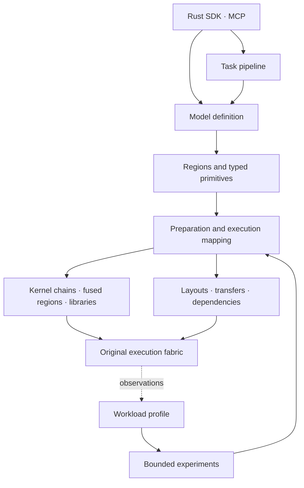

Author: Project owner
Co-authors: GPT-6 Astra Pro; GPT-6.1 Sol (composition, SDK and workload-policy review)
Owner: @pvl
Status: Accepted design direction; shared foundations queued after UX-11D acceptance
Date: 28 November 2026 (Asia/Singapore)

# ZeroGravity — composable pipelines, model authoring and adaptive execution

## 1. Decision and relationship to the service proposal

Make composition a first-class native SDK/MCP contract at both task and mathematical levels, with an inspectable mapping to physical execution.

The [service proposal](README.md) establishes lifecycle: Service/Client, operations, immutable revisions, activation, persistence and original runtime ownership. This extension supplies the authoring and optimization layer that was underspecified there:

**author a task/model → inspect its semantics → map regions to implementations → prepare → measure under a workload → activate a qualified policy → observe and iterate.**

Agents must be able to define a supported model using existing primitives, compose that model into a task pipeline, inspect all selected kernel/transfer dependencies, derive chain/fusion/layout alternatives, benchmark against observed usage and save the result. This is part of the product contract, not a future shell-command escape hatch.

All APIs, tool names, schemas and examples in this document are proposed. They do not imply that general DAGs, model authoring, arbitrary fusion, dynamic portfolios or all media tasks already execute. No builds, tests, benchmarks, model acquisitions or source implementation changes are performed for this design.

**Implementation order:** [foundation phases and parallel lanes](IMPLEMENTATION_PHASES.md) establishes the native SDK contracts before independent ROCm, CUDA, MCP and capability work. Full composition and protocol implementation do not gate backend parity. The live checklist is [TODO.md](TODO.md).

## 2. Three connected views, existing execution authorities

| View | Describes | Main typed values |
| --- | --- | --- |
| Task pipeline | Model/component calls, branches, joins, streaming and session/continuation boundaries | Text, token sequences with tokenizer identity, media with format/clock, tensors, context grants, typed streams |
| Model program | Source-bound equations, reusable layers/regions, state effects and numerical contracts | Tensor/scalar values, symbolic bounded shapes, parameter bindings, versioned state |
| Execution mapping | How semantic regions become real commands, kernels/libraries, layouts, copies, streams and waits | Existing prepared physical bindings, commands, resources and completion dependencies |

These are connected views over the existing semantic composition and prepared physical execution. Task structures and mathematical structures have different types and effects. A consistent authoring interface does not require a universal untyped node or three interpreters.

Keep the enduring semantic authority in the existing pipeline::Config/pipeline::Pipeline and ModelProgram/ForwardPlan contracts, extended where needed, and the physical authority in the prepared executable. TaskPipeline is proposed SDK vocabulary, not a claim about a current Rust type. A kernel-chain recipe and compiler-local transformation graph are preparation inputs, not a third canonical executable IR.



A task node can reference a model revision; that model exposes its program; a program region exposes its prepared implementations and actual run selections. Inspection works in both directions from a slow pipeline stage to its kernels and from a kernel trace back to source operations.

### Common composition contract

Use a small shared authoring vocabulary with domain-specific checks:

- Versioned definition/revision identity and revision-scoped node/port/value IDs.
- Named typed inputs/outputs, shapes, semantic metadata and bounded extents.
- Child definition calls and explicit bindings; deterministic bounded expansion.
- Data, state/effect and required observation dependencies.
- Source/parameter references and numerical contract.
- Legal commit, yield, cancellation and streaming boundaries.
- Capability requirements and explicit implementation choices.

Reusable definitions do not share mutable state. Two calls to the same model or block have separate invocation/session bindings unless an actual supported state relationship is declared. Weight sharing is explicit and retains the original verified source owner.

Initial nested model regions are scopes over the canonical flat plan. Expand them deterministically. Do not keep independently authoritative nested and flat model graphs. Serialized SDK/MCP definitions are authoring source, analogous to current YAML, and are checked/prepared before execution.

## 3. Grounded starting point

Follow-up inspection: `/home/pvl/spaces/abird/src/zerogravity` at `d2a96f457a266fd54d7bf474dfb089859871493c`, with unrelated ongoing UX/runtime-environment work preserved. UX-11C has landed since the original service audit; its complete assembled gate remains a separately tracked concern.

| Existing source/design | Actual capability and limitation |
| --- | --- |
| `crates/zerogravity-core/src/pipeline.rs` | Typed structural pipeline declarations and bounded checks exist. A structurally valid graph is not proof its tasks execute. |
| `crates/zerogravity-engine/src/pipeline.rs` | Production composition is a bounded serial language chain. Intermediate committed terminal text moves to the next stage; only the last stage streams. The prepared chain records exact registrations but retains no model reader for future stages. |
| `crates/zerogravity-core/src/model.rs` | ModelDefinition records the canonical ForwardPlan; ModelProgram retains exact source and plan owners. ModelAssembly is a collection of definitions, not a general execution composer. |
| `crates/zerogravity-core/src/accelerator/program.rs` and `program/source_program.rs` | Existing source primitives/builders provide a foundation, but current values, state layouts and final-output contracts remain text-oriented. Generic ranked outputs, arbitrary state and runtime scans are not established. |
| `crates/zerogravity-core/src/semantic/region.rs` | ClosedRegion retains the original plan and typed boundaries. Current admitted regions are contiguous dense source-template ranges with restricted precision/shape/effect/output boundaries. |
| `crates/zerogravity-core/src/provider.rs` and `zerogravity-engine/src/prepare.rs` | Existing whole-program/region preparation verifies original source, plan, scope and prepared owners. Extend these seams. |
| `crates/zerogravity-core/src/provider/description.rs` | Current inspection reports program geometry and region contracts; complete semantic-to-physical provenance is additional work. |
| `.agents/plans/pipeline-composition/REGIONS_AND_PROFILES.md` | Existing design already specifies recursive regions, resident handoff, chains/capture, fusion, explicit bridges, effects and staged task commits. Generalized behavior remains pending in the owning TODO. |

The required redesign is substantive: expose and generalize the existing semantic authoring/physical mapping boundaries for real consumers. A generic JSON graph wrapper over today's text-specific contracts would not deliver arbitrary model support.

## 4. Higher-level SDK pipelines

### 4.1 Easy sequential form

Keep simple composition short:

```rust
let pipeline = zg.pipelines()
    .chain("draft-review", [&writer, &reviewer])
    .prepare()
    .await?;

let answer = pipeline.run("Explain this proposal.").await?;
```

This convenience overload applies to advertised compatible text-generation components: committed final text becomes the next component's text input. Both components use their own tokenizer/task rules. The same handle supports run/stream/inspect/serve where its output/task contract is compatible. Retain per-stage model identities, usage and outcomes; aggregate usage has an explicit definition rather than hiding intermediate work.

A pipeline is exposed through an OpenAI-compatible route only when the selected endpoint's task/output/usage contract can be satisfied. Other typed pipelines use the native SDK/MCP interface rather than pretending all outputs are text generation.

### 4.2 Explicit graph form

A typed builder handles branches, joins, multiple inputs and reusable subpipelines:

```rust
let mut p = zg.pipelines().draft("reviewed-answer");
let question = p.input::<Text>("question")?;

let draft = p.call("draft", &writer, question)?;
let critique = p.call("critique", &reviewer, draft.final_text())?;

let revision_prompt = p.format(
    "Question:\n{question}\nDraft:\n{draft}\nReview:\n{review}\nRevise it.",
    fields! {
        "question" => question,
        "draft" => draft.final_text(),
        "review" => critique.final_text(),
    },
)?;

let revised = p.call("revise", &writer, revision_prompt)?;
p.output("answer", revised.text_stream())?;

let pipeline = p.prepare().await?;
let result = pipeline.run("Explain this proposal.").await?;
```

Port handles refer to draft values, not runtime tensor pointers. Reusing a port creates another consumer with checked lifetime/budget requirements. A call to an already defined subpipeline has the same typed boundary as a model/task call.

The template operation is a registered bounded pure operation, not an arbitrary host callback serialized to the service. Builder closures/functions execute at authoring time; runtime behavior is the checked definition.

The same mechanism can describe transcribe → prompt assembly → generate → sentence segmentation → speech synthesis. Each node and edge must have actual qualified capabilities. Current support for one speech task does not imply synthesis or arbitrary streaming audio is available.

### 4.3 Value edges and stream edges differ

`final_text()` requires the producer's committed terminal text. `text_stream()` represents deltas with an explicit incremental contract.

A text-token stream is not an ordinary immutable prompt. A speech synthesizer may require a complete sentence rather than arbitrary token deltas. A streaming ASR can revise partial hypotheses. Those require explicit registered buffering/segmentation/revision operators and supported incremental consumers.

Each edge declares:

- Item type and semantic identity, including tokenizer/codec/sample rate/clock where applicable.
- Delivery mode: terminal value, bounded stream or an explicit supported state relationship.
- Item and byte capacity, buffer/spill policy and failure/backpressure behavior.
- Cancellation propagation and which already committed outputs remain visible.
- Authorized sharing and placement expectations.

Reliable task data uses backpressure or explicit failure; it cannot be dropped like sampled telemetry. Downstream context/source limits are rechecked against the actual value; oversized generated handoffs are not silently truncated. Reserve handoff/storage credits before production, and release compute scratch when waiting at a legal boundary. Validate fan-out retention and downstream capacities so bounded channels do not introduce an avoidable resource deadlock.

Generalized DAG coordination and branch dispatch are new implementation work over the current serial language pipeline. Independent branches dispatch ordinary admitted calls through the existing runtime scheduler under resource/fairness limits. A graph edge never implies a new process, mandatory host copy or hidden device synchronization. Physical preparation explains actual bridges.

### 4.4 Sessions, loops and publication

Default model calls use fresh independent sessions. Reusing loaded weights does not implicitly share KV, recurrence, RNG or conversation history. Persistent task sessions declare stage/session scope.

Pin the complete composition for an admitted task, including later-stage owners. Admit compute stage by stage where appropriate; retaining future owners is not reserving every stage's worst-case workspace.

Initial task graphs are acyclic. Static repeated layers/subpipelines have bounded expansion. Runtime decoding, input waits, streaming and supported iterations belong to the original task driver. A future scan/feedback node must declare carry types, iteration/termination bounds and effects; an arbitrary graph cycle is not a recurrence contract.

Compound tasks use staged commits. A later failure does not undo an earlier accepted transcript, emitted token or played audio. Each model/session retains its original publisher. Atomic multi-model state publication would require an explicit separately implemented transaction.

Checkpoint continuation includes completed stage outputs, pending edges, stage session/frontiers and the remaining exact composition.

## 5. Agents authoring a new model

### 5.1 The model definition is complete semantics

A model definition needs more than a list of matrix kernels:

1. Verified source artifacts and config schema.
2. Tensor-role mapping, shapes, codecs, ties, offsets and parameter provenance.
3. Tokenizer/processor/task input and output contracts.
4. Canonical mathematical operations and numerical rules.
5. Positional/masking behavior and all state domains/initialization.
6. Bounded shape relations and supported execution modes.
7. Reference behavior and independent validation.

A model assembled from several sources needs an authenticated aggregate binding retaining original provenance; do not retag unrelated tensors with one convenient live SourceIdentity.

### 5.2 Build it from reusable regions

The proposed builder records existing recognized operations into the original program. A hypothetical decoder-shaped model can look like this:

```rust
let source = zg.sources().open(source_artifact).await?;
let spec = checked_model_spec(&source)?; // explicit source-role/math specification
let mut m = zg.models().definition("example-decoder", &source)?;

let tokens = m.input::<TokenIds>("tokens")?;
let positions = m.input::<Positions>("positions")?;
let mut x = m.embedding(tokens, spec.embedding())?;

for layer in spec.layers() {
    let kv = m.state(layer.kv_spec())?;
    x = m.region(layer.name(), |g| {
        let n = g.rms_norm(x, layer.attention_norm(), spec.norm())?;
        let qkv = g.qkv(n, layer.qkv())?;
        let qkv = g.rotary(qkv, positions, spec.rotary())?;
        let a = g.causal_attention(qkv, kv, spec.attention())?;
        let projected = g.linear(a, layer.attention_output())?;
        let residual = g.add(x, projected)?;

        let n = g.rms_norm(residual, layer.ffn_norm(), spec.norm())?;
        let gate = g.linear(n, layer.gate())?;
        let up = g.linear(n, layer.up())?;
        let activated = g.silu(gate)?;
        let gated = g.mul(activated, up)?;
        let down = g.linear(gated, layer.down())?;
        g.add(residual, down)
    })?;
}

let normalized = m.rms_norm(x, spec.final_norm(), spec.norm())?;
let logits = m.linear(normalized, spec.output_head())?;
m.output("logits", logits)?;
m.task(spec.text_generation_task())?;

let definition = m.finish()?;
let candidate = zg.prepare(definition).await?;
```

This illustrates the target interface for a source whose actual equations match that structure; it is not an asserted implementation of any named model. Composite helpers such as qkv/causal_attention expand to their registered primitive/effect contracts. KV mutations remain provisional under the original invocation; the helper cannot publish state.

The for-loop runs at definition construction and expands a bounded layer count. It is not a per-token Rust callback. Reusable block definitions can be instantiated with different parameter/state bindings; their definition identity does not impose one kernel or allocation per block.

Actual source rules for GQA, attention scaling, RoPE, masks, normalization, casts, gating and state are explicit in the checked specification. They are not inferred from this illustrative topology. A different architecture can use GDN/convolution, MoE routing, encoder blocks or other available contracts.

Runtime recurrence is a different capability. If a model needs a generic scan beyond existing primitives, extend the canonical semantic/state vocabulary with a real checked recurrence contract; do not place an arbitrary callback in a graph node.

### 5.3 Two extension paths

**Existing semantics:** an agent defines tensor bindings and a new composition from available primitive contracts, prepares it on supported providers, validates it, then publishes its definition through the existing catalog/load path. Ordinary users can subsequently load/run/serve it.

**New semantics:** a missing primitive/state layout/task contract requires a real engine extension with shape/effect checks, reference behavior and supported implementations. This can require a normal Rust build and controlled host replacement. Adding a kernel name, shape and code does not invent its mathematical meaning.

The generic authored-model adapter should enter the existing model registry/lifecycle once. Do not add a model-specific switch to MCP, CLI, scheduler and allocator for each new definition.

Qualification has two separate comparisons:

- Is this authored program actually the intended model? Compare against an independent specification/reference for that intended model. When reproducing an existing model, use its original-model oracle; a genuinely new architecture may have no original trained implementation.
- Does this lowering implement that program correctly? Compare kernel/region/model outputs and all relevant state under its declared numerical contract.

Two implementations of the same incorrectly authored graph do not establish model correctness. A trained checkpoint's authentic bytes do not certify a newly rewired architecture.

## 6. Deep execution pipelines: chain, fuse, capture and place

### 6.1 Distinguish the operations

| Operation | Meaning |
| --- | --- |
| Connect semantic ports | Define data/state dependencies and model/task meaning. |
| Resident handoff | Reuse compatible leased payload storage between stages. |
| Kernel chain | Prepare several kernels/libraries and explicit intermediate dependencies under one region contract. |
| Fusion | Construct/select a replacement implementation covering several semantic operations. |
| Capture | Reuse a prepared command sequence to reduce host submission work; it can still contain many kernels. |
| Placement/bridge | Assign eligible devices/layouts and insert necessary transfers/conversions/waits. |

A physical candidate may combine several of these. Minimize measured request/service cost, not kernel count.

### 6.2 Map a region explicitly

The region comes from an exact semantic revision; chain outputs must cover every escaping value, state effect and required observation.

```rust
let program = model.program().await?;
let norm = program.region(norm_region_id)?;

let chain = zg.implementations()
    .for_region(&norm)
    .chain()
    .step("reduce", rms_reduce_kernel)?
    .step("apply", rms_apply_kernel)?
    .bind(bindings! {
        "reduce.x"   <- norm.input("x")?,
        "reduce.eps" <- norm.attribute("epsilon")?,
        "apply.x"    <- norm.input("x")?,
        "apply.inv"  <- output("reduce", "inverse_rms"),
        "apply.w"    <- norm.parameter("weight")?,
        norm.output("y")? <- output("apply", "y"),
    })?
    .finish()?;

let candidate = zg.revisions()
    .derive(model.revision())
    .map_region(&norm, &chain)
    .prepare()
    .await?;
```

The binding macro is illustrative authoring syntax. The underlying representation uses typed port references and ordered checked edits; it does not parse arbitrary execution strings.

Explicit chains can be DAGs, with branches, joins and layout/copy steps. Physical scheduling retains the declared dependencies and original leases. Stream assignment is a constrained preparation choice; omitting an edge never gives permission to race accesses.

### 6.3 Request true fusion

```rust
let fused = zg.implementations()
    .for_region(&norm)
    .fuse()
    .backend(Backend::Rocm)
    .compile()
    .await?;

let alternative = zg.revisions()
    .derive(model.revision())
    .map_region(&norm, &fused)
    .prepare()
    .await?;
```

Here compile returns a checked implementation artifact/recipe, not execution permission. Preparation still validates target/bindings and admits original physical owners.

fuse() requests a transformation from a compiler/provider that advertises support for that region. propose() can enumerate alternatives; compile() returns one explicitly selected immutable implementation artifact/recipe or a typed refusal. Like a finished chain recipe, that artifact still requires ordinary mapping preparation before execution. Static attributes such as RMS epsilon remain frozen semantic bindings, not implicit implementation-tuning parameters. Already compiled opaque library kernels cannot be mechanically concatenated into a correct fused kernel. An agent may supply a new implementation artifact for the same contract through the existing kernel-authoring/isolation path.

Initial transforms should support useful closed regions and concrete primitives. Today's contiguous ClosedRegion does not already support arbitrary noncontiguous subgraph replacement. Generalize only with complete effect/escaping-value/observation closure.

### 6.4 Required invariants

Fusion preserves source operands, permitted casts/store observations, reduction/FMA order, masks/tails, signed-zero/tie/status behavior, external outputs and all state effects. Real-number algebra alone is insufficient.

A residual+normalization region may need both normalized output and a separately rounded residual side output. A candidate that only emits the final normalized tensor is not equivalent when another consumer needs the residual.

Recompute physical liveness after mapping. A graph capture, queued transfer, diagnostic observer or encoded command may retain a value beyond its semantic last use. Cancellation does not free that retained backing.

Do not cross sampling/grammar decisions, external effects, required commits, backpressure or deadline/cancellation boundaries without a supported contract. Larger fusion can worsen fairness or cancellation latency. Register pressure, spills, workspace demand, occupancy or lost overlap can make a legal fusion slower.

A mapping is validated and benchmarked as a connected plan. Independently fastest region choices may combine poorly because they change layouts, live memory, transfers or overlap.

## 7. Bidirectional semantic-to-physical inspection

This mapping is a product capability:

```rust
let mapping = candidate.execution().inspect().await?;

let lowered = mapping.for_region(norm.id())?;
let causes = mapping.explain_transfer(transfer_id)?;
let origins = mapping.semantic_origins(kernel_instance_id)?;
```

Return three distinct views:

1. **Requested mapping:** constraints/candidates the caller selected.
2. **Prepared mapping:** what was compiled, bound, admitted and why.
3. **Executed mapping:** actual selected variants and observed work for a run.

The mapping is many-to-many:

- Several semantic operations can become one fused kernel.
- One operation can need packing, a library call, conversion and status kernels.
- A view can produce no dispatch.
- A captured submission can contain many dispatches.
- A semantic intermediate may be internal to a fused kernel and have no materialized buffer.

Expose original semantic IDs/coverage; kernel/provider/artifact/ABI/compiler IDs; shapes/guards; placements/layouts; scratch/state lifetimes; copies/transfers; stream/event dependencies; capture boundaries; required observations; refusal/fallback reasons.

Detailed implementation internals may be unavailable for an opaque provider. Report known boundaries and unavailable detail rather than inventing kernel names or timings.

Explain every required bridge: layout/codec mismatch, incompatible tokenizer, device/context change, requested observation, source/state boundary, pressure or an unsupported resident path. Equal widths do not make two models' hidden states interchangeable. A transcript is not token IDs, and token IDs require the same vocabulary/semantic contract.

Do not fabricate per-operation durations inside a fused kernel. Attribute measured time to the fused region; finer attribution needs supported instrumentation. Mark theoretical/logical byte counts separately from measured device traffic.

A deep UI can use this same structure for drill-down and activity visualization. The SDK/MCP data is authoritative; the UI does not reconstruct execution semantics from log strings.

## 8. Matching MCP authoring

Expose the same checked authoring model through typed tools:

| Tool family, proposed | Purpose |
| --- | --- |
| capabilities / primitives | Discover operations, task types, attributes, shape/effect/numerical rules and target support. |
| composition_create | Create a task-pipeline, model-definition or mapping draft. |
| composition_edit | Apply an atomic typed edit batch against an expected draft revision. |
| composition_validate | Report structural, source, type/shape/effect and capability issues by node/port. |
| composition_prepare | Freeze checked recipe and prepare it; return the ordinary operation handle. |
| execution_inspect | Inspect semantic/physical mapping and actual selection for a run. |
| transform_propose | Request inline/outline/fusion/layout/capture candidates where supported. |
| workloads_profile | Collect explicitly selected observation fields and coverage. |
| experiments_run / compare | Execute bounded numerical/performance studies. |
| revision_activate | Activate prepared revisions/policies through the existing generation guard. |

These extend the service tool families; they do not require another tool namespace for each layer.

Example task connection:

```json
{
  "draft_id": "draft_17",
  "expected_revision": 4,
  "edits": [
    {
      "op": "add_model_call",
      "node_id": "review",
      "model_revision": "model_revision_9"
    },
    {
      "op": "connect",
      "from": {"node_id": "write", "port": "final_text"},
      "to": {"node_id": "review", "port": "prompt"},
      "delivery": {"kind": "value", "max_bytes": 131072}
    }
  ]
}
```

Model authoring uses typed add_parameter/add_primitive/call_region/define_state/connect/set_output edits referencing recognized versioned primitive schemas. A request cannot declare a new executable primitive merely by inventing its name.

An execution-mapping draft can add kernel steps, bind semantic input/parameter/attribute/intermediate/output ports, declare dependencies, choose placement/capture or reference an immutable implementation recipe. Each kernel step references a recognized artifact/interface revision, not a free-form function name. For example, after constructing a chain or receiving a supported fusion candidate:

```json
{
  "draft_id": "mapping_draft_12",
  "expected_revision": 2,
  "edits": [
    {
      "op": "map_region",
      "region": {
        "model_revision": "model_revision_9",
        "region_id": "region_18"
      },
      "implementation_revision": "implementation_revision_7"
    }
  ]
}
```

The source revision scopes the region ID. composition_validate explains unbound outputs, state/effect mismatches or unsupported guards; composition_prepare returns an operation for normal physical preparation. Requesting or accepting a transformation candidate does not submit it for execution.

Rust builders and MCP edits construct the same checked definitions. No serializable Rust closures, native references, raw pointers or physical permits cross the wire. Persistent references use immutable model/source/definition revisions plus scoped node/port IDs. Preparation binds fresh live registration/source owners; runtime IDs are scoped observations/preconditions, not durable source rights.

Bound edit count, graph size, nesting depth, shape expressions and artifact sizes. An incomplete draft can be saved, but preparation requires complete resolved contracts. Edits are atomic for one draft; freezing produces an immutable revision. A failed preparation preserves the immutable recipe and recorded outcome; retry creates or resumes an explicit idempotent operation rather than an implicit duplicate publication. Concurrent agents cannot silently overwrite each other's draft or activation.

Errors identify the node/port, expected and supplied contract, actual unsupported capability and possible supported path. Discovery and serialization schemas do not replace native authorization, admission or qualification.

## 9. Live usage profiles and bounded optimization

### 9.1 Observe workload separately from model semantics

A workload profile can record:

- Offered/accepted request rate and concurrency.
- Prefill/decode/context/output-length distributions and useful correlations.
- Actual scheduler batch/cohort sizes and padded/ragged shapes.
- Request classes, deadlines, queue age, cancellations and output backpressure.
- State/prefix/cache residency, memory headroom and actual model/policy revisions.
- Task-stage timings, selected implementations and outcomes.
- Sampling, clock domains, missing observations and dropped ranges.

Incoming concurrency is not the physical batch passed to a kernel. Thirty-two active requests can produce several small decode batches and a separate prefill batch. Kernel eligibility uses actual execution geometry.

Profiles are metadata-only by default. Existing aggregate counters do not become a precise per-request timeline simply because a new API reads them. Each field reports aggregate-derived, sampled, exact-event or unavailable provenance.

Raw prompt/token/tensor/output capture is an explicit separate choice. A profile cannot reconstruct prompt contents, prefix sharing, early stopping, routing or cancellation timing. Profile-derived workloads are synthetic approximations unless the required inputs/events/state were actually captured.

### 9.2 The experiment loop

```rust
let profile = zg.workloads()
    .observe("assistant")
    .metadata_only()
    .window(Duration::from_secs(120))
    .record()
    .await?;

let space = SearchSpace::from(model.revision())
    .region_candidates(norm.id(), [chain, fused])
    .scheduler_candidates(allowed_scheduler_settings)
    .workspace_limit(workspace_budget);

let study = zg.experiments()
    .optimize(space)
    .profile(&profile)
    .benchmark(explicit_workload)
    .concurrency([1, 8, 32])
    .acceptance(service_objectives)
    .budget(search_budget)
    .record("adaptive-norm-study")
    .run()
    .await?;

let policy = study.qualified_policy()?;
zg.activate("assistant", &policy)
    .if_generation(active_generation)
    .for_new_requests()
    .await?;
```

The numbers are illustrative budgets/scenarios, not measurements or current support claims. allowed_scheduler_settings come from actual capabilities. explicit_workload is an authorized replay or declared representative corpus/synthetic workload; profile distributions alone are not inputs.

Search budget limits candidates, compilations, host/GPU time, retained artifacts, traces, workspace, concurrent trials and permitted interference with live serving. A failed invariant stops affected work. No qualified gain leaves the active policy unchanged and records no improvement established.

### 9.3 Benchmark the complete objective

Kernel timing locates opportunities. Promotion uses affected model/task and service behavior:

- Correct results and all relevant state within the declared numerical policy.
- Valid request goodput: correct requests completed within their class SLO per measured wall-clock second; committed output-token throughput separately.
- TTFT, decode/inter-token and completion latency with explicit observation boundaries.
- All offered/admitted/refused/failed/cancelled/incomplete counts.
- Queue growth, fairness/starvation and service interference.
- Peak/reserved memory, compilation/cold-start/coexistence costs and amortization.

An optimization cannot win by dropping difficult requests, truncating outputs or excluding failed work. User cancellations and engine failures are distinct outcomes. Record the measurement interval and boundary policy for requests arriving before it or completing after it. In-flight work remains visible as incomplete, and drain-period results are separate rather than silently shifting the denominator.

A fixed arrival schedule and a fixed number of continuously busy clients answer different questions. Label open-loop arrival replay versus closed-loop concurrency tests. Preserve or explicitly reconstruct input correlations, cache state, prefix reuse, task backpressure and competing load. Report repeated comparison variability and a minimum worthwhile gain without requiring an elaborate evidence bureaucracy.

Heavy diagnostic tracing is a separate run mode. Primary comparisons use matched observation settings. Summed overlapping kernel durations are not wall time.

## 10. Adaptive execution policy

The result of tuning should be a small immutable prepared set of qualified variants and selection rules. Do not recompile or globally rewrite the stack whenever concurrency fluctuates.

At request/session admission, pin the semantic revision, numerical/state contract and allowed policy. The original scheduler forms a concrete cohort and coordinates resource admission with variant selection. A bounded native selector chooses an eligible prepared variant using actual phase, rows/tokens, KV length, layout, state ABI, device/provider and workspace.

Every cohort member must have compatible pinned source, semantic, numerical, state and prepared ownership requirements, with a common permitted variant. If their allowed variant sets do not intersect, form separate cohorts unless an explicitly qualified mixed-cohort plan exists. A policy activation cannot silently widen the variants allowed for already admitted sessions.

Illustrative rules, not measured recommendations:

| Runtime condition | Eligible prepared choice |
| --- | --- |
| Decode, one token per sequence, actual batch 1, matching state/layout/target | Candidate for small-row latency |
| Decode, actual supported batch 2–8, matching state/layout/target | Candidate for batched throughput |
| Prefill, supported token/row band, matching mask/layout/target | Prefill candidate |
| No specialized match | Compatible qualified baseline, otherwise typed refusal |

Prefill and decode have separate contracts. Guards include actual shape/layout/numerical/state requirements; a concurrency label does not grant eligibility.

The prepared portfolio contains alternatives under the same original session/state authority with explicitly compatible physical bindings. Independently loaded prepared services are not interchangeable merely because numerical and state-ABI labels match. Compatible compiled code can be shared, while parameter/state/scratch/capture owners retain their required original identities.

Admission accounts for the retained code, captures and parameters plus the peak scratch/state live set of variants that can execute concurrently, including old/new coexistence. It need not sum every mutually exclusive dormant scratch allocation. Either admit a conservative envelope before selection or jointly select and admit through the original scheduler; a selected variant may never exceed admitted resources. Reserving only the cheapest path does not permit an expensive fallback.

Switching between variants is allowed only at supported execution boundaries, with compatible persistent state and qualified transition behavior. Different KV layouts or changed state meaning require another preparation/migration decision. Equal equations alone do not establish switch compatibility.

No-match results distinguish unsupported input, no prepared compatible variant, insufficient admitted resources and unhealthy execution domain. Fallback occurs before submission to a qualified supported baseline. A submitted failure/cancellation requires actual retirement or quarantine; no unsafe immediate retry over the same candidate state.

Routine selection uses prepared tables and compact counters. Record policy activation and changes durably; use bounded optional traces for exact per-dispatch decisions. Do not add per-kernel strings, locks or mandatory transport events to the hot path.

An authorized background optimizer may observe drift, run another bounded study and publish a new policy revision. Use sufficient observations, hysteresis/cooldowns and rollback criteria to prevent oscillation. New code, new policy membership/guard scope, broader placement or changed scheduler strategy requires preparation and validation; new semantics/state require their stronger boundary.

## 11. Persistence and proposed acceptance unit

Saved experiments retain task/model definition, source/parameter bindings, numerical policy, mapping recipes, actual prepared identities, workload evidence, candidate outcomes, selected rules and activation lineage. The original service checkpoint/retirement rules remain unchanged.

A reusable model package consists of its source/config/tensor-role specification, typed model definition, task/tokenizer/processor declarations and validated implementation coverage. Optional target-specific implementation artifacts are reproducible derivatives. Do not duplicate base weights into every candidate or replace live owner identity with a manifest digest.

The complete proposed acceptance unit is:

1. Author a small real supported model definition using existing primitives; validate it against an independent reference.
2. Compose it into a typed multi-stage task through both SDK and MCP.
3. Inspect its mathematical regions and exact prepared mapping.
4. Create a resident chain and one supported fused alternative; expose refused transforms honestly.
5. Run correctness plus affected state tests and actual workload/concurrency comparisons.
6. Produce and activate a bounded qualified selection policy.
7. Keep admitted sessions/compositions pinned, continue serving, and expose actual selections and metrics.
8. Save the recipe/study; reattach, rerun and resume supported checkpoints without new runtime/state/resource authorities.

Begin with an existing useful primitive family and the actual supported task path. Do not require a universal compiler, arbitrary media, a full optimizer framework or another fixture system before this end-to-end unit. Generalize ranked values, state/control/output contracts only as the next real authored model requires, with explicit unsupported defaults.

Composition and mapping contracts belong in the initial native service/SDK foundations, exercised by existing supported consumers. Broader task/model authoring, MCP protocol implementation, backend parity and other capability lanes then progress independently on those contracts. Profiling, experiments and policy activation build on the same objects. Arbitrary new native code still requires the isolation/admission prerequisites in the service proposal before execution.

## References

- [Service and execution-stack proposal](README.md)
- [Foundation phases and parallel implementation](IMPLEMENTATION_PHASES.md)
- [Implementation checklist](TODO.md)
- [Recursive regions, pipelines and profiles](../pipeline-composition/REGIONS_AND_PROFILES.md)
- [Shared execution architecture](../pipeline-composition/SHARED_EXECUTION_ARCHITECTURE.md)
- [Profile policy and reusable components](../pipeline-composition/PROFILE_POLICY_AND_COMPONENT_REUSE.md)
- [Owning composition TODO and actual capability status](../pipeline-composition/TODO.md)
- [Live metric definitions](../cli-ux/LIVE_MODEL_PERFORMANCE.md)
- [Numerical correctness policy](../numerics-and-context/CORRECTNESS_POLICY.md)
