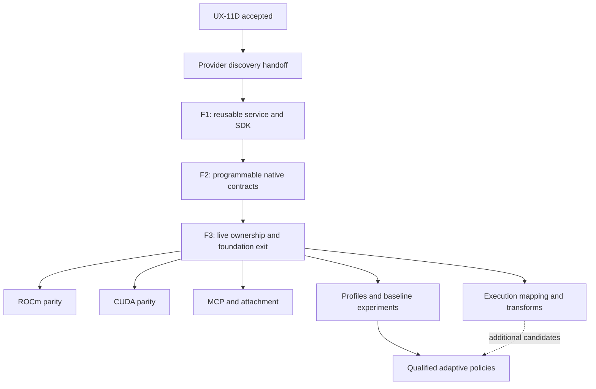

Author: Project owner
Co-authors: GPT-6 Astra Pro; GPT-6.1 Sol (service, composition and execution review)
Owner: @pvl
Status: UX-11D accepted; provider-first handoff pending; foundation preparation complete, implementation not started
Decision: 28 November 2026 (Asia/Singapore)

# Programmable stack — foundations and parallel implementation

## 1. Delivery decision

UX-11D acceptance is complete. Let the current provider-first discovery owner finish and hand off its supported implementation, then complete the shared foundations below. This handoff serializes ownership of the overlapping source files. After the foundation exit, ROCm parity, CUDA parity, MCP/native attachment and capability development can proceed independently through the same SDK and execution contracts.

This supersedes the earlier serial sequence in the [service design](README.md) and the former requirement to finish ROCm parity before beginning the CUDA campaign. It does not change numerical acceptance, source authorization, device holds or physical lifetime rules. Accepted backend results and useful dormant primitives remain valid within their original scopes.

The common prerequisite is **PS-F1 → PS-F2 → PS-F3**, not completion of the entire programmable-stack roadmap. Full MCP protocol support, arbitrary graph authoring, a general optimizer, universal checkpointing and experimental GPU workers do not gate backend parity.

The SDK is the native programming surface. It can be used directly, embedded in another application, or consumed by an optional MCP host. The MCP implementation is an outward adapter over Service/Client; it does not own inference or require CLI-private orchestration.

All interfaces in these documents remain target APIs until implemented and accepted. This document defines outcomes and dependency boundaries; [TODO.md](TODO.md) is the live completion checklist.



Task DAGs, model authoring, continuation and isolated extension work can also start after the foundation exit; the diagram shows the main integration relationships. Mapping work can start on existing models. A new-definition mapping needs only its particular model definition. A policy using an already available qualified variant need not wait for new mappings.

## 2. Put the shared foundations in place once

The first block establishes every cross-layer contract needed by later lanes. Each contract is grounded in an existing useful consumer. A declared extension point is not a claim that every possible implementation exists.

| Foundation | Required initial behavior | What later lanes add |
| --- | --- | --- |
| Service and Client | One reusable application owner; direct native calls; supervised operations; explicit model/listener/client/shutdown lifetimes | Native attachment, MCP transports, richer presentations |
| Sources and loading | Shared eligibility/acquisition/preparation policy; exact resolved source and settings; ordinary pull/load/run/stream/serve | New model/source adapters through the existing catalog |
| Definitions and revisions | Distinct typed task/model/mapping drafts; scoped IDs; bounded atomic edits, validation, freeze and derive over supported existing definitions | Task DAGs, authored models, new implementation recipes |
| Ports, mathematics and effects | Source/parameter bindings, shapes, numerical rules, state effects, escaping outputs and commit/cancel boundaries | Concrete additional primitives, ranked values and task types |
| Prepared execution | Existing ModelProgram/ForwardPlan, region/provider bindings and original executable/resource owners; inspect requested and effective choices | New HIP/CUDA implementations, chains, fusion, capture and placement |
| Live lifecycle | Bounded registration addition, exact retirement, complete admitted composition pinning, generation-guarded activation | Adaptive variant selection and qualified state migration |
| Durable operations | Stable command/attempt identities, explicit durability, immutable recipes and bounded results; interrupted/unknown reconciliation | Studies, recorded inputs/traces and broader continuation |
| Observation | Typed identities/correlation, clocks, counters and provenance; bounded subscriptions with explicit gaps | Detailed execution traces, workload profiles and visual drill-down |
| SDK adapter boundary | Owned versioned request/result schemas and capabilities over native operations; authorization remains in Service | SDK-hosted MCP and authenticated native wire |
| Continuation and extension | Checkpoint compatibility/envelope contracts tied to existing formats; recognized primitive/artifact interfaces and explicit unsupported boundaries | Full task restore, actual child-worker admission and additional backend ABIs |

Preserve one mathematical engine, source authority, StateRoot publisher per session, ResourceArbiter and actual physical completion/quarantine. Extend existing provider and task interfaces where needed. Do not add a graph interpreter, allocator or plugin registry merely to unify names.

Initial task/model/mapping drafts can import and freeze existing supported definitions and preparation choices. Unsupported primitive edits or shape/effect combinations return precise capability failures. The foundation contains real paths and checks; later lanes supply additional semantics and implementations.

### Maintenance rules

- Prefer small modules in existing crates. Add a crate only for a real dependency, packaging or isolation boundary.
- Distinguish definition identity, numerical/state compatibility, implementation identity and live prepared ownership. Content digests cannot substitute for live permits.
- Keep model-specific mathematics and source roles in their model adapters. Shared operators and physical implementations remain model-neutral.
- Keep typed SDK operations authoritative. Derive wire/tool schema information from their owned types where practical, while preserving intentional protocol projections.
- Version serialized definitions and required capabilities. Accept compatible additive data; refuse unknown required semantics or incompatible interfaces. Avoid promises about Rust binary ABI or portable GPU handles.
- Resolve discovery, policy, compilation, schema handling and human-readable diagnostics outside token/kernel execution. Native execution uses prepared bindings.
- Prefer explicit errors with stable codes, operation/region/port context and actionable details. Avoid frontend-specific string parsing.
- Introduce abstractions with a working consumer. A future capability can be described and explicitly unsupported without shipping an empty execution framework.

## 3. Shared foundation phases

### PS-F1 — Reusable Service and simple SDK

**Outcome:** one embedded Service supports the public SDK and existing CLI/TUI/Web through the original Runtime and execution owners.

**Entry:** UX-11D is accepted. Complete the current provider-first discovery handoff before taking ownership of its overlapping configuration/control/UI files. Inspect the accepted implementation and its existing qualification; reported commit IDs identify work, not a requirement to restore historical source. Broader provider features remain in their owning plan.

#### Incoming source boundary

Reuse the native `zerogravity::discovery` module introduced by the provider work. Its named `Source`/`Kind`, entries, pages, curated/local browsing, remote browsing and repository inspection are discovery observations. A selected repository or successful pull does not grant execution eligibility. Source providers are distinct from core `RegionExecutionProvider`/`PreparedExecutable` contracts for executable lowering; the current source enum/functions do not require a new plugin trait or registry.

Keep three operations distinct: discover/select → explicitly resolve and pull → prepare/load through the original source-aware planner. Normal selection can resolve a floating reference to its immutable source identity; users need not enter commits manually. Named sources, direct URLs/locators and local paths converge on those same existing authorities.

| Current boundary | Service responsibility | Retained adapter responsibility |
| --- | --- | --- |
| SDK `discovery.rs`, `discovery/remote.rs`; `configuration.rs` / `configuration/file.rs`; `pipelines::Document.sources` | Reuse discovery and original optimistic atomic configuration publication. Preserve observed source list/document checks and source-scoped results. | Navigation, focused search, source forms and rendering. |
| CLI `control_host.rs` and `control_host/{actions,work,progress,settings}.rs` | Own effective configuration, one Runtime, operation supervision, typed outcomes and joined retirement. Include `Browse`, `Repository`, `SaveSources`, `Pull` and `Load` orchestration. | Terminal preferences, Web projection/authentication, presentation progress and bounded display copies. |
| CLI `resident.rs`, `run_cli/{source,qwen_source}.rs`, `config_cli.rs`, `serve/canonical.rs` | Share cold policy, exact source resolution, eligibility, backend preflight and resident preparation. | Argv grammar, prompts/offers, process signals and output formatting. |
| CLI `pull.rs` / `pull_native.rs`; SDK `artifacts/pull.rs` | Reuse `HubSelection`, `HubPull`, `PreparedHubPull`, original receipts, cache publication and transfer controls. Expose owned typed acquisition outcomes before formatting. | Consent UI and progress destinations; credentials stay in the existing credential/transport boundary. |
| Engine `router/{event_channel,dispatch}.rs` and `output.rs` | Extend original charged receipt waiting for native async use; retain exact output, usage, errors, cancellation and backpressure. | Rendering or forwarding events. |
| CLI `output/operational.rs` and log views | Own configurable operational event/sink lifetimes without inheriting the process-global CLI singleton. | Select terminal/file destinations and restore terminal state. |

The provider handoff should state the implemented subset and outstanding limits. Current incoming code covers HF/GitHub/local kinds; custom endpoints, new credential stores, every release/object adapter and full hub enumeration are independent additions. Preserve native page/cursor semantics and documented search limits through Service; a bounded response is not whole-catalog enumeration.

#### One implementation unit

1. Put reusable Service/Client modules in the existing SDK facade and extract the complete cold discovery/acquisition/preparation flow. Preserve advanced Runtime/provider interfaces and explicit acquisition policy. The service does not depend on CLI types, TTY behavior or a Web host.
2. Give Service autonomous management supervision. Preserve the bounded single management action slot initially; no UI polling or result query may be required to reap work. This slot does not limit ordinary SDK run/stream concurrency: inference admission continues through the original scheduler. Retain typed discovery pages, repository observations, pull receipts and terminal errors independently of the native view or Web `latest` result. Leave durable command/restart storage in F2.
3. Implement the supported `pull`, `load`, `model.run/stream`, `serve`, capability/inspection and joined-shutdown surface. Native async waits use the existing receiver's `poll_recv`; the blocking facade shares a long-lived driver. Neither creates a second token channel or per-call runtime. Complete output/usage comes from original terminal events, including results larger than the current 64 KiB UI display limit.
4. Migrate CLI/TUI/Web dispatch to the same Service. Keep model registration and listener generation checks, safe public errors and full native causes. Source edits retain stale-document checks; restricted clients cannot grant new local filesystem roots. Removing a discovery source changes its configuration, while acquired snapshots, aliases, transfers, model owners and user files retain their original lifetimes.

Embedding installs no process-global logging, signals, sockets or UI implicitly. Client/view disconnection does not shut down the owner. Owner shutdown stops new management submissions, cancels and joins work outside shared locks, closes owned listeners, retires the original Runtime and finishes sinks, preserving primary and cleanup errors. Terminal restoration remains adapter work before potentially long joins.

Cancellation requested, observed terminal cancellation and physical retirement remain distinct. The current UI message after `stream.cancel()` cannot become a successful completed SDK receipt. Remote discovery uses bounded cooperative HTTP cancellation; shutdown joins that worker instead of discarding it.

#### Working exit

| Acceptance | Reuse | Required F1 evidence |
| --- | --- | --- |
| Embedded model lifecycle | `crates/zerogravity/tests/fabric_sdk.rs` exact control-client lifecycle; CLI `tests/run_unified.rs` serving harness | One already authorized real source: public Service load → run/stream → actual HTTP inference on the same registration → joined shutdown. Compare text, usage and finish; `/v1/models` alone does not qualify serving. |
| No-UI operation completion | Shared action-slot/cancellation tests and original download outcomes | Drop observer subscriptions to Service-owned management work and make no polling/query calls while gated work completes. Service joins and records its typed outcome; a subsequent operation starts without poll-triggered reaping. Preserve cancellation-on-drop where it is the existing request-scoped inference stream contract. Exercise shutdown/cancel races in this scope. |
| Async and blocking behavior | Engine `event_channel.rs` wakeups; dispatch/backpressure/lifecycle tests | On a single-thread executor, pending receipt waits yield, unrelated work advances, publication wakes the pending consumer without lost wakeups, and cancellation/disconnect wake correctly. Blocking and async consumers preserve the same result semantics. |
| Source discovery and exact reuse | Incoming provider acceptance; `fabric_artifacts.rs`, artifact acquisition fixtures and `cache_prepare.rs` | One controlled valid model fixture through discovery → explicit pull → exact cached load. Reuse has no new transfer; missing/ambiguous/offline/stale choices refuse appropriately. Existing LICENSE-byte pulls qualify acquisition mechanics, not model loading. |
| Presentation-neutral embedding | Minimal SDK feature check, CLI output/privacy/logging and PTY/Web tests | Service/Client compile without TUI/Web; embedding has no unsolicited I/O/global hooks. Long UTF-8 results retain complete native output/usage while UI copies stay bounded. Run affected frontend/logging regression after migration. |

Fold typed errors, exact cancellation identities, stale registrations/configuration and source-removal preservation into these scopes. Reuse unchanged provider/backend evidence; changed physical lifetimes retain their required real-source canary. Run the assembled `scripts/check.sh` gate once the F1 unit is complete, under current AGENTS.md acquisition/isolation rules. Preparation itself needs no build, GPU run or fresh historical acceptance cycle.

The cold atomic route-set transaction is the F1 consumer. Sequential live registration and activation remain F3; durable operations remain F2. Full MCP, daemon/remote attachment, new model families and backend parity do not gate this F1 exit.

### PS-F2 — Programmable contracts, records and observation

**Outcome:** every later client and capability uses one native authoring/control model.

Implement the small shared object vocabulary: immutable artifacts/recipes; typed task/model/mapping drafts and revisions; live prepared references; operations/attempts; activation generations; checkpoint compatibility descriptors. Reuse existing source/session/registration identities.

Exercise the authoring boundary with an existing model definition, serial pipeline and one actual supported closed-region preparation. Validate complete ports, numerical/state/source effects and original provider binding. For already supported definitions, imported scopes retain their deterministic expansion into the canonical plan. Additional nested authoring and primitive edits are capability increments in PS-C2. Mapping descriptions remain preparation inputs and inspection views.

Provide owned request/result types, capability discovery, typed errors and operation handles directly through Client. Keep borrowed native types out of owned serialized DTOs while preserving valid advanced native Rust APIs. An adapter can submit, query, cancel, inspect and subscribe without depending on CLI modules, Web projections or a mandatory transport.

Implement a small native grant context: trusted embedded ownership and explicitly restricted adapter views, with Service enforcing mutations and private-detail access. Scope command identity and visible operations appropriately. Test denied operations and detail access here; MCP authentication later maps to this established policy. No general identity-management framework is required.

Implement the minimal durable core now:

- Persist an accepted durable command with its resolved argument identity before returning a durable acknowledgement.
- Repeated command keys resolve to the same operation or a typed argument conflict.
- Retain immutable recipes and bounded operation/attempt outcomes; distinguish ephemeral work.
- Use existing atomic artifact/cache primitives. Introduce a small transactional index only for concrete consistency/search requirements.
- Record service epochs, coarse dirty/clean physical-domain ownership epochs and interrupted/completion-unknown outcomes. After unclean or unknown submitted work, fresh admission on an affected domain requires trusted original backend/supervisor retirement proof; otherwise retain unavailable/quarantined status. Process death, elapsed time or a superficial health probe do not restore credit.
- Keep terminal outcomes queryable independently of notification delivery. Make retention/expiry explicit.

Observation envelopes identify service/operation/revision/run and supported semantic/physical scopes, with clocks, units, field provenance, sequence/cursor and gap reporting. Routine counters remain compact; optional traces have budgets and declared overhead. Raw prompts/tokens/tensors require a separate capture choice.

Define the checkpoint envelope and exact compatibility fields around existing qualified codecs. Recipe recovery, neural restore and full task continuation retain distinct meanings. Establish the rule that a future experimental worker must use original parent-issued resource authority; implement worker IPC only with an actual child consumer in PS-X.

**Working exit:**

- SDK creates/edits/freezes a supported definition, prepares it, runs it and inspects actual identities and selected mapping.
- Stale edits, wrong source/state bindings and unsupported capabilities refuse before submission.
- Two native clients see the same operation/result; duplicate command submission is idempotent.
- Restart preserves recorded recipes/outcomes and reports interrupted work truthfully; rerun creates a new attempt with fresh preparation only on eligible domains. CPU or clean/no-submission recovery can qualify independently; generic GPU recovery and a cross-process broker are not foundation prerequisites.
- A native adapter conformance test consumes only public Client contracts. Full MCP protocol implementation is not required.

### PS-F3 — Safe live ownership and foundation integration

**Outcome:** later lanes can change supported registrations and prepared revisions without redesigning the shared lifecycle.

Implement a bounded add-registration transaction through the original catalog, scheduler and admission. Preparing/loading B while A is registered must not rebuild A, replace its source owner or silently discard its sessions. Publish exact registrations only after successful preparation; release failed unpublished work through original retirement.

Implement generation-guarded route/pipeline activation for a supported existing prepared revision. Retain the full admitted composition, including later-stage model owners. Retention does not reserve every future stage's worst-case scratch; compute is admitted at its real stage boundary.

Keep public alias retirement separate from physical owner retirement. New requests see the intended registration/revision; admitted tasks and sessions retain their exact owners. Old captures, readers, buffers and queued commands live through actual completion or quarantine.

Account old/new coexistence before activation. A preparation/capacity failure leaves current service usable. Where coexistence is impossible, expose a declared drain/reprepare operation instead of pretending the change is immediate.

Persist activation intent and distinguish it from observed publication. Reconcile duplicate commands and crashes around publication/receipt without inventing a global transaction covering disk, routes and GPU state. Future-admission rollback does not rewind emitted output or advanced sessions.

Use existing supported checkpoint compatibility/restore as a concrete contract consumer. This phase does not add arbitrary state migration, generic task resume or a cross-process device broker.

**Foundation exit — the common release point:**

1. In one Service: load A; run A; load B; run both; prepare/run a supported A→B task; serve an exact existing registration.
2. Inspect the task, source-bound model program and one real region's requested/prepared mapping through public SDK contracts.
3. Change/retire a later-stage public alias while an admitted task retains its original complete composition. New requests follow the new generation or exact refusal.
4. Demonstrate failed preparation, capacity refusal, stale generation and cancellation without corrupting active work or prematurely releasing physical owners.
5. Record a recipe/operation, reconnect through another direct Client and reconcile a restart. Fresh preparation does not reuse serialized native handles.
6. Exercise typed serialization/adapter conformance, optional-feature boundaries, slow observation, owned logging and joined shutdown.
7. Complete applicable real-source/numerical/state/physical checks and the final assembled repository gate.

The gate proves the common contracts on advertised existing scope. It does not require vLLM performance parity, every backend's new features, a finished MCP server, generic DAG execution or an arbitrary-kernel sandbox. Missing hardware or a backend-local failure limits that affected acceptance; it must not be presented as a pass or silently broaden support.

After this exit, start ready backend and adapter lanes immediately. Do not wait for the entire roadmap below.

## 4. Public packaging and SDK-hosted MCP

Keep responsibilities small:

| Home | Responsibility |
| --- | --- |
| zerogravity::service | Application ownership, lifecycle orchestration, operation supervision, records and sinks |
| zerogravity::client | Direct/attached typed operations, convenient builders and handles |
| zerogravity::blocking | Same operation semantics through a shared long-lived driver |
| Optional zerogravity::mcp module | MCP host and protocol projection using Client |
| Existing core/engine/model/backend/artifact/serving owners | Mathematical, source, state, physical and inference-protocol contracts |
| CLI/TUI/Web | User input, process integration and presentation |

An outward MCP crate is an alternative if dependency size/build isolation justifies it; it depends on the facade, and the facade must not depend back on it. The optional-module design is sufficient initially. Native inference must build and run without MCP, Web or TUI dependencies enabled.

Proposed SDK hosting API, delivered by PS-M:

```rust
let service = zerogravity::Service::embedded().await?;
let client = service.client();

// The same application owns the service and exposes it to agents.
zerogravity::mcp::Server::new(client)
    .serve_stdio()
    .await?;

service.shutdown().await?;
```

The same host accepts an attached Client once native attachment is implemented:

```rust
let client = zerogravity::Client::connect(endpoint).await?;

zerogravity::mcp::Server::new(client)
    .serve_stdio()
    .await?;
```

These are target shapes, not current compiled examples. Real applications also join shutdown on error paths. MCP host closure releases its subscriptions/transport and its own request scopes; it does not unload service-owned models or stop an independently owned Service.

PS-F2 establishes the adapter-facing contracts; PS-F3 completes and qualifies their supported lifecycle behavior. PS-M implements protocol/transport behavior afterward. SDK-hostability is an architectural requirement from the start, not a requirement to finish MCP before backend work.

## 5. Parallel lanes after the foundation exit

A lane can start when its concrete prerequisites exist. Every feature ships first as a native service/SDK operation; MCP and UI project it when their adapters are ready. A delayed projection does not block native acceptance. Joint product acceptance later proves parity across the supported surfaces.

| Lane | Work and useful completion | Actual dependencies |
| --- | --- | --- |
| ROCm parity — existing Phase 3 | Resume retained P3C scope on authorized AMD targets; real numerical/state/serving correctness and matched optimized baseline comparisons | Foundation exit; lane-specific source/environment/capacity. No CUDA/MCP dependency |
| CUDA parity — existing Phase 4 | Independently close NVIDIA correctness/ownership gaps and matched optimized baseline comparisons | Foundation exit; lane-specific source/environment/capacity. No ROCm/MCP dependency |
| PS-M — native attachment and MCP | SDK-hosted MCP; foreground headless service; authenticated native Client attachment and race-safe UI bootstrap | Foundation exit. No new composition or GPU parity dependency |
| PS-C — task and model composition | Bounded useful task DAGs and independently validated authored models through normal catalog/load/run/serve | Foundation contracts. Task and model sublanes are independent |
| PS-K — execution mapping and transforms | Bidirectional provenance, explicit chains, supported multi-operation fusion/capture/layout choices | Foundation region/provider contracts; existing models suffice |
| PS-E — profiles, experiments and policies | Recorded workload comparisons and finite native qualified selection policies | Foundation observations/revisions/activation. Additional region studies consume PS-K candidates |
| PS-S — continuation | Qualified task/session checkpoint envelopes, resume and fork | Foundation records + existing checkpoint owners; pipeline continuation uses PS-C's concrete task contracts |
| PS-X — isolated extension | Actual bounded compilation/native trials and parent-authoritative cross-process admission where used | Foundation resource/ABI boundaries; actual region interface when consumed |

Vulkan and optional compiled providers remain lower-priority consumers of these same seams under the full plan. Neither is required to establish the foundation exit. A supported native fusion does not require MIGraphX/TensorRT integration.

### PS-M — two independent integration milestones

**M1: SDK-hosted MCP.** Bind an embedded Client directly. Expose capability discovery, exact model operations, supported draft/prepare/inspect operations, operation get/cancel/results and bounded observation. Implement negotiated supported protocol features; ordinary operation polling remains available without optional protocol extensions. Keep inference, browser control and privileged experiments scoped by native authorization.

**M2: native attachment and process modes.** Implement versioned owned wire DTOs, authenticated local endpoint, service epoch/identity and bounded subscriptions. Headless foreground mode owns Service. TUI/Web attach to the selected existing service or embed it only after serialized discovery establishes absence. Authentication/version/busy/live-owner failures do not launch a hidden second runtime. Explicit embedded/connect modes remain available.

M1 can use an embedded Client before M2 exists; M2 can serve native clients before M1 exists. Their integration proves the same SDK/MCP operation against an embedded and attached Service, with correct disconnect and owner-shutdown behavior.

Independent hosts sharing a physical device require the original coordinated authority or an explicitly supported disjoint/isolated scope. A service-discovery lock is not a global GPU allocator.

### PS-C — separate task and model authoring, then compose them

**C1: useful task DAG.** Build a bounded acyclic text task using fan-out, joins, registered formatting and terminal-value edges; retain final-stage streaming. Declare bounded handoff/backpressure, context limits, independent sessions and staged commits. Unsupported incremental/media/feedback edges refuse explicitly.

**C2: authored model.** Compose a complete useful model from recognized primitives against an already authorized real source. Preserve that source's actual architecture, parameter roles, positional/mask rules, numerical contract and state. Reusable static regions record the canonical ModelProgram/ForwardPlan. Register through one normal authored-model adapter. Independently validate intended model semantics, then its lowerings.

C1 can use existing models. C2 can run through existing direct/serial tasks. Neither waits for the other, MCP or backend parity.

**Joint exit:** an authored model participates in a useful question→independent analyses→format/join→answer task, with inspectable identities, independent state, bounded resources and correct failure behavior. SDK acceptance can precede MCP; the MCP projection joins when M1 is available.

Broader media, ranked outputs, scans and new primitive semantics are explicit capability increments when required by actual models.

### PS-K — implementation authoring over precise regions

**K1: inspection and chains.** Extend initial provenance to requested/prepared/executed many-to-many coverage, kernel/library artifacts, layouts, transfers, streams/waits, capture boundaries and resource lifetimes. Explain actual bridges and unavailable provider detail. Construct a resident chain with typed input/attribute/parameter/intermediate/output bindings.

**K2: a real multi-operation replacement.** Prepare an alternative covering at least two canonical semantic operations in one supported closed region. Preserve all escaping outputs, finite-precision observations and provisional state effects; recompute physical liveness. Existing trusted artifacts or a finite native transform template are sufficient. No generic compiler is required.

The earlier RMS reduce/apply versus fused RMS example can demonstrate alternate physical lowering of one semantic operation. It alone does not establish multi-operation semantic-region replacement. Use an actual supported residual-add→RMS or another verified multi-operation region for K2, retaining any separately rounded escaping residual.

**Exit:** run the decomposition and replacement through ordinary execution, compare affected outputs/state and complete requests, inspect actual selections, and save/rerun the mapping recipe. K2 closes only when one supported multi-operation replacement executes and passes its declared numerical/state/physical contract. A slower correct replacement can establish capability while remaining unselected; unsupported requests remain explicit refusals. Useful correct primitives remain reusable.

This lane can work on existing model programs. New model-specific mappings depend only on the corresponding PS-C2 definition.

### PS-E — measurements first, bounded selection next

**E1: profiles and recorded comparisons.** Build on native observations and durable records. Start with already available whole-model/region variants. Record arrival, actual cohort geometry, prefill/decode, lengths, cache/state, queue/backpressure and outcomes with provenance. Separate metadata-derived approximations, exact event capture and authorized replay input. Each field declares exact-event, sampled, aggregate-derived or unavailable provenance. Initial comparisons use supported fields; missing detail narrows the study claim rather than gating unrelated comparisons.

Compare declared workloads with bounded candidate/compile/time/memory/storage/concurrency/interference budgets. Include correctness/state, full offered/admitted/refused/failed/cancelled/incomplete counts, latency/goodput, fairness, memory and observer cost. Label open-loop arrival and closed-loop concurrency tests. Record measurement/drain boundaries.

**E2: prepared native policies.** Build a small immutable set of qualified alternatives and guarded native selection. Eligibility uses actual phase/shape/layout/state/target/resources; incoming concurrency is not batch size. Cohort members require compatible original owners and a common permitted variant. Pin allowed policy membership for admitted sessions.

Use foundation activation and coexistence rather than another rollout mechanism. Account retained code/captures/parameters plus peak concurrently live scratch/state. Switch only at qualified boundaries. Pre-submit baseline fallback is distinct from submitted failure/retirement.

**E1 exit:** a rerunnable study, including an honest no-qualified-gain result, with inspectable complete outcomes and budgets.

**E2 exit:** actual guarded native selection and relevant transition/state qualification, an ineligible/capacity case, stable old sessions during new activation, generation conflict and bounded observation. Exercise this on a declared trial route through ordinary execution; a negative E1 result cannot substitute for implemented E2 behavior. No speedup is required to verify the mechanism. Without a qualified gain, keep the existing production policy unchanged. An authorized background optimizer can later rerun the finite loop with hysteresis.

E1 does not wait for PS-K or PS-C. E2 waits for the particular candidates and qualification it selects, not completion of every backend or transform.

### PS-S — qualified continuation

Wrap existing qualified neural checkpoints with required sampler/RNG/input/output/session frontier data. Start with a useful supported single-model task, then add a concrete multi-stage task once its stage/edge semantics exist.

Persist completed outputs, pending edge values/cursors, exact composition and stage sessions within explicit budgets. Restore only compatible source/backend/layout/state contracts through original authority. Never serialize live device handles or claim a recipe equals a resumable session.

**Exit:** stop/restart/continue a supported real task and compare the continuation under its declared contract; exercise incompatible/stale/corrupt checkpoints, emitted-versus-consumed frontiers and interrupted operation reconciliation. Qualified migration is limited to real useful pairs. Other lanes do not wait for universal restore.

### PS-X — actual isolated extension

Start with bounded isolated compilation/artifact intake and a real supported native trial. Keep source, code/interface/compiler/target identities, declared resource limits and correctness qualification.

When a child executes resource-consuming work, implement actual parent-issued admission/envelopes, IPC supervision, completion/retirement and retained unknown-fault authority. A child calling process_shared() cannot create another global arbiter. Process death alone does not reclaim unknown submitted work.

The first honest GPU scope may use a dedicated device or declared maintenance interval. Shared-device support requires its own measured resource/failure guarantees; process isolation is not a promise of GPU fault containment.

**Exit:** an agent supplies a new implementation for a known semantic contract, compiles it within budget, runs a bounded correctness/performance trial, records outcomes and can submit the qualified artifact for ordinary preparation within its advertised isolated provider. Trial qualification does not grant trusted in-process execution: artifact loading, preparation and dispatch retain the isolation boundary; a change in execution trust or live activation requires its explicit authorization/qualification boundary. Test relevant failure/cancellation/unknown-completion paths for the advertised scope. A schema with permanently unsupported execution does not complete this lane.

New mathematical primitives still require real semantic/reference/backend work and, where necessary, a normal build and controlled host replacement. Dynamic arbitrary Rust plugin ABI is not an assumed capability.

## 6. Parallel ownership and change control

There is one persistent L5 main checkout. Use the existing plan owners and declare concrete path/build/device ownership before assigning work. The root coordinator alone updates the shared queue and accepts changes to common contracts.

| Surface | Writer |
| --- | --- |
| Shared SDK/Service/Client, canonical types, engine lifecycle, common schemas and root scheduling | Foundation/integration owner |
| HIP compilation/implementation/target policy and HIP-specific model adapters | ROCm lane |
| CUDA compilation/implementation/target policy and CUDA-specific model adapters | CUDA lane |
| MCP protocol/transport and native attachment modules | PS-M owner; coordinate separate native-wire and MCP subpaths |
| Task orchestration vs model definitions | PS-C sublane owners with distinct files |
| Common mapping/provenance and native transforms | PS-K owner; backend-specific kernels delegated to that backend owner |
| Profiling/experiment orchestration and policy tooling | PS-E owner; scheduler contract changes return to integration owner |
| Checkpoint envelope/restore vs worker IPC/isolation | PS-S and PS-X owners on distinct paths |

No concurrent edits to a shared ForwardPlan/provider/model traversal file. A lane needing a common change proposes the smallest concrete contract delta; the integration owner implements/reviews it once with affected consumers. This serializes that change, not every unrelated lane. Prefer additive capability/implementation support; incompatible semantic changes require an explicit version/migration decision.

ROCm and CUDA may proceed simultaneously after foundation exit. Each retains its own correctness-before-performance requirements, optimized comparison conditions and actual target scope. A ROCm failure does not imply a CUDA hold, and missing MCP transport does not block native SDK benchmarks.

Coordinate canonical build output, memory and devices. Different code lanes do not confer exclusive hardware. Run competing measurements separately on the same physical resource; include deliberate shared-load interference only in a declared experiment. Preserve L5 source authoring and existing X2/A1 execution-only rules.

Initially assign available lanes to ROCm, CUDA and MCP as capacity permits. Composition, observations, continuation and isolation can begin independently when an owner/resource slot is available. This is scheduling capacity, not a dependency on earlier lane completion.

## 7. Acceptance and stopping rules

Each phase/lane closes on useful end-to-end behavior, not a collection of helpers. Reuse existing qualification support and approved sources. Test changed numerical/source/state/lifetime behavior, actual affected backend execution, meaningful fault/cancellation cases and the assembled repository gate according to AGENTS.md. Do not build a mandatory fixture matrix per interface.

- Foundation acceptance enables parallel work immediately.
- Native SDK acceptance does not wait for MCP or UI projection. Later joint tests verify their equivalence.
- Correctness and physical ownership failures block the affected capability. Shared-authority failures block all affected consumers until fixed.
- Performance tooling can be accepted when it measures and rejects a losing candidate correctly. No architecture phase promises a speedup.
- A new backend/kernel/model is advertised only for its actually qualified scope.
- Missing optional capability is an explicit result, not a silent fallback or a claimed pass.
- Preserve accepted evidence for unchanged paths; run the complete gate on the assembled batch, not after every small edit.
- Report failed/interrupted/unavailable scopes separately. No implementation, builds or benchmarks are performed by this planning change.

UI changes grow with each capability through shared data: ordinary model run/serve stays simple; advanced pipeline, mapping, study and raw-detail views are opt-in. The user separately approved the README tagline, architecture narrative, SDK previews, release-binary command examples and native interface snapshots. Runtime capability acceptance remains in the phases above.

## 8. Current source risks addressed by the foundations

These are observed reasons for the phase boundaries, not a new execution audit. Re-read the accepted UX-11D source before implementation.

| Observed source | Consequence |
| --- | --- |
| crates/zerogravity-cli/src/control_host/actions.rs: frontend-specific reap/poll paths | Service needs autonomous management supervision |
| crates/zerogravity-cli/src/control_host/work.rs: MAX_DISPLAY_BYTES = 64 KiB | Preserve the original result stream; display buffers are projections |
| crates/zerogravity-cli/src/output/operational.rs: process-global log singleton | Embedding needs service-owned event/sink lifecycle |
| crates/zerogravity-engine/src/runtime.rs: configure_text_with admits only Empty | Sequential live loading requires an actual bounded insertion transaction |
| crates/zerogravity-engine/src/pipeline.rs: future stages may disappear before their boundary | Pin full admitted composition before live route changes |
| Original source/preparation/StateRoot/ResourceArbiter owners | Wrappers and schemas cannot replace original execution rights |

Repository root for those references: /home/pvl/spaces/abird/src/zerogravity.

## References

- [Service design and simple SDK](README.md)
- [Task/model composition and adaptive execution](COMPOSITION_AND_ADAPTIVE_EXECUTION.md)
- [Live implementation checklist](TODO.md)
- [Cross-plan delivery order](../FULL_IMPLEMENTATION_PLAN.md)
- [Structure and naming](../pipeline-composition/STRUCTURE_AND_NAMING.md)
- [Existing regions and profiles](../pipeline-composition/REGIONS_AND_PROFILES.md)
- [Owning composition work](../pipeline-composition/TODO.md)
- [Owning backend optimization work](../cpu-gpu-optimization/TODO.md)
- [Owning serving work](../serving-and-speculation/TODO.md)
- [Numerical correctness policy](../numerics-and-context/CORRECTNESS_POLICY.md)
