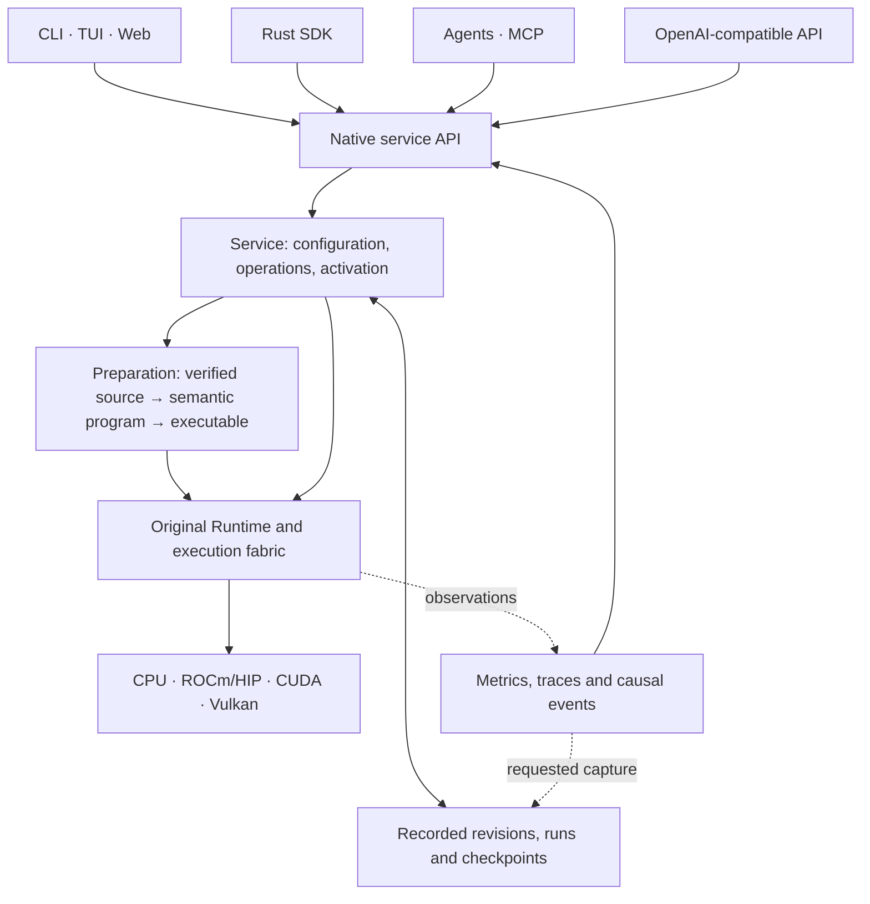

Author: Project owner
Co-authors: GPT-6 Astra Pro; GPT-6.1 Sol (independent architecture, SDK and MCP review)
Owner: @pvl
Status: Accepted design direction; UX-11D accepted and provider discovery landed; foundation API/protocol contracts specified
Date: 28 November 2026 (Asia/Singapore)

# ZeroGravity — programmable service and execution stack

## 1. Product direction

**ZeroGravity — The fully programmable, blazingly fast inference stack.**

The product contract is a simple inference SDK backed by an inspectable, programmable native stack. People and agents can use the same service to acquire models, run and serve them, inspect execution, derive alternatives, test kernels and policies, activate revisions, and preserve work for later continuation.

Programmability belongs in native typed contracts. MCP is a first-class adapter to those contracts. The agent decides what to change; prepared native code performs inference. No LLM call, JSON serialization, dynamic global lookup, or management round trip belongs in a kernel/token hot path.

The principal redesign is to make the existing application host reusable outside the CLI, then add explicit revision and experiment lifecycles around the original runtime. Preserve the mathematical engine, scheduler, original source readers, ResourceArbiter, physical completion/quarantine and per-session StateRoot authority.

**28 Nov composition extension:** task pipelines, model definitions and deep execution mappings are first-class authoring surfaces in both SDK and MCP. Agents can build supported models from reusable primitives, inspect semantic-to-kernel provenance, derive chain/fusion candidates and tune finite execution policies from actual workloads. See [composition and adaptive execution](COMPOSITION_AND_ADAPTIVE_EXECUTION.md) for the complete authoring contracts and examples; this extends the lifecycle design below without another inference runtime or canonical IR.

This document records the accepted design direction; implementation has not started for this plan. [API and protocol contracts](API_AND_PROTOCOLS.md) is the authoritative target surface for SDK operations, typed authoring, native attachment and MCP. It also records Rust performance/reuse and proportionate validation rules. API names and examples below are target interfaces, not claims that they compile today. No new numerical, performance, model, backend, persistence or isolation support follows from this proposal.

## 2. Source audit and starting point

Inspected checkout: `/home/pvl/spaces/abird/src/zerogravity`, `main` at `6986470e46c1cc5d0ac4601dc9163cf041d73e7b`, including an uncommitted UX-11C logging/error working set. Source references describe that inspection. Dirty work was read without being changed or accepted.

| Existing boundary | Evidence, relative to the repository | Implication |
| --- | --- | --- |
| One public Runtime and shared control state | `crates/zerogravity/src/runtime.rs`, Runtime/RuntimeBuilder/control | Keep this execution composition root; clones share the original engine/control state. |
| Typed native ControlPlane | `crates/zerogravity/src/control.rs`, ControlPlane/ControlAction/RegisteredModel/ServeBinding | Existing actions and identity guards are the common foundation. A borrowed native action is not a wire ABI. |
| CLI-private application host | `crates/zerogravity-cli/src/control_host.rs`, Selection/runtime/retire; `control_host/actions.rs` | Shared configuration, management workers and shutdown need a reusable service home. |
| CLI-private source/resident preparation | `crates/zerogravity-cli/src/resident.rs`, prepare/prepare_routes; `run_cli/source.rs` | Extracting control_host alone would leave SDK policy dependent on CLI internals. |
| TUI and Web sharing | `crates/zerogravity-cli/src/tui.rs` and `web.rs`, Host::start/close and standalone bootstrap | Two presentations already share a runtime. Ordinary bootstrap still owns the local runtime; general attach-or-embed is new work. |
| Limited browser wire | `crates/zerogravity-cli/src/web/wire.rs`, `web/actions.rs`, `web/http.rs` | Reuse typed service behavior and authentication principles; do not expose private native objects by serializing the browser projection. |
| Public SDK | `crates/zerogravity/examples/fabric_sdk.rs`; facade runtime and model APIs | Core capabilities exist; ordinary pull/load/run still require substantial caller orchestration. |
| Cold atomic preparation | `crates/zerogravity-engine/src/runtime.rs`, configure_text_with | Router/plan publish together from Empty. Configured/loading currently refuses; live replacement is new work. |
| Prepared program/executable seams | `crates/zerogravity-core/src/model.rs`; `crates/zerogravity-engine/src/prepare.rs` and `executable.rs` | Reuse ModelProgram/ForwardPlan and original executable owners. Digests do not substitute for source issuer and live plan binding. |
| Exact pipeline stage bindings | `crates/zerogravity-engine/src/pipeline.rs` | Stages bind registration IDs, but all future stages are not already retained/admitted for live replacement. |
| Original state and physical resource owners | `crates/zerogravity-core/src/session_root.rs` and `resource_arbiter.rs` | Activation cannot publish neural state. The current process_shared arbiter is process-local, not an IPC resource broker. |
| Metrics and transient events | `crates/zerogravity-engine/src/router/performance.rs`; `crates/zerogravity/src/control/events.rs` | Reuse current registration counters; transient invalidation rings are not a durable experiment history. |
| Operational logging | Current `crates/zerogravity-cli/src/output/operational.rs` and subtree | Reconcile UX-11C first, then move appropriate ownership. This in-progress work is not discarded or represented as fully accepted. |
| Checkpoint support | `crates/zerogravity-model-qwen35/src/checkpoint/committed.rs`; `crates/zerogravity-gpu/src/resident_inference/resident_text/checkpoint.rs` | Existing production restore is bounded by source, backend and layout. A general job/session resume layer remains to be built. |

A clear internal execution/control split exists today. A complete reusable service versus frontend/process split does not yet exist. Native MCP and an ordinary daemon/remote native control client are proposed additions.

## 3. Architecture



The diagram expresses responsibility, not mandatory serialization or an extra queue. Embedded SDK calls reach the service directly. Ordinary inference continues through the existing Runtime/scheduler. The service's operation supervision handles control work; it never schedules token steps alongside a second inference scheduler.

Preserve three distinct stages:

1. **Source ingestion:** authenticated weights, metadata, tokenizer/processor, configuration and immutable source identity.
2. **Semantic program:** the existing ModelProgram/ForwardPlan and typed task/region/state-effect contracts.
3. **Executable preparation:** native operators, mature operator libraries, captured command sequences, or optionally provider-compiled regions.

No second canonical IR is introduced. MIGraphX/TensorRT-style providers remain region implementations with actual admitted workspaces and synchronization. They are distinct from CPU/HIP/CUDA/Vulkan device backends. Their concrete integrations retain the existing later-phase status.

Preparation exposes the decisions agents need: selected implementation, supported shapes, exact numerical contract, source and state dependencies, estimated/observed resources, compilation artifacts, actual placement and rejection reasons. Metadata inspection alone cannot grant execution rights.

## 4. Service, process and client ownership

### 4.1 Public boundaries

- **Runtime:** existing advanced execution library. Owns the existing engine/catalog/scheduling/state/resource mechanisms.
- **Service:** non-cloneable application owner. Contains one Runtime, effective configuration, control-operation supervision, route activation, recording, operational sinks and listener ownership.
- **Client:** cheap cloneable handle to the same typed service API, either direct in-process or through an authenticated transport.
- **Protocol/UI adapters:** CLI, TUI, Web, native control wire, MCP and OpenAI-compatible inference projection.

The service is usable without opening any socket or starting any UI. An embedded Client uses direct calls/channels, with no localhost HTTP or serialization requirement. The native wire uses owned, versioned request/response DTOs translated to existing native operations; do not add Deserialize to borrowed ControlAction.

Service owns lifecycle policy, not every lower-layer cleanup mechanism. Each existing model, allocator, queue, captured graph and session authority retains its own original ownership.

### 4.2 One binary can have several process modes

| Invocation, proposed | Meaning |
| --- | --- |
| `zerogravity daemon` | Foreground headless service, suitable for systemd; explicit stable local control endpoint. |
| `zerogravity tui` / `zerogravity web` | Attach to the selected local service, or embed the same service in this process if absence is established. |
| `zerogravity tui --embedded` | Explicit independent embedded service; no automatic attachment. |
| `zerogravity tui --connect <endpoint>` | Explicit attachment; connection failures are reported. |
| `zerogravity mcp --stdio` | Thin MCP adapter; attach to the selected service or explicitly host embedded service. |
| `zerogravity run <model> ...` | Convenient request through selected local/embedded ownership policy. |
| `zerogravity serve <model> ...` | Start an inference listener through the same service; standalone embedded invocation retains foreground ownership. |

A `zerogravityd` executable may later be a thin alternative entry point. A second implementation or packaging split is unnecessary to establish the boundary.

Auto bootstrap discovers a service by a user/instance-scoped endpoint and identity under the existing XDG namespace. It serializes probe-and-create using an ownership lock. Only verified absence permits embedded fallback. Authentication failure, version mismatch, a busy endpoint or an unresponsive live owner does not cause a hidden second runtime. Explicit isolated instances have distinct names and budgets. Names/caps do not coordinate physical capacity: concurrent ZeroGravity hosts sharing a device require parent-authoritative resource envelopes, or disjoint devices. This cross-process mechanism is new work; until it exists, overlapping independently owned instances must refuse coordinated sharing rather than each count the whole device.

Use HTTP/JSON and bounded SSE over a private Unix-domain socket for native local attachment, with the existing transport libraries. Keep authenticated HTTP projections for Web/MCP/remote clients; the [protocol contract](API_AND_PROTOCOLS.md#6-native-attachment-protocol-m2) defines their distinct responsibilities. A remote path refers to the service machine. Local inputs use explicit artifact upload/import rather than accidentally interpreting a laptop path on another host.

### 4.3 Lifetimes are explicit

| Object/event | Behavior |
| --- | --- |
| Drop/close an attached Client | Release that client's view/subscriptions; other clones and owned derived handles remain valid. Foreground cancellation follows its explicit run scope; service-owned work continues. |
| Drop a Model client handle | Release the client reference; do not unload any registration. Explicit unload checks registration identity. |
| Drop a new service Client listener handle | Stop observing. Explicit stop addresses its exact listener generation. |
| Quit attached TUI / close a browser | Disconnect. |
| Quit the process that owns an embedded Service | Follow an explicit stop/checkpoint policy, stop admission, cancel/join owned work and retire the Runtime. Other attached clients do not make that process immortal. |
| Service::shutdown().await | Reliable joined shutdown and reported cleanup errors. Drop may request shutdown but cannot promise completed async retirement or checkpoint durability. |

An embedded host does not silently become a daemon on UI exit. Persistent compute beyond that process requires an explicitly running daemon. Durable records and resumable checkpoints can outlive either mode.

The existing advanced scoped ServerHandle can retain its current listener-owning Drop semantics; the new Client handle must use the uniform remote-compatible service-owned contract.

Configuration has separate scopes: service defaults, immutable revision settings, per-request overrides, and client presentation preferences. A client selecting a view/profile does not silently reconfigure admitted work. Effective settings report their provenance.

### 4.4 Management concurrency

Extract the existing single management-worker behavior faithfully first. Add concurrent control operations only where concrete workloads need them: bounded compile slots, transfer slots and per-owner lifecycle serialization. Reads/subscriptions remain responsive. Inference concurrency stays with the existing scheduler.

Every resource-consuming compile, trace, trial and coexistence preparation is budgeted. Lowering a limit below currently held resources stops new admission/drains; it does not invent reclaimed memory.

## 5. Small common object model

Use the existing model/source/session identities, plus a small common vocabulary:

| Concept | Meaning |
| --- | --- |
| Artifact | Immutable source, kernel code/binary, input/reference, trace or result bytes; existing verified model artifacts remain canonical. |
| Revision | Immutable resolved recipe: model/program identity, component references, numerical policy, implementation choices, placement and execution policies; optional parent revision. |
| Prepared revision | A revision bound to the original target-specific prepared owners/ExecutableBundle. This is live ownership, not another serialized physical plan. |
| Operation | Accepted service-owned work such as pull, preparation, experiment, activation, restore or explicitly background inference. Ordinary foreground RunHandle/RunStream retain request-scoped lifetime over the original receipt; they do not require a durable operation record. |
| Checkpoint | Original committed neural state plus the task continuation needed for the declared resume scope. |
| Workspace/experiment | A named namespace grouping revisions, trials, artifacts, checkpoints and results. It is not another execution runtime. |

An activation is a generation-guarded mapping of route/pipeline names to prepared revisions. It can remain a small control-plane value rather than a separate deployment framework.

Keep identity dimensions explicit within these contracts:

- Artifact/content identity locates exact bytes.
- Semantic compatibility identifies equations, finite-precision rules and state meaning.
- Implementation identity identifies actual kernel/provider/ABI/compiler/options/target.
- Live identity identifies source issuer, preparation, registration, service/stream/allocation generation and session authority.

Changing an implementation need not change semantics if it satisfies the same qualified contract. Equal shapes or equal digests never grant state restore, live source rights or permission to replay a graph. Durable recipes are reauthenticated and re-prepared after restart.

A draft is editable; validation observes its exact version, freeze produces an immutable resolved revision, and preparation binds supported live execution. A convenience prepare builder can perform those steps explicitly under one request. Human YAML and typed Rust builders produce the same checked model. Avoid arbitrary patches to mutable runtime structs and a registry per layer.

## 6. Every layer is inspectable and programmable

| Layer | Agent/user can inspect | Agent/user can change | Activation boundary |
| --- | --- | --- | --- |
| Sources | Exact artifacts, config/tokenizer/processor, supported tasks, codecs and source eligibility | Source/version selection, explicit acquisition and qualified derived artifacts | New preparation; changed semantics normally require fresh state. |
| Task composition | Typed ports, stage graph, state/effect dependencies | Compose existing operators/models/pipelines and routes | Whole-task revision; generic DAG/media execution remains capability-bound. |
| Model semantics | Actual ForwardPlan, regions, state domains and numerical policy | Supported semantic/approximation choices; new definitions through real extensions | New revision; explicit migration or fresh session when state meaning changes. |
| Kernels/regions | Source, ABI, shapes, selected implementation, compiler output, costs | Replace an implementation, tile/fuse/select libraries, choose capture or compiled provider | Prepared candidate, validation, then supported activation. |
| Placement/memory | Actual layer/device map, residency, pools, transfers and retained resources | Device placement, qualified layouts, residency/prefetch/cache/pool strategies | New preparation or explicit drained/compatible boundary. |
| Scheduler/execution | Queues, batching/cohorts, deadlines, fairness, speculation and actual committed progress | Bounded policy settings or qualified strategy implementations | Defined scheduler boundary within admitted contracts; larger changes drain/reprepare. |
| State | Committed frontier, domains, compatibility and eligible checkpoints | Fork, checkpoint, restore or qualified migration | Original session-authority transaction. |
| Observation | Metrics, errors, traces and optional tensor samples | Select counters, sampling, tracing and bounded export | Immediate reader change or new instrumented preparation where required. |

New kernel artifacts implement an existing semantic/ABI contract and enter through existing preparation/provider seams. Supported source languages/binary formats are advertised capabilities, not assumed for every backend.

New Rust operator semantics, a new state schema, allocator logic or backend implementation can require a new engine build and controlled host replacement. Do not promise arbitrary Rust hotpatching or a stable Rust dylib ABI. Runtime-loadable extensions need an explicit validated artifact/ABI boundary; add one when a real consumer requires it.

Even lower-level programmability preserves hard invariants: source authentication, initialized ranges, bounds, admission, physical completion, quarantine and session publication are contracts that strategies must satisfy.

Retained useful dormant kernels/layouts/transfers are discoverable experiment candidates. A failed A/B for one shape or device removes a production selection, not the reusable primitive.

## 7. Live change lifecycle

### 7.1 Default policy

**New requests use the new activation. Already admitted work and persistent sessions keep their pinned revision.**

Resolve the route/pipeline activation once at admission. A multi-stage task retains its complete selected composition for the admitted scope; later stages must not silently resolve to a newer model. This requires extending existing stage-owner retention, not claiming it is already present. Retaining owner handles is separate from pre-admitting every stage's worst-case compute resources.

Prepared generations coexist inside the existing Runtime/registry and scheduling/admission architecture. A revision does not create a new Runtime or a second inference queue. Extend cold-only router publication to stage/register new prepared generations and swap their route bindings while the original owners retire old generations.

For an existing stateful session, the next turn normally continues its pinned semantics. A new HTTP request does not by itself make old KV/recurrent state compatible with a new implementation.

### 7.2 Change procedure

1. Read the active revision, capability descriptions, exact registration and activation generation.
2. Derive a candidate recipe; stage source/kernel artifacts without changing live owners.
3. Validate typed interfaces, source/numerical/state contracts, supported shape envelope and planned resource costs.
4. Prepare/compile off the serving hot path using admitted resources. Share compatible immutable weights only through existing verified owners.
5. Check affected kernels/regions against the correct independent contract; then validate representative model outputs and every relevant state domain.
6. Benchmark through ordinary runtime paths with the declared workload, measurement mode and limits.
7. Activate with the expected generation and explicit boundary. Validate all dependencies beforehand; swap one immutable binding snapshot with no fallible compilation/callback work inside the publication step.
8. Retire obsolete preparation through existing request/session/capture readers and actual physical completion.

The activation receipt reports requested/previous/new revision, actual generation, affected routes, chosen boundary and unresolved draining owners.

If old/new coexistence does not fit, return the actual resource shortfall or an explicit drain-and-reprepare plan with its interruption. Do not unload live work to make a seamless-update promise appear true.

### 7.3 Compatibility and state

A change can be:

- **Equivalent implementation:** same qualified semantics/state contract. Default future-request activation; optional committed-boundary switch only where the adapter actually supports it.
- **Compatible with conversion:** requires a qualified state bridge, admitted destination and complete private candidate.
- **Semantically different:** new session or explicit recomputation/migration with a declared changed numerical/quality contract.
- **Incompatible/unavailable:** refuse and return the required next step.

A mid-session migration pauses same-session admission, pins the old committed root at a supported frontier, and finishes or invalidates pending attempts while preserving their physical owners. It binds all state domains and task continuation, prepares the complete private candidate, performs the qualified conversion/recomputation, and waits for actual completion. Replacement publication through the original SessionAuthority advances the epoch, invalidating abandoned attempts. Conversion metadata is not proof of a working bridge.

**Route activation and StateRoot publication are different transactions.** The control plane selects future execution. The original session authority alone publishes complete state.

### 7.4 Capture, cache and rollback

Changes to code, ABI, compiler options, numerical profile, state/layout, shape band, stream, workspace allocation or execution-affecting instrumentation participate in preparation/capture compatibility. Existing exact source/service/stream/buffer/generation checks remain authoritative. Invalidating future selection does not destroy an old capture held by in-flight work.

Rollback rebinds future admission to a retained qualified revision. It does not rewind a session that already advanced under the new one. Reuse a still-live compatible prepared owner, or prepare the old recipe again. A historical digest cannot resurrect a process-local graph or source issuer.

Persist desired activation separately from observed live generation. A durable command/desired-state transaction precedes live publication; an acknowledged activation reports actual publication. A crash between them is reconciled idempotently after restart. No claim that disk publication and a GPU/route change form one global atomic transaction.

## 8. Native MCP

MCP exposes the same Client/service operations as Rust, CLI and Web. The [MCP projection](API_AND_PROTOCOLS.md#7-mcp-projection-m1) defines concrete tools, typed results and optional rmcp reuse; this section explains the design. It neither shells out to parse CLI text nor obtains raw mutable runtime pointers. OpenAI-compatible inference remains a narrower projection of the same native model/run semantics.

Use a bounded set of schema-defined tools, grouped by domain:

| Family | Proposed native operations, projected to MCP tools |
| --- | --- |
| Inspect | Runtime/model/program/region/device/capability inspection; effective configuration and decision explanation |
| Models | Pull, load, unload |
| Run and serve | Run, start listener, inspect/stop exact listener |
| Revisions | Derive/edit draft, validate/prepare, activate/rollback binding |
| Experiments | Submit a bounded trial/sweep, compare actual results |
| Operations | Get/list, wait through protocol support, cancel/pause where supported |
| Observation | Query metrics/events; obtain trace and artifact references |
| Continuation | Checkpoint, resume, fork, rerun |
| Artifacts | Import/upload bounded source and download/read bounded results |

Use distinct action names and typed payloads; avoid an unrestricted execute-string tool and hundreds of kernel-specific tools. Common revision/experiment operations accept different supported target kinds. Capability discovery returns actual availability, constraints and activation/resume support.

Mutating remote commands carry a stable command/idempotency key scoped to principal/service, and expected generation when updating a shared binding. Reusing a key with different arguments conflicts. Reconnection retrieves the same accepted operation rather than launching another download, trial or activation. Report accepted, running, cancellation requested, terminal result and physical retirement independently where they differ.

Large outputs are artifacts/resources. Tool results contain small structured summaries, identities, progress and links. Resources such as `zg://operations/<id>`, `zg://revisions/<id>` and `zg://artifacts/<id>` are identifiers resolved with caller authorization; possession of a URI does not confer access. Raw files/tensors/traces use bounded resource reads or an authenticated artifact endpoint.

### Protocol contract checked on 28 November 2026

The current official core is `2026-07-28`. It uses self-contained requests and per-request capability declarations. Tasks and Events are optional Beta extensions. Keep core-version/extension compatibility in the MCP adapter, independent from the native service schema and persisted format versions. See official sources below.

- Use stdio for agent-launched adapters and Streamable HTTP for shared/remote access. Keep stdout protocol-only; diagnostics use stderr/the service sinks.
- A negotiated Tasks projection can represent durable service operations. The task must be durably created before its handle is returned. Clients without Tasks receive a normal result containing OperationId and use ordinary get/cancel tools.
- Core resource-change notifications are invalidation hints; reconnect resnapshots authoritative state. They do not provide replayable raw metrics.
- Optional Events can project native run completion, validation failure, activation and threshold events. Replay depends on the underlying retained history and advertised per-event support. Gap/truncation information remains explicit.
- Detailed operational logs and raw telemetry remain native service contracts. MCP progress is not a general tracing stream.
- Transport cancellation is mapped deliberately. Cancelling an outstanding request before a durable job is accepted can cancel that request; disconnecting from an already accepted service-owned experiment does not cancel the experiment. Explicit operation cancellation reaches its original receipt.

Authorization is enforced by the service for every adapter. Distinguish observe, ordinary inference/model management, experiment/code execution and live activation. Grants can be scoped to workspace, model, device and resource/time budgets. Public inference credentials do not automatically grant kernel compilation or private diagnostic access. Existing browser-safe projections remain separate from trusted raw detail. Local endpoint permissions and remote origin/authentication checks remain explicit.

Agents may work autonomously inside the granted policy. Approval is a policy choice for sensitive activation, not a mandatory prompt for every kernel trial.

## 9. Live metrics, raw traces and errors

Expose measurements from their actual owners through one typed observation contract. Keep the current UI metric definitions; add distinct fields when a caller needs another timing boundary.

| Mode | Content | Cost/semantics |
| --- | --- | --- |
| Basic | Existing registration counters, queue/resource snapshots, request outcomes, TTFT/decode aggregates | Low bounded overhead; retain current timestamps/counters where possible. |
| Sampled | Periodic device/queue/residency samples, reported placement and available activity | Rate/interval explicit; asynchronous snapshots may be skewed. |
| Trace | Region/kernel dispatch, device event timing, transfers and spans | Opt-in, resource-budgeted and provider-capability-bound. |
| Capture | Selected input/output tensors or state slices, compiler reports, binary/source artifacts | Opt-in with explicit bounds, permissions, storage and synchronization costs. |

No universal zero-overhead per-layer timing promise. Layer lights are labelled as scheduled, submitted, completed or sampled activity, according to actual evidence. Static layer placement is not live execution timing. Deep instrumentation may change execution/capture compatibility and must be identified in benchmark results.

Provide these distinct quantities:

- Current and lifetime-since-registration counters, with idle time defined.
- Per-request latency, service/engine TTFT, queue delay and end-to-end delivery where each boundary is measured.
- Aggregate committed output tokens per wall-clock interval.
- Token-weighted within-request decode intervals, preserving the current implementation's definition.
- Prefill/decode work, cohort sizes, accepted/rejected/cancelled requests and full offered-work denominator.
- Region/kernel/transfer durations where supported, including clock domain and overlap; do not sum overlapping durations as wall time.
- Actual resource reservations/residency, host/device IO and cache observations.

Unavailable measurements are unavailable, never zeros. GPU/device time and host monotonic time need explicit correlation if shown on one timeline. Do not claim exact per-kernel memory-bandwidth or occupancy without a supporting profiler capability.

A common event envelope contains schema version, service epoch, sequence/cursor, wall-clock timestamp, monotonic duration/time domain, operation/run/session/registration/revision IDs, event kind, units and typed payload. Ordering is defined per stream; cross-device order follows measured dependency/correlation, not timestamp guesswork.

Three stores have different jobs:

1. Existing transient invalidation ring: refresh UI/control snapshots on change or lag.
2. Durable operation/terminal records and operational logs: causal state/outcomes retained according to policy.
3. Optional raw trace/metric chunks: bounded capture for selected runs/experiments.

Slow consumers cannot stall inference. Samples may coalesce/drop with explicit loss counters. Terminal outcomes remain queryable from operation state. A capture declared lossless reserves storage/capacity and either applies explicitly accepted experiment backpressure or fails visibly when it cannot retain the stream. Never quietly drop data while labelling a trace complete. A sink failure is observable; durability failure prevents a durable acknowledgement.

Continue UX-11C destination policy: one-off CLI diagnostics on stderr, interactive embedded hosts in private XDG session logs, daemon/foreground serving on timestamped line-oriented stderr for journald, with explicit file overrides. Clients subscribe to the same service events; adding a UI/MCP connection does not create another authoritative log.

Preserve typed causal chains, stage and resource requested/available fields end to end. Public errors expose safe code/message/correlation; trusted views can read authorized detailed causes. Raw performance visibility does not imply automatic prompt, token, tensor or secret logging.

## 10. Experiments, isolation and activation evidence

An experiment is a durable recipe executed through ordinary native preparation/run APIs:

- Base/candidate revision and exact kernel/provider artifacts.
- Actual source, numerical contract and supported shape scope.
- Workload/input or immutable authorized reference.
- Device/provider/compiler environment and resource budget.
- Correctness comparison, warm-up, measured trials and observation mode.
- Results including refused, failed, cancelled and incomplete cases.

Use a kernel/region check to localize a candidate, then an actual affected model/task workload to assess improvement. Compare source semantics, relevant full outputs/state and meaningful end-to-end performance. Keep compile time, cold start, steady-state throughput, memory and tail latency distinct. Benchmark failure cannot promote a candidate. Correctness acceptance is bounded to the validated contract/scope; it is not a claim that arbitrary code is proven safe.

Generalize the existing diagnostic/benchmark machinery only at real reusable boundaries. Keep reference orchestration in diagnostic/test support; production run/load paths do not depend on fixture whitelists. Retain useful unsuccessful primitives with zero production consumers.

### Kernel execution boundaries

Qualified trusted variants can initially use existing in-process engine/physical owners. New arbitrary native kernels run in a separate experimental host address space/context. Compilation itself is bounded and isolated from live service state.

The current ResourceArbiter is process-local. A child calling process_shared() would create another authority; this is insufficient. Before shared-device child experiments, implement a parent-issued device/provider/resource envelope and IPC admission/retirement contract, grounded in the original arbiter. Child allocation is bounded suballocation within that admitted envelope. It cannot independently claim the same global capacity.

Parent ownership lasts until real physical retirement. Timeout, heartbeat loss, logical cancellation or process death alone cannot return submitted/unknown resources. Device/context health and quarantine remain explicit. Process isolation is not universal GPU fault isolation; a hung shared driver/device may affect serving. Initial arbitrary-kernel execution uses an exclusive experimental device or explicit maintenance interval when necessary. Stronger isolation is an advertised capability, not a claim attached to the word sandbox.

The worker uses the same engine implementation and contracts. It is an isolation boundary, not a second model implementation or an independent scheduler for the same live session. Cross-process state/weight sharing is explicit and admitted; it is not assumed to be zero-copy.

## 11. Persistence, continuation and reproducibility

Durable recording is the default for named experiments and requested checkpoints. Ordinary one-off inference remains ephemeral unless recording is selected. Basic counters and operational diagnostics do not automatically persist prompts or outputs.

| User action | Precise behavior |
| --- | --- |
| Reattach | Observe an existing service-owned operation; compute continues in the same host. |
| Continue | Advance the same session/experiment according to its pinned revision and current committed frontier. |
| Resume | Restore a qualified committed checkpoint after stop/restart, or continue remaining completed/queued trials according to recorded state. |
| Rerun | Create a new attempt from the recorded resolved recipe; preserve lineage and report environmental differences. |
| Fork | Create an independent experiment/revision or a new session from a compatible committed snapshot. |
| Roll back | Restore future route selection; already committed sessions require their own explicit continuation/migration decision. |

Persist a small versioned manifest and operation state plus immutable artifacts. Reuse existing content/cache/checkpoint primitives; use a small transactional service index for searchable commands, attempts and desired activation only if needed by the concrete concurrency contract. Do not persist/replay every allocator transition or duplicate model weights into each experiment.

A recorded run includes resolved sources/program/numerics/kernel code and compiler identity, actual device/runtime environment, input/reference and seed policy, workload, warm/cold state, profiling mode, result and checkpoint lineage. A full resumable task checkpoint also records input cursor, emitted/consumed frontier, committed output sequence, required task/pipeline continuation, sampler/RNG state and all semantic state domains. Existing neural checkpoint formats do not already cover that entire promise.

Publish artifacts privately with integrity/size checks and the original atomic durable publication primitives before referencing them as durable. Acknowledgements distinguish durable from visibility-only/unknown durability. Store retention is bounded; live references, pinned revisions and requested checkpoints prevent unsafe deletion. Explicitly report expired/unavailable trace history.

On restart:

1. Read durable operation/desired-state records.
2. Mark lost live attempts interrupted or completion-unknown.
3. Reconcile prior device-owner/envelope epochs and clean-retirement records with the supervisor/backend. Require trusted proof of physical retirement before new admission on an affected domain; otherwise retain its unavailable/quarantined state. Process death, elapsed time and a superficial health probe do not recreate resource credit. Durable/shared hosts retain these coarse lifetime records, not a journal of every GPU instruction.
4. Reauthenticate exact artifacts and re-prepare fresh owners on eligible domains.
5. Restore only compatible, qualified checkpoints through the original state authority.
6. Resume eligible work or report a concrete restart requirement.
7. Reconcile desired and actual route activation, preserving command identity.

GPU events, pointers, compiled module handles and physical leases are never restored from disk. A recorded recipe is not proof that a live device remained healthy.

Reproducibility levels are explicit:

- **Same setup:** exact recipe/artifacts/inputs with environment differences shown.
- **Equivalent semantics:** declared numerical and state contract met.
- **Exact output/state replay:** only where target, implementation, scheduling/RNG and determinism are qualified.
- **Performance comparison:** measured comparable conditions, never a promise of identical timing.

A seed alone does not fix batching, reduction order, provider choices, adaptive scheduling or competing workloads.

## 12. SDK target

Use one convenient Client API over embedded or attached service. [Public SDK contracts](API_AND_PROTOCOLS.md#3-public-sdk) defines the builders, input/results, reference scopes and exact run/stream/cancel semantics; examples here show the intended experience. Preserve advanced Runtime and provider interfaces for users who need them. Async and blocking facades use the same operations; the engine does not require Tokio policy. Async waits use wakeable bounded service channels, not blocking OutputStream::next() on an async executor thread or a busy-poll loop.

### Pull, load and run

Proposed API, inside an async application:

```rust
use zerogravity::Service;

let service = Service::embedded().await?;
let zg = service.client();

let source = zg.pull("catalog:qwen3.5-0.8b").await?;
let model = zg.load(source).await?;
let answer = model.run("Explain speculative decoding.").await?;

println!("{}", answer.text());
service.shutdown().await?;
```

Pull means explicit acquisition and verified artifact publication. Load means source eligibility, preparation and resource admission. It accepts an AcquiredSource, local path or an existing cache/catalog selector. AcquiredSource retains exact acquisition identity/receipt and is distinct from discovery::Source configuration. Load does not silently acquire missing weights. An explicitly selected auto-acquire policy may offer that convenience.

Names in examples are catalog selectors, not immutable source identities. Pull/load return the actual selected digest and effective preparation. Local-only input is just:

```rust
let model = zg.load("./models/model.gguf").await?;
let answer = model.run("Hello").await?;
```

In real applications, await service shutdown on error paths as well. A small structured-scope helper may encapsulate that cleanup later; do not pretend Drop proves durable or physical retirement.

### Attach to a running service

```rust
use zerogravity::Client;

let zg = Client::connect_local().await?;
let model = zg.load("catalog:qwen3.5-0.8b").await?;
println!("{}", model.run("Hello").await?.text());

zg.close().await?; // disconnects this client
```

The service remains alive. Client::connect(endpoint) supports explicit remote attachment. Service::embedded() always embeds; auto discovery belongs in CLI/UI bootstrap. Client clones share transport resources, but close releases only that client view; existing derived handles retain their own valid references. Load reuses a registration only when the immutable source and effective load policy match. Otherwise it returns a typed conflict or creates a separately admitted registration where supported; it never replaces active work implicitly.

### Stream and control execution

```rust
let mut stream = model
    .run("Explain Rust ownership.")
    .max_tokens(256)
    .stream()
    .await?;

while let Some(event) = stream.try_next().await? {
    if let Some(text) = event.text_delta() {
        print!("{text}");
    }
}
let result = stream.result().await?;
println!("{:?}", result.usage());
```

Stream EOF retains the actual terminal RunResult for stream.result(); called earlier, result drains the same original receiver. It never resubmits work or waits behind its own unread bounded events. EOF without a terminal outcome is an error; cancellation acknowledgement remains distinct from observed outcome and physical retirement.

Plain run(...).await returns a terminal RunResult, not merely an acceptance receipt. Advanced callers use run(...).start().await for a RunHandle, then handle.result().await or handle.cancel().await. A RunResult contains finish reason, usage, identity and observed revision; length-limited output remains explicitly length-limited.

Choose lifetime in the operation contract: ordinary foreground requests can be request-scoped; explicit background jobs/experiments are service-owned. Closing a streaming receiver cannot accidentally decide a durable job's lifetime.

### Serve the same loaded model

```rust
let listener = zg
    .serve(&model)
    .openai()
    .bind("127.0.0.1:8000")
    .start()
    .await?;

println!("{}", listener.address());
listener.wait().await?;
```

This shares the original registration, memory and scheduler, enforcing the exact exposed model/route set in the original serving owner. Default binding is loopback. Listener stop addresses its exact generation. Application signal handling remains the application's responsibility; the CLI supplies normal signal integration.

### Opt into placement and limits

```rust
let model = zg
    .load("catalog:qwen3.5-0.8b")
    .backend(Backend::Rocm)
    .device("pci:0000:03:00.0")
    .context(8192)
    .await?;
```

Ordinary calls use explicit documented Auto policy. A selected backend/device is a requirement, not permission to silently substitute after failure. Observe requested and effective placement. Unsupported/insufficient-capacity choices return typed actionable failures.

### Inspect, derive, compare and activate

```rust
let active = zg.revisions().active("assistant").await?;
let baseline = active.prepared();
let program = model.program().await?;
let norm = program.region(norm_region_id)?;

let candidate = zg.revisions()
    .derive(model.mapping_revision())
    .map_region(&norm, &implementation_recipe)
    .prepare()
    .await?;

let report = zg.experiments()
    .compare(&baseline, &candidate)
    .workload(workload_artifact)
    .acceptance(service_objectives)
    .budget(study_budget)
    .check_inherited_contract()
    .record("rms-norm-tuning")
    .run()
    .await?;

if report.accepts(candidate.reference())? {
    zg.activate("assistant", &candidate)
        .if_generation(active.generation())
        .for_new_requests()
        .await?;
}
```

Region identity comes from inspection of the exact semantic revision; mapping_revision identifies its implementation recipe. The local derive builder records a base reference and edits, resolving that exact base at awaited submission. active() returns an observed binding generation/prepared reference, not a mutable deployment owner.

The recorded workload and acceptance objectives define the tested scope and any required gain. No qualifying result leaves the binding unchanged; Service still checks grants, qualification, exact owners and coexistence before activation.

### Resume or repeat recorded work

```rust
let experiment = zg.experiments().open("rms-norm-tuning").await?;
let resumed = experiment.resume().await?;
let repeated = experiment.rerun().await?;
```

These return typed operation handles and report whether they continue a trial, restore an eligible checkpoint or start a fresh attempt. Use the same method shapes through `zerogravity::blocking` without await. Do not construct a new async runtime for every blocking call.

## 13. Code organization and migration

Start with modules in the existing facade rather than a crate per concept:

| Home | Responsibility |
| --- | --- |
| `zerogravity::service` | Application owner, shared preparation/acquisition orchestration, operation lifecycle, activation, recording and sink policy |
| `zerogravity::client` | Common convenient handle and request/result builders; direct/remote transports |
| `zerogravity::blocking` | Synchronous facade over the same operations |
| MCP adapter module/optional dependency | Protocol mapping, schemas and supported version/extension behavior |
| Existing core/engine/artifacts/model/backend crates | Existing semantic, physical, state and source authority |
| Existing serving crate | OpenAI/inference wire adapter |
| CLI | argv, terminal interaction, presentation, entrypoints, process signals and attach-or-embed bootstrap |
| Web | Browser presentation and safe authenticated transport projection |

A service crate depending on the facade while the facade reexports that service would create a dependency cycle. Extract a new crate only for a concrete acyclic build/dependency boundary. Keep MCP/Web dependencies optional for embedded library consumers. Preserve existing product-default backend/features policy.

Extract source selection, acquisition intent, resident preparation and effective configuration together with the host. Leaving those policies in CLI would produce a superficially public service with hidden frontend dependencies.

Keep model decisions in model-owned adapters and physical operations in backends. The service coordinates typed contracts; it does not accumulate backend-specific branches.

## 14. Delivery units and acceptance

**28 Nov scheduling decision:** UX-11D is accepted and provider discovery landed; complete the shared PS-F1/F2/F3 foundations after coordinating current source ownership. After their bounded exit, ROCm parity, CUDA parity, SDK-hosted MCP/native attachment and capability development proceed in independent lanes.

See [implementation phases and parallel dependencies](IMPLEMENTATION_PHASES.md) and [the live checklist](TODO.md). They replace the earlier serial sequence; full MCP, generalized composition, tuning, checkpoint expansion and arbitrary-code isolation do not gate backend parity.

The foundation block delivers the reusable Service/Client and simple SDK, checked native task/model/mapping contracts, minimal durable operations/observations, native authorization, actual bounded live registration/activation and complete admitted ownership. Existing supported consumers prove these contracts. SDK adapter contracts are established before the MCP implementation; the optional MCP host then consumes Client directly without CLI dependence.

Later lanes add task/model authoring, deeper mapping, experiments/policies, qualified continuation and isolated extension through those same native APIs. Each lane has a concrete end-to-end exit and only its actual dependencies. The shared integration owner coordinates common contract changes while backend-specific work remains independent.

Implement in substantial end-to-end units. Minimal acceptance scenarios:

- Same source/run produces the same supported behavior through embedded SDK, native CLI/TUI/Web, attached native client and MCP.
- Client disconnect preserves service-owned work; embedded owner exit joins/retire semantics remain visible.
- Two agents changing the same activation cannot overwrite each other silently.
- Live revision change cannot mix a multi-stage task or persistent session across incompatible revisions.
- Old captures/buffers/readers survive until their original physical retirement; unknown completion stays quarantined.
- Candidate preparation failure or insufficient coexistence capacity leaves the current activation usable.
- A restart recovers exact durable commands and eligible checkpoints without fabricating completion or repeating an idempotent mutation. Cover crashes before/after live activation publication and before the terminal receipt.
- Lost submitted worker work cannot lose its physical fence on restart; migration racing a pending attempt and rollback after session advancement preserve original state/physical authority.
- A slow telemetry subscriber does not stall ordinary inference; gaps/sink failures and unavailable data are explicit.
- Kernel trial correctness failures cannot become live selections; full offered workload and actual performance outcomes remain visible.
- Existing source/numerical/state/physical gates remain mandatory for affected implementation. Documentation work itself does not require GPU execution or a full build.

## References

### Existing project contracts

- [Structure and naming](../pipeline-composition/STRUCTURE_AND_NAMING.md)
- [Shared execution architecture](../pipeline-composition/SHARED_EXECUTION_ARCHITECTURE.md)
- [Regions and profiles](../pipeline-composition/REGIONS_AND_PROFILES.md)
- [Profile policy and component reuse](../pipeline-composition/PROFILE_POLICY_AND_COMPONENT_REUSE.md)
- [Full implementation plan](../FULL_IMPLEMENTATION_PLAN.md)
- [Live model performance](../cli-ux/LIVE_MODEL_PERFORMANCE.md)
- [UX-11 and durable operational logging](../cli-ux/TUI_POLISH_AND_MOUSE_INTERACTION.md)
- [Correctness policy](../numerics-and-context/CORRECTNESS_POLICY.md)
- [API and protocol contracts](API_AND_PROTOCOLS.md)
- [Foundation phases and parallel implementation](IMPLEMENTATION_PHASES.md)
- [README positioning and SDK preview proposal](README_PROPOSAL.md)
- [This proposal's implementation checklist](TODO.md)

### Official MCP sources checked on 28 November 2026

- [Current core specification](https://modelcontextprotocol.io/specification/2026-07-28)
- [Tools and structured results](https://modelcontextprotocol.io/specification/2026-07-28/server/tools)
- [stdio](https://modelcontextprotocol.io/specification/2026-07-28/basic/transports/stdio)
- [Streamable HTTP](https://modelcontextprotocol.io/specification/2026-07-28/basic/transports/streamable-http)
- [Published Tasks extension](https://tasks.extensions.modelcontextprotocol.io/specification/2026-07-28/tasks)
- [Official extension lifecycle/status](https://modelcontextprotocol.io/extensions/overview)
- [Events extension and replay limitations](https://modelcontextprotocol.io/extensions/events/overview)
