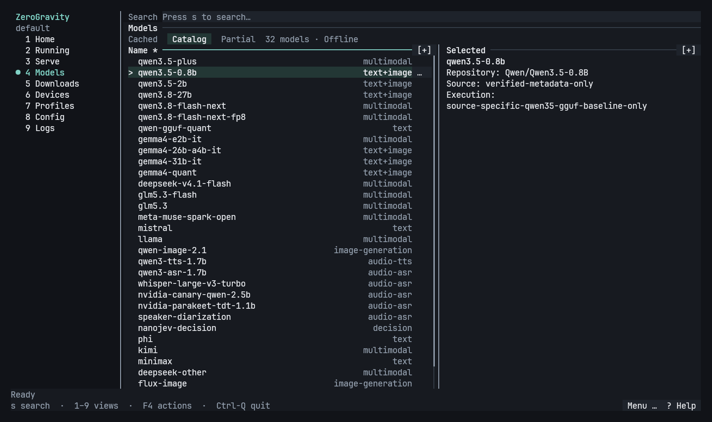
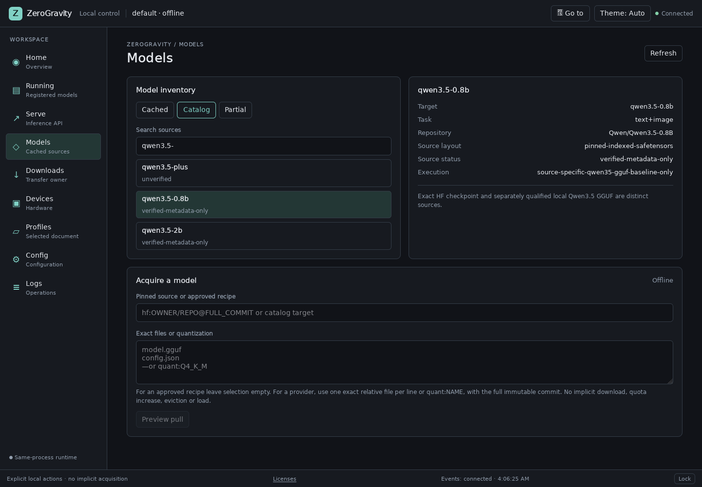

# zerogravity

**The fully programmable, blazingly fast inference stack.**

Run models from the terminal or with a few lines of Rust. Compose pipelines,
inspect execution, and change how inference runs—live, from model definitions
to the kernels beneath them.

## Quick start

Use the `zerogravity` executable on your PATH. The first prebuilt release is
pending; [install from source](docs/DEVELOPMENT.md#install-the-cli) for now.

Run a local **Qwen3.5 0.8B or 2B GGUF** with its matching `config.json` and
`tokenizer.json` alongside it:

```sh
zerogravity run ./model.gguf "Explain Rust ownership." --backend cpu
zerogravity inspect ./model.gguf
```

Or open an interactive interface:

```sh
zerogravity       # Terminal UI
zerogravity web   # Open the private URL printed in the terminal
```

Each interface runs in the foreground. See the [CLI guide](docs/CLI.md) for
cached models, acquisition, device selection and serving, or the
[OpenAI-compatible API guide](docs/OPENAI.md) for application integration.
Available backends and commands depend on the installed build.

## SDK at a glance

> **API preview:** the SDK and live-programming examples below describe the planned
> Service/Client API; they are not runnable against the current SDK.
> See [Quick start](#quick-start) for current commands.

```rust
use zerogravity::Service;

let service = Service::embedded().await?;
let zg = service.client();
let source = zg.pull("catalog:qwen3.5-0.8b").await?;
let model = zg.load(source).await?;

println!("{}", model.run("Explain Rust ownership.").await?.text());
service.shutdown().await?;
```

Load local files or pull a model into the cache. Stream responses or serve the
same model through an OpenAI-compatible endpoint. Applications also join shutdown
on error paths.

### Program the running stack

Inspect a running model, try another implementation, and measure it against a
representative workload. Activate a passing revision for new requests while
admitted tasks and sessions keep their original revision.

This separate example uses a client connected to an active `assistant` route.
`region_id` comes from inspection; `fused_mapping` is a supported implementation
recipe; `workload` includes the inputs and comparison requirements.

```rust
let base = zg.revisions().active("assistant").await?;
let region = base.program().region(region_id)?;
let candidate = zg.revisions().derive(&base)
    .map_region(&region, &fused_mapping)
    .prepare().await?;

let report = zg.experiments().compare(&base, &candidate)
    .workload(workload)
    .check_inherited_contract()
    .record("kernel-comparison").run().await?;
report.require_acceptable()?;

zg.activate("assistant", &candidate)
    .if_generation(base.activation_generation())
    .for_new_requests().await?;
```

The report must satisfy declared numerical/state checks and workload performance
requirements before activation. The experiment keeps its recipe and results so
you can reopen, rerun, and iterate. **The planned MCP adapter exposes the same
native operations to agents.**

### Deep execution pipelines

Choose how an inspected mathematical region executes: bind a kernel chain or
request a fused implementation from a provider supporting the same contract.

**API preview.** These excerpts assume a live `zg` client and loaded `model`.
`norm_region_id` and the kernel handles come from supported inspection and
implementation discovery.

```rust
let program = model.program().await?;
let norm = program.region(norm_region_id)?;

let fused_mapping = zg.implementations().for_region(&norm)
    .fuse()
    .backend(Backend::Rocm)
    .compile().await?;

let fused_candidate = zg.revisions().derive(model.revision())
    .map_region(&norm, &fused_mapping)
    .prepare().await?;
```

<details>
<summary>Build an explicit RMS kernel chain</summary>

Typed bindings connect the region's inputs, parameters and attributes to supported
kernel ports. The reduction produces the inverse RMS used by the application step.

```rust
let chain = zg.implementations().for_region(&norm)
    .chain()
    .step("reduce", rms_reduce_kernel)?
    .step("apply", rms_apply_kernel)?
    .bind(bindings! {
        "reduce.x"   <- norm.input("x")?,
        "reduce.eps" <- norm.attribute("epsilon")?,
        "apply.x"    <- norm.input("x")?,
        "apply.inv"  <- output("reduce", "inverse_rms"),
        "apply.w"    <- norm.parameter("weight")?,
        norm.output("y")? <- output("apply", "y"),
    })?
    .finish()?;

let chain_candidate = zg.revisions().derive(model.revision())
    .map_region(&norm, &chain)
    .prepare().await?;
```

The binding macro is illustrative authoring syntax over typed port references.
RMS epsilon remains a fixed semantic attribute.

</details>

Compilation and chain construction produce recipes. Preparation checks target,
bindings and resource ownership; the comparison workflow above determines
whether a candidate should become active.

This RMS example compares physical implementations of one mathematical operation.
Larger supported regions can fuse several operations while preserving their
outputs, numerical rules and state effects. Command capture reuses a sequence
and may still contain many kernels.

[Explore task pipelines, model authoring, chains, fusion and placement](.agents/plans/programmable-service/COMPOSITION_AND_ADAPTIVE_EXECUTION.md).

## CLI and Web

Native terminal and browser interfaces, captured from development builds.
Open either image for a full-size view.

| Terminal UI | Web UI |
| :---: | :---: |
|  |  |

## Architecture


This section describes the target architecture; [current support](#implementation-status-and-roadmap)
is tracked separately.

**One service, one execution fabric.** CLI, TUI, Web, Rust SDK and MCP use the same
native operations. Typed task pipelines and source-bound model programs map to
prepared kernels, libraries and device execution.

The service owns lifecycle and revisions. The execution fabric owns scheduling,
session state, physical resources and actual device completion. Run embedded or
attach to an existing service; choose implementations within the model's
declared numerical and state contract.

**Define a model once.** Original Hugging Face checkpoints (Safetensors) and
GGUF feed source-bound model definitions. Native operators and optional compiled
providers lower the semantic program into prepared execution. ONNX remains an
optional import path.

## Implementation status and roadmap

**Available today:** native Rust text inference, CLI/TUI/Web controls, and
supported OpenAI-compatible text serving. Model, source and accelerator support
is qualified for specific paths and devices; optimized backend parity remains
in progress.

The Service/Client SDK, live programming and MCP examples above are previews.
Broader model/media support, distributed execution and optional compiled
providers retain their own qualification scope.

**Next:** finish UX-11D acceptance, complete the shared service/SDK foundations,
then advance ROCm, CUDA, MCP and composition in parallel. Vulkan and optional
compiled providers follow the same contracts.

[Implementation phases](.agents/plans/programmable-service/IMPLEMENTATION_PHASES.md) ·
[Full plan](.agents/plans/FULL_IMPLEMENTATION_PLAN.md) ·
[Current baseline](.agents/docs/CURRENT_BASELINE.md) ·
[Current status](.agents/docs/CURRENT_HANDOFF.md)

## Engineering

- [Service, SDK and MCP design](.agents/plans/programmable-service/README.md)
- [Composition and adaptive execution](.agents/plans/programmable-service/COMPOSITION_AND_ADAPTIVE_EXECUTION.md)
- [Joint serving and optimization](.agents/docs/JOINT_CONCURRENT_SERVING_OPTIMIZATION_AND_GOODPUT_CONTRACT_2026-10-15.md)
- [Multimodal and real-time architecture](.agents/docs/UNIVERSAL_MULTIMODAL_EXECUTION_ARCHITECTURE_V5_1_2026-10-15.md)
- [Unified GPU/RAM/SSD residency](.agents/docs/UNIFIED_VIRTUAL_TENSOR_RESIDENCY_AND_SSD_STREAMING_2026-10-15.md)
- [Whitepaper](docs/WHITEPAPER.md) · [Engineering specification](docs/ENGINEERING_SPECIFICATION.md)
- [Build, releases, NixOS, and prior implementation details](.agents/research/README_PRE_PRODUCT_REWRITE_SNAPSHOT_2026-10-15.md)

## FAQ

**How are models defined?** Each model family supplies verified source semantics,
tensor encodings, task definitions and state requirements. Shared operators and
execution providers realize those definitions under one engine.

**Does it require a GPU or a Python inference engine?** No. The core is native
Rust and supports CPU execution; accelerator providers are optional. ZeroGravity
does not wrap a separate Python/C++ model-serving engine.

## Related projects

> **From scratch, informed by prior art.** No source from any prior-art project
> was copied or linked unless it is directly vendored (for example, CubeCL
> (vendored)) and therefore retains its upstream license. Zerogravity is an
> independent Rust rebuild that learns from the concepts, research and
> engineering of the projects acknowledged under [Related projects](#related-projects).

Zerogravity would not exist without the open-source inference and systems
community. We thank and acknowledge the following projects as inspiration and
prior art; their ideas, research and engineering shaped this work:

- **llama.cpp** — portable GGUF execution and the dead-simple local single-binary experience.
- **vLLM** — high-throughput serving, continuous batching and paged state.
- **SGLang** — structured program execution and prefix-aware cache reuse.
- **Ollama** — one-command local model UX and resident model management.
- **gufo** — model-family specialization, accelerator kernels and multimodal tasks.
- **strata** and **maya** — extreme model specialization and VRAM→RAM→SSD expert tiering.
- **CubeCL (vendored)** — the Rust GPU kernel IR, vendored with its upstream license.
- **pi** and **dwarfstar4** — agentic engineering and extreme-model execution research.

These names are acknowledged as inspiration and interoperability references only.
No source code from any prior-art project is copied or linked unless it is
directly vendored and retains its upstream license; Zerogravity is an
independent, from-scratch rebuild.

## Contributing

We build zerogravity in the open and would love your ideas, architectural
challenges, research, and focused improvements. See
[CONTRIBUTING.md](CONTRIBUTING.md) for the best ways to take part.

## AI disclosure

**Human-centric design. AI-centric implementation.** Zerogravity is built with
extensive AI assistance for research, code, tests, and documentation. We believe
the best software comes from human-led design and AI-assisted implementation:
humans own the architecture, priorities, and acceptance criteria, while AI helps
implement, test, and iterate. We don't hand direction to autonomous models or
claim every generated line is manually reviewed — correctness rests on explicit
designs, reproducible tests, and continuous validation.

## License

[MIT](https://github.com/abird-ai/zerogravity/blob/main/LICENSE) © 2026 Prasanna Loganathar and zerogravity contributors. Zerogravity-authored
text and software are MIT-licensed. Vendored third-party components (for example,
CubeCL) and other assets retain their respective upstream licenses. Model
weights, third-party libraries, and other assets retain their respective licenses.
